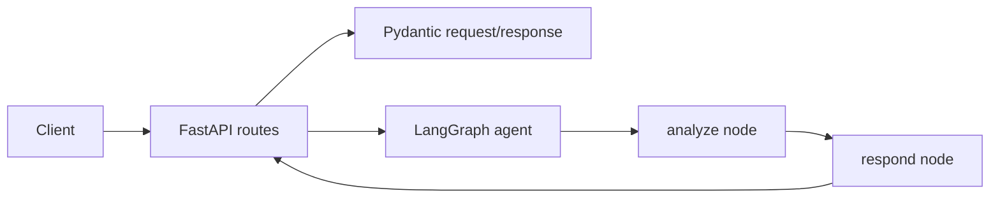

# Architecture

Status: current checkout baseline plus work-in-progress expansion, reviewed on 2026-09-30. The [GitHub issue and PR map](docs/work-in-progress.md) records branch work separately from this checkout.

## Implemented system

The current application is a single FastAPI process. It exposes a health route and mounts `/api/v1` routes. The chat route validates input with Pydantic and invokes a compiled LangGraph graph. The graph runs `analyze` and `respond` in sequence; both nodes generate example text. A conditional edge ends processing if state contains an error, but the example nodes do not currently set one.

| Component | Current source | Current responsibility |
|---|---|---|
| HTTP application | `src/main.py` | FastAPI setup, CORS, health route |
| API | `src/api/routes.py` | Chat and agent status routes |
| Data models | `src/models/schemas.py` | Chat request and response validation |
| Agent state and graph | `src/agents/state.py`, `src/agents/graph.py` | State fields and node sequencing |
| Example nodes | `src/agents/nodes/example_node.py` | Placeholder analysis and response |
| Example tools | `src/agents/tools/example_tool.py` | Calculator and stub knowledge search; not wired into graph |
| LLM factory | `src/services/llm.py` | Configures an OpenAI client; not called by graph |
| Settings | `src/config.py` | Reads app, LLM, database, and vector-store settings |

The only active data flow is `message → query → analysis → response`. There is no application frontend, database connection, vector store, authentication, workflow persistence, service adapter, approval flow, or saga implementation in the current `src/` tree. Database and vector-store settings are configuration slots, not working integrations. `docker-compose.yml` runs one backend service.

## Proposed expansion

The [confirmed MVP scope](docs/product.md#mvp-scope) includes housing selection, moving services, and travel booking. The target design uses an LLM and LangGraph state machine to decompose the move, checkpoint workflows, execute dependent steps sequentially and independent steps in parallel, and pass outputs such as a selected housing address to downstream steps. The AI system owns orchestration and calls domain MCP tools defined in the [tool catalogue](docs/specs/SPEC-008-service-tools.md). Each paid step requires human approval; service tokens are scoped to the user. Custom saga orchestration handles partial failure, while realtime progress makes long workflows visible. The [roadmap](docs/roadmap.md) lists the Gate 1 and G2 deadlines and required deliverables.

The canonical [proposed product flow diagram](docs/architecture_diagram.md#proposed-product-flow) shows the target design, including final results and recovery. Data-store choice, frontend, exact service contracts, authorization model, checkpoint storage, retry rules, and compensation semantics require explicit decisions before implementation. Record accepted decisions in `docs/adr/` when the team makes them.

For the customer, the [relocation dependency diagram](docs/architecture_diagram.md#relocation-task-dependencies-illustrative) shows why housing choice must feed the moving quote while a travel search may be independent. The [issue and PR map](docs/work-in-progress.md) identifies branch-level work for Location/Housing, Moving, Flight, Payment, and the agent graph. It does not change the implemented boundary of this checkout.

### Plan changes after finalization

A finalized plan remains editable. A change should compute the downstream impact of changed inputs and mark affected pending tasks and quotes stale. Independent completed tasks may be reused only if their inputs and validity still hold. Approvals must be bound to the exact action, quote, and relevant inputs; changing those details requires fresh approval. Executed vendor actions remain recorded, and uncertain outcomes must be reconciled before retrying. A small revision identifier or action fingerprint may help distinguish old and new decisions without storing full plan snapshots. [Issue #13](https://github.com/AI20K-Build-Phase-Cohort-4/P-044/issues/13) proposes fuller plan versioning, but that is an implementation choice under review, not a product requirement. This behavior is not part of the implemented graph in this checkout.

## Current security boundary

Settings load secrets from environment variables or `.env`; `.env` is ignored by Git. The API validates chat message length with Pydantic. CORS origins are configurable. The API does **not** currently authenticate users, enforce per-user service scopes, rate-limit requests, or gate paid actions. No real service booking should be treated as approved or protected by this baseline.

See the [current diagram](docs/architecture_diagram.md) for the same system at a glance.
