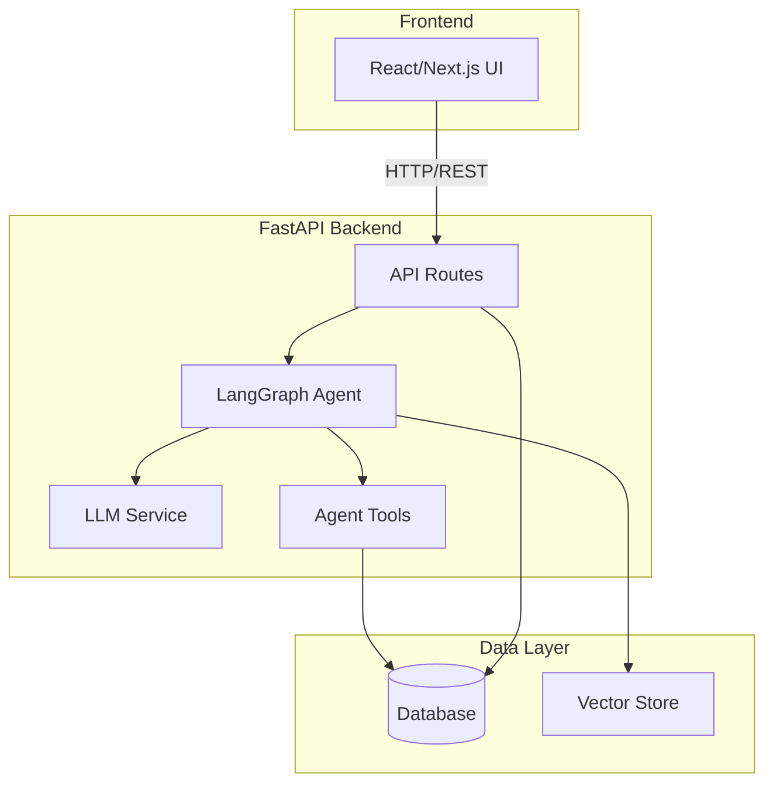
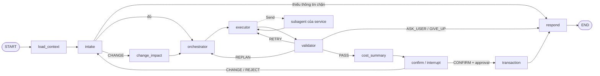
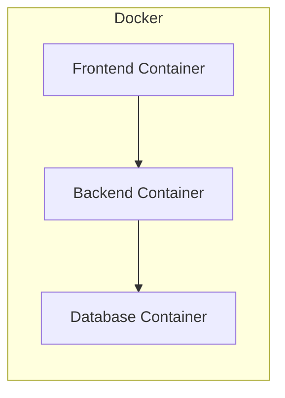

# Architecture Document

## System Overview

[Tóm tắt 2-3 câu về kiến trúc hệ thống]

## Architecture Diagram

## Components

### 1. Frontend (React/Next.js)
- **Purpose:** [mô tả]
- **Key Features:** [danh sách]
- **State Management:** [approach]

### 2. Backend (FastAPI)
- **Purpose:** [mô tả]
- **API Design:** RESTful
- **Authentication:** [JWT/None]

### 3. AI Agent (LangGraph)

Thiết kế đề xuất, chưa implement. Chi tiết: [agent graph design](docs/architecture/agent-graph.md).

- **Agent Type:** Intake + Plan-and-Execute + Result Validator + human-in-the-loop (sơ đồ v4, kết hợp góp ý mentor).
- **State:** `WorkflowState`; kế hoạch (Dependency DAG) là dữ liệu trong state và được checkpoint theo `thread_id`.
- **Nodes:** `load_context`, `intake` (hiểu yêu cầu, hỏi lại), Routing Orchestrator = `orchestrator` (Planner) + `executor` + `change_impact`, 5 node nối tới subagent của từng service, `validator`, `cost_summary`, `confirm`, `transaction`, `respond`.
- **Tools:** mỗi service có subagent riêng do chủ service viết, nối vào graph qua contract chung (manifest + `run_task`); subagent chỉ đọc, thao tác ghi đi qua commit endpoint sau approval. Giai đoạn khung dùng `FakeAgent`.
- **Flow:**

### 4. Database
- **Type:** [PostgreSQL / SQLite]
- **Tables:** [danh sách]
- **Migrations:** Alembic

### 5. Vector Store
- **Type:** [ChromaDB / FAISS / Pinecone]
- **Embeddings:** [model]
- **Purpose:** [RAG / similarity search]

## Data Flow

1. User gửi request từ Frontend
2. API route nhận và validate input
3. Agent xử lý qua LangGraph pipeline
4. LLM generate response
5. Tools thực thi actions (nếu cần)
6. Response trả về Frontend

## Deployment Architecture

## Security

- API keys stored in `.env` (never commit)
- Input validation via Pydantic
- Rate limiting on API endpoints
- CORS configured for frontend domain

## Design Decisions

| Decision | Choice | Reason |
|----------|--------|--------|
| Framework | FastAPI | Async, auto-docs, type-safe |
| Agent | LangGraph | Flexible state management |
| Database | [choice] | [reason] |
| Frontend | Next.js | [reason] |
