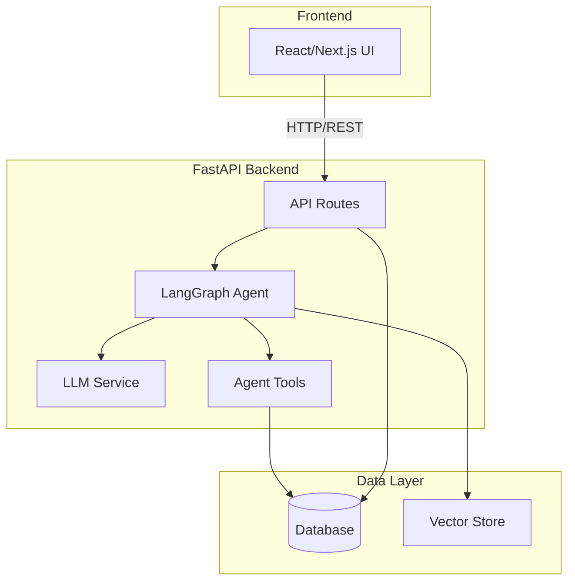
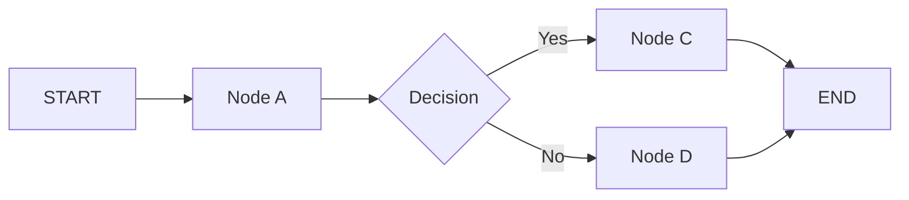
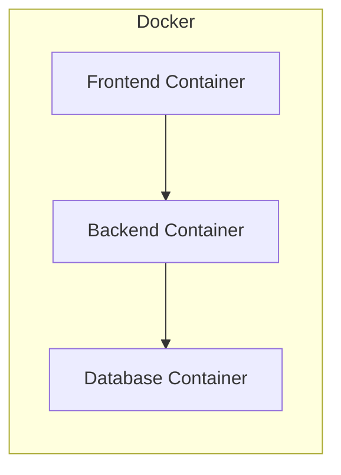

# LifeFlow Architecture

## Current implementation

The repository contains a Python FastAPI/LangGraph application and a bounded
TypeScript LifeFlow workspace for spatial, housing and moving integrations. The
TypeScript layout exception and service boundaries are recorded in
[`docs/adr/`](docs/adr/README.md).

Detailed current designs:

- [MCP service standard](docs/architecture/mcp-service-standard.md)
- [Moving/AhaMove service](docs/architecture/moving-service.md)
- [AhaMove integration contract](docs/api/ahamove-v3-integration.md)

Proposed future AI workflow: [Intake and Routing Orchestrator](docs/architecture/intake-and-routing-orchestrator.md).
The proposal applies the mentor's distinction between request understanding and
workflow orchestration; it is not part of the current agent implementation.

Moving is an independently startable MCP server. It shares canonical contracts
and MCP behavior packages with other services but owns its provider adapter,
configuration, persistence and tool registry.

Moving now exposes authenticated HTTP MCP in its own `moving-mcp` image, separate
from the AI application. A `moving-api` image receives AhaMove webhooks, and a
one-shot `moving-migrate` image prepares its PostgreSQL schema and runtime role.
Stdio remains available for local clients. See the
[container runbook](docs/runbooks/moving-containers.md) and
[deployment handoff](deploy/coolify/staging/moving.md). AI graph wiring and actual
Coolify deployment remain integration work, not automatically enabled features.

## Template/future system overview

The remainder of this document originated as the course template and describes
future system areas that are not all implemented yet.

## Architecture Diagram

## Components

### 1. Frontend (React/Next.js)
- **Purpose:** [mô tả]
- **Key Features:** [danh sách]
- **State Management:** [approach]

### 2. Backend (FastAPI)
- **Purpose:** [mô tả]
- **API Design:** RESTful
- **Authentication:** [JWT/None]

### 3. AI Agent (LangGraph)
- **Agent Type:** [ReAct / Plan-and-Execute / Custom]
- **State:** [mô tả state schema]
- **Nodes:** [danh sách nodes]
- **Tools:** [danh sách tools]
- **Flow:**

### 4. Database
- **Type:** [PostgreSQL / SQLite]
- **Tables:** [danh sách]
- **Migrations:** Alembic

### 5. Vector Store
- **Type:** [ChromaDB / FAISS / Pinecone]
- **Embeddings:** [model]
- **Purpose:** [RAG / similarity search]

## Data Flow

1. User gửi request từ Frontend
2. API route nhận và validate input
3. Agent xử lý qua LangGraph pipeline
4. LLM generate response
5. Tools thực thi actions (nếu cần)
6. Response trả về Frontend

## Deployment Architecture

## Security

- API keys stored in `.env` (never commit)
- Input validation via Pydantic
- Rate limiting on API endpoints
- CORS configured for frontend domain

## Design Decisions

| Decision | Choice | Reason |
|----------|--------|--------|
| Framework | FastAPI | Async, auto-docs, type-safe |
| Agent | LangGraph | Flexible state management |
| Database | [choice] | [reason] |
| Frontend | Next.js | [reason] |
