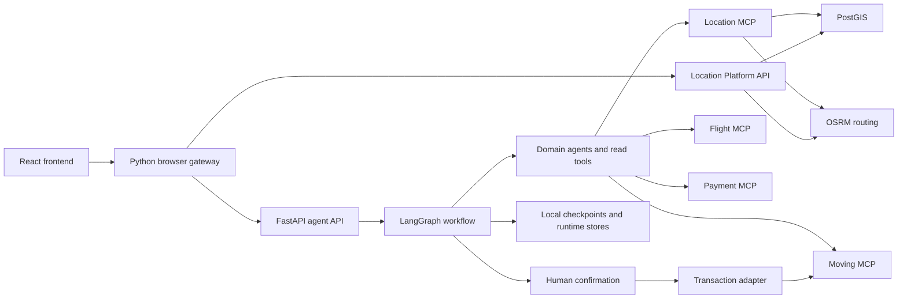

# Architecture

Status: local MVP integration, reconciled with `main` on 2026-10-04. The [product brief](docs/product.md) defines intended behavior; the [agent graph design](docs/architecture/agent-graph.md), [integration index](docs/integration/README.md), and [frontend audit](Frontend/SERVICE_AUDIT.md) describe implementation details and limits.

## Implemented system

The React frontend sends authenticated requests through a Python browser gateway. The gateway owns browser sessions and conversation history, and forwards requests to the FastAPI agent API with a server token and user identity. LangGraph coordinates intake, planning, domain reads, validation, confirmation, and transactions. Provider connections are configured separately.

| Component | Source | Responsibility |
|---|---|---|
| Browser application | `Frontend/src/` | Chat, housing/map workspaces, plan progress, and confirmation forms |
| Browser gateway | `Frontend/server.py`, `Frontend/store.py` | HttpOnly sessions, thread ownership, history, and upstream requests |
| Agent API | `src/main.py`, `src/api/` | Chat, state, decisions, UI actions, and opt-in sandbox payment endpoints |
| Agent workflow | `src/agents/` | LLM intake/planning, domain execution, validation, cost summary, approval, and response |
| Service adapters | `src/services/adapters/` | MCP boundaries, moving approvals, transactions, and local persistence |
| Location platform | `Maps VN/LifeFlow/` | Housing/POI queries, geographic data, routes, REST API, and MCP tools |
| Moving service | `packages/moving-service/` | AhaMove adapter, quotes, approval records, order actions, and webhooks |
| Flight and Payment | `src/mcp_servers/` | Flight search and payment tools with provider-specific configuration |
| Standalone agent services | `src/agent_services/` | Separate Intake and Routing APIs; execution gateway disconnected by default |

The integrated entrypoint is `AgentService.open()`. It requires live-mode configuration and an LLM API key. It persists graph checkpoints and runtime records in SQLite and wraps configured domains with LLM agents. The standalone services have a separate lifecycle and runbook.

## Approvals and service limits

Domain agents use read tools. The transaction adapter handles configured writes after confirmation and checks the approval against the user, thread, plan version, payload hash, and expiry. The moving service has separate read, write, and approval credentials. Changes to a plan can invalidate dependent results and require a new confirmation.

Moving transactions in the integrated MVP are restricted to AhaMove staging and use CASH. Flight search is supported, but the integrated runtime removes flight booking capabilities. ZaloPay sandbox payment creation is a separate opt-in form/API flow. These implementation limits do not establish production booking or payment support.

Runtime state, approval records, and encrypted PII are stored locally. Deployment currently assumes one application worker for the agent runtime. A provider timeout can require reconciliation; the code includes write-intent records, but recovery and ownership gaps identified during review remain unresolved.

## Product target and historical diagrams

The [confirmed MVP scope](docs/product.md#mvp-scope) includes housing selection, moving services, and travel booking. The [shared tool catalogue](docs/specs/SPEC-008-service-tools.md) describes proposed contracts and vendor lifecycles. The [roadmap](docs/roadmap.md) owns delivery milestones.

The [interactive housing search spec](docs/specs/SPEC-016-housing-search.md) preserves the desktop list/map and automatic viewport-search baseline and distinguishes it from the current MapLibre workspace, Location contracts, and provider-backed home-selection path. Its remaining proposals cover shared requirements, evidence assessment, location precision, and selection provenance. Browsing or focusing a card does not choose a home; an explicit home choice can invalidate dependent plan results.

The [product flow and dependency diagrams](docs/architecture_diagram.md) and [issue/PR map](docs/work-in-progress.md) capture the baseline and proposals from 2026-09-30. The integrated graph is described in [agent-graph.md](docs/architecture/agent-graph.md). Architectural decisions are indexed under [docs/adr/](docs/adr/README.md).

## Planned hosted delivery

The [infrastructure plan](docs/architecture/infrastructure.md) defines integrated application
delivery through GitHub Actions, ARM64 images in GHCR, and Coolify Docker Compose
Empty Services in one project with staging and production environments. Resources,
data, credentials, and release configuration are environment-specific; server
placement is a deployment input and can expand independently of the CD contract.
Successful eligible `main` revisions reach staging; a published
versioned release selects staging-verified image digests for an operator-dispatched
production promotion from current `main`, without rebuilding. The plan records the existing Coolify/runner setup separately from
deployment automation and production readiness that still require verification.

The [Coolify scaling and migration plan](docs/architecture/migration-options.md)
covers host resizing/relocation and qualified multi-server deployment, preserving
the same release contract and data cutover/recovery gates.

## Running and verifying

Follow the [local MVP runbook](docs/runbooks/local-mvp.md), [frontend guide](Frontend/README.md), [Location guide](Maps%20VN/LifeFlow/README.md), and [Moving container runbook](docs/runbooks/moving-containers.md). The root Compose file starts the backend and Flight/Payment MCP containers; other services have separate setup.

Review evidence is under [docs/review/](docs/review/) and [eval/](eval/). Dated reports describe the configurations they tested. Existing Python test failures and runtime review findings remain open; this documentation cleanup does not certify production readiness.
