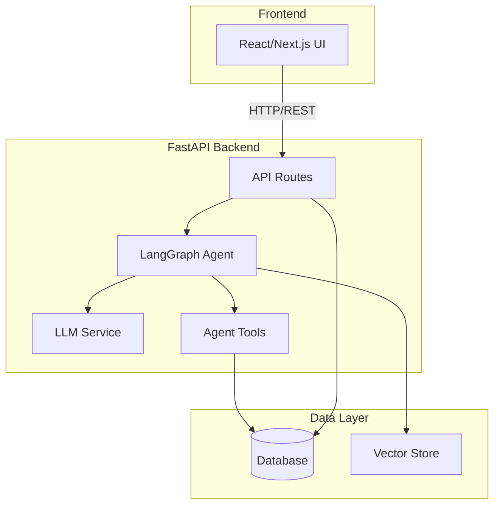
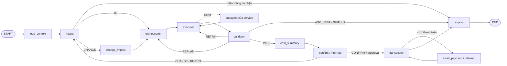
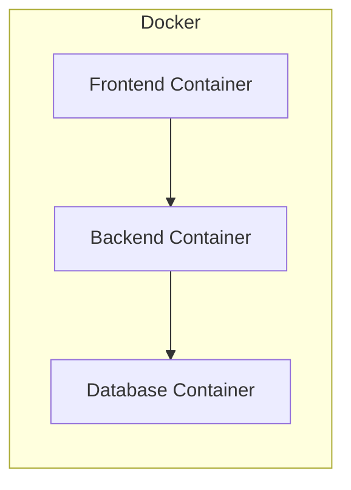

# LifeFlow Architecture

## Current implementation

The repository contains a Python FastAPI/LangGraph application and a bounded
TypeScript LifeFlow workspace for spatial, housing and moving integrations. The
TypeScript layout exception and service boundaries are recorded in
[`docs/adr/`](docs/adr/README.md).

Detailed current designs:

- [MCP service standard](docs/architecture/mcp-service-standard.md)
- [Moving/AhaMove service](docs/architecture/moving-service.md)
- [AhaMove integration contract](docs/api/ahamove-v3-integration.md)

The chat agent is one LangGraph graph (`src/agents/`, [agent graph design](docs/architecture/agent-graph.md),
ADR-016): intake → Routing Orchestrator → domain subagents → validator → confirm → transaction.
It connects to the Location (housing, place, route), Moving/AhaMove, Flight and Payment MCP services
through `src/services/adapters/` (`AGENT_SUBAGENTS=live`), or runs fully offline with fake subagents.
The LLM Intake and LLM Planner are not implemented yet (the graph uses stubs / the rule-based
`TemplatePlanner`).

Independent [Intake and Routing Orchestrator services](docs/architecture/standalone-agent-services.md)
implement direction B from the [original analysis](docs/architecture/intake-and-routing-orchestrator.md).
They have separate HTTP entrypoints and images. Intake understands requests;
Routing owns planning, scheduling, internal tool-call control and persisted workflow
state. There is no separate Executor agent. Their integration into the chat graph,
domain MCP connections and trusted approval backend remains future work.
See the [standalone runbook](docs/runbooks/agent-services.md).

Moving is an independently startable MCP server. It shares canonical contracts
and MCP behavior packages with other services but owns its provider adapter,
configuration, persistence and tool registry.

Moving now exposes authenticated HTTP MCP in its own `moving-mcp` image, separate
from the AI application. A `moving-api` image receives AhaMove webhooks, and a
one-shot `moving-migrate` image prepares its PostgreSQL schema and runtime role.
Stdio remains available for local clients. See the
[container runbook](docs/runbooks/moving-containers.md) and
[deployment handoff](deploy/coolify/staging/moving.md). AI graph wiring and actual
Coolify deployment remain integration work, not automatically enabled features.

## Template/future system overview

The remainder of this document originated as the course template and describes
future system areas that are not all implemented yet.

## Architecture Diagram

## Components

### 1. Frontend (React/Next.js)
- **Purpose:** [mô tả]
- **Key Features:** [danh sách]
- **State Management:** [approach]

### 2. Backend (FastAPI)
- **Purpose:** [mô tả]
- **API Design:** RESTful
- **Authentication:** [JWT/None]

### 3. AI Agent (LangGraph)

Đã implement khung (M0–M2) và nối service bằng subagent nền (M3); Intake / Planner dùng LLM chưa làm (M4). Quyết định: ADR-016.
Chi tiết và hiện trạng: [agent graph design](docs/architecture/agent-graph.md) §13.

- **Agent Type:** Intake + Plan-and-Execute + Result Validator + human-in-the-loop (sơ đồ v4, kết hợp góp ý mentor).
- **State:** `WorkflowState`; kế hoạch (Dependency DAG) là dữ liệu trong state và được checkpoint theo `thread_id`.
- **Nodes:** `load_context`, `intake` (hiểu yêu cầu, hỏi lại), Routing Orchestrator = `orchestrator` (Planner) + `executor` + `change_impact`, 4 node nối tới subagent của từng service (property, relocation, flight, map; Contract & Policy đã bỏ), `validator`, `cost_summary`, `confirm`, `transaction`, `await_payment` (chờ thanh toán bất đồng bộ), `respond`. Tái dùng phần kiểm evidence, approval, `validate_plan` từ nhánh `khoa` (xem agent-graph.md §3.3).
- **Tools:** mỗi service có subagent riêng do chủ service viết, nối vào graph qua contract chung (manifest + `run_task`); subagent chỉ đọc, thao tác ghi đi qua commit endpoint sau approval. Hiện dùng `FakeAgent` (mặc định) hoặc subagent nền bọc MCP tool đọc của Location, Moving, Flight (`AGENT_SUBAGENTS=live`); `transaction` gọi tool ghi của Flight, Payment, Moving theo chuỗi tất định.
- **Flow:**

### 4. Database
- **Type:** [PostgreSQL / SQLite]
- **Tables:** [danh sách]
- **Migrations:** Alembic

### 5. Vector Store
- **Type:** [ChromaDB / FAISS / Pinecone]
- **Embeddings:** [model]
- **Purpose:** [RAG / similarity search]

## Data Flow

1. User gửi request từ Frontend
2. API route nhận và validate input
3. Agent xử lý qua LangGraph pipeline
4. LLM generate response
5. Tools thực thi actions (nếu cần)
6. Response trả về Frontend

## Deployment Architecture

## Security

- API keys stored in `.env` (never commit)
- Input validation via Pydantic
- Rate limiting on API endpoints
- CORS configured for frontend domain

## Design Decisions

| Decision | Choice | Reason |
|----------|--------|--------|
| Framework | FastAPI | Async, auto-docs, type-safe |
| Agent | LangGraph | Flexible state management |
| Database | [choice] | [reason] |
| Frontend | Next.js | [reason] |
