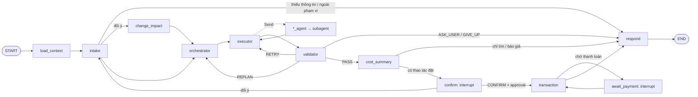

# Agent graph (LangGraph)

> 2026-09-30: `AgentService.open()` đã ghép `LlmIntake`, `LlmPlanner` và
> `MovingLlmAgent` vào graph, cùng Housing/Map/Flight MCP adapters và SQLite runtime.
> FastAPI lifespan dùng đường này. Payment sandbox là demo riêng; chưa xuất vé thật.
> [Bàn giao hiện tại](../../../../../docs/integration/mvp-completion-2026-09-30.md),
> [hướng dẫn chạy](../../../../../docs/runbooks/local-mvp.md).

Chat agent của ReloHome: **một** graph LangGraph nhận tin nhắn, hiểu yêu cầu, lập kế hoạch, gọi
subagent của từng service (phòng, bản đồ, vé máy bay, chuyển đồ), kiểm kết quả, xin xác nhận rồi mới
đặt / thanh toán.

- Thiết kế đầy đủ: [docs/architecture/agent-graph.md](../../../../../docs/architecture/agent-graph.md)
  (hiện trạng và chỗ code khác đặc tả: §13).
- Quyết định kiến trúc: [ADR-016](../../../../../docs/adr/ADR-016-agent-graph-with-domain-subagents.md) (Accepted trên nhánh tích hợp; thay ADR-006).

## Luồng



Kế hoạch (DAG các task) là **dữ liệu** trong state; graph không đổi theo yêu cầu. Subagent chỉ đọc;
mọi thao tác ghi nằm ở `transaction`, sau approval do backend tạo. Dữ liệu cá nhân (hành khách, liên
hệ) đi qua form → `pii_ref`, không vào LLM, state hay log.

## Cấu trúc thư mục

| Đường dẫn | Nội dung |
|---|---|
| `graph.py` | `build_graph(deps, checkpointer)`, checkpointer dev (`default_checkpointer`) |
| `state.py`, `models.py` | `WorkflowState`, reducer, mọi kiểu dữ liệu (Pydantic) |
| `routing.py` | hàm routing thuần giữa các node |
| `nodes/` | một file cho mỗi node; node là vỏ mỏng, logic nằm ở hàm thuần |
| `intake.py` | contract `Intake`, kiểm dữ kiện, quy tắc hỏi ngay / hỏi sau (`resolve_missing`) |
| `planning.py` | contract `Planner`, `validate_plan`, `TemplatePlanner` (không LLM) |
| `memory.py` | chính sách bộ nhớ người dùng (tự điền, hết hạn, anchor) |
| `approval.py`, `cost.py`, `suggestions.py` | kiểm approval, trần chi phí, gợi ý bước tiếp theo |
| `llm.py` | `StructuredLLM` (OpenAI) cho Intake / Planner thật |
| `deps.py` | `GraphDeps`, `GraphSettings`, `AgentRegistry`, `default_deps`, `test_deps` |
| `wiring.py` | ráp graph với service thật hoặc fake theo `.env` (`AgentService`) |
| `contracts/` | contract subagent (`AgentManifest`, `AgentTaskRequest`, `AgentTaskResult`) và script xuất JSON Schema |
| `subagents/` | `run_with_policy`, `FakeAgent`, `LocalAgent`, `RemoteAgent`, `FallbackAgent`, bộ kiểm tuân thủ |
| `subagents/services/` | subagent nền bọc MCP tool đọc của Location, Moving, Flight |
| `../services/adapters/` | client MCP, `ServiceRegistry`, `McpTransaction` (tool ghi), cầu nối approval Moving, fake port |

## Chạy

```bash
pip install -r requirements.txt
pytest tests/test_agents tests/test_api      # không cần mạng
uvicorn relohome_agent.main:app --reload                # API tại /api/v1
```

`AGENT_SUBAGENTS=fake` (mặc định) dùng `FakeAgent` + `FakeTransaction`: dữ liệu mẫu, không gọi service.
`AGENT_SUBAGENTS=live` nối các service có cấu hình trong `.env` (xem `.env.example`):

| Lĩnh vực | Service | Biến |
|---|---|---|
| property, map | Location (`apps/location-mcp`) | `LOCATION_MCP_URL`, `LOCATION_MCP_AUTH_TOKEN` |
| relocation | Moving / AhaMove (`apps/moving-mcp`) | `MOVING_MCP_URL`, `MOVING_MCP_AUTH_TOKEN`, `MOVING_QUOTE_CONTACT_*`, `MOVING_APPROVAL_URL` |
| flight | Flight (`apps/flights-mcp`) | `FLIGHT_MCP_URL` |
| thanh toán | Payment ZaloPay sandbox (`apps/payments-mcp`) | `PAYMENT_MCP_URL` |

Service chưa cấu hình thì lĩnh vực đó không được đăng ký. Lưu ý: app mặc định dùng
`PassThroughIntake` + `NotImplementedPlanner`, nên `/chat` trả `UNSUPPORTED` cho tới khi có Intake và
Planner dùng LLM. Để thử luồng, xem test `tests/test_agents/test_graph_e2e.py` (dùng `ScriptedIntake`
+ `TemplatePlanner`).

## API

| Endpoint | Việc |
|---|---|
| `POST /api/v1/chat` `{message, thread_id?}` | Gửi tin nhắn. Đang chờ xác nhận thì tin nhắn được coi là đổi ý |
| `POST /api/v1/chat/{thread_id}/decision` | `CONFIRM` (kèm `payload_hash`, form `pii_forms`) / `CHANGE` / `REJECT` / `CANCEL` |
| `POST /api/v1/chat/{thread_id}/payment/check` | Hỏi lại cổng thanh toán |
| `POST /api/v1/chat/{thread_id}/payment/cancel` | Huỷ thanh toán đang chờ, huỷ giữ chỗ |
| `POST /api/v1/chat/{thread_id}/payment/simulate` `{outcome: PAID \| FAILED \| EXPIRED}` | **Chỉ demo:** nút "giả lập đã thanh toán". Có khi `payment.simulation_available = true` (fake mode, hoặc `PAYMENT_SIMULATION_ENABLED=true` với Payment `PAYMENT_PROVIDER=mock`); ngược lại 404 |
| `GET /api/v1/chat/{thread_id}/state` | Intake, plan, trạng thái task, tổng chi phí, đơn đã đặt, `selections` (bản ghi provider của lựa chọn hiện tại) |
| `DELETE /api/v1/chat/{thread_id}` | Xoá hội thoại: checkpoint và bộ nhớ ghi nhận từ hội thoại đó. Đang chờ thanh toán → 409. Không huỷ đơn đã đặt |
| `DELETE /api/v1/memory` | Quên toàn bộ sở thích/thói quen đã ghi nhớ của người dùng |

Người dùng xác định bằng header `X-User-Id` (do gateway xác thực). Kết quả trả `status` là `done`,
`pending_confirmation` hoặc `pending_payment`.

## Phát triển subagent (nhóm AI)

Từ 2026-09-29 subagent của mọi lĩnh vực do nhóm AI viết (D13); chủ service cung cấp MCP tool và dữ liệu.

1. Đọc contract ở agent-graph.md §6.3 (quy tắc R1–R12) và §6.3.8 (input / output tối thiểu). JSON
   Schema: [docs/api/agent-contract/](../../../../../docs/api/agent-contract/)
   (tạo lại bằng `python -m relohome_agent.agents.contracts.export_schema`).
2. Viết subagent Python implement `DomainAgent` (bắt đầu từ `subagents/services/`), hoặc chạy ở nơi khác
   và expose MCP tool `get_manifest` + `run_task` (tham số `{"request": AgentTaskRequest}`).
3. Kiểm bằng `check_conformance` (`subagents/conformance.py`), ví dụ trong
   `tests/test_agents/test_service_subagents.py`.
4. Đăng ký trong `wiring.py::live_agents`. Graph không phải sửa.

## Cho người làm Intake / Planner dùng LLM

Implement `Intake.understand(IntakeInput) -> IntakeResult` và `Planner.plan(PlannerInput) -> PlannerOutput`
bằng `StructuredLLM`; đặt `uses_llm = True` và `last_usage` để node kiểm trần và ghi token. Node đã tự
kiểm evidence, lọc dữ liệu cá nhân, tính phần thiếu và `validate_plan`, nên LLM chỉ cần hiểu và đề xuất.
Truyền vào `AgentService.create(intake=..., planner=...)`; có thể dùng `TemplatePlanner(fallback=llm_planner)`.

Hai luật dùng chung cho mọi lĩnh vực (01/10, agent-graph.md §6.1–6.2):

- Khoá chọn thao tác (`operation_selector_keys`, đọc từ `input_schema` của manifest, ví dụ `map_mode`)
  được thay ở lượt `REFINE`, không thành mâu thuẫn. Thêm thao tác mới cho một lĩnh vực thì khai báo nhánh
  `anyOf` có `const` trong manifest; không thêm regex vào node `intake`.
- Planner không bỏ im lặng lĩnh vực được yêu cầu: hoặc có task, hoặc `PlannerOutput.questions`
  (`needs_input` của `LlmPlanner`, được code kiểm field theo manifest). Node `orchestrator` hỏi lại.
