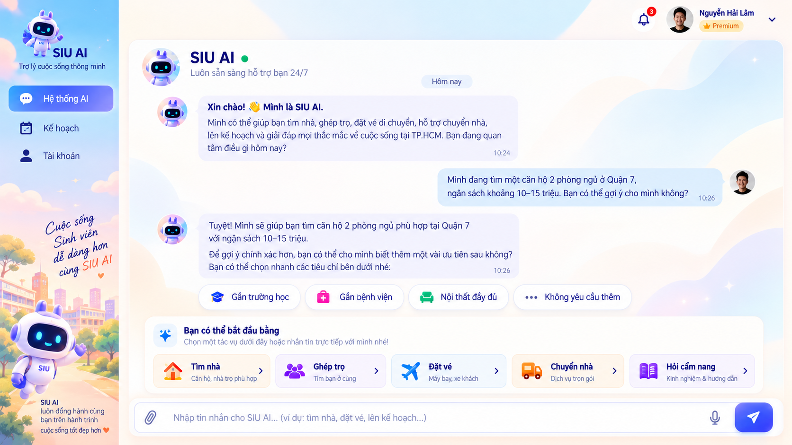
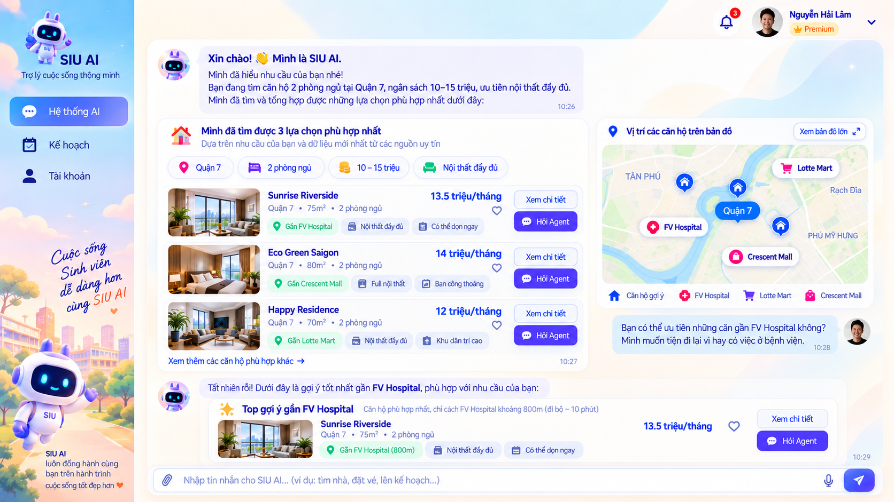
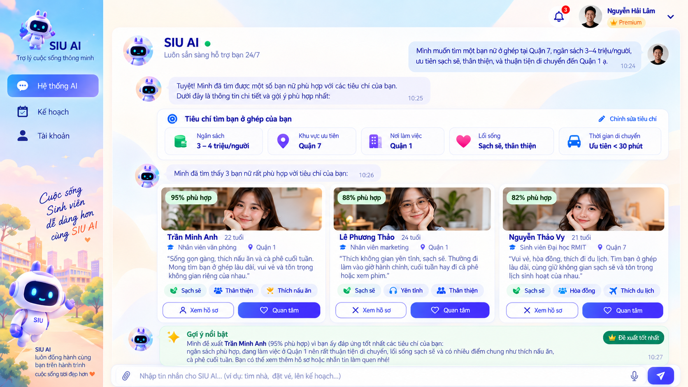
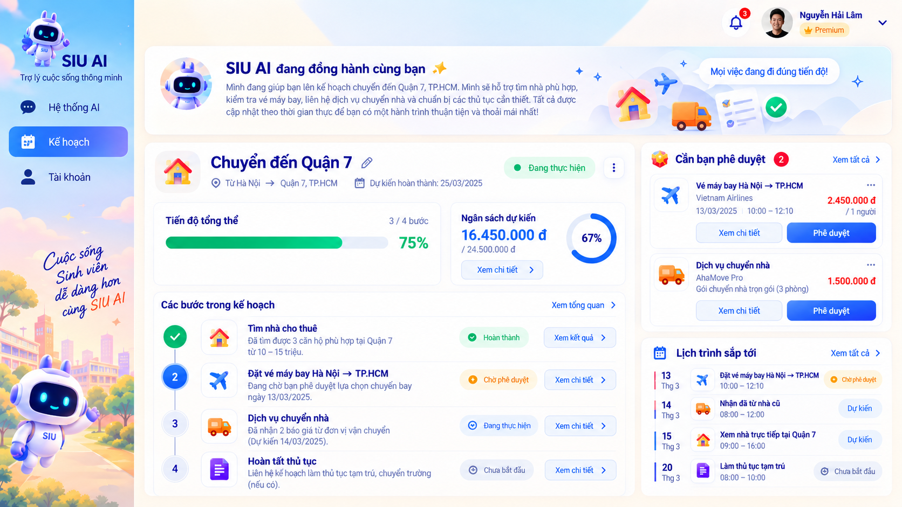
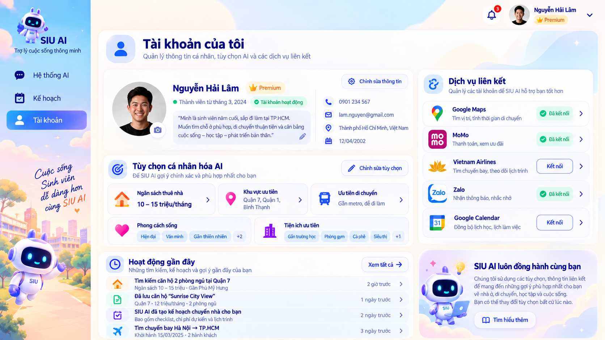

# ReloHome — Web

Trang bìa `/` dùng ảnh nhà và hồ koi toàn khung tại
`public/images/relohome-hero-home.png` (08/10/2026). Lớp phủ giữ chữ/CTA dễ đọc
ở sáng, tối và màn hình nhỏ; các link vào chat, dịch vụ và cẩm nang giữ nguyên.

Cập nhật **07/10/2026**. React + TypeScript + Vite trong thư mục `apps/web/`, thay giao diện Streamlit. Gateway FastAPI phục vụ bản build, quản lý session và nối tới Agent API/Platform API.

Source relocation #113: React is here; the [gateway](../browser-gateway/README.md) is a separate Python package. See [commands, preserved state and rollback](../../docs/integration/web-gateway-relocation.md). The dated audit results below are historical evidence.

## Production UI audit — đợt mới nhất

Tên sản phẩm hiện tại là **ReloHome** (đổi ngày 07/10/2026): đồng nhất trên
trang giới thiệu, đăng nhập, header, chat, dịch vụ, tài khoản, nhãn VI/EN và
tiêu đề tab trình duyệt. Từ 08/10, biểu tượng robot đã được bỏ khỏi
landing, đăng nhập, chat và favicon; liên kết chat dùng chữ `ReloHome`, favicon là nhà.
Tên cấu hình `SIU_*`, header API, khóa lưu nháp/tùy chọn và đường dẫn asset
giữ nguyên để tương thích hệ thống và dữ liệu đã lưu.

Lượt đổi tên: build qua, **24/24** ca landing/appearance/production/layout
qua trên desktop và mobile. Bản build được kiểm tra riêng ở 320/768/1024/
1440 px: tên và tiêu đề ReloHome, nhãn EN, không tràn ngang, không lỗi JS.
Kết quả full bên dưới thuộc đợt audit trước.

Đã audit/triển khai theo skill `frontend-ui-engineering`:
[vấn đề, design contract, kế hoạch, file thay đổi và bằng chứng](PRODUCTION_UI_AUDIT.md).

- Theme chung có token spacing/type/radius/color; xanh rừng/trắng trung tính,
  panel vuông gọn, ít bóng, dòng kết quả thay card lồng nhau. Ảnh nhà/hồ koi
  vẫn dùng ở trang đầu. Entry/login/chat/housing/map/Moving/Flight/plan/account
  dùng cùng control, typography, trạng thái và focus ring.
- Header/tabs/panes thích nghi 320/768/1024/1440; mobile giữ target 44 px.
  Input/giá/giờ và hành động chính dễ đọc; desktop có panel cạnh map, mobile
  dùng sheet hiện có. Welcome vẫn hiện đủ thao tác ở các màn thấp.
- Tab có Arrow/Home/End và Enter/Space; dialog trap focus/return focus;
  Flight không còn div chỉ bấm chuột. Search có nhãn, thêm skeleton,
  trạng thái không có kết quả, contrast/focus/hover/disabled thống nhất.
- Hiệu ứng nhẹ theo yêu cầu mới: feedback nút, underline nav, ảnh koi zoom
  khi hover và section/message vào vị trí khi cuộn/hiển thị. Không fade chữ
  hay giấu nội dung; giảm chuyển động tắt hiệu ứng, không đổi request/dữ liệu.
- Sửa chữ/icon và viền kép ở ô địa chỉ/chat/history; Moving có navigation
  Địa điểm/Lịch chuyển/Hàng hóa/Chọn xe/Giao nhận. Khi chưa ghim A, có hướng
  dẫn quay về chọn điểm lấy; B vẫn giữ căn đã chọn. Mobile/tablet không để
  chat che nút Về hội thoại; các nhãn dài xuống dòng, không cắt thao tác.
- Không sửa endpoint/schema/payload, auth, giá, tìm kiếm/recommendation,
  backend/database hay API helpers. Không thêm fetch hoặc optimistic dữ
  liệu mới; giữ form/draft/callback và tất cả guard trước giao dịch.

**Kết quả mới nhất:** **120 pass + 4 live opt-in skip / 124 browser cases**,
**8/8 gateway/UI contract pass**, build qua. Axe zero violations trong các
màn/tag WCAG 2/2.1 A/AA đã kiểm tra; keyboard + responsive qua. Baseline
279 file và call/payload expressions giữ nguyên. Build thật 8503 và các
read endpoint qua; không submit auth/business request hay đổi DB khi live.
Sau chỉnh nhãn navigation cuối, nhóm layout regression chạy lại 4/4 qua.

CSS mới: `src/product-theme.css` là entry, import `src/ui/tokens.css`,
`foundation.css`, `workspaces.css`, `pages.css` **sau** CSS layout cũ và
landing. Bổ sung/style mới tại đúng nhóm này; tránh thêm override rời rạc.
`src/ui/motion.css` là lớp interaction cuối; `useUiMotion` chỉ quan sát viewport
trang giới thiệu, không fetch hoặc sửa nội dung.
`TabList`/`UiStates` chỉ trình bày. `@axe-core/playwright` ở devDependencies,
không dùng trong ứng dụng.

Các mục tiếp theo là lịch sử các đợt trước, số liệu cũ không phải lượt mới.

## Trang giới thiệu, Cẩm nang và bộ chọn AhaMove — bản mới nhất 07/10/2026

- **`/`** là trang giới thiệu công khai, tone xanh rừng/kem, không có logo robot.
  Nút **Bắt đầu cùng ReloHome** mở **`/ai`**; dùng session/đăng nhập hiện có.
  Chat, hội thoại đã lưu, account và các route cũ vẫn mở trực tiếp được.
- Nội dung dựa trên chức năng đang có: tìm nhà, tiện ích/đường đi, chuyển đồ
  AhaMove và chuyến bay; có phần cách sử dụng và CTA vào chatbot. Header có
  sáng/tối, VI/EN và menu gọn trên điện thoại.
- **Ở ghép** có luồng tìm hồ sơ, tương thích và yêu cầu liên hệ theo consent;
  runtime mặc định tắt cho đến khi hoàn tất các điều kiện phát hành.
  **Cẩm nang** có trang nội dung biên tập tại `/guides`.
- Ảnh bìa nhà có **hồ cá koi**, lưu local tại
  `public/images/relohome-hero-home.png`. `siu-home-hero.png` vẫn được CSS
  dùng tại các vùng nhỏ hơn. Đây là ảnh minh họa, không phải tin nhà.
  [Prompt và cách tạo ảnh](public/images/README.md) bằng imagegen built-in.
- Moving dùng **loại xe → chọn trực tiếp thẻ gói**. Đã bỏ bộ lọc tải trọng
  và dropdown gói trùng bước theo yêu cầu. Thẻ ghi tên/cỡ xe, mô tả giới hạn
  từ API và service_id gốc; các gói đầu hiện gọn, có nút xem đủ khi nhiều gói.
  Không suy tải trọng thực tế từ mã: tên gói 1000kg có thể được hãng mô tả
  giới hạn 850kg; giữ nguyên cả tên và mô tả để người dùng cân nhắc.
- Danh sách bên dưới luôn theo **loại xe đang chọn**: Van chỉ có các gói
  Van tại điểm A, không lẫn xe tải/xe máy/bán tải. Tiêu đề ghi rõ loại xe;
  hover chỉ xem hướng dẫn, **bấm** mới chọn loại. Không ghép gói của loại cũ
  vào danh sách mới khi chuyển loại. Thẻ gọn, radio 16 px; chọn một gói mới
  mở mô tả hãng và mã gói của chính gói đó. Không thêm bước lọc tải trọng.
- Biểu tượng và hình minh họa riêng cho xe máy, van, tải, bán tải, ba gác.
  Rê chuột, focus bàn phím hoặc bấm loại xe để mở giới thiệu; đóng được.
  Xem hướng dẫn của loại đang chọn không xóa gói, addon hay dữ liệu nhập.
  Hình là SVG minh họa loại xe, không hứa hẹn một mẫu xe thực tế.
- Đã bỏ ô **Gói khác**. Các gói `ECO`/`POOL` phân về xe máy; mua hộ `AIPOB`
  và gói chưa xác định loại vận chuyển không đưa vào lựa chọn mới của form.
  Bán tải/ba gác chỉ hiện khi catalog tại điểm A có. Không sửa catalog server,
  xóa dữ liệu hay thêm giá/gói giả. Gói đã chọn trước đây vẫn giữ theo ID để
  không âm thầm đổi lựa chọn khi mở lại form.
- **Để ReloHome gợi ý**: chưa chốt service_id; sau khi bấm lấy báo giá, ReloHome so
  sánh một số gói chuyển đồ tại điểm A để người dùng chọn. Không tự đặt xe,
  không hứa chọn rẻ nhất hay kiểm tra đầy đủ kích thước chỉ bằng loại xe.
- `service_id`, addon, COD và payload typed quote giữ hợp đồng PR #53.
  Đổi gói vẫn bỏ addon/COD của gói cũ; đổi điểm A vẫn kiểm tra catalog mới.
  Không đổi logic Agent, xác nhận đặt dịch vụ, write flags, `.env`, backend
  hoặc housing data. Loại xe UI không gửi thành trường mới cho Agent.

**Kiểm tra:** suite browser hiện có **110 ca**: lượt full **105 pass**, **4 live
opt-in skip**, **1 ca bị Chrome ngắt mạng `ERR_NETWORK_IO_SUSPENDED` tại goto**.
Chạy lại đúng ca đó **1/1 pass**, không sửa test/app để bỏ qua lỗi; tổng
**106 ca đã xác minh qua**. Nhóm Moving riêng **20/20 pass**.
gateway/UI contract **8/8 pass** ở lượt trước, TypeScript/Vite build qua. Browser kiểm tra
public landing, login/CTA, mobile, theme/locale, menu Cẩm nang và bảo toàn ID
gói xe; các ca chat/map/housing/Moving/Flight/history/account/approval hiện có
đều qua bằng fixtures. Rà catalog thật HCM/Hà Nội và build 8503: chọn gói
bằng thẻ, hover xem hình xe máy không đổi gói xe tải đang chọn, không mất
ID/pin khi đổi theme/locale; không có lỗi JavaScript. Rà Van trên build thật
1920×990: chỉ có **Van 500/750/1000 kg**, radio **16×16 px**, không lẫn tải.
Không gửi chat LLM,
quote, order hay payment thật trong lượt này.

Mô tả tham khảo hướng dẫn chính thức của AhaMove về
[xe tải](https://ahamove.com/service/aha-truck),
[xe máy](https://ahamove.com/huong-dan-dat-don-dich-vu-giao-hang-bang-xe-may-ahamove)
và [các loại xe chở hàng](https://ahamove.com/dich-vu-ba-gac-tai-tai-van);
thông số mỗi gói vẫn lấy từ API hiện tại.

File chính: `src/components/LandingPage.tsx`, `src/landing.css`,
`src/movingCatalog.ts`, `src/components/MovingOptionsForm.tsx`,
`src/components/VehicleGuide.tsx`, `src/locales/en.json`, `tests/browser/app.spec.ts`.

Các số liệu ở mục bên dưới là kết quả của từng đợt trước đó.

## Giao diện sản phẩm, sáng/tối và Việt/Anh — 07/10/2026

### Trang đầu và logo AI — lịch sử 07/10/2026

Đã thu gọn riêng trang chào: giảm khoảng cách, card dịch vụ chuyển thành
icon cạnh nội dung, hai câu “Thử bắt đầu với” nằm cạnh nhau trên desktop
và xếp dọc trên mobile. Laptop thấp dùng tiêu đề một hàng; điện thoại thấp
giữ tên/icon dịch vụ, thu gọn phần mô tả để gợi ý và ô nhập hiện ngay.
Không tắt cuộn của các hội thoại hay cắt nội dung khi viewport quá nhỏ.

Đợt 07/10 từng dùng robot AI xanh/mint. Ngày 08/10 biểu tượng này được gỡ
khỏi giao diện và favicon theo yêu cầu mới; các luồng dịch vụ giữ nguyên.

**6/6 ca có mục tiêu qua**: welcome mới, login/welcome hiện có và appearance
trên desktop/mobile. Ca layout kiểm tra đủ 4 dịch vụ, 2 gợi ý, thông báo,
nút dùng preferences đã lưu và composer đều nằm trong vùng nhìn thấy,
không cần cuộn, trên **6 viewport** (1536×790, 1366×650, 1280×600,
390×844, 360×740, 390×680) × **VI/EN**. Bấm gợi ý vẫn chỉ điền nháp,
không gửi API. Build qua. Suite hiện có 102 ca; số 96 pass + 4 skip bên
dưới là lượt full suite trước khi thêm hai ca layout, không phải một
lượt full suite mới của 102 ca. Chỉ JSX hình ảnh/layout và CSS thay đổi.

**Đã khởi động và rà runtime:** mở http://127.0.0.1:8503. Sáu thành phần
UI/Agent/Platform/Location/Moving đều sẵn sàng; PostGIS healthy, 9/9 OSRM
trả route có hình học. Kiểm tra lại 96/96 browser + 8/8 contract qua,
13/13 bước browser trên build thật qua, có 29 gói AhaMove staging tại HCM.
Chỉ đọc provider/catalog; chưa chạy thêm chat LLM, tìm Flight, quote hoặc
transaction thật. Ghi nhận gợi ý Location có thể không khớp tên truy vấn.
Chi tiết phạm vi, bằng chứng và xác nhận không đổi nghiệp vụ ở
[báo cáo runtime](RUNTIME_CHECK_2026-10-07.md).

- Bảng màu xanh rừng, nền trắng ngà/xám xanh, đường viền nhẹ; giảm gradient,
  bóng và trang trí. Giữ tên ReloHome; biểu tượng robot đã bỏ ngày 08/10.
  Header, chat, nhà ở/map, Moving, Flight, kế hoạch và account giữ bố cục
  chức năng hiện có, cải thiện màu/chữ/khung trên desktop và mobile.
- Nút **VI / EN** và **mặt trăng/mặt trời** ở header và trang đăng nhập.
  Lưu trong `localStorage["siu-ui-preferences"]`; mặc định Việt, theme theo
  hệ điều hành nếu chưa chọn. Đổi chế độ không tạo hội thoại mới, gửi API,
  xóa form hay đổi gói xe. Lựa chọn UI này chưa đồng bộ theo tài khoản/server.
- Dịch nhãn UI, tooltip, placeholder và đơn vị hiển thị; định dạng tiền/ngày
  theo locale. Địa chỉ, tên tin nhà/gói dịch vụ từ provider, ghi chú và nội
  dung hội thoại giữ nguyên ngôn ngữ nguồn. Đây không phải dịch nội dung LLM.
- Giá trị option lưu/gửi API giữ nguyên dù nhãn đổi tiếng Anh. Kiểm tra
  điểm A/B, ngày giờ, service_id, addon và ghi chú vẫn giữ giá trị cũ.
  Không thêm `theme`/`locale` vào payload Agent hay thay workflow PR #53.
- Basemap đổi màu paint theo theme, giữ MapLibre instance, source/marker,
  tuyến OSRM, giới hạn camera và lựa chọn; không reload style để đổi màu.
- Sửa lỗi nháp chat mất sau reload do effect lưu nháp rỗng trong StrictMode:
  khởi tạo từ đúng sessionStorage trước effect. Chỉ sửa trạng thái hiển thị
  frontend; không thay logic Intake/Planner/Agent, giao dịch hoặc dữ liệu.

### File cần biết

| File | Nội dung |
| --- | --- |
| `src/product-theme.css` | Token màu sáng/tối và khung giao diện |
| `src/styles.css` | Layout hiện có sử dụng token thay các màu pastel cứng |
| `src/uiPreferences.tsx` | Preferences trình duyệt, nút UI, dịch nhãn/format |
| `src/locales/en.json` | Từ điển nhãn tiếng Anh; fallback giữ tiếng Việt |
| `src/mapStyle.ts` | Paint của bản đồ theo theme, không đổi nguồn/tuyến |
| `tests/browser/app.spec.ts` | Regression UI và bảo toàn payload khi đổi theme/locale |

Nguồn thiết kế: thư mục `../apps/web MVP planning questions/`, đặc biệt
`SIU Planner v2.dc.html`, `THE LIEMS Move Planner.dc.html` và ảnh người dùng
gửi; tham khảo phân vai màu nền/chữ/viền/trạng thái trong
[Primer Color](https://primer.style/product/primitives/color/). Link Claude
trả “Page not found” khi đọc bằng browser; dùng mẫu local làm nguồn chính.
Không nhập script mẫu vào app hoặc thay app bằng dữ liệu demo.

### Kiểm chứng đợt này

- **96/96 browser qua trong một lượt**, desktop 1440×960 và mobile 390×844.
  Suite có 100 ca; **4 ca live opt-in skip**, không gộp chúng vào số pass.
- 8 ca mới (4 tình huống × 2 viewport): preferences qua reload, nháp/transcript
  không mất, account không đổi giá trị lưu, Moving không đổi pin/lịch/gói/ghi
  chú/payload, login/welcome/map không tràn ngang và map không bị remount.
- **8/8 Python frontend/gateway contract qua** bằng HTTP fixture; không gọi
  LLM, geocode, SerpApi, đặt xe hay thanh toán thật trong đợt UI này.
- TypeScript/Vite build qua; đã kiểm tra ảnh sáng/tối, Việt/Anh trên các
  viewport. Ảnh browser nằm trong `test-results/` và là artifacts local.
- Các fixture Moving cũ được cập nhật đúng typed endpoint `/moving/quote`
  của PR #53, giữ nhánh `/chat` khi thiếu pin. Assert trực tiếp payload mới;
  không đổi product endpoint hoặc làm giảm các guards để test qua.
- Git diff backend `src/`, gateway Python, service và `.env` trống. Hash
  `.env` và JSONL housing bằng trước đợt UI. Housing geocode trước đó là
  công việc riêng; cache/data/docs của nó được giữ nguyên.

Chạy lại:

```powershell
npm.cmd run build --prefix apps/web
npm.cmd exec --prefix apps/web -- playwright test --config apps/web/playwright.config.ts --workers 4
.\.venv\Scripts\python.exe -m pytest apps/browser-gateway/tests -q --basetemp logs/local/frontend-contracts-check
```

Các số đếm và hạn chế trong các mục 05/10 bên dưới là lịch sử, không phải
kết quả mới nhất hay xác nhận end-to-end provider thật.

## Trạng thái hiện tại

- **Chat là màn hình chính**, không còn sidebar trái hoặc breadcrumb.
- **Kế hoạch nằm ở mép phải**, người dùng mở/thu gọn để xem **Tiến trình**, **Chi phí**, **Cần phản hồi** của hội thoại đang mở.
- Đã bỏ trang Kế hoạch riêng và tab **Các kế hoạch**. Hội thoại cũ được mở lại từ **Lịch sử** hoặc **Tài khoản → Lịch sử yêu cầu**.
- **Nút tài khoản** ở header: avatar, tên, khung chữ nhật bo góc cùng kiểu nút Lịch sử; không có icon hình người phía sau.
- **Tiện ích trên map tự hiển thị khi zoom đủ gần** (zoom ≥ 14), không cần tick công tắc.
- **Chat trong workspace mặc định thu gọn** thành nút “Chat với ReloHome”. Bấm để mở thanh nhập nhỏ, bấm mũi tên xuống để ẩn lại; giữ nội dung đang gõ. Đã bỏ khối tóm tắt phản hồi và nút “Xem đầy đủ”; hội thoại đầy đủ vẫn xem tại chat chính. Câu hỏi cần chọn và lỗi gửi vẫn có phần hiển thị ngắn khi mở thanh chat.
- **Moving có form dịch vụ đầy đủ hơn**: hai ô A/B tự tìm/ghim map, ngày giờ, kiện hàng, gói xe và dịch vụ thêm theo danh mục AhaMove, khai giá/COD, ghi chú, mã khuyến mãi và yêu cầu giao nhận. Form/báo giá thu gọn được trên mobile.
- **Map có thể kéo và thu nhỏ xem toàn Việt Nam**; phạm vi hiển thị tách khỏi vùng dữ liệu OSRM hiện có ở TP.HCM, Hà Nội, Đà Nẵng.
- Đợt bổ sung Moving nối thêm trường qua gateway → Agent → báo giá/báo giá lại theo cho phép của người dùng. Giữ luồng chọn phương án → phê duyệt riêng → transaction, CASH và các write flags hiện có; không đổi `.env`, data, migration hoặc service TypeScript.

### Kết quả kiểm tra gần nhất

**Căn đã chọn → điểm B Moving — 05/10/2026:** bổ sung ô tên/địa chỉ căn
đã chọn ngay dưới điểm B, luôn có thể bấm dùng lại khi đã nhập B khác. Khi
căn chọn trên map không còn trong kết quả chat hoặc snapshot, frontend đọc
đúng ID qua `GET /web/api/housing/{id}` hiện có. Khôi phục sau reload, giữ
ngày/giờ và không ghi đè B người dùng nhập trong lúc tải chi tiết. Tọa độ nhà
gần đúng vẫn là gợi ý, không tự đánh dấu đã xác nhận. **10/10 ca browser có
mục tiêu qua** trên desktop/mobile, build qua; GET căn thật trong ảnh trả
200, đúng ID/địa chỉ/tọa độ, khoảng **0,62 giây** ở lượt kiểm tra.
Đã xem bản build 8503 với chi tiết căn thật và session/hội thoại fixture:
desktop/mobile hiện đúng ô căn dưới B, map tới Bình Thạnh, mỗi viewport tải
10 tile PBF thành công; không lỗi JavaScript hoặc tràn ngang.

Kiểm toán chỉ đọc toàn bộ housing: **38.222/38.222 tọa độ khớp file nguồn
và staging gốc**; **33.761 tin** dùng chung tọa độ với tin khác. Không sửa
data hoặc logic backend trong lượt này. Map ghi “tin chung điểm bản đồ” và
giải thích pin gần đúng để tránh hiểu là các tin chắc chắn cùng một căn.
Xem [kết quả dữ liệu](../../docs/integration/location-data-quality-plan-2026-10-04.md#11-kiểm-tra-tọa-độ-housing-và-điểm-b-moving--05102026).

**Rà frontend Moving/Flight — 05/10/2026:** đã sửa mô tả kiện trống gây payload
không hợp lệ, kiểm tra nơi đi/đến Flight và cập nhật nút chọn khi giá hết hạn
trong workspace, thẻ chat và chi tiết chuyến. Moving có thông báo/tải lại khi
danh mục rỗng; header Flight mobile được bố trí lại để tên nơi đi/đến không bị
nút quay về ép xuống nhiều dòng. Giữ sửa lỗi ghim B của lượt trước.

Đã chạy trọn bộ **78/78 browser qua**; sau bổ sung expiry ở chat, nhóm liên quan
**16/16 qua**, sau sửa header **2/2 qua**. Suite hiện có **88 ca**, chưa chạy lại
toàn bộ 88 trong một lượt. **6/6 Python gateway/UI contract qua**, 4 payload
Moving lấy từ browser qua schema Agent API; TypeScript/Vite build qua.
Đã xem ảnh desktop/mobile và bản build thật tại 8503, tải basemap công khai,
không tràn ngang/lỗi JavaScript trong các màn đã kiểm tra. API/UI và các service
đã khởi động; OSRM ô tô ba thành phố trả tuyến có hình học. Các lượt browser
dùng dữ liệu dịch vụ giả lập: không gọi thêm LLM, tìm SerpApi hay báo giá/đặt
đơn AhaMove thật. Lượt này chỉ sửa React/CSS/tests/docs, không sửa logic backend.

**Bổ sung Moving — 05/10/2026:** toàn bộ **62/62 ca browser qua** trên desktop/mobile;
**50/50 ca Python có mục tiêu qua**, gồm form, intake/planner, hai adapter Moving,
phê duyệt, kiểm giá và gateway. Hai ca phê duyệt được chạy lại sau bổ sung nút dùng
chung liên hệ, đều qua. Build và Ruff qua; Agent/gateway đã khởi động lại.

Hai báo giá **AhaMove staging thật** được người dùng cho phép: cùng tuyến/gói
`SGN-TRUCK-750`, cơ bản **162.000đ**, thêm bốc xếp **237.000đ** (phí thêm
**75.000đ**). Không tạo đơn, thanh toán hoặc gọi LLM trong đợt này. Suite Python
rộng còn lỗi có sẵn: đã đối chiếu **17 lỗi trùng với HEAD trước sửa**; hai ca
stdio/live còn phụ thuộc môi trường. Xem [báo cáo Moving](../../docs/integration/moving-service-workspace-update-2026-10-05.md).

Các kết quả sau ghi nhận đợt kiểm tra trước phần Moving mở rộng:

Kiểm tra theo thao tác người dùng ngày **05/10/2026**:

| Kiểm tra | Kết quả và phạm vi |
| --- | --- |
| Playwright ban đầu | **50/50 qua** trên desktop 1440×960 và mobile 390×844 |
| Sau sửa lỗi UI | **10/10 qua**: chi tiết/chọn chuyến bay, lỗi khi chat thu gọn, chọn nhà và workspace Moving; gồm 4 ca mới. Kiểm tra ảnh kế hoạch/tài khoản/Moving thêm **6/6 qua** |
| Python frontend | **7/7 qua** với thư mục temp riêng trong workspace |
| Housing → Location thật | **1 ca live qua**, xác định Bách khoa Hà Nội rồi tìm phòng dưới 5 triệu trong 2 km, kiểm tra chi tiết/phân trang/pin; không gọi LLM |
| Flight thật | Một lần tìm SerpApi HAN → DAD, 19/10/2026, trả 3 offer; đọc chi tiết thành công |
| Payment | MCP công bố tool; UI kiểm tra chờ/hết hạn/phê duyệt bằng fixture. Chưa tạo hay thanh toán giao dịch thật |
| Build và runtime | TypeScript/Vite qua; 8503 phục vụ đúng byte của bản build mới; UI/Agent/Platform/Moving API/MCP health/ready đều 200 |

**Đã sửa ở frontend:** mã sân bay trong chi tiết chuyến bay dùng đúng `origin/destination`
của provider; kết quả chi tiết cũ không ghi đè lựa chọn mới hoặc mở lại panel đã đóng;
lỗi chọn phương án tự mở chat nhỏ để người dùng nhìn thấy.

Trước phần Moving mở rộng, suite browser có **54 ca**, đã kiểm chứng qua các lượt trên, không phải một lượt
chạy toàn bộ 54 ca. Suite Flight/Payment Python còn **6 ca thất bại** cần đồng bộ test:
5 ca kỳ vọng booking mô phỏng trong khi mặc định tắt, 1 ca allowlist chưa chứa trường
thời hạn thanh toán. Chưa sửa backend hoặc bật simulation để làm test qua.
Local đang có `writes_enabled=false`, `flight_booking_enabled=false`,
`sandbox_payments_enabled=false`; tìm/chọn phương án không đồng nghĩa đặt dịch vụ.
Chưa kiểm chứng hội thoại LLM đa dịch vụ trong lượt này.
Xem [báo cáo dịch vụ và UI 05/10](../../docs/integration/user-service-ui-audit-2026-10-05.md).

#### Bằng chứng các lượt trước

| Kiểm tra ngày 03/10 | Kết quả và phạm vi |
| --- | --- |
| TypeScript + Vite build | Thành công |
| Playwright | 32 ca hiện có qua trọn bộ; 4 ca bổ sung qua các lượt kiểm tra tiếp theo. Hiện có 18 tình huống × desktop/mobile = 36 ca |
| Kiểm tra lại sau sửa giao diện | Luồng chi tiết/chọn/lưu nhà và panel kế hoạch đã chạy lại; test đo vị trí panel chờ hiệu ứng mở hoàn tất. Sau khi thu gọn chat workspace, 12 ca map/chuyển đồ/chuyến bay desktop/mobile qua |
| Kiểm tra chỉ đọc ứng dụng local | apps/web 8503, Agent `/api/v1/status`, Platform `/health`, Moving API `/health` trả HTTP 200 tại thời điểm kiểm tra |
| Capability local | Agent công bố 5 domain: property, map, relocation, flight, payment; `writes_enabled=false` |

**Lỗi đã sửa:** nhà lưu khi khám phá map có thể không nằm trong kết quả chat ban đầu. Mở nhà đó từ Tài khoản nay lấy bản lưu đúng hội thoại và gọi API chi tiết hiện có, kể cả sau tải lại. Khi bản lưu không có ngữ cảnh kết quả để chọn phương án, dialog chỉ xem thông tin; thao tác chọn vẫn thực hiện qua map/kết quả dịch vụ.

Các ca trình duyệt dùng API giả lập. Chúng xác minh đường đi, trạng thái hiển thị và dữ liệu gửi đi; **không chứng minh chất lượng suy luận LLM, đặt đơn hoặc thanh toán thật**. Các kết quả Python/provider trong [SERVICE_AUDIT.md](SERVICE_AUDIT.md) có ngày kiểm tra riêng, chưa được chạy lại toàn bộ trong đợt chỉnh giao diện này.

Kiểm tra cập nhật ngày **04/10**: build qua; **16 ca desktop/mobile qua hai lượt**
cho map toàn quốc, gợi ý ngay trong cả A/B, đổi địa chỉ/ghim lại, căn đã chọn,
workspace nhà và báo giá. API route thật khớp 3 OSRM local; Moving API/MCP `/ready`
đều 200 sau migration. Hai tool đọc danh mục AhaMove staging trả 71 thành phố và
5 dịch vụ tại thành phố được kiểm tra. Chưa chạy báo giá/đặt đơn provider thật
trong đợt này. Xem [báo cáo mới](../../docs/integration/vietnam-map-moving-update-2026-10-04.md).

## Màn hình và cách sử dụng

### Chat và lịch sử

1. Đăng nhập, bắt đầu tại `/ai`; nhập yêu cầu hoặc chọn một trong bốn nhóm: Tìm nhà, Tìm chuyến bay, Chuyển đồ, Đường đi.
2. Agent hỏi bổ sung hoặc trả kết quả. Form tìm kiếm vẫn gửi yêu cầu tới graph, cần LLM để xử lý đầy đủ.
3. Kết quả nhà, chuyến bay hoặc báo giá chuyển đồ mở workspace tương ứng. Nhấn **Chat với ReloHome** để mở thanh chat nhỏ; mũi tên xuống thu gọn lại.
4. Chọn phương án để trở lại chat và tiếp tục các dịch vụ khác.
5. Nút **Lịch sử** trên header tìm theo tiêu đề, mở lại hội thoại; có tạo mới, xóa từng hội thoại và xóa tất cả/làm mới ReloHome.

Lịch sử lưu ở máy chủ. Xóa hội thoại không đồng nghĩa hủy đơn đã đặt. Luồng xóa tất cả giữ hội thoại đang chờ thanh toán khi backend yêu cầu; hồ sơ, sở thích và nhà đã lưu được giữ.

### Kế hoạch bên phải

| Tab | Nội dung |
| --- | --- |
| Tiến trình | Các mục tiêu, trạng thái, phương án đã chọn và quan hệ phụ thuộc/song song từ `state.progress`; hội thoại cũ có thể dùng danh sách task hiện có |
| Chi phí | Tổng phương án đã chọn, tách hằng tháng/một lần, biên nhận dịch vụ |
| Cần phản hồi | Thông tin agent cần bổ sung; form phê duyệt hoặc kiểm tra thanh toán khi workflow đang chờ |

Panel dùng cùng hội thoại và callback với chat, không tạo bản kế hoạch riêng. **Đã chọn phương án chưa có nghĩa đã đặt dịch vụ hay đã thanh toán.** Người dùng đóng bằng nút trên mép phải, nút X, Escape hoặc bấm ngoài panel.

### Tài khoản

Nhấn avatar/tên trên header để vào `/account`.

| Mục | Nội dung |
| --- | --- |
| Lịch sử yêu cầu — tab mặc định | Từng lượt yêu cầu/phản hồi đã lưu, thời gian, tìm kiếm, lọc trạng thái, xem phản hồi, mở lại hội thoại |
| Đăng nhập & bảo mật | Email đăng nhập, thông tin bảo mật và khả năng trình duyệt lưu/tự điền mật khẩu |
| Hồ sơ | Sửa tên hiển thị |
| Sở thích AI | Thành phố, ngân sách, loại nhà, phương tiện, tiện nghi; chỉ áp dụng khi người dùng chọn, yêu cầu mới trong chat được ưu tiên |
| Đã lưu | Xem/bỏ lưu nhà; mở chi tiết gắn với hội thoại hoặc xem tại Tài khoản nếu hội thoại gốc đã bị xóa |

Lịch sử yêu cầu đọc API `/threads` và `/threads/:id` hiện có; không phải nhật ký từng tool/LLM. Mật khẩu không hiển thị lại. Chưa có đổi/khôi phục mật khẩu, xác minh email hoặc SSO.

### URL hiện có

| URL | Đích đến |
| --- | --- |
| `/ai` | Chat mới |
| `/ai/:threadId` | Hội thoại đã lưu |
| `/ai/:threadId?panel=plan` | Hội thoại và panel kế hoạch |
| `/account` | Tài khoản, mặc định lịch sử yêu cầu |
| `/plans` — URL cũ | Chuyển đến `/account` |
| `/plans/:planId` — URL cũ | Chuyển đến hội thoại tương ứng và mở panel kế hoạch |
| `/login` | Đăng nhập khi chưa có session; đã đăng nhập thì về chat |

## Phạm vi các dịch vụ

| Dịch vụ | apps/web hiện có | Giới hạn |
| --- | --- | --- |
| Nhà / Map | Card, chi tiết, lưu, so sánh tối đa 3 căn; danh sách theo viewport, sort, marker/cụm, tiện ích, tuyến đường, pin địa điểm | Bộ lọc commute/bán kính dùng bản đồ của kết quả; khám phá viewport không âm thầm bỏ điều kiện không hỗ trợ |
| Chuyển đồ / AhaMove | A/B tự tìm/ghim map, ngày giờ; căn đã chọn điền sẵn B; kiện hàng, gói xe, add-on/số lượng/mức dịch vụ, khai giá/COD, ghi chú/mã giảm giá, POD/xác minh; báo giá, liên hệ riêng, review, biên nhận/tracking | CASH; tùy chọn phụ thuộc danh mục/giới hạn hãng; chưa hỗ trợ add-on yêu cầu nhập tự do, nhiều điểm giao, quản lý nhiều đơn, timeline callback hoặc rating; đặt/sửa/hủy phụ thuộc capability; OSRM có dữ liệu 3 vùng |
| Chuyến bay | Tìm, sắp xếp, xem offer, chọn vào kế hoạch | Tìm thật cần SerpApi; chưa cung cấp luồng xuất vé thật |
| Thanh toán | Trạng thái workflow, link/QR provider, kiểm tra thanh toán | Chưa có form ZaloPay sandbox độc lập hoặc refund; không coi lời người dùng là xác nhận đã thanh toán |
| Phê duyệt / Chi phí | Form liên hệ riêng, task/version/hash và expiry; khóa thao tác khi không hỗ trợ hoặc writes tắt | Có giao diện không đồng nghĩa provider đã thực hiện giao dịch |

Không có streaming token; giao diện hiển thị trạng thái chờ theo lượt. Runtime không thay lỗi provider bằng dữ liệu demo. Ghép trọ/cẩm nang, quản lý vé thật và các tính năng chưa có capability chưa được bật. Danh sách tool và bằng chứng kiểm tra chi tiết: [SERVICE_AUDIT.md](SERVICE_AUDIT.md).

### Sử dụng form Moving mới

1. Mở Chuyển đồ từ chat. Nhập/chọn điểm A và B ngay trong hai ô hoặc chạm map; chọn ngày giờ.
2. Thêm kiện hàng nếu cần: mô tả, kg và kích thước cm. Khai giá trị hàng/COD riêng với phí vận chuyển.
3. Chọn gói xe tại điểm A để mở các dịch vụ thêm **do AhaMove trả về**. Có thể giữ lựa chọn so sánh để Agent tìm các gói chuyển đồ phù hợp như trước.
4. Chọn bốc xếp/tùy chọn, số lượng hoặc mức dịch vụ nếu gói có hỗ trợ; thêm ghi chú, mã khuyến mãi, yêu cầu giao nhận. Phí hiển thị trong danh mục là tham khảo; báo giá hãng quyết định tổng phí.
5. Bấm **Xác nhận và lấy báo giá**, kiểm tra phí và chọn phương án. Nút **Sửa yêu cầu / báo giá lại** mở lại form, giữ dữ kiện hiện có.
6. Khi yêu cầu đặt đơn, nhập tên/SĐT người gửi/người nhận, tòa nhà/tầng và chỉ dẫn tại form xác nhận riêng. Nút **Dùng liên hệ điểm lấy** sao chép tên/SĐT sang điểm giao. Chỉ transaction có phê duyệt hợp lệ mới có thể tạo đơn khi cấu hình cho phép.

Đổi/bỏ ghim A sẽ bỏ gói xe, add-on và COD cũ; đổi xe cũng bỏ add-on/COD. Các
thông tin hàng hóa và lịch chuyển vẫn giữ. Thiếu mức dịch vụ, COD quá giới hạn,
kiện thiếu khối lượng hoặc lỗi danh mục đều được báo ngay. Danh mục lỗi có nút
tải lại. Tên/SĐT không đưa vào tin nhắn; ghi chú form báo giá được che số điện
thoại/email, liên hệ chính xác gửi ở bước phê duyệt.

## Chạy ứng dụng

Cần Python environment của repo, Node 24/npm 11 và các service theo [runbook local](../../docs/runbooks/local-mvp.md).

Từ gốc repo:

```powershell
npm ci
npm run build:web
.venv/Scripts/python.exe scripts/local-integration.py ui
```

Mở **http://127.0.0.1:8503**. Agent API cần chạy tại 8000; map khám phá vùng cần Platform tại 4100. Location/Moving/OSRM và database khởi động theo runbook. Lệnh trên chỉ khởi động UI/gateway.

### Phát triển với hot reload

Giữ gateway tại 8503. Trong terminal khác:

```powershell
npm run dev:web
```

Mở **http://127.0.0.1:5174**. Vite proxy `/web/api` tới gateway. Nếu gateway đổi địa chỉ, đặt `SIU_GATEWAY_URL` trước khi chạy Vite.

Sau khi chỉnh source để xem qua cổng 8503, chạy lại `npm run build`, rồi tải lại bằng **Ctrl + F5**.

## Kiểm thử

### Cập nhật picker địa điểm — 04/10/2026

Chat chính, chat workspace, bản đồ và form Moving dùng chung bộ loại ID/alias lặp
ở `src/placeCandidates.ts`. Chỉ gộp khi ID giống nhau hoặc backend cung cấp alias;
cùng tên hoặc cùng tọa độ không đủ để gộp, kể cả các tin nhà.

Kết quả tìm kiếm ưu tiên nhãn `display_name` có loại địa điểm/thành phố. Pin đã
chọn giữ nguyên ID/tọa độ; tìm lại không tự gửi yêu cầu và không xóa ngày/giờ Moving.
Backend Location cần migration **011 + 012** và bộ POI đã làm sạch trên database.
Local đã xóa vật lý 20.853 POI có tên trùng; còn 131.191 POI active. Không chỉ
ẩn bản ghi ở frontend. POI khác tầng/loại tiện ích và dữ liệu nhà được giữ riêng;
ID/tọa độ cũ vẫn đọc được qua mapping để lịch sử và pin đã chọn hoạt động.
Bộ dữ liệu xuất nằm ở `../data/poi-clean/2026-10-04/` (không commit vào Git).
Xem [runbook POI](../../docs/location/POI-CANONICALIZATION.md).

### Map Việt Nam và hai ô A/B Moving — 04/10/2026

Map ReloHome đã mở rộng từ ba khung thành phố sang khung Việt Nam: `[101, 7]` →
`[118, 24.5]`. Có thể kéo/thu nhỏ giữa các vùng, fit đồng thời các điểm khác thành
phố, chọn điểm ngoài ba vùng OSRM; không thêm nút đổi thành phố. Đây là khung
camera chữ nhật, không phải polygon biên giới; có thể thấy một phần các nước
lân cận. Áp dụng cả map phóng lớn, workspace nhà và hai màn hình Moving.

Trong form Moving, nhập trực tiếp vào **A · Điểm lấy đồ** hoặc **B · Điểm giao đồ**.
Từ 2 ký tự, giao diện đợi 400 ms rồi gọi API tìm hiện có, hiển thị gợi ý dưới đúng
ô đang chọn. Chọn gợi ý điền tên và ghim tọa độ; vẫn có thể chạm map để chọn cổng
xe đến. Đổi nội dung sẽ bỏ pin cũ; kết quả tìm cũ bị hủy khi đổi ô/địa chỉ.
Ngày/giờ và payload `moving_locations` giữ nguyên, chưa tự gửi báo giá khi tìm.

Moving vẽ GeoJSON từ API OSRM có sẵn thay đường nối thẳng A/B. Nhãn tuyến tham khảo
ô tô được tách khỏi báo giá AhaMove; thiếu/lỗi route không vẽ đường thẳng thay thế.
Planner, subagent, gateway, đặt xe, tính tiền và `.env` không đổi trong đợt này.
Hiển thị toàn quốc không mở rộng coverage OSRM: hai điểm phải thuộc cùng một
trong ba vùng có dữ liệu để lấy tuyến tham khảo.

Đã chuẩn hóa thêm **1.521 studio 0 → 1** ở DB/file; snapshot lịch sử cũ không bị
viết lại; không chuẩn hóa housing thêm trong đợt mở camera này.
Xem [triển khai hiện hành](../../docs/integration/vietnam-map-moving-update-2026-10-04.md),
[đợt studio trước đó](../../docs/integration/mainland-map-moving-studio-update-2026-10-04.md)
và [audit trước sửa](../../docs/integration/map-housing-osrm-audit-2026-10-04.md).

Kiểm tra riêng picker và Moving trên desktop/mobile:

```powershell
npx playwright test --grep "POI candidate|POI picker|a moving question opens"
```

Kết quả lần triển khai: **10/10 đạt**, có kiểm tra cảnh báo React key trùng.

Hướng dẫn, danh sách tình huống và cách đọc kết quả: [tests/README.md](tests/README.md).

```powershell
# Từ apps/web/
npm run build
npm run test:e2e -- --workers=1
```
# Từ gốc repo — gateway, hợp đồng UI và graph/action
.venv/Scripts/python.exe -m pytest apps/browser-gateway/tests -q


Playwright dùng Chrome đã cài, tự chạy Vite ở 5174; dừng dev server đang chiếm cổng này trước khi test. Fixture API chỉ có trong test. Các test Python dùng mock/graph, không thay thế kiểm tra provider thật.

## Cấu trúc

| Đường dẫn | Vai trò |
| --- | --- |
| [src/App.tsx](src/App.tsx) | Route, chat, lịch sử, tài khoản và kết nối các workspace |
| [src/components/PlanPeek.tsx](src/components/PlanPeek.tsx) | Panel kế hoạch bên phải |
| [src/components/PlanProgress.tsx](src/components/PlanProgress.tsx) | Mô tả mục tiêu và tổng phương án đã chọn được tái sử dụng |
| [src/components/RequestHistory.tsx](src/components/RequestHistory.tsx) | Lịch sử từng lượt gửi yêu cầu |
| [src/components/MapWorkspace.tsx](src/components/MapWorkspace.tsx) | Map nhà và danh sách theo viewport |
| [src/mapScope.ts](src/mapScope.ts), [src/movingRoute.ts](src/movingRoute.ts) | Camera khung Việt Nam, tuyến OSRM tham khảo của Moving trong ba vùng có dữ liệu |
| [src/components/ServiceWorkspaces.tsx](src/components/ServiceWorkspaces.tsx) | Workspace chuyến bay/chuyển đồ và form chuyển đồ |
| [src/components/WorkspaceChat.tsx](src/components/WorkspaceChat.tsx) | Chat ẩn/hiện trong workspace dịch vụ |
| [src/components/Forms.tsx](src/components/Forms.tsx), [Transactions.tsx](src/components/Transactions.tsx) | Form, phê duyệt, thanh toán và biên nhận |
| [src/styles.css](src/styles.css) | Giao diện và responsive |
| [server.py](../browser-gateway/src/relohome_gateway/server.py), [store.py](../browser-gateway/src/relohome_gateway/store.py) | Gateway cùng origin; SQLite user/session/history/saved |
| [scripts/prepare-map.mjs](scripts/prepare-map.mjs) | Chuẩn bị MapLibre worker/module khi install/dev/build |
| [tests/](tests/README.md) | Playwright, kiểm thử gateway và hợp đồng |
| `dist/` | Bản build Vite được gateway phục vụ |

## Cấu hình gateway

| Biến | Vai trò / mặc định |
| --- | --- |
| `AGENT_API_TOKEN` | Token ở máy chủ để gọi Agent API |
| `LIFEFLOW_API_BASE_URL` | `http://127.0.0.1:8000/api/v1` |
| `SIU_PLATFORM_API_URL` | `http://127.0.0.1:4100/v1` |
| `SIU_WEB_DB` | `data/siu-web.sqlite3` |
| `SIU_ALLOW_REGISTRATION` | `false` để tắt đăng ký mới |
| `SIU_SECURE_COOKIE` | `true` khi phục vụ qua HTTPS |
| `SIU_GATEWAY_URL` | Đích proxy Vite; mặc định `http://127.0.0.1:8503` |

Chạy một worker gateway. Giữ database web cùng dữ liệu checkpoint của agent để bảo toàn lịch sử. Secret LLM/AhaMove/SerpApi/ZaloPay nằm phía máy chủ; không dùng biến `VITE_*` để chứa token.

## Tài liệu liên quan

- [Danh sách file thay đổi và bàn giao code + data QuangDung](../../docs/integration/quangdung-changes-and-data-handoff-2026-10-04.md).
- [Audit tool và giới hạn dịch vụ](SERVICE_AUDIT.md).
- [Kiểm thử frontend](tests/README.md).
- [Kế hoạch frontend theo agent](../../docs/integration/siu-ai-agent-first-frontend-plan.md).
- [Thiết kế màn hình ban đầu](../../docs/integration/siu-ai-frontend-screen-design.md).
- [Workspace map và dịch vụ](../../docs/integration/map-workspace-2026-10-01.md).
- [Kiến trúc MVP](../../docs/review/mvp-architecture.md).
- [Chạy hệ thống local](../../docs/runbooks/local-mvp.md).

Tài liệu thiết kế và ảnh dưới đây là tham chiếu ban đầu. Bố cục hiện hành được mô tả trong README này.

## Ảnh tham chiếu










