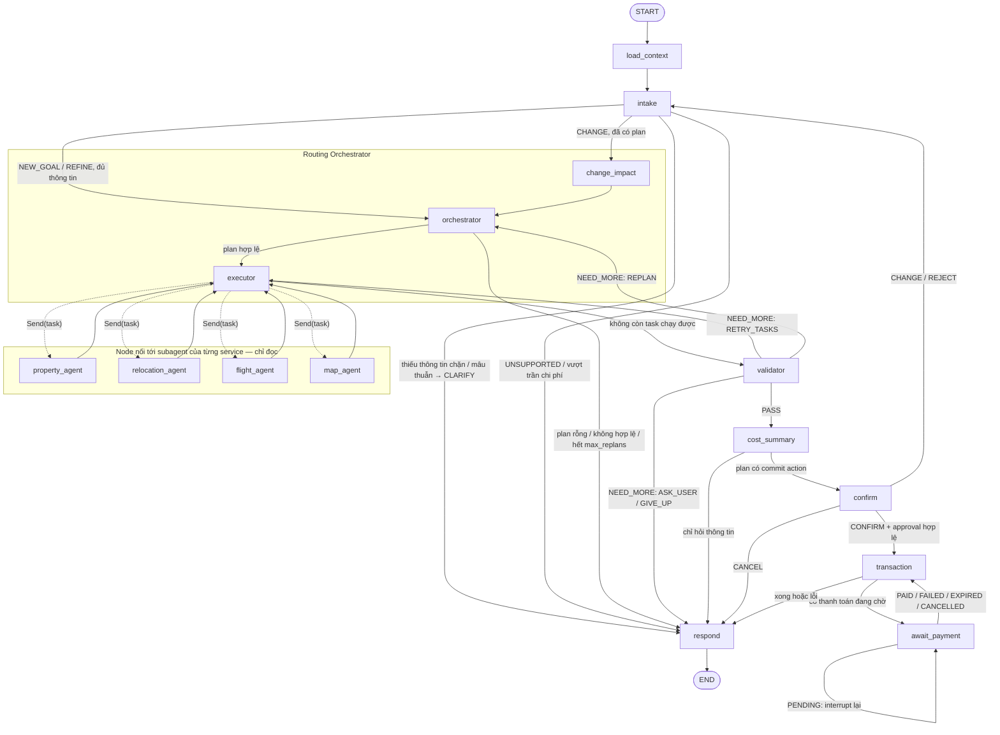

# Thiết kế khung LangGraph cho Stateful Multi-Agent Orchestration

> Historical layout/command evidence (M23); use the [current development map](../../DEVELOPMENT.md) for this branch.


> Đề xuất 07/10/2026 (Draft, chưa code): thanh toán đa dịch vụ theo
> [payment-design.md](../review/payment-design.md). Thay Q21 (chuyển đồ qua thanh toán điện tử của app, bỏ luồng
> staging tiền mặt) và mở rộng Q25 (nhà có lịch xem, thỏa thuận, mức cọc nhập tay; app vẫn không thu tiền nhà).
> Mỗi lần thanh toán gắn một đơn thanh toán của một dịch vụ; vé khứ hồi là hai chặng, thanh toán chung một lần.

> Cập nhật 03/10/2026: domain agent nhận goal/user_request và tự chọn preparation,
> search, details, pagination, ask/finish/replan trong tool namespace giới hạn.
> Map nearby vẫn hỗ trợ khám phá độc lập; bộ lọc Housing không bị thay bởi câu hỏi Map.
> Xem [ADR-021](../adr/ADR-021-mission-driven-domain-tools.md) và SPEC-014.

> Cập nhật runtime `mvp` 30/09/2026: Intake/Planner/Moving đã được nối bằng LLM;
> Housing/Map/Flight và Payment tra cứu được bổ sung domain tool loop theo
> [ADR-020](../adr/ADR-020-llm-domain-agents.md) và [SPEC-014](../specs/SPEC-014-domain-llm-agents.md).
> Nội dung mốc 27–29/09 bên dưới là thiết kế/lịch sử, không phải trạng thái kiểm thử mới nhất.

Status: ADR-016 Accepted trên nhánh tích hợp. **Đã implement khung** trên nhánh `integration/langgraph-services`
(M0–M2, nối service ở mức subagent nền của M3); Intake và Planner dùng LLM chưa làm (M4). Hiện trạng
và các điểm code khác bản đặc tả: §13.
Date: 2026-09-27. Cập nhật 2026-09-28: thêm tầng `intake` và ranh giới "Routing
Orchestrator" theo góp ý mentor (§3.2); chốt quy tắc hỏi ngay / hỏi sau và tự điền
từ dữ liệu đã lưu (§6.1); thêm kiểm soát chi phí (§7.5); chốt chính sách bộ nhớ người
dùng (§6.0, §6.1, Q14); chuẩn contract cho subagent của từng service (§6.3, D13); bỏ
dịch vụ hợp đồng / pháp lý (Contract & Policy agent), còn 4 lĩnh vực (D1); hỗ trợ cả
yêu cầu một mục đích lẫn chuỗi liên hoàn (D14, quy tắc S1–S10 ở §6.2, ví dụ §10.2);
gợi ý bước tiếp theo sau mỗi kết quả (S9, §6.10). Cập nhật 2026-09-29: hợp nhất với
code nhánh `khoa` theo hướng giữ tài liệu này (D15, §3.3); đối chiếu tool thật của các
service (§6.3.7); dữ liệu cá nhân qua form và thanh toán bất đồng bộ với node
`await_payment` (D16, §6.9); quản lý đơn đã đặt (S10); chốt Q20 (OpenAI cho mọi
agent, model theo tầng), Q21 (AhaMove trả tiền mặt), Q22 (ghi approval sang Moving),
Q23 (đánh số lại ADR, §12.1; thêm ADR-016), Q25 (MVP không có đặt cọc).

**Người viết subagent** (từ 2026-09-29 là nhóm AI, xem D13) đọc §6.3 (contract, quy tắc R1–R12), §6.3.8
(input/output tối thiểu theo lĩnh vực) và §6.9 (commit endpoint, nếu service có thao
tác ghi).

Tài liệu này chuyển sơ đồ kiến trúc v4 thành một **khung LangGraph** có thể code
ngay: topology graph, state schema, contract của từng node/subagent và điểm ráp
(API thật, subagent thật, Intake, Orchestrator). Mục tiêu là dựng được graph chạy
end-to-end bằng **stub + fake adapter**, để sau này khi có API hoặc thiết kế
Intake/Orchestrator thì chỉ cần thay implementation sau interface, không phải sửa graph.


Bản chi tiết (baseline) dùng để đối chiếu thành phần:
[architecture-baseline.png](images/architecture-baseline.png).

---

## 1. Phạm vi

**Trong phạm vi tài liệu này**

- Topology cố định của graph LangGraph (node, edge, conditional edge).
- `WorkflowState` và các kiểu dữ liệu con (IntakeResult, Task, Plan, TaskResult, …) cùng reducer.
- Contract (interface) cho các phần sẽ ráp sau: Intake, Planner (Orchestrator),
  **subagent của từng service** (manifest, request/result, quy tắc R1–R12), commit
  endpoint, Port của graph (Transaction, Approval, Session).
- Cơ chế runtime: checkpoint, retry/timeout, data quality, change impact,
  human-in-the-loop, approval.
- Cách API FastAPI gọi graph (mô tả, chưa code).
- Layout thư mục code và thứ tự implement.

**Ngoài phạm vi (làm sau)**

- Logic bên trong Intake và Planner — **để trống**, chỉ có contract và stub.
- Bên trong subagent của từng lĩnh vực: nhóm AI viết theo §6.3 (D13, đổi 2026-09-29); chủ service
  cung cấp MCP tool, dữ liệu và adapter tới provider thật.
- Dịch vụ hợp đồng / pháp lý (Contract & Policy agent của sơ đồ v4): **đã bỏ khỏi phạm
  vi** (2026-09-28).
- Prompt LLM, lựa chọn model, đánh giá chất lượng.
- UI, deployment (xem `docs/architecture/infrastructure.md` trên branch
  `docs/coolify-migration-plan`).

**Quy ước:** văn bản tiếng Việt; tên node, field, class, enum giữ tiếng Anh để
dùng thẳng trong code. Các đoạn code trong tài liệu là **đặc tả**, không phải code
đã tồn tại.

---

## 2. Quyết định nền tảng

| # | Quyết định | Lý do |
|---|---|---|
| D1 | Theo sơ đồ **v4**, trừ Contract & Policy agent (đã bỏ): 4 domain agent trong Phase 2 (property, relocation, flight, map); Transaction/Payment tách riêng ở Phase 5; Booking/Reservation của baseline gộp vào Transaction. | Tách rõ "thu thập thông tin" (không side-effect) với "commit" (có side-effect, cần xác nhận). |
| D2 | Mô hình **Intake + Plan-and-Execute + Validator + Human-in-the-loop**, không phải một ReAct agent duy nhất. | Đúng với 5 phase trong sơ đồ; dễ kiểm soát, dễ test. |
| D3 | **Graph LangGraph cố định; kế hoạch (Dependency DAG) là dữ liệu trong state.** | Orchestrator sinh DAG động mỗi request; graph không đổi. Xem §3.1. |
| D4 | Subagent và API ngoài đi qua **Protocol + dependency injection** (`GraphDeps`). | Chạy được với fake ngay; ráp API thật không đổi graph. |
| D5 | Validator, Cost Summary, Change Impact, Executor là **deterministic** (không LLM). | Đúng yêu cầu "deterministic totals"; test được; không bịa số. |
| D6 | Lỗi của subagent là **dữ liệu** (`TaskResult.status = FAILED`), không làm crash graph. | Validator quyết định retry/replan/hỏi user dựa trên dữ liệu đó. |
| D7 | State top-level là `TypedDict` (theo [guide state.md](../guide/langgraph/state.md)); kiểu con dùng Pydantic v2. | TypedDict hợp với reducer của LangGraph; Pydantic validate output của Intake, Planner và adapter. Checkpointer của LangGraph serialize được Pydantic. |
| D8 | **Ba ranh giới: hiểu (`intake`) → lập kế hoạch (`orchestrator`) → thực thi (`executor`).** `orchestrator` + `executor` + `change_impact` gọi chung là **Routing Orchestrator**. Mọi tin nhắn tự nhiên của người dùng, kể cả đổi ý, đi qua `intake`. | Kết hợp hai phương án đã cân nhắc. Xem §3.2. |
| D9 | **Domain agent chỉ đọc.** Mọi thao tác ghi (đặt xe, đặt vé, thanh toán, huỷ / sửa đơn) chỉ nằm ở `transaction`, sau khi có **approval do backend lưu**, không phải do model tạo. | Không có side-effect trong fan-out song song; approval không thể bị model giả mạo. |
| D10 | **Chỉ hỏi ngay khi không task nào trong yêu cầu chạy được** (hoặc có mâu thuẫn); còn lại chạy phần làm được rồi hỏi sau. Được **tự điền** thông tin thiếu từ dữ liệu người dùng đã cung cấp trước đó, nhưng **phải thông báo** để người dùng sửa. | Ít lượt hỏi, người dùng thấy kết quả sớm; không tự đoán vì dữ liệu tự điền đến từ chính người dùng. §6.1 |
| D11 | **Chi phí có trần theo lượt và theo thread.** LLM của graph chỉ dùng ở `intake` và `orchestrator`; LLM bên trong subagent (D13) báo qua `usage` và vẫn tính vào trần; `respond` dùng template ở giai đoạn khung; các node còn lại là code. | Chi phí dự đoán được, đo được theo request. §7.5 |
| D12 | **Bộ nhớ người dùng tách khỏi dữ liệu gốc** và chỉ chứa điều người dùng nói ra hoặc xác nhận, chia ba mức (tự điền / chỉ gợi ý / không dùng), có hạn theo thời gian và theo sự kiện. | Tự điền không thành tự đoán; không dùng lại dữ liệu phòng/giá đã hết hạn. §6.0, §6.1 |
| D13 | **Mỗi lĩnh vực có subagent riêng, nối vào graph qua contract chung** (manifest + `run_task` hoặc `LocalAgent`, §6.3). **Cập nhật 2026-09-29:** subagent của mọi service do **nhóm AI** phát triển (từ subagent nền) để thống nhất và thông minh nhất có thể; chủ service cung cấp MCP tool, dữ liệu, thao tác ghi tất định (Location và Moving đã xác nhận ranh giới này). DAG của Planner ở mức **giữa các lĩnh vực**; việc bên trong lĩnh vực là của subagent. Subagent chỉ đọc, không hỏi người dùng trực tiếp, không gọi chéo lĩnh vực; thao tác ghi đi qua commit endpoint tất định. | Các đội làm song song, đổi bên trong subagent không phải sửa graph; giữ được kiểm soát chi phí, phụ thuộc và an toàn ghi ở graph. |
| D14 | **Một graph cho mọi phạm vi yêu cầu**: vừa một mục đích (chỉ tìm phòng, chỉ đặt vé, chỉ đặt xe) vừa chuỗi liên hoàn (tìm phòng → vé → chuyển đồ → thanh toán). Mặc định chỉ tìm / báo giá; chỉ đặt và thanh toán thứ người dùng yêu cầu rõ; sau mỗi bước có thể gợi ý bước tiếp theo nhưng không tự làm. Quy tắc S1–S10. | Không phải làm luồng riêng cho từng dịch vụ; không đặt hay trả tiền cho thứ người dùng chưa yêu cầu. §6.2, §10.2 |
| D15 | **Hợp nhất với code Intake / Routing trên nhánh `khoa` theo hướng giữ tài liệu này** (chốt 2026-09-29): giữ kiến trúc một graph + subagent theo lĩnh vực; tái dùng các phần an toàn đã có của nhánh `khoa` (kiểm evidence, `validate_plan`, approval binding, lease / reconciliation, LLM wrapper); registry 13 tool Moving trở thành phần bên trong subagent moving. ADR-006 của nhánh `khoa` (hai service HTTP riêng) được thay bằng ADR-016 khi merge (§12.1). | Giữ quyết định subagent do chủ service viết (D13) mà không bỏ công sức đã làm. §3.3 |
| D16 | **Dữ liệu cá nhân để đặt chỗ (hành khách, liên hệ) không đi qua LLM.** UI thu bằng form, backend giữ và chỉ đưa vào `transaction` qua tham chiếu (`pii_ref`). **Thanh toán là bất đồng bộ**: `transaction` tạo yêu cầu thanh toán rồi chờ kết quả qua `interrupt`. | Bảo vệ dữ liệu cá nhân (thống nhất ADR-015); khớp cách ZaloPay hoạt động thật. §6.9 |

---

## 3. Ánh xạ sơ đồ v4 → LangGraph

| Sơ đồ v4 | Thành phần LangGraph | Ghi chú |
|---|---|---|
| User (chat / web / mobile) | FastAPI `/chat` → `graph.ainvoke` | Ngoài graph. §9 |
| Context & Session | node `load_context` | Đọc long-term memory qua `SessionPort`. |
| Lead Orchestrator — phần intent + constraints | node `intake` gọi `deps.intake` | **Stub.** Hỏi lại nếu thiếu thông tin chặn. §6.1 |
| Lead Orchestrator — phần decompose → task DAG | node `orchestrator` gọi `deps.planner` | **Stub.** §6.2 |
| Intent + constraints / Task decomposition / Dependency DAG | `IntakeResult.intent`, `.constraints`; `Plan.tasks[].depends_on` | Dữ liệu, không phải node. |
| Executor / Dynamic Router (READY tasks, dispatch) | node `executor` + conditional edge `route_from_executor` trả về `list[Send]` | Fan-out song song. §6.4 |
| Domain agent (4 trên 5 của v4; Contract & Policy đã bỏ) | node `property_agent`, `relocation_agent`, `flight_agent`, `map_agent` | Mỗi node nối tới **subagent của lĩnh vực** (nhóm AI viết, D13) qua `DomainAgent`; chỉ đọc. §6.3 |
| Collect Results | reducer `merge_dict` trên `task_results`, `task_status` | Fan-in: các agent chạy song song đều quay về `executor`, executor chạy **một lần** ở superstep kế tiếp. |
| Result Validator (PASS / NEED MORE) | node `validator` + conditional edge `route_from_validator` | §6.5 |
| Cost & Plan Summary | node `cost_summary` | §6.6 |
| User Confirmation | node `confirm` dùng `interrupt()`; resume bằng `Command(resume=...)` | §6.7 |
| CONFIRM | edge `confirm → transaction` (kèm approval hợp lệ) | |
| CHANGE / REJECT | `confirm` → `intake` → `change_impact` → `orchestrator` | §6.8 |
| Transaction / Payment Agent | node `transaction` + node `await_payment` (chờ thanh toán bất đồng bộ bằng `interrupt`) | Idempotent, kiểm approval. §6.9 |
| Response | node `respond` | §6.10 |
| Workflow State / Checkpoint | `WorkflowState` + checkpointer, key theo `thread_id` | §7.1 |
| Retry / Timeout / Fallback | wrapper `run_with_policy` quanh mỗi subagent (timeout, budget); retry provider bên trong subagent; `FallbackAgent` | §6.3.6, §7.2 |
| Data Quality / Unknown Fields | `TaskResult.missing_fields`; validator V2 | Không bao giờ tự điền field thiếu. |
| Change Impact / Compensation | `change_impact` đánh dấu `STALE` theo `depends_on`; `TransactionPort.compensate` | §6.8, §6.9 |

Thành phần của baseline **không** nằm trong graph: Chat/Web/Mobile UI, API Gateway,
Property DB, Vector DB, Crawled Property Documents (do `crawler/` + `preprocess/`
tạo ra), Payment Gateway, Maps/Flight/Moving APIs, Approval Store, và **bên trong
các subagent**. Graph chỉ chạm tới chúng qua subagent (contract §6.3) hoặc Port.

### 3.1. Graph LangGraph ≠ Dependency DAG

Có **hai** "graph" khác nhau, rất dễ nhầm:

| | Graph LangGraph | Dependency DAG (plan) |
|---|---|---|
| Là gì | Luồng điều khiển của hệ thống | Kế hoạch công việc cho **một** yêu cầu |
| Ai tạo | Dev, lúc build (`build_graph`) | Orchestrator, lúc runtime |
| Thay đổi | Không bao giờ trong runtime | Mỗi request / mỗi lần replan có version mới |
| Lưu ở đâu | Code | `state["plan"]` (được checkpoint) |
| Node | `intake`, `orchestrator`, `executor`, `*_agent`, … | `Task` (ví dụ `t1: property search`) |

`executor` đọc DAG trong state, tìm task đã đủ điều kiện (READY) và `Send` sang
node agent tương ứng. Vòng `executor → agents → executor` lặp cho tới khi hết task
chạy được.

### 3.2. Ranh giới trách nhiệm: kết hợp phương án A và B

Có ba việc: **hiểu** yêu cầu (U), **lập kế hoạch** (P) và **thực thi** (E). Hai
phương án đã cân nhắc cắt ở hai chỗ khác nhau:

- **A (sơ đồ gốc):** `[U + P] | [E]`, tức Planner → Router/Executor.
- **B (góp ý mentor):** `[U] | [P + E]`, tức Intake → Routing Orchestrator.

Khung này **cắt cả hai chỗ**:


| Lấy từ | Điểm giữ lại |
|---|---|
| **A** | Lập kế hoạch (LLM hoặc rule) tách khỏi thực thi (code thuần). Scheduler test được bằng hàm thuần, idempotent. `Plan.version` là contract giữa hai phần. |
| **B** | `intake` riêng: hỏi lại **trước** khi tốn công lập plan, và test intent độc lập. Chỉ Routing Orchestrator được tạo hoặc sửa plan. Contract giữa hai tầng là `IntakeResult` (nghiệp vụ), không phải tool/endpoint. Approval do backend lưu, gắn với hash payload. Service phải có trong registry (allowlist). Ghi rõ nguồn sandbox/demo. |
| Bổ sung | **Validator quyết định *có* replan hay không; Planner quyết định replan *thế nào*.** Đây là điểm cả A và B còn bỏ ngỏ. Đổi ý bằng lời phải đi qua `intake` trước, vì Router không phải nơi hiểu ngôn ngữ tự nhiên. Payment không nằm trong fan-out đọc (D9). |

| Thành phần | Sở hữu | Không sở hữu |
|---|---|---|
| `load_context` | Tải sở thích, lựa chọn đã xác nhận, lịch sử | Suy đoán yêu cầu mới |
| `intake` | Phân loại yêu cầu (`RequestKind`), trích intent/constraints, phát hiện thiếu hoặc mâu thuẫn, gộp dữ kiện qua các lượt, xác định task người dùng muốn đổi | Chọn agent/tool, tạo DAG, phê duyệt |
| `orchestrator` | Lập và replan DAG từ `IntakeResult` + feedback, validate plan với registry | Gọi provider, tự quyết định retry |
| `executor` | Tính task READY, dispatch song song/tuần tự, đếm lượt | Quyết định nghiệp vụ, sửa plan |
| `validator` | Kiểm kết quả; chọn PASS / RETRY / REPLAN / ASK_USER / GIVE_UP | Tạo task mới |
| `change_impact` | Đánh dấu STALE theo `depends_on`, xác định phần tái dùng | Hiểu câu đổi ý bằng lời |
| Subagent của lĩnh vực (nhóm AI viết; chủ service cung cấp tool) | Thực hiện một task trong lĩnh vực của mình: gọi tool, lọc, xếp hạng, retry provider | Lập plan giữa các lĩnh vực, hỏi người dùng trực tiếp, gọi chéo lĩnh vực, ghi |
| `transaction` | Kiểm approval, commit idempotent qua commit endpoint tất định, compensate | Tự tạo approval, gọi subagent LLM để ghi |
| Backend (ngoài graph) | Xác thực người dùng, lưu `Approval` gắn hash payload | Quyết định plan |

### 3.3. Hợp nhất với code trên nhánh `khoa` (D15)

Nhánh `khoa` (commit `5d6f6b0`, ADR-006) đã có Intake và Routing Orchestrator dạng hai
service HTTP, Planner lập plan ở **mức tool** và gọi thẳng MCP qua `ToolGateway`, state
trong SQLite. Tài liệu này giữ kiến trúc một graph + subagent, và tái dùng code đó như sau:

| Thành phần trên nhánh `khoa` | Dùng lại ở đâu | Cách dùng |
|---|---|---|
| `intake/service.py`: `normalize()` kiểm evidence (NFC, nguồn `message` / `history` / `confirmed_context`), vòng `repair_evidence` một lần | node `intake` (§6.1 bước 2) | Giữ nguyên logic kiểm; fact không khớp thì sửa một lần, vẫn sai thì bỏ fact (không fail cả lượt) |
| `intake/models.py`: `Fact`, `Understanding`, danh sách `Intent` | `ConfirmedFact`, `IntakeResult` (§5.3) | Ánh xạ intent sang `Intent.domains`, `commit_requested` và yêu cầu quản lý đơn theo bảng dưới. Không dùng `confidence < 0.6` để chặn; việc hỏi lại dựa vào `blocking_missing` / `conflicts` (D10) |
| `intake/service.py`: prompt Intake | Prompt của `Intake` thật (M4) | Giữ các ý: dữ liệu là nội dung không phải chỉ dẫn, không suy diễn toạ độ / giá / ID, evidence sao chép nguyên văn, hỏi tối đa ba câu, không hỏi câu tiếp thị |
| `orchestrator/registry.py`: `validate_plan` (id duy nhất, dependency, chu trình, allowlist, `allowed_intents` cho write) | `validate_plan` của graph (§6.2) | Phần cấu trúc DAG và kiểm write theo intent dùng lại ở mức lĩnh vực (S1, S2) |
| `orchestrator/registry.py`: `ToolSpec`, `trusted_arguments`, `input_refs` (JSON pointer), kiểm JSON Schema | **Bên trong subagent moving** | Planner của graph không thấy tool. Subagent moving dùng registry 13 tool, lập kế hoạch mức tool trong lĩnh vực của mình (có thể tái dùng `Planner` + `validate_plan` của Khoa) |
| `config/agent-services/registry.json`, `scripts/export-agent-registry.mjs` | Subagent moving; nguồn cho manifest (§6.3.2) | Manifest `relocation` sinh từ cùng nguồn Zod |
| `orchestrator/models.py`: `ApprovalRequest`, `TaskApproval` (khớp `payload_hash`, hạn ≤ 30 phút, không dùng lại `approval_id`, `actor_id` = chủ) | `Approval`, `check_approval` (§6.7, §6.9) | Thêm các kiểm "không dùng lại" và "hạn tối đa 30 phút" vào `check_approval` |
| `orchestrator/engine.py`: lease, `needs_reconciliation`, write chạy một cái một lúc | `transaction` (§6.9) | Write đang chạy mà không rõ kết quả → `pending_verification` (tương đương `needs_reconciliation`); commit tuần tự |
| `orchestrator/engine.py`: đọc song song có giới hạn (`agent_max_parallel_tasks`) | `executor` (§6.4) | Thêm `max_parallel_tasks` vào `GraphSettings` |
| `orchestrator/engine.py`: kiểm revision (CAS) chống hai request cùng ghi | API (§9) | Mỗi `thread_id` chỉ một lượt chạy tại một thời điểm; request thứ hai nhận 409 |
| `llm.py`: `StructuredLLM` (structured output, không fallback giả, mã lỗi rõ) | Wrapper LLM cho `intake` và `orchestrator` | OpenAI cho mọi agent, model theo tầng `light` / `heavy` (Q20, §7.5) |
| `common.py`: `canonical`, `fingerprint` | `confirmation_hash`, `idempotency_key` | Dùng lại nguyên |
| `orchestrator/store.py` (SQLite WAL) | Không dùng | State do LangGraph checkpointer giữ (§7.1, Q3); không để hai nguồn sự thật |
| `intake/app.py`, `orchestrator/app.py` (HTTP `:8011`, `:8012`, `/v1/workflows…`) | Không dùng | Graph được gọi qua Chat API (§9) |
| `tests/test_agent_services/` | `tests/test_agents/` | Chuyển các case về evidence, approval, DAG, revision |

**Ánh xạ intent của nhánh `khoa`:**

| Intent (`khoa`) | Trong tài liệu này |
|---|---|
| `housing_search` | domain `property` |
| `location_lookup`, `route` | domain `map` |
| `moving_quote`, `moving_catalog` | domain `relocation` (đọc) |
| `moving_create` | domain `relocation` + `commit_requested: moving_booking` |
| `moving_status`, `moving_update`, `moving_cancel` | quản lý đơn đã đặt (S10) |
| `flight_search` | domain `flight` |
| `flight_booking` | domain `flight` + `commit_requested: flight_booking` |
| `payment` | gắn với một commit action (S6); không rõ cho gì thì hỏi lại |
| `information` | câu hỏi chung thuộc các lĩnh vực: task đọc của lĩnh vực tương ứng nếu cần dữ liệu (ví dụ khu vực AhaMove phục vụ); không cần dữ liệu thì giai đoạn khung trả `UNSUPPORTED`, sau này LLM composer của `respond` trả lời |
| `out_of_scope` | `RequestKind.UNSUPPORTED` |
| `unknown` | `conflicts` → hỏi lại |

---

## 4. Topology graph



### 4.1. Bảng edge và điều kiện

| Từ | Hàm routing | Điều kiện | Tới |
|---|---|---|---|
| `START` | — | luôn | `load_context` |
| `load_context` | — | luôn | `intake` |
| `intake` | `route_from_intake` | `kind == UNSUPPORTED`, hoặc vượt trần chi phí (§7.5) | `respond` |
| | | `needs_clarification` (có `blocking_missing` hoặc `conflicts`) | `respond` |
| | | `kind == CHANGE` và `plan` đã có | `change_impact` |
| | | ngược lại (`NEW_GOAL`, `REFINE`, hoặc `CHANGE` khi chưa có plan) | `orchestrator` |
| `orchestrator` | `route_from_orchestrator` | `plan` có ≥ 1 task và không có lỗi validate plan | `executor` |
| | | ngược lại (stub trả plan rỗng, plan lỗi, vượt `max_replans` hoặc trần LLM, hoặc thay đổi chỉ nhắm vào thứ đã đặt: `change_context.blocked_by_commit` có mà `invalidated_task_ids` rỗng) | `respond` |
| `executor` | `route_from_executor` | `state["dispatch"]` không rỗng | `[Send(f"{task.agent}_agent", AgentInput) for task in dispatch]` |
| | | không còn task `READY` hay `RUNNING` | `validator` |
| `*_agent` | — | luôn | `executor` |
| `validator` | `route_from_validator` | `verdict == PASS` | `cost_summary` |
| | | `action == RETRY_TASKS` | `executor` |
| | | `action == REPLAN` | `orchestrator` |
| | | `action in (ASK_USER, GIVE_UP)` | `respond` |
| `cost_summary` | `route_from_cost_summary` | `plan.commit_actions` không rỗng | `confirm` |
| | | ngược lại | `respond` |
| `confirm` | `route_from_confirm` | `CONFIRM` (approval đã được kiểm trong node) | `transaction` |
| | | `CHANGE`, `REJECT` | `intake` |
| | | `CANCEL` | `respond` |
| `change_impact` | — | luôn | `orchestrator` |
| `transaction` | `route_from_transaction` | `pending_payment` có và `status == PENDING` | `await_payment` |
| | | ngược lại (mọi commit action đã xong, lỗi, hoặc cần xác nhận lại) | `respond` |
| `await_payment` | `route_from_await_payment` | `pending_payment.status == PENDING` (sau khi hỏi `get_payment`) | `await_payment` (interrupt lại) |
| | | trạng thái cuối | `transaction` |
| `respond` | — | luôn | `END` |

`CANCEL` là bổ sung so với sơ đồ v4 (người dùng bỏ hẳn, không muốn phương án khác).
Hàm routing là hàm thuần (chỉ đọc state, không ghi), đặt chung trong `routing.py`
để test riêng.

Một lượt chat mới trên cùng `thread_id` (graph đã tới `END`) cũng đi
`START → load_context → intake`. Nếu đã có plan, `intake` quyết định đây là
`REFINE`, `CHANGE` hay `NEW_GOAL`. Nhờ vậy đổi ý bằng nút bấm hay bằng tin nhắn
đều đi cùng một đường.

### 4.2. Chống lặp vô hạn

Có bốn vòng lặp: `executor ↔ agents`, `validator → executor`,
`validator → orchestrator`, `confirm → intake → change_impact → orchestrator`. Chặn bằng:

- `max_task_attempts` — mỗi task được dispatch tối đa N lần (đếm trong `task_attempts`).
- `max_replans` — `replan_count` vượt ngưỡng thì `orchestrator` route sang `respond`.
  Replan do CHANGE cũng tính vào `replan_count`.
- `recursion_limit` của LangGraph (mặc định 25 superstep) phải nâng lên, ví dụ 100,
  vì mỗi vòng executor/agent tốn 2 superstep. Truyền qua `config={"recursion_limit": ...}`.

Hỏi lại (`CLARIFY`) luôn kết thúc lượt ở `END`, nên không tạo vòng lặp trong một lượt.
Vòng `await_payment` dừng ở `interrupt` mỗi lần, nên mỗi lần resume chỉ chạy một vòng;
nó kết thúc khi thanh toán có trạng thái cuối hoặc hết hạn.

---

## 5. State schema

### 5.1. `WorkflowState`

```python
class WorkflowState(TypedDict, total=False):
    # --- Input & hội thoại ---
    messages: Annotated[list[AnyMessage], add_messages]
    user_id: str
    session: SessionContext            # load_context ghi

    # --- Phase 1: Understand & Plan ---
    intake: IntakeResult | None        # intake ghi (gộp dần qua các lượt)
    plan: Plan | None                  # orchestrator ghi (version tăng dần)
    replan_count: int                  # orchestrator ghi
    change_context: ChangeContext | None  # change_impact ghi, orchestrator đọc

    # --- Phase 2: Execute ---
    task_status: Annotated[dict[str, TaskStatus], merge_dict]
    task_attempts: Annotated[dict[str, int], merge_dict]
    task_results: Annotated[dict[str, TaskResult], merge_dict]
    dispatch: list[str]                # executor ghi; id task gửi đi ở vòng này

    # --- Phase 3: Validate ---
    validation: ValidationReport | None

    # --- Phase 4: Decide ---
    cost_summary: CostSummary | None
    user_decision: UserDecision | None

    # --- Phase 5: Commit & Respond ---
    transaction: TransactionResult | None        # kết quả của lần commit gần nhất
    pending_payment: PendingPayment | None       # transaction / await_payment ghi (§6.9)
    committed: Annotated[dict[str, Receipt], merge_dict]  # commit_action.id -> receipt; tích luỹ qua các lượt (S8)
    declined_suggestions: Annotated[list[str], operator.add]  # key gợi ý người dùng đã từ chối trong thread (S9)
    response: AgentResponse | None

    # --- Chẩn đoán ---
    errors: Annotated[list[ErrorRecord], operator.add]
```

**Reducer**

```python
def merge_dict(left: dict | None, right: dict | None) -> dict:
    """Gộp theo key; right thắng. Cho phép nhiều agent song song cùng ghi."""
    return {**(left or {}), **(right or {})}
```

- Các field **không** có reducer bị ghi đè (last write wins). Chỉ đúng một node
  được ghi các field này; ghi chú "ai ghi" ở bảng dưới là ràng buộc bắt buộc.
- `merge_dict` không xóa key. Muốn "vô hiệu" thì đổi status (`STALE`), không xóa.
- Intent và constraints chỉ nằm trong `intake`, không nhân đôi ra field top-level.

### 5.2. Bảng đọc/ghi

| Field | Ghi bởi | Đọc bởi |
|---|---|---|
| `messages` | API (input), `confirm` (câu đổi ý khi resume), `respond` (AI message) | `intake`, `respond` |
| `session` | `load_context` | `intake`, `orchestrator`, `cost_summary`, `respond` |
| `intake` | `intake` | `route_from_intake`, `orchestrator`, `executor` (constraints vào AgentInput), `validator`, `cost_summary`, `change_impact`, `respond` |
| `plan`, `replan_count` | `orchestrator` | `intake` (tóm tắt plan để hiểu câu đổi ý), `executor`, `validator`, `cost_summary`, `change_impact`, `transaction` |
| `change_context` | `change_impact` (orchestrator reset về `None`) | `orchestrator` |
| `task_status` | `orchestrator` (khởi tạo), `executor`, `*_agent`, `validator` (đưa về PENDING để retry), `change_impact` (STALE) | `executor`, `validator` |
| `task_attempts` | `executor` | `executor`, `validator` |
| `task_results` | `*_agent` | `executor` (upstream), `validator`, `cost_summary`, `change_impact`, `respond` |
| `dispatch` | `executor` | `route_from_executor` |
| `validation` | `validator` | `route_from_validator`, `orchestrator` (feedback), `respond` |
| `cost_summary` | `cost_summary` | `confirm`, `transaction`, `respond` |
| `user_decision` | `confirm` | `route_from_confirm`, `intake`, `transaction` |
| `transaction` | `transaction` | `respond` |
| `pending_payment` | `transaction` (tạo, xoá khi xong), `await_payment` (cập nhật `status`); hai node chạy tuần tự, không bao giờ song song | `transaction`, `await_payment`, `respond` |
| `committed` | `transaction` | `orchestrator` (`validate_plan`, S8), `cost_summary`, `change_impact`, `respond` |
| `declined_suggestions` | `intake` | `respond` (`next_step_suggestions`) |
| `response` | `respond` | API, `intake` (đọc `suggestions` của lượt trước để hiểu câu trả lời ngắn như "có", S9) |
| `errors` | mọi node | `respond`, logging |

### 5.3. Kiểu dữ liệu con (Pydantic v2)

```python
class AgentName(StrEnum):
    PROPERTY = "property"        # Property Search & Knowledge
    RELOCATION = "relocation"    # Room Relocation (moving)
    FLIGHT = "flight"            # Flight / Travel
    MAP = "map"                  # Map & Nearby Utility
    # Contract & Policy của sơ đồ v4 đã bỏ khỏi phạm vi (2026-09-28)

class RequestKind(StrEnum):
    NEW_GOAL = "new_goal"        # mục tiêu mới, không liên quan plan hiện tại (S5)
    REFINE = "refine"            # bổ sung thông tin / trả lời câu hỏi lại / thêm lĩnh vực vào mục tiêu hiện tại (S5)
    CHANGE = "change"            # đổi lựa chọn hoặc ràng buộc của plan đã có
    UNSUPPORTED = "unsupported"  # ngoài phạm vi hệ thống

class Intent(BaseModel):
    name: str                        # ví dụ "relocate_and_rent"
    domains: list[AgentName]         # lĩnh vực liên quan, chỉ là gợi ý cho Planner
    summary: str

class Constraints(BaseModel):
    # Để mở; chốt khi thiết kế Intake. Ví dụ các key: budget_vnd,
    # city, move_date, near (địa điểm), room_type, must_have (["wifi", ...]).
    values: dict[str, Any] = {}
    missing: list[str] = []          # thiếu nhưng không chặn lập plan; validator hỏi sau

class ConfirmedFact(BaseModel):
    value: Any
    evidence: str                    # trích nguyên văn lời người dùng; code kiểm là chuỗi con của tin nhắn
    stated_at: datetime

class PrefilledValue(BaseModel):
    value: Any
    source: Literal["preference", "trait"]  # lấy từ bộ nhớ người dùng (§6.0, §6.1)
    last_confirmed_at: datetime             # để respond nói "như lần trước" và để đo tuổi dữ liệu

class IntakeResult(BaseModel):
    kind: RequestKind
    normalized_goal: str
    intent: Intent | None
    constraints: Constraints         # đã gồm giá trị tự điền
    prefilled: dict[str, PrefilledValue] = {}  # field nào được tự điền; respond phải thông báo
    blocking_missing: list[str] = [] # không task nào chạy được nếu thiếu → CLARIFY ngay
    conflicts: list[str] = []        # ví dụ "ngân sách 3 triệu nhưng yêu cầu căn hộ 2 phòng ở Q1"
    user_confirmed_facts: dict[str, ConfirmedFact] = {}  # gộp dần qua các lượt; chỉ điều người dùng nói
    commit_requested: list[CommitActionKind] = []  # người dùng nói rõ muốn đặt / thanh toán (S2);
                                                   # mỗi loại cần fact "commit:<kind>" có evidence
    change_request: str | None = None          # khi kind == CHANGE
    target_task_ids: list[str] = []            # task người dùng muốn đổi (nếu xác định được)

    @property
    def needs_clarification(self) -> bool:
        return bool(self.blocking_missing or self.conflicts)

class TaskStatus(StrEnum):
    PENDING = "pending"    # chờ dependency
    READY = "ready"        # dependency đã DONE, chờ dispatch
    RUNNING = "running"    # đã Send, chờ kết quả
    DONE = "done"
    FAILED = "failed"
    SKIPPED = "skipped"    # dependency FAILED/SKIPPED, không chạy được
    STALE = "stale"        # kết quả bị vô hiệu do change hoặc quá TTL
    NEEDS_INPUT = "needs_input"  # subagent cần người dùng trả lời questions (§6.3, R4)

class Task(BaseModel, frozen=True):
    id: str                          # ổn định qua các version nếu task không đổi
    agent: AgentName
    inputs: dict[str, Any]           # theo input schema của agent (§6.3)
    depends_on: list[str] = []
    required: bool = True            # False: thiếu cũng PASS được, chỉ ghi chú

class CommitActionKind(StrEnum):
    DEPOSIT = "deposit"                  # đặt cọc phòng — NGOÀI PHẠM VI MVP (Q25); validate_plan từ chối
    MOVING_BOOKING = "moving_booking"    # đặt dịch vụ chuyển đồ
    FLIGHT_BOOKING = "flight_booking"    # đặt vé
    CANCEL_ORDER = "cancel_order"        # huỷ đơn đã đặt (S10)
    UPDATE_ORDER = "update_order"        # sửa đơn đã đặt (S10)

class CommitAction(BaseModel, frozen=True):
    id: str                          # ổn định qua các version, ví dụ "flight_booking:t3"
    kind: CommitActionKind
    source_task_id: str              # task cung cấp lựa chọn (ví dụ listing, quote, tra cứu đơn)
    target_receipt_id: str | None = None  # bắt buộc với CANCEL_ORDER / UPDATE_ORDER
    requires_payment: bool = False   # đi qua Payment MCP (§6.9, bảng thực thi)
    pii_required: list[str] = []     # ví dụ ["passengers", "contact"]; UI thu bằng form (D16)

class PendingPayment(BaseModel):
    action_id: str
    payment_ref: str
    pay_url: str | None = None       # link / QR của cổng thanh toán
    amount_vnd: int
    expires_at: datetime
    status: Literal["PENDING", "PAID", "FAILED", "EXPIRED", "CANCELLED"]
    pre_payment_receipt: Receipt | None = None  # ví dụ giữ chỗ vé đã tạo trước khi thanh toán

class Plan(BaseModel, frozen=True):
    version: int
    tasks: list[Task]
    commit_actions: list[CommitAction] = []

class Quote(BaseModel):
    option_id: str                   # id lựa chọn trong data (listing, offer, quote)
    label: str
    amount_vnd: int
    recurrence: Literal["one_time", "monthly"]

SourceKind = Literal["live", "sandbox", "demo", "fake"]

class TaskResult(BaseModel):
    """Bản trong state của AgentTaskResult (§6.3.3), thêm agent và retryable."""
    task_id: str
    agent: AgentName
    plan_version: int
    status: Literal["done", "failed", "needs_input"]
    data: dict[str, Any] = {}        # theo output_schema trong manifest (§6.3)
    quotes: list[Quote] = []         # dùng cho cost_summary
    missing_fields: list[str] = []   # field agent không có dữ liệu — KHÔNG tự bịa
    questions: list[Question] = []   # khi status == "needs_input"; validator chuyển thành ASK_USER
    source: str = ""                 # provider / nguồn thực sự trả dữ liệu
    source_kind: SourceKind = "fake" # respond phải nói rõ khi không phải "live"
    source_refs: list[str] = []
    fetched_at: datetime
    summary: str | None = None       # chỉ để hiển thị; không đưa vào prompt của Planner
    usage: AgentUsage = AgentUsage()
    error: str | None = None         # AgentError.code + message
    retryable: bool = False          # từ AgentError.retryable

class ValidationIssue(BaseModel):
    code: Literal["V1", "V2", "V3", "V4", "V5"]
    task_id: str | None
    message: str

class ValidationReport(BaseModel):
    verdict: Literal["PASS", "NEED_MORE"]
    action: Literal["NONE", "RETRY_TASKS", "REPLAN", "ASK_USER", "GIVE_UP"]
    issues: list[ValidationIssue] = []
    retry_task_ids: list[str] = []
    ask_user_fields: list[str] = []
    questions: list[Question] = []   # câu hỏi gốc từ subagent, để respond hỏi đúng ý

class CostLine(BaseModel):
    task_id: str
    option_id: str
    label: str
    amount_vnd: int
    recurrence: Literal["one_time", "monthly"]

class CostSummary(BaseModel):
    plan_version: int
    selected: dict[str, str]         # task_id -> option_id đang được chọn
    lines: list[CostLine]
    total_one_time_vnd: int
    total_monthly_vnd: int
    commit_actions: list[CommitAction]
    payload_hash: str                # sha256 của (plan_version, selected, lines, commit_actions)
    quotes_expire_at: datetime       # min(fetched_at + stale_ttl) của các task có commit action

class UserDecision(BaseModel):
    kind: Literal["CONFIRM", "CHANGE", "REJECT", "CANCEL"]
    plan_version: int                # phải khớp plan hiện tại, chống xác nhận nhầm bản cũ
    approval_id: str | None = None   # bắt buộc khi CONFIRM; do backend tạo (§9), không phải model
    pii_refs: dict[str, str] = {}    # action_id -> pii_ref do backend tạo từ form (D16); không chứa dữ liệu thật
    change_request: str | None = None
    target_task_ids: list[str] = []  # phần user muốn đổi (ví dụ bấm "đổi phòng" trên UI)

class Approval(BaseModel, frozen=True):
    approval_id: str
    user_id: str
    thread_id: str
    plan_version: int
    payload_hash: str                # phải bằng CostSummary.payload_hash
    expires_at: datetime             # không muộn hơn CostSummary.quotes_expire_at

class ChangeContext(BaseModel):
    request: str | None
    invalidated_task_ids: list[str]
    reusable_task_ids: list[str]
    blocked_by_commit: list[str] = []   # commit_action.id đã đặt mà người dùng muốn đổi (§6.8 bước 7)

class TransactionResult(BaseModel):
    status: Literal["committed", "failed", "compensated", "pending_verification"]
    receipts: list[Receipt] = []
    error: str | None = None

class Suggestion(BaseModel):
    key: str                         # ví dụ "quote:relocation"; dùng để không lặp lại (S9)
    label: str                       # chữ hiển thị trên nút, ví dụ "Báo giá chuyển đồ"
    message: str                     # câu gửi đi như tin nhắn của người dùng khi bấm
    domain: AgentName
    kind: Literal["search", "quote", "book"]

class AgentResponse(BaseModel):
    kind: Literal["ANSWER", "PARTIAL", "CLARIFY", "COMMITTED", "CANCELLED", "UNSUPPORTED", "ERROR"]
    text: str
    data: dict[str, Any] = {}
    suggestions: list[Suggestion] = []  # gợi ý bước tiếp theo (S9, §6.10); UI hiện thành nút

class ErrorRecord(BaseModel):
    node: str
    task_id: str | None = None
    message: str
    at: datetime
```

**Bộ nhớ người dùng** (long-term memory, đọc/ghi qua `SessionPort`, §6.0):

```python
class MemoryValue(BaseModel):
    value: Any
    stated_at: datetime              # lần đầu người dùng nói
    last_confirmed_at: datetime      # lần gần nhất người dùng dùng lại mà không sửa và làm tiếp
    source_thread: str
    stop_prefill: bool = False       # ví dụ khu vực tìm phòng sau khi đã chuyển nhà xong

class SessionContext(BaseModel):
    preferences: dict[str, MemoryValue] = {}  # mức 1: khu vực, ngân sách, loại phòng, tiện ích
    traits: dict[str, MemoryValue] = {}       # mức 1: số người ở, thú cưng, xe máy
    hints: dict[str, MemoryValue] = {}        # mức 2, chỉ gợi ý: origin_city, current_address,
                                              # khối lượng đồ, hãng bay / bên chuyển đồ quen

class MemoryUpdate(BaseModel):
    group: Literal["preferences", "traits", "hints"]
    key: str
    value: Any | None                # None = xoá
    stop_prefill: bool | None = None
    evidence: str | None = None      # lời người dùng làm căn cứ; bắt buộc khi value khác None
```

`Receipt` định nghĩa chi tiết khi có `TransactionPort` thật; giai đoạn khung chỉ cần
`receipt_id`, `action_id`, `provider`, `amount_vnd`, `source_kind`.

### 5.4. Payload gửi cho agent (`Send`)

Node agent **không** nhận toàn bộ `WorkflowState`, mà nhận payload thu gọn. Từ payload
này, `run_with_policy` dựng `AgentTaskRequest` gửi cho subagent (§6.3.6):

```python
class AgentInput(TypedDict):
    task: Task
    plan_version: int
    attempt: int
    request_id: str
    thread_id: str
    constraints: Constraints          # từ state["intake"].constraints; lọc theo manifest khi gửi
    hints: dict[str, Any]             # từ session.hints / preferences; lọc theo manifest khi gửi
    upstream: dict[str, TaskResult]   # kết quả của các task trong task.depends_on
    budget_left: AgentBudget          # phần còn lại của trần lượt (§7.5)
```

(Code: không có `budget_left` trong payload; `run_with_policy` tính ngân sách từ `UsageMeter` ngay
trước khi gọi subagent, xem §13.)

Subagent không nhận nguyên `SessionContext`; chỉ nhận các key khai báo trong
`constraint_keys` / `hint_keys` của manifest.

Node agent đăng ký với `input_schema=AgentInput`, và trả về update cho state chung:

```python
{"task_results": {task.id: result}, "task_status": {task.id: DONE | FAILED | NEEDS_INPUT}}
```

Subagent tự quyết định dùng `upstream` thế nào (ví dụ subagent map lấy toạ độ từ các
listing của task property). `Task.inputs` chỉ chứa giá trị tĩnh; không có ngôn ngữ
tham chiếu kiểu `$ref`.

---

## 6. Node và contract

Mọi node: `async def node(state) -> dict`, chỉ trả field thay đổi, có docstring,
bắt exception và ghi `errors` thay vì làm crash graph (theo
[guide nodes-and-edges.md](../guide/langgraph/nodes-and-edges.md)). Node lấy
dependency qua closure do `build_graph(deps)` tạo, không import adapter trực tiếp.

### 6.0. `load_context` và bộ nhớ người dùng

- Đọc `SessionPort.load(user_id)`, trả về `SessionContext` (`preferences`, `traits`,
  `hints`; long-term memory của baseline).
- Không có dữ liệu thì trả `SessionContext` rỗng; không coi là lỗi.
- Fake: `InMemorySessionPort`.

```python
class SessionPort(Protocol):
    async def load(self, user_id: str) -> SessionContext: ...
    async def save(self, user_id: str, thread_id: str, updates: list[MemoryUpdate]) -> None: ...  # upsert
    async def forget(self, user_id: str) -> None: ...           # "Xóa tất cả và làm mới SIU" (DELETE /memory)
    async def forget_thread(self, user_id: str, thread_id: str) -> None: ...  # xoá hội thoại: bỏ giá trị có source_thread này
```

**Ba loại dữ liệu, không được trộn:**

| | Bộ nhớ người dùng | Dữ liệu gốc | Kết quả trong một lần xử lý |
|---|---|---|---|
| Nói về | Người dùng: khu vực muốn ở, ngân sách, có xe máy… | Thế giới: phòng trọ, giá, tiền cọc, địa chỉ | Bản chụp dữ liệu gốc cho một yêu cầu |
| Nguồn | Lời người dùng trong chat | `crawler/` + `preprocess/`, API provider | Domain agent gọi Port |
| Phạm vi | Riêng từng người | Dùng chung | Riêng một thread |
| Nằm ở | `SessionPort` (Q8) | Property DB, Vector DB, provider | `task_results` trong checkpoint |
| Hạn dùng | Theo §6.1 (thời gian + sự kiện) | Theo lịch crawl / provider | `stale_ttl` (§6.3) |

Bộ nhớ người dùng **không** lưu thông tin phòng, báo giá hay giá vé. Dữ liệu gốc
**không** lưu gì về người dùng.

**Ghi bộ nhớ.** `respond` gọi `SessionPort.save` ở cuối lượt với danh sách
`MemoryUpdate` do hàm thuần `memory_updates(state)` tính:

- Chỉ lưu giá trị có trong `intake.user_confirmed_facts` (có `evidence` là lời người
  dùng), **và** lượt đó đã dùng giá trị để làm tiếp (có task `DONE` dùng nó, hoặc
  người dùng chọn một phương án). Điều model tự suy ra không bao giờ được lưu.
- Giá trị tự điền mà người dùng dùng tiếp không sửa: cập nhật `last_confirmed_at`.
  Chỉ im lặng rồi bỏ đi thì không tính là xác nhận.
- Người dùng sửa giá trị tự điền: ghi đè ngay.
- Sự kiện làm hết hạn (§6.1): ví dụ `transaction` đặt xe chuyển nhà thành công thì đặt
  `stop_prefill` cho khu vực tìm phòng và lưu `hints.current_address` = điểm đến của đơn.
- Chỉ giá trị thuộc mức 1 hoặc mức 2 (§6.1) mới được lưu.
- `save` là upsert theo `(user_id, group, key)`, nên chạy lại không sai. Lỗi khi lưu
  chỉ ghi `errors`, không làm hỏng câu trả lời.

Dữ kiện trong một thread (`user_confirmed_facts`) chỉ thuộc thread đó. Người dùng
thử nhiều phương án ở nhiều thread thì bộ nhớ chỉ đổi khi có giá trị thoả điều kiện
trên, không ghi đè chỉ vì đang thử.

**Đo chất lượng tự điền.** Mỗi lần người dùng sửa giá trị tự điền, ghi log sự kiện
`prefill_corrected` (field, tuổi của giá trị) theo `request_id`/`thread_id`. Tỉ lệ bị
sửa theo từng field dùng để chỉnh `prefill_ttl` (§7.4): field hay bị sửa thì rút ngắn
hạn hoặc ngừng tự điền.

### 6.1. `intake` — Intake / Goal Understanding (**để trống**)

Node này chỉ là vỏ: gọi `deps.intake`, rồi kiểm tra kết quả bằng code.
**Logic hiểu yêu cầu nằm trong Intake và chưa được thiết kế.**

```python
class IntakeInput(BaseModel):
    messages: list[AnyMessage]
    session: SessionContext
    previous: IntakeResult | None            # để gộp dần, không mất dữ kiện cũ
    plan_outline: list[TaskOutline] | None   # id, agent, lựa chọn đang chọn; để hiểu câu đổi ý
    decision: UserDecision | None            # khi đến từ confirm (CHANGE / REJECT)
    pending_questions: list[Question]        # câu hỏi lượt trước (intake hoặc subagent) để hiểu câu trả lời
    last_suggestions: list[Suggestion]       # gợi ý lượt trước (S9), để hiểu "có", "cái thứ hai", "không cần"
    supported_domains: list[AgentName]       # từ AgentRegistry

class Intake(Protocol):
    async def understand(self, inp: IntakeInput) -> IntakeResult: ...
```

**Việc của node `intake` (phần có thể code ngay):**

1. Gọi `deps.intake.understand(...)`. Output phải qua Pydantic validate.
2. Gộp `user_confirmed_facts` của lần trước. Dữ kiện người dùng đã xác nhận chỉ
   bị ghi đè khi có `CHANGE` rõ ràng. Ngoại lệ là **khoá chọn thao tác** của một lĩnh vực
   (ví dụ `map_mode`: `route` hay `nearby`): `operation_selector_keys` đọc từ `input_schema`
   của các manifest (khoá được ghim `const` trong nhánh `anyOf`/`oneOf` hoặc mệnh đề `if`).
   Đổi thao tác là một task mới của lĩnh vực đó, không phải mâu thuẫn, nên giá trị mới thay
   giá trị cũ cả khi `REFINE`. Mâu thuẫn thật được hỏi lại bằng nhãn tiếng Việt
   (`FACT_LABELS`), không lộ tên khoá nội bộ. Fact mới phải có `evidence` là chuỗi con của
   một tin nhắn người dùng (so sánh sau chuẩn hoá Unicode NFC, chỉ lấy tin nhắn của
   người dùng, không lấy tin nhắn của assistant); không có thì cho LLM trích lại **một
   lần**, vẫn sai thì bỏ fact đó (đó là điều model tự suy ra). Dùng lại `normalize()` /
   `repair_evidence` của nhánh `khoa` (§3.3).
   Dữ liệu cá nhân người dùng tự gõ vào chat (họ tên, ngày sinh, CCCD, email, SĐT)
   **không** được ghi thành fact; `respond` hướng người dùng nhập qua form (D16).
   `commit_requested` chỉ giữ loại có fact `commit:<kind>` với evidence (ví dụ
   "đặt giúp vé máy bay"). Có ý muốn thanh toán nhưng không rõ cho thứ gì thì đưa vào
   `conflicts` để hỏi lại (S6).
3. **Tính lại phần thiếu bằng code** (hàm thuần `resolve_missing`, xem bên dưới),
   không tin vào LLM. Hàm này ghi `constraints` (kể cả giá trị tự điền), `prefilled`,
   `blocking_missing` và `constraints.missing`.
4. `REJECT` không kèm lời: `kind = CHANGE`, `target_task_ids` = task trong
   `decision.target_task_ids`, hoặc mọi task có `quotes` nếu người dùng không chỉ rõ.
4a. **Trả lời gợi ý (S9).** Người dùng bấm gợi ý hoặc đồng ý ngắn ("có", "ừ, báo giá
   chuyển đồ đi", "cái thứ hai") → hiểu như người dùng đã gửi `Suggestion.message`
   tương ứng: `kind = REFINE`, thêm lĩnh vực; nếu là gợi ý loại `book` thì lời đồng ý
   là evidence cho `commit_requested` (fact ghi lời đồng ý kèm `key` của gợi ý; code
   kiểm `key` có trong `last_suggestions`, vì câu "có" một mình không đủ làm căn cứ).
   Lượt trước có nhiều gợi ý mà người dùng chỉ nói "có" → mơ hồ, đưa vào `conflicts`
   để hỏi lại. Người dùng từ chối ("không cần") → ghi `key`
   vào `declined_suggestions`. Người dùng bỏ qua gợi ý và hỏi việc khác → không coi là
   từ chối.
5. `intake` **không** chọn agent/tool, không tạo DAG, không tạo approval.
   `Intent.domains` chỉ là gợi ý cho Planner.

**Quy tắc hỏi ngay / hỏi sau (D10).** Bảng `REQUIRED_INPUTS` ghi input bắt buộc để
task của từng domain chạy được, và input nào suy ra được từ task khác:

| Domain | Bắt buộc để task chạy | Suy ra từ task khác | `cost_tier` (tạm) |
|---|---|---|---|
| property (tìm phòng) | khu vực: `city` hoặc `near` | — | cheap |
| relocation (báo giá chuyển đồ) | `from_address`, `to_address`, `move_date` | `to_address` ← phòng đã chọn (property) | paid |
| flight (tìm vé) | `origin`, `destination`, `date` | `destination` ← thành phố của phòng (property) | paid |
| map (tiện ích xung quanh) | toạ độ | toạ độ ← phòng (property) | cheap |

Ngân sách, loại phòng, tiện ích bắt buộc (`must_have`) là **bộ lọc**, không nằm
trong bảng và **không bao giờ chặn**.

`resolve_missing(intake, session, previous, registry)` làm theo thứ tự:

1. Lấy giá trị từ tin nhắn hiện tại và `user_confirmed_facts` của thread.
2. **Tự điền từ bộ nhớ người dùng** cho input còn thiếu, theo chính sách bộ nhớ bên
   dưới (chỉ mức 1, còn hạn, không `stop_prefill`, thoả quy tắc đi kèm), ghi vào
   `prefilled` kèm nguồn. Chỉ tự điền input dùng cho task `cheap`. Task `paid` phải
   dùng giá trị người dùng nói trong thread, để không gọi API tính tiền bằng dữ liệu cũ.
3. Bỏ các input suy ra được từ task khác có trong cùng yêu cầu (ví dụ có tìm phòng
   thì `to_address` của chuyển đồ không tính là thiếu).
4. Với mỗi domain, input bắt buộc còn thiếu là phần thiếu của task đó.
5. Nếu **không task nào chạy được**, `blocking_missing` = phần thiếu của các task
   **gốc** (không phụ thuộc task khác). Ví dụ "tìm phòng và vé bay vào đó" chỉ hỏi
   khu vực, vì điểm đến của vé suy ra từ phòng, còn ngày bay để hỏi sau.
6. Ngược lại, phần thiếu của các task chưa chạy được vào `constraints.missing`.
   Planner **không** tạo task còn thiếu input; validator hỏi sau khi đã có kết quả
   một phần (§6.5). Khi người dùng bổ sung (`REFINE`), Planner thêm task đó vào plan
   version mới và giữ các task đã `DONE`.

Cột "suy ra từ task khác" chỉ áp dụng khi lĩnh vực nguồn có trong **cùng yêu cầu hoặc
plan hiện tại** (S3, §6.2). Người dùng chỉ đặt xe chuyển nhà thì `to_address` phải do
người dùng nói; chỉ tìm vé thì `destination` phải do người dùng nói.
7. `conflicts` không rỗng thì cũng hỏi ngay, giống `blocking_missing`.

Người dùng sửa giá trị tự điền ("không, lần này ở Thủ Đức") thì `intake` trả
`kind = CHANGE`, đi luồng `change_impact` như mọi thay đổi khác.

**Chính sách bộ nhớ (chốt Q14).** Nguyên tắc nguồn: bộ nhớ chỉ chứa điều người dùng
**nói ra hoặc xác nhận** (§6.0). Dữ liệu chia ba mức:

| Mức | Loại dữ liệu | Ví dụ | Cách dùng | Lý do |
|---|---|---|---|---|
| 1 — tự điền, có thông báo | Sở thích tìm phòng (`preferences`) | khu vực, ngân sách, loại phòng, tiện ích | `resolve_missing` tự điền cho task `cheap`; `respond` thông báo | Sai thì chỉ tốn một lần tìm rẻ, người dùng sửa được ngay |
| | Đặc điểm ít thay đổi (`traits`) | số người ở, thú cưng, xe máy | như trên | Gần như không đổi giữa các lần tìm |
| 2 — chỉ gợi ý | Input của task `paid` (`hints`) | thành phố xuất phát, `current_address`, khối lượng đồ | Không tự điền; `respond` hỏi kèm gợi ý ("Bay từ Hà Nội như lần trước?"), chờ người dùng xác nhận | Không gọi API tính tiền bằng dữ liệu cũ |
| | Nhà cung cấp quen (`hints`) | hãng bay, bên chuyển đồ từng chọn | Agent chỉ dùng để **xếp hạng**, không làm bộ lọc | Không loại bớt lựa chọn của người dùng |
| 3 — không bao giờ dùng | Lựa chọn giao dịch cũ | phòng đã chọn, báo giá, giá vé | Không lưu | Hết hạn, phòng có thể đã có người thuê |
| | Ngày tháng | ngày chuyển, ngày bay | Không lưu | Gắn với một lần cụ thể |
| | Dữ liệu nhạy cảm | thanh toán, giấy tờ | Không lưu vào bộ nhớ, không đưa vào LLM; chỉ backend xử lý | Bảo mật |
| | Điều model tự suy ra | "có vẻ là sinh viên" | Không lưu | Dùng lại là tự đoán |

Phạm vi ban đầu nhỏ: mức 1 chỉ gồm 4 sở thích (`city`/`near`, `max_price_vnd`,
`room_type`, `must_have`) và 3 đặc điểm (`household_size`, `has_pet`, `has_motorbike`).
Mở rộng sau khi chạy ổn.

**Hết hạn theo thời gian.** Tính từ `last_confirmed_at`, mỗi field một hạn, cấu hình
ở `GraphSettings.prefill_ttl` (§7.4):

| Field | Hạn mặc định | Lý do |
|---|---|---|
| khu vực (`city`, `near`) | 90 ngày | Gắn với trường, chỗ làm; đổi theo học kỳ, hợp đồng |
| ngân sách (`max_price_vnd`) | 60 ngày | Giá thị trường và thu nhập đổi nhanh hơn |
| loại phòng, tiện ích | 180 ngày | Tương đối ổn định |
| số người, thú cưng, xe | 365 ngày | Rất ít thay đổi |

**Hết hạn theo sự kiện** (ưu tiên hơn hạn thời gian):

| Sự kiện | Xử lý |
|---|---|
| Người dùng sửa giá trị tự điền | Ghi đè ngay, `last_confirmed_at = now` |
| Người dùng nói hoàn cảnh mới ("mình chuyển việc sang Thủ Đức") | Bỏ khu vực cũ |
| Đặt xe chuyển nhà thành công (MVP không có đặt cọc, Q25) | Khu vực tìm phòng `stop_prefill = True`; lưu `hints.current_address` = điểm đến của đơn chuyển nhà, làm gợi ý cho lần chuyển đồ sau |
| Người dùng yêu cầu "quên thông tin của mình" | `SessionPort.forget` (01/10: nút "Xóa tất cả và làm mới SIU"; màn hình xem từng giá trị vẫn hoãn, Q14) |
| Người dùng xoá một hội thoại | `SessionPort.forget_thread`: bỏ giá trị có `source_thread` là hội thoại đó (kể cả khi đã được xác nhận lại ở hội thoại khác) |

**Quy tắc đi kèm.** Một số giá trị chỉ đúng trong bối cảnh của giá trị khác. Bảng
`PREFILL_ANCHORS` ghi các cặp này; field chỉ được tự điền khi mọi anchor của nó cũng
lấy từ bộ nhớ, không bị người dùng đổi trong lượt này:

| Field | Anchor | Ví dụ |
|---|---|---|
| `max_price_vnd` | `city`, `near` | Ngân sách 5 triệu đặt cho Quận 10; người dùng nói "tìm ở Thủ Đức" thì không điền ngân sách cũ |
| `near` (01/10) | `city`, `district` | Đã nhớ "gần Bách Khoa"; người dùng nói "tìm ở Cầu Giấy" thì không điền lại địa danh cũ |

Cùng ngày, node `intake` áp dụng thêm: câu mới nêu `district` hoặc `near` thì phạm vi đó thay phạm vi
cũ chưa được nhắc lại (kèm toạ độ, ID địa điểm, khung bản đồ phụ thuộc); thành phố giữ trừ khi đổi.

Đặc điểm (`traits`) không có anchor nên vẫn được tự điền khi đổi khu vực. Khi
anchor trong bộ nhớ đổi giá trị, `memory_updates` đặt `stop_prefill` cho các field
phụ thuộc, trừ khi người dùng cũng nói giá trị mới cho field đó. Nhờ vậy lần sau
không tự điền ngân sách cũ cho khu vực mới.

**Tin nhắn luôn thắng bộ nhớ.** Field người dùng nói trong lượt hiện tại không bao
giờ bị tự điền đè lên.

**Bộ lọc tự điền làm ra 0 kết quả.** Planner đưa các bộ lọc có trong `prefilled` vào
`Task.inputs.soft_filters`. Agent tìm với đủ bộ lọc; nếu không có kết quả thì tìm lại
không có `soft_filters` và ghi `data.relaxed_filters`. `respond` nói rõ, ví dụ "Không
có phòng dưới 5 triệu như lần trước; đây là các phòng đến 6 triệu." Bộ lọc người
dùng tự nói trong lượt này không bao giờ bị nới.

**Implementation giai đoạn khung**

| Class | Dùng khi | Hành vi |
|---|---|---|
| `PassThroughIntake` | mặc định trong app | `kind = NEW_GOAL`, không thiếu gì; để `NotImplementedPlanner` trả `UNSUPPORTED`. |
| `FixedIntake(result)` | test, demo | Trả `IntakeResult` dựng sẵn. |
| `ScriptedIntake([r1, r2, …])` | test hỏi lại / đổi ý | Mỗi lần gọi trả kết quả kế tiếp. |

### 6.2. `orchestrator` — Planner của Routing Orchestrator (**để trống**)

Node này chỉ là vỏ: gọi `deps.planner`, validate kết quả, khởi tạo trạng thái task.
**Logic lập kế hoạch nằm trong Planner và chưa được thiết kế.** Planner nhận
`IntakeResult` đã được kiểm tra, không đọc `messages` thô.

```python
class PlannerInput(BaseModel):
    intake: IntakeResult
    session: SessionContext
    previous_plan: Plan | None
    previous_results: dict[str, TaskResult]
    validation: ValidationReport | None      # feedback khi REPLAN
    change_context: ChangeContext | None     # feedback khi CHANGE/REJECT
    available_agents: list[AgentName]        # từ AgentRegistry

class PlannerOutput(BaseModel):
    plan: Plan                               # tasks có thể rỗng
    questions: list[Question] = []           # domain được hoãn: field "<domain>.<key>" + câu hỏi

class Planner(Protocol):
    async def plan(self, inp: PlannerInput) -> PlannerOutput: ...
```

**Việc của node `orchestrator` (phần có thể code ngay):**

1. Nếu `replan_count >= max_replans` thì ghi `errors` và route sang `respond`.
2. Gọi `deps.planner.plan(...)`.
3. Validate plan (hàm thuần `validate_plan`):
   - `task.id` duy nhất;
   - `depends_on` chỉ trỏ tới id có trong plan;
   - DAG không có chu trình (topological sort);
   - `task.agent` có trong `AgentRegistry` (đây là allowlist, xem §6.3);
   - `task.inputs` hợp lệ với `input_schema` trong manifest của subagent;
   - `commit_actions[].source_task_id` tồn tại, và `kind` nằm trong `commit_kinds`
     của service tương ứng;
   - `commit_actions[].kind` nằm trong `intake.commit_requested` (S2) và action chưa
     có trong `committed` (S8);
   - task `paid` chỉ thuộc lĩnh vực có trong `intake.intent.domains` (S1);
   - không có commit action `deposit` (ngoài phạm vi MVP, Q25).
4. Ghi `plan` với `version = (plan cũ).version + 1`.
5. Khởi tạo `task_status` cho mọi task của plan mới:
   - `DONE` nếu id nằm trong `change_context.reusable_task_ids` và đã có kết quả DONE
     không stale, hoặc task giữ nguyên từ plan cũ và kết quả còn hợp lệ;
   - còn lại là `PENDING`, kể cả task `NEEDS_INPUT` của lượt trước (người dùng đã trả
     lời, Planner đưa câu trả lời vào `task.inputs`).
6. Reset `validation`, `user_decision`, `cost_summary`, `change_context` về `None`;
   tăng `replan_count` nếu đây không phải lần plan đầu.

Thiếu thông tin chặn vẫn do `intake` xử lý. Nhưng `resolve_missing` chỉ biết field **có mặt**
hay không; Planner có thể thấy một input có mặt mà chưa dùng được (ví dụ người dùng bảo lấy
"giữa quận" làm điểm giao). Khi đó Planner LLM **không** được im lặng bỏ lĩnh vực đó mà trả
`needs_input = {domain, field, question}`. Code (`LlmPlanner._deferrals`) chỉ nhận lĩnh vực
có trong yêu cầu, `field` là key trong `input_schema` của manifest, và lĩnh vực đó không có
task mới trong cùng plan; hợp lệ thì thành `PlannerOutput.questions`. Kiểm tra "lĩnh vực đủ
input thì phải có task" bỏ qua lĩnh vực đã hoãn. Node `orchestrator`:

- plan rỗng + có `questions` → `ASK_USER` (respond hỏi đúng các câu đó), không phải `PLAN_INVALID`;
- plan có task + có `questions` → chạy phần đã lập, `respond` trả kết quả kèm câu hỏi;
- plan rỗng, không câu hỏi → `PLAN_EMPTY` như trước.

`state.planner_questions` được `intake` đặt lại mỗi lượt. Độ chính xác địa chỉ / địa điểm vẫn
là việc của subagent (có tool resolve), không phải lý do để Planner hoãn.

**Quy tắc phạm vi yêu cầu (D14).** Cùng một graph phục vụ cả yêu cầu **một mục đích**
(chỉ tìm phòng, chỉ đặt vé, chỉ đặt xe chuyển nhà) lẫn **chuỗi liên hoàn** (tìm phòng
→ tìm vé → đặt xe chuyển đồ → thanh toán). Không có luồng riêng cho từng dịch vụ; khác
nhau chỉ ở số task và số commit action trong plan. Ví dụ ở §10.2.

| Mã | Quy tắc |
|---|---|
| S1 | **Chỉ làm lĩnh vực người dùng yêu cầu.** Task `paid` chỉ được tạo cho lĩnh vực có trong `intake.intent.domains`. Task `cheap` bổ trợ (ví dụ map cho property) chỉ được thêm khi phục vụ một ràng buộc người dùng đã nêu (ví dụ "gần bệnh viện"). |
| S2 | **Tìm / báo giá khác đặt / thanh toán.** Mặc định mọi lĩnh vực dừng ở tìm kiếm hoặc báo giá. `commit_actions` chỉ có cho loại nằm trong `intake.commit_requested`, tức người dùng nói rõ "đặt", "chốt", "thanh toán" cho lĩnh vực đó (có evidence). Người dùng có thể đặt lĩnh vực này nhưng chỉ xem giá lĩnh vực khác. |
| S3 | **Mỗi lĩnh vực đứng một mình được.** Input suy ra từ task khác (§6.1) chỉ được suy ra khi lĩnh vực nguồn có trong cùng yêu cầu hoặc plan hiện tại; nếu không, input đó do người dùng cung cấp. |
| S4 | **Phụ thuộc vào lựa chọn của người dùng.** Task cần một lựa chọn (ví dụ báo giá chuyển đồ tới *phòng đã chọn*) chỉ được tạo khi `user_confirmed_facts` đã có lựa chọn đó. Trước đó, lựa chọn là một input còn thiếu, validator `ASK_USER` kèm kết quả để người dùng chọn. Phụ thuộc chỉ vào kết quả (ví dụ điểm đến của vé = thành phố của phòng) thì không cần chờ chọn. |
| S5 | **Mở rộng dần trong một thread.** Người dùng thêm lĩnh vực vào mục tiêu đang làm ("đặt luôn vé bay vào đó") → `intake` trả `REFINE`; Planner thêm task, giữ task `DONE`, input suy ra từ kết quả đã có. Mục tiêu không liên quan ("giờ tìm vé đi Đà Nẵng") → `NEW_GOAL`; plan mới không tái dùng task cũ, nhưng `committed` giữ nguyên. |
| S6 | **Thanh toán gắn với một thao tác đặt.** Thanh toán không phải lĩnh vực riêng mà là một phần của commit action (đặt xe, đặt vé), do `transaction` thực hiện qua Payment. "Thanh toán" mà không rõ cho thứ gì → `intake` hỏi lại. |
| S7 | **Một lần xác nhận cho các thao tác được yêu cầu.** `confirm` gom mọi commit action của plan hiện tại vào một `payload_hash`. Muốn đặt từng thứ ở những thời điểm khác nhau thì mỗi lần plan chỉ có commit action của thứ được yêu cầu lúc đó (theo S2). |
| S8 | **Không đặt lại cái đã đặt.** Commit action đã có trong `committed` không được đưa lại vào plan. Đổi ý với thứ đã đặt không tự huỷ (§6.8). |
| S10 | **Quản lý đơn đã đặt.** Tra cứu trạng thái đơn (đơn trong `committed` hoặc mã đơn người dùng đưa) là task **đọc** của lĩnh vực tương ứng. Huỷ / sửa đơn là thao tác **ghi**: `intake` ghi `commit_requested` (`cancel_order` / `update_order`, có evidence), Planner tạo commit action trỏ tới receipt, đi qua `confirm` + approval + `transaction` như mọi thao tác ghi. Mã đơn người dùng đưa phải được backend xác nhận thuộc về người dùng trước khi dùng. Luôn báo phí huỷ / hoàn tiền (nếu service cho biết) trước khi xác nhận. |
| S9 | **Gợi ý bước tiếp theo, không tự làm.** Sau khi trả kết quả, `respond` có thể gợi ý bước kế tiếp trong chuỗi. Bước phụ thuộc căn nhà (báo giá chuyển đồ, tìm vé tới thành phố của căn) chỉ gợi ý **sau khi người dùng đã chọn căn** (01/10), không gợi ý khi mới có danh sách tìm kiếm. Gợi ý **không** gọi subagent nào; chỉ khi người dùng đồng ý thì mới thành yêu cầu, đi qua `intake` như `REFINE` (S5). Chi tiết ở §6.10. |

`TemplatePlanner` xử lý tốt các yêu cầu một lĩnh vực (S1–S3 đơn giản); LLM Planner
dùng cho chuỗi nhiều lĩnh vực. Cả hai đều phải qua `validate_plan`, nên S1, S2, S8 được
ép bằng code, không phụ thuộc vào LLM.

**Implementation giai đoạn khung**

| Class | Dùng khi | Hành vi |
|---|---|---|
| `NotImplementedPlanner` | mặc định trong app | Trả `plan.tasks = []`; `respond` trả `UNSUPPORTED` ("chức năng lập kế hoạch chưa sẵn sàng"). |
| `FixedPlanner(plan)` | test, demo | Trả plan dựng sẵn, bỏ qua input. |
| `ScriptedPlanner([plan_v1, plan_v2, …])` | test replan / change | Mỗi lần gọi trả plan kế tiếp. |
| `TemplatePlanner(templates, fallback)` | sau này, giảm chi phí (§7.5) | Yêu cầu một domain, không dependency: dựng plan từ mẫu, không gọi LLM; còn lại chuyển cho `fallback` (LLM Planner). |

Các câu hỏi mở của Intake và Orchestrator được liệt kê ở §12.

### 6.3. Subagent của service — chuẩn contract

Mỗi lĩnh vực (property, map, relocation, flight) có **subagent riêng**, có thể dùng LLM bên trong.
Từ 2026-09-29 subagent do **nhóm AI** viết (D13); chủ service chỉ cung cấp tool / dữ liệu. Contract
dưới đây vẫn giữ để thay subagent không phải sửa graph, và để sau này có thể chạy subagent ở nơi khác. Graph không biết và không
quản lý bên trong subagent; graph chỉ **nối vào** qua contract ở mục này. Người viết
subagent làm theo mục này; subagent qua được bộ test tuân thủ (§11) thì đăng ký vào
registry mà **không cần sửa graph** (D13).

Pydantic trong repo là nguồn schema chính; khi code sẽ export JSON Schema vào
`docs/api/agent-contract/` cho các service viết bằng ngôn ngữ khác (TypeScript).

#### 6.3.1. Phân vai

| Việc | Graph (kiến trúc) | Subagent (chủ service) |
|---|---|---|
| Chọn lĩnh vực nào, thứ tự, phụ thuộc **giữa** các lĩnh vực | Planner (DAG) | — |
| Chia nhỏ và thực hiện **trong** lĩnh vực: gọi tool nào, mấy lần, lọc, xếp hạng | — | Subagent |
| Hỏi người dùng | `respond` | Trả `questions` (R4) |
| Retry với provider | — | Subagent, trong `budget` (R7) |
| Timeout tổng, ngân sách, đếm chi phí | `run_with_policy`, `UsageMeter` | Tôn trọng `budget`, báo `usage` (R6, R11) |
| Kiểm schema, độ mới, xung đột | `validator` | Cung cấp đủ nguồn gốc dữ liệu (R2) |
| Thao tác ghi (đặt xe, đặt vé, thanh toán, huỷ / sửa đơn) | `transaction` gọi commit endpoint | Cung cấp commit endpoint tất định; subagent **không** ghi (R3) |
| Bộ nhớ người dùng | Graph (§6.0) | Không lưu dữ liệu người dùng (R8) |

Mức chia task: mỗi `Task` trong DAG là **một mục tiêu cho một lĩnh vực** (ví dụ "tìm
phòng theo các điều kiện này"), không phải một lần gọi tool.

#### 6.3.2. Manifest

Mỗi subagent công bố manifest. Registry đọc manifest khi khởi động; subagent khác
**major** `contract_version` thì không được đăng ký, và `validate_plan` từ chối task
dùng lĩnh vực đó.

```python
class AgentBudget(BaseModel):
    max_llm_calls: int
    max_provider_calls: int
    deadline_at: datetime | None = None   # trong manifest: None; trong request: luôn có

class AgentCapability(BaseModel):
    agent: AgentName                   # một subagent có thể phục vụ nhiều AgentName
    input_schema: dict                 # JSON Schema của task.inputs
    output_schema: dict                # JSON Schema của data (validator V4)
    required_fields: list[str]         # validator V2
    stale_ttl_s: int                   # validator V3
    cost_tier: Literal["cheap", "paid"]  # §7.5
    uses_llm: bool
    default_budget: AgentBudget
    constraint_keys: list[str]         # constraint nào của người dùng subagent cần nhận
    hint_keys: list[str] = []          # gợi ý xếp hạng nào subagent cần nhận
    commit_kinds: list[CommitActionKind] = []  # thao tác ghi service hỗ trợ qua commit endpoint (§6.9)

class AgentManifest(BaseModel):
    name: str                          # id subagent, ví dụ "lifeflow-location"
    owner: str                         # người / đội chịu trách nhiệm
    contract_version: str              # hiện hành "1.1"; chấp nhận cùng major
    capabilities: list[AgentCapability]
```

#### 6.3.3. Request và result

```python
class UpstreamResult(BaseModel):
    task_id: str
    agent: AgentName
    data: dict[str, Any]
    source_refs: list[str]

class AgentTaskRequest(BaseModel):
    contract_version: str
    request_id: str
    thread_id: str                     # chỉ để log / trace; subagent không giữ state theo thread
    task_id: str
    plan_version: int
    attempt: int
    agent: AgentName
    inputs: dict[str, Any]             # đúng input_schema
    goal: str = ""                    # mục tiêu ngữ nghĩa; không cấp thêm quyền
    user_request: str = ""            # lượt user mới nhất, đã giới hạn/redact
    constraints: dict[str, Any]        # chỉ các key trong constraint_keys
    hints: dict[str, Any] = {}         # chỉ các key trong hint_keys; để xếp hạng, không làm bộ lọc
    upstream: dict[str, UpstreamResult]  # kết quả của task trong depends_on
    budget: AgentBudget                # deadline_at luôn có
    locale: str = "vi-VN"

class Question(BaseModel):
    field: str                         # input còn thiếu, ví dụ "has_bulky_items"
    text: str                          # câu hỏi gợi ý; respond có thể viết lại
    options: list[str] = []
    blocking: bool                     # True: thiếu thì task không xong được

class AgentUsage(BaseModel):
    llm_calls: int = 0
    tokens_in: int = 0
    tokens_out: int = 0
    provider_calls: int = 0
    cached_calls: int = 0

class AgentError(BaseModel):
    code: Literal["invalid_input", "unsupported_contract", "provider_unavailable",
                  "provider_rejected", "timeout", "budget_exceeded", "internal"]
    message: str
    retryable: bool

class AgentTaskResult(BaseModel):
    contract_version: str
    task_id: str
    plan_version: int
    status: Literal["done", "failed", "needs_input"]
    data: dict[str, Any] = {}          # đúng output_schema
    quotes: list[Quote] = []           # dùng cho cost_summary
    missing_fields: list[str] = []     # field không có dữ liệu — KHÔNG tự bịa
    questions: list[Question] = []     # bắt buộc khi status == "needs_input"
    source: str                        # provider / nguồn thực sự trả dữ liệu
    source_kind: SourceKind
    source_refs: list[str] = []        # id bản ghi gốc (listing, offer, quote, tài liệu) để truy vết
    fetched_at: datetime
    summary: str | None = None         # văn bản chỉ để hiển thị; graph không dùng để ra quyết định
    usage: AgentUsage
    error: AgentError | None = None    # bắt buộc khi status == "failed"

class DomainAgent(Protocol):
    capability: AgentCapability
    async def run(self, req: AgentTaskRequest) -> AgentTaskResult: ...
```

#### 6.3.4. Quy tắc bắt buộc cho subagent

| Mã | Quy tắc |
|---|---|
| R1 | **Đầu ra có cấu trúc.** `data` đúng `output_schema`; văn bản tự do chỉ nằm trong `summary`. |
| R2 | **Không bịa.** Không có dữ liệu thì để `None` và thêm vào `missing_fields`. Mỗi item trong `data` có id nguồn nằm trong `source_refs`. `source`, `source_kind`, `fetched_at` luôn có. Subagent dùng RAG phải kèm trích dẫn (tài liệu + đoạn trích) cho mỗi kết luận. |
| R3 | **Chỉ đọc.** Subagent chỉ được cấp credential chỉ-đọc; không gọi tool ghi (`create_*`, `cancel_*`, `pay_*`…). Thao tác ghi chỉ đi qua commit endpoint tất định, không có LLM (§6.9). |
| R4 | **Không hỏi người dùng trực tiếp.** Cần thêm thông tin thì trả `status = "needs_input"` kèm `questions`. |
| R5 | **Không gọi chéo lĩnh vực.** Không gọi subagent khác hay service của lĩnh vực khác. Được dùng tool của service mình và tiện ích dùng chung có trong registry (ví dụ geocode). Dữ liệu của lĩnh vực khác chỉ lấy qua `upstream`. |
| R6 | **Tôn trọng `budget` và `deadline_at`.** Sắp vượt thì dừng: đủ `required_fields` thì trả `done` kèm `missing_fields`; không đủ thì trả `failed` với `budget_exceeded` / `timeout`. |
| R7 | **Retry với provider là việc của subagent**, trong `budget`; không retry lỗi không tạm thời. `error.retryable` chỉ `true` khi chạy lại có khả năng thành công. |
| R8 | **Không lưu dữ liệu người dùng** (`constraints`, `hints`) sau khi xong task, ngoài log theo `request_id`. Không dùng `thread_id` để giữ state. |
| R9 | **Dữ liệu nguồn là dữ liệu, không phải chỉ dẫn.** Tin phòng crawl, tài liệu RAG, phản hồi provider có thể chứa câu giống lệnh; subagent không làm theo, không đưa nguyên văn vào `summary` như chỉ dẫn. |
| R10 | **Gọi lại an toàn.** Cùng `task_id` + `plan_version` + `attempt` gọi lại không gây side-effect (hệ quả của R3). |
| R11 | **Báo `usage` trung thực**, gồm cả LLM call và provider call bên trong. |
| R12 | **Phiên bản.** Nhận request khác major `contract_version` thì trả `failed` với `unsupported_contract`. |

Phía graph đảm bảo ngược lại: chỉ gửi constraint/hint có trong manifest (tối thiểu
hoá dữ liệu); không đưa `summary` hay văn bản tự do của subagent vào prompt của
Planner, chỉ đưa field có cấu trúc.

#### 6.3.5. Kênh truyền

| Loại | Khi dùng | Cách nối |
|---|---|---|
| `RemoteAgent` (mặc định) | Subagent chạy trong service của chủ (ví dụ service TypeScript) | Service expose MCP tool `run_task` (vào `AgentTaskRequest`, ra `AgentTaskResult`) và `get_manifest`, qua MCP HTTP như các service hiện có. Nếu MCP không hợp thì dùng HTTP `POST /agent/run_task` với cùng JSON (chốt ở Q15). |
| `LocalAgent` | Subagent viết bằng Python, chạy trong process (có thể là subgraph LangGraph) | Implement `DomainAgent` trực tiếp. |
| `FakeAgent` | Giai đoạn khung, test | Đọc fixture JSON theo `AgentName`, trả `AgentTaskResult` hợp lệ. |

Registry giữ hai loại entry cho mỗi service: **read** (`run_task`, `get_manifest`;
credential chỉ-đọc, dùng bởi node `*_agent`) và **write** (commit endpoint; credential
ghi, chỉ `transaction` dùng). Model không bao giờ tự tạo URL, tên tool hay nhìn thấy
credential.

#### 6.3.6. Wrapper `run_with_policy`

Mỗi node `*_agent` gọi subagent qua wrapper:

```python
async def run_with_policy(agent: DomainAgent, inp: AgentInput, policy: AgentPolicy) -> dict:
    """Dựng AgentTaskRequest, gọi subagent, kiểm result, trả update cho state.

    Không bao giờ raise: lỗi của subagent là dữ liệu cho validator (D6).
    """
```

1. Dựng `AgentTaskRequest` từ `AgentInput`: lọc `constraints`/`hints` theo manifest,
   `budget` = `min(default_budget, phần còn lại của trần lượt)`, `deadline_at` =
   bây giờ + `policy.timeout_s`.
2. Gọi `agent.run`, timeout tổng = `deadline_at` + một khoảng dư nhỏ.
3. **Chỉ retry 1 lần cho lỗi đường truyền** (không kết nối được, service trả 502/503
   trước khi nhận task). Không chạy lại cả subagent khi nó đã nhận việc, vì đắt và
   cho kết quả khác; lặp lại ở mức task là việc của validator (`RETRY_TASKS`).
4. Kiểm result: parse được, `task_id` / `plan_version` / major `contract_version`
   khớp. Sai thì thành `failed` với `internal`.
5. Ghi `usage` vào `UsageMeter`.
6. Chuyển thành `TaskResult` và trả
   `{"task_results": {task.id: result}, "task_status": {task.id: DONE | FAILED | NEEDS_INPUT}}`.

LangGraph 1.2 có sẵn `retry_policy=`, `timeout=` và `error_handler=` ở `add_node`.
Khung **không** dùng chúng cho agent, vì exception cuối cùng sẽ làm crash run; tự
bọc giúp validator thấy lỗi dưới dạng dữ liệu. Các tuỳ chọn này có thể dùng cho node
hạ tầng như `load_context`.

#### 6.3.7. Subagent và port theo từng service

Provider, cache và fallback giữa các provider là việc **bên trong** subagent. Graph
chỉ giữ port cho những gì graph tự làm.

| Node | Nối tới | Chủ / nguồn thật (sau này) | Fake giai đoạn khung |
|---|---|---|---|
| `property_agent` | Subagent housing | Service housing/location (nhánh `QuangDung`); dữ liệu phòng từ Property DB + Vector DB (từ `crawler/`/`preprocess/`) | `FakeAgent(property)` |
| `map_agent` | Subagent location (có thể cùng subagent với housing) | Service location (nhánh `QuangDung`) | `FakeAgent(map)` |
| `relocation_agent` | Subagent moving | Service Moving / AhaMove (nhánh `khoa`) | `FakeAgent(relocation)` |
| `flight_agent` | Subagent flight | Service Flight (nhánh `Doan/api`) | `FakeAgent(flight)` |
| `transaction` | `TransactionPort` → commit endpoint của từng service + Payment | Commit endpoint của các service trên + Payment ZaloPay **sandbox** (nhánh `Doan/api`) | `FakeTransaction` (ghi nhận, idempotent) |
| `transaction`, `confirm` | `ApprovalPort.get(approval_id)` | Approval Store của backend | `InMemoryApprovalStore` |
| `transaction` | `PiiPort.get(pii_ref)` (D16) | Kho dữ liệu cá nhân của backend, hạn ngắn | `InMemoryPiiStore` |
| `await_payment` | `TransactionPort.payment_status(payment_ref)` → `get_payment` | Payment MCP (nhánh `Doan/api`) | `FakeTransaction` (đổi trạng thái theo kịch bản test) |
| `load_context` (đọc), `respond` (ghi) | `SessionPort` (§6.0) | Long-term user memory (DB / LangGraph Store, Q8) | `InMemorySessionPort` |

`source_kind` của mỗi service ghi trong registry (ví dụ Flight booking giả lập là
`demo`, ZaloPay là `sandbox`); graph đối chiếu với `source_kind` subagent trả về.

Có thể có nhiều subagent cho cùng một `AgentName` (ví dụ hai nguồn tìm phòng):
`FallbackAgent([a, b])` thử lần lượt và ghi `source` là subagent đã trả kết quả.

**Hiện trạng service (kiểm ngày 2026-09-29).** Chưa service nào có `run_task` /
`get_manifest`; tất cả đang expose MCP tool thô. Subagent của mỗi service sẽ bọc các
tool dưới đây. Tool **đọc** do subagent gọi; tool **ghi** chỉ do `transaction` gọi (R3).

| Service (nhánh) | Tool đọc (cho subagent) | Tool ghi (cho `transaction`) | Việc bên trong subagent / ghi chú nối |
|---|---|---|---|
| Location: housing + place + route (`QuangDung`); Streamable HTTP + Bearer | `search_housing`, `get_housing`, `search_places`, `get_place`, `find_nearby_places`, `search_areas`, `resolve_location`, `calculate_route` | — (chưa có đặt cọc) | Một subagent phục vụ cả `property` và `map`. `search_housing` chỉ lọc, **không xếp hạng** → subagent xếp hạng. Tìm gần địa danh: `resolve_location` rồi mới `search_housing` với `commute.destination`. `search_housing` trả rỗng khi chưa có dữ liệu thật (không bịa) |
| Moving / AhaMove (`khoa`); HTTP `/mcp` + Bearer | `list_service_areas`, `list_moving_services`, `get_moving_service`, `estimate_move`, `get_move_order`, `get_move_orders`, `find_move_orders_by_tracking_number`, `get_move_tracking_link`, `get_move_order_events` | `create_move_order`, `update_move_order`, `cancel_move_order`, `rate_move_driver` | Registry 13 tool và planner mức tool của nhánh `khoa` nằm trong subagent (§3.3). Tool ghi cần `approval_id` **khớp bản ghi approval trong backend Moving** (ADR-003 nhánh `khoa`) → cần cầu nối approval (Q22). Tạo đơn không rõ kết quả thì đối soát bằng tracking number |
| Flight (`Doan/api`); FastMCP, **chưa có Bearer** | `search_airports`, `search_flights`, `get_offer`, `get_booking` | `hold_booking`, `confirm_booking`, `cancel_booking` (gọi `confirm=false` trước để lấy phí huỷ) | Đặt vé 2 bước giữ chỗ → xuất vé; phần đặt là **giả lập** (`source_kind = demo`). `hold_booking` cần thông tin hành khách + liên hệ (D16). Cần thêm Bearer trước khi đăng ký registry |
| Payment / ZaloPay sandbox (`Doan/api`); FastMCP, **chưa có Bearer** | `get_payment` (polling trạng thái) | `create_payment` (trả link / QR), `cancel_payment`, `refund_payment` | Không phải lĩnh vực của Planner; chỉ `transaction` dùng (S6). Không nhận tên / email / SĐT (ADR-015); `order_ref` = commit action id |

#### 6.3.8. Input/output tối thiểu theo lĩnh vực

Manifest của từng lĩnh vực phải **ít nhất** bao được bảng dưới (được thêm field, không
được bớt); chốt lại với chủ service:

| Agent | `inputs` (tối thiểu) | `data` (output) | `required_fields` | `quotes` | `stale_ttl` (tạm) |
|---|---|---|---|---|---|
| property | `city`, `max_price_vnd?`, `near?`, `room_type?`, `must_have?`, `soft_filters?` (bộ lọc tự điền, được nới khi 0 kết quả) | `candidates: [Listing{id, title, price_vnd, deposit_vnd?, area_m2?, address, lat?, lng?, wifi?}]`, `relaxed_filters?` | `candidates`, `candidates[].price_vnd`, `candidates[].address` | tiền thuê (monthly), cọc (one_time) nếu biết | 6h |
| relocation | `from_address`, `move_date`, `volume?` (`to_address` lấy từ upstream property) | `quotes: [MovingQuote{id, provider, price_vnd, vehicle, movers, date}]` | `quotes`, `quotes[].price_vnd` | giá chuyển (one_time) | 24h |
| flight | `origin`, `destination`, `date`, `passengers` | `offers: [FlightOffer{id, carrier, fare_vnd, baggage_kg?, depart_at, arrive_at, seats_left?}]` | `offers`, `offers[].fare_vnd`, `offers[].depart_at` | giá vé (one_time) | 15m |
| map | `categories` (hospital, school, market, pharmacy, gym…), `radius_m`; toạ độ lấy từ upstream | `nearby: {listing_id: [Poi{name, category, distance_m}]}` | `nearby` | — | 7d |

`?` là field có thể thiếu. Thiếu thì để `None` **và** thêm tên vào
`missing_fields`; không suy đoán (ví dụ không mặc định "có Wi-Fi", không tự tính cọc
= 1 tháng tiền nhà).

`cost_tier` tạm theo bảng ở §6.1: property, map là `cheap` (DB nội bộ / PostGIS /
Vector DB nội bộ); relocation, flight là `paid` (provider bên ngoài). Giá trị chính
thức do manifest khai báo (Q13). Nếu subagent dùng LLM (`uses_llm`), chi phí LLM của nó
vẫn tính vào trần qua `usage`, dù `cost_tier` là `cheap`.

### 6.4. `executor` — Executor của Routing Orchestrator

Hàm thuần `compute_ready(plan, task_status, task_attempts, max_attempts)` quyết định:

| Trạng thái hiện tại | Điều kiện | Trạng thái mới |
|---|---|---|
| `PENDING` | mọi `depends_on` đều `DONE` | `READY` |
| `PENDING` | có dependency `FAILED` hoặc `SKIPPED` | `SKIPPED` |
| `READY` | `attempts < max_task_attempts` | `RUNNING`, đưa vào `dispatch`, `attempts + 1` |
| `READY` | `attempts >= max_task_attempts` | `FAILED` |
| `STALE` | (chỉ xảy ra sau validator V3 / change) | xử lý như `PENDING` |
| `PENDING` | có dependency `NEEDS_INPUT` | giữ `PENDING` (chờ người dùng trả lời; không dispatch) |
| `NEEDS_INPUT` | — | giữ nguyên; không dispatch lại trong lượt này |

Node ghi `task_status`, `task_attempts`, `dispatch`. Sau đó
`route_from_executor` gửi `Send(f"{task.agent}_agent", AgentInput(...))` cho mỗi id
trong `dispatch`; `upstream` lấy từ `task_results` của các task trong `depends_on`.

- Các agent trong cùng một `dispatch` chạy **song song** trong một superstep; mọi
  agent đều có edge về `executor`, nên executor chạy lại **một lần** khi tất cả xong
  (fan-in). Đây là chỗ "Collect Results" của sơ đồ.
- Task không phụ thuộc nhau chạy song song; task phụ thuộc chạy tuần tự theo DAG.
  Đây là "parallel / sequence / conditional" của sơ đồ.
- Nhánh "conditional" (ví dụ chỉ đặt vé nếu user bay) do Planner thể hiện bằng việc
  có hay không có task trong plan; executor không đánh giá điều kiện nghiệp vụ.
- Executor **không bao giờ sửa plan**. Mọi thay đổi plan đều quay về `orchestrator`.
- Mỗi vòng dispatch tối đa `max_parallel_tasks` task; task `READY` còn lại chờ vòng sau.
- Trước khi đưa task `paid` vào `dispatch`, executor kiểm `max_paid_calls_per_turn` /
  `max_paid_calls_per_thread` qua `deps.usage`. Vượt trần thì đánh dấu task `FAILED`
  (`retryable=False`, lỗi `budget_exceeded`) để validator trả `GIVE_UP` → `PARTIAL` (§7.5).

### 6.5. `validator` — Result Validator

Kiểm tra theo thứ tự; mỗi lỗi sinh một `ValidationIssue`:

| Mã | Kiểm tra | Ví dụ |
|---|---|---|
| V1 | Task completeness: mọi task `required` đều `DONE` (task `NEEDS_INPUT` chuyển sang hỏi người dùng) | task flight `FAILED` |
| V2 | Required information: `data` có đủ `required_fields` (theo manifest); `missing_fields` không chứa field bắt buộc; item có id trong `source_refs` (R2) | listing không có giá |
| V3 | Dependency / stale-result: `fetched_at + stale_ttl < now` (`stale_ttl_s` của manifest); kết quả thuộc `plan_version` cũ; upstream đã đổi sau khi task chạy | giá vé lấy từ 1 giờ trước |
| V4 | Schema: `data` validate được bằng `output_schema` trong manifest; `source_kind` khớp registry | subagent trả sai kiểu |
| V5 | Conflicts giữa các kết quả (luật pluggable) | ngày chuyển đồ trước ngày có phòng; tổng chi phí vượt `budget_vnd` |

**Bảng quyết định** (áp dụng theo thứ tự, dừng ở dòng đầu tiên khớp). Validator
quyết định **có** replan hay không; Planner quyết định replan **thế nào**.

| Điều kiện | verdict / action | Ghi vào state |
|---|---|---|
| Không có issue và `intake.constraints.missing` rỗng | `PASS` / `NONE` | — |
| Có task `FAILED` do `budget_exceeded` (§7.5) | `NEED_MORE` / `GIVE_UP` | không retry, không replan |
| Thiếu thông tin chỉ user mới cung cấp được (`intake.constraints.missing`, task `NEEDS_INPUT` có `questions`, hoặc V5 cần user chọn) | `NEED_MORE` / `ASK_USER` | `ask_user_fields` (gộp cả `questions` của subagent, bỏ trùng); `respond` trả kết quả đã có kèm câu hỏi |
| Có issue V1/V2/V3 trên task `retryable` hoặc stale, còn lượt `max_task_attempts` | `NEED_MORE` / `RETRY_TASKS` | `retry_task_ids`; `task_status[id] = PENDING` |
| Có issue cần kế hoạch khác (không có kết quả phù hợp, V5 xung đột, lỗi không retry được) và còn `max_replans` | `NEED_MORE` / `REPLAN` | feedback cho Planner qua `validation` |
| Còn lại | `NEED_MORE` / `GIVE_UP` | `respond` trả `PARTIAL`, nêu rõ phần thiếu |

Task `required=False` bị lỗi chỉ tạo ghi chú, không chặn `PASS`.

### 6.6. `cost_summary` — Cost & Plan Summary

Deterministic, không LLM:

1. Với mỗi task có `quotes`, chọn option: ưu tiên option user đã chọn **trong thread
   này** (`intake.user_confirmed_facts`), nếu không thì lấy option đầu tiên (agent trả
   về đã xếp hạng). Lựa chọn giao dịch của lần trước không được dùng (mức 3, §6.1).
2. Tạo `CostLine`, tính `total_one_time_vnd` và `total_monthly_vnd` bằng số nguyên
   VND (không float).
3. Gắn `commit_actions` từ plan; `route_from_cost_summary` quyết định có cần xác nhận
   hay không. Đây là nút "Critical action?" của baseline. Yêu cầu chỉ tìm / báo giá
   (không có commit action, S2) đi thẳng `respond` (`ANSWER`), không qua `confirm`.
   Khoản đã có trong `committed` được hiển thị là "đã đặt", không tính lại vào tổng
   cần xác nhận.
4. Tính `payload_hash` (hàm thuần `confirmation_hash`, JSON canonical) và
   `quotes_expire_at`.

### 6.7. `confirm` — User Confirmation (human-in-the-loop)

```python
async def confirm_node(state: WorkflowState) -> dict:
    """Dừng graph chờ user xác nhận trước khi commit / thanh toán."""
    summary = state["cost_summary"]
    payload = {
        "type": "confirmation_required",
        "plan_version": state["plan"].version,
        "cost_summary": summary.model_dump(),
        "payload_hash": summary.payload_hash,
        "expires_at": summary.quotes_expire_at,
        "pii_required": {a.id: a.pii_required for a in summary.commit_actions if a.pii_required},  # UI hiện form (D16)
    }
    decision = UserDecision.model_validate(interrupt(payload))  # graph dừng, state được checkpoint
    update = {"user_decision": decision}
    if decision.kind == "CONFIRM":
        await check_approval(deps.approvals, decision, summary, state)  # lỗi → ghi errors, interrupt lại
    if decision.change_request:
        update["messages"] = [HumanMessage(decision.change_request)]    # để intake đọc như mọi tin nhắn
    return update
```

- Cần checkpointer bền vững; resume bằng `graph.ainvoke(Command(resume=decision_dict), config)`
  với cùng `thread_id`.
- Khi resume, LangGraph **chạy lại node từ đầu**, nên mọi thứ trước `interrupt()`
  phải không có side-effect.
- `decision.plan_version` khác plan hiện tại thì coi là không hợp lệ: ghi `errors`
  và interrupt lại.
- `check_approval` với `CONFIRM`: `approval_id` tồn tại trong `ApprovalPort`, cùng
  `user_id` và `thread_id`, `payload_hash` khớp `cost_summary.payload_hash`, chưa hết
  hạn, hạn không quá 30 phút kể từ lúc tạo, và `approval_id` chưa từng được dùng cho
  commit action khác (các kiểm tra lấy từ nhánh `khoa`, §3.3). Mọi action có
  `pii_required` phải có `pii_refs` tương ứng. Sai bất kỳ điều kiện nào thì không đi
  tiếp sang `transaction`.
- `CHANGE`/`REJECT` đi về `intake`, không đi thẳng `change_impact`, vì câu đổi ý là
  ngôn ngữ tự nhiên cần được hiểu trước.

### 6.8. `change_impact` — Change Impact / Compensation

Khi `intake` trả `kind = CHANGE` và đã có plan (ví dụ "phòng này đắt quá, chọn phòng khác"):

1. Lấy `intake.target_task_ids` (hoặc toàn bộ task có `quotes` nếu intake không xác
   định được).
2. Tính **downstream closure** theo `depends_on` (ví dụ đổi phòng thì map,
   relocation phụ thuộc phòng cũng bị ảnh hưởng; flight thì không).
3. Ghi `task_status[id] = STALE` cho target + downstream.
4. Ghi `change_context` với `invalidated_task_ids`, `reusable_task_ids` (các task còn
   lại DONE), và `request` (= `intake.change_request`).
5. Báo giá và approval gắn với plan cũ tự hết hiệu lực vì `plan_version` và
   `payload_hash` sẽ đổi.
6. Compensation: giai đoạn này chưa có side-effect nào trước `confirm`, nên không cần
   release gì. Nếu sau này có "giữ chỗ tạm" (hold) ở Phase 2 thì gọi
   `TransactionPort.release_hold` tại đây.
7. **Thứ đã đặt** (target có commit action nằm trong `committed`, S8): `change_impact`
   **không** tự đánh dấu `STALE` và không tự huỷ. Task đó giữ nguyên; `change_context`
   ghi `blocked_by_commit` để `respond` báo "đã đặt, muốn huỷ không?". Huỷ là một thao
   tác ghi, phải đi qua `confirm` + approval + `TransactionPort.compensate`; luồng huỷ
   chi tiết chốt ở Q18.

### 6.9. `transaction` — Transaction / Payment Agent

```python
class TransactionPort(Protocol):
    async def commit(self, action: CommitAction, option_id: str, amount_vnd: int,
                     idempotency_key: str) -> Receipt: ...
    async def lookup(self, idempotency_key: str) -> Receipt | None: ...
    async def compensate(self, receipt: Receipt) -> None: ...
    async def status(self, receipt_id: str) -> Receipt: ...
    async def payment_status(self, payment_ref: str) -> PendingPayment: ...  # luôn hỏi cổng thanh toán

class PiiPort(Protocol):
    async def get(self, pii_ref: str) -> dict[str, Any]: ...  # chỉ transaction gọi; không log, không lưu vào state
```

- Chỉ chạy khi `user_decision.kind == "CONFIRM"`, `plan_version` khớp và approval
  còn hợp lệ. Kiểm lại approval ngay trước khi commit (phòng trường hợp hết hạn
  giữa `confirm` và `transaction`).
- `idempotency_key = sha256(thread_id, plan.version, action.id, option_id)`.
- Trước mỗi `commit`, gọi `lookup(idempotency_key)`. Đã có receipt thì dùng lại,
  không commit lần hai (xử lý trường hợp node chạy lại khi resume/retry).
- Receipt thành công được ghi vào `committed[action.id]` (tích luỹ qua các lượt). Nhờ
  vậy người dùng có thể đặt vé ở lượt này, đặt xe ở lượt sau mà không đặt lại vé (S7, S8).
- Thanh toán đi kèm từng commit action qua Payment (S6); không có commit action nào
  chỉ để "thanh toán".
- **Timeout hoặc kết quả không rõ sau `commit`**: gọi `lookup` trước. Chỉ gọi
  `commit` lại khi provider hỗ trợ idempotency key; nếu không, trả
  `TransactionResult(status="pending_verification")` và báo người dùng, không tự
  gọi lại. Xem ADR-003 trên nhánh `khoa`.
- Commit tuần tự theo `commit_actions`. Nếu một action lỗi thì `compensate` các
  receipt đã thành công theo thứ tự ngược lại, và trả
  `TransactionResult(status="compensated")`.
- Theo v4, Booking/Reservation được gộp ở đây: adapter thật dispatch theo
  `CommitActionKind` (đặt chuyển đồ, đặt vé; đặt cọc ngoài phạm vi MVP) và Payment Gateway.
- **Commit endpoint của service là tất định, không qua subagent LLM** (R3). Về lâu dài
  mỗi service hỗ trợ ghi công bố commit endpoint cho các `commit_kinds` trong manifest;
  trước khi có, adapter `commit.py` gọi tool ghi hiện có theo bảng bên dưới. Contract
  tối thiểu của commit endpoint:
  - vào: `action_kind`, `option_id` (id trong `source_refs` của kết quả đã được xác
    nhận), `amount_vnd`, `idempotency_key`, `approval_id`;
  - ra: `Receipt` hoặc lỗi có cấu trúc;
  - thêm `lookup(idempotency_key)` và, nếu hỗ trợ huỷ, `compensate(receipt_id)`.
  Endpoint từ chối nếu `amount_vnd` khác giá hiện tại của provider, thay vì tự đổi
  giá. Chỉ `transaction` có credential ghi.
- Receipt từ adapter `sandbox`/`demo` phải mang `source_kind` đó; `respond` không
  được trình bày như đặt/thanh toán thật.
- Đặt xe chuyển nhà thành công là sự kiện hết hạn của bộ nhớ (§6.1). `transaction`
  không tự ghi bộ nhớ; `respond` ghi qua `memory_updates` (§6.0).

Các service hiện expose tool MCP ghi (§6.3.7), chưa có "commit endpoint" gộp. Adapter
`commit.py` (implement `TransactionPort`) ánh xạ mỗi `CommitActionKind` thành **chuỗi
gọi tool tất định**, không qua LLM:

| `CommitActionKind` | Các bước trong `transaction` | Qua Payment? | Khi lỗi / huỷ |
|---|---|---|---|
| `flight_booking` | 1. `get_offer` kiểm giá và điều kiện vé (đọc). 2. `hold_booking` với dữ liệu hành khách lấy qua `pii_ref`. 3. Tổng tiền giữ chỗ khác số tiền đã được approve → dừng, `cancel_booking(confirm=true)` huỷ giữ chỗ, xin xác nhận lại. 4. `create_payment` (`order_ref` = commit action id). 5. Chờ `PAID` (`await_payment`). 6. `confirm_booking` | Có | Không trả / hết hạn → huỷ giữ chỗ. Xuất vé lỗi sau khi đã `PAID` → `pending_verification`, cần hoàn tiền (`refund_payment` chưa hỗ trợ trong MVP của Payment → báo rõ cho người dùng) |
| `moving_booking` | 1. `estimate_move` kiểm lại giá (đọc), lần này với liên hệ thật lấy qua `pii_ref` (AhaMove bắt buộc tên + SĐT ngay cả khi báo giá; subagent báo giá bằng liên hệ tổng đài của hệ thống, §13); giá khác số đã approve thì dừng. 2. Ghi bản ghi approval sang backend Moving qua endpoint nội bộ (Q22). 3. `create_move_order` với `approval_id` đó, `payment_method = CASH`, tên + SĐT người gửi / người nhận lấy qua `pii_ref` (`pii_required = [pickup_contact, destination_contact]`, D16) | **Không**: `CASH`, trả tiền mặt cho tài xế (Q21) | Kết quả không rõ → đối soát bằng tracking number (ADR-003 nhánh `khoa`); huỷ bằng `cancel_move_order` |
| `deposit` | **Ngoài phạm vi MVP** (Q25) | — | Không tạo commit action này, không gợi ý đặt cọc |
| `cancel_order` | Gọi bản "báo phí" trước nếu service có (`cancel_booking(confirm=false)`), đưa phí vào `confirm`; sau approval gọi tool huỷ (`cancel_booking(confirm=true)`, `cancel_move_order`, `cancel_payment`) | Hoàn tiền nếu đã trả qua Payment | — |
| `update_order` | `update_move_order` | — | — |

**Giữ chỗ (Q5 cho flight):** giữ chỗ là thao tác ghi, nên chỉ làm **sau** approval,
bên trong `transaction` (bước 2 ở trên). Không giữ chỗ trước `confirm`.

**Dữ liệu cá nhân khi đặt (D16).** Commit action cần dữ liệu cá nhân (ví dụ
`flight_booking` cần họ tên, ngày sinh, email, SĐT; CCCD tuỳ chọn) khai báo trong
`confirm` payload (`pii_required`). UI hiện **form**, không hỏi qua chat. Backend lưu
dữ liệu vào kho riêng có hạn ngắn và trả `pii_ref`; resume `CONFIRM` mang `pii_refs`
theo từng action (backend gắn vào `Approval`). `transaction` lấy dữ liệu qua
`PiiPort.get(pii_ref)` rồi đưa thẳng vào tool ghi. Dữ liệu cá nhân **không** nằm trong
`messages`, `WorkflowState`, log hay prompt; chỉ `pii_ref` nằm trong state.

**Thanh toán bất đồng bộ (D16).** ZaloPay trả link / QR, người dùng trả trong app,
trạng thái lấy bằng polling `get_payment`. Vì vậy:

1. `transaction` làm các bước trước thanh toán, gọi `create_payment`, ghi
   `pending_payment` (action id, `payment_ref`, link / QR, số tiền, hạn, receipt giữ chỗ)
   rồi route sang node `await_payment`. Kết quả các bước trước đã nằm trong state,
   nên resume không làm lại.
2. `await_payment` gọi `interrupt({"type": "payment_required", ...})`. API trả link / QR
   cho UI. Khi người dùng bấm "Tôi đã thanh toán" hoặc UI hỏi định kỳ, API resume.
3. Sau resume, `await_payment` gọi `get_payment` (luôn hỏi cổng, không tin client):
   `PENDING` → interrupt lại; trạng thái cuối (`PAID`, `FAILED`, `EXPIRED`,
   `CANCELLED`) → quay lại `transaction` để làm bước sau thanh toán hoặc huỷ giữ chỗ.
   Resume kèm yêu cầu huỷ (người dùng bấm huỷ) → gọi `cancel_payment` trước, rồi xử lý
   như `CANCELLED`.
4. `create_payment` phải idempotent theo `order_ref`; `transaction` tra `pending_payment`
   trước khi tạo mới.

Việc đối soát nền khi người dùng bỏ đi giữa chừng (giữ chỗ / thanh toán treo) là của
backend, ngoài phạm vi graph; giữ chỗ và đơn thanh toán tự hết hạn phía provider.

### 6.10. `respond` — Response

Soạn `AgentResponse` và thêm AI message vào `messages`. Giai đoạn khung dùng template
(không LLM); sau này có thể thay bằng LLM composer.

| Tình huống | `kind` |
|---|---|
| Plan rỗng do `NotImplementedPlanner` / intake `UNSUPPORTED` | `UNSUPPORTED` |
| Intake `needs_clarification` / validator `ASK_USER` | `CLARIFY` (liệt kê field cần hỏi hoặc mâu thuẫn) |
| `PASS`, không có commit action | `ANSWER` |
| validator `GIVE_UP` | `PARTIAL` (nêu phần đã có và phần thiếu) |
| transaction thành công | `COMMITTED` |
| user `CANCEL` | `CANCELLED` |
| thanh toán không thành (`FAILED` / `EXPIRED` / người dùng huỷ), đã huỷ giữ chỗ | `CANCELLED`, nêu lý do và gợi ý đặt lại |
| lỗi hệ thống / vượt `max_replans` / `pending_verification` | `ERROR` |
| vượt trần chi phí (§7.5) | `PARTIAL` nếu đã có kết quả, ngược lại `ERROR`; nêu lý do |
| người dùng muốn đổi thứ đã đặt (`blocked_by_commit`, §6.8 bước 7) | `CLARIFY`: nói rõ đã đặt, hỏi có muốn huỷ không |

Quy tắc chung cho mọi câu trả lời:

- Kết quả hoặc receipt có `source_kind != "live"` phải được ghi chú rõ.
- `intake.prefilled` không rỗng thì **nêu rõ giá trị đã tự điền và mời sửa**, ví dụ
  "Mình tìm quanh Quận 10, dưới 5 triệu như lần trước nhé. Muốn đổi thì bạn cứ nói."
- `CLARIFY` chỉ **bắt buộc** hỏi `blocking_missing` / `ask_user_fields`. Được gợi ý
  thêm bộ lọc tuỳ chọn (ngân sách, tiện ích) trong cùng câu nhưng không bắt buộc trả
  lời. Với input của task `paid` không được tự điền, có thể gợi ý giá trị trong
  session làm lựa chọn nhanh ("Bay từ Hà Nội như lần trước?"), chờ người dùng xác nhận.
- `CLARIFY` do validator `ASK_USER` phải kèm kết quả đã có, không chỉ hỏi.
- Có `data.relaxed_filters` thì nói rõ bộ lọc tự điền nào đã được nới.
- Gợi ý lấy từ `session.hints` (mức 2) chỉ xuất hiện dưới dạng câu hỏi xác nhận,
  không được trình bày như điều đã biết chắc.
- Câu hỏi từ subagent (`validation.questions`) được hỏi qua `respond`, có thể viết lại
  cho tự nhiên và gộp với câu hỏi khác; người dùng không nói chuyện trực tiếp với
  subagent.
- `summary` của subagent chỉ được hiển thị như thông tin tham khảo, sau các field có
  cấu trúc; nội dung từ nguồn (tin phòng, tài liệu RAG) không được coi là chỉ dẫn.

**Gợi ý bước tiếp theo (S9).** Sau khi soạn câu trả lời, `respond` gọi hàm thuần
`next_step_suggestions(state, registry, settings)` để điền `AgentResponse.suggestions`.
Hàm đi qua bảng `NEXT_STEPS` theo thứ tự, lấy các dòng thoả điều kiện:

| Điều kiện sau lượt này | `key` | Gợi ý (ví dụ) | Chỉ hiện khi |
|---|---|---|---|
| property `DONE`, plan chưa có relocation | `quote:relocation` | "Bạn có cần báo giá chuyển đồ tới phòng bạn chọn không?" | relocation có trong registry |
| property `DONE`, plan chưa có flight, `hints.origin_city` khác thành phố của phòng | `search:flight` | "Bạn có cần tìm vé từ Hà Nội vào TP.HCM không?" | có `hints.origin_city` |
| flight `DONE`, chưa đặt vé | `book:flight` | "Bạn muốn đặt chuyến này không?" | service flight có `flight_booking` |
| flight `DONE`, plan chưa có property | `search:property` | "Bạn có cần tìm chỗ ở tại TP.HCM không?" | — |
| relocation `DONE`, chưa đặt xe | `book:relocation` | "Bạn muốn đặt xe với báo giá này không?" | service moving có `moving_booking` |
| người dùng vừa chọn một phòng, plan chưa có map | `search:map` | "Bạn có muốn xem tiện ích quanh phòng này không?" | — |
| vừa đặt xe chuyển nhà xong, plan chưa có map | `search:map` | "Bạn có muốn xem tiện ích quanh nhà mới không?" | — |

Không có gợi ý đặt cọc trong MVP (Q25).

Quy tắc:

- **Chỉ gợi ý, không chạy trước.** Tạo gợi ý không gọi subagent hay API nào (S1).
- **Ít và đúng lúc.** Tối đa `max_suggestions` gợi ý (mặc định 2). Lượt có câu hỏi
  `CLARIFY` kèm kết quả thì tối đa 1, để câu hỏi được ưu tiên. Không gợi ý khi
  `CLARIFY` do `intake` chặn (chưa có kết quả), `UNSUPPORTED`, `CANCELLED`, `ERROR`.
- **Không lặp.** Bỏ gợi ý có `key` đã nằm trong `declined_suggestions`, lĩnh vực đã có
  trong plan, hoặc thao tác đã có trong `committed`.
- **Chỉ gợi ý thứ làm được.** Gợi ý loại `book` chỉ hiện khi service có commit endpoint
  cho thao tác đó (manifest `commit_kinds`, Q17). Không có thì không gợi ý đặt.
- **Bộ nhớ chỉ để gợi ý.** Giá trị từ `session.hints` (ví dụ thành phố xuất phát) chỉ
  xuất hiện trong câu hỏi, không được coi là người dùng đã xác nhận.
- **Đồng ý mới là yêu cầu.** Bấm hoặc đồng ý với gợi ý → `intake` xử lý như tin nhắn
  của người dùng (§6.1 bước 4a). Gợi ý loại `book` được đồng ý vẫn phải qua `confirm`
  và approval như mọi thao tác đặt khác.
- Giai đoạn khung, câu gợi ý lấy từ template; sau này LLM composer có thể viết lại cho
  tự nhiên nhưng không được thêm gợi ý ngoài danh sách hàm trả về.

Cuối lượt, sau khi soạn câu trả lời, `respond` gọi `SessionPort.save` với
`memory_updates(state)` (§6.0). Lỗi khi lưu chỉ ghi `errors`.

---

## 7. Runtime control

### 7.1. Workflow State / Checkpoint

- `build_graph(deps, checkpointer=None)`. Dev/test dùng `InMemorySaver`
  (`langgraph.checkpoint.memory`); môi trường thật dùng Postgres checkpointer. Chọn
  loại cụ thể trong một ADR mới (số ADR chốt khi merge, Q23; xem [project organization](../project-organization.md)).
- `thread_id` = id phiên hội thoại; mỗi request gửi `config={"configurable": {"thread_id": ...}, "recursion_limit": ...}`.
- State checkpoint chứa đủ những gì sơ đồ yêu cầu: `intake` (dữ kiện đã xác nhận),
  `plan.version`, `task_status`, lựa chọn đang chọn (`cost_summary.selected`), quotes,
  reservation/receipt.

### 7.2. Retry / Timeout / Fallback

| Lớp | Xử lý | Ở đâu |
|---|---|---|
| Lỗi tạm thời khi subagent gọi provider | retry có backoff, trong `budget` | bên trong subagent (R7) |
| Không gọi được subagent (lỗi đường truyền, 502/503 trước khi nhận task) | retry 1 lần | `run_with_policy` |
| Subagent quá `deadline_at` | `TaskResult(FAILED, error="timeout", retryable=True)` | `run_with_policy` |
| Task FAILED / thiếu field / stale | dispatch lại (giới hạn `max_task_attempts`) | `validator` → `executor` |
| Không có kết quả phù hợp | lập kế hoạch lại (giới hạn `max_replans`) | `validator` → `orchestrator` |
| Provider chính lỗi | provider dự phòng | bên trong subagent |
| Subagent chính lỗi | subagent dự phòng cho cùng `AgentName` (nếu có) | `FallbackAgent` |
| Timeout sau thao tác ghi | `lookup(idempotency_key)` trước khi cân nhắc gọi lại | `transaction` |

### 7.3. Data Quality / Unknown Fields

- Subagent không có dữ liệu thì ghi `None` và thêm vào `missing_fields` (R2).
- Validator V2 chặn nếu field thiếu là bắt buộc; nếu không bắt buộc thì `respond`
  ghi rõ "chưa có thông tin".
- Cấm suy diễn mặc định (Wi-Fi, tiền cọc, phí dịch vụ…).
- Không trình bày dữ liệu `sandbox`/`demo` như dữ liệu thật.

### 7.4. Cấu hình

```python
class GraphSettings(BaseModel):
    max_task_attempts: int = 2
    max_replans: int = 2
    max_parallel_tasks: int = 4                  # số task đọc chạy song song tối đa mỗi vòng (§3.3)
    recursion_limit: int = 100
    agent_timeout_s: dict[AgentName, float]      # mặc định 20s; subagent dùng LLM có thể cần lâu hơn
    agent_transport_retries: int = 1             # chỉ lỗi đường truyền trước khi subagent nhận task (§6.3.6)
    # stale_ttl lấy từ manifest (stale_ttl_s); có thể ghi đè ở đây nếu cần chặt hơn
    stale_ttl_override: dict[AgentName, timedelta] = {}
    approval_ttl: timedelta = timedelta(minutes=10)  # trần; không vượt quotes_expire_at
    max_suggestions: int = 2                     # gợi ý bước tiếp theo mỗi lượt (S9, §6.10)

    # --- Kiểm soát chi phí (§7.5) ---
    llm_models: dict[Literal["light", "heavy"], str]  # tầng -> model id OpenAI (Q20, §7.5)
    max_llm_calls_per_turn: int = 4              # LLM của graph (intake, orchestrator)
    max_subagent_llm_calls_per_turn: int = 20    # tổng LLM call báo qua usage của các subagent
    max_paid_calls_per_turn: int = 6             # tổng call tới agent cost_tier="paid"
    max_paid_calls_per_thread: int = 30

    # --- Bộ nhớ người dùng (§6.0, §6.1) ---
    prefill_ttl: dict[str, timedelta] = {        # tính từ last_confirmed_at
        "city": timedelta(days=90), "near": timedelta(days=90),
        "max_price_vnd": timedelta(days=60),
        "room_type": timedelta(days=180), "must_have": timedelta(days=180),
        "household_size": timedelta(days=365), "has_pet": timedelta(days=365),
        "has_motorbike": timedelta(days=365),
    }                                            # field không có trong bảng thì không tự điền
```

Giá trị mặc định là tạm thời. Sau này đọc từ `apps/agent-api/src/relohome_agent/config.py` (`Settings`) qua biến
môi trường.

### 7.5. Kiểm soát chi phí

**Chi phí đến từ đâu**

| Nguồn | Mức | Ở node |
|---|---|---|
| LLM call lớn (lập DAG) | đắt | `orchestrator` |
| LLM call nhỏ (trích xuất, phân loại) | rẻ, dùng model nhỏ | `intake` |
| LLM bên trong subagent (`uses_llm`) | tuỳ subagent; nhân theo số task | subagent, báo qua `usage` |
| API bên ngoài tính tiền hoặc giới hạn lượt (báo giá chuyển đồ, tìm vé) | đắt / giới hạn | agent `paid` |
| DB nội bộ (Property DB, Vector DB, PostGIS, RAG nội bộ) | gần như miễn phí | agent `cheap` |
| Số lượt chat | mỗi lượt ≥ 1 LLM call | toàn graph |

**Nguyên tắc**

1. **Phân tầng model (Q20).** Mọi agent dùng **OpenAI** (Responses API, structured
   output, qua `StructuredLLM` của nhánh `khoa`). Chọn model theo độ nặng của việc:

   | Tầng | Dùng cho | Đặc điểm việc |
   |---|---|---|
   | `light` | `intake`, `respond` (khi có LLM composer), subagent chỉ trích xuất / định dạng, `TemplatePlanner` không cần LLM | Một lĩnh vực, đầu ra ngắn, schema đơn giản |
   | `heavy` | `orchestrator` với yêu cầu nhiều lĩnh vực, replan sau đổi ý, subagent phải suy luận nhiều bước (ví dụ moving lập kế hoạch mức tool) | Nhiều phụ thuộc, cần suy luận |

   `GraphSettings.llm_models` ánh xạ tầng → model id (ví dụ nhánh `khoa` đang dùng
   `gpt-4o-mini` cho cả hai); đổi model không phải sửa code. Node chọn tầng theo quy tắc
   cố định (ví dụ `orchestrator` dùng `light` khi `intake.intent.domains` chỉ có một
   lĩnh vực, `heavy` khi nhiều hơn). Subagent của service tự chọn model trong cùng nhà
   cung cấp và báo qua `usage`. Node khác không gọi LLM (D11).
2. **Bỏ qua LLM Planner khi không cần** (đề xuất). Yêu cầu chỉ có một domain và không
   có dependency (ví dụ `find_room → [property]`) dùng `TemplatePlanner` với plan mẫu.
   LLM Planner chỉ dùng cho yêu cầu nhiều domain. Cả hai implement cùng `Planner`,
   graph không đổi.
3. **Không gọi lại thứ đã có.** Khi `REFINE`/`CHANGE`, task không bị ảnh hưởng giữ
   `DONE` (§6.2, §6.8). Subagent nên cache kết quả provider theo hash input, hạn bằng
   `stale_ttl` (khuyến nghị cho chủ service, báo `cached_calls` trong `usage`).
4. **Không gọi API tính tiền bằng dữ liệu đoán.** Tự điền từ session chỉ áp dụng cho
   task `cheap` (§6.1). Task `paid` chỉ chạy khi input do người dùng nói trong thread
   hoặc suy ra từ kết quả đã có.
5. **Chỉ làm mới cái sắp commit.** Trước `confirm`, chỉ làm mới kết quả hết hạn của
   task có commit action (V3), không làm mới toàn bộ plan.
6. **Có trần.** `max_task_attempts`, `max_replans` và các trần ở §7.4. Node kiểm trần
   trước khi gọi LLM / dispatch task `paid`; vượt trần thì không gọi, ghi `errors` và
   route sang `respond` (`PARTIAL` hoặc `ERROR`, nêu lý do). Replan do `CHANGE` cũng
   tính vào trần.
7. **Hỏi sau giúp giảm lượt.** Gộp câu hỏi còn thiếu vào lượt trả kết quả một phần
   (D10) thường bớt được một lượt chat, tức bớt LLM call.
8. **Ngân sách cho subagent.** Mỗi request tới subagent mang `budget` = `min(default_budget`
   trong manifest, phần còn lại của trần lượt`)`. Subagent phải dừng trong ngân sách
   (R6) và báo `usage` (R11); `run_with_policy` ghi vào `UsageMeter`. Không chạy lại cả
   subagent khi lỗi tạm thời (§6.3.6), vì mỗi lần chạy lại là cả một vòng LLM.

**Đo chi phí.** `GraphDeps.usage: UsageMeter` ghi mỗi LLM call (node, model, token
vào/ra) và mỗi call provider (agent, `cost_tier`, thời gian, cache hit) theo
`request_id`, `thread_id`, `plan_version`. Bộ đếm theo lượt/thread để kiểm trần cũng
lấy từ đây. Dữ liệu đo **không** nằm trong `WorkflowState` để checkpoint không phình.
Test dùng `InMemoryUsageMeter`.

```python
class UsageMeter(Protocol):
    async def record_llm(self, node: str, model: str, tokens_in: int, tokens_out: int) -> None: ...
    async def record_provider(self, agent: AgentName, cost_tier: str, cached: bool, elapsed_ms: int) -> None: ...
    async def record_subagent(self, agent: AgentName, usage: AgentUsage, elapsed_ms: int) -> None: ...
    async def counts(self, thread_id: str, request_id: str | None = None) -> UsageCounts: ...
```

**Ước lượng theo ví dụ** (số call, chưa quy ra tiền):

| Tình huống | LLM lớn | LLM nhỏ | Call `paid` | Lượt |
|---|---|---|---|---|
| "Tìm phòng giúp mình" — người dùng mới: hỏi khu vực rồi tìm | 1 (0 nếu `TemplatePlanner`) | 2 | 0 | 2 |
| "Tìm phòng giúp mình" — người dùng cũ: tự điền khu vực, tìm luôn | 1 (0 nếu `TemplatePlanner`) | 1 | 0 | 1 |
| Phòng + chuyển đồ, **hỏi ngay** địa chỉ | 2 | 3 | 1 | 3 |
| Phòng + chuyển đồ, **hỏi sau** (theo D10) | 2 | 2 | 1 | 2 |

Ở ví dụ phòng + chuyển đồ, người dùng đằng nào cũng phải chọn phòng trước khi báo giá,
nên hỏi sau gộp câu hỏi vào lượt đó và bớt một lượt.

---

## 8. Dependency injection và build graph

```python
@dataclass(frozen=True)
class GraphDeps:
    intake: Intake
    planner: Planner
    agents: AgentRegistry            # AgentName -> DomainAgent (Remote/Local/Fake), dựng từ manifest
    session: SessionPort
    transaction: TransactionPort
    approvals: ApprovalPort
    pii: PiiPort                     # dữ liệu cá nhân để đặt chỗ (D16)
    settings: GraphSettings
    usage: UsageMeter                # đo token / call provider, kiểm trần chi phí (§7.5)
    clock: Callable[[], datetime]    # inject để test V3 (stale), hạn approval, tuổi sở thích

def build_graph(deps: GraphDeps, checkpointer: BaseCheckpointSaver | None = None):
    """Dựng StateGraph theo §4. Node agent được tạo động từ deps.agents."""
```

- Một node `*_agent` được đăng ký cho mỗi agent có trong registry. Agent chưa có thì
  không có node, và `validate_plan` sẽ từ chối task dùng agent đó.
- `default_deps()` dùng `PassThroughIntake` + `NotImplementedPlanner` + `InMemoryUsageMeter`
  + `FakeAgent` cho mọi lĩnh vực + các fake port.
  Đây là thứ API dùng cho tới khi có implementation thật.
- `test_deps(intake=FixedIntake(...), planner=FixedPlanner(...), overrides=...)` cho test.

**Ráp phần thật sau này:**

| Phần | Việc cần làm | Graph có phải sửa không |
|---|---|---|
| Subagent thật của một service | Chủ service làm theo §6.3 (manifest + `run_task`), chạy bộ test tuân thủ; đăng ký endpoint + credential chỉ-đọc vào registry | Không |
| Commit endpoint của một service | Chủ service làm theo §6.9; đăng ký credential ghi cho `transaction` | Không |
| Lĩnh vực mới | Thêm `AgentName`, manifest mới, đăng ký registry | Không (node sinh từ registry) |
| Intake | Viết class implement `Intake` (LLM structured output), thay `PassThroughIntake` | Không |
| Orchestrator | Viết class implement `Planner`, thay `NotImplementedPlanner` | Không |
| LLM cho respond | Thay template trong `respond` | Không |

---

## 9. Ráp vào API (làm sau, chỉ mô tả)

Endpoint hiện tại ([routes.py](../../apps/agent-api/src/relohome_agent/api/routes.py)) gọi
`agent.ainvoke({"query": ...})` với graph mẫu. Khi chuyển sang graph mới:

| Endpoint | Hành vi |
|---|---|
| `POST /chat` `{thread_id?, message}` | Tạo `thread_id` nếu chưa có. Nếu thread đang chờ xác nhận (`aget_state` có `interrupts`), coi tin nhắn là đổi ý: `Command(resume={"kind": "CHANGE", "plan_version": <hiện tại>, "change_request": message})`. Ngược lại `graph.ainvoke({"messages": [HumanMessage(message)], "user_id": ...}, config)`. |
| | Nếu kết quả có `__interrupt__` thì trả `{status: "pending_confirmation", thread_id, confirmation: <payload>}`. |
| | Ngược lại trả `{status: "done", thread_id, response: AgentResponse}`. |
| `POST /chat/{thread_id}/decision` `{kind, plan_version, payload_hash?, change_request?, target_task_ids?, pii_forms?}` | Với `CONFIRM`: backend xác thực user, so `payload_hash` client gửi với payload đang chờ (lấy từ `aget_state`), lưu dữ liệu form cá nhân (`pii_forms`) vào kho riêng để lấy `pii_ref`, tạo `Approval` (gắn `pii_refs`), rồi resume với `approval_id` + `pii_refs`. Client **không** tự gửi `approval_id` hay `pii_ref`. Các kind khác resume trực tiếp. |
| | Nếu interrupt mới là `payment_required` thì trả `{status: "pending_payment", thread_id, payment: {pay_url, amount_vnd, expires_at}}`. |
| `POST /chat/{thread_id}/payment/check` | Resume `await_payment` để hỏi lại cổng thanh toán (người dùng bấm "Tôi đã thanh toán" hoặc UI hỏi định kỳ). |
| `POST /chat/{thread_id}/payment/cancel` | Resume `await_payment` với yêu cầu huỷ: gọi `cancel_payment`, rồi `transaction` huỷ giữ chỗ. |
| `GET /chat/{thread_id}/state` | `graph.aget_state(config)`: intake, plan, task_status, cost_summary, đang chờ gì (`next`, `interrupts`), `selections` (bản ghi provider của lựa chọn `selected:<domain>`, đọc từ `task_results`). |
| `DELETE /chat/{thread_id}` | Xoá checkpoint (`checkpointer.adelete_thread`) và bộ nhớ có nguồn từ thread (`forget_thread`). Đúng chủ sở hữu, giữ khoá thread; đang chờ thanh toán → 409 (huỷ/hoàn tất trước). Không huỷ đơn đã đặt; biên nhận, approval vẫn ở kho bền vững. Thread chưa có checkpoint → `deleted: false`. |
| `DELETE /memory` | `SessionPort.forget(user_id)`: quên toàn bộ preferences/traits/hints. |
| (sau) `GET /chat/{thread_id}/stream` | `graph.astream(..., stream_mode="updates")` để hiển thị tiến độ từng task. |

**Một lượt chạy cho mỗi thread.** API giữ khoá theo `thread_id`: đang có lượt chạy
thì request mới của cùng thread nhận 409 (ý tưởng kiểm revision của nhánh `khoa`,
§3.3). Khi thread đang dừng ở `payment_required`, tin nhắn chat mới không đổi luồng
thanh toán; API nhắc người dùng thanh toán hoặc huỷ bằng hai endpoint ở trên.

`AgentResponse.suggestions` được trả kèm trong `response`; UI hiện thành nút. Bấm nút
thì gửi `POST /chat` với `message = Suggestion.message` (và tuỳ chọn `suggestion_key`
để `intake` khớp chính xác), không có endpoint riêng cho gợi ý.

Cần cập nhật `ChatRequest`/`ChatResponse` trong
[schemas.py](../../src/models/schemas.py). App tạo graph một lần khi khởi động bằng
`build_graph(default_deps(), checkpointer)`. Mỗi request ghi log `request_id`,
`thread_id`, `plan_version`, tool đã gọi và thời gian.

---

## 10. Ví dụ chạy qua một yêu cầu

> "Tháng 11 mình chuyển từ Hà Nội vào TP.HCM, cần phòng dưới 6 triệu gần bệnh viện
> Chợ Rẫy, có Wi-Fi; đặt giúp chuyển đồ và vé máy bay."

**Lượt 1 — `intake`** (giai đoạn khung là `FixedIntake`) trả `kind = NEW_GOAL`,
`intent = relocate_and_rent` (domains: property, relocation, flight, map),
`constraints.values = {city: HCM, max_price_vnd: 6_000_000, near: "BV Chợ Rẫy",
must_have: [wifi], origin_city: HN, move_month: 2026-11}`,
`commit_requested = [moving_booking, flight_booking]` (evidence: "đặt giúp chuyển đồ
và vé máy bay"). Phòng chỉ dừng ở tìm kiếm (S2; MVP không có đặt cọc, Q25).

Áp quy tắc §6.1:

| Domain | Còn thiếu | Chạy được? |
|---|---|---|
| property | — | có |
| map | — (toạ độ lấy từ phòng) | có, sau property |
| flight | `date` (mới có tháng) | chưa |
| relocation | `from_address` (mới có thành phố), `move_date`; `to_address` lấy từ phòng | chưa |

Có task chạy được nên **không hỏi ngay**: `blocking_missing = []`,
`constraints.missing = [flight.date, relocation.from_address, relocation.move_date]`.
Flight và relocation là `paid`, nên dù session có địa chỉ cũ cũng không tự điền.

Plan v1 (do Planner sinh ra; ở giai đoạn khung là `FixedPlanner`) chỉ gồm task chạy được:

| Task | Agent | depends_on | inputs (rút gọn) |
|---|---|---|---|
| `t1` | property | — | `city=HCM, max_price_vnd=6_000_000, near="BV Chợ Rẫy", must_have=["wifi"]` |
| `t2` | map | `t1` | `categories=[hospital, market, pharmacy], radius_m=1500` |

Validator không thấy lỗi nhưng `constraints.missing` còn, nên `ASK_USER`. Câu trả lời
lượt 1 gồm danh sách phòng kèm tiện ích xung quanh và câu hỏi: *"Bạn chọn phòng
nào? Bay ngày nào? Chuyển đồ ngày nào, từ địa chỉ nào ở Hà Nội?"*

**Lượt 2** — người dùng: *"Phòng số 2. Bay 15/11, chuyển đồ 14/11 từ 12 Láng Hạ."*
`intake` trả `REFINE`, ghi `selected_listing_id` vào `user_confirmed_facts`, không
còn thiếu gì. Plan v2 giữ `t1`, `t2` ở `DONE` và thêm:

| Task | Agent | depends_on | inputs (rút gọn) |
|---|---|---|---|
| `t3` | flight | — | `origin=HAN, destination=SGN, date=2026-11-15` |
| `t4` | relocation | `t1` | `from_address="12 Láng Hạ", move_date=2026-11-14`; `to_address` từ phòng đã chọn trong `t1` |

`commit_actions`: `flight_booking(t3)`, `moving_booking(t4)`. Không có `deposit(t1)` vì
MVP không có đặt cọc (Q25); `t4` được tạo ở lượt 2 vì cần phòng đã chọn (S4).

```mermaid
sequenceDiagram
    participant API
    participant I as intake
    participant O as orchestrator
    participant E as executor
    participant A as agents
    participant V as validator
    participant C as cost_summary / confirm
    participant X as change_impact
    participant T as transaction
    Note over API,T: Lượt 1
    API->>I: messages
    I->>O: IntakeResult (NEW_GOAL, missing: date, from_address, move_date)
    O->>E: plan v1 (t1, t2)
    E->>A: Send t1 (property)
    A-->>E: task_results t1
    E->>A: Send t2 (map)
    A-->>E: task_results t2
    E->>V: không còn task
    V-->>API: ASK_USER → respond CLARIFY (kèm danh sách phòng)
    Note over API,T: Lượt 2
    API->>I: "Phòng số 2, bay 15/11, chuyển 14/11 từ 12 Láng Hạ"
    I->>O: IntakeResult (REFINE, đủ thông tin)
    O->>E: plan v2 (t1, t2 DONE; thêm t3, t4)
    E->>A: Send t3 (flight), t4 (relocation) — song song
    A-->>E: task_results t3, t4
    E->>V: không còn task
    V->>C: PASS
    C-->>API: interrupt(confirmation_required v2, payload_hash)
    API->>C: Command(resume=CHANGE "phòng đắt quá", target t1)
    C->>I: câu đổi ý (messages)
    I->>X: IntakeResult (CHANGE, target t1)
    X->>O: t1, t2, t4 STALE; t3 reusable
    O->>E: plan v3 (t1 mới, t3 giữ DONE)
    Note over E,V: lặp lại Phase 2–3 chỉ cho task bị ảnh hưởng
    C-->>API: interrupt(confirmation_required v3, payload_hash mới)
    Note over API: backend xác thực user, lưu Approval(payload_hash v3)
    API->>C: Command(resume=CONFIRM v3 + approval_id)
    C->>T: approval hợp lệ
    T->>T: lookup → commit flight, moving (idempotent) → ghi committed
    T-->>API: respond COMMITTED (ghi rõ sandbox/demo nếu có)
```

Trường hợp `t1` trả listing có `wifi = None`: `missing_fields=["candidates[0].wifi"]`.
Wi-Fi là `must_have`, nên V2 báo lỗi. Validator chọn `RETRY_TASKS` (nếu adapter có
thể bổ sung) hoặc `ASK_USER` / `PARTIAL`, **không** giả định là có Wi-Fi.

### 10.1. "Tìm phòng giúp mình."

Yêu cầu chỉ có domain property, thiếu khu vực.

**Người dùng mới** (session rỗng): không task nào chạy được, nên
`blocking_missing = [location]`. Luồng `load_context → intake → respond (CLARIFY) → END`,
không gọi Planner, không gọi API.

> Bạn muốn tìm phòng ở khu vực nào? Ví dụ: gần ĐH Bách Khoa, Quận 10 TP.HCM…
> Nếu có ngân sách hay yêu cầu như Wi-Fi, máy lạnh, chỗ để xe thì nói luôn để mình lọc sát hơn.

Lượt sau người dùng trả lời "Quận 10, dưới 5 triệu": `intake` trả `REFINE` → plan
`[t1 property]` → `ANSWER`.

**Người dùng cũ** (`session.preferences` có `near = "Quận 10"` và
`max_price_vnd = 5_000_000`, còn hạn theo `prefill_ttl`, không `stop_prefill`):
property là `cheap` nên được tự điền. `prefilled = {near: preference,
max_price_vnd: preference}`; hai giá trị vào `soft_filters`. Không còn thiếu gì, tìm
luôn trong một lượt:

> Mình tìm quanh Quận 10, dưới 5 triệu như lần trước nhé. Có 6 phòng: …
> Muốn đổi khu vực hay ngân sách thì bạn cứ nói.

Người dùng đáp "không, lần này ở Thủ Đức": `intake` trả `CHANGE` → `change_impact`
đánh dấu `t1` là `STALE` → Planner lập plan mới. Ngân sách 5 triệu có anchor là khu
vực, nên **không** được tự điền cho Thủ Đức. Cuối lượt, `memory_updates` ghi
`near = "Thủ Đức"` (có evidence, đã dùng để tìm) và đặt `stop_prefill` cho ngân sách
cũ; log `prefill_corrected` cho `near`.

Nếu 5 triệu ở Quận 10 cho 0 kết quả: agent tìm lại không có `soft_filters` và trả
`relaxed_filters = [max_price_vnd]`; câu trả lời nói rõ ngân sách như lần trước đã
được nới.

### 10.2. Một mục đích và chuỗi liên hoàn

Cùng một graph, chỉ khác số task và commit action (D14, S1–S10). Các dòng dưới đây
dùng làm test case cho Intake và Orchestrator.

| # | Người dùng nói | `domains` / `commit_requested` | Plan | Luồng và kết quả |
|---|---|---|---|---|
| 1 | "Tìm phòng dưới 5 triệu ở Quận 10" | property / — | `t1 property` | validator `PASS` → không có commit action → `ANSWER` |
| 2 | "Tìm vé Hà Nội – Sài Gòn ngày 15/11" | flight / — | `t1 flight` | `ANSWER` với danh sách chuyến; không qua `confirm` |
| 3 | "Đặt vé Hà Nội – Sài Gòn sáng 15/11 cho 1 người" | flight / `flight_booking` | `t1 flight`; `flight_booking(t1)` (`requires_payment`, `pii_required = [passengers, contact]`) | tìm chuyến → `cost_summary` chọn chuyến xếp hạng đầu → `confirm` (người dùng thấy rõ chuyến, điền form hành khách, có thể `CHANGE`) → `transaction`: `get_offer` → `hold_booking` → `create_payment` → `await_payment` (trả link ZaloPay, chờ `PAID`) → `confirm_booking` → `COMMITTED` (ghi rõ vé giả lập, thanh toán sandbox) |
| 4 | "Báo giá chuyển nhà từ 12 Láng Hạ sang 45 Kim Mã ngày 5/10" | relocation / — | `t1 relocation` | `ANSWER` với các báo giá; không đặt |
| 5 | "Đặt xe chuyển nhà từ 12 Láng Hạ sang 45 Kim Mã ngày 5/10" | relocation / `moving_booking` | `t1 relocation`; `moving_booking(t1)` | báo giá → `confirm` → `transaction` → `COMMITTED` |
| 6 | "Mình muốn chuyển nhà" | relocation / — | — | không task nào chạy được → `intake` hỏi ngay điểm đi, điểm đến, ngày (S3: không có tìm phòng nên `to_address` phải hỏi). Relocation là `paid` nên không tự điền; nếu bộ nhớ có `current_address` thì chỉ gợi ý "Chuyển từ 12 Láng Hạ?" |
| 7 | Chuỗi đầy đủ ở §10 | property, map, flight, relocation / `flight_booking`, `moving_booking` | lượt 1: `t1`, `t2`; lượt 2 thêm `t3`, `t4` | hỏi sau (D10), chờ chọn phòng (S4), một lần xác nhận cho vé và xe (S7) |
| 8 | Lượt 1: "Tìm phòng ở Thủ Đức dưới 4 triệu"; lượt 2: "Đặt luôn vé bay từ Hà Nội vào đó ngày 15/11" | lượt 2 thêm flight / `flight_booking` | lượt 1: `t1 property`; lượt 2 thêm `t2 flight` (`destination` ← thành phố của phòng) | lượt 2 là `REFINE` (S5), `t1` giữ `DONE`; chỉ vé cần xác nhận |
| 9 | Đã đặt vé ở lượt trước; giờ: "Đặt xe chuyển đồ tới phòng số 2, từ 12 Láng Hạ ngày 14/11" | relocation / `moving_booking` | thêm `t4 relocation`; chỉ `moving_booking(t4)` | `flight_booking` đã có trong `committed` nên không đặt lại (S8); `cost_summary` hiện vé là "đã đặt" |
| 10 | Đã đặt vé; giờ: "Đổi sang chuyến chiều" | flight / — | — | `change_impact` thấy vé đã đặt → không tự huỷ; `respond` hỏi có muốn huỷ vé đã đặt không (§6.8 bước 7, Q18) |
| 11 | "Thanh toán giúp mình" (chưa có gì để trả) | — | — | không rõ thanh toán cho thứ gì → `intake` hỏi lại (S6) |
| 11a | Sau dòng 3, người dùng không trả tiền, link hết hạn | — | — | `await_payment` hỏi `get_payment` → `EXPIRED` → `transaction` gọi `cancel_booking(confirm=true)` huỷ giữ chỗ → `respond` báo chưa đặt được, gợi ý đặt lại |
| 11b | "Đơn chuyển nhà của mình tới đâu rồi?" (có đơn trong `committed`) | relocation / — | `t1 relocation` (tra cứu: `get_move_order` / `get_move_tracking_link` bên trong subagent) | `ANSWER` với trạng thái đơn và link theo dõi (S10) |
| 11c | "Huỷ đơn chuyển nhà hôm qua giúp mình" (mã đơn ở phiên khác) | relocation / `cancel_order` | `t1 relocation` tra đơn theo mã (backend xác nhận đơn thuộc người dùng); `cancel_order(t1, target_receipt_id)` | `confirm` hiện phí huỷ (nếu có) → approval → `transaction` gọi `cancel_move_order` (S10) |
| 11d | Người dùng gõ họ tên, ngày sinh, CCCD vào chat | — | — | `intake` không ghi thành fact; `respond` hướng người dùng điền form khi xác nhận đặt (D16) |
| 12 | Sau dòng 1 (tìm phòng xong), bộ nhớ có `origin_city = Hà Nội` | — | — | `ANSWER` kèm tối đa 2 gợi ý: `quote:relocation`, `search:flight` (không có gợi ý đặt cọc trong MVP, Q25). Không gọi subagent nào cho gợi ý (S9) |
| 13 | Sau dòng 12, người dùng bấm "Báo giá chuyển đồ" | relocation / — | thêm `t2 relocation` khi đã có phòng được chọn (S4) | `intake` hiểu là `REFINE`; chưa chọn phòng và chưa có điểm đi → `ASK_USER` hỏi phòng nào, chuyển từ đâu, ngày nào |
| 14 | Sau dòng 12, người dùng: "không cần chuyển đồ, mình tự chở" | — | — | `quote:relocation` vào `declined_suggestions`; các lượt sau trong thread không gợi ý lại |
| 15 | Sau dòng 2 (tìm vé xong, lượt trước chỉ có gợi ý `book:flight`), người dùng: "có" | flight / `flight_booking` | `flight_booking(t1)` | "có" trả lời gợi ý `book:flight` → `commit_requested` (evidence = lời đồng ý + `key`) → `confirm` → `transaction`. Nếu lượt trước có nhiều gợi ý thì "có" là mơ hồ → `intake` hỏi lại muốn cái nào |

---

## 11. Layout code đề xuất và thứ tự implement

```text
apps/agent-api/src/relohome_agent/agents/
  graph.py              # build_graph(deps, checkpointer)
  state.py              # WorkflowState, merge_dict, AgentInput
  models.py             # IntakeResult, Task, Plan, TaskResult, ValidationReport, CostSummary, Approval, enums…
  routing.py            # route_from_intake/orchestrator/executor/validator/cost_summary/confirm
  deps.py               # GraphDeps, AgentRegistry, GraphSettings, default_deps()
  intake.py             # Intake Protocol, REQUIRED_INPUTS, resolve_missing, PassThroughIntake, FixedIntake, ScriptedIntake
  planning.py           # Planner Protocol, validate_plan, NotImplementedPlanner, FixedPlanner, TemplatePlanner
  approval.py           # confirmation_hash, check_approval (hàm thuần)
  memory.py             # MEMORY_TIERS, PREFILL_ANCHORS, prefill_from_memory, memory_updates (hàm thuần)
  suggestions.py        # NEXT_STEPS, next_step_suggestions (hàm thuần, S9)
  cost.py               # UsageMeter Protocol, UsageCounts, check_budget (hàm thuần)
  nodes/
    load_context.py
    intake.py           # vỏ node; logic nằm trong Intake
    orchestrator.py     # vỏ node; logic nằm trong Planner
    executor.py         # + compute_ready (hàm thuần)
    validator.py        # + các rule V1–V5
    cost_summary.py
    confirm.py
    change_impact.py    # + downstream_closure (hàm thuần)
    transaction.py
    await_payment.py    # interrupt chờ thanh toán, hỏi lại cổng (§6.9)
    respond.py
  contracts/
    agent_task.py       # AgentManifest, AgentCapability, AgentBudget, AgentTaskRequest,
                        # AgentTaskResult, Question, AgentUsage, AgentError (§6.3) — nguồn schema
    export_schema.py    # xuất JSON Schema ra docs/api/agent-contract/
  subagents/
    base.py             # DomainAgent Protocol, run_with_policy, AgentPolicy
    remote.py           # RemoteAgent: gọi MCP tool run_task / get_manifest qua registry
    local.py            # LocalAgent: bọc subagent Python chạy trong process
    fake.py             # FakeAgent(AgentName) đọc fixture
    fallback.py         # FallbackAgent
apps/agent-api/src/relohome_agent/services/adapters/
  ports.py              # TransactionPort, ApprovalPort, SessionPort (port của graph; port provider nằm trong subagent)
  registry.py           # ServiceRegistry: URL, credential ref (read / write), tool allowlist, source_kind, manifest
  commit.py             # TransactionPort thật: gọi commit endpoint của từng service (§6.9)
  fakes.py              # FakeTransaction, InMemorySessionPort, InMemoryApprovalStore, InMemoryPiiStore,
                        # InMemoryUsageMeter
docs/api/agent-contract/  # JSON Schema xuất từ contracts/agent_task.py, cho chủ service
tests/fixtures/agents/    # JSON fixture cho FakeAgent
tests/contract/agent_conformance/  # bộ test tuân thủ R1–R12, chủ service chạy với subagent của mình
tests/test_agents/
  test_routing.py       # các hàm route_* (thuần)
  test_intake.py        # resolve_missing: chặn chỉ khi không task nào chạy được, chỉ hỏi task gốc,
                        # tự điền cho cheap / không cho paid, prefill quá hạn, REJECT → CHANGE,
                        # fact không có evidence bị bỏ
  test_memory.py        # quá hạn không điền; sửa thì ghi đè; đặt xe chuyển nhà xong ngừng điền khu vực;
                        # đổi khu vực không điền ngân sách; mức 2 chỉ gợi ý; mức 3 và điều
                        # model suy ra không được lưu; save chạy lại không sai; 0 kết quả → nới
  test_executor.py      # compute_ready: song song, tuần tự, SKIPPED, max attempts
  test_validator.py     # V1–V5 và bảng quyết định
  test_change_impact.py # downstream closure, reusable, thứ đã đặt không tự STALE / huỷ
  test_request_scope.py # S1–S10 với các dòng ở §10.2: một mục đích, chuỗi liên hoàn, mở rộng
                        # dần, chỉ tìm không qua confirm, không đặt lại cái đã đặt
  test_suggestions.py   # S9: đúng gợi ý theo NEXT_STEPS, tối đa max_suggestions, không lặp gợi ý
                        # đã từ chối / đã làm / đã đặt, không gợi ý đặt khi service không hỗ trợ,
                        # không gọi subagent; "có" với một / nhiều gợi ý
  test_approval.py      # hash lệch, hết hạn, quá 30 phút, dùng lại approval_id, sai user,
                        # sai plan_version, thiếu pii_refs
  test_payment_flow.py  # hold → create_payment → PENDING (interrupt) → PAID → confirm_booking;
                        # EXPIRED / huỷ → huỷ giữ chỗ; resume không tạo thanh toán / giữ chỗ lần hai;
                        # dữ liệu cá nhân không xuất hiện trong state, log, messages
  test_cost_limits.py   # vượt trần paid/LLM → PARTIAL/ERROR, cache hit không tính call, TemplatePlanner,
                        # usage của subagent tính vào trần
  test_run_with_policy.py  # lọc constraint/hint theo manifest, budget, deadline, retry 1 lần chỉ
                        # cho lỗi đường truyền, result sai contract → FAILED, needs_input → NEEDS_INPUT
  test_graph_e2e.py     # FixedIntake + FixedPlanner + fakes: PASS → confirm → CONFIRM → COMMITTED
  test_interrupt.py     # interrupt / resume CHANGE → intake → replan v2; restart không lặp side-effect
```

Code dùng lại từ nhánh `khoa` (evidence, `validate_plan`, approval, `StructuredLLM`,
`canonical` / `fingerprint`) chuyển vào các file tương ứng ở trên theo bảng §3.3;
`apps/intake-api/` and `apps/orchestrator-api/` (HTTP app, SQLite store) không giữ lại.

`example_node.py`, `example_tool.py` và test hiện có trong
[test_graph.py](../../tests/test_agents/test_graph.py) sẽ được thay thế khi code
khung. `requirements.txt` đang ghi `langgraph>=0.2.0`; nên nâng lên `>=1.0` vì thiết
kế dùng `interrupt`, `Command`, `input_schema` (bản đã cài trong `.venv` là 1.2.11).

Layout thực tế sau khi implement (thêm `wiring.py`, `llm.py`, `subagents/services/`,
`apps/agent-api/src/relohome_agent/services/adapters/mcp.py` …) ghi ở §13.

**Thứ tự implement** (tiến độ theo dõi ở GitHub Issues, không cập nhật ở đây):

| Mốc | Nội dung | Kết quả kiểm chứng |
|---|---|---|
| M0 — Khung | models, state, routing, `build_graph`, `PassThroughIntake`/`FixedIntake`, `NotImplementedPlanner`/`FixedPlanner`, `resolve_missing`, `InMemoryUsageMeter`, contract §6.3 + JSON Schema, `FakeAgent` cho 4 lĩnh vực, `run_with_policy`, `respond` template | `test_graph_e2e` chạy hết hai lượt ở §10, hai trường hợp ở §10.1 và các dòng một mục đích ở §10.2 không cần mạng |
| M1 — Kiểm soát | validator V1–V5, cost_summary, change_impact, chính sách bộ nhớ (`memory.py`, `SessionPort.save`) với `InMemorySessionPort` | test bảng quyết định, closure, `test_memory` |
| M2 — Human-in-the-loop | `confirm` + checkpointer, approval với `InMemoryApprovalStore` (kiểm tra lấy từ nhánh `khoa`), `pii_refs` với `InMemoryPiiStore`, transaction + `await_payment` với `FakeTransaction`, API `/chat` + `/decision` + `/payment/*` | test interrupt/resume, approval, idempotency, `test_payment_flow` |
| M3 — Subagent thật | bộ test tuân thủ; `RemoteAgent`; từng service đăng ký subagent (manifest + `run_task`) khi các nhánh được ghép, bắt đầu bằng subagent moving chỉ đọc trên staging (bọc registry 13 tool và planner mức tool của nhánh `khoa`; dữ liệu mock trước, Q13); adapter `commit.py` gọi tool ghi theo bảng §6.9; giữ `FakeAgent` cho test | mỗi subagent qua bộ test tuân thủ; e2e với ít nhất một `RemoteAgent` |
| M4 — Intake + Orchestrator | thiết kế + implement `Intake` và `Planner` (kèm `TemplatePlanner`), model theo `llm_models` | bộ câu tiếng Việt có expected intent; golden scenarios (`tests/golden_scenarios/`); báo cáo token/call theo kịch bản từ `UsageMeter` |

---

## 12. Câu hỏi mở

| # | Câu hỏi | Ảnh hưởng |
|---|---|---|
| Q1 | Orchestrator dùng LLM planner (structured output) hay rule-based, hay kết hợp? | Chỉ ảnh hưởng implementation `Planner`. |
| Q2 | ~~Domain agent là tool-caller deterministic hay ReAct LLM?~~ **Đã chốt 2026-09-28:** mỗi service có subagent riêng do chủ service viết, bên trong tuỳ chủ service (có thể dùng LLM); graph nối qua contract §6.3 (D13). | §6.3. |
| Q3 | Checkpointer thật: Postgres hay SQLite? Dùng chung DB với Property DB không? | ADR mới (Q23). |
| Q4 | Giá trị `stale_ttl` cho từng loại dữ liệu (đặc biệt giá vé, báo giá chuyển đồ). | Validator V3, hạn approval. |
| Q5 | ~~Có cần "giữ chỗ tạm" (hold) trước khi user xác nhận không?~~ **Đã chốt 2026-09-29 cho flight:** giữ chỗ chỉ làm sau approval, bên trong `transaction` (§6.9). Service khác chưa có giữ chỗ. | `transaction`. |
| Q6 | `max_task_attempts`, `max_replans`, timeout từng agent. | `GraphSettings`. |
| Q7 | Chọn option mặc định trong `cost_summary`: lấy theo thứ hạng của agent hay theo tiêu chí tổng chi phí thấp nhất? | `cost_summary`. |
| Q8 | Long-term memory: DB riêng hay LangGraph `Store`? | `SessionPort`. |
| Q9 | Luật xung đột V5 cụ thể (ngày chuyển, ngân sách, vị trí). | `validator`. |
| Q10 | ~~Field nào chặn (hỏi ngay), field nào hỏi sau?~~ **Đã chốt 2026-09-28:** chỉ hỏi ngay khi không task nào chạy được; được tự điền từ session kèm thông báo. Xem D10, §6.1. | `intake`, validator `ASK_USER`. |
| Q11 | Intake và Planner dùng chung một model/prompt hay tách? Có gộp thành một LLM call khi yêu cầu đơn giản không? | Chi phí, độ trễ; không ảnh hưởng graph. |
| Q12 | Approval Store đặt ở đâu, ai sở hữu, TTL bao lâu? | `ApprovalPort`, API `/decision`. |
| Q13 | Đơn giá / hạn mức của từng provider (AhaMove, flight, maps) và giá trị trần chi phí; `cost_tier` của từng agent. **Hoãn** đến khi có API thật: giai đoạn đầu test độ ổn định bằng API mock. Khi test mock vẫn giữ `cost_tier` theo bản chất provider thật (không đặt tất cả `cheap`), để hành vi tự điền và trần chi phí giống lúc chạy thật. | §7.4, §7.5. |
| Q14 | ~~Dữ liệu session nào được tự điền, và bao lâu thì hết hiệu lực?~~ **Đã chốt phần logic 2026-09-28:** ba mức dữ liệu, hạn theo field và theo sự kiện, quy tắc đi kèm, chỉ lưu điều người dùng nói (§6.0, §6.1, §7.4). **Hoãn** đến khi có người dùng thật: xin đồng ý lưu, màn hình xem/xoá, `SessionPort.forget` (thống nhất với ADR-015); chỉnh `prefill_ttl` theo tỉ lệ `prefill_corrected`. | `SessionPort`, `memory.py`, `resolve_missing`. |
| Q15 | Kênh truyền tới subagent: MCP tool `run_task` (đề xuất, vì các service đều đã là MCP server) hay HTTP `POST /agent/run_task`? Có cần stream tiến độ từ subagent không? | `RemoteAgent`, registry, §6.3.5. |
| Q16 | Danh sách tiện ích dùng chung subagent được phép gọi theo R5 (ví dụ geocode, tính khoảng cách): ai cung cấp, đặt ở service nào? | R5, registry. |
| Q17 | Commit endpoint cụ thể của từng service (đặt xe, đặt vé, thanh toán): service nào hỗ trợ `lookup` / `compensate`? | §6.9, `commit.py`. |
| Q18 | Luồng huỷ thứ đã đặt khi người dùng đổi ý (§6.8 bước 7): có hỗ trợ huỷ không, phí huỷ trình bày thế nào, huỷ và đặt lại có gộp trong một lần xác nhận không? | `change_impact`, `confirm`, `TransactionPort.compensate`. |
| Q19 | Khi đặt (S2) mà kết quả tìm có nhiều lựa chọn tương đương: `cost_summary` tự chọn phương án xếp hạng đầu để người dùng xác nhận, hay bắt buộc người dùng chọn trước (thêm một lượt)? | `cost_summary`, S4, Q7. |
| Q20 | ~~Nhà cung cấp và model LLM?~~ **Đã chốt 2026-09-29:** tạm thời mọi agent (node của graph và subagent của service) dùng **OpenAI**; chọn model theo độ nặng của việc (bảng tầng model ở §7.5). | `StructuredLLM`, `llm_models`. |
| Q21 | ~~Đặt xe AhaMove thanh toán thế nào?~~ **Đã chốt 2026-09-29:** `payment_method = CASH`, người gửi trả tiền mặt cho tài xế; `moving_booking` không qua Payment MCP (`requires_payment = False`). `confirm` ghi rõ "giá ước tính X, trả tiền mặt cho tài xế". `BALANCE` / thu tiền qua ZaloPay để sau MVP. **Đề xuất 07–08/10 (Draft, chưa code):** bỏ luồng đặt xe staging trả tiền mặt; mọi lần chốt xe đi qua thanh toán điện tử của app theo quy trình ZaloPay sandbox; app chỉ thu và giữ tiền, trả xong ghi "đã duyệt", không tạo đơn AhaMove. `payment_method` giữ đúng giá trị của AhaMove, cách app thu tiền là field riêng `checkout_mode` ([payment-design.md](../review/payment-design.md) D6, D17, §9). | Bảng thực thi §6.9. |
| Q22 | ~~Cầu nối approval sang backend Moving?~~ **Đã chốt 2026-09-29:** sau khi `check_approval` qua, `transaction` gọi endpoint nội bộ của Moving (credential ghi) để ghi bản ghi approval cho đúng action (`approval_id`, `approved_by`, payload theo cách Moving tính hash, hạn), rồi mới gọi `create_move_order`. Việc cần làm phía Moving: thêm endpoint ghi approval (chủ service: Khoa). Contract graph đang gọi (`apps/agent-api/src/relohome_agent/services/adapters/moving_approval.py`): `POST MOVING_APPROVAL_URL` + Bearer, body `{approval_id (UUID), action_type: create/update/cancel, payload, approved_by, expires_at}`, trả 200/201; endpoint gọi `MovingService.registerApproval`. Chưa có endpoint thì `transaction` từ chối đặt xe với lỗi rõ ràng. | `commit.py`, §6.9. |
| Q23 | ~~Trùng số ADR giữa các nhánh~~ **Đã chốt 2026-09-29:** bảng đánh số lại ở §12.1; nhánh `khoa` giữ ADR-001…006, nhánh `QuangDung` và `Doan/api` đánh số tiếp. | `docs/adr/`. |
| Q24 | Flight và Payment MCP (nhánh `Doan/api`) hiện nhận mọi request, không kiểm header `Authorization: Bearer <token>` như Location / Moving. Ai gọi được tới cổng `8765` / `8766` đều gọi được `confirm_booking`, `create_payment`. Chủ service bổ sung kiểm token trước khi đăng ký vào registry, tốt nhất tách hai token: chỉ-đọc (subagent) và ghi (`transaction`). | Registry, §6.3.5. |
| Q25 | ~~Đặt cọc phòng làm thế nào?~~ **Đã chốt 2026-09-29:** MVP **không có** đặt cọc. Phòng chỉ dừng ở tìm kiếm / xem chi tiết; không có commit action `deposit`, không gợi ý đặt cọc. **Đề xuất 07–08/10 (Draft, chưa code):** thêm đặt lịch xem, báo kết quả và thỏa thuận; người dùng nhập mức cọc thực tế (gợi ý 1 tháng tiền thuê, tạm thời, sau này chủ nhà xác nhận); đã thỏa thuận không có nghĩa đã trả, việc trả cho chủ nhà là một bước báo riêng "chưa xác minh"; tiền trả thẳng cho chủ nhà ngoài app, vẫn không có commit action `deposit` ([payment-design.md](../review/payment-design.md) D7, §10). | §6.9, S9. |

### 12.1. Đánh số lại ADR (Q23)

Ba nhánh đang dùng trùng số ADR. Quy tắc: nhánh `khoa` giữ nguyên số (các ADR đã
*Accepted*, được SPEC và tài liệu này tham chiếu); nhánh `QuangDung` rồi `Doan/api`
đánh số tiếp theo thứ tự ADR trong nhánh; ADR mới của graph đánh số sau cùng.

| Số mới | Nguồn hiện tại | Tiêu đề | Ghi chú |
|---|---|---|---|
| ADR-001 | `khoa` ADR-001 | Polyglot LifeFlow workspace | Giữ |
| ADR-002 | `khoa` ADR-002 | Service adapter boundary | Giữ |
| ADR-003 | `khoa` ADR-003 | Approval, idempotency and recovery | Giữ |
| ADR-004 | `khoa` ADR-004 | One MCP server per domain | Giữ |
| ADR-005 | `khoa` ADR-005 | Moving container HTTP boundary | Giữ |
| ADR-006 | `khoa` ADR-006 | Standalone Intake and Routing | *Superseded by ADR-016* (D15), đã đổi 2026-09-29 |
| ADR-007 | `QuangDung` ADR-001 | Giữ hai workspace ứng dụng độc lập | Trùng chủ đề với ADR-001; đã đánh dấu *Superseded by ADR-001* (2026-09-29) |
| ADR-008 | `QuangDung` ADR-002 | Một nguồn schema chuẩn cho mỗi runtime | |
| ADR-009 | `QuangDung` ADR-003 | PostGIS là nguồn dữ liệu POI | |
| ADR-010 | `QuangDung` ADR-004 | OSRM cho routing | |
| ADR-011 | `QuangDung` ADR-005 | Không suy đoán giá hay vùng phục vụ của đối tác | Đã thêm mục cập nhật: áp dụng cho Location; báo giá AhaMove thuộc service Moving |
| ADR-012 | `Doan/api` ADR-004 | Nguồn dữ liệu chuyến bay | |
| ADR-013 | `Doan/api` ADR-005 | Bố cục Flight MCP server | |
| ADR-014 | `Doan/api` ADR-006 | Đóng gói MCP server bằng Docker | |
| ADR-015 | `Doan/api` ADR-007 | ZaloPay sandbox và bảo vệ dữ liệu cá nhân | |
| ADR-016 | mới | Một LangGraph graph với subagent theo lĩnh vực | Accepted trên nhánh tích hợp theo code (D13, D15) |
| ADR-017 | mới (dự kiến) | Checkpointer cho workflow | Theo Q3 |

**Tình trạng áp dụng (2026-09-29):**

- `Doan/api`: đã đổi tên 4 file và sửa mọi tham chiếu, đã push.
- `QuangDung`: nhánh gốc giữ nguyên; việc đổi số 001–005 → 007–011 làm trong nhánh tích hợp
  `integration/langgraph-services`.
- `khoa`: không đổi số. ADR-006 đã chuyển *Superseded by ADR-016*; ADR-003, ADR-004 có mục cập nhật.
- ADR-016 Accepted trên nhánh tích hợp: [ADR-016](../adr/ADR-016-agent-graph-with-domain-subagents.md).
  Mục lục thống nhất 001–016: [docs/adr/README.md](../adr/README.md).

Khi áp dụng, chủ mỗi nhánh: đổi tên file, sửa tiêu đề `# ADR-0xx`, sửa mọi link và
chú thích tham chiếu số cũ (nhánh `Doan/api` có tham chiếu trong `docs/api/examples/`,
`src/mcp_servers/*/README.md`, `settings.py`, `storage.py`, `privacy.py`, `Dockerfile`,
`src/ui/`), và cập nhật `docs/adr/README.md`.

---

## 13. Hiện trạng implement (2026-09-29)

Nhánh `integration/langgraph-services` (gộp tài liệu này, `Doan/api`, `QuangDung`, `khoa`).
Chạy test: `pytest tests/test_agents tests/test_api` (không cần mạng; `test_live_flight_payment.py`
chạy Flight + Payment MCP thật qua stdio với provider mock).

### 13.1. Đã có

| Mốc | Nội dung | Ở đâu |
|---|---|---|
| M0 | Models, state, routing, `build_graph`, contract §6.3 + JSON Schema (`docs/api/agent-contract/`), `FakeAgent` 4 lĩnh vực, `run_with_policy`, `resolve_missing`, `respond` template, `InMemoryUsageMeter` | `apps/agent-api/src/relohome_agent/agents/` |
| M1 | Validator V1–V5 + bảng quyết định, `cost_summary`, `change_impact`, chính sách bộ nhớ (`memory.py`) | `apps/agent-api/src/relohome_agent/agents/nodes/`, `memory.py` |
| M2 | `confirm` + `interrupt`, approval (kiểm của nhánh `khoa`), `pii_refs`, `transaction` + `await_payment`, API `/chat`, `/decision`, `/payment/check`, `/payment/cancel`, `/state`, khoá 409 theo thread | `nodes/confirm.py`, `nodes/transaction.py`, `apps/agent-api/src/relohome_agent/api/routes.py` |
| M3 (một phần) | Client MCP (Streamable HTTP + Bearer / stdio, allowlist read/write), `ServiceRegistry` từ `.env`, **subagent nền** cho Location (property + map), Moving (báo giá, tra đơn), Flight (tìm chuyến, tra booking); `McpTransaction` gọi tool ghi của Flight, Payment, Moving; `RemoteAgent` cho `run_task`; bộ kiểm tuân thủ R1–R12 | `apps/agent-api/src/relohome_agent/services/adapters/`, `apps/agent-api/src/relohome_agent/agents/subagents/`, `wiring.py` |
| (thêm) | `TemplatePlanner` tất định cho cả 4 lĩnh vực (không chỉ một lĩnh vực), dùng làm Planner mặc định khi chưa có LLM Planner và làm `fallback` ngược lại; `StructuredLLM` (OpenAI, từ nhánh `khoa`) cho Intake / Planner thật | `planning.py`, `llm.py` |

`AGENT_SUBAGENTS=fake` (mặc định) dùng `FakeAgent` + `FakeTransaction`; `AGENT_SUBAGENTS=live` nối
service nào có cấu hình trong `.env` (`.env.example` có danh sách biến). App mặc định vẫn dùng
`PassThroughIntake` + `NotImplementedPlanner` như §8, nên `/chat` trả `UNSUPPORTED` cho tới khi có Intake
thật (issue Intake). Test dùng `ScriptedIntake` + `TemplatePlanner`.

**Subagent nền** (`apps/agent-api/src/relohome_agent/agents/subagents/services/`) là bản tất định, không LLM, để nối service ngay.
Nhóm AI phát triển tiếp thành subagent thông minh hơn (D13, 2026-09-29), đăng ký trong `wiring.py`
sau khi qua `check_conformance`; graph không đổi. Location và Moving không viết subagent, chỉ cung cấp tool.

### 13.2. Khác với đặc tả ở trên

| Chỗ | Đặc tả | Code | Lý do |
|---|---|---|---|
| `WorkflowState` | — | thêm `thread_id`, `request_id` (API ghi) và `outcome` (node nào route sang `respond` thì ghi lý do; `load_context` reset mỗi lượt) | `respond` biết lượt này kết thúc vì sao mà không đọc nhầm kết quả lượt trước |
| `AgentInput` | có `budget_left` | không có; `run_with_policy` tính từ `UsageMeter` | Hàm routing là hàm thuần, không đọc được bộ đếm async |
| `UsageMeter` | `record_*` không có id | mọi hàm nhận `thread_id`, `request_id` | Đếm theo lượt / thread |
| `TransactionPort` | `commit`, `lookup`, `compensate`, `status`, `payment_status` | thêm `start_payment`, `complete_after_payment`, `abort_after_payment`, `cancel_payment`; tham số gộp trong `CommitRequest` (có `pii`, không bao giờ vào state) | Luồng thanh toán bất đồng bộ §6.9 cần bước trước / sau thanh toán |
| Thứ tự commit | theo `commit_actions` | thao tác không qua Payment trước, qua Payment sau | Thanh toán lỗi thì còn huỷ được đơn chuyển nhà; vé đã xuất thì chưa hoàn tiền được trong MVP |
| `order_ref` của Payment | = commit action id | `fb_<24 ký tự đầu của idempotency_key>` | Payment chỉ nhận `[A-Za-z0-9_-]{1,30}` (ADR-015); vẫn tất định nên tạo lại không trùng |
| Báo giá chuyển đồ | subagent chỉ đọc, không có dữ liệu cá nhân | `estimate_move` của AhaMove bắt buộc tên + SĐT: subagent dùng liên hệ tổng đài cấu hình ở `MOVING_QUOTE_CONTACT_*`; `transaction` báo giá lại với liên hệ thật rồi mới ghi approval + tạo đơn | Giữ D16 (dữ liệu cá nhân chỉ ở `transaction`) |
| Thao tác lỗi giữa chừng | `compensate` các receipt đã thành công | Dừng, **không tự huỷ** thao tác đã đặt; `TransactionResult(status="partial")` có `failed_action_ids`, `skipped_action_ids`; `respond` trả `PARTIAL`, hỏi có muốn huỷ phần đã đặt (`cancel_order` qua `confirm` + approval). Chỉ tự huỷ giữ chỗ của chính thao tác thanh toán lỗi | Phản hồi Moving (M10): không huỷ bằng sự đồng ý cũ khi người dùng chưa biết điều kiện / phí huỷ |
| Giá lúc đặt khác báo giá | dừng nếu lệch | `CostLine.min/max_amount_vnd` (chuyển đồ ±5%, `GraphSettings.price_tolerance`) nằm trong `payload_hash`; bước xác nhận ghi rõ giá tối đa; `transaction` đặt nếu giá thực tế trong khoảng, receipt ghi giá thực tế | Người dùng đồng ý trước khoảng giá (cách dung hoà với yêu cầu xác nhận theo giá của Moving) |
| Thời điểm chuyển đồ | `move_date`, subagent tự chọn 08:00 | thêm `move_time` bắt buộc; ngày giờ đã qua (hoặc < 30 phút) → `needs_input`, không thành đơn gọi xe ngay | Phản hồi Moving |
| Toạ độ địa chỉ chuyển đồ | lấy kết quả đầu của `resolve_location` | bỏ kết quả chỉ khớp khu hành chính hoặc mơ hồ → hỏi lại | Phản hồi Moving |
| Đặt xe | báo giá lại → ghi approval → tạo đơn | tìm đơn theo mã đối soát trước (đã có thì dùng lại, nhiều đơn → `pending_verification`); mã đối soát đặt vào điểm giao trước lần báo giá dùng để tạo đơn; mã approval Moving gắn với `quote_id` | Chạy lại / restart không tạo đơn thứ hai; không bị 409 khi báo giá lại |
| Hạn báo giá chuyển đồ | `stale_ttl` 24 h | 300 s, và `quotes_expire_at` lấy `expires_at` thật của báo giá | AhaMove mặc định 5 phút |
| Token Moving | token ghi để trống thì dùng token đọc | không có token ghi thì không có endpoint ghi; lỗi JSON `{code, message, retryable}` đọc đúng `retryable` | Server Moving kiểm quyền theo token |
| Tên viết tắt địa danh | — | node `intake` phát hiện viết tắt ("Q10", "BV", "HCM"…) trong field địa danh / địa chỉ, bỏ giá trị và hỏi lại tên đầy đủ; MVP không tự diễn giải | Location không có alias (phản hồi Location) |
| Địa chỉ chuyển đồ tự do | geocode địa chỉ bất kỳ (`geocode_address`) | Không làm trong MVP. Toạ độ lấy từ tin nhà đã chọn hoặc địa danh / địa điểm Location tìm được; không xác định được thì hỏi lại | Location không có geocoder |
| Contract Location | 8 tool; địa chỉ `house_number` / `province` | 9 tool (thêm `calculate_route_between_entities`); khoá địa chỉ `housenumber`, `street`, `ward`, `district`, `city`, `raw`; `deposit`, `location_accuracy`, `location_method`; tìm nhà luôn gửi `currency: VND`, `price_period: month`; `search_areas` / `resolve_location` lấy 5 ứng viên, mơ hồ thì hỏi lại; riêng field `city` dùng `pick_city_area`: trong các vùng khớp tên (không fuzzy) ở cấp cao nhất (`parent` rỗng), vùng duy nhất có ranh giới bao các vùng còn lại là vùng người dùng gọi tên ("Hà Nội" bao "Trung tâm Hà Nội"); vị trí gần đúng được ghi chú khi trả lời | Phản hồi Location; sửa 01/10 vì "Hà Nội", "Đà Nẵng" luôn bị hỏi lại |
| Chế độ bản đồ (01/10) | — | `ChatRequest.map_view` / `place_choice` do API kiểm; "khu này" → `near='current:map_view'` → `bounding_box`; `Question.choices` cho ứng viên địa điểm; Housing trả `map_context.viewport`; POI khớp chính xác trong 150 m gom làm một điểm đến (không cho Moving). Chi tiết [map workspace](../integration/map-workspace-2026-10-01.md) | Người dùng tìm nhà trên bản đồ, chat điều khiển bản đồ |
| Tin nhắn gửi LLM | — | node `intake` che email, SĐT, số CCCD trước khi gọi Intake | D16; họ tên không nhận diện được, hướng người dùng nhập qua form |
| Huỷ đơn không nói mã | — | `TemplatePlanner` lấy đơn đã đặt trong thread nếu chỉ có đúng một đơn của lĩnh vực đó | Trả lời "có, huỷ" sau `PARTIAL` |
| Nút giả lập thanh toán (demo) | — | `POST /chat/{thread_id}/payment/simulate` gọi `simulate_payment_result` của Payment mock (PAID / FAILED / EXPIRED) rồi hỏi lại cổng như `/payment/check`; response thanh toán có `simulation_available`; tắt ở môi trường thật | Thanh toán lúc demo dùng mock kèm nút giả lập (chốt 2026-09-29) |
| Planner mặc định của app | `NotImplementedPlanner` | `TemplatePlanner` (`AgentService.create`) | |
| Khoá dữ kiện | `selected_listing_id`, `date` | fact `selected:<agent>` (lựa chọn, S4), `commit:<kind>` (ý muốn đặt, S2); constraint vé là `flight_date`; phần thiếu dạng `domain.field` (ví dụ `relocation.selected:property`) | Không trùng tên giữa các lĩnh vực |
| Ý muốn đặt qua các lượt | — | fact `commit:<kind>` bị bỏ khi đã có receipt cùng loại tạo sau fact đó; `NEW_GOAL` bắt đầu dữ kiện mới | Không đặt lại ngoài ý muốn |
| Gộp constraint | LLM giữ qua `previous` | node `intake` gộp thêm constraint lượt trước (trừ giá trị tự điền) khi không phải `NEW_GOAL` | Không phụ thuộc LLM để khỏi mất ràng buộc |
| Replan vô ích | — | `REPLAN` mà Planner trả plan y hệt → `GIVE_UP` | Tránh lặp tới `max_replans` |
| Fixture `FakeAgent` | `tests/fixtures/agents/` | `apps/agent-api/src/relohome_agent/agents/subagents/fixtures/` | App mặc định cũng dùng |
| `RemoteAgent` | MCP `run_task` | tham số `{"request": AgentTaskRequest}` | Chốt dạng tham số cho Q15 |
| V2 | — | `a\|b` = có ít nhất một; `list[].field` = mọi phần tử có field | Lĩnh vực có hai chế độ (báo giá / tra đơn) |

### 13.3. Chưa làm / chờ người khác

- **Intake và Planner dùng LLM** (issue Intake, issue Routing Orchestrator; thiết kế Intake:
  [intake-llm.md](intake-llm.md)): implement `Intake` và
  `Planner` với `StructuredLLM`; đặt `uses_llm = True` và `last_usage` để node kiểm trần, ghi token.
  Node, `resolve_missing`, `validate_plan`, executor, `change_impact` đã có; hai issue chỉ còn phần LLM.
- **Moving (Khoa):** endpoint ghi approval (Q22, contract ở bảng §12); cho phép ghi trên staging khi test.
- **Flight / Payment (Doan/api):** kiểm Bearer, tách token đọc / ghi (Q24).
- **Location (Dũng):** dữ liệu tin nhà thật (hiện `search_housing` trả rỗng khi chưa import).
- **Backend / hạ tầng:** checkpointer bền vững (ADR-017, Q3), Approval Store và kho dữ liệu cá nhân
  thật (hiện in-memory trong process), `SessionPort` và `UsageMeter` thật, xác thực người dùng
  (API đang tin header `X-User-Id` từ gateway), lưu receipt theo `idempotency_key` bền vững (Q17).
- `GET /chat/{thread_id}/stream`, LLM composer cho `respond`.
- Test live với Location / Moving thật (cần PostGIS, credential AhaMove staging).
