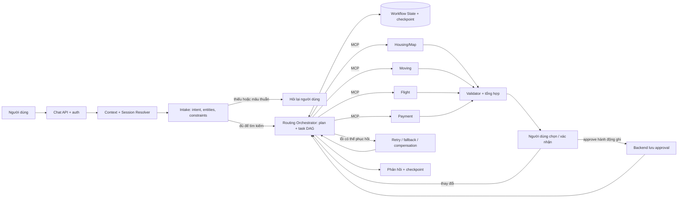

# Intake và Routing Orchestrator — đề xuất triển khai

Status: analysis for team review (2026-09-28); chưa chốt phương án hoặc triển khai.

Update: Khoa đã yêu cầu triển khai hướng B dưới dạng hai thành phần độc lập.
Xem [thiết kế đã triển khai](standalone-agent-services.md) và [ADR-006](../adr/ADR-006-standalone-intake-routing.md).
Phần bên dưới giữ lại phân tích ban đầu; không dùng làm trạng thái triển khai hiện tại.

## Đọc đúng hai sơ đồ hiện có

Hai hình [kiến trúc v4](images/architecture-v4.png) và
[workflow chi tiết](images/architecture-baseline.png) là bản gợi ý. Trong **bản
gốc**, `Context & Session Resolver` lấy lịch sử/sở thích; `Lead Orchestrator /
Planner` trích mục tiêu, chia task, dựng DAG và replan. `Executor / Dynamic
Router` nhận plan đó, tìm task có dependency đã thỏa, chọn domain agent, xếp
lịch song song/tuần tự, quan sát kết quả và retry/fallback. Như vậy Router gốc
đã là **executor/scheduler**; Planner gốc vẫn giữ phần điều phối chiến lược.

Sau đó kết quả đi qua `Result Validator`, tổng hợp chi phí/phương án, quyết định
của người dùng và bước `Transaction / Payment`. `Workflow State Manager` lưu
checkpoint, lựa chọn, quote và trạng thái task. Người dùng đổi ý thì phân tích
ảnh hưởng, giữ kết quả còn dùng được, làm vô hiệu nhánh cũ và replan; lỗi write
đi qua recovery/compensation. Đây là những vòng phản hồi của workflow, không
phải đường thẳng gọi service một lần.

## Hai cách tách trách nhiệm cần đội lựa chọn

| Phương án | Tầng đầu | Tầng thứ hai | Phù hợp khi |
|---|---|---|---|
| A — Giữ ý nghĩa sơ đồ gốc | Planner hiểu mục tiêu, chia task, lập/replan DAG | Router thực thi DAG, lên lịch và theo dõi | Plan phức tạp, muốn tách riêng việc lập plan và chạy plan; phải định nghĩa rõ ai quyết định replan sau kết quả |
| B — Theo góp ý mentor | Intake hiểu mục tiêu, ràng buộc, thông tin thiếu và hỏi lại | Routing Orchestrator sở hữu plan, DAG, thực thi, quan sát và replan | Muốn một nơi chịu trách nhiệm trọn vòng đời task đa service; tránh hai thành phần cùng quyết định plan |

**Đánh giá:** Cả hai đều khả thi. Với repo hiện chỉ có graph mẫu, B có đường triển
khai ngắn và trách nhiệm dễ kiểm chứng hơn. Nhưng không cần dựng hai *LLM agent*
tự trị: có thể là **hai node/bước trong một LangGraph workflow**, cùng state và
checkpoint. Intake có thể là structured LLM call cộng validation; Router có thể
pha quyết định của LLM với scheduler/allowlist bằng code. Nếu chọn A, Planner
và Router cần contract plan/version thật chặt để tránh lập lại kế hoạch ở hai nơi.

Phần dưới mô tả **phương án B để khảo sát**, chưa là quyết định đã được duyệt:

| Thành phần | Sở hữu | Không sở hữu |
|---|---|---|
| Context & Session Resolver | Tải lịch sử, sở thích, lựa chọn đã xác nhận và trạng thái phiên | Suy đoán yêu cầu mới hoặc lên lịch task |
| Intake / Goal Understanding | Nhận message cùng context đã tải, phân loại mục tiêu, rút trích ràng buộc, nhận ra thông tin thiếu hoặc mâu thuẫn, hỏi lại | Chọn MCP, gọi provider, tạo DAG, phê duyệt, commit |
| Routing Orchestrator / Executor | Lập và cập nhật kế hoạch có dependency, chọn service từ registry, xếp lịch bước sẵn sàng, gọi MCP qua adapter, retry có giới hạn và chuyển sang validation/decision | Tự suy đoán dữ liệu provider, tự cấp approval, giữ API key trong prompt |
| Workflow State Manager | Lưu checkpoint, plan/version, trạng thái task, lựa chọn và kết quả để resume | Tự quyết định plan hay tự gọi provider |
| Domain service/MCP | Thực hiện đúng tool và contract của Housing/Map, Moving, Flight hoặc Payment; trả dữ liệu có nguồn và lỗi có cấu trúc | Quyết định toàn bộ hành trình nhiều service |
| Validator + User Decision | Kiểm tra kết quả, độ mới, giá, xung đột; trình phương án và nhận lựa chọn/phê duyệt rõ ràng | Tự thực hiện thao tác ghi trước khi người dùng đồng ý |
| Trusted backend | Xác thực người dùng, ghi approval bound với payload và idempotency key, tiếp tục workflow | Cho model tự tạo approval qua MCP |

Tên `Routing Agent` của mentor là **orchestrator về mặt trách nhiệm** nếu chọn B. Trong tài liệu
LangChain, `router` thường chỉ là bước phân loại/chuyển hướng; vòng lặp nhiều lượt,
theo dõi kết quả rồi quyết định bước tiếp theo gần với `supervisor` hơn. Đội có
thể giữ tên Routing Agent, nhưng contract phải bao gồm execution/state/replanning.
Xem [Router](https://docs.langchain.com/oss/python/langchain/multi-agent/router)
và [Graph API](https://docs.langchain.com/oss/python/langgraph/graph-api).

## Luồng nếu chọn phương án B

Ví dụ: “Tìm phòng dưới 7 triệu gần trường, rồi báo giá chuyển đồ đến đó.” Intake
trích ngân sách, địa điểm, ý định `housing + moving`, kiểm tra còn thiếu địa chỉ
điểm nhận. Router tìm nhà và vị trí trước; sau khi người dùng chọn phòng và có
điểm nhận, Router gọi `estimate_move` cho tọa độ được chọn. Báo giá là dữ liệu
provider có hạn, không phải đơn hàng. Chỉ nếu người dùng yêu cầu đặt xe mới đi
qua phê duyệt và `create_move_order`.

## Hợp đồng dữ liệu đầu vào/đầu ra (đề xuất)

`IntakeResult`: `request_id`, `session_id`, `normalized_goal`, `intents[]`,
`entities`, `constraints`, `missing_fields[]`, `conflicts[]`, `needs_clarification`,
`confidence` và `user_confirmed_facts`. Chỉ trả cấu trúc đã kiểm tra bằng Pydantic;
không gắn endpoint, tool name hay DAG ở bước này. `confidence` chỉ để ưu tiên hỏi
lại, không là quyền chạy thao tác ghi.

`PlanTask`: `task_id`, `kind`, `service`, `tool`, `input_refs`, `depends_on[]`,
`mode` (`read` hoặc `write`), `status`, `attempt`, `result_ref`, `expires_at` và
`failure_policy`. `WorkflowState` giữ `plan_version`, lựa chọn của người dùng,
approval reference, idempotency key, event/error theo task và kết quả có provenance.
Định nghĩa Pydantic là nguồn schema chính; tài liệu này mô tả ý nghĩa, không duy
trì schema JSON độc lập.

Router chọn tool từ **registry có allowlist** gồm tên service, URL nội bộ,
credential từ secret store, tập tool cho phép, phiên bản contract và khả năng
`read/write`. Kết quả phân loại do LLM đề xuất phải được code kiểm tra với
registry. Không cho model tự tạo URL hoặc tên tool.

## Quy tắc điều phối và phục hồi

- Bước chỉ đọc độc lập có thể chạy song song; bước dùng kết quả của bước trước
  phải chờ dependency. Ví dụ Housing + tìm trường gần đó có thể song song;
  Moving estimate phải đợi người dùng chọn điểm đến chính xác.
- Chỉ tạo task mới hoặc replan khi có dữ kiện mới, lỗi được phân loại hoặc người
  dùng đổi lựa chọn. Tăng `plan_version`; giữ kết quả còn phù hợp và làm vô hiệu
  báo giá/approval đã hết hạn hoặc không còn khớp payload.
- Lỗi tạm thời chỉ retry trong giới hạn; lỗi validation, thiếu thông tin, hết hạn
  báo giá, provider từ chối và timeout sau thao tác ghi là các nhánh khác nhau.
  Timeout sau create cần tra cứu bằng tracking/idempotency key trước khi cân nhắc
  gọi lại, theo [ADR-003](../adr/ADR-003-approval-idempotency-and-recovery.md).
- Trước write: dừng graph, trình đúng hành động/đối tượng/giá/phiên bản cho người
  dùng; backend xác thực và lưu approval; khi resume kiểm lại payload/hash/hạn và
  chỉ sau đó gọi write tool. `interrupt` cần checkpointer bền vững và cùng
  `thread_id`; node resume có thể chạy lại, nên side effect phải nằm sau ranh giới
  checkpoint và có idempotency. Xem [persistence](https://docs.langchain.com/oss/python/langgraph/persistence)
  và [interrupts](https://docs.langchain.com/oss/python/langgraph/interrupts).
- Mỗi kết quả được validator kiểm contract, nguồn, timestamp, đơn vị tiền, giá và
  vị trí. Không suy diễn tin nhà hoặc giờ/giá vé thành dữ liệu thật nếu provider
  chỉ là demo/sandbox; kết quả thiếu bắt người dùng xác nhận hoặc trả rõ giới hạn.

## Gắn vào repository hiện tại

`apps/agent-api/src/relohome_agent/agents/graph.py` hiện chỉ `analyze -> respond`; `example_node.py` tạo chuỗi
minh họa, chưa phân loại hoặc gọi MCP. `apps/agent-api/src/relohome_agent/api/routes.py` nhận `/chat` rồi gọi
graph không có `thread_id`. Cần nâng cấp trong `apps/agent-api/src/relohome_agent/agents/` và `apps/agent-api/src/relohome_agent/api/`, không
đặt logic điều phối vào các Moving/Housing MCP server.

Các nhánh đang tách: `khoa` có Moving MCP HTTP; `QuangDung` có Location MCP HTTP;
`Doan/api` có Flight/Payment MCP và client adapters. Trước khi gọi đa service,
đội cần ghép/review các nhánh, thống nhất URL/token và metadata contract. Flight
booking trên nhánh hiện là giả lập; ZaloPay chỉ sandbox. Không đưa kết quả của
chúng vào lời hứa đặt vé/thanh toán thực.

## Thứ tự triển khai đề xuất

1. Chốt trách nhiệm, `IntakeResult`, `PlanTask`, trạng thái task và service
   registry với chủ sở hữu các service; ghi ADR sau khi team đồng ý.
2. Thay graph mẫu bằng luồng intake -> clarify hoặc router -> validate ->
   respond. Trước tiên chạy một yêu cầu chỉ đọc qua **Moving MCP thật trên
   staging**, với `thread_id`, request ID và audit.
3. Thêm Location MCP đọc thật; xử lý phụ thuộc `resolve_location ->
   estimate_move`, sau đó thêm nhánh Housing. Chỉ bật song song khi task độc lập.
4. Thêm checkpoint bền vững, thay đổi yêu cầu/replan, giới hạn retry/timeout,
   theo dõi task và kết quả hết hạn.
5. Tích hợp UI/backend approval và kiểm tra idempotency trước khi bật bất kỳ
   write tool nào. Thêm Flight/Payment khi các nhánh được ghép và ý nghĩa
   demo/sandbox được biểu đạt rõ cho người dùng.

## Kiểm chứng cần có

- Intake phân biệt hỏi thông tin, tìm nhà, xem giá chuyển đồ, hủy đơn; câu mơ hồ
  đi vào hỏi lại. Kiểm bằng tập câu tiếng Việt do đội viết, có expected intent,
  không dùng listing/đơn/provider giả.
- Router không gọi tool ngoài allowlist hoặc write trước approval; task phụ
  thuộc chạy đúng thứ tự, task độc lập chạy song song; khi người dùng đổi phòng,
  báo giá cũ không thể dùng để đặt xe.
- Chạy thực tế qua MCP/DB staging cho truy vấn chỉ đọc; ghi `request_id`,
  `thread_id`, `plan_version`, tool và thời gian. Không thử tạo/hủy đơn khi chưa
  có UAT được duyệt.
- Sau restart, workflow ở bước hỏi lại/approval tiếp tục đúng checkpoint và
  không lặp side effect. Kết quả thiếu hoặc provider timeout được giải thích rõ
  cho người dùng, không tạo dữ liệu tưởng tượng.
