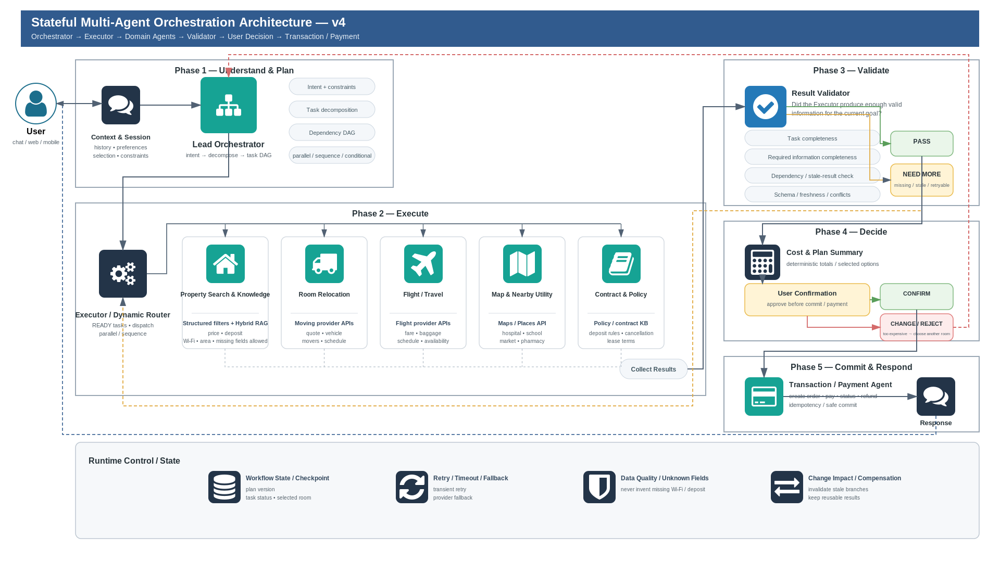
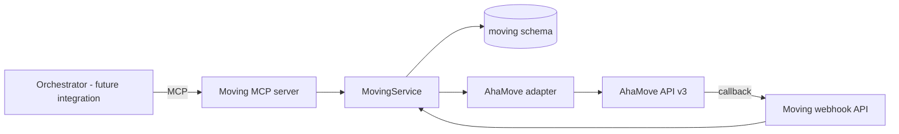
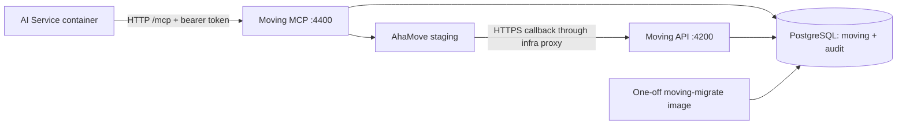

# Moving service architecture

Status: current implementation plus labeled future orchestrator integration.

The diagrams are design references, not executable requirements. The implemented
Moving boundary is:

## Implemented components

- `packages/contracts/src/moving.ts`: canonical Moving schemas.
- `packages/mcp-core`: shared MCP handler and redacted audit behavior.
- `packages/moving-service`: provider-independent policy, persistence boundary,
  AhaMove client and mapping.
- `moving-mcp-server`: independent stdio and authenticated HTTP MCP entrypoints.
  Stdio and the HTTP read credential expose 9 read tools; the separate HTTP write
  credential exposes all 13 tools. Writes still require stored approval and the
  environment write flag.
- `moving-api`: separate HTTP process for webhook ingestion and health.
- `database/migrations/008_moving_service.sql`: quotes, approvals, idempotency,
  orders and webhook events.
- `Dockerfile.moving`: separate images for MCP, webhook API and one-off migrations.
- `compose.moving.yaml`: isolated local stack with a real PostgreSQL database.
- `packages/moving-service/src/migrate.ts`: Moving-only schema and runtime role provisioning.

## Container boundary

`MovingService` and the adapter are TypeScript libraries inside the two application
images. They are not extra containers. The AI backend obtains the MCP bearer token
from secret storage, never from tool arguments. Only the webhook route needs a
public HTTPS ingress. See [container runbook](../runbooks/moving-containers.md) and
[infra handoff](../runbooks/moving-coolify.md).

## Interaction with Map and Housing

Moving accepts canonical coordinates and addresses. It does not import the Map
service's OSRM or database implementation. The orchestrator first resolves a
location using Map MCP, then passes the selected coordinate into Moving MCP.
Housing listing coordinates can be used in the same manner.

## Approval boundary

The future user-decision/transaction component calls
`MovingService.registerApproval` through an internal trusted application
boundary. There is deliberately no MCP tool that lets the model approve its own
operation. `create_move_order`, `update_move_order`, `cancel_move_order` and
`rate_move_driver` only consume a matching stored approval.

## State and recovery

- Quote snapshots expire.
- Create actions reserve a workflow/action idempotency key.
- A provider timeout leaves an ambiguous action pending unless lookup by partner
  tracking number proves that the order exists.
- Webhook payload hashes prevent duplicate event application.
- Provider order and delivery-point statuses are retained in the normalized
  order payload without collapsing failed and returned deliveries.
