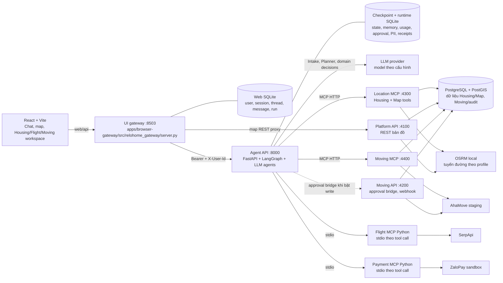
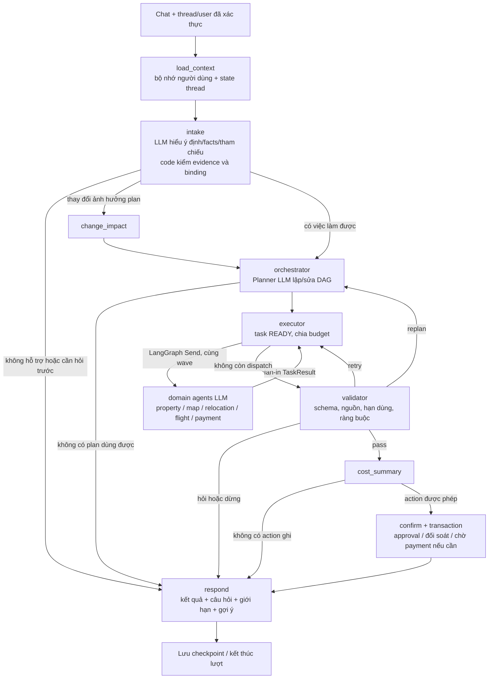
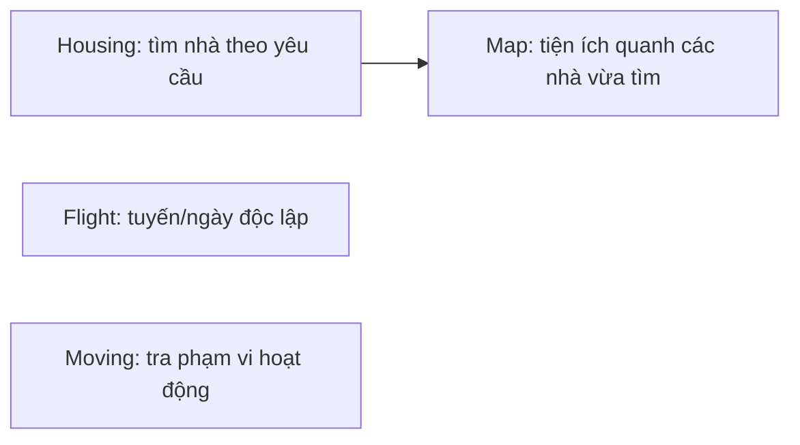
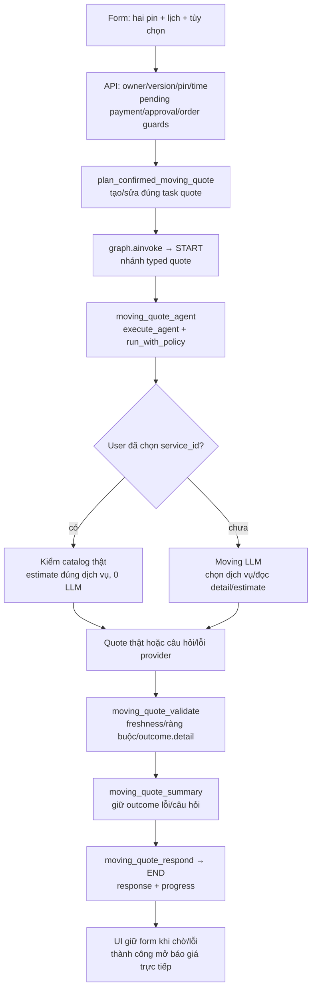

# Kiến trúc MVP hiện tại — ReloHome / SIU AI

> Historical layout/command evidence (M23); use the [current development map](../../DEVELOPMENT.md) for this branch.


Cập nhật: **05/10/2026**, đối chiếu implementation trong workspace đang chạy demo.
Đối tượng đọc: teammate ghép agent, backend, service và UI.

Đây là bản mô tả **hệ thống đã triển khai local**, không phải cam kết mọi phần đã
merge vào GitHub `main` hoặc sẵn sàng production. Workspace nền hiện là
`review/quangdung-post-mvp` tại `62f83b7`, có các cải tiến agent/context local và
phần Moving form của [PR #53](https://github.com/AI20K-Build-Phase-Cohort-4/P-044/pull/53)
(code `6c89a60`, cập nhật chứng cứ/spec sau đó). Cần review/CI theo quy trình nhóm
trước khi coi là bản tích hợp chính trên GitHub.

Bản phân tích ngày 02/10, các BUG và kết quả test lịch sử giữ tại
[docs/review/mvp-architecture.md](../review/mvp-architecture.md). Không dùng các
số liệu hoặc mô tả vòng tool cũ trong bản review đó thay cho implementation hiện tại.

## 1. Đọc nhanh: hệ thống hiện làm gì?

Người dùng nói mục tiêu bằng ngôn ngữ tự nhiên. **Intake LLM** hiểu yêu cầu và ngữ
cảnh nhiều lượt; **Routing Orchestrator có Planner LLM** phân rã thành các task
domain và quan hệ phụ thuộc; các **domain subagent LLM** tự chọn thao tác phù hợp.
LangGraph cùng code policy thực thi, kiểm kết quả và lưu trạng thái.

Năm domain đã ghép vào runtime khi cấu hình đủ endpoint/provider:

| Domain | Agent trong graph | Nhiệm vụ hiện tại |
| --- | --- | --- |
| Housing | `property_agent` → `ReadLlmAgent` | Tìm nhà, đọc chi tiết, phân trang, đánh giá trong phần dữ liệu đã đọc |
| Map | `map_agent` → `ReadLlmAgent` | Phân giải địa điểm, tìm tiện ích, tính tuyến; hỗ trợ Housing và Moving |
| Moving | `relocation_agent` → `MovingLlmAgent` | Danh mục/phạm vi AhaMove, báo giá, tra đơn; có đường báo giá form riêng |
| Flight | `flight_agent` → `ReadLlmAgent` | Sân bay và chuyến bay thật qua SerpApi; không giữ chỗ/xuất vé mô phỏng |
| Payment | `payment_agent` → `ReadLlmAgent` | Tra thanh toán thuộc người dùng; ZaloPay sandbox, không suy diễn đã trả tiền |

**Agent khác MCP server.** Agent hiểu nhiệm vụ và chọn thao tác bằng LLM; MCP
server cung cấp công cụ có contract, truy vấn DB hoặc gọi provider. MCP server
không cần LLM để thực hiện một truy vấn/API đã có tham số rõ ràng.

**Không phải mọi thao tác đều đi qua LLM.** Hệ thống có ba đường vào:

1. Chat tự nhiên: Intake → Planner → domain agent → kiểm kết quả.
2. Thao tác có cấu trúc trên UI: xem chi tiết/chọn/xem thêm/đọc map → API/code,
   không diễn giải lại thành chat.
3. Form báo giá Moving đủ hai pin và lịch: typed intent → task quote dùng chung
   runtime/checkpoint. Xe user đã chọn thì 0 LLM; “để SIU đề xuất” vẫn dùng Moving LLM.

Không có bộ phân loại keyword tự quyết “câu dễ/câu khó” để bỏ Intake hoặc Planner
cho chat. Các đường 2–3 dựa vào **loại thao tác UI đã xác định rõ**, còn đường
chat và các quyết định chuyên môn vẫn do LLM thực hiện.

## 2. Các process và kết nối đang dùng



### 2.1. Phân chia logic và process

- Intake, Planner và năm domain agent chạy trong **cùng process Agent API** ở
  local. Chúng có instance, prompt, capability và trạng thái invocation riêng;
  không phải bảy container LLM đang gọi nhau qua HTTP.
- Housing và Map là **hai agent domain riêng**, nhưng dùng chung **Location MCP**.
  Không mô tả thành hai MCP process riêng khi implementation chưa tách.
- Moving có **MCP riêng** và **Moving API riêng**; không đồng nhất cả hai với
  agent Moving trong LangGraph.
- Flight/Payment dùng MCP Python qua stdio. `McpToolClient._session()` mở child
  process/session theo lần gọi, không phải hai HTTP service dài hạn trên stack
  local hiện tại. Runtime hạn chế truyền credential không liên quan cho child.
- Các definition container/Compose có trong repo không đồng nghĩa local đang
  chạy tất cả bằng container. Triển khai mạng/container production nằm ngoài
  phạm vi tài liệu snapshot này.

### 2.2. Tìm code theo trách nhiệm

| Thành phần | File/thư mục |
| --- | --- |
| UI/workspace, trạng thái đang submit | [App.tsx](../../apps/web/src/App.tsx), [ServiceWorkspaces.tsx](../../apps/web/src/components/ServiceWorkspaces.tsx), [MovingOptionsForm.tsx](../../apps/web/src/components/MovingOptionsForm.tsx) |
| Gateway, cookie HttpOnly, CSRF, request replay | [server.py](../../apps/browser-gateway/src/relohome_gateway/server.py), [store.py](../../apps/browser-gateway/src/relohome_gateway/store.py) |
| Khởi tạo runtime thật và lifecycle | [wiring.py](../../apps/agent-api/src/relohome_agent/agents/wiring.py), [llm_components.py](../../apps/agent-api/src/relohome_agent/agents/llm_components.py) |
| Graph topology và payload fan-out | [graph.py](../../apps/agent-api/src/relohome_agent/agents/graph.py), [state.py](../../apps/agent-api/src/relohome_agent/agents/state.py), [routing.py](../../apps/agent-api/src/relohome_agent/agents/routing.py) |
| Intake | [intake_llm.py](../../apps/agent-api/src/relohome_agent/agents/intake_llm.py), [nodes/intake.py](../../apps/agent-api/src/relohome_agent/agents/nodes/intake.py) |
| Planner và kiểm plan | [planner_llm.py](../../apps/agent-api/src/relohome_agent/agents/planner_llm.py), [planning.py](../../apps/agent-api/src/relohome_agent/agents/planning.py), [nodes/orchestrator.py](../../apps/agent-api/src/relohome_agent/agents/nodes/orchestrator.py) |
| Scheduler / kiểm kết quả | [nodes/executor.py](../../apps/agent-api/src/relohome_agent/agents/nodes/executor.py), [nodes/validator.py](../../apps/agent-api/src/relohome_agent/agents/nodes/validator.py) |
| Domain LLM và grounded tools | [read_llm.py](../../apps/agent-api/src/relohome_agent/agents/subagents/services/read_llm.py), [domain_tools.py](../../apps/agent-api/src/relohome_agent/agents/subagents/services/domain_tools.py), [moving_llm.py](../../apps/agent-api/src/relohome_agent/agents/subagents/services/moving_llm.py) |
| Tối ưu dữ liệu cho model | [llm_context.py](../../apps/agent-api/src/relohome_agent/agents/llm_context.py), [moving_context.py](../../apps/agent-api/src/relohome_agent/agents/subagents/services/moving_context.py) |
| Typed quote API / thao tác UI | [moving_quotes.py](../../apps/agent-api/src/relohome_agent/api/moving_quotes.py), [web_actions.py](../../apps/agent-api/src/relohome_agent/api/web_actions.py), [routes.py](../../apps/agent-api/src/relohome_agent/api/routes.py) |
| Trạng thái bền vững | [sqlite_runtime.py](../../apps/agent-api/src/relohome_agent/services/adapters/sqlite_runtime.py), [progress.py](../../apps/agent-api/src/relohome_agent/agents/progress.py) |
| Endpoint, credential, allowlist | [registry.py](../../apps/agent-api/src/relohome_agent/services/adapters/registry.py), [mcp.py](../../apps/agent-api/src/relohome_agent/services/adapters/mcp.py) |
| TypeScript services | [ReloHome location](../location/README.md) |
| Python Flight / Payment | [flights](../../src/mcp_servers/flights/), [payments](../../src/mcp_servers/payments/) |

`apps/intake-api/src/relohome_intake/` và `apps/orchestrator-api/src/relohome_orchestrator/` còn chứa
implementation standalone HTTP/contract trước đó. **Graph tích hợp hiện dùng
`LlmIntake` và `LlmPlanner` qua wiring**, không gọi lại hai HTTP service
standalone ấy. Khi sửa agent đang chạy, bắt đầu từ các file graph trong bảng.

## 3. Đường chat: Intake → Orchestrator → domain agent



Graph topology cố định; **DAG nghiệp vụ là dữ liệu `Plan.tasks` trong state**.
LLM không tự tạo node Python mới và không sinh code/SQL để thực thi.
Node `*_agent` được graph builder đăng ký từ agent registry.

### 3.1. Intake làm gì?

- Hiểu mục tiêu, domain, yêu cầu mới hay bổ sung/đổi mục tiêu, lựa chọn và tham
  chiếu như “căn đó”, “vào đó”, “điểm đã chọn”.
- Trả structured facts với evidence. Code kiểm fact, gộp ngữ cảnh phù hợp và
  xác định phần còn thiếu/xung đột.
- Ghép các binding UI đã được API kiểm: `place_choice`, `map_view`,
  `housing_location`, `moving_locations`, `moving_options`.
- Không tự bịa tọa độ hoặc thay vai điểm lấy/giao. Thay địa chỉ không được mặc
  nhiên giữ tọa độ của địa chỉ cũ.
- Không phải cứ hỏi đủ tất cả domain mới chạy. Planner có thể làm phần đã đủ
  dữ kiện và giữ câu hỏi cho phần bị hoãn; vẫn có các trường hợp xung đột toàn
  lượt cần hỏi trước.

### 3.2. Planner là phần suy luận của Routing Orchestrator

Planner nhận `PlannerInput`: mục tiêu/ràng buộc, capability của agent đã đăng
ký, plan và kết quả trước, binding đã xác nhận, validation/change feedback.

LLM tạo `PlanDraft`: task domain, input và `depends_on`, action được phép,
hoặc `needs_input` cho phần chưa thể làm. **Task là nhiệm vụ domain, không phải
chỉ thị cứng “hãy gọi tool X đầu tiên”.**

Code conversion/grounding gắn ID/tọa độ từ nguồn tin cậy, kiểm schema, capability,
phụ thuộc không có chu trình và giữ yêu cầu người dùng. Plan lỗi được gửi feedback
cho LLM sửa trong budget; một số lỗi structured output tạm thời cũng được thử
lại trong giới hạn. Không mặc định fallback sang rule-based Planner trong runtime này.

Task giữ nguyên, kết quả còn hạn và không bị invalidated có thể được tái dùng.
Task đổi input hoặc kết quả quá hạn phải được xử lý lại.

### 3.3. Vì sao Executor không có LLM?

**Executor là scheduler bên trong Routing Orchestrator, không phải một agent
suy luận độc lập thay thế Planner.**

- Planner LLM quyết định *cần làm gì và việc nào phụ thuộc việc nào*.
- Executor đọc DAG đó: task chỉ READY khi dependency DONE, cấp budget rồi gửi
  `Send` đến domain node.
- Validator kiểm dữ kiện và quyết định retry/replan/hỏi. Khi cần đổi hướng,
  feedback quay về Planner LLM; Executor không tự sửa plan.

Đây là thực thi hợp đồng, không phải hardcode mỗi câu người dùng vào một luồng.
Kế hoạch vẫn thay đổi theo ngữ cảnh. Những điều như xác thực, không chạy trước
dependency, không đặt xe khi chưa duyệt là điều kiện bắt buộc, không giao cho
model “linh hoạt bỏ qua”.

### 3.4. Song song, tuần tự và fan-in

Ví dụ minh họa DAG, **không phải kế hoạch cố định cho mọi câu hỏi**:



Housing, Flight và Moving catalog có thể cùng wave. Map cần kết quả Housing nên
chờ dependency. **LangGraph hiện fan-in theo wave**: task của wave kế tiếp được
scheduler tính sau khi wave hiện tại hoàn tất; không hứa Map bắt đầu ngay khi
Housing xong nếu task Flight cùng wave vẫn chạy.

Không cần người dùng bấm trên UI để hệ thống biết chạy song song/tuần tự.
Quan hệ thực thi từ `depends_on`; lựa chọn UI cung cấp thực thể đã xác nhận cho
những nhiệm vụ cần nó.

Căn đã chọn có ID bền vững: Map/Moving có thể tự đọc chi tiết bằng ID mà không
phải chạy lại search Housing. Quan hệ trong dải progress có thể là quan hệ nguồn
lựa chọn, **không đồng nghĩa luôn có execution dependency phải chạy lại Housing**.

## 4. Domain agents: có chuyên môn và quyền chọn tool

### 4.1. Contract nhận và trả

Mỗi task được đóng thành `AgentTaskRequest` có `task_id`, `plan_version`,
`agent`, `inputs`, `goal`, `user_request`, `constraints`, `hints`,
`upstream` và budget/deadline.

Subagent trả `AgentTaskResult`:

- `status`: done / needs_input / failed.
- Dữ kiện `data`, `quotes`, nguồn `source/source_kind/source_refs/fetched_at`.
- `questions` và lựa chọn địa điểm thật, `missing_fields`.
- `usage`, `error_code`, `retryable`; trace và thời gian thực thi.

Đây là dữ liệu đi qua LangGraph state, **không phải các agent tự chat tự do với
nhau**. Agent phụ thuộc nhận kết quả upstream qua contract; yêu cầu đổi kế hoạch
đi về Validator/Planner. Model không cầm credential hoặc quyền ghi của domain khác.

### 4.2. Housing / Map / Flight / Payment

`ReadLlmAgent` dùng prompt domain riêng và `DomainToolSession` riêng mỗi
invocation. **Không còn ép tool đầu tiên cố định rồi gọi LLM chỉ để chọn lại nó.**

| Domain | Các quyết định/thao tác LLM được chọn khi đủ điều kiện |
| --- | --- |
| Housing | `search_areas`, `resolve_location`, `search_housing`, `get_housing`, trang tiếp, `ask_user`, `finish`, `request_replan` |
| Flight | `search_airports`, `search_flights`, `get_offer`, hỏi/finish/đề nghị replan |
| Map | Resolve địa điểm/địa giới trước nếu cần, tính route hoặc nearby đúng mode task, hỏi/finish/đề nghị replan |
| Payment | Tra `get_payment` sau kiểm ownership, hỏi/finish; namespace hẹp là giới hạn quyền, không phải lỗi thiếu quyền tự thu tiền |

Tool resolve thường nhận **tham chiếu field** (`near`, `city`, `origin`…)
thay vì cho LLM thay tên địa điểm. Detail chỉ nhận ID đã thấy; cursor trang tiếp
chỉ dùng giá trị provider đã trả. Code/adapters phụ trách normalization, PostGIS
query và provenance, không dùng LLM đọc hết DB để “duyệt nhà”.

Agent không được tự nới hard budget, đổi ngày/tuyến, bỏ điều kiện hoặc thêm domain
ngoài nhiệm vụ. Có thể hỏi user, báo hạn chế, hoặc gửi đề nghị replan có nguồn.
`agent_assessment` là nhận định model, tách khỏi dữ kiện provider; không phải
một field mới do provider xác minh.

### 4.3. Tối ưu tìm kiếm đơn giản nhưng giữ quyền suy luận

Housing/Flight có thêm `search_housing_and_return` và
`search_flights_and_return` — **tool nội bộ của agent**, không phải thêm hai tool
vào MCP server.

LLM tự chọn:

- Cần danh sách theo bộ lọc đã rõ → chọn tool ghép, code resolve/search an toàn
  rồi trả dữ kiện, không cần lượt LLM riêng chỉ để nói “finish”.
- Cần so sánh/đọc detail/đánh giá yêu cầu riêng → search thường, đọc kết quả,
  chọn detail/page/finish hoặc yêu cầu replan.
- Mơ hồ → hỏi/đưa choices thật; tool ghép không bỏ qua bước này.

Kết thúc bằng dữ kiện có `agent_completion.model_assessed=false`; không giả vờ
model đã đánh giá đầy đủ mọi ưu tiên. Trần provider/LLM/deadline vẫn áp dụng.

### 4.4. Moving LLM

Ba mode: `catalog`, `quote`, `order_status`.

- Catalog: đọc phạm vi phục vụ hoặc danh mục/chi tiết dịch vụ thật.
- Quote: resolve tuyến → danh mục → có thể đọc detail → estimate → trả quote hoặc
  hỏi. Tool được mở theo prerequisite, LLM chọn trong các thao tác hợp lệ.
- Provider từ chối nội dung: model nhận lý do, hỏi điều chỉnh hoặc thử service
  catalog chưa thử trong budget. Lỗi credential/transport không biến thành giá giả.
- Order status: tra mã đơn/tracking, link và lịch sử event theo tool đã nối.

Không hardcode “chỉ được chuyển trong cùng thành phố”, không tự đoán dung tích,
bốc xếp hoặc addon. Catalog/provider estimate quyết định khả dụng; yêu cầu chưa
được provider xác nhận phải giữ là chưa biết.

Nhà có tọa độ approximate chỉ là gợi ý để user xác nhận điểm dừng xe. Không coi
một địa danh khớp tên duy nhất là điểm xe chắc chắn có thể đến.

### 4.5. MCP tool khác tool nội bộ agent

- **Location MCP: 9 tool** — `search_areas`, `resolve_location`,
  `search_housing`, `get_housing`, `search_places`, `get_place`,
  `find_nearby_places`, `calculate_route`, `calculate_route_between_entities`.
  Không phải cả 9 đều được LLM thấy trực tiếp; adapter/REST có thể dùng các tool
  tương ứng trong thao tác ghép.
- **Moving MCP: 9 read + 4 write trong server**. Read gồm khu vực/dịch vụ/detail/
  estimate/tra đơn/danh sách đơn/tracking/event. Write gồm create/update/cancel/
  rate. Read credential không được gọi write; graph transaction hiện nối
  create/update/cancel khi được bật và duyệt, không quảng bá rate thành chức năng
  agent đã ghép.
- **Flight MCP local hiện có 3 tool đọc**: `search_airports`, `search_flights`,
  `get_offer`. Bốn booking tool cũ chỉ đăng ký khi bật simulation, mà local
  launcher ép simulation false. Không ghi “7 tool đang hoạt động”.
- **Payment ZaloPay MCP có 4 tool**: create/get/cancel/refund. Domain agent chat
  chỉ được đọc; `simulate_payment_result` không đăng ký với ZaloPay.
  Tool tồn tại ở server không đồng nghĩa đã nối đầy đủ vào UI/graph.
- `ask_user`, `finish`, `request_replan`, `resolve_move_route` và
  `*_and_return` là thao tác agent/runtime, không phải API trực tiếp của vendor.

Trong local bundled Flight, lookup sân bay có thể dùng catalog thật của chính
module ngay trong process, tránh sinh stdio chỉ cho lookup tĩnh.
`search_flights` vẫn gọi provider thật; đây không phải dữ liệu chuyến bay giả.

## 5. Đường UI và form Moving: không diễn giải lại thao tác rõ ràng

### 5.1. Thao tác chọn/đọc

Gateway nhận request với cookie phiên và CSRF header, proxy actor/token phía
server. Agent API kiểm owner, version/freshness và ID của nhóm kết quả.

- Xem chi tiết: gọi read API/tool đúng ID, không LLM.
- Chọn Housing/Flight/Moving: cập nhật fact `selected:<domain>`, selection,
  cost/progress/checkpoint; không yêu cầu Intake/Planner suy nghĩ lại.
- Chọn nhà tìm trên map: API đọc lại listing từ Location, không tin price/address
  user tự gửi.
- Xem thêm: dùng cursor provider và bộ lọc cũ, không LLM.
- Map viewport/POI/route thao tác trực tiếp: gateway → Platform API; không đi qua
  graph trừ khi user gửi một yêu cầu chat cần reasoning.

**Chọn phương án không phải duyệt đặt đơn.** ID/lựa chọn trên UI trở thành ngữ
cảnh cho lượt chat sau; mọi mutation vẫn phải đi đúng flow approval.

### 5.2. Báo giá Moving bằng typed form

Routes:

- Gateway: `POST /web/api/threads/{thread}/moving/quote`.
- Backend: `POST /api/v1/ui/chat/{thread_id}/moving/quote`.
- Model: `MovingQuoteForm` trong `src/models/schemas.py`.

Form chứa hai pin `confirmed=true`, ngày/giờ, `moving_options`,
`plan_version` và ID nhà đã chọn nếu có. Không chứa approval hay contact PII
tự truyền vào quyền giao dịch.



Đường này chạy **nhánh riêng từ START trong cùng compiled graph**. API kiểm
preflight và tạo task tất định, rồi `ainvoke` chọn nhánh bằng context form do API
cấp. Các node quote dùng lại policy, validator checks và cost/respond, có callback
tracing và checkpoint theo bước. Không chạy load_context/Intake/Planner/executor
hoặc nhánh giao dịch. Dependencies cấp qua `context_schema=GraphContext` và tham số
`context` của `ainvoke`; node quote nhận `Runtime[GraphContext]`. Runtime context không được
checkpoint, nên caller phải cấp lại khi resume. Context chọn nhánh trong state
được xóa ở cuối lượt và khi bắt đầu chat mới, nên tin nhắn sau form trở về đường
chat thông thường.

Input checkpoint lưu plan version mới trước khi gọi agent; nếu lượt bị gián đoạn,
đọc state mới nhất trước khi submit lại. Checkpoint theo node không bảo đảm
exactly-once cho từng provider call bên trong agent.

Plan version tăng, selection quote cũ bị bỏ, downstream bị stale; task/selection
không liên quan được giữ. Không tự thêm quyền booking. Nếu có nhiều task quote
không thể chọn rõ, backend hỏi thay vì chọn task đầu.

UI giữ cùng form trong lúc tạo thread và submit, khóa thao tác trùng; lỗi giữ
pin/lịch/service để sửa. Thành công chuyển thẳng sang quote workspace, không
bật ra chat rồi mới vào lại.

### 5.3. Cache đúng chỗ

`MovingCatalogCache` dùng chung cho UI đọc catalog và agent Moving:

- Catalog thật, TTL mặc định **45 giây**, tối đa 64 query.
- Scope theo client/provider/credential và exact pickup/city/delivery-type;
  không làm tròn tọa độ hoặc dùng catalog thành phố khác.
- Catalog mặc định và TRUCK được UI đọc song song, deduplicate bằng ID provider.
- Refresh chủ động và provider refusal làm invalidation; không cache lỗi/rỗng.
- **Không cache giá/quote/order/payment qua các request.** Requote vẫn estimate mới.

`MemoizedReadClient` của domain tools chỉ memoize trong một invocation; tái dùng
preparation/detail mà không sửa shared adapter giữa các task song song.

Thiết kế typed form ghi ở [ADR-022](../adr/ADR-022-confirmed-moving-form-intent.md)
(**Proposed**, chưa tự coi là Accepted) và [contract API](../api/moving-quote-form.md).
Phần bổ sung SPEC-004 dùng AC-33–38, không ghi đè AC-26–32 của main.

## 6. Multiturn, Map liên kết dịch vụ và bộ nhớ

### 6.1. State theo hội thoại và memory theo người dùng

| Nơi giữ | Nội dung / ý nghĩa |
| --- | --- |
| Web SQLite | Tài khoản, phiên, thread/messages, runs/idempotency, saved homes; không thay checkpoint agent |
| LangGraph checkpoint | Messages, intake facts, plan version, task status/results, selections qua facts, goal_tasks, cost, transaction/pending |
| Runtime SQLite | User memory, usage, encrypted PII, approval/consumption, receipts/holds và metadata phục hồi |
| PostGIS/service DB | Housing/POI/địa giới và dữ kiện Moving/audit; không phải chat history |
| Provider | Giá/khả dụng/trạng thái giao dịch có hạn; cần refresh/đối soát, không lấy kết luận từ lời user |

Xuyên lượt trong cùng thread, Intake dùng state/facts và plan outline để xử lý
tham chiếu. Plan hiện tại không phải toàn bộ lịch sử mục tiêu:
`goal_tasks`/`plan_progress` giữ các việc đã yêu cầu và các lựa chọn còn hợp lệ.

Memory xuyên thread có TTL/source, prefill và các hint có giới hạn; không phải
bộ nhớ không giới hạn hoặc lời user nào cũng thành sở thích lâu dài.
Xóa thread còn xóa checkpoint và memory có nguồn từ thread đó; không âm thầm
hủy đơn. Payment đang pending có guard riêng trước khi xóa.

### 6.2. Ví dụ Housing “gần Bách khoa Hà Nội”

1. Intake hiểu yêu cầu Housing, anchor tên trường và các hard filters.
2. Planner giao mission Housing; không tự lấy tọa độ từ kiến thức model.
3. Housing LLM có thể resolve anchor trước hoặc chọn search ghép, để adapter
   resolve bằng Location. Nếu nhiều trường/cơ sở khớp, trả choices để chọn.
4. Scope đã rõ → PostGIS lọc nhà theo bán kính, giá, loại phòng và các yêu cầu.
5. Kết quả có ID, provenance, tọa độ/độ chính xác và viewport để UI hiển thị.
6. Cần “đi đến trường mất bao lâu” → nhiệm vụ route Map với phương tiện và endpoint
   thật, không gọi khoảng cách đường thẳng là thời gian/quãng đường đi.

Lọc nhà “gần bệnh viện/trường” thuộc Housing `nearby_*`.
“Cho xem bệnh viện quanh **các căn vừa tìm**” là Map task phụ thuộc kết quả Housing.
“Quanh **căn đã chọn**” dùng ID đã chọn, không tự chọn căn đầu tiên.

### 6.3. Liên kết Moving

Căn đã chọn có thể là **điểm lấy hoặc điểm giao**, theo ý user. Agent tra đúng
listing ID; vị trí approximate cần user ghim/xác nhận, không tự biến thành rooftop.
Form có pin đã xác nhận dùng thẳng binding; không hỏi lại chỉ vì label là khu rộng.

Map là nguồn tra cứu/gợi ý tọa độ, không phải provider quyết định AhaMove có
nhận tuyến hay không. Ghim map không phải đồng ý book, và tính route OSRM không
phải báo giá AhaMove.

### 6.4. Dữ liệu và độ tin cậy

GeoJSON/boundary/POI/Housing source được import/restore vào DB trước. Runtime
Location/Platform đọc **PostGIS**, không nạp hết `Maps VN/cities/boundaries`
vào context LLM mỗi câu hỏi. Luồng import liên quan
[import-places.ts](../../apps/platform-api/src/import-places.ts)
(`BOUNDARY_SOURCE_DIR`) và
[import-admin-areas.ts](../../apps/platform-api/src/import-admin-areas.ts).

DB local hiện dùng `lifeflow_quangdung_20261005`, DB cũ giữ để rollback.
Tên DB/port lấy từ cấu hình, không phải giá trị business hardcode trong agent.

Cần giữ chất lượng giá, provenance, tọa độ approximate và độ phủ POI là giới hạn
dữ liệu. OSRM local trả ước tính theo profile, không có giao thông realtime.
Có coordinate chưa đủ khẳng định đúng cổng/tòa nhà/điểm dừng xe.

## 7. Tối ưu context và giới hạn thực thi

### 7.1. Context cho quyết định khác dữ liệu đầy đủ cho UI

`llm_context.py` tạo projection mới, không sửa record backend:

- Bỏ các field render/trace trùng: thumbnail/images, map geometry/polyline,
  usage/execution/debug trace.
- Giữ dữ kiện domain, ID, nguồn, fetched_at, uncertainty/missing fields, câu hỏi,
  giá/đơn vị và kết quả assessment cần quyết định.
- Planner nhận capability input schema; output schema được validator dùng,
  không cần gửi lặp để model lập task.
- Lịch sử search lặp cùng tool có thể giữ snapshot mới, giữ call/output pairing;
  preparation/detail có dữ kiện khác vẫn được giữ.
- Moving detail bỏ nhãn lặp/presentation, giữ request/option/limits và các
  constraint provider thực sự có.

Không thay Planner bằng bản tóm tắt rule-based và không cắt tùy tiện danh sách
thành “N phương án đầu” để model chọn. Dữ liệu đầy đủ vẫn dành cho API/UI/backend.

### 7.2. Các default hiện trong code

| Giới hạn | Default / nguồn |
| --- | --- |
| Intake/Planner repair calls mỗi invocation | `AGENT_MAX_ATTEMPTS` mặc định 5, phạm vi 1–5 |
| Task attempts / replans | Live wiring dùng `AGENT_MAX_ATTEMPTS`; là trần, không cố retry đủ 5 |
| Max task/wave | 4 |
| Graph LLM calls / turn | 30 |
| Subagent LLM calls cộng / turn | 40 |
| Paid task slots / turn và thread | 6 / 30; không đồng nghĩa chỉ 6 HTTP provider requests |
| ReadLlmAgent / invocation | Tối đa 6 model calls; còn bị giới hạn budget cấp |
| Moving / invocation | Tối đa 8 model calls; form đã chọn xe có thể 0 |
| Domain timeout | Housing/Map/Flight/Payment 100 s, Moving 120 s |
| Graph recursion limit | 100 |

Nguồn: `ServiceSettings`, `GraphSettings`, live wiring và vòng invocation.
Đây là **giới hạn an toàn**, không phải thời gian phải chờ ở mọi request.
Số liệu đo không được suy ra chỉ từ default budget.

## 8. An toàn và phạm vi giao dịch hiện tại

Local launcher mặc định:

- `AGENT_SUBAGENTS=live`; AhaMove staging; Flight SerpApi; Payment ZaloPay sandbox.
- `AGENT_WRITES_ENABLED=false`, `AHAMOVE_WRITE_ENABLED=false`,
  `AGENT_SANDBOX_PAYMENTS_ENABLED=false`.
- Flight/Payment simulation và simulated transactions false. Không dùng dữ liệu
  giả để bù provider chưa sẵn sàng.
- Chỉ định `--sandbox-writes` là cấu hình có chủ đích, **không** bật chỉ vì user
  nói “đặt luôn” hoặc click chọn quote. Không tự chạy production.

Graph có confirm/transaction/await_payment và approval/receipt/reconciliation
code. Moving booking lifecycle có tích hợp staging khi bật đúng flag/credential
và user duyệt; CASH là tiền trả tài xế, không tự tạo ZaloPay payment.
API demo sandbox payment là luồng riêng có guard, không chứng minh mọi payment/
refund use case đã ghép đầy đủ.

Không có flight booking thật đang bật; simulation booking không được dùng làm
MVP giao dịch. Payment chat không được tự thu/hoàn tiền. Tool write trong server,
API sandbox và chức năng mà user hiện có thể dùng là ba phạm vi khác nhau.

> Đề xuất 07/10/2026 (Draft, chưa code): [payment-design.md](../review/payment-design.md) thay phạm vi trên cho
> bản demo. Vé một chiều và khứ hồi (tìm thật qua SerpAPI) được giữ chỗ và xuất vé **mô phỏng**; vé và chuyển đồ
> đi qua đơn thanh toán ZaloPay sandbox riêng cho từng dịch vụ; chuyển đồ trả xong chỉ ghi "đã duyệt", không tạo
> đơn AhaMove; nhà có lịch xem và thỏa thuận do người dùng báo. Đoạn trên vẫn đúng với code hiện tại.

Ownership/approval/expiry/exact material inputs vẫn do backend kiểm. Ghi nhầm
giá mới hoặc quote đã thay vào approval cũ phải bị chặn. Không mặc định có dung
sai giá hoặc hủy miễn phí; trạng thái không rõ cần đối soát, không tự retry để tạo
đơn thứ hai.

Secrets chỉ phía server; read/write client tách credential và allowlist;
PII contact booking đi kho riêng. Liên hệ hệ thống để quote AhaMove không phải
thông tin cá nhân tự đưa vào context model.

## 9. Chạy lại local và tìm lỗi đúng tầng

### 9.1. Trên Windows PowerShell

Từ root repo, khi dependency/build/data đã được setup theo
[runbook local](../runbooks/local-mvp.md):

```powershell
.\scripts\start-local-mvp.ps1
```

Launcher kiểm Docker, DB/schema **read-only**, readiness của 6 process và ghi log
riêng dưới `data/local-mvp-logs/`. Nó không restore/migrate lại DB tự động,
không kill process lạ, không restart process đã chạy khi source đổi.

Nếu UI chưa build hoặc vừa đổi React, chạy trong thư mục `apps/web`:

```powershell
npm.cmd run build
```

Cần chạy một service riêng để xem lỗi trực tiếp:

```powershell
.\.venv\Scripts\python.exe scripts/local-integration.py api
.\.venv\Scripts\python.exe scripts/local-integration.py ui
```

Hai lệnh trên chạy ở **hai terminal**, sau khi dừng đúng API/UI cũ nếu cổng đã bị
chiếm. Sửa backend phải restart process backend; sửa React phải build lại.
Script chỉ đọc `.env` và `data/integration.env` riêng tư, không gửi key lên browser.

Default local: location 4300, platform 4100, moving MCP 4400, moving API 4200,
agent API 8000, gateway 8503. Mở **http://127.0.0.1:8503**.
Chi tiết Docker/data restore và biến môi trường giữ trong runbook, không sao chép
credential hoặc hướng dẫn reset DB vào tài liệu kiến trúc.

### 9.2. Khoanh vùng theo triệu chứng

| Triệu chứng | Kiểm trước |
| --- | --- |
| Chat hiểu sai/ngữ cảnh cũ bị mất | Intake facts/evidence, plan outline, memory source, state thread |
| Sai task/phụ thuộc hoặc domain bị bỏ | Planner draft/feedback, capability/grounding, DAG |
| Task chờ dù input đã đủ | Executor task_status, dependency, budget/attempts |
| Địa danh thiếu/mơ hồ, pin sai | Location dataset/resolve choices, binding API, coordinate accuracy |
| Không có giá/chuyến bay | Domain trace + provider error/freshness, không bịa để che lỗi |
| Nút báo giá chậm hoặc bật về chat | Typed endpoint, `movingSubmission`, catalog timings; xác nhận đã restart/build bản mới |
| Chọn phương án gọi lại nhiều LLM | Kiểm UI có dùng action route hay đang gửi chat |
| Không đặt đơn | Trước tiên kiểm write flag/capability/approval, không bỏ guard để “sửa” |

`data.agent_trace` ghi tool, model và timing; `data.execution` ghi task start/end,
dependency và allocation. Usage ledger đo token/calls thật. Cần đọc cả nguồn/
questions/errors, không chỉ nhìn `kind=ANSWER` để tuyên bố toàn luồng tốt.

## 10. Kiểm chứng mới nhất và phần chưa hoàn thiện

Chứng cứ nằm tại [persona regression 05/10](../../eval/persona-regression-2026-10-05.md)
và [Moving form latency](../../eval/moving-form-latency-2026-10-05.md), không sao
chép trạng thái issue/CI đang thay đổi vào spec.

- 26 persona / 42 bước thật: 36 chat + 6 selection, **24/26 đạt tiêu chí nguồn**.
  Hai ca lệch gồm lịch xa cần pin trước và tiêu chí cấm Map pharmacy đã cũ.
- P09 có execution intervals Housing/Flight chồng nhau thật. Lựa chọn/đa lượt
  qua các case đã kiểm, nhưng không chứng minh mọi cách diễn đạt đều đúng.
- 401.993 token / 110 LLM calls; chat median 8,968 s, selection 0 LLM.
  Đây là số đo local integration, không benchmark A/B riêng một commit.
- Hai Chrome E2E quote thực tế 2,525 s / 1,491 s, form không mất/remount/bật về chat.
- Ngày xa với pin/gói thật bị AhaMove từ chối; còn question field generic và
  tiền tố lỗi lặp. “Chuyển công tác” còn có thể bị hỏi giờ chuyển đồ không cần thiết.
- Không test giao dịch trong vòng persona này; không coi skipped/live opt-in
  chưa chạy hoặc PASS lịch sử trong JSON là chứng cứ mới.

Các phần **chưa được khẳng định hoàn tất**: sửa mọi false-positive Intake,
độ phủ/cổng địa danh, mọi tổ hợp addon/COD, outage/reconciliation/booking path,
flight ticketing thật, payment/refund toàn luồng, realtime traffic, deployment và
multi-worker production. SQLite + lock in-process hiện phù hợp local một worker;
chưa chứng minh scale nhiều process/host.

Với teammate: review contract và behavior liên quan; follow issue → branch/PR →
test phù hợp → review + CI xanh trên đúng base/head → maintainer merge.
Tham khảo [project organization](../project-organization.md) và
[CONTRIBUTING](../../CONTRIBUTING.md). Tài liệu này chỉ giải thích implementation,
không tự duyệt ADR, đóng issue hoặc merge/deploy.
