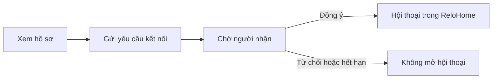

# Roommate: hồ sơ dùng lại và luồng kết nối gọn hơn

Ngày lập: 16/10/2026. Cập nhật: **17/10/2026**, theo yêu cầu kết nối để chat trực tiếp. Trạng thái: **đã triển khai code và kiểm thử local; chưa deploy cloud**. Xem [bàn giao triển khai](../integration/roommate-chat-profile-handoff-2026-10-17.md).

Đã đọc lại [tài liệu Roommate hôm nay](roommate-service-guide-2026-10-16.md), đối chiếu local `f5e6209` và `origin/main` `713266f` sau khi fetch. Hai revision có cùng cây source tại thời điểm kiểm tra. Báo cáo này không xác nhận cấu hình hoặc hành vi runtime của staging.

## 1. Kết luận đề xuất

**Một tài khoản, một bản giới thiệu dùng lại. Hai bên đồng ý kết nối thì chat ngay trong ReloHome.**

- Tài khoản là nơi chuẩn bị thông tin mặc định; không bắt người mới hoàn thành form ở ghép khi đăng ký.
- Trong Roommate, hiện bản tóm tắt đã điền sẵn và nút **Chỉnh sửa**. Chỉ mở những mục thiếu hoặc người dùng muốn sửa.
- Khi gửi yêu cầu: một khung gồm bản giới thiệu, người nhận và nút **Gửi yêu cầu kết nối**. Người nhận bấm **Đồng ý kết nối** thì mở hội thoại trực tiếp.
- Không yêu cầu khai/chọn Phone/Zalo, không có checkbox chia sẻ số liên hệ trong luồng mới. Không thêm bước xin quyền chat sau khi đã đồng ý kết nối.
- Giữ tìm kiếm theo danh sách, bộ lọc và lý do phù hợp hiện có. Không swipe, tự ghép cặp hoặc thay thuật toán.
- Chat Roommate nằm trong phạm vi kế hoạch này. Tận dụng giao diện nhắn tin Housing; bổ sung backend/database/quyền Roommate riêng. Luồng Phone/Zalo chỉ còn là dữ liệu/chức năng cũ cần tương thích, không phải điều kiện của kết nối mới.



Phần audit mục 2–3 mô tả baseline kiểm tra ngày 16/10. Các mục thiết kế là căn cứ triển khai ngày 17/10; trạng thái/evidence hiện hành ở tài liệu bàn giao, không phải xác nhận staging đã được cập nhật.

## 2. Baseline ngày 16/10 và điểm gây nhập lặp

| Phần | Đang có | Hệ quả đối với UX |
| --- | --- | --- |
| Tài khoản | Tên, email đăng nhập, preferences; hồ sơ hành khách tách riêng | Chưa có một hồ sơ sinh hoạt chung hoàn chỉnh để tự điền mọi trường Roommate |
| Bản giới thiệu riêng | `GET/PUT /roommate/me/intro`, lưu trong `intros` theo owner | Đã có nền tảng dùng lại; không cần thêm bảng hồ sơ để bắt đầu |
| Hồ sơ tìm người | `/me/profile` có version, trạng thái và thời hạn | Khác bản giới thiệu riêng; sửa mặc định không có nghĩa tự đăng hoặc gia hạn công khai |
| Tiêu chí tìm kiếm | `/me/criteria` độc lập với intro | Hiện chưa tự lấy toàn bộ intro làm bộ lọc; cần quy tắc điền sẵn có thứ tự |
| Gửi kết nối | Mở `ProfileEditor` đầy đủ → preview → chọn/xem kênh → consent → gửi | Người đã có thông tin vẫn phải đi qua form và bước xem lại riêng |
| Đọc liên hệ | Hai bên đồng ý, rồi đọc Phone/Zalo theo grant còn hiệu lực | Không phải chat nội bộ Roommate |

Nguồn: [Account trong App](../../apps/web/src/App.tsx), [API hồ sơ](../../apps/agent-api/src/relohome_agent/api/roommate_profiles.py), [repository](../../packages/python/roommate/src/relohome_roommate/profile_repository.py), [composer](../../apps/web/src/roommate/ConnectionComposer.tsx), [discovery](../../apps/web/src/roommate/Discovery.tsx).

Hai điểm cần xử lý cùng đợt UX:

- [CandidateDetail](../../apps/web/src/roommate/CandidateDetail.tsx) gọi `setCompose(false)` khi cửa sổ nhận focus; [ConnectionDetail](../../apps/web/src/roommate/ConnectionDetail.tsx) cũng đóng action khi refresh. Đây là đường code có thể làm mất khung đang thao tác sau khi chuyển tab; chưa tái hiện browser trong đợt audit này.
- Composer nạp lại intro bằng effect gán toàn bộ state. Khi tái sử dụng ở nhiều màn hình, dữ liệu tải lại không được ghi đè form người dùng đang sửa.

## 3. Chat liên hệ mới đang nằm ở đâu?

`ContactMessenger` dùng thông báo/activity Housing; `ContactThread` gọi `/housing-management/housing/contact-requests/{id}/messages`. Widget Tin nhắn trong screenshot vì vậy chưa chứng minh Roommate đã có hội thoại riêng.

Ở baseline ngày 16/10, Roommate chỉ có gửi/accept/reject/withdraw/revoke/read và đọc contact. Đợt 17/10 đã bổ sung API chat Roommate và allowlist tương ứng. Nguồn: [messenger](../../apps/web/src/components/ContactMessenger.tsx), [thread Housing](../../apps/web/src/components/ContactThread.tsx), [gateway Roommate](../../apps/browser-gateway/src/relohome_gateway/roommate_gateway.py), [API kết nối](../../apps/agent-api/src/relohome_agent/api/roommate_connections.py), [API chat mới](../../apps/agent-api/src/relohome_agent/api/roommate_chat.py).

**Đích đã được người dùng chốt ngày 17/10:** gửi yêu cầu để mở chat; chỉ khi người nhận đồng ý mới tạo/mở hội thoại. Không bắt chia sẻ liên hệ ngoài ứng dụng.

Tái sử dụng phần trình bày của thread sau khi tách adapter dữ liệu, thêm loại hội thoại/permission Roommate riêng. Không truyền request ID Roommate vào API Housing, không tạo yêu cầu Housing giả và không dùng chung grant liên hệ. Tin nhắn có nhãn “Nhà thuê” hoặc “Ở ghép” trong cùng widget; trạng thái yêu cầu đang chờ vẫn được quản lý trong Roommate.

Đây là thay đổi hành vi kết nối đã được yêu cầu, cần sửa domain/API/storage và kiểm thử. Không chỉ đổi nhãn hoặc bỏ validation contact ở frontend. Thuật toán tìm người, bộ lọc, hard constraints và scoring giữ nguyên.

## 4. Tham khảo nước ngoài: học cách tổ chức

| Nguồn chính thức | Điều quan sát được từ tài liệu công khai | Áp dụng cho ReloHome |
| --- | --- | --- |
| [SpareRoom — Create your profile](https://blog.spareroom.com/product-page-create-your-profile/) | Chuẩn bị thông tin tiền thuê, vị trí và phần giới thiệu; sau đó trao đổi qua tin nhắn | Có bản giới thiệu dùng lại; để việc trao đổi và kết nối ở vị trí dễ tìm |
| [Roomies — Safety](https://www.roomies.com/safety) | Khuyến khích nhắn trong hệ thống trước khi người dùng sẵn sàng chia sẻ liên hệ riêng | Dùng chat nội bộ làm cách trao đổi chính sau đồng ý kết nối; không yêu cầu số liên hệ |
| [Airbnb — Profile visibility](https://www.airbnb.com/help/article/3811) | Hồ sơ giới thiệu và thông tin tài khoản riêng tư cùng được truy cập trong khu vực Profile, nhưng phạm vi hiển thị khác nhau | Một điểm quản lý thông tin, nhãn quyền hiển thị rõ cho từng nhóm |

Đây là bài học thiết kế đề xuất từ nguồn công khai, không phải xác nhận đã thử luồng đăng nhập của các trang đó. Roomies chặn browser audit bằng Cloudflare; ảnh trang SpareRoom tải chưa đầy đủ nên không dùng làm bằng chứng so sánh pixel. Không sao chép yêu cầu xác minh hay policy của họ sang ReloHome.

## 5. Bố cục đề xuất

### 5.1 Tài khoản → Hồ sơ

Đưa thông tin cơ bản lên trước, tiếp đến **Bản giới thiệu ở ghép**, rồi hồ sơ dùng riêng cho từng dịch vụ. Khối hành khách vẫn được giữ nhưng đặt trong nhóm “Thông tin dùng cho đặt vé”, có thể thu gọn; không chiếm ngang hàng với việc giới thiệu bản thân.

```text
Hồ sơ của tôi
  Thông tin tài khoản                  [Chỉnh sửa]
  Tên hiển thị · Email đăng nhập

  Bản giới thiệu ở ghép                 [Hoàn thiện / Chỉnh sửa]
  Tên · Giới thiệu ngắn · Khu vực · Ngân sách · Ngày chuyển
  Chưa công khai. Dùng để điền sẵn khi bạn sử dụng Ở ghép.

  Thông tin dùng cho đặt vé             [Mở rộng]
```

Người chưa đủ điều kiện Roommate thấy phần giới thiệu tính năng và CTA hoàn thiện. Trước khi đọc/lưu intro, dùng lại gate 18+ và terms hiện có; không gọi API bị chặn rồi bỏ qua lỗi. Người đã xác nhận đúng phiên bản không phải xác nhận lại chỉ vì mở từ Tài khoản.

### 5.2 Roommate → Tìm người

- Một dòng tóm tắt “Đang tìm tại … · Ngân sách …” và **Sửa nhu cầu** phía trên danh sách.
- Card tập trung tên, khu vực, ngân sách, thời điểm chuyển và vài thông tin phù hợp hiện có; nội dung dài mở trong chi tiết.
- Giữ navigation đang có: Tìm người, Đã lưu, Yêu cầu kết nối, Hồ sơ của tôi, Cài đặt. Trong yêu cầu đã đồng ý có **Nhắn tin** mở đúng hội thoại trong widget chung; không tạo hai inbox tin nhắn trùng nhau.
- Emerald cho điều hướng chung; Rose cho icon/nhận diện Roommate. Màu trạng thái vẫn theo semantic tokens, không dùng Rose làm lỗi mặc định.

### 5.3 Gửi yêu cầu: xem lại ngay trong một khung

```text
Gửi yêu cầu đến [Tên người nhận]
  Bản giới thiệu của bạn                [Chỉnh sửa]
  [Tên · Giới thiệu · Nhu cầu đã lưu]

  Khi người này đồng ý, hai bạn có thể nhắn tin trong ReloHome.
  Không cần cung cấp số điện thoại hoặc Zalo.

  [Đóng]                          [Gửi yêu cầu kết nối]
```

- Đây đã là màn xem lại; không cần “Tiếp tục” để mở một màn review giống hệt.
- Thiếu trường bắt buộc thì mở đúng nhóm cần bổ sung, hiển thị lỗi tại trường và đưa focus đến lỗi đầu tiên. Không tự tạo thông tin sinh hoạt.
- Không render `ContactPicker`, không gọi contact store/vault để gửi yêu cầu chat. Người chưa có Phone/Zalo vẫn gửi và nhận được yêu cầu.
- Nút gửi thể hiện ý định gửi bản giới thiệu và đề nghị trò chuyện với người đang hiển thị; không thêm checkbox chia sẻ liên hệ. Đổi người nhận phải trở lại bản xem lại đúng người, không tái sử dụng thao tác gửi cũ.
- Footer giữ CTA trong tầm nhìn; desktop một sheet/dialog, mobile toàn chiều rộng. Nội dung cuộn, footer không che field khi bàn phím mở; focus/label và reduced motion theo shared components.

### 5.4 Người nhận yêu cầu

Hiện bản giới thiệu người gửi, giải thích “Đồng ý để trò chuyện trong ReloHome” và hai nút **Từ chối / Đồng ý kết nối**. Không cần nhập Phone/Zalo, checkbox chia sẻ kênh hoặc popup xác nhận thứ hai.

Accept thành công trả về hội thoại và mở ngay trong widget ở phía người nhận. Người gửi nhận thông báo và nút **Nhắn tin**; không bật cưỡng bức popup khi họ đang thao tác ở màn khác. Tải lại trang vẫn tìm lại được hội thoại. Nếu hai người đã có chat đang hoạt động, mở lại hội thoại đó thay vì gửi yêu cầu hoặc tạo chat trùng.

### 5.5 Hội thoại sau kết nối

- Header: tên người kia và nhãn **Ở ghép**; nội dung: tin nhắn, thời gian, trạng thái gửi; footer: ô nhập và nút gửi. Dùng giao diện chung với Housing.
- Trước accept không có ô nhập chat. Bản giới thiệu trong yêu cầu không được biến thành tin nhắn mở kênh trước khi đồng ý.
- Có **Ngừng kết nối**, **Chặn**, **Báo cáo** trong menu; giải thích tác động tại thao tác liên quan, không thêm xác nhận lặp vào gửi tin thường ngày.
- Không thêm tính năng riêng “Chia sẻ Zalo” trong đợt này. Nếu bổ sung về sau phải là opt-in riêng; accept chat không tạo quyền đọc contact.

Quy tắc lifecycle dự kiến:

| Trạng thái/sự kiện | Hành vi dự kiến |
| --- | --- |
| Pending | Giữ hạn chờ 7 ngày, chỉ có yêu cầu kết nối; chưa nhắn được |
| Reject/withdraw/expiry trước accept | Không tạo hội thoại và không gửi tin được |
| Accept | Chỉ recipient hợp lệ được chấp nhận; tạo hoặc trả lại đúng một hội thoại cho cặp người trong cùng transaction |
| Đã kết nối | Hai thành viên đọc/gửi được khi tài khoản còn quyền; không áp hạn grant Phone/Zalo 7 ngày cho chat |
| Hồ sơ công khai hết 30 ngày/pause/resolved | Giữ discovery/lifecycle hồ sơ hiện tại; không tự khóa chat đã được đồng ý chỉ vì hồ sơ không còn tìm kiếm |
| Ngừng kết nối | Dừng gửi cả hai phía; lịch sử chỉ đọc khi còn quyền. Kết nối lại phải được cả hai chủ động đồng ý, không tự mở lại từ grant cũ |
| Block/restriction/delete | Kiểm tra quyền ở server cho mỗi read/send; block đóng hội thoại, chặn truy cập nội dung trong ứng dụng khi block còn hiệu lực; unblock không tự khôi phục quyền gửi |
| Xóa dữ liệu cá nhân | Bổ sung phạm vi message/conversation vào export/erase/cleanup; tách việc lưu lịch sử khỏi quyền nhắn tin |

Không dùng TTL request/profile làm thời hạn xóa tin nhắn. Đã thêm `ROOMMATE_CHAT_RETENTION_DAYS`, mặc định 180 ngày (1–3650); cleanup và chống replay sau xóa đã có test. Retention backup do operator quản lý riêng. Chưa áp thay đổi lên DB thật/cloud.

## 6. Thông tin nào được dùng lại?

| Dữ liệu | Mặc định đề xuất | Quyền hiển thị |
| --- | --- | --- |
| Tên hiển thị tài khoản | Gợi ý khi intro chưa có tên; người dùng sửa được, vẫn phải qua validation Roommate | Chưa gửi/chưa đăng thì không tự công khai |
| Email đăng nhập | Giữ cho tài khoản, không chèn vào intro | Riêng tư |
| Giới thiệu, thành phố/khu vực, ngân sách, nhu cầu, thời điểm chuyển | Lưu một lần qua intro hiện có; mở Roommate dùng lại | Chỉ phần snapshot gửi cho người nhận hoặc nội dung người dùng chủ động công khai |
| Đặc điểm sinh hoạt và mong muốn | Dùng lại giá trị người dùng đã tự khai, cho mở rộng sửa | Mong muốn riêng không được đưa vào bản giới thiệu gửi đi nếu API hiện tại không chia sẻ |
| Phone/Zalo | Không yêu cầu và không tự đưa vào kết nối/chat mới; giữ dữ liệu cũ theo policy hiện có | Accept chat không cấp grant và không tự tiết lộ liên hệ |
| Họ tên pháp lý, ngày sinh, email/phone đặt vé | Không tự lấy sang Roommate | Giữ trong hồ sơ hành khách riêng |
| Sở thích AI | Chỉ là gợi ý nếu người dùng chủ động áp dụng và kiểu dữ liệu hợp lệ | Không suy diễn thành đặc điểm thật hoặc điều kiện bắt buộc |

Thứ tự ưu tiên: **thay đổi đang nhập > intro đã lưu > tên tài khoản gợi ý > để trống**. Với tìm kiếm: tiêu chí phiên hiện tại/đầu vào route > criteria đã lưu; chỉ gợi ý từ intro khi chưa có criteria. Không tự ghi đè bộ lọc hoặc biến preferences thành hard constraints.

Không lấy ngày sinh hành khách để suy ra đã chấp thuận 18+/terms. Không tự đồng bộ avatar chưa duyệt thành ảnh công khai.

## 7. Phương án kỹ thuật: giữ matching, thay cách liên lạc

1. Tái sử dụng `ProfileEditor`, phần summary, `AccessGate`, `useOperation` và client Roommate. `ContactPicker` chỉ giữ cho luồng legacy, không nằm trong kết nối chat mới. Bóc phần trình bày messenger/thread dùng chung với adapter riêng Housing/Roommate và khóa định danh gồm loại hội thoại + ID.
2. Account và Roommate cùng đọc/lưu **`/me/intro`**; không lưu thêm bản sao vào `users.preferences`, không tạo bảng hồ sơ mới. Phần chat cần migration additive trong storage Roommate, hỗ trợ SQLite/PostgreSQL hiện có; không dùng bảng `housing.contact_messages` có FK/role của Housing.
3. Lưu intro không phải thao tác thuần trang trí: `ProfileService.save_intro` có thể đóng các yêu cầu pending không còn thỏa điều kiện. Chỉ lưu khi người dùng bấm; khi đổi nhu cầu quan trọng, giải thích tác động ngay cạnh thao tác lưu. Không gọi PUT khi mount, mở preview hay chỉ đổi tab.
4. Luồng gửi hiện có đã lưu intro khi tạo yêu cầu mới thành công. Không gắn nhãn “sửa chỉ lần này”; ghi gọn “Thông tin này được dùng cho lần gửi sau”. Không thêm PUT intro trước POST request, tránh mutation phụ hoặc lưu một phần khi gửi thất bại.
5. Preview API hiện có được giữ như bước kiểm tra trước gửi, có thể nằm trong cùng thao tác cuối. Khóa payload và người nhận theo lần gửi người dùng chủ động bấm; preview lỗi thì không gửi. Server vẫn kiểm tra eligibility hai chiều khi send/accept, không suy ra đồng ý từ việc mở profile.
6. Giữ idempotency key/payload và unknown-result recovery cho request/accept; thêm client message ID chống gửi trùng khi timeout/retry. Version contact chỉ dùng ở luồng legacy. Không tạo key mới khi retry, không lưu nội dung chat/PII vào localStorage và không tự gửi lại draft sau reload.
7. Tách revalidation khi focus khỏi đóng form. Hai màn Account/Roommate cùng invalidation intro, không ghi đè dirty form. Chat cũng phải bỏ response cũ khi đổi actor/conversation, dừng polling và xóa state khi logout/mất quyền.
8. Hồ sơ công khai là nội dung có lifecycle riêng; “Lưu bản giới thiệu” không tự publish/reconfirm hay kéo dài TTL. Nếu người dùng đã có profile mà chưa có intro, có thể đề xuất **Dùng hồ sơ này làm bản giới thiệu**, không tự ghi trong lúc đọc.

Giới hạn hiện tại: `intros` chưa có optimistic version, nên bảo vệ dirty form không giải quyết tuyệt đối ghi đồng thời từ hai thiết bị. Không hứa cơ chế merge đa thiết bị; bổ sung conditional write/version là hạng mục API riêng nếu cần.

Nguồn: [profile service](../../packages/python/roommate/src/relohome_roommate/services/profiles.py), [lifecycle](../../packages/python/roommate/src/relohome_roommate/services/lifecycle.py), [request service](../../packages/python/roommate/src/relohome_roommate/services/requests.py), [operation hook](../../apps/web/src/roommate/useOperation.tsx).

### 7.1 Contract và database cần bổ sung

- Phân biệt rõ yêu cầu kiểu **chat nội bộ** với yêu cầu chia sẻ contact cũ bằng discriminator có validation theo từng kiểu. Chốt schema/route trước khi sửa domain; không gửi `contact=null` hoặc channel giả vào contract cũ để lách kiểm tra.
- Send/accept kiểu chat không yêu cầu contact ref/version/vault. Accept không tạo `GrantRecord` đọc Phone/Zalo. Ý định gửi/đồng ý được ghi bằng actor, người nhận, request, thời gian và operation key.
- Conversation lưu hai participant, nguồn request và trạng thái active/closed; message lưu conversation, sender do server suy ra, body, thời điểm server và client message ID. Read cursor riêng từng thành viên; indexes phục vụ phân trang. Ràng buộc một cuộc trò chuyện đang hoạt động cho mỗi cặp, kể cả yêu cầu gửi ngược chiều và accept đồng thời.
- API dự kiến gồm: send/accept trả `conversation_id`; danh sách hội thoại/unread; đọc/gửi tin phân trang; mark-read và close. Không cho client tự khai sender hoặc tự tạo membership. Khóa ngoại, uniqueness, transaction và lỗi typed được kiểm chứng trên cả SQLite/PostgreSQL.
- Kiểm tra thành viên, trạng thái kết nối, block/restriction mỗi lần đọc/gửi. Không lệ thuộc public profile còn ACTIVE sau khi đã accept. Rate limit/quota chống spam vẫn áp cho tất cả kiểu yêu cầu, không được nhân đôi bằng đổi discriminator.
- Tái sử dụng polling và cách hiển thị hiện có trước; không cần WebSocket hoặc thêm dịch vụ chat bên ngoài cho phiên bản đầu. Không dùng agent/LLM để quyết định quyền chat hoặc chấp nhận kết nối.
- Metadata thông báo chỉ chứa thông tin đủ mở đúng hội thoại; logging không ghi body/Phone/Zalo. Message body được render text an toàn; giới hạn độ dài/body và trang dữ liệu theo contract đã chốt.

### 7.2 Tương thích dữ liệu và client cũ

- Không sửa ý nghĩa grant/contact cũ hoặc xóa dữ liệu khi migration. Luồng cũ có test riêng; không bỏ yêu cầu consent contact trên API legacy.
- Không tự chuyển consent chia sẻ số điện thoại thành đồng ý chat. Với cặp legacy, muốn dùng chat phải gửi/đồng ý lời mời chat rõ ràng; request mới không đòi nhập lại contact. Dedupe/pair lookup phải phân biệt mục đích nhưng vẫn dùng chung giới hạn chống spam.
- Operation/draft cũ không được replay thành kiểu chat. Giữ fingerprint/schema tương ứng; UI không hỗ trợ một draft legacy phải báo rõ thay vì tự chuyển payload.
- Deploy migration/backend hỗ trợ cả hai kiểu trước, rồi bật UI chat. Rollback UI không được xóa bảng tin nhắn hoặc làm client cũ vô tình nhận quyền mới. Chạy rehearsal trên dữ liệu test có pending/accepted/expired/grant cũ trước phát hành.

## 8. Kế hoạch thực hiện và tiêu chí nghiệm thu

Các task dưới đây đã được triển khai và nghiệm thu local. Checklist hoàn tất ở [tasks/todo.md](../../tasks/todo.md), số liệu và giới hạn ở [bàn giao](../integration/roommate-chat-profile-handoff-2026-10-17.md). Các cột scope là cách chia slice ban đầu, không phải danh sách việc còn chờ.

| Task | Phạm vi dự kiến | Acceptance | Phụ thuộc / kiểm chứng |
| --- | --- | --- | --- |
| RU-01 Hồ sơ tại Account | Account + panel dùng chung + test, khoảng 3–5 file | Một intro dùng lại ở hai nơi; người mới đi qua gate đúng; không gọi traveler để điền ở ghép | Không phụ thuộc; test guest/access/dirty/save lỗi, build |
| RU-02 Điền sẵn tìm kiếm | Discovery + adapter typed + test, 2–3 file | Criteria cũ và chỉnh sửa hiện tại được ưu tiên; không tự nâng mức bắt buộc | RU-01; kiểm tra thứ tự ưu tiên và payload search |
| RC-01 Lời mời chat | Contract/domain + migration + focused test, chia slice 3–5 file | Tạo lời mời chat không cần contact; hai chiều eligibility và quota giữ nguyên; pending hết hạn sau 7 ngày | RU-01; contract/domain test và legacy không đổi |
| RC-02 Đồng ý mở chat | Domain/storage + API + tests, chia slice 3–5 file | Accept tạo đúng một conversation, không cấp contact grant; retry/race nguyên tử | RC-01; test hai accept đồng thời, cặp ngược chiều, stale quyền |
| RC-03 Đọc/gửi tin | Một slice read rồi một slice send, mỗi slice 3–5 file | Chỉ member còn quyền đọc/gửi; pagination/read cursor; retry không nhân đôi tin | RC-02; test outsider, block, message ID, limit và SQLite/PG |
| RU-03 Gửi một khung | Composer + summary + tests, 3–5 file | Không ContactPicker/checkbox chia sẻ kênh; xem lại ngay và gửi một operation | RU-01 + RC-01; preview lỗi, thiếu intro, double click, unknown/retry |
| RU-04 Nhận và giữ draft | CandidateDetail, ConnectionDetail + tests, 3–4 file | Đồng ý mở chat ngay; focus không mất draft; đổi actor dọn state | RU-03 + RC-02; reject/expiry/focus/logout |
| RC-04 Messenger chung | Tách view/adapter rồi nối inbox, mỗi slice 3–5 file | Housing không đổi; Roommate có nhãn/route/unread đúng; người gửi nhận CTA Nhắn tin | RC-03 + RU-04; UI và tích hợp hai actor, reload/polling |
| RC-05 Lifecycle/privacy | Close/block rồi export/erase/retention, mỗi slice 3–5 file | Ngừng kết nối dừng gửi; block có hiệu lực server; hồ sơ hết hạn không khóa chat đang hoạt động | RC-03; test read/send race với block/close, cleanup và legacy migration |
| RU-05 Trình bày thống nhất | Shared summary/CSS + tests, 3–5 file | Card gọn, footer dễ thấy, VI/EN, light/dark, keyboard và mobile | RC-04 + RU-03–04; screenshot 390px/desktop, Axe, không tràn ngang |
| RU-06 Bàn giao và hồi quy | Tests + tài liệu, chia nhỏ nếu quá 5 file | Matching/public lifecycle và quyền legacy giữ nguyên; chat mới không phụ thuộc contact; rollout/rollback rõ | RU-01–05 + RC-01–05; build, UI/integration và domain/storage hồi quy |

Checkpoint sau RU-01–02: cùng dữ liệu, đúng quyền và giữ tiêu chí. Sau RC-01–03: hai người không có contact vẫn send/accept/read/send-message được qua API thật, legacy không đổi. Sau RU-03–04 + RC-04–05: UI một khung và chat đúng quyền/lifecycle. Sau RU-05–06: kiểm tra hình, rollout và hồi quy trước PR. Những task được ghi nhiều slice phải chia nhỏ theo dependency trước khi triển khai, không gộp cả module trong một lần sửa.

Lệnh tham chiếu khi triển khai, chạy từ `apps/web` và theo fixture/config hiện có:

```powershell
npm run build
npm run test:e2e -- --config playwright.roommate-ui.config.ts
npm run test:e2e -- --config playwright.roommate.config.ts
```

Config tích hợp cần môi trường test riêng; không gửi kết nối tới người thật để kiểm chứng. Chạy thêm suite domain Roommate hiện có khi kiểm tra bất biến, không sửa CI để hợp thức hóa kết quả.

Chỉ tiêu UX đề xuất: người dùng đã hoàn thiện intro không phải nhập lại; từ detail đến gửi còn một màn xem lại và một nút gửi, không cần Phone/Zalo. Người nhận bấm Đồng ý là vào chat; không có bước cấp quyền contact hoặc xác nhận chat lần nữa. Trước accept/ngoài membership không thể đọc/gửi tin kể cả gọi API trực tiếp; accept/retry không tạo chat trùng. Số request mạng không phải chỉ tiêu giảm.

## 9. Phạm vi đã thực hiện

Ngày 16/10 đối chiếu source và tham khảo nguồn chính thức; ngày 17/10 sửa kế hoạch rồi triển khai Roommate chat, intro dùng lại, schema v3 và test hồi quy. Đã kiểm thử SQLite, PostgreSQL riêng, browser fixture và tích hợp thật hai tài khoản synthetic. Không sửa thuật toán, provider/orchestration hoặc CI; chưa deploy staging/cloud hay migrate DB thật. Bộ browser workspace rộng còn 32 lỗi cũng tái hiện trên code gốc, được ghi rõ trong bàn giao.
