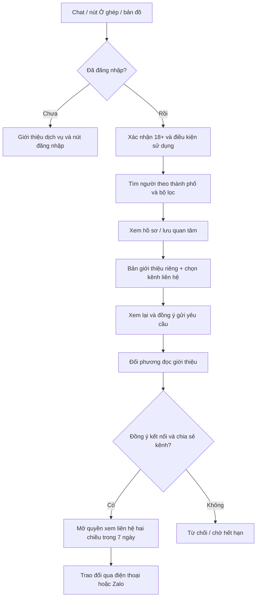
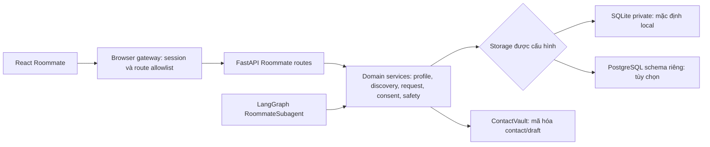

# Roommate trong ReloHome: cách hoạt động và hướng cải thiện trải nghiệm

**Cập nhật 17/10/2026:** đã bỏ hồ sơ demo khỏi UI/runtime và bản đồ. Roommate chỉ dùng hồ sơ do tài khoản người dùng đăng; xem [runbook hiện hành](../runbooks/roommate.md). Các ghi nhận DEMO bên dưới là lịch sử ngày 16/10, không còn là hướng dẫn cấu hình.

Ngày đối chiếu: 16/10/2026, code `main` tại `49ab46a` (đã gồm PR #192 và #194).

Tài liệu phân biệt **hành vi đang có trong code**, **cấu hình local**, và **đề xuất chưa triển khai**. Đây không phải xác nhận môi trường cloud đã được cấu hình hoặc kiểm thử tải.

**Phiên bản hiện hành:** ngày 17/10 đã triển khai code chat sau kết nối và intro dùng lại; xem [bàn giao mới](../integration/roommate-chat-profile-handoff-2026-10-17.md). Các phần 1–16 ghi lại baseline ngày 16/10 (`origin/main` đối chiếu thêm tại `713266f`), mô tả Phone/Zalo là luồng legacy còn được hỗ trợ. Không dùng evidence cũ để kết luận tính năng mới đã deploy lên staging.

## 1. Tóm tắt sản phẩm

Roommate là dịch vụ tìm người ở cùng theo nhu cầu nhà ở và sinh hoạt. Người dùng xem danh sách, đọc hồ sơ, gửi bản giới thiệu và tự quyết định kết nối. Không có swipe, tự ghép cặp hoặc AI tự đồng ý thay người dùng.

Có hai nhu cầu chính:

- **Đã có phòng, tìm người ở cùng** (`has_room`): có thể liên kết một tin Housing và chủ động đồng ý hiện phòng trên bản đồ.
- **Cùng tìm chỗ ở** (`looking_together`): tìm người có nhu cầu tương tự trước, sau đó cùng tìm nhà.

Hiện hỗ trợ TP.HCM, Hà Nội và Đà Nẵng. Các thông tin cá nhân/sinh hoạt là **tự khai**; không đồng nghĩa đã xác minh danh tính, số điện thoại hay quyền ở tại phòng.

## 2. Người dùng đi qua những bước nào?



Điểm cần hiểu: **không phải đăng hồ sơ công khai mới được tìm người hoặc gửi yêu cầu**. Nhưng khi gửi yêu cầu, bản giới thiệu riêng phải đủ thông tin và người gửi phải chọn một kênh liên hệ.

Nguồn: [Workspace](../../apps/web/src/roommate/Workspace.tsx), [Guest](../../apps/web/src/roommate/RoommateGuest.tsx), [AccessGate](../../apps/web/src/roommate/AccessGate.tsx), [ConnectionComposer](../../apps/web/src/roommate/ConnectionComposer.tsx).

## 3. Những màn hình hiện có

| Khu vực | Người dùng làm gì? | Lưu ý |
| --- | --- | --- |
| Tìm người | Chọn thành phố, xem hồ sơ, bổ sung thông tin của mình và lọc nâng cao | Tự tìm khi mở trang/đổi thành phố; 12 hồ sơ mỗi trang |
| Chi tiết hồ sơ | Xem nhu cầu/sinh hoạt, lý do phù hợp, lưu, gửi yêu cầu, chặn/báo cáo | Link mở trực tiếp không có điểm phù hợp nếu không có tiêu chí tìm kiếm |
| Đã lưu | Quay lại các hồ sơ quan tâm | Hồ sơ mất quyền xem không được hiển thị lại thông tin cũ |
| Yêu cầu kết nối | Xem đã nhận/đã gửi, phản hồi và kiểm tra quyền liên hệ | Không phải hộp chat nhắn tin tự do |
| Hồ sơ của tôi | Lưu giới thiệu riêng, xem trước, chủ động đăng nhu cầu, quản lý trạng thái/ảnh | Giới thiệu riêng và hồ sơ công khai là hai phần lưu trữ khác nhau |
| Cài đặt | Quản lý điện thoại/Zalo, chặn, xuất/xóa dữ liệu riêng | Liên hệ không nằm trong hồ sơ công khai |
| Thông báo | Biết có yêu cầu mới, phản hồi, hết hạn hoặc thu hồi liên hệ | Polling khi tab hoạt động; chưa có email/SMS/push |
| Quản lý cộng đồng | Duyệt ảnh, xử lý báo cáo, hạn chế/khôi phục hồ sơ, xem thống kê | Chỉ account ID được operator cấu hình là moderator |
| DEMO | Thử tìm người với 30 hồ sơ giả | Tách khỏi hồ sơ thật; không gửi kết nối thật |

## 4. Ba loại dữ liệu người dùng dễ nhầm

### 4.1. Thông tin dùng để tìm (`criteria`)

Gồm thành phố, thông tin tự khai của người tìm (`self_facts`) và các ưu tiên (`preferences`). Có thể lưu cho lần sau. Không tự công khai thông tin này.

### 4.2. Bản giới thiệu riêng (`intros`)

Được dùng để gửi cho một người cụ thể. Gửi yêu cầu không tự tạo hồ sơ công khai. Khi gửi, backend lưu snapshot giới thiệu đã xem lại; đối phương đọc snapshot đó.

### 4.3. Hồ sơ công khai trong dịch vụ (`profiles`)

Chỉ xuất hiện khi chủ hồ sơ chủ động đăng và còn hiệu lực. “Công khai” ở đây là hiển thị cho người dùng đủ điều kiện truy cập Roommate; không phải cho khách chưa đăng nhập hoặc công cụ tìm kiếm.

Hồ sơ đăng cần có tên hiển thị, giới thiệu, thành phố, ít nhất một khu vực, ngân sách và cơ sở phí, nhu cầu, thời điểm vào ở. Người đã có phòng cần khai có sẵn sàng chuyển đi hay không. Sinh hoạt/ưu tiên chi tiết có thể để trống.

**Hệ quả UX:** dùng cùng một form lớn ở nhiều chỗ không làm ba loại dữ liệu tự đồng bộ. Hiện Discovery đọc tiêu chí đã lưu; Composer đọc giới thiệu riêng. Không nên hứa “chỉ nhập một lần ở mọi nơi” trước khi thiết kế quy tắc đồng bộ và xác nhận rõ ràng.

Nguồn: [models](../../packages/python/roommate/src/relohome_roommate/models.py), [profiles service](../../packages/python/roommate/src/relohome_roommate/services/profiles.py), [MyProfile](../../apps/web/src/roommate/MyProfile.tsx), [Discovery](../../apps/web/src/roommate/Discovery.tsx).

## 5. Thuật toán ghép hiện tại

### 5.1. Lọc trước, xếp hạng sau

Backend loại hồ sơ nếu là chính mình, sai thành phố, bị chặn/hạn chế, chưa active hoặc hết hạn. Tiếp theo kiểm tra điều kiện bắt buộc của **cả hai bên**:

- Ưu tiên `hard`: phải đáp ứng; thiếu thông tin cũng không qua điều kiện đó.
- Ưu tiên `soft`: không loại kết quả chỉ vì khác biệt; có thể ảnh hưởng điểm với các tiêu chí được chấm.
- Nếu cả hai đều đã có phòng và không ai xác nhận sẵn sàng chuyển đi, không đưa vào kết quả phù hợp.

Ví dụ: A không hút thuốc và bắt buộc người ở cùng không hút thuốc. B để trống thông tin hút thuốc sẽ không qua bộ lọc này. Không được hiểu “chưa khai” thành “không hút thuốc”.

Điều kiện hai chiều được kiểm tra lại khi gửi và chấp nhận yêu cầu, tránh dùng kết quả tìm đã cũ sau khi hồ sơ thay đổi.

### 5.2. Trọng số điểm

| Tiêu chí | Trọng số |
| --- | ---: |
| Khu vực | 20 |
| Ngân sách | 20 |
| Thời điểm vào ở | 15 |
| Hút thuốc | 10 |
| Thú cưng | 10 |
| Giờ yên tĩnh | 10 |
| Dọn dẹp | 10 |
| Sử dụng không gian chung | 5 |

Chỉ ưu tiên đã chọn mới tham gia tính điểm. Điểm là tổng có trọng số chia cho tổng trọng số được chọn, quy về 100. Tiêu chí chưa biết tạm có giá trị 0,5 trong tính toán nội bộ và làm giảm độ phủ thông tin; UI vẫn thể hiện là thiếu thông tin.

Khu vực/hút thuốc/thú cưng chủ yếu so khớp điều kiện. Ngân sách và ngày vào ở có mức giảm dần khi lệch; giờ yên tĩnh so phần giao nhau; dọn dẹp/không gian chung so mức độ trong các lựa chọn có thứ tự. Ngân sách tính **VND/người/tháng** và cần cơ sở phí có thể so sánh. Giới tính có thể là điều kiện bắt buộc, nhưng không có trọng số trong bảng chấm điểm hiện tại.

### 5.3. Khi nào mới hiển thị con số?

Chỉ công bố điểm khi đồng thời đủ:

- Có điểm tính được, có khu vực của ứng viên và ngân sách so sánh được.
- Ít nhất 4 tiêu chí có dữ liệu, trong đó ít nhất 2 tiêu chí về sinh hoạt.
- Độ phủ trọng số có dữ liệu đạt ít nhất 80%.

Nhãn: từ 80 là `high`, từ 60 là `medium`, còn lại `differences`. Không đủ dữ liệu thì trả `score=null`, không bịa phần trăm.

### 5.4. Thứ tự kết quả và điểm cần chú ý

Nhóm đủ điều kiện công bố điểm đứng trước, theo điểm giảm dần. Nhóm còn lại dùng mức đáp ứng một phần của khu vực/ngân sách/ngày vào ở. Khi bằng nhau dùng ID chủ hồ sơ để sắp ổn định; hiện chưa dùng “mới hoạt động” làm tiêu chí phụ.

Chỉ nhập **thông tin của mình** không tự tạo các **ưu tiên mong muốn** để chấm điểm. Khi chưa chọn ưu tiên, danh sách vẫn có thể tìm được nhưng không nên kỳ vọng có phần trăm phù hợp. Ngân sách tự khai có tham gia kiểm tra khả năng công bố điểm, nhưng không tự trở thành một preference có trọng số.

Đây là thuật toán quy tắc đơn giản, có thể giải thích. AI không quyết định điểm hoặc tự học hành vi vuốt như ứng dụng hẹn hò.

Nguồn: [eligibility](../../packages/python/roommate/src/relohome_roommate/eligibility.py), [scoring](../../packages/python/roommate/src/relohome_roommate/scoring.py), [factors](../../packages/python/roommate/src/relohome_roommate/factors.py), [ranking](../../packages/python/roommate/src/relohome_roommate/ranking.py).

## 6. Kết nối và quyền xem liên hệ

1. Người gửi chọn hồ sơ, nhập/kiểm tra giới thiệu, chọn điện thoại hoặc Zalo đã lưu.
2. Xem lại và tích đồng ý chia sẻ với đúng người nhận nếu họ chấp nhận.
3. Backend kiểm tra quyền, hồ sơ, điều kiện, phiên bản contact, quota và cặp yêu cầu trùng.
4. Người nhận đọc giới thiệu rồi chọn kênh của mình và xác nhận chia sẻ.
5. Backend tạo `grant` mở quyền xem liên hệ hai chiều trong 7 ngày tính từ lúc chấp nhận.
6. Mỗi lần xem contact vẫn kiểm tra quyền hiện tại. Hết hạn, thu hồi, chặn hoặc contact thay đổi có thể làm liên hệ không còn khả dụng.

UI chỉ tải contact khi người dùng bấm xem, xóa khỏi state khi mất focus/ẩn tab và kiểm tra lại khoảng 15 giây khi đang mở. Đây là kiểm soát trong ứng dụng; không thể thu hồi số mà người khác đã ghi lại bên ngoài.

Hiện không có hội thoại nhắn tin Roommate riêng. Sau kết nối, người dùng trao đổi qua điện thoại/Zalo. Chat Housing với chủ nhà là chức năng khác.

Nguồn: [requests](../../packages/python/roommate/src/relohome_roommate/services/requests.py), [consent](../../packages/python/roommate/src/relohome_roommate/services/consent.py), [ConnectionDetail](../../apps/web/src/roommate/ConnectionDetail.tsx), [useContactLease](../../apps/web/src/roommate/useContactLease.ts).

## 7. Trạng thái, thời hạn và giới hạn

| Đối tượng/chính sách | Giá trị hiện tại |
| --- | --- |
| Hồ sơ | `draft`, `active`, `paused`, `resolved`, `expired`, `restricted`, `deleted` |
| Hiệu lực hồ sơ | 30 ngày từ đăng/khôi phục/xác nhận lại có review |
| Nhắc còn tìm | Trong 3 ngày cuối, hiện qua inbox |
| Yêu cầu | `pending`, `accepted`, `rejected`, `withdrawn`, `expired`, `cancelled` |
| Hạn chờ phản hồi | 7 ngày |
| Quyền liên hệ | `active`, `expired`, `revoked`; hiệu lực 7 ngày từ chấp nhận |
| Gửi mới | Tối đa 10 yêu cầu trong cửa sổ 24 giờ |
| Đang chờ do mình gửi | Tối đa 20 |
| Sau từ chối | Cooldown gửi lại theo cặp/chiều: 30 ngày |
| Sau rút yêu cầu | 24 giờ |
| Sau hết hạn yêu cầu | 7 ngày |
| Sau thu hồi liên hệ | 30 ngày đối với chiều gửi lại được backend thiết lập |
| Draft phục hồi thao tác | Mã hóa phía server, 30 phút; tối đa 10 draft hoạt động |

Các thời hạn được kiểm tra khi đọc, không phải chờ job mới có hiệu lực. Maintenance đã có trong lifespan, chạy khoảng 60 giây/lần, xử lý hết hạn và dọn dữ liệu tạm. Một số runbook cũ nói chưa có daemon là mô tả lịch sử, không còn phản ánh đầy đủ code hiện tại.

Hạn mức tài nguyên API riêng theo actor/phút: search 60, upload 12, report 10, read 240, write 120. Đây là lớp bảo vệ tải, khác quota 10 yêu cầu kết nối/24 giờ.

Nguồn: [policy](../../packages/python/roommate/src/relohome_roommate/policy.py), [connection repository](../../packages/python/roommate/src/relohome_roommate/connection_repository.py), [background](../../packages/python/roommate/src/relohome_roommate/background.py), [access API](../../apps/agent-api/src/relohome_agent/api/roommate_access.py).

## 8. Vai trò của AI/LangGraph

Chat nhận ý định ở ghép và mở entry Roommate. Subagent chỉ hỗ trợ tìm kiếm, chạy discovery với quyền người dùng hiện tại; không gửi yêu cầu, tự xuất bản hồ sơ hoặc cấp consent.

Kết quả agent giữ `profile_refs` để UI tải lại bằng API riêng. Lớp projection của lịch sử chỉ giữ envelope và reference đã allowlist, không giữ snapshot hồ sơ/liên hệ trong lịch sử. API riêng kiểm tra lại quyền khi đọc.

**Ý nghĩa khi cải thiện UX:** có thể làm entry và prefill tiêu chí mượt hơn, nhưng vẫn để người dùng xem lại trước mọi hành động công khai/chia sẻ. Không cần tăng lượt LLM cho chấm điểm hoặc nút kết nối.

Nguồn: [RoommateSubagent](../../apps/agent-api/src/relohome_agent/agents/subagents/services/roommate.py), [agent projection](../../packages/python/roommate/src/relohome_roommate/agent_projection.py).

## 9. Housing và bản đồ liên quan như thế nào?

Người đã có phòng có thể chọn tin Housing theo thành phố/từ khóa. Chọn tin chưa đủ để công khai: phải có `public_location_consent=true` và hồ sơ active. Map hỏi marker theo danh sách tin đang hiển thị, tối đa 250 ID/lần; chỉ trả những liên kết còn đủ điều kiện.

Liên kết tin là thông tin tự khai, **chưa xác minh quyền ở/quyền sở hữu**. Không tự lấy căn đã lưu trong chat làm phòng công khai. Marker DEMO có nhãn riêng, không xác nhận người giả đang ở tại căn đó.

Nguồn: [RoomPicker](../../apps/web/src/roommate/RoomPicker.tsx), [roommate map API](../../apps/agent-api/src/relohome_agent/api/roommate_map.py), [models](../../packages/python/roommate/src/relohome_roommate/models.py).

## 10. Kiến trúc và database



### Nhóm bảng

| Nhóm | Bảng chính | Vai trò |
| --- | --- | --- |
| Quyền và hồ sơ | `access`, `profiles`, `intros`, `criteria`, `bookmarks` | Điều kiện sử dụng, nội dung riêng/công khai, bộ lọc, quan tâm |
| Kết nối | `requests`, `grants`, `pairs`, `cooldowns` | Snapshot giới thiệu, consent và deadline, chống cặp trùng, thời gian chờ |
| Liên hệ/ảnh | `contacts`, `media`, `private_metadata` | Ciphertext liên hệ, ảnh đã sanitize, kiểm tra đúng contact key |
| An toàn | `blocks`, `restrictions`, `reports`, `moderation` | Chặn, hạn chế, báo cáo và audit |
| Vận hành | `operations`, `operation_times`, `operation_drafts`, `rate_buckets`, `notifications` | Idempotency, phục hồi, giới hạn tải và thông báo |

SQLite schema hiện tại là v2, dùng WAL, foreign keys và transaction ghi `BEGIN IMMEDIATE`. PostgreSQL adapter tái sử dụng repositories, dùng connection pool, private schema và khóa transaction để giữ quy tắc ghi giữa các replica.

**Local đang dùng SQLite**, không phải tự chuyển Roommate vào PostGIS vì Docker đã bật. Housing/Location dùng PostgreSQL/PostGIS riêng. Đường dẫn Roommate theo cấu hình hiện tại:

```text
D:\DEMO_AI\DEMO_1\logs\private-roommate\roommate.sqlite3
D:\DEMO_AI\DEMO_1\logs\private-roommate\contact.key
```

Contact và draft phục hồi được mã hóa; không được hiểu toàn bộ DB/giới thiệu đã được mã hóa chỉ vì có Fernet. Media đang lưu BLOB trong DB. Backup phải bao gồm snapshot nhất quán và đúng key, cất ở nơi riêng tư; không gửi chung ZIP data Housing.

Khi dùng nhiều replica trên cloud, chọn PostgreSQL chung với role/schema riêng, key ổn định và cutover có kiểm chứng. Adapter hiện vẫn tuần tự hóa mutation bằng khóa chung; không thể suy ra đã chịu tải lớn chỉ từ việc dùng PostgreSQL.

Nguồn: [runtime](../../apps/agent-api/src/relohome_agent/roommate_runtime.py), [migrations](../../packages/python/roommate/src/relohome_roommate/migrations.py), [storage](../../packages/python/roommate/src/relohome_roommate/storage.py), [PostgreSQL adapter](../../packages/python/roommate/src/relohome_roommate/postgres.py), [bàn giao vận hành](../integration/roommate-production-2026-10-12.md).

## 11. Quyền riêng tư, moderation và lỗi mạng

- Gateway lấy identity từ session phía server; browser không được tự chỉ định user ID. Các mutation dùng bảo vệ request/same-origin hiện có; API yêu cầu gateway token. Dữ liệu riêng dùng no-store.
- Tên/giới thiệu bị kiểm tra thông tin liên hệ công khai như số điện thoại, email, URL; liên hệ lưu ở phần riêng. Đây không thay thế kiểm duyệt lừa đảo hoặc xác minh danh tính.
- JPEG/PNG tối đa 5 MB, 16 triệu pixel, không ảnh động; ảnh được giải mã, bỏ metadata và chuyển PNG tối đa 1024×1024. Tối đa 10 ảnh lưu mỗi owner. Chỉ ảnh đã duyệt mới được gắn avatar cho người khác xem.
- Có chặn, bỏ chặn, báo cáo và moderator xử lý có lý do/audit. Báo cáo không tự đồng nghĩa tài khoản bị khóa.
- Có xuất dữ liệu của mình và xóa nội dung riêng Roommate. Xóa nội dung không đồng nghĩa xóa quota, ban và audit chống lạm dụng.
- Mutation quan trọng có `operation_key`. Khi timeout chưa rõ kết quả, UI cho kiểm tra trạng thái và chỉ gửi lại cùng key/payload khi phù hợp. Không tự tạo yêu cầu khác để thử lại.
- Inbox/thông báo refresh khoảng 30 giây khi tab đang hoạt động. Chưa có realtime WebSocket hoặc thông báo ra ngoài ứng dụng.

Nguồn: [gateway](../../apps/browser-gateway/src/relohome_gateway/roommate_gateway.py), [media](../../packages/python/roommate/src/relohome_roommate/media.py), [privacy](../../packages/python/roommate/src/relohome_roommate/services/privacy.py), [useOperation](../../apps/web/src/roommate/useOperation.tsx), [useActiveRefresh](../../apps/web/src/roommate/useActiveRefresh.ts).

## 12. Những điểm đang làm người dùng phổ thông khó hiểu

Đây là nhận định UX từ luồng và code, chưa phải kết quả phỏng vấn người dùng hoặc đo conversion thực tế.

| Điểm vướng | Nguyên nhân hiện tại | Đề xuất giữ nguyên policy |
| --- | --- | --- |
| Không biết bắt đầu ở đâu | Nhiều tab và ba loại dữ liệu khác nhau | Entry hai lựa chọn “Tôi đã có phòng” / “Tôi muốn cùng tìm phòng”, rồi CTA rõ |
| Form gửi kết nối dài | Composer dùng lại toàn bộ ProfileEditor | Hiển thị tóm tắt đã lưu + “Chỉnh sửa”; chỉ mở phần còn thiếu |
| Nhập thông tin nhưng không thấy điểm | Self facts không tự biến thành preferences; điểm có gate dữ liệu | Giải thích ngắn “Thêm ưu tiên để so sánh”; hiện 2–3 lý do, không ép phần trăm |
| Khó phân biệt bản riêng và bản đăng | Cùng khu vực Hồ sơ có lưu riêng/preview/publish và nhiều trạng thái | Nhãn rõ “Chỉ mình bạn” / “Đang hiện trong tìm kiếm”; CTA chính theo trạng thái |
| Kết quả trống tưởng là lỗi | Có thể thiếu supply, sai thành phố hoặc điều kiện bắt buộc hai chiều | Hiện thành phố, số tiêu chí bắt buộc và nút nới lọc do người dùng chọn; không lộ hồ sơ bị chặn |
| Muốn lọc quận/phường nhưng chỉ thấy cả thành phố | Local chưa cấu hình area catalog ngoài city IDs | Bổ sung catalog canonical từ Location và bộ chọn tìm kiếm khu vực; không tạo ID từ nhãn tùy ý |
| Khó biết còn bao lâu hoặc đã làm xong chưa | Thời hạn request/grant/profile khác nhau | Timeline nhỏ “Đã gửi → Chờ phản hồi → Đã kết nối”, ngày hết hạn gần CTA |
| Muốn tiếp tục nhắn nhưng không có chat Roommate | Sản phẩm hiện mở Phone/Zalo sau consent | Sau accept, làm nổi “Xem liên hệ” và giải thích cách trao đổi; chưa cần xây messenger |
| Không biết có yêu cầu mới nếu không mở app | Chỉ polling/in-app | Trước mắt làm badge chưa đọc rõ; email/push chỉ thêm khi có opt-in và hạ tầng vận hành |
| Bị ngắt form khi quay lại tab | CandidateDetail đóng Composer mỗi lần window focus | Xem xét giữ draft RAM và chỉ refresh availability; vẫn bắt review/consent lại khi dữ liệu liên quan đổi |

## 13. Thứ tự cải thiện nên làm

### Đợt 1 — dễ dùng hơn với API/logic hiện có

1. Onboarding theo hai nhu cầu, nhãn trạng thái rõ, một CTA chính ở mỗi màn.
2. Card gọn: tên, khu vực, ngân sách/người, ngày vào ở, 2–3 chips sinh hoạt; thông tin đầy đủ trong detail.
3. Composer ưu tiên bản giới thiệu đã có; chia “giới thiệu”, “kênh liên hệ”, “xem lại”. Không bỏ consent hoặc tự đăng hồ sơ.
4. Giữ draft khi mất focus; trên mobile giữ CTA chính trong vùng dễ bấm, tránh form quá dài.
5. Empty state có đường đi tiếp, nhắc hạn dễ hiểu và badge request rõ hơn.

Tiêu chí đạt: người dùng mới phân biệt được tìm người/đăng nhu cầu/gửi yêu cầu; desktop/mobile không mất draft; gửi/accept/revoke và quyền riêng tư giữ nguyên qua regression tests.

### Đợt 2 — cải thiện chất lượng khám phá

1. Nối area catalog chuẩn và tìm quận/phường.
2. Cho người dùng chủ động áp dụng một số facts làm preferences, xem lại trước khi lưu. Không ngầm biến thông tin thành yêu cầu bắt buộc.
3. Làm lý do phù hợp dễ đọc; cân nhắc “mới xác nhận còn tìm” khi bằng điểm, sau khi chốt thay đổi ranking với chủ sản phẩm.
4. Hiện thời điểm xác nhận nhu cầu để giảm cảm giác hồ sơ cũ. Không gắn nhãn verified cho thông tin tự khai.

### Đợt 3 — sẵn sàng vận hành nhiều người thật

1. Chọn SQLite một instance hoặc PostgreSQL chung theo nhu cầu thực tế; đo search latency/lock wait trước khi tối ưu.
2. Moderator account thật, lịch trực, backup/restore drill, cảnh báo 5xx/429 và retention rõ ràng.
3. Nếu số hồ sơ tăng, discovery cần đánh giá lại việc tải toàn bộ active profiles của một thành phố rồi lọc/sort trong Python trước khi phân trang. UI phân trang 12 không làm chi phí backend chỉ còn 12 hồ sơ.
4. Chỉ thêm email/push hoặc xác minh điện thoại khi đã thống nhất trải nghiệm, consent và vận hành. Đây là chức năng mới, không phải điều đã có.

## 14. Checklist để bạn tự test

1. Mở `/ai` khi chưa đăng nhập: chat được; vào `/roommate` xem giới thiệu và đăng nhập khi muốn xem hồ sơ thật.
2. Dùng tài khoản thử của mình, xác nhận 18+/điều kiện. Không cần đăng công khai để mở Tìm người.
3. Chọn thành phố, tìm tối giản, rồi thử ưu tiên mềm và bắt buộc; quan sát kết quả/nhãn thiếu thông tin.
4. Lưu một hồ sơ, mở detail rồi quay lại: kiểm tra bộ lọc/phân trang.
5. Lưu giới thiệu riêng và kiểm tra chưa xuất hiện trong tìm kiếm. Sau đó chủ động preview/publish và kiểm tra trạng thái 30 ngày.
6. Dùng hai tài khoản thử đồng ý tham gia để gửi → nhận → accept → xem liên hệ → revoke. Không thử với contact của người không đồng ý.
7. Upload ảnh thử, kiểm tra pending/approve/avatar bằng moderator được cấu hình đúng.
8. Thử mất mạng khi gửi và khôi phục: kiểm tra trạng thái trước khi retry; không gửi trùng.
9. Kiểm tra mobile/light/dark, form dài, CTA, keyboard và thông báo chưa đọc.
10. Sau kết nối xem gợi ý “Cùng tìm chỗ ở” và “Cẩm nang hợp đồng thuê”; bấm mới mở trang tương ứng, không tự đặt dịch vụ khác. Đề xuất Moving theo ngữ cảnh là phần có thể bổ sung sau, chưa phải gợi ý hiện có của Roommate.

### Dữ liệu và giới hạn test local

- Local bật Roommate và DEMO; DEMO có 30 hồ sơ giả, tách riêng khỏi kết nối thật.
- Trước startup, SQLite có 1 dòng hồ sơ trạng thái `active`, 0 request/grant/contact/media/report. Trạng thái lưu không tự chứng minh còn hiệu lực hoặc phù hợp để tìm; API vẫn xét deadline/điều kiện. Không tự seed hoặc công khai thêm người thật trong đợt kiểm tra này.
- Local chưa cấu hình `ROOMMATE_AREA_CATALOG`, nên catalog mặc định chỉ có ba scope toàn thành phố.
- Kết quả health, browser smoke và test của đợt này được ghi ở phần kiểm chứng dưới đây sau khi khởi động hoàn tất.

## 15. Kiểm chứng ngày 16/10/2026

### Hệ thống local đang chạy

| Thành phần | Cổng | Kết quả kiểm tra |
| --- | ---: | --- |
| Location MCP | 4300 | `/readyz`: 200, database connected |
| Platform API / PostGIS | 4100 | `/health`: 200, PostGIS 3.5 |
| Moving MCP | 4400 | `/ready`: 200, staging |
| Moving API | 4200 | `/ready`: 200 |
| Flight MCP | 8765 | `/health`: 200, provider SerpApi |
| Payment MCP | 8766 | `/health`: 200, ZaloPay sandbox |
| Agent API | 8000 | `/health`: 200, development |
| UI / Browser gateway | 8503 | `/health`: 200, `/ai` trả HTML và mở được bằng Chrome |
| OSRM 3 thành phố × 3 chế độ | 5000–5002, 5010–5012, 5020–5022 | 9/9 truy vấn nearest trả 200 / `Ok` |

Link dùng thử:

- Chat: <http://127.0.0.1:8503/ai>.
- Roommate: <http://127.0.0.1:8503/roommate>.
- DEMO sau đăng nhập: <http://127.0.0.1:8503/roommate?tab=demo>.

Backend availability xác nhận `enabled=true`, `demo_enabled=true` và đủ 5 feature: notifications, media, moderation, privacy, operation_drafts. Gateway trả `{enabled:false, requires_account:true}` cho khách chưa đăng nhập theo thiết kế; không dùng phản hồi đó để kết luận backend bị tắt.

### Việc đã làm để startup đúng main

- Bật Docker Desktop, database có sẵn và 9 container OSRM của dự án. Không nhập lại data Housing/routing.
- Đồng bộ Node dependencies bằng `npm ci`; build TS và web thành công.
- Đồng bộ Python bằng requirements đã commit; bổ sung Langfuse và MCP SDK đúng bản. Gỡ `langchain-mcp-adapters` cũ không còn được repo dùng, vì xung đột với MCP 2.3. `pip check` sau đó đạt.
- Platform báo `migration_required`: schema local mới đến 023. Đã sao lưu **schema** vào `.tmp/database-schema-before-main-49ab46a-20261016.sql` rồi chạy migrator hiện có, áp dụng 024–027 và grants. File này là backup cấu trúc, không phải backup toàn bộ dữ liệu.
- Không đổi backend/frontend source, CI, `.env.local`, thuật toán ghép hoặc contact key để làm báo cáo. File mới của đợt này là tài liệu tổng hợp; helper/artifact kiểm tra nằm trong thư mục ignored.

### Kết quả kiểm thử thực tế

| Kiểm chứng | Kết quả |
| --- | --- |
| Domain/API/storage/agent/gateway Roommate | **193 passed, 6 skipped**; các ca cần PostgreSQL test riêng chưa được chạy |
| Chrome UI Roommate và production features, desktop/mobile | **26 passed**, gồm VI/EN, light/dark, keyboard/Axe, settings/moderation, consent và phục hồi thao tác |
| Chrome → gateway session → API → SQLite tách riêng | **4 passed**: publish/pause/resume, send/accept/read/revoke, photo moderation, privacy erasure |
| Smoke browser trên hệ thống local thật | Desktop/mobile: khách vào chat được, Roommate có CTA đăng nhập, không page error hoặc tràn ngang trên trang guest |
| Liên kết tài liệu local | 35 liên kết nguồn ban đầu đều tồn tại |

Các ca test tạo người/ảnh/contact **synthetic trong state test riêng**, không gửi yêu cầu tới người dùng thật. Test UI dùng API fixture; 4 ca tích hợp mới đi qua API/gateway/storage thật. Không dùng kết quả fixture để nói đã thử giao dịch hoặc provider thật.

Artifacts local: `.tmp/roommate-audit-browser-20261016.json`, `.tmp/roommate-audit-browser-results/`, `.tmp/roommate-audit-live-*.png`, `apps/web/test-results/roommate-integration/`. Log service: `data/local-mvp-logs/`.

### Phạm vi chưa được chứng minh

- Health 200 không chứng minh OpenRouter còn quota, vé có kết quả hoặc AhaMove báo giá cho mọi tuyến. Không gửi giao dịch, thanh toán, LLM prompt hoặc kết nối thật trong đợt này.
- Chưa chạy lại parity/load test PostgreSQL Roommate, chưa thực hiện cutover storage hoặc deploy cloud.
- Collector OTLP local ở cổng 4318 chưa được bật; một số tiến trình instrumentation ghi cảnh báo export. Không coi việc startup application thành công là tracing đã hoạt động.
- Các số liệu kiểm thử trong bàn giao ngày 12/10 là evidence lịch sử, không tự coi là kết quả chạy lại hôm nay.

## 16. Bản đồ API để tiếp tục phát triển

Frontend gọi dưới `/web/api/roommate`, gateway proxy sang `/api/v1/roommate` và gắn identity/token tin cậy. Nhóm route chính:

| Nhóm | Route tiêu biểu | Trách nhiệm |
| --- | --- | --- |
| Availability/điều kiện | `GET availability`, `GET/POST access` | Feature flags, tuổi tự xác nhận, phiên bản terms |
| Discovery | `POST search`, `GET profiles/{id}`, `GET areas/{city}` | Lọc/xếp hạng, detail còn quyền xem, catalog |
| Hồ sơ | `GET/PUT me/profile`, `PUT me/intro`, `POST me/profile/preview`, `POST me/profile/actions` | Nội dung riêng/công khai và lifecycle có version |
| Tiêu chí/quan tâm | `GET/PUT me/criteria`, `GET me/bookmarks`, `PUT me/bookmarks/{id}` | Lưu bộ lọc và danh sách quan tâm |
| Liên hệ riêng | `GET/PUT me/contacts` | Channel version, mã hóa và tác động lên consent khi sửa |
| Kết nối | `POST requests`, `GET me/requests`, `GET requests/{id}`, `POST requests/{id}/{action}` | Gửi/accept/reject/withdraw/revoke |
| Đọc contact | `GET requests/{id}/contact` | Kiểm tra grant và deadline tại thời điểm đọc |
| Safety | `PUT blocks/{id}`, `GET me/blocks`, `POST reports` | Chặn/bỏ chặn/báo cáo |
| Media | `POST media`, `GET me/media`, `GET/DELETE media/{id}`, `PUT me/profile/avatar` | Upload private, trạng thái duyệt, avatar |
| Notifications | `GET notifications`, `POST notifications/read`, `POST requests/{id}/read` | Unread riêng theo actor |
| Recovery | `GET operations/{key}`, `PUT operation-drafts`, `GET me/operation-drafts`, `GET/DELETE operation-drafts/{key}` | Idempotency và khôi phục có TTL |
| Privacy | `GET me/privacy`, `GET me/privacy/export`, `POST me/privacy/erase` | Export/erase dữ liệu của chính người dùng |
| Moderation | `moderation/summary`, `moderation/reports`, `moderation/media`, `moderation/profiles` và mutation tương ứng | Queue riêng, moderator authorization và audit |
| Map/DEMO | `POST map/rooms`, `POST demo/search` | Liên kết tin Housing và dữ liệu thử tách riêng |

Đổi UX đợt đầu nên gọi lại các route này, không tạo thêm endpoint chỉ để đổi bố cục form. Nếu thay ranking/policy hoặc đồng bộ tự động dữ liệu, cần coi đó là thay đổi hành vi riêng và thêm regression tương ứng.

## 17. Bổ sung: tài khoản dùng lại và chat sau kết nối — cập nhật 17/10

Widget `ContactMessenger`/`ContactThread` hiện gọi API contact requests của Housing, phục vụ người thuê–chủ nhà. Roommate vẫn có yêu cầu kết nối và quyền đọc Phone/Zalo sau đồng ý hai chiều, chưa có messages endpoint riêng. Không dùng sự xuất hiện của widget để kết luận chat Roommate đã được nối xong.

Hướng đã được người dùng chốt: **Gửi yêu cầu kết nối → người nhận đồng ý → chat ngay trong ReloHome**. Luồng mới không yêu cầu Phone/Zalo, không chọn kênh hoặc tick chia sẻ số liên hệ, không xin đồng ý chat thêm lần nữa. Gửi/đồng ý thể hiện ý định trò chuyện; chưa accept thì chưa nhắn được. Hội thoại đã accept không dùng thời hạn grant Phone/Zalo 7 ngày.

Account và Roommate cùng dùng intro riêng `/me/intro`, hiện tóm tắt và nút chỉnh sửa. Không tự sao chép email/hồ sơ hành khách, công khai hoặc gia hạn hồ sơ. Save intro vẫn có tác động kiểm tra/đóng pending không phù hợp. Thuật toán tìm người không đổi; backend/API/storage phải bổ sung quyền kết nối chat và tin nhắn, tái sử dụng view Housing qua adapter riêng. Không tự đổi consent/grant cũ thành quyền chat.

Chi tiết field mapping, lifecycle, tương thích dữ liệu cũ, nguồn tham khảo và checklist RU-01–06 + RC-01–05 tại [kế hoạch cập nhật ngày 17/10](roommate-profile-ux-plan-2026-10-16.md). Code và kiểm thử local đã hoàn tất; chưa deploy cloud.

## 18. Đã triển khai ngày 17/10: chat nội bộ và hồ sơ dùng lại

- Send/accept kiểu chat không có contact ref; đồng ý mở ngay hội thoại trong widget chung. Luồng contact cũ vẫn giữ nguyên quyền/version/grant riêng.
- Schema v3 thêm các bảng chat trong storage Roommate, hỗ trợ SQLite/PostgreSQL; không dùng bảng Housing. Pending vẫn 7 ngày, chat đã accept không áp hạn grant 7 ngày.
- Account và Roommate dùng chung intro. Gợi ý tên chỉ khi chưa có bản giới thiệu; không điền lại bản đã xóa. Không tự lấy dữ liệu hành khách, publish hoặc ghi đè dirty form.
- Có pagination/unread, retry cùng message ID, chặn/ngừng kết nối, chống thao tác từ tài khoản cũ, export/erase và retention tin mặc định 180 ngày có cấu hình.
- Kiểm chứng: 206 ca Roommate với PostgreSQL thật, 42 UI desktop/mobile, 4 tích hợp thật và 6 messenger Housing. Suite workspace rộng còn 32 lỗi giống baseline, không coi toàn bộ frontend xanh.

Xem [bàn giao ngày 17/10](../integration/roommate-chat-profile-handoff-2026-10-17.md) cho endpoint, config, backup/migration/rollback, artifact và phạm vi chưa kiểm chứng cloud.
