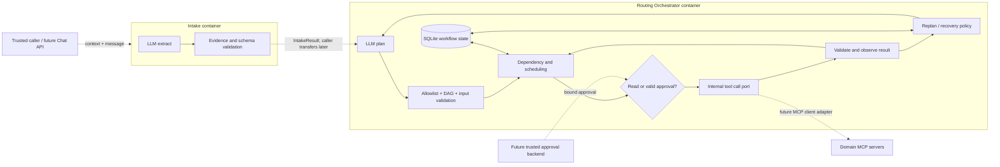

# Intake and Routing Orchestrator — standalone implementation

Status: implemented independent components; full integration is future work.

There are exactly two agent services. Scheduling, execution and observation are
internal responsibilities of Routing Orchestrator. Dashed edges are not connected
in this release. The running services do not call each other or domain MCPs.

The original `mermaid-diagram.png` remains the user's reference design. This
implementation moves the missing-information gate before planning and gates writes
inside Routing before any tool call. Each result is validated before dependencies
can consume it. User changes arrive as a new supplied IntakeResult; Routing owns
plan versions and impact analysis. Stateless Intake has no persistence requirements.

Registry metadata is exported offline from the existing Moving contracts. All 13
names match the actual Moving server. Other branches' tools are not guessed or
advertised until their contracts are reviewed/imported. JSON Schema does not express
every Zod refinement; domain service validation remains authoritative (for example,
unique tracking numbers within destinations). Export includes cancellation XOR rule.

`ToolGateway` is an internal Python interface; `DisconnectedGateway` is the real
standalone configuration, returning no provider data. It is not a mock transport.
The orchestration scheduler has timeout/leases and result validation for later
adapters; live domain execution, automatic reconciliation and compensation are
not verified or enabled. There is no external endpoint that accepts arbitrary
pretend tool results to advance a workflow.

Each request performs one bounded operation. No untracked background tasks continue
after an HTTP response. Workflow snapshots and audit events are saved transactionally;
optimistic revision checks prevent racing requests from overwriting state. SQLite
is supported on one local host, not as a distributed production store.

References: [SPEC-001](../specs/SPEC-001-goal-understanding.md),
[SPEC-003](../specs/SPEC-003-planning-and-execution.md),
[ADR-006](../adr/ADR-006-standalone-intake-routing.md),
[runbook](../runbooks/agent-services.md).
