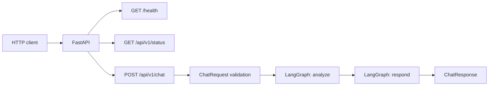
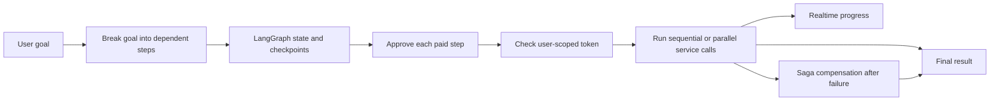
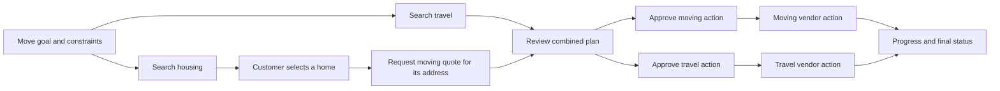
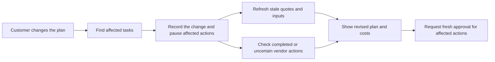

# Architecture diagrams

> Baseline snapshot: 2026-09-30, before the local MVP integration. See the [current architecture](../ARCHITECTURE.md) and [agent graph](architecture/agent-graph.md) for the integrated runtime.

These diagrams distinguish the code that exists from the proposed product. Component details and security limits are in [ARCHITECTURE.md](../ARCHITECTURE.md).

## Current implementation

The two graph nodes return example text. The calculator, knowledge-search stub, and configured LLM factory are outside this execution path. The application has no connected database, vector store, frontend, or external service.

## Proposed product flow

This flow reflects the team's stated target and has not yet been implemented. The exact service APIs and first demo scenario remain to be selected.

## Relocation task dependencies (illustrative)

Travel search can proceed while housing options are being found if its route and date are known. A moving quote depends on the chosen destination address. Each paid vendor action has its own approval. If a later action fails, the orchestrator must report and reconcile the earlier actions according to their service contracts. This diagram shows intended dependencies, not an implemented workflow or a commitment to a specific vendor sequence.

## Change after plan finalization (proposed)

Unrelated results can be reused only while valid. A completed booking remains visible and may require cancellation, refund, or manual follow-up. The customer must approve any new paid action and any consequential change that incurs a fee. The [product brief](product.md#changing-a-finalized-plan) defines the intended behavior; this flow is not implemented in the current checkout.
