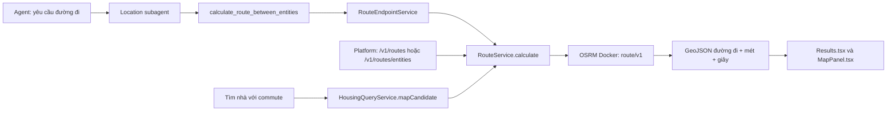

# Kiểm tra bản đồ, phòng trọ và OSRM — 04/10/2026

> Historical layout/command evidence (M23); use the [current development map](../../DEVELOPMENT.md) for this branch.

> Ghi nhận audit trước chỉnh camera/Moving/studio. Trạng thái hiện hành:
> [cập nhật hiện hành](vietnam-map-moving-update-2026-10-04.md): studio 0 → 1 được giữ,
> camera SIU xem Việt Nam và Moving vẽ geometry OSRM. Các ảnh biển đảo/số
> studio giữ 0 và đường nét đứt bên dưới là bằng chứng của thời điểm trước sửa.

## 1. Ba nguồn dữ liệu khác nhau

| Phần | Nguồn và vai trò |
|---|---|
| Nền bản đồ, tên biển/đảo, đường biên | OpenFreeMap Positron, tiles OpenMapTiles/OSM và raster Natural Earth tải qua mạng |
| Nhà và tiện ích của ứng dụng | PostgreSQL/PostGIS local; các bộ crawl/POI nhập riêng |
| Đường đi, khoảng cách, thời gian | OSRM Docker local; graph OSM đã tiền xử lý cho từng thành phố và phương tiện |

Làm sạch POI trong PostGIS không đổi nhãn biển đảo trong nền bản đồ tải từ ngoài.
OSRM tính đường đi, không cung cấp nhãn hoặc quyết định cách vẽ chủ quyền.

## 2. Biển đảo: đã phát hiện vấn đề nhãn hiển thị

Đã tải đúng style `https://tiles.openfreemap.org/styles/positron`, dùng MapLibre
và **tuneBasemap của ứng dụng** trong Chrome headless. Chụp ba khung bản đồ;
tiles đều tải xong, không có map error. Kiểm tra cả nhãn render và dữ liệu tile.

| Khung kiểm tra | Nhãn thấy trên ảnh |
|---|---|
| Biển Đông, tâm [112,14], zoom 4 | Vietnam, China và các nước/thành phố; không có tên hai quần đảo ở mức zoom này |
| Hoàng Sa, tâm [112,16.5], zoom 8 | Sansha, Qilianyu, Yongle Qundao, Bremen Bank, Discovery Reef, Bombay Reef; kèm chữ Trung Quốc |
| Trường Sa, tâm [114,10], zoom 8 | Nansha, Zhubi, Kalayaan; kèm chữ Trung Quốc ở một số nhãn |

**Kết luận:** có hình thể một số đảo/rạn nhưng chưa hiển thị rõ hai nhãn quần đảo
Hoàng Sa, Trường Sa theo yêu cầu của sản phẩm. Không thể suy ra ý đồ “bôi nhọ”
chỉ từ kết quả này; có vấn đề cụ thể về nguồn nhãn và cách render cần xử lý.

Tile nguồn có `name:vi=Trường Sa` ở một đối tượng thuộc lớp place, nhưng chưa
render trong khung Trường Sa đã chụp. Cũng có `name:vi=Tam Sa`, `Quận Tây Sa`,
`Quận Nam Sa` trên các đối tượng khác: **chỉ đổi ưu tiên sang name:vi chưa đủ**.
Style hiện ưu tiên name:latin/name:nonlatin hoặc name_en/name, không ưu tiên tiếng Việt.

Trong dữ liệu boundary tải được có `adm0_l/adm0_r` gồm CHN/VNM/PHL/TWN,
`claimed_by=CN;PH;TW`, các thuộc tính disputed/maritime. Style có lớp boundary
disputed và lọc maritime; một số đường hành chính trên biển vẫn có thể xuất hiện
qua lớp khác. Không được coi các thuộc tính này là nguồn xác nhận chủ quyền.

Không thấy đường chín đoạn trong ba ảnh được kiểm tra. Đây **không phải chứng nhận
toàn bộ nguồn tiles an toàn** ở mọi tọa độ/zoom hoặc thời điểm cập nhật.
Database local không có hàng administrative area mang tên Hoàng Sa/Trường Sa,
và không tìm thấy POI mang các tên này ở phía đông kinh độ 110 trong truy vấn mẫu.
Điều đó mô tả độ phủ local, không chứng minh nền tiles bên ngoài không có đảo.

Việt Nam khẳng định chủ quyền đối với Hoàng Sa và Trường Sa trong
[tuyên bố của Bộ Ngoại giao](https://web.mofa.gov.vn/web/guest/tin-chi-tiet/chi-tiet/viet-nam-mot-lan-nua-khang-dinh-hai-quan-dao-hoang-sa-va-truong-sa-la-thuoc-chu-quyen-cua-viet-nam--10.html).
Nguồn và cách hiển thị nền cần được thẩm định riêng theo yêu cầu đó.

### Hướng xử lý đề xuất

1. Dùng nguồn nền và nhãn có thể quản lý phiên bản, thẩm định được; không phụ thuộc
   hoàn toàn vào style công cộng cập nhật tự động.
2. Bổ sung lớp tên quần đảo/đảo tiếng Việt từ nguồn đã kiểm chứng; không tự vẽ
   đường biên, lãnh hải hoặc vùng đặc quyền kinh tế bằng suy đoán.
3. Rà nhãn hành chính và đường tranh chấp trong vùng biển đảo, kiểm tra cả nguồn
   và lớp được render. Giữ attribution theo giấy phép.
4. Chụp kiểm tra các vùng biển đảo ở nhiều mức zoom mỗi khi đổi phiên bản nền.

Lượt này kiểm tra và báo cáo nền bản đồ; chưa thay style/nhãn/đường biên.
Ảnh và metadata: `data/map-housing-osrm-audit-20261004/` gồm
`bien-dong-z4.png`, `hoang-sa-z8.png`, `truong-sa-z8.png`,
`positron-style.json`, `basemap-browser-audit.json`.

## 3. OSRM đã được ứng dụng dùng thực tế

### Các luồng đang gọi

- Agent route: `src/agents/subagents/services/location.py`, `_route()` gọi MCP.
- MCP: `Maps VN/LifeFlow/mcp-server/src/tools/routing-tools.ts`.
- HTTP API: `platform-api/src/app.ts`, `/v1/routes` và `/v1/routes/entities`.
- Tìm nhà theo commute: `packages/housing-query/src/housing-service.ts`, gọi
  route cho ứng viên và lọc bằng duration_seconds/distance_meters.
- Client định tuyến: `packages/housing-query/src/route-service.ts` gọi HTTP
  `/route/v1/{profile}/{lng,lat;lng,lat}` với GeoJSON full.
- UI: `Frontend/src/components/Results.tsx` hiển thị km/phút;
  `MapPanel.tsx` dùng `routing.route.geometry` cho source `siu-route`.

### Docker và thuật toán

**9/9 container đang chạy**, đều có command `osrm-routed --algorithm mld`.
MLD là **Multi-Level Dijkstra**, theo [tài liệu OSRM chính thức](https://github.com/Project-OSRM/osrm-backend#quick-start).
Docker chạy engine; graph thành phố đã được extract/partition/customize trước đó.
Đường dẫn profile trong URL không tự biến graph ô tô thành graph xe máy;
ứng dụng chọn đúng port có graph tương ứng.

| Thành phố | Ô tô | Đi bộ | Xe máy |
|---|---:|---:|---:|
| TP.HCM | 5000 | 5010 | 5020 |
| Hà Nội | 5001 | 5011 | 5021 |
| Đà Nẵng | 5002 | 5012 | 5022 |

Config: `packages/housing-query/src/config.ts`, biến `OSRM_{CITY}_{PROFILE}_URL`.
Profile xe máy: `infra/osrm/profiles/motorcycle.lua`, dựa trên car.lua, điều chỉnh
access/speed và quy tắc cao tốc. Kết quả giữa các profile có thể giống nhau trên
một tuyến cụ thể; không phải bằng chứng profile chưa chạy.

### Kiểm chứng runtime

- **9 tuyến**: 3 thành phố × 3 phương tiện. Khoảng cách, thời gian và toàn bộ
  GeoJSON từ Platform API **khớp chính xác** với endpoint OSRM Docker tương ứng.
- Route có **53–112 điểm geometry**, không phải đường thẳng nối hai marker.
- MCP `calculate_route_between_entities` thành công: mẫu Hà Nội xe máy
  **1.978,9 m / 175,1 giây**, geometry 72 điểm.
- Housing search có commute trả 3 mẫu; các distance khớp route API:
  **3.765,1 m / 320 giây**, **3.161 m / 311 giây**, **4.156,6 m / 374,5 giây**.
- Report: `data/map-housing-osrm-audit-20261004/osrm-runtime.json`.
  Chỉ gọi local, không dùng LLM, SerpApi hoặc API AhaMove.

### Giới hạn hiện tại

- Coverage route chỉ TP.HCM/Hà Nội/Đà Nẵng theo bounds hiện tại; không có route
  toàn quốc/liên tỉnh hoặc đường biển đảo. Ngoài coverage bị báo lỗi.
- Nearby bán kính dùng PostGIS/geography, không mặc định tính đường bộ OSRM.
- OSRM chưa tích hợp traffic thời gian thực; phút hiển thị là ước tính theo graph/profile.
- Bản đồ kết quả **Moving/AhaMove** trong ServiceWorkspaces hiện nối pickup và
  destination bằng nét đứt hai điểm (`mv-line`), **chưa vẽ GeoJSON OSRM** ở luồng đó.
  Báo giá là dữ kiện AhaMove; không suy ra giá từ OSRM.
- Không thấy code gọi dịch vụ OSRM Table, Match hay Trip; hiện dùng Route.

## 4. Chuẩn hóa phòng trọ 0 → 1

File crawl có **9.934 room = 0** và **1.521 studio = 0**. DB có **9.879 room = 0**
và **1.521 studio = 0** trước sửa. Số file/DB khác vì không phải mọi dòng đều publish.

Quy tắc `rental_room_zero_to_one_v1`:

- Chỉ `property_type=room`, `listing_type=rent`, bedrooms đúng 0.
- Giữ null, số đã khác 0, studio và bản ghi lifeflow_verified.
- Tin có dấu hiệu ở ghép/giường tầng/ký túc xá, open plan, nguyên căn/nguyên tầng
  hoặc nhiều phòng ngủ được giữ riêng để review; không tự đoán số phòng.
- Giá trị 1 là **quy ước một phòng thuê để ngủ**, không khẳng định có phòng ngủ
  tách biệt đã xác minh. `unit.attributes.bedroom_normalization` lưu original_value=0,
  normalized_value=1, quy tắc, ý nghĩa và thời điểm.

Script: `scripts/normalize-housing-room-bedrooms.py`. Dry-run mặc định; --apply
chỉ cập nhật manifest đã kiểm tra, backup file gốc và đơn vị DB, so fingerprint
mọi bảng ngoài scope và các unit ngoài danh sách trước COMMIT.

Raw `integration.source_records`/housing_staging giữ nguyên lịch sử crawl.
Không re-import toàn bộ housing, không sửa ID, pin, giá, offer hoặc ảnh.
File crawl hoạt động cập nhật cùng DB để import lại không khôi phục giá trị 0
ở những dòng đã chuẩn hóa. Snapshot lịch sử chat cũ không được viết lại.

### Kết quả sau apply

- **8.795 unit DB** và **8.840 dòng file crawl** đổi 0 → 1.
- Còn **1.084 room = 0 trong DB** cần review; giữ nguyên **1.521 studio = 0**.
- Tổng unit vẫn **38.222**. Giá/pin/ảnh/listing/source/staging giữ nguyên fingerprint;
  mọi unit ngoài manifest giữ nguyên toàn bộ hàng.
- Đối chiếu mọi dòng với file backup: **8.840 dòng chỉ thay bedrooms và metadata
  normalization**, **30.090 dòng khác giữ nguyên nội dung**.
- **12 ca kiểm tra quy tắc đạt**; 3 API detail mẫu và bộ lọc room đúng 1 phòng
  ngủ trả giá trị mới thành công. Không cần restart để đọc số phòng mới từ DB.
- Source SHA256 mới:
  `8b1783c56b94d6e0812a0e578b36c3a240870116652cc108a9ca0d9138bf07fe`.
- Backup file trước sửa:
  `data/map-housing-osrm-audit-20261004/housing-source-before-room-normalization.jsonl`.
- Backup trạng thái các unit trước sửa:
  `data/map-housing-osrm-audit-20261004/housing-units-before-room-normalization.json`.

Kết quả apply và fingerprint xem `data/map-housing-osrm-audit-20261004/housing-room-applied.json`;
kiểm chứng sau sửa: `housing-runtime-verification.json` trong cùng thư mục.
Các tin bỏ qua nằm trong `preserved_review`; đây là sàng lọc thận trọng theo text,
không phải xác minh thực địa.

**Chia sẻ dữ liệu:** bộ POI `data/poi-clean/2026-10-04/` không chứa housing. Cần gửi
thêm file housing đã chuẩn hóa và report quy tắc. Importer hiện tại đọc giá trị 1
và giữ metadata; code cần kèm phiên bản tương ứng.
