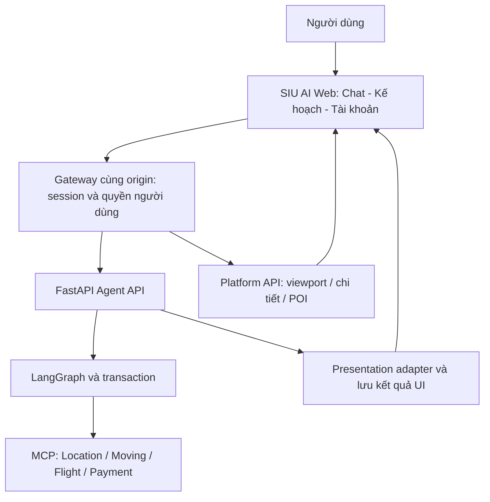

# Kế hoạch phát triển frontend SIU AI theo hướng AI Agent-first

> Historical layout/command evidence (M23); use the [current development map](../../DEVELOPMENT.md) for this branch.


> **Cập nhật 01/10:** chế độ bản đồ cho tìm nhà (danh sách theo vùng, chat điều khiển bản đồ, chọn địa điểm bằng pin) đã có; xem [map workspace](map-workspace-2026-10-01.md). Khác bản kế hoạch: ngưỡng hiển thị theo số lượng căn trong vùng chứ không theo zoom cố định; action chọn địa điểm là `ChatRequest.place_choice` thay cho endpoint `/actions` chung.
>
> **Cập nhật triển khai:** Frontend React và gateway đã được bổ sung trong `Frontend/`, thay cho Streamlit trong lệnh chạy mặc định. Xem [phạm vi đã làm, giới hạn và hướng dẫn chạy](../../Frontend/README.md). Nội dung khảo sát/đề xuất bên dưới giữ mốc lập tài liệu; các tính năng tương lai chưa được bật khi backend chưa hỗ trợ.

Ngày lập: **30/09/2026**. Đối chiếu code local `QuangDung@e407d45`, đã đồng bộ `origin/mvp` ở lượt cập nhật trước.

**Trạng thái: kế hoạch tổng thể để chia việc; frontend chưa triển khai, một phần backend Map đã được thực hiện theo bản cập nhật bên dưới.** Khảo sát ban đầu dựa trên source code và 5 ảnh demo; bằng chứng kiểm thử của phần backend mới nằm trong bản cập nhật.

**Tiến độ backend sau khi lập kế hoạch:** [bản cập nhật Map/Graph 30/09](map-backend-update-2026-09-30.md) đã thực hiện một phần BE-04 và logic route/nearby qua lựa chọn nhà. Các mô tả “còn thiếu” dưới đây là mốc khảo sát ban đầu; xem bản cập nhật để phân biệt phần đã làm với phần UI/action/history vẫn đang đề xuất.

**Thiết kế giao diện chi tiết:** đọc [Kế hoạch trang, màn hình và tương tác SIU AI](siu-ai-frontend-screen-design.md) để xem sitemap, wireframe, bố cục desktop/mobile, form và nút thao tác của từng dịch vụ. Tài liệu hiện tại giữ vai trò kế hoạch kiến trúc/tích hợp; bản thiết kế màn hình triển khai cụ thể trải nghiệm người dùng trên cùng phạm vi backend.

**Đọc theo nhóm phụ trách:** [Yêu cầu Frontend](#141-yêu-cầu-frontend) · [Yêu cầu Backend](#142-yêu-cầu-backend) · [Điểm bàn giao giữa hai bên](#143-điểm-bàn-giao-giữa-hai-bên). Các mã FE/BE ở phần 14 dùng để chia task; phần thiết kế màn hình liên kết về cùng mã đó.

## 1. Mục tiêu sản phẩm

SIU AI có một giao diện chat chính. Người dùng diễn đạt nhu cầu bằng lời; AI hỏi thêm khi thiếu thông tin, gọi công cụ và trả kết quả bằng văn bản kết hợp component phù hợp ngay trong cuộc hội thoại.

Sidebar giữ đúng ba mục: **Hệ thống AI – Kế hoạch – Tài khoản**. Tìm nhà, bản đồ, chuyển nhà, chuyến bay, ghép trọ và cẩm nang là những ngữ cảnh trong chat. Nút tác vụ nhanh mở một cuộc trao đổi hoặc điền lời nhắc, không chuyển sang trang chức năng riêng.

Người dùng có thể tiếp tục bằng câu nói hoặc thao tác trên card. Hai cách này phải cập nhật cùng một trạng thái backend. Ví dụ: bấm “Chọn căn này” rồi nói “báo giá chuyển đồ tới đó” phải sử dụng đúng `listing_id` vừa chọn.

Kế hoạch bao gồm giao diện và những bổ sung backend cần thiết để đồng bộ. Có tool nghiệp vụ chưa đồng nghĩa frontend đã có API, dữ liệu và quyền cần thiết để sử dụng đầy đủ tool đó.

## 2. Chuyển 5 ảnh demo thành yêu cầu thực hiện

Ảnh là tham chiếu thiết kế. Tên người, số liệu, trạng thái kết nối, phần trăm phù hợp và lời hứa chức năng trong ảnh đều cần dữ liệu thật trước khi xuất hiện trong sản phẩm.

| Ảnh tham chiếu | Áp dụng vào sản phẩm | Điều chỉnh theo backend hiện tại |
| --- | --- | --- |
| [01 – Chat chính](../design/references/01-chat.png) | Sidebar ba mục; avatar SIU AI; composer cố định; lời gợi ý và chip tiêu chí trong chat | Khi đã đủ thông tin thì tìm ngay. Các tiêu chí tùy chọn không được trở thành câu hỏi bắt buộc. Ghép trọ/cẩm nang chỉ bật khi service sẵn sàng. |
| [02 – Nhà và bản đồ](../design/references/02-housing-map.png) | Một khối kết quả gồm card nhà + map; xem chi tiết; hỏi AI về căn cụ thể; lọc tiếp trong hội thoại | Không cố định “3 căn tốt nhất”, “dữ liệu mới nhất”, “có thể dọn ngay”. Chỉ hiển thị điều có bằng chứng từ dữ liệu. Map dùng lại MapLibre hiện có. |
| [03 – Ghép trọ](../design/references/03-roommates.png) | Card hồ sơ, tiêu chí, quan tâm và xem chi tiết là hướng mở rộng | Chưa có service ghép trọ trong runtime đã kiểm tra. Điểm 95%/88% cần công thức và dữ liệu được người dùng cho phép sử dụng. |
| [04 – Kế hoạch](../design/references/04-plan.png) | Tổng hợp công việc, chi phí, việc chờ duyệt; bấm quay lại đúng đoạn chat | Phân biệt “đã tìm xong” với “đã đặt xong”. Chưa được hiển thị phê duyệt xuất vé thật. Lịch hẹn, tiến độ đời thực cần dữ liệu riêng. |
| [05 – Tài khoản](../design/references/05-account.png) | Hồ sơ, sở thích, dữ liệu đã lưu và hoạt động gần đây | Chưa có cơ sở để hiện Google Maps/MoMo/Vietnam Airlines/Zalo/Calendar đã liên kết, Premium hoặc thanh toán thuê bao. Mỗi kết nối cần backend tương ứng. |

Phạm vi địa lý tiếp tục là **Hà Nội, Đà Nẵng, TP.HCM** theo năng lực Location hiện có; dữ liệu thực tế từng thành phố phụ thuộc snapshot đã import. Nội dung chào không giới hạn toàn sản phẩm ở TP.HCM chỉ vì ảnh demo dùng ví dụ này.

## 3. Nền tảng đang có và phần còn thiếu

### 3.1. Service và tool có thể tận dụng

| Thành phần | Công cụ/năng lực đã có trong code | Cách đưa vào frontend |
| --- | --- | --- |
| LangGraph | Intake, Planner, validator, task results, memory/checkpoint, confirmation và transaction | Điều phối chat; cung cấp câu trả lời, câu hỏi, kết quả, kế hoạch và trạng thái chờ duyệt. |
| Location – housing | `search_housing`, `get_housing` | Card nhà, chi tiết, phân trang, nguồn và thông tin vị trí. Graph hiện thiên về tìm thuê theo tháng; không tự suy rộng thành đầy đủ mọi chế độ mua/bán của service. |
| Location – place/area | `search_places`, `get_place`, `find_nearby_places`, `search_areas`, `resolve_location` | Chọn địa điểm rõ ràng, hiển thị tiện ích và phân biệt tìm trong khu vực với tìm gần một điểm. |
| Location – route | `calculate_route`, `calculate_route_between_entities` | Tuyến đường và thời gian ước tính; hỗ trợ driving/walking/motorcycle theo graph OSRM đã cấu hình. |
| Moving – đọc | `list_service_areas`, `list_moving_services`, `get_moving_service`, `estimate_move`, `get_move_order`, `get_move_orders`, `find_move_orders_by_tracking_number`, `get_move_tracking_link`, `get_move_order_events` | Chọn dịch vụ, so sánh báo giá, xem trạng thái và theo dõi đơn. |
| Moving – ghi | `create_move_order`, `update_move_order`, `cancel_move_order`, `rate_move_driver` khi server được cấp quyền ghi | Chỉ bật action đã nối vào graph/transaction và được backend cho phép. Allowlist ghi của graph hiện chưa bao gồm `rate_move_driver`; tool tồn tại không có nghĩa chat đã gọi được. |
| Flight | `search_airports`, `search_flights`, `get_offer`; thêm `hold_booking`, `confirm_booking`, `get_booking`, `cancel_booking` khi bật simulation ở MCP | MVP sản phẩm hiện dùng tìm chuyến. Card kết quả chuyến bay không được trình bày như vé đã xuất. |
| Payment | `create_payment`, `get_payment`, `cancel_payment`, `refund_payment`; `simulate_payment_result` chỉ ở mock | Có ZaloPay sandbox riêng. Chưa gắn thành checkout chung cho chuyến bay hoặc đơn Moving trả tiền mặt. |
| Platform API + MapLibre | API viewport nhà/POI, tìm kiếm/chi tiết, định vị và route; React map, card, drawer, POI, marker và cluster | Tái sử dụng trong một component map gắn với kết quả chat và có chế độ mở rộng. |

### 3.2. Khoảng trống ảnh hưởng trực tiếp tới frontend

1. `Frontend/` hiện chứa **5 ảnh**, chưa có ứng dụng web SIU AI. UI đang chạy của MVP là Streamlit trong `src/ui/`.
2. `ChatResponse` hiện trả JSON cuối lượt với `done`, `pending_confirmation`, `pending_payment`. Chưa có giao thức streaming sự kiện dành cho frontend động.
3. `AgentResponse.data.results` đã có dữ liệu theo task, nhưng chưa phải hợp đồng component ổn định. Housing adapter giữ thông tin cơ bản nhưng chưa giữ ảnh/nguồn đầy đủ; chỉ trả `has_more`, không chuyển tiếp cursor cho frontend. Dữ liệu nearby qua graph cũng chưa đủ tọa độ để đặt mọi POI lên map.
4. `ChatRequest` chưa có action có kiểu cho “chọn nhà”, “lọc lại”, “tải thêm”. `suggestion_key` có trong schema nhưng route hiện không chuyển trường này vào graph; không dùng nó làm cơ chế lựa chọn chính thức.
5. API `/state` cung cấp trạng thái workflow nhưng chưa phải API phục hồi đầy đủ lịch sử chat và component. History của UI Streamlit hiện ở session của UI.
6. Chưa có API sản phẩm cho danh sách hội thoại/kế hoạch theo tài khoản, hồ sơ, yêu thích và tùy chọn được người dùng chỉnh sửa. Bộ nhớ agent không tự thay thế các API đó.
7. `HousingMapRequestSchema` chỉ có bbox, zoom, loại nhà, loại tin, limit. Bộ lọc giá/phòng/diện tích trong app map hiện áp dụng trên các listing đã tải ở client; cluster chưa phản ánh các bộ lọc này. Cần sửa trước khi nói “map hiển thị tất cả nhà phù hợp”.
8. Trong code graph đã kiểm tra, domain được đăng ký là `property`, `map`, `relocation`, `flight`. Ghép trọ, cẩm nang có nguồn, vé xe khách và các liên kết tài khoản trong ảnh cần bổ sung riêng.
9. API agent hiện tin cậy gateway truyền `X-User-Id` và dùng token server. Cần lớp xác thực người dùng cho web công khai; không đưa token này vào bundle trình duyệt.

## 4. Thiết kế trải nghiệm thống nhất

Danh sách màn hình, đặc tả từng dịch vụ và checklist bàn giao thiết kế nằm trong [bản thiết kế frontend chi tiết](siu-ai-frontend-screen-design.md). Ba mục điều hướng bên dưới là khung cố định; các kết quả nghiệp vụ xuất hiện bên trong Hệ thống AI.

### 4.1. Hệ thống AI

- Lần đầu: lời chào ngắn, ví dụ câu hỏi và các tác vụ đang được hỗ trợ. Lịch sử hội thoại đặt trong mục Hệ thống AI, không thêm mục sidebar thứ tư.
- Khi xử lý: phản hồi ngay bằng trạng thái tải thật. Bản đầu dùng “Đang xử lý”; chỉ hiện từng bước “Đang tìm nhà/Đang tính đường” khi backend phát sự kiện tương ứng.
- Một lượt trả lời có thể gồm văn bản, câu hỏi, card, map, chi phí và nút tiếp tục. Không bắt buộc mọi câu trả lời phải có card.
- Kết quả mới khi lọc lại tạo một nhóm kết quả mới. Nhóm cũ giữ để xem lại; lựa chọn/giao dịch từ nhóm cũ phải được kiểm tra lại phiên bản.
- Chi tiết nhà mở drawer/bottom sheet trong chat. “Xem bản đồ lớn” mở panel hoặc modal, đóng lại vẫn ở đúng đoạn hội thoại và giữ viewport.
- Chip như “Gần bệnh viện” là yêu cầu bổ sung. Nếu cần tên bệnh viện, khoảng cách hay phương tiện thì hỏi đúng thông tin thiếu; không tự coi đó là dữ kiện đã xác nhận.
- Hành động “Hỏi AI về căn này” gửi ID căn cùng ý định. “Chọn căn này” lưu lựa chọn; không tạo đặt cọc, đặt xe hay liên hệ chủ nhà.

### 4.2. Kế hoạch

Trang Kế hoạch là góc nhìn tổng hợp của cùng dữ liệu trong chat: nhu cầu, lựa chọn, việc cần làm, chi phí và phương án chờ duyệt. Mỗi mục có liên kết về `thread_id` và message/component liên quan.

Phải tách **task xử lý của AI** và **công việc đời thực**. Task tìm nhà `done` chỉ nghĩa đã có kết quả tìm kiếm. “Đã thuê nhà”, “đã chuyển đồ”, “đã hoàn thành thủ tục” cần xác nhận hoặc trạng thái nghiệp vụ riêng.

Chi phí chia theo khoản một lần và khoản hằng tháng, dùng `CostSummary` hiện có. Nếu thể hiện ngân sách kỳ đầu, phải ghi rõ công thức và khoản chưa biết; không cộng tiền thuê tháng, tiền cọc chưa rõ và phí chuyển đồ thành một tổng “đã chi”. Tiến độ chỉ có phần trăm khi định nghĩa rõ các mốc và cách tính.

Nút phê duyệt trên trang Kế hoạch dùng cùng endpoint, cùng phiên bản và cùng trạng thái với card trong chat. Lịch trình là mốc dự kiến do người dùng xác nhận; chưa gọi là lịch đã đồng bộ khi chưa có calendar integration.

### 4.3. Tài khoản

Bản đầu cần danh tính đăng nhập, tùy chọn cá nhân hóa có thể sửa/xóa và danh sách nhà đã lưu. Người dùng xem được những sở thích nào đang dùng cho gợi ý. Ưu tiên họ nói trong lượt hiện tại phải được áp dụng trước sở thích cũ.

Ẩn tính năng chưa có backend như Premium, liên kết MoMo/Zalo/Calendar và thông báo có số đếm. Thêm từng mục khi có API và trạng thái kết nối thật. Thông tin liên hệ cho đơn chuyển nhà nhập bằng form theo `pii_required`, không tự đưa vào lời nhắc LLM hoặc lưu trong lịch sử chat công khai.

### 4.4. Màu sắc và bố cục

Giữ tinh thần xanh–tím, robot SIU AI, nền sáng và card bo góc của ảnh. Nền trang có thể dùng gradient nhạt; vùng đọc chat và card cần ít họa tiết để dễ đọc.

| Token đề xuất | Màu | Áp dụng |
| --- | --- | --- |
| Brand blue | `#2563EB` | CTA, focus, liên kết |
| Brand violet | `#6D28D9` | Điểm nhấn AI, gradient giới hạn ở nút/nhận diện |
| Main text | `#172554` | Chữ chính |
| Secondary text | `#475569` | Chú thích |
| Surface/background | `#FFFFFF` / `#F7F9FF` | Card và nền |
| Border | `#D8E0EF` | Card/input |
| Housing mặc định | fill `#D6EFE9`, border `#176E69`, text `#0B675E` | Giữ teal và viền rõ theo map hiện tại |
| Housing được chọn | `#F97316` | Căn đang chọn nổi nhất trên map |
| Route | `#347FD6` | Tuyến đường, giữ viền nền để dễ nhìn |
| Success/error | `#15803D` / `#B91C1C` | Trạng thái, luôn kèm chữ hoặc icon |

Màu map lấy từ `map-theme.ts` hiện có. Không đổi marker được chọn sang tím chỉ để giống ảnh, vì trạng thái chọn cần nhất quán với phần map đã làm. Kiểm tra contrast của cặp chữ/nền khi triển khai, focus bàn phím, reduced motion và nhãn nút chỉ có icon.

Desktop: nhóm nhà/map chia hai cột khi đủ rộng. Mobile: card xếp dọc, map mở rộng bằng bottom sheet/panel; composer và nút duyệt không bị bàn phím che. Robot trang trí lớn giảm hoặc ẩn trên màn hình nhỏ. Icon microphone/đính kèm chỉ bật khi có luồng upload/voice tương ứng.

## 5. Kiến trúc đề xuất



- **Web:** React + TypeScript + Vite, tận dụng cùng nền tảng của map hiện tại. Component renderer có danh sách loại được hỗ trợ và kiểm tra schema.
- **Gateway:** xác thực session, kiểm tra quyền hội thoại, giữ token API/MCP ở server. Có thể triển khai cùng backend, không bắt buộc thêm một microservice.
- **LangGraph:** hiểu yêu cầu, hỏi lại, gọi tool, kiểm tra phương án, quản lý lựa chọn có ảnh hưởng workflow và giao dịch.
- **Presentation adapter:** chuyển dữ liệu tool/task đã kiểm tra thành UI contract. Có thể nằm trong FastAPI. LLM có thể đề nghị cách trình bày; code quyết định component/action hợp lệ. Không render HTML/JS tùy ý do model sinh ra.
- **Platform API:** phục vụ thao tác trực quan thường xuyên như kéo/zoom map, tải chi tiết và phân trang. Không gọi LLM sau mỗi lần kéo bản đồ.
- **Nguồn trạng thái:** backend giữ facts/selection/plan/approval; frontend giữ draft nhập liệu, panel đang mở và viewport tạm thời. Cần lưu viewport theo component khi khôi phục cuộc hội thoại.

Vị trí code đề xuất: `web-app/` cho ứng dụng mới, giữ `Frontend/` làm ảnh tham chiếu để tránh xung đột tên hoa/thường trên Windows/Linux. Tách thành phần map dùng chung sang `Maps VN/LifeFlow/packages/map-ui/` khi có bản tích hợp đầu tiên; khai báo workspace/build rõ ràng thay vì import chéo tùy ý vào source của một app khác.

## 6. Hợp đồng API và component

### 6.1. API đang tồn tại

Các route agent có prefix `/api/v1` từ `src/main.py`.

| API hiện tại | Dùng cho | Lưu ý |
| --- | --- | --- |
| `POST /api/v1/chat` | Tin nhắn mới, tiếp tục hội thoại; có thể gửi `housing_location` hoặc `moving_locations` | JSON cuối lượt; `message` bắt buộc. Vị trí xác nhận có address, lat, lng, `confirmed: true`. |
| `GET /api/v1/chat/{thread_id}/state` | Phục hồi plan, task status, cost summary, committed, pending | Chưa trả toàn bộ message/component history. |
| `DELETE /api/v1/chat/{thread_id}`, `DELETE /api/v1/memory` | Nút xoá hội thoại / "Xóa tất cả và làm mới SIU" (01/10) | Gateway gọi trước khi xoá lịch sử của mình; agent từ chối (409) khi đang chờ thanh toán. |
| `POST /api/v1/chat/{thread_id}/decision` | `CONFIRM`, `CHANGE`, `REJECT`, `CANCEL` | Giữ cơ chế `plan_version`, `payload_hash`, expiry và form PII hiện có. |
| `GET /api/v1/map/search?text=...` | Tìm ứng viên địa điểm bằng `resolve_location` | Không tự xác nhận điểm Moving thay người dùng. |
| `GET /api/v1/status` | Domain, mode, writes, sandbox payment, khả năng booking | Dùng làm đầu vào cho capability UI; cần bổ sung khi muốn mô tả quyền chi tiết hơn. |
| `POST /api/v1/chat/{thread_id}/payment/check` và `/cancel` | Workflow đang chờ payment | Không đồng nhất với form ZaloPay sandbox độc lập. `/simulate` chỉ dành cho mock khi được bật. |
| `POST /api/v1/sandbox/payments`, `GET /api/v1/sandbox/payments/{payment_id}` | Demo ZaloPay sandbox riêng | Chỉ hiện trong chế độ thử nghiệm được bật; không gắn tự động với đơn Moving CASH. |
| Platform: `POST /v1/housing/search`, `POST /v1/housing/map`, `GET /v1/housing/{listingId}` | Tìm nhà, viewport, chi tiết | Đây là service khác Agent API; web truy cập qua gateway route được cấu hình. |
| Platform: `/v1/places/search`, `/v1/places/map`, `/v1/places/nearby`, `/v1/places/{placeId}`, `/v1/areas/search`, `/v1/locations/resolve`, `/v1/routes` | POI, địa danh và đường đi | `/v1/routes` hiện tính từ tọa độ. Entity routing đã có ở MCP; cần lớp nối phù hợp cho action từ UI. |

Không tự mặc định URL Platform dùng cùng `/api/v1` với Agent API. Chốt bảng proxy trong cấu hình deploy để frontend có một origin công khai.

### 6.2. Đọc response hiện tại và nâng cấp có tương thích

Bản đầu ánh xạ `response.text`, `response.questions`, `response.suggestions`, `response.data.results[task_id]`, `confirmation`, `payment` thành component. Xử lý cả hai tầng: `status=done` có thể chứa `kind=CLARIFY`, `PARTIAL`, `UNSUPPORTED` hoặc `ERROR`; không coi mọi `done` là thành công nghiệp vụ.

Đề xuất thêm trường `ui` tùy chọn vào `ChatResponse`. Giữ các trường cũ cho Streamlit và client hiện tại. Ví dụ dưới là **contract đề xuất**, không phải response hiện có; ID minh họa phải thay bằng ID thật:

```json
{
  "status": "done",
  "thread_id": "th_example",
  "response": {
    "kind": "ANSWER",
    "text": "Đây là các căn phù hợp trong kết quả vừa tìm.",
    "data": {},
    "questions": [],
    "suggestions": []
  },
  "ui": {
    "schema_version": "1.0",
    "message_id": "msg_example",
    "revision": 1,
    "plan_version": 3,
    "components": [
      {
        "id": "cmp_housing_example",
        "type": "housing_results",
        "status": "ready",
        "data": {
          "result_set_id": "rs_example",
          "items": [],
          "has_more": false,
          "next_cursor": null
        },
        "provenance": {
          "source_kind": "live",
          "provider": "location",
          "fetched_at": "2026-09-30T05:00:00Z"
        },
        "actions": [
          {"type": "housing.select", "enabled": true}
        ]
      }
    ]
  }
}
```

Mỗi loại component có payload schema riêng và fallback văn bản khi frontend không hỗ trợ phiên bản/loại đó. Các loại ban đầu:

| Component đề xuất | Dữ liệu chính | Tương tác |
| --- | --- | --- |
| `clarification` / `location_picker` | Câu hỏi, field, ứng viên có ID và tọa độ/khu vực phù hợp | Trả lời hoặc xác nhận địa điểm |
| `housing_results` / `housing_detail` | Listing ID, giá + đơn vị, ảnh, diện tích, phòng, địa chỉ, source URL, accuracy, trường chưa biết | Xem chi tiết, lưu, chọn, hỏi AI, tải thêm |
| `map_view` | Result set, mode, viewport, entity IDs, các lớp đang bật | Chọn marker, zoom cluster, tìm trong vùng, mở rộng |
| `nearby_places` / `route_summary` | POI ID, tọa độ, khoảng cách có loại; route geometry, profile, distance, duration | Xem POI, đổi phương tiện, xem đường |
| `flight_offers` | Offer ID, hành trình, ngày giờ/múi giờ, giá, nguồn, thời hạn nếu có | Xem điều kiện, chọn để so sánh; chỉ bật booking khi thực sự được hỗ trợ |
| `moving_quotes` / `order_tracking` | Quote/order ID, phí, điểm lấy/giao, expiry, trạng thái provider | Chọn báo giá, yêu cầu đặt/hủy/sửa qua graph |
| `approval` / `payment` | Phương án, giới hạn giá, expiry, phiên bản, form cần nhập, trạng thái xác thực | Duyệt/đổi/từ chối; kiểm tra payment theo luồng được bật |
| `plan_summary` / `checklist` | Task/mốc công việc, trạng thái, chi phí, liên kết chat | Xem lại; đánh dấu việc cá nhân sau khi có API |
| `roommate_profiles` / `knowledge_answer` | Hồ sơ được phép công khai hoặc nội dung có trích nguồn | Giai đoạn mở rộng sau khi service sẵn sàng |

`source_kind` giữ enum hiện có `live/sandbox/demo/fake`, nhưng bổ sung provenance riêng cho dữ liệu tìm kiếm và giao dịch. Ví dụ registry Flight hiện gắn `demo` trong khi tìm kiếm có thể qua SerpApi: không dùng một badge chung để suy ra “vé thật” hoặc “toàn bộ kết quả giả”. `fetched_at` là thời điểm truy vấn; không thay thế ngày cập nhật tin nhà từ nguồn.

### 6.3. Hợp đồng tương tác ngược về graph

Đề xuất endpoint mới `POST /api/v1/chat/{thread_id}/actions`, bổ sung theo hướng tương thích. Ví dụ:

```json
{
  "action_id": "client-generated-uuid",
  "message_id": "msg_example",
  "component_id": "cmp_housing_example",
  "plan_version": 3,
  "type": "housing.select",
  "payload": {
    "result_set_id": "rs_example",
    "listing_id": "actual-listing-uuid"
  }
}
```

Backend kiểm tra quyền thread, loại action, phiên bản, entity thực và phạm vi result set; sau đó cập nhật selection/facts qua logic dùng chung với intake. Không chỉ đổi màu card ở frontend. Không parse lại câu “chọn căn số 2” để xử lý nút đã có ID.

- Thao tác cục bộ như hover, mở drawer, zoom và đóng panel không cần gửi vào graph.
- Thao tác thay đổi lựa chọn, bộ lọc, đầu/đích hành trình hoặc yêu cầu báo giá phải có structured action và phản hồi trạng thái mới.
- Frontend không gửi tùy ý tên tool để backend thực thi. Server có allowlist action và ánh xạ sang năng lực được cấp quyền.
- Việc xác nhận giao dịch tiếp tục qua endpoint `/decision`. `action_id` chống lặp ở UI không thay thế approval và idempotency trong transaction.
- Nút từ kết quả cũ phải revalidate. Khi báo giá hết hạn/plan đã đổi: trả trạng thái cần cập nhật, tải phương án mới và yêu cầu duyệt lại nếu có ghi.
- Một action tạo một event dễ hiểu trong chat, ví dụ “Bạn đã chọn căn A”; giữ ID ở dữ liệu, tránh biến toàn bộ JSON thành nội dung hội thoại.

### 6.4. Lưu lịch sử, stream và capability

Đề xuất bổ sung API liệt kê thread, lấy message/component history, hồ sơ, preferences và saved listings. Lưu message ID, component revision, result-set reference, selected entity IDs và phiên bản schema; kiểm tra owner cho mọi thao tác đọc/ghi. Checkpoint graph phục vụ thực thi, history API phục vụ khôi phục giao diện.

Bản đầu có thể dùng HTTP response cuối lượt. Giai đoạn sau bổ sung run ID và SSE cho các event `run.started`, `task.status`, `component.upsert`, `confirmation.required`, `run.completed`, `run.failed`. Event có ID/sequence để reconnect và bỏ trùng; khi mất stream tải trạng thái từ server. Đây là phần cần viết thêm, không phải endpoint có sẵn.

Mở rộng `/status` hoặc tạo capability endpoint để công bố năng lực thực sự được cấu hình: tìm kiếm, đặt đơn, trả tiền, môi trường và lý do action bị khóa. UI không chỉ dựa vào việc model nói “có thể đặt”. Lỗi một service không làm biến mất kết quả hợp lệ từ service khác.

## 7. Tích hợp map để khai thác đầy đủ phần Location

### 7.1. Dùng lại những phần đã viết

Tái sử dụng `MapView`, `HousingCard`, `HousingDetailDrawer`, `HousingFilterBar`, `RoutePanel`, các service client và `map-theme.ts`. Tách state/data loading khỏi `App.tsx` để map nhận props/callback theo ngữ cảnh chat. Drawer hiện chủ yếu dùng dữ liệu marker; nối thêm API chi tiết nếu muốn ảnh đầy đủ, mô tả và nguồn.

Iframe có thể dùng để thử kết nối nhanh, nhưng bản sản phẩm nên dùng component chung để card, map và graph chia sẻ selection/filter. Nếu có bước iframe thử nghiệm, phải định nghĩa message contract và kiểm tra origin, không coi đó là hoàn tất tích hợp.

### 7.2. Hai chế độ rõ nghĩa

| Chế độ | Dữ liệu | Hành vi |
| --- | --- | --- |
| Kết quả AI vừa tìm | Các listing trong result set đã kiểm tra | Card và marker khớp ID; hiển thị đúng phạm vi “các căn trong kết quả này”. Zoom không tự đổi tiêu chí. |
| Khám phá khu vực | API viewport theo bbox/zoom và bộ lọc được hỗ trợ | Zoom ra có cluster, zoom vào có listing. Nút “Tìm trong khu vực này” đưa vùng mới vào ngữ cảnh tìm kiếm. |

Ngưỡng hiện tại ở housing backend: **zoom < 13 trả cluster; zoom ≥ 13 trả listing**, trong giới hạn request. `returned_count` là số feature trả về, `cluster.count` là số tin trong cụm, `truncated` báo kết quả bị giới hạn. Không dùng số feature/POI trên màn hình làm tổng số nhà phù hợp hoặc tổng dữ liệu thành phố.

### 7.3. Đồng bộ bộ lọc là hạng mục bắt buộc

Giai đoạn đầu chỉ gọi chế độ “kết quả AI” là phù hợp nhu cầu. Chế độ khám phá nếu chỉ lọc được một phần phải nêu đúng phạm vi, không gắn toàn bộ marker với bộ lọc chat.

Để hoàn thiện, mở rộng contract/query của `/v1/housing/map` với các bộ lọc được thống nhất với search: thành phố/khu vực, loại tin, currency/period, giá, phòng ngủ, diện tích, amenities. Dùng chung logic điều kiện ở backend; cả truy vấn cluster và listing phải áp dụng trước khi đếm/giới hạn.

Các điều kiện đắt như thời gian đi tới nơi làm việc cần thiết kế riêng: result set đã được đánh giá commute có thể dùng cho map kết quả; map khám phá chưa tính commute đầy đủ phải hiển thị rõ. Không chạy routing toàn bộ tin cho mỗi lần pan/zoom.

Giữ metadata `truncated` và mode qua client; client map hiện chuyển payload thành GeoJSON nhưng chưa giữ meta này. Khi bị giới hạn, hiện “Đang hiển thị một phần, hãy zoom hoặc lọc thêm”. Giá cluster “từ…” cần cùng currency và period hoặc ghi rõ loại giá; không trộn thuê theo đêm với theo tháng thành một mức giá so sánh được.

### 7.4. Selection, POI và route

- Card/marker cùng `listing_id`; hover và click đồng bộ hai chiều. Chọn nhà giữ marker cam nổi bật; marker khác giữ teal.
- Có thể mở POI quanh nhà và tính đường từ nhà tới địa điểm bằng tool entity routing đã có. Graph hiện có route độc lập place→place; cần mở rộng adapter/capability để nhận ID nhà được chọn cho luồng này.
- Bổ sung tọa độ POI vào presentation payload hoặc hydrate bằng API chi tiết; không tạo tọa độ từ tên địa điểm.
- Dùng `distance_meters` gần nhất làm khoảng cách đường thẳng khi đúng nguồn; thời gian/khoảng cách đi đường lấy từ route. Không tự đổi “800 m đường thẳng” thành “10 phút đi bộ”. OSRM hiện không cung cấp giao thông trực tiếp.
- Pin nhà approximate/unknown phải có nhãn. Để báo giá/đặt chuyển nhà, người dùng xác nhận địa chỉ và điểm lấy/giao; không tự coi tâm phường/quận là điểm giao hàng chính xác.
- Bản đồ thiếu WebGL hoặc tile lỗi: vẫn dùng được danh sách nhà và thông tin route dạng chữ.
- Debounce viewport khoảng 250–400 ms, hủy request cũ và bỏ response sai revision. Một map tương tác đang hoạt động là đủ; các đoạn chat cũ có thể thu gọn để tránh nhiều WebGL context.
- Khi mở rộng/thu nhỏ panel gọi resize cho map, giữ viewport, attribution và lựa chọn. Lỗi map không chặn composer.

## 8. Luồng mẫu để cả nhóm triển khai cùng một cách

### A. Tìm nhà → so sánh → chọn → xem đường

1. Người dùng: “Tìm căn 2 phòng ngủ ở Quận 7, 10–15 triệu/tháng”. Nếu thiếu thành phố và chưa có ngữ cảnh thì hỏi thành phố; không hỏi lại ngân sách/phòng đã có.
2. Graph gọi Location, trả text + filter chips + housing results + map kết quả. Ảnh thiếu thì dùng placeholder; field chưa biết hiển thị “chưa có thông tin”.
3. Người dùng bấm marker hoặc “Xem chi tiết”: tải detail, chưa thay đổi lựa chọn workflow.
4. Bấm “Chọn căn này”: server lưu ID; chat và map cập nhật cùng selection.
5. “Đi xe máy từ căn này đến FV Hospital mất bao lâu?”: resolve bệnh viện trong thành phố, hỏi lại nếu mơ hồ; entity routing nhận nhà đã chọn và POI đã xác định.
6. Trả route map, km/phút/profile và độ chính xác vị trí. Người dùng tiếp tục sửa tiêu chí trong cùng chat.

### B. Nhà đã chọn → báo giá chuyển đồ → phê duyệt

1. Người dùng yêu cầu chuyển đồ đến căn đã chọn. Thu thập các trường bắt buộc còn thiếu và xác nhận pin, ngày/giờ.
2. Hiển thị báo giá kèm giá thành phần, thời hạn và phương thức trả tiền theo provider.
3. Khi người dùng muốn đặt: backend tạo pending confirmation; UI hiện review + form liên hệ.
4. Nút duyệt gửi `plan_version`, `payload_hash` và PII form qua `/decision`. Backend tự tạo approval/PII references.
5. Nếu write bị tắt, UI cho xem báo giá và lý do chưa đặt được. Nếu ghi được, chỉ hiện “Đã tạo đơn” sau kết quả/receipt được xác nhận; timeout chưa rõ kết quả thì đối soát, không tự tạo đơn lần hai.
6. Order tracking cập nhật card và Kế hoạch từ cùng trạng thái. Hủy/sửa đơn là yêu cầu mới cần kiểm tra quyền và điều kiện tương ứng.

### C. Tìm chuyến bay và phạm vi đặt vé

Hiện card tìm chuyến trong chat, chọn để xem điều kiện và so sánh. Ghi đúng nguồn và thời điểm giá. Chưa bật nút “Thanh toán để xuất vé” trong luồng sản phẩm hiện tại. Khi có provider booking thật/sandbox phù hợp, bổ sung hold/expiry/reprice/issue/refund và kiểm thử trước khi mở thao tác.

### D. Ghép trọ và cẩm nang

Giữ thiết kế component để mở rộng. Trước khi có dữ liệu/service: trả lời rõ chưa hỗ trợ, có thể đề nghị tìm phòng theo nhu cầu đã nói. Dữ liệu mẫu chỉ ở môi trường demo và có nhãn.

Ghép trọ cần service hồ sơ, quyền công khai, tiêu chí, kết nối có đồng ý và quản lý chặn/báo cáo. Cẩm nang cần kho nội dung, phiên bản/ngày cập nhật, tìm kiếm và trích dẫn nguồn. Chốt schema/tool với người phụ trách sau khi có dữ liệu, không invent tool đang chạy từ ảnh demo.

## 9. Kế hoạch thay đổi theo thứ tự

Mỗi giai đoạn có phần frontend, backend và điều kiện nghiệm thu; phân công theo vai trò để team tự gán người.

| Giai đoạn | Công việc | Phụ trách chính | Điều kiện hoàn thành |
| --- | --- | --- | --- |
| P0 – Chốt contract | UI schema, action schema, ID/revision, capability, source metadata; fixture từ response thật đã bỏ PII; định nghĩa map hai chế độ | Frontend + Graph + Location | Cùng một fixture được kiểm tra schema; thống nhất hành vi lỗi/thiếu dữ liệu/approval. |
| P1 – Khung web và chat | Tạo `web-app/`, theme từ ảnh, sidebar ba mục, composer, chat states; gateway/session; map response hiện tại sang component | Frontend + Backend | Gọi backend thật qua gateway; text/clarify/partial/pending hiển thị đúng; không lộ token. |
| P2 – Nhà và map | Tách component map, card/detail, selected ID, pagination cursor/result set; action selection; mở rộng filter viewport và giữ meta | Location + Graph + Frontend | Chọn card↔marker; zoom cluster→listing; map/search cùng điều kiện; route từ nhà; missing/approximate rõ ràng. |
| P3 – Flight và Moving | Flight offers; moving quotes; pin form; approval/receipt/tracking; capability khóa hành động chưa có | Graph + service owner + Frontend | Search/quote dùng dữ liệu thực đúng môi trường; duyệt đúng phiên bản; expired/double-click/timeout không tạo đơn lặp. |
| P4 – Kế hoạch và khôi phục | Persist message/component history; thread list; plan projection, link về chat; tách task AI với checklist đời thực | Backend + Graph + Frontend | Reload giữ lựa chọn/phương án chờ; chat và Kế hoạch cùng trạng thái; tài khoản khác không đọc được. |
| P5 – Tài khoản và trải nghiệm | Profile/preferences/saved listings API, xử lý ưu tiên hiện tại so với memory; responsive/accessibility; streaming nếu cần | Backend + Frontend | Lưu/xóa/sửa được dữ liệu, đồng bộ thiết bị sau login; reconnect không nhân đôi message/component. |
| P6 – Mở rộng sản phẩm | Ghép trọ, cẩm nang có nguồn, notification/calendar, voice/upload, booking/payment thực theo nhu cầu | Owner từng domain + Graph | Có service, dữ liệu, policy và test trước khi bật component tương ứng. |
| P7 – Đưa lên cloud | Web build, gateway/proxy, auth, persistent storage, migration/backup, service config, theo dõi lỗi | Backend/DevOps + QA | Deploy sạch từ tài liệu; restart giữ history; kiểm tra quyền và recovery; nghiệm thu đúng môi trường provider. |

**Mốc MVP frontend:** hoàn thành P0–P4, cộng phần Tài khoản tối thiểu đăng nhập/đăng xuất và hiển thị hồ sơ cần cho quyền truy cập. Trang Tài khoản còn lại có thể phát triển ở P5. Chat nhà+map phải chạy xuyên suốt trước khi mở rộng domain mới.

Production cần rà lại lưu trữ/runtime: khóa thread hiện là `asyncio.Lock` trong process; checkpoint local không tự giải quyết nhiều replica. Nếu chạy một instance phải ghi rõ giới hạn; nếu scale nhiều instance cần persistence và cơ chế điều phối/idempotency chung. Đưa volume, migration và backup vào cấu hình deploy, không mang token của máy phát triển vào image.

## 10. Danh sách file và module dự kiến tác động

| Vị trí | Thay đổi dự kiến |
| --- | --- |
| `web-app/` — mới | App shell, chat renderer, component registry, API clients, state và views Kế hoạch/Tài khoản. |
| `src/models/schemas.py` | Schema `ui`, structured actions và các API sản phẩm mới theo contract đã duyệt. |
| `src/api/routes.py` và module API mới | Presentation response, actions, capability/history; giữ tương thích route chat/decision hiện có. |
| `src/agents/nodes/respond.py` | Bổ sung dữ liệu trình bày cần thiết; tránh để component phụ thuộc format văn bản. |
| `src/agents/subagents/services/location.py` | Truyền ảnh/nguồn/cursor/POI coordinates khi có; selection/entity route; giữ rõ giới hạn xếp hạng trong trang. |
| `src/agents/subagents/capabilities.py`, intake/planning/state | Đăng ký structured selection/constraints, route có housing ID và quy tắc plan invalidation. |
| `src/services/adapters/`, runtime persistence | Kiểm tra quyền/action, history/result-set storage và recovery/idempotency theo phạm vi triển khai. |
| `Maps VN/LifeFlow/map-app/src/` → `packages/map-ui/` | Tách component, giữ theme/marker, nhận data và callback từ host chat; app map cũ dùng lại package chung. |
| `Maps VN/LifeFlow/packages/contracts/src/housing.ts` | Mở rộng map filter và metadata được thống nhất với search. |
| `Maps VN/LifeFlow/packages/housing-query/src/housing-service.ts` | Dùng bộ lọc chung cho search/map/cluster, có giới hạn truy vấn rõ ràng. |
| `Maps VN/LifeFlow/platform-api/src/app.ts` | Validation/proxy integration hoặc route đọc bổ sung khi cần; kiểm tra cấu hình CORS/deploy. |
| `tests/`, test của Location, E2E web mới | Contract, quyền, state transition, dữ liệu map và các kịch bản người dùng. |

## 11. Bộ tiêu chí nghiệm thu chung

| Kịch bản | Kết quả bắt buộc |
| --- | --- |
| Hỏi tìm nhà đủ dữ kiện | Tìm ngay, không hỏi lại trường đã rõ; chat có card và map khớp cùng result set. |
| Viết tắt/địa danh mơ hồ | Graph hỏi lại hoặc đưa ứng viên; Location tool không tự đoán alias theo UI. |
| Card↔map | Click/hover khớp ID; “chọn” cập nhật backend; zoom không làm mất selection đã xác nhận. |
| Zoom ra/vào và bộ lọc | Có cluster/listing theo backend; cluster count áp dụng bộ lọc; báo `truncated`; không tuyên bố phủ hết dữ liệu khi chưa đủ. |
| Dữ liệu thiếu | Ảnh có placeholder; cọc null không hiện 0; vị trí approximate có nhãn; không bịa tiện nghi/tình trạng trống. |
| Nhà→POI→route | ID đúng xuyên suốt; phân biệt đường thẳng/đi đường; giữ profile, accuracy và không ghi thời gian giao thông trực tiếp. |
| Đổi yêu cầu khi đang tải | Response cũ không ghi đè kết quả mới; message/component giữ revision; action lỗi có thể phục hồi. |
| Bấm duyệt hai lần/hết hạn | Không ghi lặp; phương án cũ không được duyệt; có hướng lấy báo giá mới. |
| Mất mạng sau khi gửi giao dịch | Kiểm tra trạng thái/đối soát trước retry; không hiển thị thành công giả. |
| Một phần workflow lỗi | Giữ kết quả hợp lệ, phân biệt việc đã đặt/chưa đặt; cho thử lại phần phù hợp. |
| Reload, mở lại hội thoại | Khôi phục text, card, selection và pending từ server; pending cũ được kiểm tra expiry. |
| Chat và Kế hoạch | Đồng nhất phiên bản/chi phí/approval; hoàn tất tìm kiếm không biến thành đã thuê/đã thanh toán. |
| Quyền và credentials | User A không truy cập thread/saved data của B; không có token API/MCP trong JS hoặc log client. |
| Flight/Payment/Moving | UI phản ánh đúng tìm kiếm, mô phỏng, sandbox, CASH và quyền ghi; không mở booking thật khi backend chưa có. |
| Mobile và bàn phím | Đọc/gửi/chọn/duyệt được; focus rõ, đóng panel trở về vị trí trước; map lỗi vẫn dùng được chat. |

Kiểm thử fixture/contract và E2E có thể chạy thường xuyên. Test tích hợp provider có chi phí hoặc tạo đơn chạy trong môi trường được chỉ định, dùng dữ liệu thử và ghi rõ phạm vi kết quả. Không lấy số test pass của lần bàn giao trước làm chứng nhận cho frontend mới.

## 12. Những quyết định đề nghị duyệt

1. Xây web React mới tại `web-app/`; giữ `Frontend/` làm ảnh demo, dùng lại MapLibre dưới dạng component chung.
2. Chat là nơi thực hiện nghiệp vụ; Kế hoạch/Tài khoản là hai góc nhìn hỗ trợ, sidebar đúng ba mục.
3. UI dùng component schema có phiên bản và action theo ID; backend giữ trạng thái lựa chọn và quyền giao dịch.
4. Ưu tiên nhà+map đầy đủ, gồm viewport/cluster/filter/route và dữ liệu khôi phục; tiếp theo Flight search và Moving quote/approval theo năng lực thực tế.
5. Bổ sung gateway/auth/history/result set và sửa bất đồng bộ lọc search↔map như các hạng mục backend bắt buộc của frontend này.
6. Ghép trọ, cẩm nang, booking/payment thực và liên kết tài khoản được triển khai theo giai đoạn có service; không dùng ảnh demo làm bằng chứng đã tích hợp.

## 13. Nguồn đối chiếu trong repo

- [Agent API](../../src/api/routes.py), [API prefix](../../src/main.py), [HTTP schemas](../../src/models/schemas.py), [Agent models](../../src/agents/models.py).
- [Response composer](../../src/agents/nodes/respond.py), [Location adapter](../../src/agents/subagents/services/location.py), [service registry/allowlist](../../src/services/adapters/registry.py).
- [Streamlit chat hiện tại](../../src/ui/agent_chat.py), [ZaloPay sandbox riêng](../../src/api/sandbox_payments.py).
- [Map app](../../examples/map-app/src/App.tsx), [MapView](../../examples/map-app/src/components/MapView.tsx), [map theme](../../examples/map-app/src/config/map-theme.ts), [map housing client](../../examples/map-app/src/services/platform-housing.ts).
- [Housing contracts](../../Maps%20VN/LifeFlow/packages/contracts/src/housing.ts), [housing query](../../Maps%20VN/LifeFlow/packages/housing-query/src/housing-service.ts), [Platform API](../../Maps%20VN/LifeFlow/platform-api/src/app.ts).
- [Bàn giao MVP](mvp-completion-2026-09-30.md), [trạng thái Location](location-service-implementation-status.md), [trạng thái dữ liệu](location-data-status.md), [runbook local](../runbooks/local-mvp.md).

Khi triển khai, cập nhật trạng thái theo commit, môi trường và kết quả kiểm tra thực tế. Các endpoint/component được ghi là “đề xuất” trong tài liệu phải được đánh dấu hoàn thành sau khi có code và kiểm thử tương ứng.

## 14. Yêu cầu theo nhóm phụ trách

Các yêu cầu dưới đây là công việc cần thực hiện cho frontend mới. “Đã có nền tảng” nghĩa có code nghiệp vụ để tận dụng; chỉ đánh dấu hoàn thành sau khi tích hợp và nghiệm thu. Thứ tự triển khai tổng thể vẫn theo P0–P7 ở phần 9.

### 14.1. Yêu cầu Frontend

Frontend chịu trách nhiệm bố cục, component, form, trải nghiệm tương tác, gọi API theo contract và hiển thị trạng thái backend cung cấp. State cục bộ gồm draft, panel, hover và viewport. Quyết định nghiệp vụ có tác động workflow phải được server ghi nhận.

| Mã | Yêu cầu | Đầu ra Frontend cần bàn giao | Điều kiện hoàn thành / phụ thuộc |
| --- | --- | --- | --- |
| FE-01 | Khung ứng dụng và điều hướng | `web-app/`, theme, ba menu, route login/chat/plans/account; desktop/mobile | Đúng sitemap trong tài liệu màn hình; panel đóng/mở và Back không mất ngữ cảnh. Login tích hợp BE-01. |
| FE-02 | Chat và renderer | Composer, history drawer, text/questions, component registry, loading/partial/error/fallback | Hiển thị được fixture BE-02 và response thật; `done` không tự coi là thành công nghiệp vụ. |
| FE-03 | Nhà ở | Form tiêu chí, HousingCard, detail, so sánh, pagination, saved state | Hiển thị đúng đơn vị/null/nguồn; selection được BE-03 xác nhận; cursor từ BE-04; saved từ BE-08. |
| FE-04 | Bản đồ/POI/route | Tích hợp MapLibre dùng chung, cluster/listing, lớp POI, route, location picker, map lớn | Card↔marker cùng ID; giữ metadata và filter scope của BE-04; pin chỉ gửi confirmed sau thao tác người dùng. |
| FE-05 | Chuyến bay | Input bổ sung, offer cards, chi tiết/so sánh, lưu lựa chọn | Hiển thị đúng capability BE-05; không dựng trạng thái đã phát hành vé từ offer tìm kiếm. |
| FE-06 | Chuyển đồ | Form điểm/ngày giờ, quote cards, service detail, order tracking | Tương tác theo BE-03/05/06; trạng thái pin/quote/order đúng và giữ form khi có lỗi. |
| FE-07 | Phê duyệt/thanh toán | Review, form PII, trạng thái expired/submitting/unknown/receipt, QR/link khi được bật | Gửi dữ liệu review đúng phiên bản; không tự xác nhận đã trả tiền; retry theo kết quả BE-06. |
| FE-08 | Kế hoạch và phục hồi | Danh sách/chi tiết plan, pending actions, chi phí, deep link về message; restore UI | Đọc projection/history BE-07; task AI và mốc đời thực có nhãn khác nhau; không tự tính tiến độ từ số card. |
| FE-09 | Tài khoản | Profile/preferences/saved tabs, form edit/save/cancel/logout | BE-01/08 xác nhận lưu thành công; preference draft không sửa đơn đã đặt. |
| FE-10 | Chất lượng giao diện | Responsive, keyboard/focus, empty/error states, request cancellation ở client, bỏ response cũ, E2E | Đạt checklist thiết kế; lỗi map/service không chặn chat; không có secret server trong browser bundle. |
| FE-11 | Component mở rộng | Hồ sơ ghép trọ, cẩm nang/citation/checklist, các màn booking/integration tương lai | Có thể thiết kế bằng fixture; chỉ bật live sau BE-11 và capability được duyệt. |

Frontend được validate form để người dùng sửa nhanh, nhưng backend vẫn phải validate lại. Tiền, phí, điểm phù hợp, quyền ghi và trạng thái đơn là dữ liệu backend; frontend chỉ định dạng và trình bày. Một nút đã render chưa được coi là hoàn thành khi chưa có hành vi thực hoặc lý do chưa hỗ trợ rõ ràng.

### 14.2. Yêu cầu Backend

Backend gồm ba vai trò phối hợp: **API/nền tảng** quản lý identity, persistence và giao thức; **Graph** quản lý hiểu yêu cầu, selection, workflow/approval; **owner service** quản lý schema và nghiệp vụ Location/Moving/Flight/Payment. Đây là chia trách nhiệm, không bắt buộc tách thêm microservice.

| Mã | Yêu cầu | Nhóm Backend chính | Đầu ra và tiêu chí hoàn thành |
| --- | --- | --- | --- |
| BE-01 | Identity/gateway và quyền | API/nền tảng | Session người dùng, giữ token service ở server, owner checks cho thread/plan/saved/order; kiểm tra user A không đọc/ghi dữ liệu B. Nền tảng token local hiện có cần bổ sung để dùng web công khai. |
| BE-02 | UI response contract | API + Graph | Schema có phiên bản, presentation adapter, dữ liệu text/component/source, mẫu success/partial/error/pending; giữ tương thích client cũ. Bổ sung ảnh/nguồn/timestamp khi nguồn thực có. |
| BE-03 | Structured action và selection | Graph + API | Nhận action theo ID, xác thực entity/result set/version, cập nhật facts/selection dùng chung với chat, chống trùng; phản hồi trạng thái authoritative. Việc chọn ở UI được câu hỏi kế tiếp sử dụng đúng. |
| BE-04 | Nhà/map đồng bộ | Location + Graph | Filter dùng chung search/map/cluster, result set và cursor, meta/truncation, đơn vị giá; detail/POI coordinates; action route từ housing ID. Map không hiện cluster count bỏ qua điều kiện chat. |
| BE-05 | Capability từng service | Graph + owner service | Danh mục thao tác thực sự được cấu hình và lý do khóa; mapping DTO Flight/Moving; status normalized có nguồn. Bật read/write độc lập, không suy từ tool tồn tại rằng graph đã hỗ trợ. |
| BE-06 | Giao dịch, approval, reconciliation | Graph + Moving/Flight/Payment | Tận dụng transaction hiện có; kiểm tra version/hash/expiry, PII riêng, idempotency và kết quả chưa rõ; query trạng thái trước retry. Payment chỉ liên kết đơn khi có nghiệp vụ hợp lệ. |
| BE-07 | History và plan sản phẩm | API/nền tảng + Graph | Lưu/list/get thread, message/component revision/result set, selection, pending; plan projection và checklist/milestone khi được bật. Reload khôi phục được UI, không chỉ checkpoint graph. |
| BE-08 | Profile/preferences/saved | API/nền tảng + Graph | API đọc/sửa/xóa theo owner, lưu nhà theo ID, kiểm tra tin không còn khả dụng; sở thích cũ không lấn điều kiện mới người dùng vừa nói. |
| BE-09 | Streaming và phục hồi run | API + Graph | Giai đoạn sau: run ID, event ID/sequence, SSE/reconnect và API trạng thái; không phát sự kiện tiến độ giả. Bản đầu có thể dùng response cuối lượt. |
| BE-10 | Runtime/deploy và kiểm thử backend | API/DevOps + owner service | Cấu hình proxy/env, migration/volume/backup, giới hạn single instance hoặc cơ chế đa replica; contract/auth/concurrency/recovery tests. Công bố môi trường và năng lực có thể nghiệm thu. |
| BE-11 | Service mở rộng | Owner domain + Graph | Ghép trọ có dữ liệu/quyền kết nối; cẩm nang có nguồn; booking/payment/provider integrations thật khi được chọn. Đăng ký capability và contract trước khi FE bật. |

Backend không cần quyết định vị trí pixel hay cách chia cột. Backend cần cung cấp ý nghĩa dữ liệu: giá theo kỳ nào, kết quả thuộc phạm vi nào, trường nào chưa biết, action nào còn hiệu lực. Đây là điều kiện để frontend hiển thị đúng mà không phải tự suy đoán từ đoạn văn AI.

### 14.3. Điểm bàn giao giữa hai bên

| Điểm nối | Backend cung cấp/xử lý | Frontend thực hiện | Kiểm tra chung |
| --- | --- | --- | --- |
| Kết quả tìm nhà | Listing/result-set ID, field có kiểu, cursor, constraints đã áp dụng | Card, filter chips, map kết quả, Xem thêm | Giá/ID/bộ lọc khớp; không tự tổng hợp toàn thị trường từ một trang. |
| Chọn nhà | Validate và lưu ID, trả selection/revision mới | Gửi action, chờ xác nhận, đồng bộ card/marker | Bấm chọn rồi nói “căn đó” dùng đúng căn sau reload. |
| Kéo/zoom map | Endpoint viewport + filter + meta, cluster count đúng | Debounce, abort request cũ, render, nhãn phạm vi | Không gọi LLM mỗi move; không lấy response viewport cũ ghi đè mới. |
| Chọn địa điểm | Resolve ứng viên; phân biệt area/place/coordinate | Hiện danh sách/map, yêu cầu xác nhận pin khi cần | Tâm quận không bị dùng làm điểm giao nhận đã xác nhận. |
| Route/nearby | Geometry, khoảng cách có semantics, profile, accuracy | Route map, POI card và nhãn km/phút | Đường thẳng không bị trình bày như thời gian đi bộ. |
| Phê duyệt | Pending/version/hash/expiry/PII requirements; backend tự tạo approval | Review/form, submit và các trạng thái phản hồi | Double-click, phương án cũ và expired không ghi lặp/sai. |
| Đơn/payment | Trạng thái đã đối soát, owner, receipts, các action còn được phép | Tracking/payment card; hiển thị đang xác minh khi chưa rõ | Browser redirect không đủ để hiện đã trả tiền. |
| Kế hoạch | Projection phân biệt AI task và milestone đời thực; cost summary | Timeline, budget và liên kết về chat | “Tìm xong” không thành “đã thuê”; tiền tháng không thành đã chi. |
| Profile/lịch sử | Owner-scoped API, schema và lỗi chuẩn | Draft/save/cancel/restore theo response | Dữ liệu tồn tại sau reload; không rò sang user khác. |

Trước khi hai bên triển khai một nhóm màn hình, chốt: **request/response schema, ví dụ payload, enums và null, ID/version, action được phép, lỗi có thể retry, môi trường dữ liệu**. Backend bàn giao fixture đã bỏ PII; frontend dựng renderer bằng cùng fixture. Fixture và test dùng chung được cập nhật khi contract thay đổi.

### 14.4. Thứ tự chia task đề nghị

1. **Cùng chốt:** BE-02 + FE-02 và schema action BE-03; dùng luồng tìm nhà làm ví dụ xuyên suốt.
2. **Làm độc lập sau contract:** FE-01/02/03/04 xây UI với fixture; backend thực hiện BE-01/03/04 và phần history cần cho luồng này của BE-07.
3. **Ghép luồng đầu tiên:** chat tìm nhà → detail → chọn nhà → route → reload. Chỉ chuyển sang mở rộng domain sau khi luồng này qua nghiệm thu.
4. **Mở rộng nghiệp vụ:** FE-05/06/07 cùng BE-05/06; giữ giới hạn Flight search và môi trường Moving/Payment hiện có.
5. **Hoàn thiện sản phẩm:** FE-08/09 với BE-07/08; FE-10 và BE-10 kiểm tra phần mình rồi chạy E2E chung.
6. **Sau MVP:** BE-09/11 và FE-11 theo ưu tiên sản phẩm, không buộc chờ các phần này để ra bản chat nhà/map đầu tiên.
