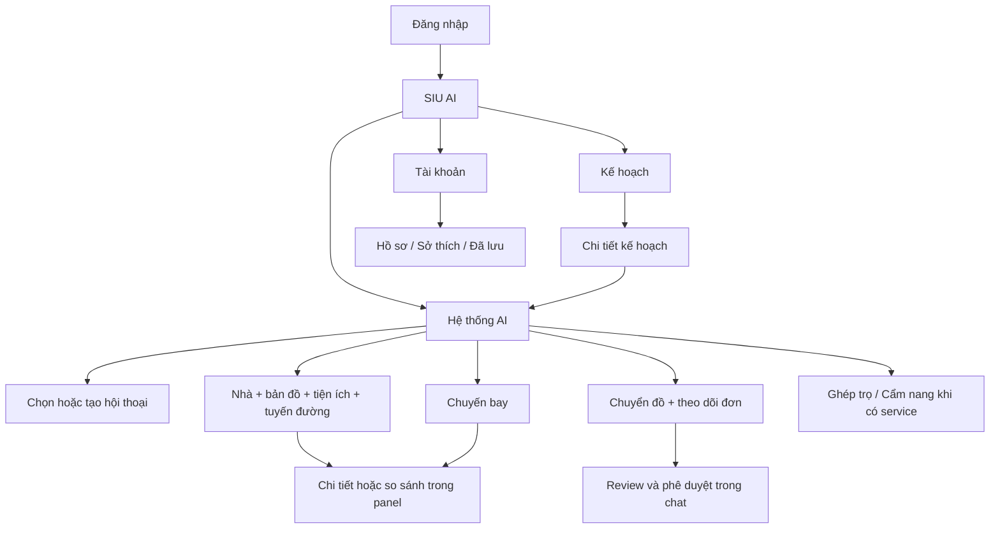

# SIU AI — Kế hoạch trang, màn hình và tương tác frontend

> Historical layout/command evidence (M23); use the [current development map](../../DEVELOPMENT.md) for this branch.


> **Cập nhật triển khai:** Frontend React và gateway đã được bổ sung trong `Frontend/`, thay cho Streamlit trong lệnh chạy mặc định. Xem [phạm vi đã làm, giới hạn và hướng dẫn chạy](../../Frontend/README.md). Nội dung khảo sát/đề xuất bên dưới giữ mốc lập tài liệu; các tính năng tương lai chưa được bật khi backend chưa hỗ trợ.

Ngày lập: **30/09/2026**. Trạng thái: **đề xuất thiết kế, chưa triển khai UI**. Căn cứ: 5 ảnh trong `Frontend/` và backend được đối chiếu tại `e407d45` trong [kế hoạch tích hợp](siu-ai-agent-first-frontend-plan.md).

Mục đích: designer biết cần vẽ những màn hình nào; frontend biết mỗi màn hình có gì và bấm nút sẽ làm gì; backend biết dữ liệu/tương tác nào còn phải bổ sung. Các URL, tên component và hành động trong tài liệu này là thiết kế đề xuất, không phải cam kết đã có endpoint tương ứng.

**Đọc theo vai trò:** Frontend/designer dùng phần 1–14 để thiết kế màn hình; Backend dùng [bảng yêu cầu BE](siu-ai-agent-first-frontend-plan.md#142-yêu-cầu-backend). Phần 15 bên dưới nối từng nhóm màn hình với yêu cầu FE/BE và xác định điểm cần bàn giao giữa hai bên.

## 1. Cần những trang nào?

**Ba trang chính sau đăng nhập: Hệ thống AI, Kế hoạch, Tài khoản.** Bên trong Hệ thống AI có nhiều trạng thái theo dịch vụ: tìm nhà, bản đồ, chuyến bay, chuyển nhà, thanh toán, ghép trọ và cẩm nang. Mỗi dịch vụ có card/form/detail riêng, vẫn nằm trong cuộc hội thoại đang mở.

“Màn hình” ở tài liệu này bao gồm trang đầy đủ, trạng thái chat, panel và hộp xác nhận. Không tạo một mục sidebar cho mỗi màn hình đó.



### 1.1. Danh mục trang và URL đề xuất

| Mã | Trang | URL web đề xuất | Nội dung / đường vào |
| --- | --- | --- | --- |
| AUTH-01 | Đăng nhập | `/login` | Cửa vào cho phiên người dùng; quay lại hội thoại đang xem sau khi đăng nhập. |
| AI-01 | Bắt đầu với AI | `/ai` | Lời chào, tác vụ nhanh đang hỗ trợ, hội thoại gần đây, composer. |
| AI-02 | Hội thoại | `/ai/:threadId` | Lịch sử tin nhắn và mọi component nghiệp vụ; là trang sử dụng thường xuyên nhất. |
| PL-01 | Danh sách kế hoạch | `/plans` | Kế hoạch đang thực hiện, chờ mình phản hồi và đã hoàn thành/lưu trữ. |
| PL-02 | Chi tiết kế hoạch | `/plans/:planId` | Các mốc, lựa chọn, chi phí, việc chờ duyệt và liên kết về chat. Cần API plan sản phẩm. |
| AC-01 | Tài khoản | `/account` | Hồ sơ, sở thích AI và dữ liệu đã lưu dưới các tab. |
| SYS-01 | Không tìm thấy/không có quyền | Route fallback | Thông báo ngắn, nút về Hệ thống AI; không lộ thông tin tài khoản khác. |

Đăng ký/quên mật khẩu chỉ thiết kế theo phương án identity team chọn. Nếu dùng provider đăng nhập có sẵn, sử dụng luồng của provider; không tự thêm form mật khẩu vào phạm vi MVP. Các trang xác thực và lỗi không phải mục sidebar.

Chi tiết nhà/map/offer/order dùng trạng thái panel trên URL hội thoại, ví dụ `?message=...&component=...&panel=map`. Back đóng panel trước khi rời hội thoại. Đây là lựa chọn điều hướng frontend; quyền truy cập vẫn kiểm tra ở server. Không đặt số điện thoại, token hay dữ liệu form lên URL.

### 1.2. Dịch vụ xuất hiện ở đâu?

| Dịch vụ | Giao diện trong chat | Chi tiết khi cần | Xuất hiện thêm ở đâu? | Phạm vi backend |
| --- | --- | --- | --- | --- |
| Nhà ở | Bộ tiêu chí + card nhà + map | Chi tiết nhà, so sánh nhà | Nhà đã lưu trong Tài khoản; căn đã chọn trong Kế hoạch | Có query/map; cần nối đầy đủ UI/action/history. |
| Bản đồ/tiện ích/route | Map + POI cards + tóm tắt tuyến | Map lớn, chi tiết POI, chọn điểm | Gắn với bước tìm nhà/chuyển đồ | Có Location tool; cần đồng bộ filter và entity selection. |
| Chuyến bay | Form bổ sung + danh sách offer | Chi tiết hành trình, so sánh | Lựa chọn chuyến trong Kế hoạch | Hiện tìm chuyến; chưa xuất vé thật. |
| Chuyển nhà | Form điểm/ngày giờ + báo giá | Dịch vụ, review, đơn, lịch sử đơn | Bước chuyển đồ trong Kế hoạch | Có Moving MCP; ghi phụ thuộc quyền/cấu hình và luồng approval. |
| Thanh toán | Card thanh toán trong ngữ cảnh giao dịch được bật | QR/link, trạng thái, chi tiết giao dịch | Gắn với giao dịch có liên kết hợp lệ | ZaloPay sandbox hiện riêng; chưa checkout chung. |
| Ghép trọ | Tiêu chí + card hồ sơ | Hồ sơ, yêu cầu kết nối | Đã lưu/quan tâm khi có API | Chưa có service; giai đoạn mở rộng. |
| Cẩm nang | Câu trả lời có nguồn + checklist | Nội dung đầy đủ và nguồn | Checklist cá nhân trong Kế hoạch | Chưa có service nội dung được kiểm chứng. |

## 2. Khung thiết kế chung

### 2.1. Desktop

Các kích thước dưới là điểm bắt đầu để thiết kế, cần kiểm tra thực tế với tiếng Việt, ảnh và dữ liệu dài:

- Sidebar 224–240 px: logo/avatar SIU AI, ba mục chính; khu vực dưới cho trạng thái tài khoản nhỏ. Minh họa robot dùng ở phần trống, không đẩy menu khỏi màn hình.
- Header khoảng 64 px: tiêu đề trang/hội thoại, nút mở lịch sử/tạo hội thoại và avatar. Chuông thông báo chỉ có khi đã có nguồn thông báo thật.
- Vùng nội dung tối đa khoảng 1.280 px. Tin nhắn chữ rộng khoảng 720–800 px; khối nhà+map hoặc so sánh được dùng toàn bộ chiều rộng vùng nội dung.
- Composer nằm cuối cột chat, rộng theo nội dung, tự cao 1–5 dòng. Chừa khoảng trống dưới lịch sử bằng chiều cao composer để không che card cuối.
- Kết quả nhà+map: hai cột khoảng 55/45 khi đủ rộng; map cao khởi điểm 360–440 px. Bản đồ lớn và bảng so sánh là panel mở rộng theo nhu cầu.
- Drawer chi tiết khoảng 440–520 px; ở màn hình hẹp chuyển sang full-screen sheet. Không ép cùng lúc chat + map + detail thành ba cột quá hẹp.

Wireframe khung hội thoại:

```text
┌──────────────────┬────────────────────────────────────────────────┐
│ SIU AI           │ Tên hội thoại           Lịch sử   Mới   Avatar │
│                  ├────────────────────────────────────────────────┤
│ ● Hệ thống AI    │                          Tin nhắn người dùng  │
│   Kế hoạch       │ AI: tóm tắt yêu cầu / câu hỏi cần bổ sung     │
│   Tài khoản      │                                                │
│                  │ [Tiêu chí: Quận 7 · 2 PN · 10–15 tr/tháng]    │
│                  │ ┌────────────────────┬───────────────────────┐ │
│                  │ │ Card nhà A         │ Map                  │ │
│                  │ │ Card nhà B         │ Marker / cluster     │ │
│                  │ │ Card nhà C         │ [Mở rộng]            │ │
│                  │ └────────────────────┴───────────────────────┘ │
│                  │ [Xem thêm]  [So sánh các căn đã chọn]         │
│                  │ AI: câu gợi ý tiếp theo khi phù hợp           │
│                  ├────────────────────────────────────────────────┤
│                  │ [Đang hỏi về: Căn A ×]                       │
│                  │ Nhắn cho SIU AI...                    [Gửi]  │
└──────────────────┴────────────────────────────────────────────────┘
```

### 2.2. Tablet và mobile

| Độ rộng đề xuất | Bố cục |
| --- | --- |
| Từ 1.200 px | Sidebar đầy đủ; khối kết quả có thể chia card/map. |
| 768–1.199 px | Sidebar thu gọn hoặc mở bằng nút menu; ưu tiên một cột nếu card/map không đủ rộng. |
| Dưới 768 px | Header gọn + chat toàn chiều ngang + composer dưới; menu dạng drawer vẫn có đúng ba mục. |

Trên mobile, nhóm kết quả nhà có tab **Danh sách / Bản đồ** dùng cùng dữ liệu và selection. Xem chi tiết mở sheet toàn màn hình với Back/Đóng rõ ràng; nút chính nằm cuối sheet. Map lớn giữ nút “Về cuộc trò chuyện”. Form dài cho cuộn phần nội dung, nút tiếp tục không bị bàn phím che.

Kích thước chạm mục tiêu khoảng 44 px trở lên, chữ nội dung khoảng 16 px, tiêu đề có phân cấp. Spacing theo hệ 4/8/12/16/24/32 px; card radius khoảng 16–20 px; dùng chung token màu trong kế hoạch tích hợp. Kiểm tra tại ít nhất 390, 768, 1.440 px và khi phóng chữ.

### 2.3. Các quy tắc áp dụng cho mọi dịch vụ

1. Mỗi card có một nút chính rõ nghĩa; các thao tác phụ như xem nguồn/lưu/so sánh không cạnh tranh bằng nhiều nút gradient.
2. Mở chi tiết không đồng nghĩa chọn. Chọn không đồng nghĩa đặt. Đặt/huỷ/sửa có ảnh hưởng đơn phải qua review đúng phạm vi.
3. Mọi kết quả hiển thị đơn vị giá, thời điểm dữ liệu khi có và tình trạng thiếu thông tin cần cho quyết định.
4. AI đọc đúng giá trị form đã gửi. Form sửa dở chưa gửi chỉ là draft; không tự thay đổi kế hoạch.
5. Text và component bổ sung cho nhau. Text giải thích điều đáng chú ý; card chứa thông tin có cấu trúc, tránh lặp toàn bộ danh sách thành hai bản.
6. Không tự cuộn xuống nếu người dùng đang đọc lịch sử; hiện nút “Có phản hồi mới”. Khi mở/đóng detail, trả focus về nút gốc.
7. Mỗi lần lọc có kết quả riêng trong lịch sử. Nhóm cũ ghi “Kết quả trước đó”; nút giao dịch cũ phải được kiểm tra lại trước khi dùng.

## 3. Hệ thống AI: màn hình bắt đầu và hội thoại

### AI-01 — Chưa có cuộc hội thoại

Thứ tự nội dung: avatar SIU AI nhỏ → lời chào một đoạn → ví dụ câu hỏi → tác vụ nhanh → composer. Ví dụ “Tìm phòng ở Hà Nội dưới 5 triệu/tháng” hoặc “Tìm chuyến bay Đà Nẵng đến TP.HCM”. Không cần banner lớn chiếm hơn nửa màn hình.

Các tác vụ nhanh đầu tiên: **Tìm nhà, Tìm chuyến bay, Chuyển đồ, Xem đường/tiện ích**. Có thể giữ hình minh họa ghép trọ/cẩm nang trong bản prototype, nhưng UI thật chỉ mở khi capability có hỗ trợ. Trong chat đang có nội dung, bộ tác vụ chào được thu gọn.

Bấm tác vụ đưa ví dụ vào composer hoặc mở form bổ sung ngắn trong chat; người dùng còn được chỉnh trước khi gửi. Không yêu cầu đi qua form nếu câu tự nhiên đã đủ dữ kiện.

### AI-02 — Hội thoại đang sử dụng

Header có tên hội thoại và nút mở lịch sử. Lịch sử là drawer trong Hệ thống AI, có tìm theo tiêu đề, ngày cập nhật và tạo mới; cần API thread list. (01/10) Có xóa từng hội thoại (thùng rác ở header và từng mục lịch sử) và **Xóa tất cả và làm mới SIU** (cả bộ nhớ sở thích từ chat), luôn qua hộp xác nhận; hội thoại đang chờ thanh toán không xóa được; đơn đã đặt không bị hủy. Chưa có chia sẻ hội thoại.

| Trạng thái | Thiết kế hiển thị | Người dùng có thể làm gì? |
| --- | --- | --- |
| Đang soạn | Composer, chip ngữ cảnh nếu đang hỏi về một entity | Sửa tin, bỏ chip, gửi. Enter gửi; Shift+Enter xuống dòng trên desktop. |
| Đã gửi/đang xử lý | Tin người dùng + skeleton khối trả lời; thông báo trạng thái thật | Tiếp tục soạn draft. Nếu backend chưa xử lý đồng thời trong thread, khóa gửi lượt mới cho tới khi lượt hiện tại kết thúc. |
| Cần làm rõ | Một câu hỏi + lựa chọn hoặc input phù hợp | Chọn địa điểm, nhập ngân sách/ngày giờ hoặc trả lời bằng chữ. |
| Có kết quả | Text ngắn + nhóm component phù hợp | Xem/chọn/lọc/thao tác tiếp. |
| Kết quả một phần | Các component thành công vẫn hiện; lỗi nằm cạnh phần thất bại | Thử lại phần được phép hoặc tiếp tục với phần đã có. |
| Không hỗ trợ | Nói rõ khả năng hiện tại, có tác vụ thay thế phù hợp | Sửa yêu cầu; không tạo card giả. |
| Mất kết nối | Giữ draft và kết quả đã có; trạng thái chưa rõ | Kiểm tra trạng thái trước khi gửi lại, nhất là giao dịch. |

Không hiện nút “Dừng tác vụ” như một cam kết nếu backend chưa có cancellation. Nếu chỉ đóng kết nối nhận kết quả, phải phân biệt với việc tác vụ đã dừng ở server.

## 4. Nhà ở: các màn hình và tương tác cần vẽ

### H-01 — Tiêu chí tìm nhà

Hiện ngay sau khi AI hiểu nhu cầu, dưới dạng chip có nút **Sửa tiêu chí**. Chỉ mở form cho trường còn thiếu hoặc khi người dùng yêu cầu chỉnh.

| Trường | Control | Quy tắc |
| --- | --- | --- |
| Thành phố | Select Hà Nội/Đà Nẵng/TP.HCM | Có thể lấy từ ngữ cảnh rõ ràng; hỏi lại nếu chưa xác định. |
| Khu vực hoặc gần địa điểm | Chọn “Trong khu vực” / “Gần địa điểm” + tìm kiếm | Hiện ứng viên có tên và thành phố; không trộn polygon khu vực với pin địa điểm. |
| Khoảng giá | Min/max có đơn vị VND/tháng cho luồng thuê tháng | Min ≤ max; không bắt nhập max nếu yêu cầu đã đủ để tìm. |
| Loại nhà | Chip/select các loại được hỗ trợ | Hiển thị tên dễ hiểu, gửi enum hợp lệ. |
| Phòng ngủ/phòng tắm | Số hoặc khoảng với nhãn “ít nhất/chính xác” rõ ràng | Không biến “2 phòng ngủ” thành “2 người ở”. |
| Diện tích | Min/max m² | Để trống nghĩa không có điều kiện này. |
| Tiện nghi | Multi-select từ taxonomy thực tế | Trường thiếu thông tin không tự coi là có tiện nghi. |
| Đi lại tới trường/cơ quan | Địa điểm + phương tiện + giới hạn phút | Bật khi graph và query nối đủ; đây là điều kiện tính route, không chỉ khoảng cách tròn. |

Form có **Áp dụng** và **Hủy**; Hủy bỏ draft. Áp dụng gửi thay đổi có cấu trúc và tạo kết quả mới. Có nút xóa từng điều kiện, không tự nới điều kiện cứng nếu không có kết quả.

### H-02 — Kết quả nhà + map

Đầu nhóm: tóm tắt phạm vi, filter chips, số căn đang hiển thị và nguồn/thời điểm nếu có. Khi chỉ lấy một trang, dùng “Đang hiển thị 5 căn” thay vì “Chỉ có 5 căn”.

Card nhà cần xếp thông tin theo thứ tự:

1. Ảnh thumbnail hoặc placeholder; badge “Vị trí gần đúng” khi áp dụng.
2. Tên tin tối đa khoảng hai dòng; giá nổi bật cùng chu kỳ thuê.
3. Địa chỉ ngắn, diện tích, phòng ngủ/phòng tắm khi biết.
4. Tối đa 2–3 tiện nghi hoặc điểm phù hợp có bằng chứng.
5. Nút chính **Xem chi tiết**; nút lưu dạng icon có nhãn; checkbox **So sánh**.

Click card/marker làm nổi cùng entity, chưa lưu selection của workflow. **Chọn căn này** nằm ở detail hoặc thanh hành động của card đang mở. Một kết quả nhỏ vẫn cần hành vi giống kết quả nhiều trang.

Footer nhóm: **Xem thêm** theo cursor; thanh so sánh xuất hiện khi đã đánh dấu từ hai căn. Sắp xếp “giá thấp/diện tích” chỉ bật nếu backend hỗ trợ đúng phạm vi; sắp xếp trong các căn đã tải phải ghi rõ phạm vi đó.

### H-03 — Chi tiết nhà

Drawer có: gallery → tên/giá → địa chỉ và độ chính xác → thông số → mô tả → tiện nghi → cọc/chi phí khác nếu biết → nguồn tin → POI/tuyến đường liên quan.

Thanh cuối: **Chọn căn này** là CTA chính. Các nút phụ: **Hỏi AI về căn này**, **Xem đường đi**, **Lưu**. Nút hỏi AI gắn chip “Đang hỏi về: …” vào composer để người dùng nhập câu hỏi. Chọn xong đổi thành “Đã chọn” và cho phép “Đổi lựa chọn”.

Nguồn mở link ngoài hợp lệ và có chỉ báo. Không thêm nút “Đặt cọc”, “Đã giữ phòng”, “Liên hệ ngay” nếu chưa có luồng/dữ liệu tương ứng. Nếu tin không còn truy cập được, giữ bản lịch sử với trạng thái không khả dụng và mời tìm lại.

### H-04 — So sánh nhà

Chọn tối đa 3 căn cho bản đầu. Desktop: bảng cột theo căn, hàng gồm giá + kỳ, diện tích, phòng, cọc, tiện nghi, độ chính xác, khoảng cách hoặc route đã tính. Mobile: chọn hai căn đang xem, cuộn ngang trong bảng có tiêu đề cố định hoặc chuyển từng căn; không làm toàn trang bị tràn.

Ô thiếu ghi “Chưa có dữ liệu”; không tự tạo điểm chất lượng. Mỗi cột có **Xem chi tiết** và **Chọn căn này**. So sánh dựa trên detail thật, không biến đánh dấu checkbox thành yêu cầu đặt.

### H-05 — Trống/lỗi/đã chọn

| Trạng thái | Cách hiển thị |
| --- | --- |
| Không có kết quả | Nhắc lại điều kiện đã áp dụng; nút Sửa ngân sách / Đổi khu vực. Chỉ áp dụng nới lọc sau lựa chọn của người dùng. |
| Thiếu ảnh hoặc cọc | Placeholder hoặc “Chưa rõ tiền cọc”; card vẫn dùng được. |
| Lỗi map | Danh sách vẫn hiển thị, map có Thử tải lại. |
| Có nhiều hơn giới hạn | Xem thêm/zoom/lọc; không giấu cảnh báo giới hạn kết quả. |
| Đã chọn | Một thanh tóm tắt căn đã chọn + Đổi lựa chọn + gợi ý phù hợp như xem đường/báo giá chuyển đồ. |

## 5. Bản đồ, tiện ích và tuyến đường

### M-01 — Map trong chat và M-02 — Map mở rộng

Map trong chat thuộc về một nhóm kết quả. Thanh trên có **Kết quả đang xem / Khám phá khu vực**, nút lớp POI và Mở rộng. Hiện rõ bộ lọc nào đang áp dụng; hai chế độ dùng phạm vi dữ liệu đã quy định trong kế hoạch tích hợp.

Map lớn desktop: danh sách thu gọn bên trái, map chiếm phần còn lại, detail thay danh sách khi chọn một căn. Mobile: map toàn màn hình với card căn đang chọn ở dưới và nút về chat. Không đặt hàng loạt card giá phủ kín bản đồ khi zoom xa; dùng cluster.

Giữ marker teal có viền rõ, căn được chọn màu cam, route xanh. Legend dùng ít nhãn cần thiết. Pan/zoom chỉ tải viewport; nút **Tìm trong khu vực này** mới chuyển vùng thành nhu cầu của cuộc hội thoại. Khi viewport chưa đồng bộ filter, thông báo phạm vi rõ ngay cạnh tên chế độ.

### M-03 — Chọn địa điểm

Mở khi câu hỏi mơ hồ, chọn điểm đi/đến hoặc xác nhận pin chuyển đồ. Gồm ô tìm kiếm → danh sách ứng viên tên/địa chỉ/thành phố → bản đồ kiểm tra → nút **Dùng địa điểm này**.

Với vùng hành chính, chọn khu vực để tìm nhà; với điểm giao nhận, cần pin và địa chỉ phù hợp. Không mặc định GPS; nút **Dùng vị trí hiện tại** chỉ lấy vị trí sau thao tác người dùng, có cách nhập thủ công khi từ chối quyền.

### M-04 — Tiện ích quanh nhà

Header ghi quanh căn/điểm nào, nhóm tiện ích và phạm vi. Card POI gồm tên, loại, khoảng cách có nhãn “đường thẳng” khi đó là cách tính, và nút **Xem trên bản đồ** / **Tính đường đi**. Số POI trả về theo tool không đồng nghĩa đã liệt kê tất cả POI trong bán kính.

Chi tiết POI mở sheet gọn, chỉ hiện địa chỉ/điện thoại/giờ mở cửa nếu có dữ liệu. Nếu không có kết quả, cho đổi nhóm/phạm vi; không kết luận khu vực chắc chắn không có tiện ích.

### M-05 — Tuyến đường

Panel gồm điểm đi, điểm đến, phương tiện **Đi bộ / Xe máy / Ô tô**, khoảng cách, thời gian ước tính và route trên map. Các điểm từ căn/POI đã chọn hiển thị tên và ID phía dữ liệu; người dùng được đổi từng đầu.

Đổi phương tiện tính lại route, có loading riêng. Không đưa xe buýt/metro vào lựa chọn tính tuyến khi chưa có provider. Chưa có turn-by-turn thì không vẽ bảng hướng dẫn rẽ giả. Lỗi ngoài vùng hỗ trợ hoặc không tìm được đường có giải thích và cho đổi điểm/phương tiện.

## 6. Chuyến bay: trải nghiệm tìm và chọn

### F-01 — Bổ sung nhu cầu

Form trong chat có nơi đi, nơi đến, ngày bay; ô sân bay có tên + mã để chọn rõ. Chỉ thu thêm hành khách/hạng vé khi contract hỗ trợ và ảnh hưởng tìm kiếm thật. Ngày quá khứ có lỗi ngay ở trường, giữ những dữ liệu khác đã nhập.

Bản đầu thiết kế tìm một chiều theo đường chạy backend hiện tại. Khứ hồi có thể thiết kế hai chặng riêng khi adapter đã hỗ trợ, nhưng không trình bày thành một vé khứ hồi đã gộp điều kiện/giá nếu chỉ thực hiện hai lượt tìm.

### F-02 — Kết quả chuyến bay

Header: chặng + ngày + tiêu chí hiện hành. Card: hãng/mã chuyến nếu có, giờ đi/đến và ngày/múi giờ khi cần, sân bay, thời lượng, điểm dừng, giá và cơ sở tính giá theo payload. Không mặc định giá tổng thành giá/người nếu dữ liệu không nói vậy.

Nút chính **Xem hành trình**; phụ **So sánh** hoặc **Chọn vào kế hoạch** sau khi có API lưu lựa chọn. Chỉ hiện sắp xếp theo trường có dữ liệu. Nhãn “Giá tại thời điểm tra cứu” và thời hạn offer nếu có; không tự đặt đồng hồ đếm ngược.

### F-03 — Chi tiết offer

Sheet có timeline các chặng, đổi sân bay/quá ngày nếu có, bảng giá, hành lý/điều kiện có dữ liệu và nguồn. Trường thiếu ghi rõ. Nút **Chọn vào kế hoạch** lưu ý định; thông báo “Đã lưu lựa chọn chuyến, chưa đặt vé”.

### F-04 — Booking về sau

Thiết kế bổ sung sau khi có provider: thông tin hành khách → giá/điều kiện mới nhất → review → payment hợp lệ → xác nhận vé. Chỉ trạng thái đã phát hành từ backend mới có màn vé với booking reference/PNR. Trong bản hiện tại không hiển thị nút “Xuất vé” trong luồng live; prototype booking phải ghi môi trường mô phỏng.

## 7. Chuyển đồ: từ báo giá tới theo dõi đơn

### MV-01 — Điểm lấy/giao và thời gian

Form có hai khối **Lấy đồ tại** và **Giao đến**; mỗi khối có địa chỉ, map preview, trạng thái pin đã xác nhận và nút Sửa. Nếu giao đến nhà đã chọn, điền gợi ý từ nhà nhưng vẫn cần kiểm tra vị trí khi chưa chính xác.

Chọn ngày và giờ lấy đồ trong khả năng provider; thông tin hàng/xe/dịch vụ bổ sung chỉ hiện theo yêu cầu service thật. Không tự hứa đóng gói, tháo lắp hoặc nhân công từ tên “chuyển nhà”. Đổi địa chỉ/pin làm mất xác nhận cũ và yêu cầu kiểm tra lại.

(01/10) Hiện thực là workspace **Thông tin chuyển đồ** cạnh bản đồ (không còn modal nhập vĩ độ/kinh độ): mở khi agent hỏi bất kỳ thông tin chuyển đồ nào, khi bấm "Chuyển đồ tới đây" hoặc thẻ Chuyển đồ; điền sẵn từ điều người dùng đã nói và căn đã chọn; câu hỏi của agent hiện tại ô liên quan; ghim điểm là tùy chọn (chọn ứng viên Location, tìm, chạm bản đồ). Xem [map workspace §10](map-workspace-2026-10-01.md).

Nút **Xác nhận và lấy báo giá** chỉ gửi sau khi đủ trường bắt buộc. Chưa cần yêu cầu người dùng điền form liên hệ giao dịch ở bước chỉ xem giá nếu backend đang có cơ chế liên hệ lấy báo giá riêng.

### MV-02 — Chọn dịch vụ và báo giá

Card gồm tên provider/dịch vụ, loại xe/capacity nếu có, tổng giá, chi tiết phí mở rộng, thời hạn và phương thức trả tiền. Có nút **Xem dịch vụ** và **Chọn báo giá**. Không vẽ ETA tài xế nếu chưa có dữ liệu.

Footer “Giá ước tính” hoặc giá xác nhận theo đúng payload; chi phí có khoảng phải hiện khoảng và điều kiện. Chưa có tài xế ở giai đoạn này thì không đưa avatar tài xế mẫu.

### MV-03 — Kiểm tra và yêu cầu đặt

Sau khi chọn báo giá: tóm tắt điểm lấy/giao, thời gian, dịch vụ, giá/phạm vi giá, CASH hoặc phương thức thực tế, form liên hệ theo backend. Nút **Tiếp tục xác nhận** dẫn tới component duyệt chung AP-01.

Nếu quyền ghi bị tắt, vẫn xem báo giá; thay CTA đặt bằng thông báo “Hiện chưa thể đặt đơn trên hệ thống”. Người dùng có thể đổi nhu cầu hoặc lưu kế hoạch khi có persistence.

### MV-04 — Chi tiết và theo dõi đơn

Card sau giao dịch hiển thị mã đơn, trạng thái đã chuẩn hóa từ provider, điểm lấy/giao, lịch đặt, giá xác nhận và link theo dõi nếu có. Timeline chỉ dựng các sự kiện backend cung cấp; không tự chạy tiến độ theo thời gian.

Các trạng thái thiết kế tối thiểu: đang xác minh kết quả tạo đơn, đã tạo/chờ xử lý, đang thực hiện, hoàn thành, đã hủy, lỗi tải trạng thái. Trạng thái nghiệp vụ cụ thể phải ánh xạ từ schema provider; không đoán bằng màu hay elapsed time.

Nút **Kiểm tra trạng thái**, **Xem theo dõi**, **Yêu cầu sửa liên hệ**, **Yêu cầu hủy** chỉ hiện khi được phép. Form sửa hiện tại giới hạn liên hệ/ghi chú; đổi tuyến/giá cần phương án mới. Rating thiết kế để mở rộng sau khi graph có allowlist/action tương ứng.

### MV-05 — Đơn trước đây

Người dùng hỏi “xem các đơn chuyển đồ của tôi”: trả danh sách trong chat, mỗi dòng mã/ngày/điểm đến/trạng thái và Xem đơn. Có thể truy cập lại từ bước chuyển đồ trong Kế hoạch. Cần lọc theo quyền người dùng tại backend; không đưa toàn bộ lịch sử tài khoản provider cho mọi user.

## 8. Phê duyệt và thanh toán

### AP-01 — Phương án chờ người dùng duyệt

Đặt tại cuối lượt chat và dùng lại trong Kế hoạch. Card có tiêu đề rõ “Xác nhận đặt đơn chuyển đồ”, danh sách thao tác, phương án đã chọn, giá tối đa/phương thức trả tiền, điều kiện/expiry, form cần nhập và ba hướng **Xác nhận**, **Đổi phương án**, **Từ chối**.

Nếu backend yêu cầu duyệt một nhóm thao tác thì hiển thị đủ nhóm đó. Không tự thêm checkbox chọn duyệt từng phần nếu endpoint chưa hỗ trợ semantics tương ứng. Các ID, hash và phiên bản là dữ liệu giao thức, không in ra như nội dung người dùng phải đọc.

| Trạng thái | Nút và phản hồi |
| --- | --- |
| Còn hiệu lực | Có thể sửa form/duyệt; nhãn CTA mô tả thao tác thực tế. |
| Đang gửi | Khóa nút gửi lặp, vẫn đọc được nội dung đang duyệt. |
| Hết hạn/đã đổi phương án | Khóa duyệt cũ, hiện **Lấy phương án mới**. |
| Xử lý thành công | Hiện receipt hoặc đơn được xác nhận; giữ liên kết xem chi tiết. |
| Chưa rõ kết quả | Hiện **Kiểm tra trạng thái**; không biến thành nút tạo lại ngay. |
| Thành công một phần | Tách từng thao tác đã/chưa thực hiện; mọi yêu cầu hủy sau đó có review riêng. |

“Từ chối phương án” phải phân biệt với “Hủy đơn đã đặt”. Dùng ngôn từ khác nhau trên nút và trong confirmation để tránh nhầm.

### PAY-01 — Thanh toán và PAY-02 — Kết quả

Chỉ mở khi workflow có giao dịch được phép thanh toán. Card gồm đơn liên quan, số tiền/đơn vị, provider, expiry nếu có, QR/link được backend cấp và nút **Kiểm tra thanh toán**. Mobile ưu tiên Mở trang thanh toán; QR có thể mở lớn khi thanh toán bằng thiết bị khác.

Trạng thái cần thiết kế: chờ trả tiền, đang xác minh, đã thanh toán, thất bại, hết hạn, yêu cầu hoàn/đã hoàn khi có dữ liệu. Bấm “Tôi đã thanh toán” chỉ kích hoạt kiểm tra; callback trở về trình duyệt cũng chưa đủ để xác nhận thành công.

ZaloPay sandbox hiện là luồng thử riêng: nếu đưa vào bản demo SIU AI thì mở từ yêu cầu thử nghiệm rõ ràng trong chat, gắn nhãn sandbox, không thêm mục sidebar thứ tư. Không dùng form này để thu tiền cho Moving CASH hay chuyến bay chưa được đặt. Refund/cancel chỉ bật khi có API nghiệp vụ và quyền thực thi tương ứng.

## 9. Ghép trọ và cẩm nang: thiết kế sẵn cho giai đoạn mở rộng

### RM-01 / RM-02 / RM-03 — Tiêu chí, hồ sơ và kết nối

Ghép trọ cần ba màn hình trong chat:

- **Tiêu chí:** thành phố/khu vực, ngân sách mỗi người, thời điểm vào ở, số người, nhu cầu sinh hoạt do người dùng khai báo. Bổ sung điểm đến để tính commute chỉ khi có địa điểm phù hợp.
- **Kết quả:** avatar do chủ hồ sơ cho phép, tên hiển thị, khu vực, ngân sách, thời điểm có thể ở cùng, vài tiêu chí chung. Nút **Xem hồ sơ** và **Quan tâm**.
- **Chi tiết/kết nối:** mô tả, ưu tiên, điểm phù hợp có giải thích, nút **Gửi yêu cầu kết nối**. Sau gửi có trạng thái chờ/chấp nhận/từ chối; kênh liên hệ chỉ mở theo quyền và sự đồng ý.

Không suy ra tính cách hoặc độ tin cậy từ ảnh. Không hiện điểm phần trăm phù hợp nếu chưa có công thức, dữ liệu và cách giải thích. Không gắn nhãn “đã xác minh” nếu chưa có quy trình xác minh. Backend hồ sơ, matching, consent và moderation là điều kiện để bật trải nghiệm này.

### KB-01 / KB-02 — Câu trả lời có nguồn và checklist

Card cẩm nang gồm câu trả lời ngắn, nội dung có thể mở rộng, tên nguồn + link + ngày cập nhật khi biết. Nút **Xem nguồn**, **Hỏi tiếp**, **Thêm checklist vào kế hoạch** khi backend đã có khả năng đó.

Ví dụ “Cần chuẩn bị gì trước khi chuyển trọ?” trả checklist các bước có giải thích. Người dùng đánh dấu hoàn thành bước cá nhân trong kế hoạch; AI không tự khẳng định thủ tục đã xong. Cần màn không tìm thấy nguồn phù hợp và nguồn cũ/mâu thuẫn; không biến câu trả lời không có nguồn thành hướng dẫn chính thức.

## 10. Kế hoạch: danh sách và chi tiết

### PL-01 — Danh sách

Header “Kế hoạch của bạn”, nút **Lên kế hoạch với AI** mở chat với prompt soạn sẵn. Bộ lọc trạng thái: Đang thực hiện / Cần bạn phản hồi / Đã hoàn thành hoặc lưu trữ khi API hỗ trợ.

Card kế hoạch gồm tên mục tiêu, nơi/thời gian nếu có, bước hiện tại, số việc chờ phản hồi, ngày cập nhật. Nút chính **Xem kế hoạch**; phụ **Tiếp tục chat**. Trống thì có ví dụ nhu cầu và CTA bắt đầu với AI.

### PL-02 — Chi tiết

```text
Tên kế hoạch: Chuyển đến TP.HCM                    [Tiếp tục chat]
Thời gian dự kiến · Trạng thái
┌───────────────────────────────────┬─────────────────────────────┐
│ Mục tiêu và lựa chọn hiện tại      │ Cần bạn phản hồi           │
│ Nhà / chuyến bay / chuyển đồ       │ Card phê duyệt hoặc câu hỏi│
├───────────────────────────────────┼─────────────────────────────┤
│ Các bước và checklist             │ Chi phí                    │
│ 1. Tìm nhà: có kết quả             │ Một lần / hàng tháng       │
│ 2. Chọn nhà: đã chọn căn A         │ Khoản chưa xác định        │
│ 3. Chuyển đồ: chờ xác nhận         ├─────────────────────────────┤
│ 4. Việc cá nhân: chưa hoàn tất     │ Mốc thời gian dự kiến      │
└───────────────────────────────────┴─────────────────────────────┘
```

Mỗi bước có trạng thái, tóm tắt kết quả, nút **Xem kết quả trong chat**. Việc người dùng tự làm mới có checkbox đánh dấu; việc provider thực hiện hiển thị trạng thái từ backend. Mobile ưu tiên việc chờ phản hồi ở trên, tiếp đến các bước và chi phí.

Sửa mục tiêu/ngày/ngân sách tạo thay đổi để graph đánh giá, không chỉnh lặng lẽ các đơn đã đặt. Backend hiện có task plan nhưng cần projection/persistence bổ sung cho plan sản phẩm, timeline và checklist này.

## 11. Tài khoản: các tab cần thiết kế

| Tab | Nội dung | Tương tác | Ưu tiên |
| --- | --- | --- | --- |
| Hồ sơ | Tên hiển thị, avatar nếu có, danh tính đăng nhập; liên hệ chỉ khi sản phẩm cần | Chỉnh sửa thông tin được phép, đăng xuất | MVP tối thiểu theo identity đã chọn |
| Sở thích AI | Ngân sách thuê, thành phố, loại nhà, tiện nghi, phương tiện ưu tiên | Sửa/xóa từng sở thích, bật/tắt sử dụng để gợi ý | Sau khi có API preferences |
| Đã lưu | Nhà đã lưu; mở rộng loại khác theo service | Xem detail, bỏ lưu, hỏi AI về mục đó | Sau khi có saved-listings API |
| Dữ liệu cá nhân | Thông tin nào được lưu và cách quản lý | Các thao tác xem/xóa được hỗ trợ thực sự | Chốt cùng backend |
| Dịch vụ liên kết | Provider mà sản phẩm đã có integration tài khoản thực | Kết nối/ngắt theo flow của provider | Giai đoạn sau; ẩn khi chưa có |

Mỗi form có **Lưu thay đổi** và **Hủy**. Khi rời tab có draft chưa lưu, cho Lưu/Bỏ thay đổi/Ở lại. Không tự đồng bộ sở thích mới vào một đơn đã đặt. Dữ liệu đã lưu nhưng tin gốc mất thì ghi “Tin không còn khả dụng”, cho bỏ lưu hoặc tìm tương tự.

## 12. Bộ component và trạng thái cần bàn giao

| Nhóm | Component dùng chung | Cần vẽ những biến thể |
| --- | --- | --- |
| Khung app | Sidebar, Header, HistoryDrawer, Composer, ContextChip | Desktop/mobile, menu thu gọn, nội dung dài, focus |
| Chat | Message, AssistantResultGroup, ClarificationForm, SuggestedAction | Loading, câu hỏi, answer, partial, unsupported, error |
| Dữ liệu | FilterChip, SourceLabel, Money, UnknownValue, EmptyState | Đơn vị giá, thiếu dữ liệu, source/sandbox, giới hạn kết quả |
| Nhà/map | HousingCard, HousingDetail, ComparisonPanel, MapPanel, POICard, RouteSummary | Selected/hover/saved, approximate, cluster/listing, tile lỗi |
| Di chuyển | FlightOfferCard, ItineraryDetail, MovingQuoteCard, PinConfirmation, OrderCard | Offer cũ, hết hạn, điểm chưa xác nhận, order đang đối soát |
| Giao dịch | ApprovalCard, ContactForm, Receipt, PaymentCard | Ready/submitting/expired/success/partial/unknown |
| Kế hoạch/tài khoản | PlanCard, TaskRow, CostSummary, PreferencesForm, SavedList | Empty, pending, draft, saved, không có quyền |
| Mở rộng | RoommateCard, ConnectionRequest, KnowledgeAnswer, Checklist | Chưa đủ dữ liệu, consent, citation, nguồn không có |

Một bộ dữ liệu prototype nên có: tên nhà dài, không ảnh, giá/diện tích null, pin gần đúng, nhiều thành phố, offer quá ngày, báo giá hết hạn, một phần thành công và đơn chưa rõ kết quả. Dữ liệu demo phải được đánh dấu, không ghi như bằng chứng service đã hoạt động.

## 13. Kế hoạch thực hiện thiết kế và frontend

| Bước | Sản phẩm bàn giao | Hoàn thành khi |
| --- | --- | --- |
| D1 — Chốt sitemap và điều hướng | Route map, ba menu, cách mở/đóng detail, link trở lại chat | Mọi dịch vụ có đường vào và đường quay lại; không thêm trang nghiệp vụ rời rạc. |
| D2 — Wireframe khung chung | AI-01/02, lịch sử, composer; PL-01/02; AC-01; login/fallback | Có desktop và mobile, xác định scroll/focus/panel. |
| D3 — Nhà/map đầy đủ | H-01…05, M-01…05, so sánh và các lỗi dữ liệu | Prototype đi được từ câu hỏi → card/map → chọn nhà → route → quay lại chat. |
| D4 — Flight/Moving/giao dịch | F-01…03, MV-01…05, AP-01, PAY-01/02 theo môi trường | Mỗi nút có kết quả rõ, đủ trạng thái expiry/không có quyền/chưa rõ kết quả. |
| D5 — Kế hoạch/tài khoản đồng bộ | Card đã chọn xuất hiện ở plan, saved list, khôi phục hội thoại | Chat/plan/account dùng cùng selection và trạng thái sau reload. |
| D6 — Hoàn thiện hình ảnh | Tokens, icon/avatar asset, typography, spacing, responsive | Dùng thống nhất tinh thần 5 ảnh; card thật đọc tốt khi dữ liệu dài/thiếu. |
| D7 — Bàn giao phát triển | Mỗi screen có component tree, nguồn dữ liệu, action, loading/error; checklist nghiệm thu | Frontend/backend xác nhận các field/action đã có hoặc nằm trong backlog rõ ràng. |
| D8 — Mở rộng | RM/KB, booking thật và account integrations | Service tương ứng đủ dữ liệu và quyền để bật UI. |

Designer và frontend có thể làm khung, card và fixture ngay. Trước khi nối live, mỗi CTA phải được gắn một trong ba loại: thao tác local, đọc dữ liệu, hoặc thay đổi trạng thái backend. Owner backend xác nhận contract cho loại thứ hai/ba. Giữ danh sách khoảng trống ở kế hoạch tích hợp để tránh UI có nút nhưng không có hành vi thật.

## 14. Tiêu chí duyệt thiết kế

- Nhìn màn hình đầu biết có thể nhắn nhu cầu; không cần hiểu tên service/tool.
- Sidebar đúng ba mục ở cả desktop và mobile; tác vụ nhanh mở ngữ cảnh trong chat.
- Trong mỗi màn nghiệp vụ đọc được: đang xem gì, tiêu chí nào, dữ liệu còn thiếu gì và bước tiếp theo là gì.
- Có prototype hoàn chỉnh cho nhà→map→route và nhà→moving→approval; các nút Back/Đóng không mất draft hoặc lựa chọn.
- Mỗi form ghi rõ trường bắt buộc/tùy chọn, nhãn đơn vị và lỗi tại trường; không hỏi lại dữ liệu đã xác định.
- Thiết kế loading/empty/error/partial/expired/permission/unknown cho những màn liên quan, không chỉ màn đẹp có đủ dữ liệu.
- Một click chọn không phát sinh đặt đơn; một click duyệt có review rõ và không tạo lặp.
- Phân biệt tìm được nhà với đã thuê, offer với vé đã xuất, báo giá với đơn đã tạo, nhấn kiểm tra thanh toán với đã thanh toán.
- Map có cluster, bộ lọc đúng phạm vi, nhà được chọn nổi bật; số liệu UI không phóng đại độ đầy đủ dữ liệu.
- Token màu, focus, nhãn icon, font và khoảng chạm dùng thống nhất; có thể thao tác các bước chính bằng bàn phím.
- Màn hình prototype ghép trọ/cẩm nang/booking tương lai ghi trạng thái dự kiến và không được đưa vào capability live sớm.

Tài liệu liên quan: [kế hoạch tích hợp frontend–backend](siu-ai-agent-first-frontend-plan.md), [trạng thái tích hợp MVP](mvp-completion-2026-09-30.md), [trạng thái dữ liệu Location](location-data-status.md). Khi triển khai xong từng màn, ghi lại commit, endpoint thực tế và kết quả nghiệm thu tương ứng.

## 15. Chia yêu cầu Frontend và Backend theo nhóm màn hình

Mã FE/BE tham chiếu [phần giao việc trong kế hoạch tích hợp](siu-ai-agent-first-frontend-plan.md#14-yêu-cầu-theo-nhóm-phụ-trách). Đây là bảng để chia task màn hình; chi tiết endpoint và contract vẫn lấy ở kế hoạch tích hợp và schema được duyệt.

| Nhóm màn hình | Yêu cầu Frontend | Yêu cầu Backend | Bàn giao để nối live |
| --- | --- | --- | --- |
| AUTH-01, khung app | FE-01: login/session UI, route guard, ba menu, avatar/logout | BE-01: identity/session, gateway và owner checks | Cách login/logout, user payload, 401/403 và hết phiên. |
| AI-01/02, history | FE-02: composer, renderer, clarification, lịch sử, trạng thái tải/lỗi | BE-02/03/07: response có cấu trúc, action, thread/message history | Payload các loại câu trả lời, ID/revision, resume/history. |
| H-01…05 | FE-03: filter/card/detail/compare/pagination/selection | BE-03/04: filter, cursor/result set, detail, selection canonical | Listing DTO, semantics null/price, search request, action chọn. |
| M-01…05 | FE-04: map hai mode, cluster, POI, picker, route và responsive | BE-04: viewport có filter/meta, coordinate/accuracy, entity routing | Viewport DTO, cluster count, limit, route geometry, lỗi ngoài vùng. |
| F-01…03 | FE-05: form chặng/ngày, offer/detail, lưu lựa chọn | BE-03/05: adapter search, offer freshness/capability, selection | Offer DTO, điều kiện tìm thực sự hỗ trợ, hành vi giá hết hạn. |
| MV-01…05 | FE-06: form pin/ngày giờ, quote/detail/order cards | BE-03/05/06: dịch vụ/báo giá, pin validation, order ownership/status | Required fields theo dịch vụ, quote/order DTO, quyền từng action. |
| AP-01, PAY-01/02 | FE-07: review, form, gửi duyệt, QR/link, receipt/unknown states | BE-06: approval, expiry/reprice, PII, idempotency, payment status | Phạm vi duyệt, payload_hash/version, error/retry và receipt. |
| PL-01/02 | FE-08: plan list/detail, pending, cost, deep link, checklist UI | BE-07: persistence/projection, milestone API, liên kết message | Plan DTO, trạng thái AI task/đời thực, công thức budget/progress nếu có. |
| AC-01 | FE-09: profile/preferences/saved list, save/cancel/draft | BE-01/08: profile API, sở thích, saved ownership/persistence | Field nào được sửa, precedence sở thích, xử lý listing đã mất. |
| RM/KB, F-04 và integrations tương lai | FE-11: prototype và component theo dữ liệu đã chốt | BE-11: service, dữ liệu, quyền, booking/nguồn nội dung | Capability live và schema đã kiểm thử; trước đó chỉ là prototype. |
| Toàn bộ màn | FE-10: accessibility/mobile/E2E UI, hủy request cũ | BE-09/10: stream khi triển khai, recovery/runtime/API checks | Checklist tích hợp, môi trường nghiệm thu và kết quả thực tế. |

### 15.1. Checklist bàn giao của Frontend

- [ ] Sitemap và các frame desktop/mobile theo mã màn hình.
- [ ] Component library, token màu/font/spacing và các state loading/empty/error/partial/expired.
- [ ] Mỗi nút có hành vi local hoặc request/action cụ thể; không có CTA trống không giải thích.
- [ ] Form ghi rõ required/optional, validation, draft/save/cancel, điều gì xảy ra khi Back/reload.
- [ ] Mapping payload backend → UI; giữ ID và revision; fallback khi schema/field chưa hỗ trợ.
- [ ] Prototype/E2E thể hiện chọn nhà→route và chuyển đồ→review, gồm các nhánh lỗi.

### 15.2. Checklist bàn giao của Backend

- [ ] Schema và payload mẫu đã bỏ PII cho mỗi nhóm component/action.
- [ ] API thực tế, quyền truy cập, capability/môi trường, error codes và quy tắc retry.
- [ ] Nguồn dữ liệu, đơn vị, semantics null, freshness, cursor/limit/filter được ghi rõ.
- [ ] State selection/plan/history có thể đọc lại và dùng cho câu hỏi tiếp theo.
- [ ] Approval/transaction/PII/idempotency được kiểm tra; kết quả chưa rõ có đường đối soát.
- [ ] Có tài liệu chạy môi trường tích hợp và test contract/auth/recovery liên quan.

### 15.3. Quy tắc phân công

Frontend phụ trách **người dùng nhìn thấy gì và thao tác thế nào**. Backend phụ trách **dữ liệu, quyền, trạng thái và kết quả nghiệp vụ**. Cả hai cùng chốt **contract và kịch bản nghiệm thu**. Ví dụ nút “Chọn căn này”: frontend gửi ID và hiện loading; backend kiểm tra/lưu lựa chọn; frontend chỉ hiện “Đã chọn” sau xác nhận của server và phục hồi trạng thái đó khi tải lại.
