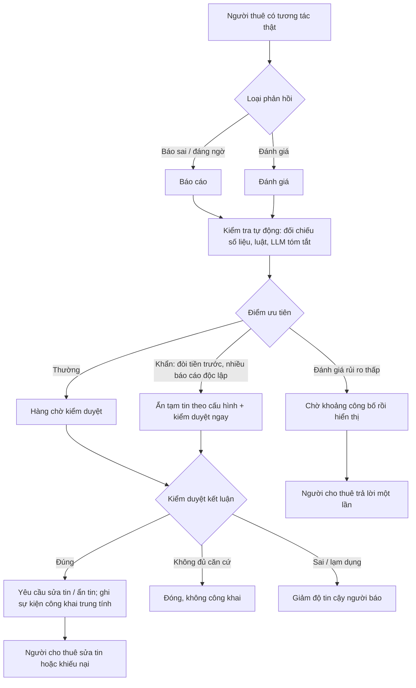

# Thiết kế: phản hồi của người thuê về căn nhà và người cho thuê

Trạng thái: **v1, đề xuất, chưa code.** Ngày: 09/10/2026.
Nền đối chiếu: nhánh `feat/housing-product-v1-finish` (từ `origin/QuangDung`), gồm [SPEC-021](../specs/SPEC-021-housing-product-v1.md),
[host-mode-design](host-mode-design.md), [viewing-landlord-confirmation](viewing-landlord-confirmation.md),
[housing-viewing-design](housing-viewing-design.md) và hộp thư nhắn tin giữa hai bên.

## 1. Mục tiêu

Người thuê cần một chỗ để:

- **Báo tin sai** (giá, ảnh, địa chỉ, phí ẩn, phòng đã cho thuê) và **báo hành vi đáng ngờ** (đòi chuyển cọc trước khi
  xem, dọa, quấy rối).
- **Đánh giá** căn nhà và người cho thuê sau khi đã xem hoặc đã thuê, kể cả khi hài lòng.

ReloHome cần dùng các phản hồi này để người thuê sau tin hơn và để kiểm duyệt xử lý người đăng sai, nhưng **không
được để phản hồi sai làm hại người cho thuê trung thực**. Phản hồi có thể sai vì nhầm, vì thông tin cũ, vì thù cá
nhân, vì đối thủ, hoặc vì người cho thuê tự nhờ người khen.

Ngoài phạm vi: bồi thường, giải quyết tranh chấp tiền cọc, xử phạt người cho thuê (tạm khóa vẫn chờ team chốt cùng
điều khoản, xem host-mode-design H9).

## 2. Các trường hợp cần xử lý

### 2.1. Theo ý định của người phản hồi

| # | Trường hợp | Ví dụ | Rủi ro nếu xử lý sai |
|---|---|---|---|
| C1 | Hài lòng thật | "Phòng đúng ảnh, chủ nhà nhiệt tình" | Thấp |
| C2 | Không hài lòng thật, có căn cứ | "Giá thực tế 4,5 triệu, tin ghi 3,5 triệu" | Bỏ qua thì người thuê sau bị lừa |
| C3 | Báo lừa đảo khẩn | "Chủ nhà đòi chuyển 2 triệu giữ chỗ trước khi cho xem" | Chậm xử lý thì có người mất tiền |
| C4 | Nhầm lẫn | Tưởng "Phí dịch vụ: Chưa rõ" nghĩa là miễn phí | Phạt oan người cho thuê |
| C5 | Thông tin đã cũ | Giá đã sửa sau khi người thuê xem | Phạt oan; tin hiện tại đã đúng |
| C6 | Chủ quan, không kiểm chứng được | "Khu này ồn", "chủ nhà khó tính" | Dễ thành bôi nhọ nếu trình bày như sự thật |
| C7 | Trả thù sau tranh chấp | Bị giữ cọc nên chấm 1 sao hàng loạt | Phạt oan, ảnh hưởng uy tín |
| C8 | Đối thủ hoặc tài khoản ảo chê | Nhiều tài khoản mới cùng chê một tin | Phạt oan |
| C9 | Người cho thuê tự khen hoặc nhờ người quen khen | Nhiều đánh giá 5 sao từ tài khoản chưa từng liên hệ | Người thuê sau bị lừa |
| C10 | Ngôn từ xúc phạm, lộ thông tin cá nhân | Ghi số điện thoại, tên đầy đủ, chửi bới | Vi phạm dữ liệu cá nhân, bôi nhọ |
| C11 | Phản hồi về người khác, không phải căn này | Than phiền về hàng xóm, dịch vụ chuyển đồ | Sai đối tượng |

### 2.2. Theo thời điểm

| Thời điểm | Người thuê biết được gì | Loại phản hồi phù hợp |
|---|---|---|
| Trước khi xem (mới nhắn tin) | Cách chủ nhà trả lời, yêu cầu tiền trước | Báo hành vi (C3), không đánh giá căn |
| Sau buổi xem (đã ghi "Đã gặp") | Ảnh, vị trí, giá chủ nhà báo trực tiếp | Báo tin sai (C2), đánh giá "đã xem" |
| Sau khi chốt và dọn vào | Phí thực tế, điện nước, độ yên tĩnh | Đánh giá "đã thuê", sau một khoảng thời gian ở |
| Sau khi chuyển đi | Trả cọc, sửa chữa | Đánh giá "đã thuê" (cọc là tranh chấp, không tự xử) |

## 3. Nguyên tắc

| # | Nguyên tắc |
|---|---|
| F1 | **Chỉ người có tương tác thật mới phản hồi**: có yêu cầu liên hệ, hoặc lịch xem được chủ nhà xác nhận và đã ghi "Đã gặp", hoặc đã chốt căn. Mỗi tương tác một phản hồi (sửa được trong thời hạn cấu hình) |
| F2 | **Tách "báo cáo" và "đánh giá"**. Báo cáo đi tới kiểm duyệt, không công khai. Đánh giá công khai sau khi lọc |
| F3 | **Tách sự thật kiểm được và cảm nhận**. Giá, cọc, phí, ảnh, địa chỉ, tình trạng trống là sự thật đối chiếu được với dữ liệu; "ồn", "khó tính" là cảm nhận, hiển thị như cảm nhận |
| F4 | **Không tự phạt dựa trên một phản hồi**. Máy (luật, ML, LLM) chỉ xếp ưu tiên và gợi ý; quyết định ảnh hưởng tới người cho thuê do kiểm duyệt |
| F5 | **Người cho thuê được trả lời** công khai một lần cho mỗi đánh giá và **khiếu nại** báo cáo |
| F6 | **Không hiển thị điểm khi chưa đủ dữ liệu**. Hiện "Chưa đủ đánh giá" thay vì 5,0 từ một người (giống nguyên tắc số liệu thật của SPEC-021) |
| F7 | **Không gán cứng ngưỡng**: số đánh giá tối thiểu, thời hạn sửa, ngưỡng ẩn tin… là cấu hình |

## 4. Trải nghiệm

### 4.1. Người thuê

- Ở **Tài khoản → Liên hệ chủ nhà**, tab **Xem nhà** và trang chi tiết tin: nút **"Phản hồi về căn này"** hiện khi
  đủ điều kiện F1.
- Form có hai đường:
  1. **Báo sai hoặc báo đáng ngờ**: chọn loại (giá, cọc, phí, ảnh, địa chỉ, đã cho thuê, đòi tiền trước, khác), mỗi
     loại có ô **số liệu đúng** (ví dụ giá thực tế), mô tả ngắn, ảnh đính kèm tùy chọn.
  2. **Đánh giá**: 1–5 sao cho bốn tiêu chí (đúng mô tả, minh bạch chi phí, phản hồi của chủ nhà, tình trạng nhà) và
     nhận xét. Đánh giá "đã thuê" mở sau khi chốt và qua số ngày cấu hình.
- Báo "đòi chuyển tiền trước khi xem" hiện ngay cảnh báo an toàn cho người báo và vào hàng ưu tiên cao.

### 4.2. Người cho thuê

- Tab mới **"Phản hồi"** trong `/landlord`: đánh giá công khai (trả lời một lần), báo cáo đã được kiểm duyệt kết
  luận (kèm số liệu cần sửa), nút **"Sửa tin"** hoặc **"Khiếu nại"**.
- Không thấy danh tính người báo cáo; chỉ thấy nội dung đã được xem xét.

### 4.3. Kiểm duyệt

- Tab **"Duyệt tin"** thêm mục **"Phản hồi cần xem"**, xếp theo điểm ưu tiên (mục 6), có tóm tắt và bằng chứng
  máy đối chiếu được.
- Kết luận: **Đúng** (yêu cầu sửa tin hoặc ẩn tin), **Không đủ căn cứ**, **Sai hoặc lạm dụng** (ghi nhận vào độ tin
  cậy của người báo), **Chuyển xử lý khác** (ví dụ báo lừa đảo cho cơ quan chức năng theo quy trình của team).

### 4.4. Người thuê khác

- Trên tin: điểm theo tiêu chí, số đánh giá đã xác minh ("12 người đã xem, 3 người đã thuê"), nhãn
  **"Đã xem nhà"/"Đã thuê"** trên từng đánh giá, câu trả lời của chủ nhà.
- Báo cáo đúng đã kết luận hiện dạng sự kiện trung tính: "Giá trên tin đã được sửa ngày 12/10 sau phản hồi của người
  thuê", không hiện lời buộc tội.
- Agent dùng các tín hiệu đã xác minh khi giới thiệu nhà (mục 7.3).

## 5. Luồng

## 6. Xử lý phản hồi có thể không chính xác

Kết hợp nhiều lớp, từ rẻ và chắc chắn tới tốn kém. Lớp sau chỉ thêm tín hiệu cho kiểm duyệt, không thay quyết định.

### 6.1. Điều kiện tham gia (chặn từ gốc C8, C9, C11)

- F1: gắn mỗi phản hồi với một `contact_request` hoặc giao dịch xem nhà và chốt căn có thật. Tài khoản chưa từng liên
  hệ không phản hồi được.
- Người cho thuê không phản hồi tin của chính mình (đã có quy tắc không tự duyệt).
- Giới hạn tần suất theo tài khoản và theo tin (cấu hình).

### 6.2. Đối chiếu sự thật bằng luật (xử lý C2, C4, C5; 0 LLM)

| Loại báo cáo | Dữ liệu đối chiếu đã có | Cách xử lý |
|---|---|---|
| Giá, cọc sai | Lịch sử `housing.offers` (giá theo thời gian), số tiền người thuê khai khi chốt (`agreement` trong tab Xem nhà) | Nếu giá trên tin tại thời điểm xem khác số người thuê báo quá ngưỡng cấu hình thì "có căn cứ"; nếu tin đã sửa sau đó thì đánh dấu C5 |
| Phí ẩn | `listing_fees` theo thời gian; phí "Chưa rõ" (amount null) | Báo cáo về một khoản đang "Chưa rõ" là C4 (nhầm) hoặc yêu cầu chủ nhà điền, không phải tin sai |
| Đã cho thuê | `availability_status`, `availability_confirmed_at` | Xác nhận cũ hơn ngưỡng cấu hình thì nhắc chủ nhà xác nhận lại trước khi kết luận |
| Địa chỉ, vị trí | Tọa độ địa điểm, bản đồ | Kiểm duyệt so trên bản đồ; nhiều báo cáo cùng nội dung tăng ưu tiên |
| Đòi tiền trước | Tin nhắn trong app (nếu người báo đồng ý cho kiểm duyệt xem đoạn liên quan) | Ưu tiên khẩn; ẩn tạm tin theo cấu hình |

### 6.3. Độ tin cậy của người phản hồi (xử lý C7, C8, C9)

Điểm tin cậy tính bằng luật minh bạch, cập nhật sau mỗi kết luận kiểm duyệt:

- Tuổi tài khoản, số tương tác thật (đã xem có xác nhận, đã chốt).
- Lịch sử báo cáo: tỉ lệ được kết luận đúng so với sai hoặc lạm dụng.
- Độ lệch so với các đánh giá độc lập khác của cùng tin (một người chấm 1 sao trong khi 10 người đã thuê chấm 4–5).

Điểm tin cậy dùng để **xếp ưu tiên** và **trọng số** khi gộp điểm, không để ẩn ý kiến của ai.

### 6.4. Gộp điểm ổn định

- Điểm hiển thị dùng **trung bình Bayes**: kéo về mức trung bình chung khi ít đánh giá, để một vài phản hồi cực đoan
  không làm lệch. Số đánh giá tối thiểu để hiện điểm là cấu hình (F6).
- Trọng số theo loại tương tác ("đã thuê" nặng hơn "đã xem") và độ tin cậy.
- Đánh giá "đã thuê" công bố sau một khoảng cấu hình, hoặc khi cả hai bên đã gửi (kiểu Airbnb), để giảm trả đũa.

### 6.5. LLM trong agent hiện có (hỗ trợ, không quyết định)

Dùng như một bước có cấu trúc, đầu vào là văn bản người dùng tự viết, đầu ra là JSON theo schema:

- **Tách nhận định**: chuyển "phòng không có máy lạnh như ảnh, giá thật 4tr5" thành các mục kiểm được
  (`amenity_missing: điều hòa`, `price_actual: 4500000`) để lớp luật 6.2 đối chiếu.
- **Phân loại**: sự thật hay cảm nhận (F3), đúng đối tượng hay không (C11), mức khẩn (C3).
- **Phát hiện** ngôn từ xúc phạm và thông tin cá nhân (C10); đề xuất bản đã che để người viết tự sửa trước khi gửi.
- **Tóm tắt** cho kiểm duyệt khi một tin có nhiều phản hồi.

Giới hạn: LLM không tính điểm, không đối chiếu số liệu (đã có luật), không quyết định ẩn tin; mọi đầu ra đều qua
schema và có thể bỏ qua khi LLM lỗi (phản hồi vẫn vào hàng chờ). Không đưa tin nhắn riêng vào LLM nếu người báo
chưa đồng ý.

Agent trong chat: người thuê nói "căn này giá thật cao hơn tin" thì Intake mở **form phản hồi đã điền sẵn**, người
thuê xác nhận rồi mới gửi (giống cách chọn căn đi qua thao tác có kiểu, không tự gửi).

### 6.6. ML/DL khi có đủ dữ liệu (giai đoạn sau)

| Bài toán | Mô hình đề xuất | Dữ liệu cần | Khi nào |
|---|---|---|---|
| Ưu tiên báo cáo (khả năng được kết luận đúng) | Gradient boosting (LightGBM/XGBoost) trên đặc trưng có cấu trúc: độ tin cậy người báo, kết quả đối chiếu 6.2, số báo cáo độc lập, tuổi tin, lịch sử người cho thuê | Vài trăm kết luận kiểm duyệt có nhãn | Sau pilot; thay thế công thức ưu tiên bằng luật nếu chính xác hơn trên tập kiểm |
| Phát hiện nhóm tài khoản bất thường (C8, C9) | Phát hiện bất thường (Isolation Forest) trên thời gian, tần suất, tương tác; luật đồ thị đơn giản (nhiều tài khoản mới cùng nhắm một tin trong thời gian ngắn) | Log tương tác thật | Khi lượng tin tự đăng đủ lớn |
| Phân loại văn bản tiếng Việt (độc hại, lừa đảo, loại vấn đề) | Tinh chỉnh PhoBERT hoặc mô hình nhỏ tương đương; dùng nhãn do LLM gợi ý và kiểm duyệt xác nhận làm dữ liệu huấn luyện | Vài nghìn câu có nhãn | Khi chi phí LLM theo lượt trở thành vấn đề hoặc cần chạy nội bộ |

Mọi mô hình chỉ thêm tín hiệu cho kiểm duyệt (F4); có bộ kiểm tra độ lệch giữa nhóm người dùng trước khi dùng.
Không huấn luyện trên dữ liệu giả.

## 7. Tác động tới phần đã có

### 7.1. Người cho thuê

- Báo cáo kết luận đúng: yêu cầu sửa tin (tin chuyển `hidden` nếu vượt ngưỡng cấu hình chưa sửa). Không tạm khóa
  tài khoản (chờ team chốt cùng điều khoản).
- Chỉ số trong Tổng quan: số đánh giá, điểm theo tiêu chí, báo cáo đang mở; không có số liệu khi chưa đủ dữ liệu.

### 7.2. Người thuê

- Chi tiết tin hiện điểm theo tiêu chí và sự kiện đã sửa sau phản hồi. Bảng chi phí giữ nguyên quy tắc "Chưa rõ"
  (không lấy số người thuê báo thay số của chủ nhà; chỉ hiện "Người thuê báo giá thực tế cao hơn tin" khi báo cáo
  đã kết luận đúng).

### 7.3. Agent

- Khi giới thiệu nhà, agent đọc các trường đã tổng hợp (điểm Bayes, số đánh giá đã xác minh, sự kiện đã sửa), không
  đọc văn bản đánh giá thô, để không lặp lại cáo buộc chưa kiểm chứng.
- Tin có báo cáo khẩn đang mở không được agent đề xuất cho tới khi kiểm duyệt xử lý (cấu hình).

## 8. Dữ liệu (đề xuất)

Migration mới, chỉ thêm bảng trong schema `housing`:

| Bảng | Nội dung chính |
|---|---|
| `housing.feedback` | `id`, `listing_id`, `author_user_id`, `contact_request_id` (bắt buộc, F1), `kind` (`report` / `review`), `stage` (`contacted` / `viewed` / `rented`), `category` (giá, cọc, phí, ảnh, địa chỉ, đã thuê, đòi tiền trước, hành vi, khác), `claimed` (jsonb: số liệu người thuê báo), `ratings` (jsonb theo tiêu chí), `body`, `status` (`pending`, `published`, `upheld`, `insufficient`, `rejected`, `withdrawn`), `priority`, `checks` (jsonb: kết quả đối chiếu 6.2 và LLM 6.5), `publish_after`, thời gian |
| `housing.feedback_media` | Ảnh bằng chứng, lưu như ảnh tin (kiểm MIME, kích thước, tên ngẫu nhiên), chỉ kiểm duyệt xem |
| `housing.feedback_responses` | Trả lời của người cho thuê (một lần cho đánh giá) và khiếu nại cho báo cáo |
| `housing.feedback_decisions` | Kết luận của kiểm duyệt, lý do, người quyết, thời điểm |
| `housing.reporter_trust` | Điểm tin cậy và đếm kết luận theo người dùng (tính lại được từ `feedback_decisions`) |

Contract đọc công khai thêm trường optional `feedback_summary` (điểm, số đánh giá theo `stage`, sự kiện đã sửa), mặc
định `null` để client cũ vẫn parse.

## 9. Cấu hình

`HOUSING_FEEDBACK_MIN_REVIEWS`, `HOUSING_FEEDBACK_EDIT_HOURS`, `HOUSING_FEEDBACK_RENTED_AFTER_DAYS`,
`HOUSING_FEEDBACK_PUBLISH_DELAY_HOURS`, `HOUSING_FEEDBACK_PRICE_TOLERANCE`, `HOUSING_FEEDBACK_URGENT_HIDE` (bật hoặc tắt
ẩn tạm khi có báo cáo khẩn), `HOUSING_FEEDBACK_UNFIXED_HIDE_DAYS`, giới hạn tần suất. Không gán cứng trong code.

## 10. Tương thích với thiết kế của QuangDung

| Nguyên tắc trong SPEC-021 / housing-product-v1 | Thiết kế này |
|---|---|
| Chỉ thêm; không đổi endpoint, field cũ | Bảng mới, endpoint mới, trường optional `feedback_summary` |
| Persistence trong schema `housing`, không thêm database | Có |
| Moderator lấy từ cấu hình, khác người cho thuê | Dùng lại `HOUSING_MODERATOR_IDS` và tab Duyệt tin; không tự duyệt phản hồi về tin mình quản lý |
| Số liệu chỉ từ dữ liệu thật, có empty state | F6, không backfill, không dựng đánh giá mẫu |
| Không dùng LLM cho tính toán và filter | Điểm, đối chiếu, ngưỡng đều là luật; LLM chỉ tách nhận định và tóm tắt |
| Liên hệ qua hộp thư trong app | Bằng chứng lừa đảo lấy từ tin nhắn trong app khi người báo đồng ý |
| Tin crawl không có chủ quản lý | Không nhận phản hồi kiểu đánh giá chủ nhà; chỉ cho "báo tin không còn đúng" để ẩn khỏi gợi ý (cân nhắc ở giai đoạn sau) |

## 11. Giai đoạn

1. **Báo cáo có cấu trúc + đối chiếu luật + hàng chờ kiểm duyệt** (không công khai). Đủ để xử lý C2–C5, C10 và báo
   lừa đảo khẩn.
2. **Đánh giá công khai** với điều kiện F1, trung bình Bayes, trả lời của chủ nhà, khoảng công bố.
3. **LLM tách nhận định và tóm tắt** trong agent; form phản hồi mở từ chat.
4. **Mô hình ưu tiên và phát hiện bất thường** khi có đủ kết luận kiểm duyệt có nhãn.

## 12. Tiêu chí nghiệm thu (gợi ý cho spec)

- **FB-01:** Tài khoản không có tương tác thật với tin không gửi được phản hồi; người cho thuê không phản hồi tin của
  mình.
- **FB-02:** Báo cáo giá sai được đối chiếu với lịch sử giá tại thời điểm xem; tin đã sửa sau đó được đánh dấu "thông
  tin cũ".
- **FB-03:** Báo cáo về khoản "Chưa rõ" không bị coi là tin sai.
- **FB-04:** Báo cáo khẩn được xếp đầu hàng chờ; ẩn tạm tin chỉ khi bật cấu hình.
- **FB-05:** Điểm không hiển thị khi dưới số đánh giá tối thiểu; một đánh giá cực đoan không đổi điểm quá mức đã định.
- **FB-06:** Người cho thuê trả lời một lần, khiếu nại được; không thấy danh tính người báo.
- **FB-07:** LLM lỗi hoặc tắt thì phản hồi vẫn vào hàng chờ; không có quyết định nào chỉ dựa trên LLM hoặc mô hình.
- **FB-08:** Nội dung có số điện thoại hoặc ngôn từ xúc phạm được nhắc sửa trước khi gửi và không hiển thị công khai.

## 13. Cần team chốt

1. Có công khai đánh giá ở giai đoạn đầu không, hay chỉ làm báo cáo cho kiểm duyệt (đề xuất: chỉ báo cáo trước).
2. Báo cáo lừa đảo khẩn có ẩn tạm tin tự động không (dính trách nhiệm pháp lý, giống chuyện tạm khóa).
3. Người báo có đồng ý cho kiểm duyệt đọc đoạn tin nhắn liên quan không (cần câu xin đồng ý riêng).
4. Có nhận phản hồi cho tin crawl không.
