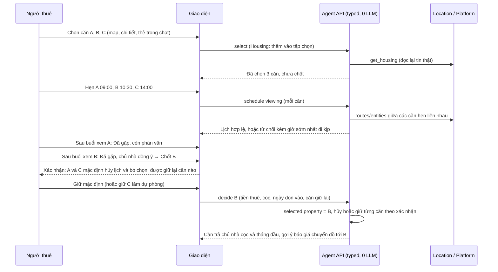
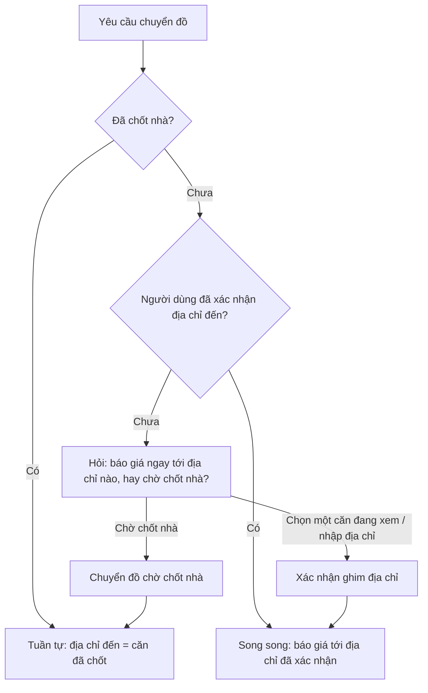
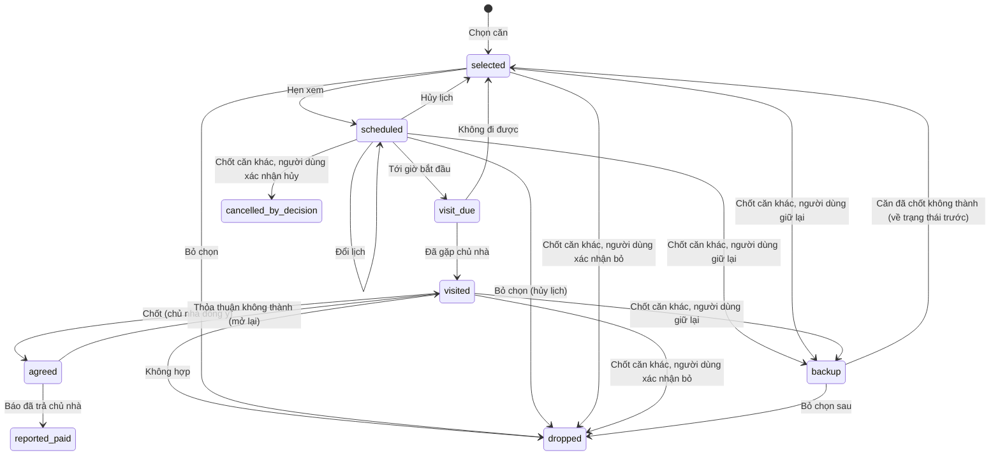

# Thiết kế: chọn nhiều căn, hẹn xem và chốt căn

Trạng thái: **v4, triển khai trên nhánh `feat/housing-viewing`, PR #83 vào `khoa`.** Ngày: 09/10/2026.
Kiểm tra và sửa tính nhất quán theo [issue #84](https://github.com/AI20K-Build-Phase-Cohort-4/P-044/issues/84).
Nền đối chiếu: nhánh `khoa` tại `66e0c20` (PR #80 `khoa → main`), gồm checkout của
[payment-design](payment-design.md) và so sánh nhà của Khoa
([SPEC-019](../specs/SPEC-019-housing-comparison-isolation.md)).

Lịch sử: v2 bỏ "danh sách xem nhà" riêng, dùng chính nút "Chọn căn" để chọn nhiều căn.
v3 chốt các mặc định, đổi cách chuyển đồ chọn địa chỉ đến (song song hoặc tuần tự theo việc
đã chốt nhà hay chưa), thêm cách agent xử lý yêu cầu gộp "tìm nhà và chuyển đồ", và không
chạm phần so sánh của Khoa. v4 chốt các câu hỏi còn lại: khi chốt, hủy lịch các căn khác
là mặc định nhưng phải hỏi xác nhận và người dùng được giữ lại căn nào tùy ý.

Cập nhật 09/10/2026: với tin do chủ nhà quản lý trên ReloHome, giờ hẹn được gửi vào hộp thư chủ nhà để xác nhận
([viewing-landlord-confirmation](viewing-landlord-confirmation.md)); tin từ nguồn khác vẫn là lịch thử.

### Ghi chú khi code (09/10/2026)

- **Nguồn sự thật** của lịch, kết quả buổi xem và thỏa thuận là giao dịch `housing:{listing_id}` trong kho
  checkout (`src/checkout/viewing.py`). Checkpoint chỉ giữ `housing_selection` (ID, nhãn, task) để agent biết
  căn đang xem và `moving_destination_mode`. Thao tác hẹn, ghi kết quả, báo đã trả không ghi checkpoint (nhanh hơn).
- **Chốt rồi chuyển đồ (6.6, chờ chốt):** không tự chạy một lượt agent sau khi chốt (tốn thời gian, dễ bất ngờ).
  Giao diện hiện gợi ý một chạm mở form chuyển đồ đã điền căn vừa chốt; báo giá qua đường form có kiểu (0 LLM).
- Câu hỏi chờ chốt / địa chỉ cụ thể thay luôn câu hỏi "chuyển đồ tới địa chỉ nào" để không hỏi trùng.
- Chọn căn qua chat đi qua `housing_selector` trong Intake: căn vào tập chọn, không thành căn của kế hoạch.
- Bản đồ không đóng sau mỗi lần chọn: chọn nhiều căn (bấm lại để bỏ), khay "Đã chọn N/max · Xong, hẹn lịch xem"
  mới đóng bản đồ và mở tab Xem nhà. Mở lại bản đồ hoặc thêm/bỏ/đổi căn sau đó làm qua chat.
- Intake hiểu thêm `housing_select_ids` (thêm nhiều căn) và `housing_unselect_ids` (bỏ căn, chỉ ID trong
  `housing_selection`); "đổi A thành B" = bỏ A rồi thêm B. Lượt chỉ đổi căn đang xem trả lời ngay từ Intake,
  không lập kế hoạch hay tìm lại (đo thật ~2–3 giây thay vì ~10–15 giây).
- Cấu hình nằm trong `ServiceSettings` (mục 8); local bật mặc định qua launcher, staging bật trong
  `compose.coolify.yaml`.

## 1. Bối cảnh và mục tiêu

Người thuê thường đi xem vài căn rồi mới quyết. ReloHome hiện có:

- **So sánh 2–4 căn** (Khoa): giúp chọn nhà dễ hơn, chỉ đọc. Thiết kế này **không sửa** phần so sánh.
- **Chọn căn** (`selected:property`): đúng một căn; chuyển đồ, đường đi và chi phí tháng dựa vào căn này. Khi yêu cầu chuyển đồ cần căn đã chọn mà chưa có, Intake ghi thiếu `relocation.selected:property`, chuyển đồ chờ (test `test_relocation_waits_for_room_choice_s4`).
- **Bước nhà trong checkout** (payment-design §10): lịch xem chế độ thử, thỏa thuận với cọc tự nhập, báo đã trả chủ nhà. Mỗi căn là một giao dịch `housing:{listing_id}`.

Mục tiêu: trong **một hội thoại**, người dùng chọn vài căn để hẹn gặp chủ nhà, xem từng căn,
rồi chốt một căn; chuyển đồ chạy được cả khi chưa chốt (song song) lẫn sau khi chốt (tuần
tự). Không gọi LLM cho thao tác, không gán cứng số liệu hay từ khóa, tương thích PR #80.

## 2. Ba bước, ba ý nghĩa

| Bước | Người dùng làm | Ý nghĩa | Có tiền? |
|---|---|---|---|
| **Chọn** (1..N căn) | Bấm "Chọn căn" như hiện tại, giờ chọn được nhiều căn | Muốn gặp chủ nhà xem căn này | Không |
| **Hẹn xem** (mỗi căn đã chọn) | Chọn khung giờ | Lịch gặp chủ nhà (chế độ thử: chủ nhà chưa xác nhận) | Không |
| **Chốt** (đúng 1 căn) | Sau buổi gặp, báo đã thỏa thuận với chủ nhà | Căn này thành **căn của kế hoạch**; kích hoạt luồng tiền nhà của payment-design (cọc, tháng đầu, ngày dọn vào → cần trả chủ nhà → báo đã trả) | Ghi khoản cần trả, app **không thu** |

**Chốt chỉ được làm sau khi đã ghi nhận buổi xem:** căn phải có lịch hẹn đã tới giờ bắt đầu và người dùng ghi
"Đã gặp chủ nhà". Căn chưa hẹn, lịch chưa tới giờ, hoặc "Không đi được" đều không chốt được.

## 3. Quyết định

| # | Quyết định | Trạng thái |
|---|---|---|
| V1 | Tập căn đã chọn **gắn với hội thoại**, lưu trong checkpoint (`housing_selection`) | Đề xuất |
| V2 | Số căn chọn tối đa là cấu hình `HOUSING_MAX_SELECTED`, **mặc định 3** | Đã chốt |
| V3 | `selected:property` **chỉ được đặt khi chốt** (căn của kế hoạch). Chọn căn chỉ thêm vào `housing_selection`, không đặt `selected:property` | Đã chốt (thay V3 của v2) |
| V4 | **Chuyển đồ có hai chế độ** theo việc đã chốt nhà hay chưa: chưa chốt thì **song song**, địa chỉ đến phải được người dùng xác nhận; đã chốt thì **tuần tự**, địa chỉ đến là căn đã chốt | Đã chốt |
| V5 | Chốt đặt căn của kế hoạch. Với các căn còn lại, **mặc định hủy lịch và bỏ chọn**, nhưng phải **hỏi xác nhận**: màn chốt liệt kê từng căn, người dùng được giữ lại bất kỳ căn nào (căn dự phòng) | Đã chốt |
| V10 | Thỏa thuận không thành thì **gỡ căn của kế hoạch**; chuyển đồ tuần tự quay về "chờ chốt nhà" | Đã chốt |
| V11 | Câu hỏi về địa chỉ đến của chuyển đồ (khi chưa chốt) **mặc định "chờ chốt nhà"** | Đã chốt |
| V12 | Hội thoại cũ đã có căn được chọn trước tính năng này: coi là **đã chốt kiểu cũ** | Đã chốt |
| V6 | Lịch là **chế độ thử** (chủ nhà chưa xác nhận); app không liên hệ chủ nhà | Đề xuất |
| V7 | Mọi ngưỡng là **cấu hình**; mặc định **báo trước 120 phút**, **đệm 15 phút** giữa hai lịch | Đã chốt |
| V8 | Kết quả buổi xem là giá trị có kiểu; không có ô ghi chú tự do | Đề xuất |
| V9 | **Không chạm** phần so sánh của Khoa (`HousingComparison`, khay, `housingInteraction.ts`) | Đã chốt |

## 4. Luồng

### 4.1. Chọn, hẹn, chốt

### 4.2. Chuyển đồ song song và tuần tự

- **Tuần tự** dùng đúng cơ chế đang có: chuyển đồ phụ thuộc `selected:property`; thiếu thì Intake ghi `relocation.selected:property`, chuyển đồ chờ. Khác với hiện tại: giờ `selected:property` chỉ có sau khi chốt, nên "chờ chọn phòng" trở thành **"chờ chốt nhà"**.
- **Song song** dùng địa chỉ đến do người dùng xác nhận (`to_address` + ghim tọa độ đã xác nhận trong `moving_locations`, qua câu hỏi có `choices` như hiện tại). Các căn đang xem chỉ là **gợi ý** trong câu hỏi; chọn một căn ở đây là xác nhận địa chỉ cho chuyển đồ, **không phải chốt nhà**.

## 5. Trạng thái mỗi căn đã chọn

`agreed` và `reported_paid` là trạng thái **đã có** của giao dịch `housing:{listing_id}`.

`backup` là căn người dùng giữ lại khi chốt căn khác. Căn dự phòng vẫn giữ lịch hẹn (nếu
có) và vẫn ghi được kết quả buổi xem, nhưng **không chốt được** khi đang có căn `agreed`.
Muốn chuyển sang căn dự phòng thì báo "thỏa thuận không thành" ở căn đã chốt trước (6.5);
khi đó căn dự phòng về trạng thái trước lúc được giữ lại (`selected`, `scheduled` hoặc
`visited`) và chốt được như bình thường.

## 6. Quy tắc hợp lý

### 6.1. Chọn căn

1. Đọc lại tin bằng `get_housing` như luồng chọn căn từ map hiện tại. Không đọc được thì không chọn.
2. Không chọn trùng. Đủ `HOUSING_MAX_SELECTED` căn thì báo phải bỏ chọn một căn trước; căn `dropped` không tính.
3. Đã có căn `agreed` thì không chọn thêm; phải "mở lại" trước (6.5).
4. Giá là **giá tham khảo lúc X**; tin vị trí gần đúng hiện cảnh báo hỏi địa chỉ chính xác trước khi đi.
5. Chọn căn **không** làm cũ hay chạy lại chuyển đồ, đường đi, chi phí tháng (vì không đổi `selected:property`). Gợi ý bước tiếp sau khi chọn là "Hẹn xem", không phải "báo giá chuyển đồ tới căn này".

### 6.2. Hẹn xem

1. Chỉ hẹn cho căn trong tập chọn; mỗi căn một lịch sắp tới; đổi lịch giữ lịch sử.
2. Khung giờ sinh từ cấu hình (mục 8). Từ chối khung đã qua hoặc bắt đầu sớm hơn thời gian báo trước (mặc định 120 phút).
3. Hai lịch không được chồng giờ.
4. **Đi kịp:** với hai lịch liền nhau trong ngày, `bắt đầu sau ≥ bắt đầu trước + độ dài buổi xem + thời gian đi + đệm (mặc định 15 phút)`. Thời gian đi lấy từ Platform `routes/entities` (housing → housing) với profile cấu hình. Không tính được đường thì dùng khoảng tối thiểu cấu hình và ghi "chưa tính được thời gian đi". Không đủ thì **từ chối** kèm giờ sớm nhất hợp lệ.
5. **Nhắc (không chặn):** vượt số lịch/ngày cấu hình; lịch trước giờ hạ cánh của chuyến bay đã chọn; lịch sau ngày chuyển đồ đã báo giá; hai căn khác thành phố cùng ngày.
6. Tin đọc lại thấy không còn hoặc đổi giá thì đánh dấu trên lịch; tin không còn thì đề nghị hủy lịch.

### 6.3. Sau buổi xem

1. Tới giờ bắt đầu, căn chuyển `visit_due` và hiện nhắc ghi kết quả. Cờ `HOUSING_VIEWING_TEST_VISIT_ANYTIME` chỉ bỏ điều kiện thời gian trong môi trường không phải production; vẫn phải có lịch hẹn.
2. Kết quả có kiểu: **Đã gặp chủ nhà** (chủ nhà đồng ý / còn phân vân / không hợp) hoặc **Không đi được**. Không có ô ghi chú tự do.
3. "Không đi được" đưa căn về `selected` để hẹn lại; không tính là đã xem.

### 6.4. Chốt

1. **Điều kiện bắt buộc:** căn ở `visited`.
2. Form chốt dùng lại form thỏa thuận hiện có: tiền thuê/tháng, cọc thực tế (gợi ý `HOUSING_DEPOSIT_SUGGESTED_MONTHS` × tiền thuê), ngày dọn vào.
3. Đọc lại tin trước khi chốt. Tin không còn thì không chốt. Giá trên tin khác giá đã chọn thì hiện cả hai; số người dùng nhập là số đã thỏa thuận.
4. **Màn xác nhận chốt** liệt kê từng căn còn lại trong tập chọn (tên, lịch hẹn sắp tới nếu có, kết quả buổi xem nếu có). Mỗi căn có lựa chọn **"Hủy lịch và bỏ chọn"** (mặc định) hoặc **"Giữ lại làm dự phòng"**. Không giới hạn số căn được giữ (đã nằm trong `HOUSING_MAX_SELECTED`). Màn này cũng ghi ảnh hưởng tới chuyển đồ (6.6). Người dùng phải bấm xác nhận; đóng màn là không chốt.
5. Thực hiện theo thứ tự, ghi ý định trước (như checkout §7.4): ghi quyết định → đặt `selected:property` bằng logic chọn căn hiện có (kiểm `plan_version`, làm cũ bước phụ thuộc) → ghi thỏa thuận (`housing_agreement`) → với từng căn còn lại, làm đúng lựa chọn đã xác nhận (hủy lịch và bỏ chọn, hoặc chuyển sang `backup`). Danh sách căn giữ lại được ghi vào quyết định trước khi thực hiện, nên lần gọi lại không hỏi lại và không hủy nhầm. Gọi lại với cùng khóa chống trùng thì làm tiếp phần còn thiếu.
6. Mỗi hội thoại tối đa một căn `agreed`. Đã có đơn dịch vụ thật liên quan (quy tắc `committed` hiện có) thì chặn như hiện tại.
7. Sau khi chốt, các nhắc D8 đang có (ngày dọn vào trước ngày chuyển đồ, chuyến về trước ngày dọn vào) dùng căn đã chốt.

### 6.5. Thỏa thuận không thành

1. Căn `agreed` về `visited` (giao dịch về `not_agreed` như hiện có), khoản cần trả về 0, **gỡ `selected:property`** (V10). Chuyển đồ tuần tự quay lại "chờ chốt nhà"; báo giá chuyển đồ tuần tự cũ thành cũ. Các căn `backup` về trạng thái trước lúc được giữ lại.
2. Chuyển đồ song song (địa chỉ người dùng tự xác nhận) **không bị ảnh hưởng**.
3. Các căn đã bỏ không tự quay lại tập chọn; lịch đã hủy không tự khôi phục.
4. Đã "báo đã trả chủ nhà" thì không mở lại từ app; hiện hướng dẫn tự xử lý với chủ nhà.
5. Đã có **thanh toán chuyển đồ tuần tự** tới căn này (giao dịch `relocation` ở `approved`/`paid_processing` hoặc lần thanh toán đang mở) thì vẫn cho mở lại nhưng **cảnh báo rõ**: chuyển đồ đã trả tới địa chỉ căn này, app không tự hủy hay hoàn tiền.

### 6.6. Chuyển đồ khi chốt nhà

| Chuyển đồ trước khi chốt | Xử lý khi chốt căn B |
|---|---|
| Chưa có | Gợi ý một chạm "Báo giá chuyển đồ tới căn B" |
| Đang "chờ chốt nhà" (tuần tự) | Tự chạy báo giá tới B (task đang chờ đủ điều kiện, như cơ chế hiện có) |
| Song song, địa chỉ đến **trùng** B (đã chọn B làm gợi ý, hoặc cùng ghim) | Giữ báo giá; ghi là tới căn đã chốt |
| Song song, địa chỉ đến **khác** B, chưa thanh toán | Hiện lựa chọn: "Đổi chuyển đồ sang căn B" (báo giá lại) hoặc "Giữ địa chỉ cũ" |
| Song song, địa chỉ đến khác B, **đã thanh toán trong app** | Không tự đổi. Màn chốt bắt xác nhận "Chuyển đồ đã trả tới X sẽ giữ nguyên"; nhắc xử lý với bên chuyển đồ; không tự hủy hay hoàn tiền |

So sánh "trùng" dựa trên ID tin hoặc tọa độ đã xác nhận trong khoảng cách cấu hình
(`HOUSING_SAME_PLACE_METERS`), không so chuỗi địa chỉ.

## 7. Agent với yêu cầu gộp "tìm nhà và chuyển đồ luôn"

Ví dụ: "Giúp tôi tìm nhà ở quận 7 và chuyển đồ luôn". Intake (LLM, không từ khóa) nhận hai
domain như hiện tại. Khác biệt nằm ở cách agent xử lý phần chuyển đồ khi chưa chốt nhà:

1. **Tìm nhà chạy ngay.** Chuyển đồ cần địa chỉ đến mà chưa có căn chốt, nên Intake ghi thiếu `relocation.selected:property` như hiện tại (không đổi code phần này).
2. **Câu hỏi thay vì im lặng chờ.** Respond tạo một câu hỏi có lựa chọn:
   - "Chờ tôi xem nhà và chốt căn rồi báo giá" (tuần tự, mặc định);
   - "Báo giá ngay tới một địa chỉ" (song song): nhập địa chỉ hoặc chọn một căn đang xem làm gợi ý, rồi xác nhận ghim.
   Các thông tin chuyển đồ khác (điểm đi, ngày giờ, gói xe) hỏi như hiện tại qua form chuyển đồ, không phụ thuộc lựa chọn này.
3. **Kế hoạch hiển thị đúng trạng thái:** bước Chuyển đồ "Chờ chốt nhà" (tuần tự) hoặc "Báo giá tới địa chỉ bạn xác nhận" (song song).
4. **Người dùng nói sau đó** ("báo giá chuyển đồ tới căn đã chọn") khi có nhiều căn đang xem mà chưa chốt: Intake hiểu đây là yêu cầu song song chưa rõ địa chỉ, agent hỏi lại "chuyển tới căn nào?" với các căn đang xem làm lựa chọn (kèm "chờ chốt nhà"). Không tự lấy căn đầu hay căn gần nhất.
5. **Chỉ có một căn đang xem**: vẫn hỏi xác nhận (song song) hoặc chờ chốt, vì chọn chưa phải chốt; câu hỏi điền sẵn căn đó làm gợi ý đầu.
6. **Thay đổi ý định** ("thôi đợi chốt nhà rồi tính") được Intake hiểu bằng LLM: bỏ địa chỉ song song chưa thanh toán, chuyển đồ về "chờ chốt nhà".
7. **Ngày tháng:** ngày chuyển đồ trước ngày dọn vào của căn đã chốt, hoặc trước lịch xem cuối cùng khi chọn chờ chốt, thì nhắc (D8), không chặn.

Agent không tự hẹn xem, không tự chốt, không tự chọn căn cho chuyển đồ. Hẹn, ghi kết quả,
chốt là thao tác UI có kiểu; agent trả lời kèm nút mở đúng chỗ.

## 8. Dữ liệu và cấu hình

**Dữ liệu**

- `housing_selection` trong checkpoint, cạnh `goal_selections`: danh sách `{listing_id, task_id, status, selected_at}` theo thứ tự chọn. Cập nhật qua `graph.aupdate_state(..., as_node="respond")` như các thao tác UI hiện có.
- Lịch và kết quả buổi xem nằm trong giao dịch `housing:{listing_id}` đã có (`details.viewing`, thêm `details.viewing_history`, `details.visit_outcome`).
- Chống trùng chốt: bảng nhỏ `checkout_decisions(decision_key UNIQUE, thread_id, listing_id, step, data)` trong runtime SQLite.
- `thread_view` giữ công thức tổng; chỉ thêm tập chọn và lịch để UI đọc. Chi phí tháng chỉ tính căn đã chốt.
- Không lưu: tên hay số điện thoại chủ nhà, ghi chú tự do, vị trí GPS người dùng.

**Cấu hình** (đưa vào `ServiceSettings`, thay giá trị đang nằm trong `CheckoutSettings`)

| Biến | Mặc định | Dùng cho |
|---|---|---|
| `HOUSING_MAX_SELECTED` | 3 | Số căn chọn tối đa |
| `HOUSING_VIEWING_SLOT_MINUTES` | 30 | Độ dài buổi xem |
| `HOUSING_VIEWING_DAY_START`, `HOUSING_VIEWING_DAY_END` | 08:00, 22:00 | Giờ bắt đầu sớm nhất và muộn nhất trong ngày, bao gồm 22:00 |
| `HOUSING_VIEWING_WINDOW_DAYS` | 14 | Số ngày mở lịch |
| `HOUSING_VIEWING_LEAD_MINUTES` | 60 | Thời gian báo trước tối thiểu; làm tròn lên theo bước lịch |
| `HOUSING_VIEWING_TRAVEL_BUFFER_MINUTES` | 15 | Đệm giữa hai lịch |
| `HOUSING_VIEWING_MIN_GAP_MINUTES` | 60 | Khoảng tối thiểu khi không tính được đường |
| `HOUSING_VIEWING_DAILY_SOFT_LIMIT` | 4 | Ngưỡng nhắc số lịch/ngày |
| `HOUSING_VIEWING_ROUTE_PROFILE` | `motorcycle` | Profile OSRM tính thời gian đi |
| `HOUSING_SAME_PLACE_METERS` | 50 | Coi địa chỉ chuyển đồ trùng căn đã chốt |
| `HOUSING_DEPOSIT_SUGGESTED_MONTHS` | 1 | Gợi ý cọc trong form chốt |
| `APP_TIMEZONE` | `Asia/Ho_Chi_Minh` | Khung giờ và hiển thị |

Không có danh sách từ khóa, tên thành phố hay tên địa điểm trong code. Kết quả buổi xem và
lựa chọn chuyển đồ (chờ chốt / song song) là enum trong schema; nhãn nằm trong file ngôn ngữ.

## 9. API (typed, 0 LLM)

| Phương thức | Đường dẫn | Ghi chú |
|---|---|---|
| POST | `/ui/chat/{thread_id}/action` `kind=select` | **Đã có.** Housing: thêm vào `housing_selection`, không đặt `selected:property`. Flight, Moving không đổi |
| GET | `/ui/chat/{thread_id}/viewings` | Tập căn chọn, lịch và trạng thái; kiểm chủ sở hữu hội thoại |
| POST | `/ui/chat/{thread_id}/viewings/unselect` | `{listing_id}`; hủy lịch nếu có; không bỏ chọn căn đã chốt bằng đường này |
| POST | `/ui/chat/{thread_id}/viewings/schedule` | `{listing_id, slot}`; kiểm 6.2 |
| POST | `/ui/chat/{thread_id}/viewings/cancel` | `{listing_id}` |
| POST | `/ui/chat/{thread_id}/viewings/visit` | `{listing_id, outcome}`; không sửa kết quả căn đã chốt/đã báo trả tiền |
| POST | `/ui/chat/{thread_id}/viewings/decide` | `{listing_id, rent_vnd, deposit_vnd, move_in?, keep_listing_ids, decision_key, acknowledge_paid_moving?}`; yêu cầu `visited`. Giữ khóa hội thoại xuyên suốt, dùng task/version hiện hành từ backend; kiểm lại tập chọn và ghi thỏa thuận/căn dự phòng cùng một transaction SQLite. Cùng khóa chỉ chấp nhận cùng nội dung; quyết định đã mở lại không được replay |
| POST | `/ui/chat/{thread_id}/viewings/reopen` | Thỏa thuận không thành (6.5); không mở lại căn đã báo trả tiền |
| POST | `/ui/chat/{thread_id}/viewings/paid` | `{amount_vnd, paid_on}`; tự báo đã trả trực tiếp, không gọi cổng thanh toán |
| POST | `/ui/chat/{thread_id}/viewings/moving-mode` | `{mode: wait_for_home \| null}`; lựa chọn chuyển đồ tuần tự hoặc độc lập |

Gateway thêm proxy tương ứng trong `Frontend/server.py` (dùng `checkout_call` để giữ mã lỗi).
Mọi endpoint kiểm quyền sở hữu, khóa theo hội thoại, kiểm `plan_version`. Bật bằng cờ
`HOUSING_VIEWING_ENABLED`, độc lập với `APP_PAYMENT_DEMO_ENABLED`.

## 10. Giao diện

1. Nút "Chọn căn" trên map, chi tiết căn và thẻ trong chat giữ chỗ cũ; nhãn đổi theo trạng thái: "Chọn để hẹn xem", "Đã chọn · Hẹn xem", "Bỏ chọn". Đủ giới hạn thì nút báo cần bỏ bớt.
2. Bước Nhà trên dải kế hoạch: "Đã chọn 3 căn · 2 lịch hẹn" → "Đã chốt căn B".
3. Bước Chuyển đồ: "Chờ chốt nhà" hoặc "Tới địa chỉ bạn xác nhận" hoặc "Tới căn đã chốt".
4. Tab Thanh toán trong Kế hoạch (đã có), phần Nhà thành danh sách căn đã chọn: lịch, nhắc ghi kết quả, nút Chốt (chỉ bật khi `visited`), rồi phần tiền nhà như hiện tại.
5. Form chuyển đồ thêm lựa chọn địa chỉ đến: "Chờ chốt nhà" hoặc "Địa chỉ cụ thể" (gợi ý các căn đang xem).
6. Không sửa khay và bảng so sánh của Khoa.
7. Chữ qua `uiText` và `en.json`; dùng tên ReloHome.

## 11. Tương thích với PR #80

| Phần trên `khoa` | Thay đổi | Cách giữ tương thích |
|---|---|---|
| `result_action` (select) | Housing: thêm vào tập chọn, không đặt `selected:property` | Flight, Moving không đổi. Đặt `selected:property` chuyển sang thao tác chốt, dùng lại phần code chọn căn (tách thành hàm dùng chung, không viết lại) |
| `selections.py`, `remembered_home`, `record_selections`, `goal_selections` | Không sửa | Vẫn làm việc trên `selected:property`, nay có ý nghĩa "căn đã chốt" |
| Intake `missing_for` (`relocation.selected:property`) | Không sửa | Trở thành "chờ chốt nhà" một cách tự nhiên |
| Respond, suggestions | Thêm câu hỏi chế độ chuyển đồ (mục 7) và gợi ý "Hẹn xem" sau khi chọn | Chỉ thêm câu hỏi/gợi ý; không đổi luồng hiện có khi đã chốt |
| Planner, map `selected_listing_id` | Không sửa | Chỉ đọc `selected:property`. Map "đường tới căn đã chọn" khi chưa chốt hỏi căn nào như mục 7.4 (map chỉ đọc, không cần xác nhận ghim) |
| Checkout: `viewing_slots`, `_housing_tx`, `housing_viewing`, `housing_agreement`, `housing_paid`, `thread_view`, `reminders` | Bỏ điều kiện "chỉ căn đã chọn duy nhất"; thêm `visited`; tham số từ cấu hình | Giữ trạng thái và công thức tổng |
| So sánh của Khoa | Không chạm | — |
| Cấu hình staging | Thêm `HOUSING_VIEWING_ENABLED` và các biến mục 8 | Thêm vào `compose.coolify.yaml` và test cấu hình |
| Hội thoại cũ đã có `selected:property` từ trước tính năng | Không tự đổi | Coi căn đó là đã chốt kiểu cũ (giữ chuyển đồ đang có); UI ghi "đã chọn trước đây, chưa có lịch xem"; người dùng có thể mở lại để dùng luồng mới |

## 12. Kiểm thử dự kiến

| Nhóm | Ca | Kết quả bắt buộc |
|---|---|---|
| Chọn | Chọn đến 3 căn; chọn thêm; chọn trùng; tin không đọc được | Báo đúng lý do; `selected:property` không đổi; chuyển đồ không chạy lại |
| Gộp yêu cầu | "Tìm nhà và chuyển đồ luôn" | Tìm nhà chạy; chuyển đồ hỏi "chờ chốt hay địa chỉ cụ thể"; không tự báo giá |
| Tuần tự | Chọn "chờ chốt", chốt B | Báo giá chuyển đồ tới B tự chạy |
| Song song | Chọn căn A làm gợi ý, xác nhận ghim, báo giá; rồi chốt A, hoặc chốt B | Báo giá tới A; chốt A giữ báo giá; chốt B đưa lựa chọn đổi hoặc giữ |
| Song song đã trả | Chuyển đồ đã thanh toán tới A, chốt B | Bắt xác nhận giữ nguyên; không tự đổi hay hoàn tiền |
| Nhiều căn, chưa chốt | "Báo giá chuyển đồ tới căn đã chọn" | Hỏi căn nào; không tự lấy căn đầu |
| Lịch | Chồng giờ; không đi kịp theo OSRM; không tính được đường; dưới 120 phút báo trước | Từ chối kèm giờ sớm nhất hợp lệ; đổi cấu hình thì kết quả đổi theo |
| Chốt | Chốt khi chưa có buổi xem đã qua; sau "Không đi được" | Bị từ chối |
| Xác nhận khi chốt | Chốt B khi A đã xem, C có lịch; giữ mặc định | Hủy lịch C, bỏ A và C |
| Giữ dự phòng | Chốt B, giữ C | C thành `backup`, lịch C còn; chốt C bị từ chối khi B còn `agreed` |
| Dự phòng sau đó | B "thỏa thuận không thành" | Gỡ căn của kế hoạch; C về `scheduled`, chốt được sau buổi xem |
| Đóng màn xác nhận | Mở màn chốt rồi đóng | Không có thay đổi |
| Mở lại | Thỏa thuận không thành; đã báo đã trả; chuyển đồ tuần tự đã trả | Gỡ `selected:property`, chuyển đồ về chờ; ca đã trả bị từ chối; ca chuyển đồ đã trả có cảnh báo |
| Chống trùng | Bấm chốt hai lần, hai tab, lỗi giữa chừng | Một quyết định; phần còn thiếu được làm tiếp |
| Quyền | User B gọi API của hội thoại user A | 404 |
| Tương thích | Toàn bộ test của PR #80 (cập nhật `test_relocation_waits_for_room_choice_s4` theo nghĩa "chờ chốt") | Vẫn xanh |

## 13. Giai đoạn

1. **Bản đầu:** chọn nhiều căn, hẹn xem chế độ thử, kiểm đi kịp, ghi kết quả, chốt và hủy lịch còn lại, mở lại, chuyển đồ song song/tuần tự, câu hỏi của agent, cấu hình hóa tham số.
2. **Khi có phía chủ trọ:** chủ nhà mở lịch trống, xác nhận lịch và thỏa thuận, khai phí; hủy lịch gửi thông báo qua hộp thư.
3. **Sau đó:** gợi ý thứ tự đi trong ngày, xuất lịch ra lịch cá nhân, nhắc trước giờ hẹn.

## 14. Câu hỏi còn lại

Các quyết định V2–V5 và V7, V9–V12 đã chốt. Còn ba đề xuất chưa có ý kiến, nếu không đổi thì
giữ như viết:

1. V1: tập căn đã chọn gắn với hội thoại (không dùng chung cho cả tài khoản).
2. V6: lịch hẹn ở chế độ thử, app không liên hệ chủ nhà cho tới khi có phía chủ trọ.
3. V8: kết quả buổi xem chỉ là lựa chọn có kiểu, không có ô ghi chú tự do.
