# Kiến trúc nhánh `mvp` (LifeFlow / SIU AI)

> Historical record: commands and source paths below describe the original checkout. Use the [current ReloHome location guide](../location/README.md) for operation.

Tài liệu đọc hiểu cấu trúc nhánh `mvp`: hệ thống gồm những phần nào, chạy thế nào, Orchestrator lập kế hoạch và
điều phối ra sao, từng subagent gọi tool gì. Mục 8 mô tả các lỗi tìm được khi chạy bộ case
[mvp-multiflow-test-cases.json](mvp-multiflow-test-cases.json) trên stack thật.

| Phiên bản | Nội dung |
|---|---|
| `74f778a` (02/10) | Bản gốc của tài liệu; mục 8.1–8.5 là kết quả chạy trên bản này |
| `194f51d` nhánh `khoa` | Sửa BUG-01…12 (một phần), thêm `map_near`/`map_city`/`moving_mode`; chạy lại: [khoa-retest.md](khoa-retest.md) |
| `mvp` local, chưa commit (02/10 tối) | = `194f51d` + sửa K-01…K-04 + dải tiến trình kế hoạch + tổng tiền đã chốt (mục 7.1, 8.6) |

Tài liệu gốc chi tiết hơn: [agent-graph.md](../architecture/agent-graph.md) (đặc tả graph),
[runbook local](../runbooks/local-mvp.md), [Frontend/SERVICE_AUDIT.md](../../Frontend/SERVICE_AUDIT.md) (đối chiếu tool).

## 1. Tổng quan

Người dùng chat bằng tiếng Việt trên web React. Một **agent graph LangGraph** hiểu yêu cầu (Intake LLM), lập
**kế hoạch dạng DAG** gồm các task theo lĩnh vực (Planner LLM của Orchestrator), chạy các task bằng **subagent
theo lĩnh vực** (mỗi subagent là một vòng LLM nhỏ chỉ được gọi một số tool), kiểm kết quả bằng code rồi trả lời.

Năm lĩnh vực (domain) đang đăng ký: `property` (nhà ở), `map` (đường đi), `relocation` (chuyển đồ
AhaMove), `flight` (chuyến bay), `payment` (tra thanh toán). Tiện ích (bệnh viện, chợ…) **không phải dịch vụ riêng**:
"gần bệnh viện" là bộ lọc của Housing (`nearby_categories`, `nearby_radius_m` → `search_housing.nearby`). Tất cả đang **chỉ đọc**: `writes_enabled=false`,
không tạo đơn AhaMove, không xuất vé, không thu tiền.

Nguyên tắc xuyên suốt:

- **LLM quyết định, code kiểm.** LLM chọn domain, task, tool; code kiểm schema, nguồn dữ liệu, quyền, phụ thuộc.
- **Dữ liệu từ provider là sự thật.** Giá, ID, toạ độ, trạng thái chỉ lấy từ tool; LLM không được sửa hay bịa.
- **Giá trị tin cậy gắn bằng code.** Vùng bản đồ đang xem, địa điểm người dùng bấm chọn, điểm đã ghim, căn đã chọn
  do API kiểm rồi code gắn vào task; model không tự tạo được.
- **Lỗi là dữ liệu.** Subagent lỗi trả `TaskResult` thất bại; Validator quyết định thử lại, lập lại kế hoạch hay hỏi người dùng.
- **Hợp đồng quyết định, không phải câu chữ.** Giá trị Intake trích được kiểm bằng `input_schema` của các domain dùng
  cùng key (ví dụ trần diện tích/giá phải > 0); tham chiếu như "các phòng đó" là trường có kiểu (`map_origin`), không
  phải danh sách cụm từ.
- **Tiền: chỉ tổng đã chốt.** Thanh toán qua chat đang tắt. Người dùng thấy tổng tiền của các phương án đã chọn
  (đã chốt = đã xác nhận, chưa phải đã trả), tách khoản hằng tháng và một lần.

## 2. Kiến trúc hệ thống

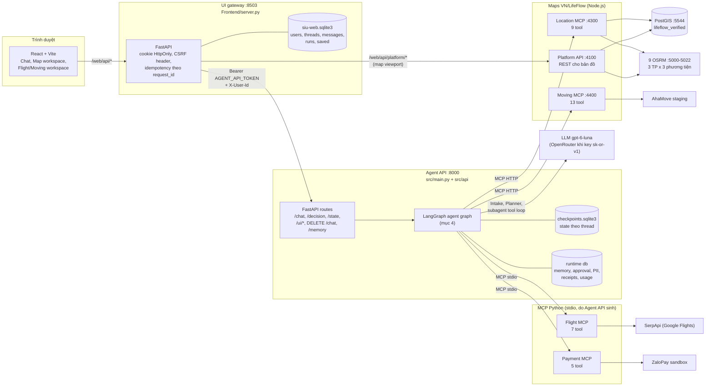

| Thành phần | Mã nguồn | Vai trò |
|---|---|---|
| React UI | `Frontend/src/` | Chat; dải tiến trình kế hoạch + tổng đã chốt (`PlanProgress.tsx`); workspace bản đồ nhà ở (`MapWorkspace.tsx`), chuyến bay và chuyển đồ (`ServiceWorkspaces.tsx`), form Thông tin chuyển đồ, xoá hội thoại |
| UI gateway | `Frontend/server.py`, `store.py` | Tài khoản, lịch sử chat, idempotency; giữ secret phía server; proxy tới Agent API và Platform API |
| Agent API | `src/api/routes.py`, `web_actions.py` | Kiểm `ChatRequest` (map_view, place_choice, moving_locations), khoá 1 lượt/thread, chạy graph, trả `ChatResponse`; `/chat/{id}/state` trả thêm `selections` và `progress` (`src/agents/progress.py`) |
| Agent graph | `src/agents/graph.py`, `nodes/` | Intake → Orchestrator → Executor → subagent → Validator → Respond (mục 4) |
| Subagent | `src/agents/subagents/services/` | `ReadLlmAgent` (Housing, Map, Flight, Payment) và `MovingLlmAgent` |
| Location MCP | `apps/location-mcp` | Địa giới, địa điểm, nhà, tiện ích, đường đi (PostGIS + OSRM) |
| Platform API | `apps/platform-api` | REST cho workspace bản đồ: `/v1/housing/map`, `/v1/housing/search`, `/v1/places/map`, `/v1/routes/entities`… |
| Moving MCP | `apps/moving-mcp`, `packages/moving-service` | Bọc AhaMove partner API v3 (staging) |
| Flight MCP | `src/mcp_servers/flights` | Tìm chuyến qua SerpApi; booking chỉ có engine giả lập, không bật |
| Payment MCP | `src/mcp_servers/payments` | ZaloPay sandbox; chỉ tra cứu qua chat |

## 3. Cách chạy

### 3.1. Thứ tự khởi động

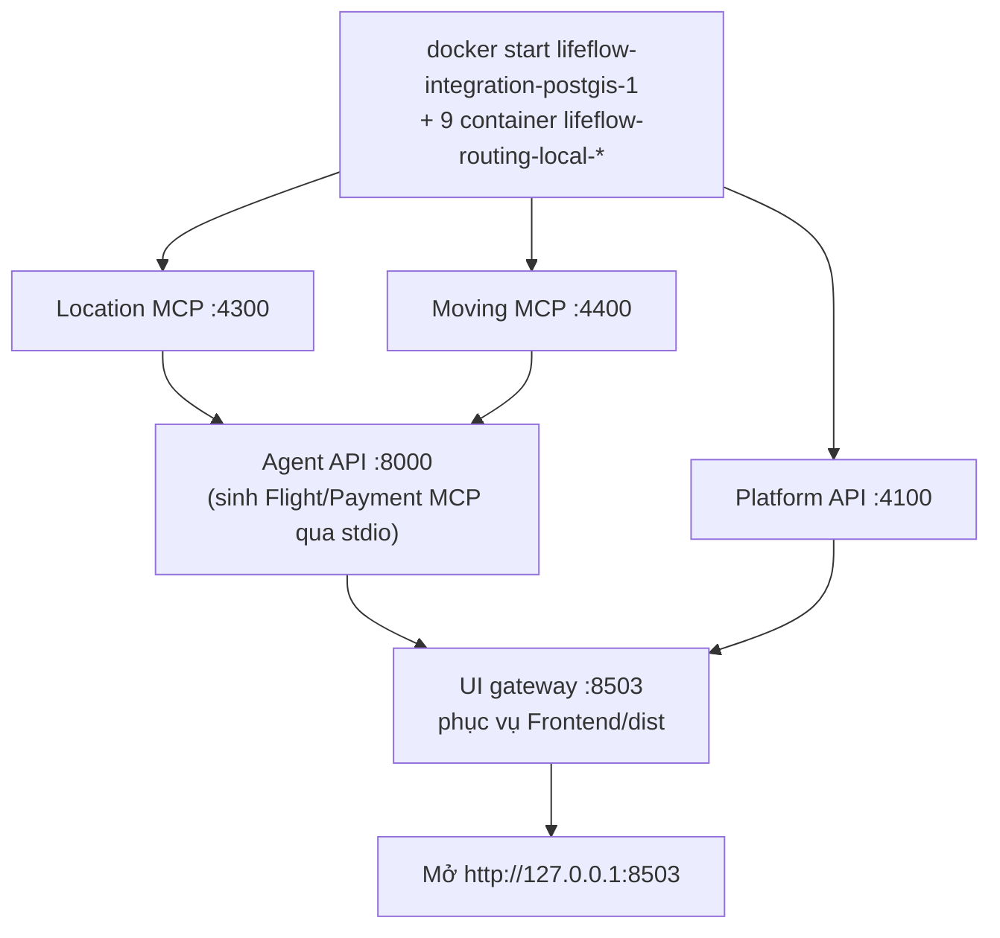

```bash
# 1. Dữ liệu và routing (container đã tạo sẵn từ snapshot, xem runbook)
docker start lifeflow-integration-postgis-1 $(docker ps -a --format '{{.Names}}' | grep lifeflow-routing-local)

# 2. Mỗi service một terminal (Linux/WSL dùng .venv/bin/python; Windows dùng .venv/Scripts/python.exe)
.venv/bin/python scripts/local-integration.py location   # :4300
.venv/bin/python scripts/local-integration.py platform   # :4100
.venv/bin/python scripts/local-integration.py moving     # :4400
.venv/bin/python scripts/local-integration.py api        # :8000
.venv/bin/python scripts/local-integration.py ui         # :8503 (build trước: cd Frontend && npm run build)
```

`scripts/local-integration.py` đọc `.env` và `data/integration.env`, rồi **ép** cấu hình an toàn cho môi trường local:

| Biến | Giá trị ép | Ý nghĩa |
|---|---|---|
| `AGENT_SUBAGENTS` | `live` | Dùng subagent LLM + MCP thật, không dùng fake |
| `AGENT_WRITES_ENABLED`, `AHAMOVE_WRITE_ENABLED`, `AGENT_SANDBOX_PAYMENTS_ENABLED` | `false` (trừ khi `--sandbox-writes`) | Không tạo đơn / không thu tiền |
| `AHAMOVE_ENV`, `AHAMOVE_BASE_URL` | staging | Không bao giờ gọi AhaMove production |
| `FLIGHT_SEARCH_PROVIDER` | `serpapi` | Tìm chuyến thật |
| `LANGCHAIN_TRACING_V2` | `false` | Tắt LangSmith cho app chạy local |
| Node service | chỉ nhận biến `MCP_*`, `OSRM_*`, `PLATFORM_*` hoặc `AHAMOVE_*`, `MOVING_*` và Postgres | Không lộ key LLM sang service Node |

### 3.2. Kiểm thử

| Bộ | Lệnh | Ghi chú |
|---|---|---|
| Python offline | `.venv/bin/python -m pytest -q` | 261 đạt, 22 lỗi cũ (fixture/hợp đồng, xem SERVICE_AUDIT) |
| UI Playwright | `cd Frontend && npx playwright test` | 28 ca desktop + mobile, dùng fixture API |
| Live opt-in | `RUN_LIVE_INTEGRATION=1 pytest ...` | Gọi LLM/provider thật |
| AhaMove staging | `RUN_AHAMOVE_STAGING_INTEGRATION=1` + tuyến `AHAMOVE_TEST_*` | Chỉ báo giá |
| Bộ case đa luồng (tài liệu này) | runner gọi gateway `/web/api` | Kết quả ghi trong JSON |

## 4. Agent graph: một lượt chat chạy qua đâu

Graph là **topology cố định**; kế hoạch (DAG các task) là **dữ liệu trong state**. Node `*_agent` sinh động từ
các domain đã đăng ký.

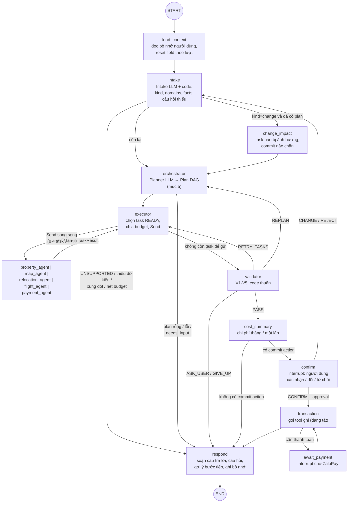

| Node | Có LLM? | Việc chính | File |
|---|---|---|---|
| `load_context` | không | `SessionPort.load(user_id)`: preferences/traits/hints | `nodes/load_context.py` |
| `intake` | có (≤2 lần) | `LlmIntake` trả `IntakeResult` (kèm `map_origin`: named_place / housing_results / selected_home); code kiểm evidence và kiểm giá trị theo `input_schema` các domain, đổi tham chiếu thành marker (`upstream:property`, `selected:property`), gắn `map_view`/`place_choice`/`moving_locations`, gộp fact qua lượt, tự điền từ bộ nhớ, tính `blocking_missing`; ý định giao dịch không khả dụng để riêng (`unavailable_commit_requested`) | `nodes/intake.py`, `intake.py`, `intake_llm.py` |
| `change_impact` | không | Lượt "đổi" khi đã có plan: task nào phải chạy lại, commit nào chặn | `nodes/change_impact.py` |
| `orchestrator` | có (≤2 lần) | Planner LLM → `Plan`; kiểm `validate_plan`; khởi tạo trạng thái task, tái dùng task còn hạn | `nodes/orchestrator.py`, `planner_llm.py`, `planning.py` |
| `executor` | không | Tính READY, gửi tối đa `max_parallel_tasks=4` task/wave bằng `Send`, chia budget LLM, trần task `paid` | `nodes/executor.py`, `routing.py` |
| `*_agent` | có (subagent) | `run_with_policy`: dựng `AgentTaskRequest`, timeout, retry transport 1 lần, `check_result` | `graph.py`, `subagents/base.py` |
| `validator` | không | V1 trạng thái, V2 field bắt buộc/nguồn, V3 hết hạn, V4 output schema, V5 luật chéo (ngân sách) → PASS/RETRY/REPLAN/ASK/GIVE_UP | `nodes/validator.py` |
| `cost_summary` | không | Tổng tháng / một lần, khoản đã chọn | `nodes/cost_summary.py` |
| `confirm`, `transaction`, `await_payment` | không | Human-in-the-loop, approval do backend tạo, gọi tool ghi, chờ thanh toán | `nodes/*.py` |
| `respond` | không | `AgentResponse` (ANSWER/PARTIAL/CLARIFY/…), câu hỏi kèm `choices`, gợi ý bước tiếp, `known_request`, ghi bộ nhớ | `nodes/respond.py`, `suggestions.py`, `memory.py` |

Giới hạn mỗi lượt (`GraphSettings`, chỉnh bằng `AGENT_MAX_ATTEMPTS`, mặc định và tối đa 5): Intake và Planner mỗi
lần gọi được sửa tối đa 5 lần; mỗi task chạy tối đa 5 lần; lập lại kế hoạch tối đa 5 lần; lỗi kết nối subagent thử
tối đa 5 lần. Trần chung: 30 lần gọi LLM cho Intake + Planner, 40 lần cho subagent mỗi lượt; timeout subagent
100–120 s; `recursion_limit=100`.

## 5. Orchestrator: lập kế hoạch và đưa luồng thực thi

Orchestrator gồm **Planner** (node `orchestrator`, có LLM) và **Executor** (node `executor`, code thuần). Planner là
nơi duy nhất tạo/sửa plan; Executor không bao giờ sửa plan.

### 5.1. Planner lập kế hoạch

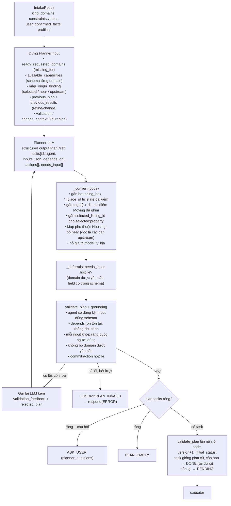

Ví dụ kế hoạch cho câu "tìm phòng Hải Châu dưới 5 triệu, chợ và bệnh viện gần các phòng đó, chuyến bay Hà Nội –
Đà Nẵng 25/10, AhaMove có ở Đà Nẵng không" (case TC28):

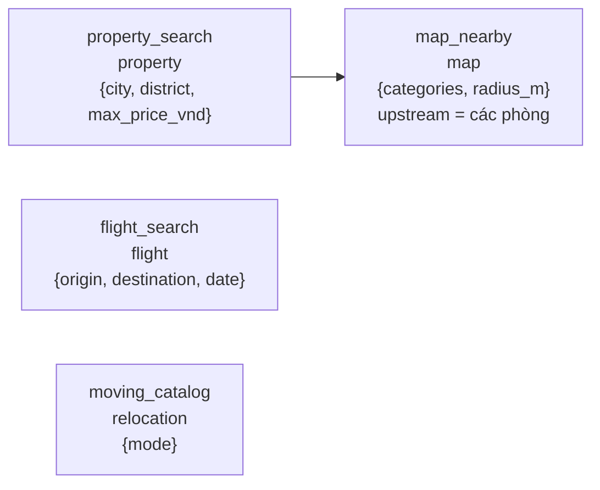

`map_nearby` có `depends_on=[property_search]` nên chạy **tuần tự** sau Housing; `flight_search`, `moving_catalog`
không phụ thuộc ai nên chạy **song song** với Housing ngay wave đầu.

Các key Map tách khỏi Housing (`map_near`, `map_city`) chỉ áp vào task Map **nearby**; task route dùng
`route_from`/`route_to`/`city` nên không bị buộc chép `map_near` của lượt trước (K-02). Task Map có `depends_on` tới
Housing lấy gốc từ kết quả upstream nên không cần, và không được giữ, `near` (K-01).

### 5.2. Executor đưa luồng thực thi

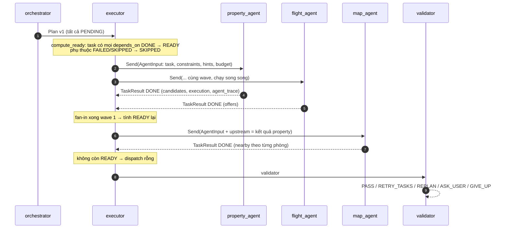

Quy tắc của Executor (`nodes/executor.py`):

- Mỗi wave gửi tối đa 4 task READY theo thứ tự plan; task còn lại chờ wave sau.
- Trước khi gửi, **giữ chỗ budget LLM** cho cả lần chạy của subagent (`max_llm_calls` của capability). Không đủ thì
  hoãn task sang wave sau (nếu wave đã có task khác), tránh hai subagent tranh nhau budget.
- Domain `paid` bị đếm trần riêng theo lượt và theo thread; vượt trần → task FAILED `budget_exceeded`.
- Mỗi lần gửi tăng `task_attempts`; quá `max_task_attempts=2` → FAILED.
- Task RUNNING mà không có kết quả sau fan-in coi là FAILED.
- Mỗi `TaskResult` được ghi `data.execution` (request_id, started_at, finished_at, elapsed_ms, allocated_llm_calls,
  depends_on) — runner dùng trường này để đo task có thật sự chạy chồng thời gian (song song) hay không.

### 5.3. Validator quyết định bước sau

| Thứ tự | Điều kiện | Hành động |
|---|---|---|
| 1 | Không có vấn đề và không có câu hỏi | `PASS` → cost_summary |
| 2 | Có task vượt trần chi phí | `GIVE_UP` |
| 3 | Có task NEEDS_INPUT (subagent hỏi) hoặc thiếu field người dùng, hoặc luật V5 (vượt ngân sách) | `ASK_USER` |
| 4 | Task FAILED có `retryable` (timeout, provider tạm lỗi) hoặc kết quả cũ, còn lượt | `RETRY_TASKS` |
| 5 | Còn lượt replan | `REPLAN` (Planner đọc `validation` để sửa hướng) |
| 6 | Còn lại | `GIVE_UP` |

## 6. Subagent: nhận lệnh rồi làm gì

### 6.1. Hợp đồng chung

Mỗi task được Executor gửi thành `AgentInput` → `run_with_policy` dựng **`AgentTaskRequest`**: `task_id`,
`agent`, `inputs` (đã kiểm theo `input_schema` của capability), `constraints`, `hints` (lọc theo `hint_keys`),
`upstream` (kết quả task phụ thuộc), `budget` (`max_llm_calls`, `max_provider_calls`, `deadline_at`).

Subagent trả **`AgentTaskResult`**: `status` (`done` / `needs_input` / `failed`), `data` (đúng `output_schema`),
`quotes`, `questions`, `missing_fields`, `source_refs`, `usage`, `error_code`, `retryable`. `check_result` kiểm
lại trước khi đưa vào state.

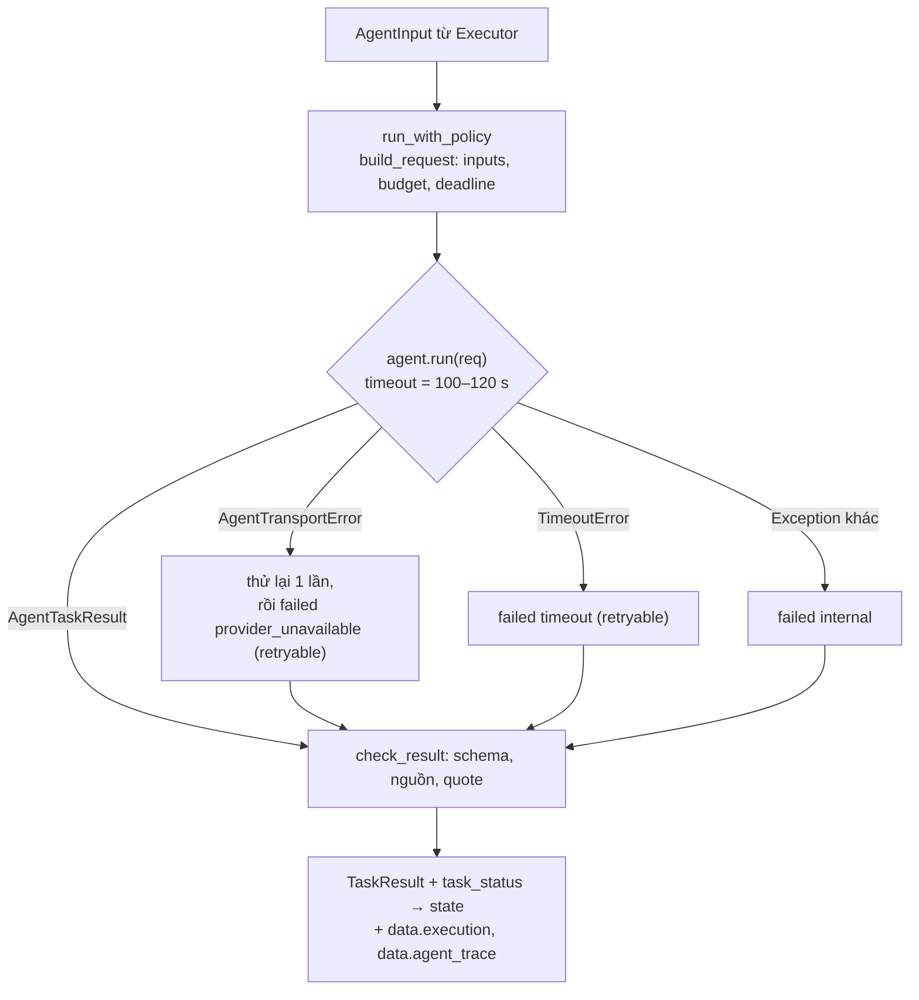

### 6.2. `ReadLlmAgent` — Housing, Map, Flight, Payment

Một runtime dùng chung, mỗi domain một instance với capability và tool riêng (`services/read_llm.py`). LLM **không**
gọi thẳng tool MCP thô: tool đầu tiên là một **thao tác đọc ghép** đã được code gắn tham số từ input tin cậy.

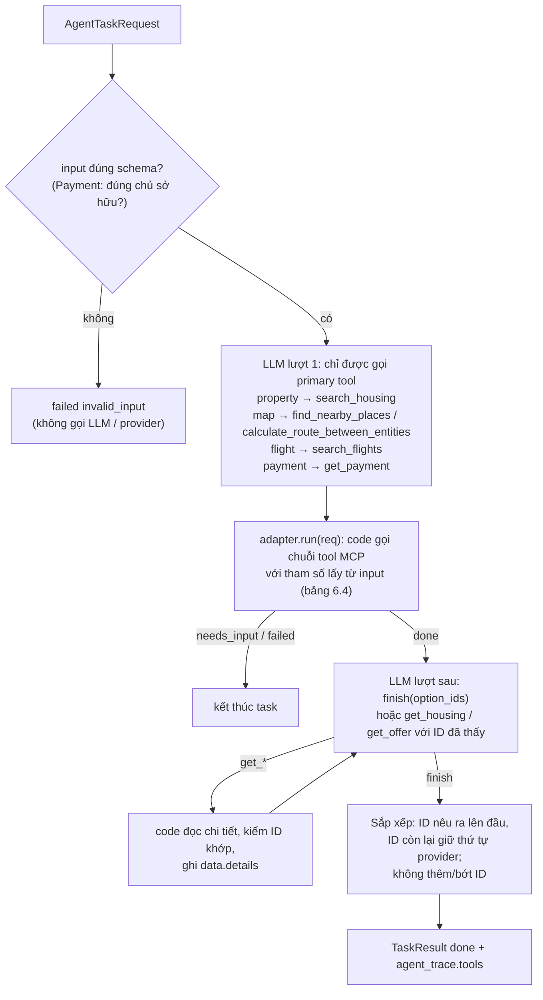

Ràng buộc: tối đa 4 lần gọi LLM, `tool_choice=required`, một tool mỗi lượt, tham số kiểm bằng JSON Schema (ID phải
nằm trong `enum` các ID đã thấy), Flight offer phải có `source=serpapi`, fare rules giả lập bị đánh dấu chưa xác minh.

### 6.3. `MovingLlmAgent` — Chuyển đồ (AhaMove)

`services/moving_llm.py`. Có 3 mode: `quote` (báo giá), `order_status` (tra đơn), `catalog` (danh mục khu vực/dịch vụ).
Code **mở dần** tool theo điều kiện đã đạt, nên LLM không thể nhảy bước.

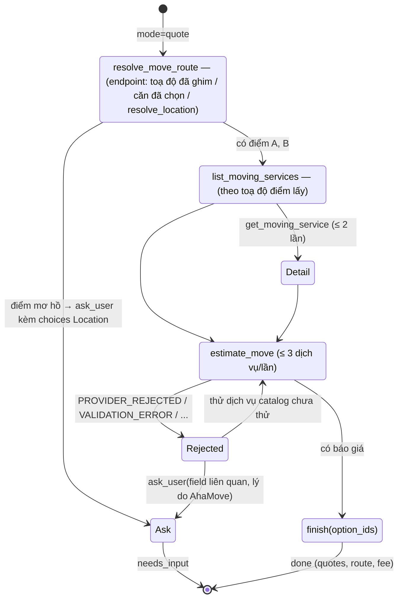

- `order_status`: chỉ có `get_move_order`, `find_move_orders_by_tracking_number`, `get_move_tracking_link`,
  `get_move_order_events`, `finish`, `ask_user`.
- `catalog`: `list_service_areas` (chưa có `city_id`) hoặc `list_moving_services` + `get_moving_service`.
- Lỗi transport/credentials/rate limit vẫn làm task FAILED; chỉ lỗi "provider hiểu nhưng từ chối nội dung" mới quay
  lại cho LLM hỏi người dùng.
- Tool ghi (`create_move_order`, `update_move_order`, `cancel_move_order`, `rate_move_driver`) **không** có trong
  subagent; chỉ `transaction` gọi sau khi người dùng xác nhận và có approval, và hiện đang tắt.

### 6.4. Tool từng server và ai gọi

#### Location MCP :4300 (9 tool, PostGIS + OSRM)

| Tool | Làm gì | Subagent / thành phần gọi |
|---|---|---|
| `search_areas` | Tìm địa giới (tỉnh, quận, phường), trả ID/parent/bbox | Housing (`city`, `district`, khung nhìn), Map route (`city`) |
| `resolve_location` | Tên → ứng viên địa điểm/địa giới, có cờ `ambiguous` | Housing (`near`), Map (near, route endpoint), Moving (`resolve_move_route`), API `/map/search` |
| `search_housing` | Tìm tin nhà theo bộ lọc cứng, cursor, bbox/bán kính, gần tiện ích (`nearby`) | Housing (primary tool) |
| `get_housing` | Chi tiết một `listing_id` | Housing (`get_housing`), Map/Moving khi dùng căn đã chọn, web action chọn căn |
| `search_places` | Tìm POI theo text/category | Chưa dùng trong graph |
| `get_place` | Chi tiết một `place_id` | Housing/Map khi có `near_place_id`, API kiểm `place_choice` |
| `find_nearby_places` | POI gần nhất theo category quanh một điểm | Map nearby (còn trong code; Intake không còn tạo yêu cầu tiện ích riêng — tiện ích là bộ lọc `search_housing.nearby`) |
| `calculate_route` | Đường đi giữa hai toạ độ | Không gọi trực tiếp |
| `calculate_route_between_entities` | Đường đi giữa housing/place/toạ độ, có cảnh báo độ chính xác | Map route (primary tool) |

Chuỗi gọi của adapter Location (`services/location.py`):

- **Housing**: `search_areas` (city) → `pick_city_area` → [`search_areas` district | `resolve_location` near → `pick_place` |
  `get_place` near_place_id | dùng `bounding_box`] → `search_housing` (thử lần 2 nếu nới bộ lọc tự điền) → `_viewport`.
- **Map nearby**: origin từ `selected_listing_id` (`get_housing`) / `near_place_id` (`get_place`) / `near`
  (`resolve_location`) / các phòng upstream → `find_nearby_places`.
- **Map route**: `search_areas` (city) → mỗi đầu: căn đã chọn | `*_place_id` | `resolve_location` + `pick_place` →
  `calculate_route_between_entities`.

#### Moving MCP :4400 (13 tool, AhaMove partner API v3 staging)

| Tool | Loại | Subagent gọi? |
|---|---|---|
| `list_service_areas` | đọc | Moving catalog |
| `list_moving_services` | đọc | Moving quote/catalog |
| `get_moving_service` | đọc | Moving quote/catalog |
| `estimate_move` | đọc (báo giá) | Moving quote |
| `get_move_order` | đọc | Moving order_status |
| `get_move_orders` | đọc | Chưa nối |
| `find_move_orders_by_tracking_number` | đọc | Moving order_status |
| `get_move_tracking_link` | đọc | Moving order_status |
| `get_move_order_events` | đọc | Moving order_status |
| `create_move_order` | ghi | Chỉ `transaction` (đang tắt) |
| `update_move_order` | ghi | Chỉ `transaction` (đang tắt) |
| `cancel_move_order` | ghi | Chỉ `transaction` (đang tắt) |
| `rate_move_driver` | ghi | Chưa nối |

`resolve_move_route` không phải tool MCP: là bước code của agent, dùng `resolve_location` / `get_housing` của Location.

#### Flight MCP (stdio, 7 tool)

`search_airports` (adapter chuẩn hoá tên → IATA), `search_flights` (primary tool), `get_offer` (đọc chi tiết offer
đã thấy); `hold_booking`, `confirm_booking`, `get_booking`, `cancel_booking` không bật (chỉ có engine giả lập).

#### Payment MCP (stdio, 5 tool)

`get_payment` (primary tool, chỉ sau khi `authorized()` xác nhận người dùng sở hữu `payment_id`); `create_payment`,
`cancel_payment` dùng ở luồng giao dịch/sandbox; `refund_payment` chưa nối; `simulate_payment_result` chỉ có ở mock.

## 7. Dữ liệu mang qua các lượt

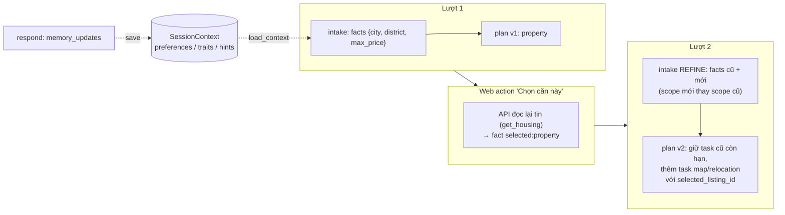

- **Theo thread** (checkpoint LangGraph): intake (facts có evidence), plan, task_status, task_results, cost_summary,
  committed, pending. API `/chat/{id}/state` trả thêm `selections` (bản ghi provider của lựa chọn hiện tại) và
  `progress` (mục 7.1).
- **Theo người dùng** (`SessionPort`, xuyên thread): mức 1 (`city`, `near`, `max_price_vnd`, `room_type`, …) được
  tự điền cho Housing có thông báo; mức 2 (`origin`, `from_address`, …) chỉ gợi ý. `DELETE /chat/{id}` xoá giá trị
  có nguồn từ thread đó; `DELETE /memory` xoá hết.

### 7.1. Dải tiến trình kế hoạch và tổng tiền đã chốt

Thanh ngang ở đầu khung chat (và đầu trang chi tiết Kế hoạch), đóng/mở được, ghi nhớ trạng thái trên trình duyệt.
Chỉ hiện những mục tiêu người dùng đã nêu; chưa nhắc tới thì chưa có ô. Thanh toán không hiện trên dải (đang tắt);
thay vào đó là **tổng tiền đã chốt**.

> Đề xuất 07/10/2026 (Draft, chưa code): [payment-design.md](payment-design.md) §12 thêm trạng thái thanh toán và
> lịch xem nhà vào dải, và tách tổng thành đã thanh toán qua app (mô phỏng), chờ thanh toán, trả trực tiếp cho chủ
> nhà, hằng tháng.

Planner chỉ giữ task cần cho lượt đang xử lý, nên plan hiện tại không đủ làm lịch sử. Node `respond` gọi
`progress.record_goal` mỗi lượt để ghi `goal_tasks` (state của thread): mọi task của mục tiêu hiện tại qua các lượt,
cộng domain người dùng đã yêu cầu nhưng chưa lập task vì thiếu thông tin (ô `pending:<domain>`, giữ những gì người
dùng đã nói). Lượt `new_goal` bắt đầu dải mới.

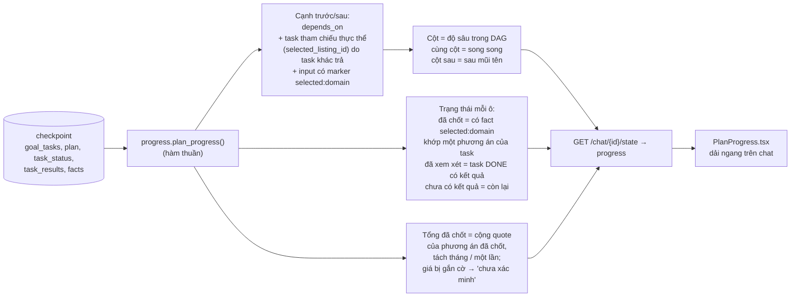

Ví dụ: tìm nhà và chuyến bay trong cùng câu → hai ô cùng cột; chọn căn rồi hỏi chuyển đồ tới căn đó → ô Chuyển đồ
xuất hiện ở cột sau, có mũi tên từ Tìm nhà (vì task chuyển đồ tham chiếu căn đã chọn). Chọn lại căn khác làm các ô
phụ thuộc trở về "chưa có kết quả" (task STALE) cho tới khi chạy lại.

| Trạng thái | Điều kiện | Ghi chú |
|---|---|---|
| Đã chốt | Có `selected:<domain>` khớp một phương án trong kết quả task, task không STALE | Chưa phải đã đặt/đã thanh toán |
| Đã xem xét | Task DONE và có kết quả | Map chỉ có trạng thái này (không có phương án để chốt) |
| Chưa có kết quả | Đang chờ thông tin, đang chạy, lỗi hoặc STALE | Hiện để người dùng biết mục tiêu đã được ghi nhận |

## 8. Lỗi tìm được khi chạy bộ case

### 8.1. Cách chạy và kết quả chung

- 30 case trong [mvp-multiflow-test-cases.json](mvp-multiflow-test-cases.json), từ một domain đơn giản tới 4 domain
  nhiều lượt. Chạy ngày 02/10/2026 trên stack local với LLM thật, Location/OSRM thật, AhaMove staging (chỉ báo giá),
  SerpApi thật. Runner gọi gateway `/web/api` như trình duyệt; không bao giờ gửi CONFIRM.
- Mỗi case dùng **một tài khoản mới** để bộ nhớ người dùng không ảnh hưởng chéo. Lần chạy đầu dùng chung một
  tài khoản và chính vì vậy lộ ra BUG-01.
- Kết quả: **23 PASS, 7 FAIL**. Một số case PASS vẫn lộ lỗi phụ (cột "Lỗi liên quan").
- Kiểm song song/tuần tự bằng `data.execution` của từng `TaskResult`:

| Case | Task | Bắt đầu (s) | Kết thúc (s) | Kết luận |
|---|---|---|---|---|
| TC09 | property / flight | 0.00 / 0.00 | 3.91 / 4.53 | Song song: cùng wave 1 |
| TC10 | map route / flight | 0.00 / 0.00 | 4.19 / 4.64 | Song song |
| TC12 | property / flight | 0.00 / 0.00 | 5.61 / 6.61 | Song song (relocation không lập được, BUG-02) |
| TC14 | property → map | 0.00 → 5.06 | 5.06 → 7.79 | Tuần tự: map chạy ngay khi property xong |
| TC15 | property → map | 0.00 → 3.83 | 3.83 → 6.61 | Tuần tự |

Executor chạy đúng thiết kế: task không phụ thuộc đi cùng wave, task `depends_on` chờ fan-in. Phần lớn lỗi nằm ở
**Intake** (hiểu sai / chặn cả lượt), **hợp đồng giữa các tầng** (capability có mà Intake không có), **dữ liệu
Location** và **thông báo lỗi**.

| Case | Mức | Luồng | Nội dung | Kết quả | Kind cuối | Lỗi liên quan |
|---|---|---|---|---|---|---|
| TC01 | 1 | single | Housing đơn | PASS | ANSWER | — |
| TC02 | 1 | single | Map nearby đơn | PASS | ANSWER | — |
| TC03 | 1 | single | Map route Hồ Hoàn Kiếm → Lăng Bác | FAIL | CLARIFY | BUG-04 |
| TC04 | 1 | single | Flight đơn | PASS | ANSWER | — |
| TC05 | 1 | single | Moving catalog | FAIL | UNSUPPORTED | BUG-02 |
| TC06 | 1 | single | Ngoài phạm vi | PASS | UNSUPPORTED | — |
| TC07 | 1 | single | Thiếu thông tin | PASS | CLARIFY | BUG-01 (lần chạy 1) |
| TC08 | 2 | single | Moving quote | PASS | CLARIFY | BUG-04 |
| TC09 | 2 | parallel | Housing + Flight | PASS | ANSWER | BUG-05 |
| TC10 | 2 | parallel | Map route + Flight | PASS | ANSWER | — |
| TC11 | 2 | parallel | Housing + Map độc lập | FAIL | CLARIFY | BUG-03 |
| TC12 | 3 | parallel | Housing + Flight + Moving catalog | FAIL | CLARIFY | BUG-02 |
| TC13 | 3 | parallel | Moving quote + Flight | PASS | CLARIFY | BUG-04 |
| TC14 | 3 | sequential | Housing → Map | PASS | ANSWER | — |
| TC15 | 3 | sequential | Housing → Map (trường học) | PASS | ANSWER | BUG-05 |
| TC16 | 4 | mixed | (Housing → Map) và Flight | FAIL | CLARIFY | BUG-12; bản "TP.HCM": BUG-03 |
| TC17 | 3 | multi_turn | Chọn căn → tiện ích | PASS | ANSWER | — |
| TC18 | 4 | multi_turn | Chọn căn → đường đi | PASS | ANSWER | — |
| TC19 | 4 | multi_turn | Chọn căn → báo giá chuyển đồ | PASS | CLARIFY | BUG-10 |
| TC20 | 5 | multi_turn | Chọn căn → Moving và Flight song song | PASS | CLARIFY | BUG-06 (lần trước), BUG-10, BUG-05 |
| TC21 | 3 | multi_turn | Refine thêm số phòng ngủ | PASS | ANSWER | — |
| TC22 | 3 | multi_turn | Đổi khu vực sang Hà Đông | FAIL | CLARIFY | BUG-09 |
| TC23 | 3 | multi_turn | Map nearby → route | PASS | ANSWER | bản đầu: BUG-04 |
| TC24 | 3 | single | AhaMove từ chối ngày quá 7 ngày | PASS | CLARIFY | bản đầu: BUG-04 |
| TC25 | 2 | single | Địa chỉ cấp quận cho Moving | PASS | CLARIFY | — |
| TC26 | 2 | single | Lỗi cũ A: POI trùng (Cầu Rồng, Chợ Hàn) | PASS | ANSWER | đã sửa |
| TC27 | 2 | single | Lỗi cũ B: xếp hạng thiếu ID | PASS | ANSWER | đã sửa; BUG-05 |
| TC28 | 5 | mixed | 4 domain | FAIL | CLARIFY | BUG-02, BUG-12 |
| TC29 | 4 | single | Thanh toán không thuộc người dùng | PASS | ERROR | BUG-08 |
| TC30 | 5 | multi_turn | Yêu cầu đặt xe khi writes tắt | PASS | ERROR | BUG-07, BUG-08, BUG-11 |

### 8.2. Lỗi nằm ở đâu trong kiến trúc

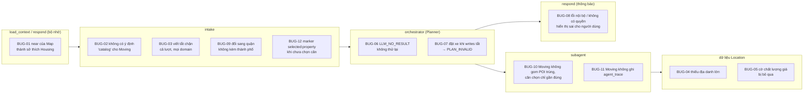

### 8.3. Mô tả từng lỗi

Mức ảnh hưởng: **Cao** = sai kết quả hoặc chặn cả luồng hợp lệ; **Trung bình** = luồng chạy được nhưng phải hỏi
lại thừa / sai UX; **Thấp** = khó quan sát, không đổi kết quả.

#### BUG-01 — Bộ nhớ trộn ngữ nghĩa giữa domain: `near` của Map thành sở thích tìm nhà (Cao)

- **Tầng:** `respond.memory_updates` → `SessionPort.save` → lượt sau `load_context` → `intake.prefill_from_memory`.
- **Hiện tượng (lần chạy 1, chung tài khoản):** TC02 hỏi *bệnh viện gần ĐH Bách khoa* (Map). Ở hội thoại mới, TC07
  "Mình muốn thuê nhà" không hỏi khu vực mà trả kết quả ngay với Housing
  `{city: Hà Nội, near: Đại học Bách khoa Hà Nội, max_price_vnd: 5000000, room_type: phòng trọ}`.
- **Nguyên nhân:** `MEMORY_TIERS` coi `near` là preference mức 1 không phân biệt domain. `memory_updates.used()`
  chỉ kiểm "có task DONE nào dùng key `near`" nên `near` của task Map (điểm tra tiện ích) được lưu như nơi người dùng
  muốn ở. `PREFILL_FIELDS_BY_DOMAIN[PROPERTY]` lại tự điền `near` cho Housing.
- **Ảnh hưởng:** người dùng hỏi một tiện ích một lần, các lần tìm nhà sau bị khoanh quanh địa điểm đó; câu hỏi
  bắt buộc (khu vực) bị bỏ qua.
- **Hướng sửa:** lưu bộ nhớ theo `(domain, key)` hoặc chỉ ghi `near` khi task dùng nó là Housing; anchor `near` bắt
  buộc phải do người dùng nói trong lượt Housing.

#### BUG-02 — Moving `catalog` có ở subagent nhưng Intake không đi tới được (Cao)

- **Tầng:** hợp đồng giữa `intake` (keys, `missing_for`) và capability Moving.
- **Hiện tượng:** TC05 "AhaMove hỗ trợ những thành phố nào?" → `UNSUPPORTED`. TC12, TC28 câu "AhaMove có hoạt động
  ở Đà Nẵng không" bị hiểu thành báo giá chuyển đồ và hỏi điểm lấy, phòng đã chọn, ngày, giờ.
- **Nguyên nhân:** `MovingLlmAgent` thêm `mode=catalog` (+ `city_id`) vào capability và có tool
  `list_service_areas`/`list_moving_services`, nhưng prompt Intake không có key nào cho ý định tra danh mục và
  `missing_for(RELOCATION)` luôn đòi `from_address, to_address, move_date, move_time`. Planner không nhận
  relocation là `ready_requested_domain` nên không bao giờ tạo task `catalog`.
- **Hướng sửa:** thêm fact ý định Moving (ví dụ `moving_mode`) vào Intake và nhánh `catalog` trong `missing_for`;
  hoặc cho Planner sinh task `mode=catalog` khi chỉ hỏi phạm vi dịch vụ.

#### BUG-03 — Luật chặn tên viết tắt chặn cả lượt và mọi domain (Trung bình)

- **Tầng:** `nodes/intake.py` (`abbreviation_questions` → `conflicts`) → `IntakeResult.needs_clarification`.
- **Hiện tượng:** TC11, TC16 (bản đầu) có "TP.HCM" → cả lượt `CLARIFY`, kể cả phần Hà Nội không liên quan và
  Flight. Plan rỗng.
- **Nguyên nhân:** câu hỏi viết tắt được đưa vào `conflicts`, mà `conflicts` là cờ chung của lượt nên Planner trả
  plan rỗng. Không có danh sách viết tắt được chấp nhận hay thử chuẩn hoá qua `search_areas`.
- **Hướng sửa:** câu hỏi viết tắt chỉ gắn với field/domain chứa nó (như `needs_input` của Planner), các domain khác
  vẫn chạy; thử `search_areas`/`resolve_location` với chuỗi viết tắt trước khi hỏi.

#### BUG-04 — Dữ liệu Location thiếu địa danh lớn; câu hỏi lại đưa ứng viên không liên quan (Trung bình)

- **Tầng:** dữ liệu `lifeflow_verified` + `resolve_location` + `pick_place`.
- **Hiện tượng:** "Hồ Hoàn Kiếm", "Lăng Chủ tịch Hồ Chí Minh" không có bản ghi khớp chính xác (TC03, TC08, TC13 và
  bản đầu TC23/TC24/TC30). Ứng viên trả về là trạm xe buýt "Hồ Hoàn Kiếm (đối diện 15 Hàng Khay)", khách sạn, cửa hàng
  Toyota…; với Lăng Bác chỉ có "Khu di tích Hố Lang", "Di tích đường Hồ Chí Minh trên biển" (fuzzy).
- **Nguyên nhân:** dữ liệu POI không có mặt nước, công trình lớn dạng polygon; `pick_place` chỉ nhận kết quả
  `exact`. Một số địa danh chỉ tồn tại dưới dạng trạm xe buýt (ví dụ "Nhà hát Lớn Hà Nội", "Văn Miếu - Quốc Tử Giám"
  khớp chính xác là `bus_stop`), nên Moving/Map dùng toạ độ trạm xe buýt thay cho công trình.
- **Hướng sửa:** bổ sung lớp địa danh (OSM `tourism`, `historic`, `natural=water`) vào dữ liệu; khi chỉ có kết quả
  fuzzy thì không đưa vào `choices` (hoặc lọc theo bbox thành phố và ngưỡng điểm khớp).

#### BUG-05 — Cờ chất lượng giá của dữ liệu bị bỏ qua (Trung bình)

- **Tầng:** `search_housing` (Location MCP) → `to_candidate` → `respond`.
- **Hiện tượng:** "Cho thuê căn hộ 3pn view sông tại Samtower — 520.000đ/tháng" đứng đầu kết quả Hải Châu (TC09,
  TC15, TC20) và được chọn ở TC20; "Phòng trọ Đống Đa… 500.000đ/tháng" ở TC27. Bản ghi trong DB có
  `quality.flags = price_outlier_low`.
- **Nguyên nhân:** cờ chất lượng nằm trong `attributes.quality` nhưng không đi qua contract `search_housing` và
  agent; sắp xếp mặc định theo giá nên tin giá sai luôn lên đầu bộ lọc "dưới X triệu".
- **Hướng sửa:** đưa `quality_flags` vào kết quả Location, `ReadLlmAgent`/UI đánh dấu hoặc đẩy xuống cuối; không
  tính vào ngân sách khi giá bị gắn cờ.

#### BUG-06 — Planner không thử lại khi LLM không trả structured output (Trung bình, chập chờn)

- **Tầng:** `orchestrator` → `LlmPlanner.plan` → `Invocation.parse`.
- **Hiện tượng:** TC20 lần chạy trước: lượt 3 (Moving + Flight) trả `ERROR` "[LLM_NO_RESULT] LLM từ chối hoặc không
  hoàn tất structured output". Chạy lại cùng câu thì được (CLARIFY đúng).
- **Nguyên nhân:** vòng 2 lần của Planner chỉ sửa **lỗi kiểm plan**; `LLMError` từ `parse` thoát thẳng ra node, node
  trả `OutcomeCode.ERROR`. Không có retry riêng cho lỗi tạm thời của LLM, không có fallback `TemplatePlanner`.
- **Hướng sửa:** coi `LLM_NO_RESULT`/timeout là lỗi tạm thời: thử lại trong cùng `max_calls`, hoặc rơi về
  `TemplatePlanner` cho các domain mẫu.

#### BUG-07 — Yêu cầu đặt xe khi chưa bật ghi kết thúc bằng PLAN_INVALID (Trung bình)

- **Tầng:** `intake` (`commit_requested`) → `LlmPlanner._grounding_errors` → `orchestrator`.
- **Hiện tượng:** TC30 có báo giá AhaMove thật, lượt sau "Đặt xe với báo giá rẻ nhất" → `ERROR` "[PLAN_INVALID]
  Kế hoạch LLM không đạt contract sau khi sửa: Missing requested action intent: moving_booking". Không có đơn nào
  được tạo (đúng), nhưng người dùng không được biết vì sao.
- **Nguyên nhân:** grounding bắt buộc có action `moving_booking` khi Intake ghi `commit_requested`, nhưng LLM không
  thêm action cả 2 lần. Trong khi đó `writes_enabled=false` và capability Moving vẫn quảng bá `MOVING_BOOKING`; không
  có bước nào trả lời "đặt xe chưa bật" trước Planner.
- **Hướng sửa:** khi `writes_enabled=false`, gỡ commit kind khỏi capability (như đã làm cho Flight) và để Intake/
  respond trả lời rõ ràng; hoặc Planner gắn action bằng code khi `commit_requested` hợp lệ (giống cách gắn
  `selected_listing_id`).

#### BUG-08 — Thông báo lỗi không phản ánh đúng nguyên nhân (Trung bình)

- **Tầng:** `respond.compose` (ánh xạ `OutcomeCode`/`error_code` → câu chữ).
- **Hiện tượng:**
  - TC29: `payment_id` không thuộc người dùng (subagent trả `invalid_input`) → "Mình chưa lấy được kết quả từ dịch
    vụ. Bạn thử lại sau nhé." — người dùng sẽ thử lại vô ích.
  - TC20 (lần trước), TC30: mã nội bộ `[LLM_NO_RESULT]`, `[PLAN_INVALID] … Missing requested action intent` hiện
    nguyên văn trong câu trả lời.
- **Hướng sửa:** phân biệt `invalid_input`/không có quyền với lỗi tạm thời; giữ mã lỗi trong log/`data`, câu trả lời
  chỉ nêu việc người dùng làm được.

#### BUG-09 — Đổi sang một quận (không nêu thành phố) sau lượt "gần X" bị hỏi lại và giữ plan cũ (Cao)

- **Tầng:** `nodes/intake.py` (thay phạm vi `SEARCH_SCOPE_KEYS`) + `missing_for(PROPERTY)`.
- **Hiện tượng:** TC22 lượt 1 "phòng gần ĐH Bách khoa Hà Nội dưới 4 triệu" (chỉ có `near`), lượt 2 "Đổi sang tìm ở
  quận Hà Đông" → `CLARIFY` "Bạn muốn tìm phòng ở khu vực nào?", plan vẫn là `{near: Bách khoa}`. Lặp lại ở cả 2 lần chạy.
- **Nguyên nhân:** luật thay phạm vi (sửa 01/10) bỏ `near` cũ khi người dùng nêu `district`, nhưng lượt 1 không có
  `city` (thành phố chỉ nằm ngầm trong tên địa danh). Còn lại `district` một mình, mà `REQUIRED_INPUTS` của Housing
  đòi `city|near` nên bị coi là thiếu. Lần sửa 01/10 chỉ kiểm câu có đủ "Cầu Giấy Hà Nội".
- **Hướng sửa:** cho `district` đủ làm phạm vi khi `search_areas` phân giải được duy nhất (subagent Housing đã có
  bước này), hoặc khi thay phạm vi thì giữ `city` suy từ kết quả Location của lượt trước.

#### BUG-10 — Moving gần như luôn hỏi lại điểm: không gom POI trùng, căn đã chọn chỉ có vị trí gần đúng (Trung bình)

- **Tầng:** `MovingLlmAgent.point` / `endpoint` (`resolve_move_route`).
- **Hiện tượng:** TC20: "Sân bay Quốc tế Đà Nẵng" có 2 bản ghi `exact` cùng tên → hỏi lại điểm lấy; căn đã chọn
  (tin đăng chỉ có vị trí gần đúng) → hỏi lại điểm giao với **0 choices** trong chat (TC19, TC20). Tương tự
  "Bệnh viện Bạch Mai" (2 bản ghi exact).
- **Nguyên nhân:** `point()` chỉ nhận đúng 1 kết quả `exact`; `pick_place` (gom ứng viên exact trong 150 m) được cố ý
  không áp dụng cho Moving. Với căn đã chọn, `endpoint()` chỉ nhận `location_accuracy == rooftop`, mà phần lớn tin
  đăng là `approximate`; `location_question` tìm ứng viên theo địa chỉ chữ nên thường rỗng.
- **Ghi chú:** web đã bù bằng form Thông tin chuyển đồ (hiện vị trí căn để ghim); qua chat thuần thì người dùng không
  có lựa chọn nào để bấm.
- **Hướng sửa:** gom bản ghi exact trùng tên trong bán kính nhỏ (cùng `category`) cho Moving, vẫn hỏi xác nhận điểm
  dừng xe nhưng đưa sẵn điểm đã gom và vị trí căn làm `choices`.

#### BUG-11 — MovingLlmAgent không ghi `agent_trace` (Thấp)

- **Tầng:** `services/moving_llm.py`.
- **Hiện tượng:** Housing/Map/Flight có `data.agent_trace.tools`, Moving thì không (TC30, TC08), nên không quan sát
  được agent đã gọi `resolve_move_route` → `list_moving_services` → `estimate_move` bao nhiêu lần.
- **Hướng sửa:** ghi trace giống `ReadLlmAgent` (tên tool, không ghi payload riêng tư).

#### BUG-12 — Intake gán `near='selected:property'` khi chưa chọn căn, Housing hỏi lại bằng mã nội bộ (Cao)

- **Tầng:** `intake_llm` → `ground_facts` → Planner grounding → subagent Housing.
- **Hiện tượng:** TC16 (bản viết đầy đủ), TC28: "tìm phòng …, tìm siêu thị/chợ gần **các phòng đó**" → Intake tạo
  fact `near = selected:property` (evidence "gần các phòng đó"). Planner buộc phải chép vào task Housing; Housing không
  resolve được → câu hỏi "Mình chưa xác định được vị trí "selected:property"" hiện cho người dùng; task Map phụ thuộc
  đứng ở PENDING. Cùng kiểu câu ở TC14 thì đúng, nên đây là lỗi chập chờn của LLM mà code không chặn.
- **Nguyên nhân:** prompt cấm `near='selected:property'` nhưng code chỉ kiểm marker này cho `from_address/to_address/
  route_*` (`relocation.selected:property`, `map.selected:property`), không kiểm cho `near` của Housing. Grounding của
  Planner còn bắt buộc mọi constraint phải xuất hiện trong task, nên giá trị sai lan thẳng xuống subagent.
- **Hướng sửa:** trong `ground_facts`/node intake, từ chối marker `selected:*` ở key không hỗ trợ hoặc khi chưa có
  fact `selected:property`; "các phòng đó" (kết quả vừa tìm) phải thành phụ thuộc Map → Housing như TC14.

### 8.4. Hai lỗi có từ trước

Hai phát hiện ngày 01/10 (ngoài 3 lỗi được giao lúc đó) được đưa vào bộ case để kiểm hồi quy:

| Lỗi cũ | Tầng | Trạng thái 02/10 | Case |
|---|---|---|---|
| **A.** Địa điểm trùng gần nhau ("Cầu Rồng" 2 trạm xe buýt cách 82 m, "Văn Miếu" 2 node cách 7 m) làm Map route hỏi lại | `location.py` `pick_place` | **Đã sửa** cho Map/Housing: route Cầu Rồng → Chợ Hàn ra 1,94 km. Cách sửa cố ý không áp cho Moving, nên vấn đề còn ở dạng **BUG-10** | TC26 PASS |
| **B.** Subagent Housing thất bại khi LLM `finish` xếp hạng thiếu ID | `read_llm.py` `finish` | **Đã sửa**: danh sách thiếu là thứ tự ưu tiên, các ID còn lại giữ thứ tự provider; không task Housing nào thất bại trong 24 lượt có Housing của bộ case | TC27 PASS (và mọi case Housing) |

### 8.5. Ưu tiên đề xuất

1. **BUG-12, BUG-01, BUG-09**: sai kết quả tìm nhà hoặc chặn luồng hợp lệ, đều nằm ở Intake / bộ nhớ.
2. **BUG-02, BUG-07, BUG-08**: hợp đồng giữa các tầng và câu trả lời lỗi; sửa gọn, ảnh hưởng trực tiếp người dùng.
3. **BUG-03, BUG-06, BUG-10**: giảm hỏi lại thừa và lỗi chập chờn.
4. **BUG-04, BUG-05**: dữ liệu Location (cần phối hợp phía dữ liệu); **BUG-11**: quan sát.

### 8.6. Tình trạng sau khi sửa (02/10 tối, `mvp` local chưa commit)

Nền: `origin/khoa` (194f51d, đã sửa BUG-01…12 một phần, xem [khoa-retest.md](khoa-retest.md)) + các sửa dưới đây.
Chạy lại 30 case: **28 đạt, 2 không đạt** (mvp 23/7, khoa 24/6); sau sửa K-05 chạy lại 9 case nhiều lượt, đều đạt. Chi tiết:
[fix-multiflow-test-results.json](fix-multiflow-test-results.json) (có `khoa_result` để đối chiếu và `progress` của
từng lượt). Bộ test offline: 279 đạt, đúng 22 lỗi cũ; Playwright 30/30.

| Lỗi | Sửa thế nào (không có bảng cụm từ hay địa danh) | Kiểm chứng |
|---|---|---|
| K-01 `map_near` nhận "các phòng đó"/"housing_results" | Intake trả thêm trường có kiểu `map_origin` (named_place / housing_results / selected_home). Tham chiếu được đổi thành marker `upstream:property` / `selected:property` và không bao giờ đem đi geocode; nhãn tham chiếu bị chép nhầm vào `near` cũng bị gỡ. Planner: task Map có `depends_on` Housing bỏ `near` | TC16, TC28 ANSWER: Map chạy sau Housing, Flight/Moving song song |
| K-02 nearby → route ra PLAN_INVALID | Grounding chỉ đòi `map_near → near` cho task nearby không phụ thuộc Housing | TC23: lượt 2 ra đường đi 2,53 km, giữ kết quả nhà thuốc |
| K-03 `max_area_m2 = 0` | Giá trị Intake được kiểm theo `input_schema` của mọi domain dùng cùng key và cùng kiểu; schema Housing khai báo trần diện tích/giá > 0 | TC27 ANSWER, không còn fact diện tích |
| K-04 chọn phương án xoá lựa chọn vừa ghi | Chỉ xoá lựa chọn của domain phụ thuộc khác domain đang chọn | `Frontend/tests/test_actions.py` đạt |
| BUG-04 (phần Moving) | Câu hỏi chọn điểm của Moving dùng cùng luật gợi ý với Housing/Map: địa điểm khớp không fuzzy hoặc fuzzy mạnh (≥ 0,8); vẫn phải xác nhận | TC08/TC13: gợi ý chỉ có khi dữ liệu có địa điểm đủ khớp |
| Hồi quy phát hiện khi sửa | Lần đầu kiểm schema theo key làm hỏng `passengers` (fact là số, input Flight là object); nay chỉ kiểm khi cùng kiểu | TC04 ANSWER |
| K-05 (mới, gặp khi thử dải tiến trình) | Nhà + bay → chọn căn → "báo giá chuyển đồ tới phòng mình chọn" ra `PLAN_INVALID: Missing runnable requested domain: flight` vì model bỏ task bay đã xong. `_convert` giữ lại task đã DONE của domain được yêu cầu mà model bỏ sót, chỉ khi input của nó vẫn đúng bằng input suy từ ràng buộc hiện tại (đổi ngày bay thì không giữ) | Unit test; chạy thật: lượt 3 ra CLARIFY hỏi điểm giao kèm vị trí căn; TC17–TC23, TC28, TC30 chạy lại đều đạt |
| K-06 (người dùng gặp khi thử web) | Tìm nhà → chọn căn → báo giá chuyển đồ "đến phòng mình đã chọn" ra `PLAN_INVALID: selected_listing_id must match the confirmed housing selection`: Planner LLM ghi sai ID căn, code chỉ `setdefault` nên giữ giá trị sai. Nay ID căn đã chọn luôn gắn từ fact `selected:property` cho task Moving/Map dùng căn đó, và bị gỡ khỏi task không dùng | Unit test; chạy lại đúng hội thoại: lượt cuối CLARIFY hỏi điểm giao kèm vị trí căn |
| K-07 (giao diện) | Lượt lỗi vẫn mở lại bản đồ nhà (vì câu trả lời luôn kèm kết quả cũ) và khung chat tóm tắt kết quả thay vì hiện lỗi. Workspace chỉ mở cho kết quả **mới** của lượt đó (id kết quả chưa có ở tin trả lời trước) | Playwright 30/30 |

Cập nhật theo phản hồi sau khi thử web (02/10 đêm):

| Thay đổi | Cách làm | Kiểm chứng |
|---|---|---|
| Tiện ích không còn là dịch vụ | "Gần bệnh viện" khi tìm nhà là bộ lọc Housing: Intake ghi `nearby_categories`/`nearby_radius_m`, Planner chép vào task property, adapter gửi `search_housing.nearby` (bán kính mặc định 1500 m khi người dùng không nói). Nếu model vẫn tạo Map không phải đường đi, code bỏ domain Map và giữ bộ lọc cho Housing của mục tiêu đang có. Bỏ gợi ý "Xem tiện ích quanh phòng"; thẻ/biểu mẫu Map chỉ còn đường đi | Chạy lại hội thoại Hà Đông: "dưới 7 triệu và gần bệnh viện" → mỗi căn kèm bệnh viện gần nhất (vd. 630 m), không có ô tiện ích trên dải |
| Giới hạn thử lại lên 5 | `AGENT_MAX_ATTEMPTS` (1–5, mặc định 5) cho Intake/Planner, số lần chạy task, số lần replan, thử lại kết nối | Test offline |
| Câu trả lời lặp lại kết quả cũ | Văn bản chỉ liệt kê kết quả chạy trong lượt này; kết quả cũ vẫn có trong dữ liệu cho giao diện. Lượt không chạy gì mới thì vẫn hiện kết quả cũ một lần | Lượt "đặt thêm máy bay" chỉ hiện chuyến bay |

Còn lại:

- **TC03 (BUG-04):** dữ liệu Location không có "Hồ Hoàn Kiếm", "Lăng Chủ tịch Hồ Chí Minh" khớp chính xác; cần bổ sung
  dữ liệu địa danh, không sửa bằng code.
- **TC11 (BUG-03 phần còn lại):** "thành phố Thủ Đức, TP.HCM" chưa phân giải được; Map độc lập vẫn trả kết quả, Housing
  hỏi lại đúng field. Muốn hiểu viết tắt cần dữ liệu alias trong Location.
- BUG-01, BUG-06 chưa có case tái hiện trên stack thật (mỗi case một tài khoản; LLM không lỗi trong lần chạy).

Thêm mới cùng đợt: dải tiến trình kế hoạch và tổng tiền đã chốt (mục 7.1). Trang chi tiết Kế hoạch đổi mục
"Chi phí dự kiến" thành "Tổng tiền đã chốt"; thẻ chi phí dự kiến trong từng câu trả lời chat được bỏ vì nó tự lấy
phương án đầu tiên khi người dùng chưa chọn.

### 8.7. Bộ case nhập vai người dùng (02/10 đêm)

[persona-test-cases.json](persona-test-cases.json): 26 case viết theo cách người dùng thật nói (không dấu, viết tắt,
lẫn tiếng Anh, kể dài, đổi ý, nhiều lượt, chọn phương án giữa chừng), chạy trên stack thật. Mỗi case kiểm cả dải
kế hoạch (`progress`) và tổng đã chốt khi cần.

| Lần chạy | Kết quả | Ghi chú |
|---|---|---|
| 1 | 23/26 | P08 Intake hết thời gian chờ LLM không được thử lại; P22 "tìm vé vào đó" không ra thành phố của căn; P24 kịch bản chốt báo giá chuyển đồ chưa có báo giá (căn cần xác nhận điểm giao, đúng thiết kế) nên đổi sang chốt vé bay |
| 2 | 25/26 | P24: thêm vé bay sau khi chốt nhà bị Intake coi là mục tiêu mới → mất căn đã chốt |
| 3 | **26/26** | Sau 3 sửa bên dưới |

| Sửa | Tầng | Cách làm |
|---|---|---|
| Lỗi LLM tạm thời không được thử lại (Intake) | `llm_runtime.Invocation.parse` | `LLM_TIMEOUT`, `LLM_NO_RESULT`, `LLM_CONNECTION_ERROR` được gọi lại trong cùng số lần cho phép (≤ 5) và thời hạn (150 s); dùng chung cho Intake và Planner |
| "Vé bay vào đó" sau khi chốt căn | node `intake` | Điểm đi/đến của chuyến bay là tham chiếu căn đã chọn → thay bằng thành phố của căn trong bản ghi provider; không có bản ghi thì bỏ để Flight hỏi |
| Thêm dịch vụ bị coi là mục tiêu mới | `intake_llm` | Intake LLM điền thêm trường có kiểu `drops_previous_goal`. `new_goal` mà không bỏ mục tiêu cũ và khác domain → tiếp tục mục tiêu (giữ căn đã chốt, kết quả cũ, dải kế hoạch). "Thôi không tìm nhà nữa…" vẫn là mục tiêu mới (P23) |

Các điểm còn mở (case vẫn đạt theo tiêu chí, nhưng trải nghiệm chưa tốt):

| Case | Hiện tượng | Tầng |
|---|---|---|
| P01 | "gần trường Bách Khoa Hà Nội" không phân giải được (tên trong dữ liệu là "Đại học Bách khoa Hà Nội"), hỏi lại không kèm gợi ý | Dữ liệu / so khớp tên Location (BUG-04) |
| P07 | "thứ bảy này" (hôm nay thứ sáu 02/10) thành ngày 10/10 thay vì 03/10 | Intake LLM tính ngày tương đối |
| P16 | Mã "ZP123456789" bị bộ lọc dữ liệu cá nhân coi là dãy số dài và bỏ, nên hỏi lại mã | `looks_like_pii` trong Intake |
| P18 | Từ chối tra tiện ích riêng đúng, nhưng câu trả lời chung chung | `respond` (UNSUPPORTED) |
| P19 | "q3 hcm" chưa phân giải được viết tắt | Location (BUG-03) |
| P17 | Danh sách khu vực AhaMove lẫn mục "VNM", "NA", tên tiếng Anh; chưa trả lời thẳng "có ở Cần Thơ" | Moving catalog / `respond` |
