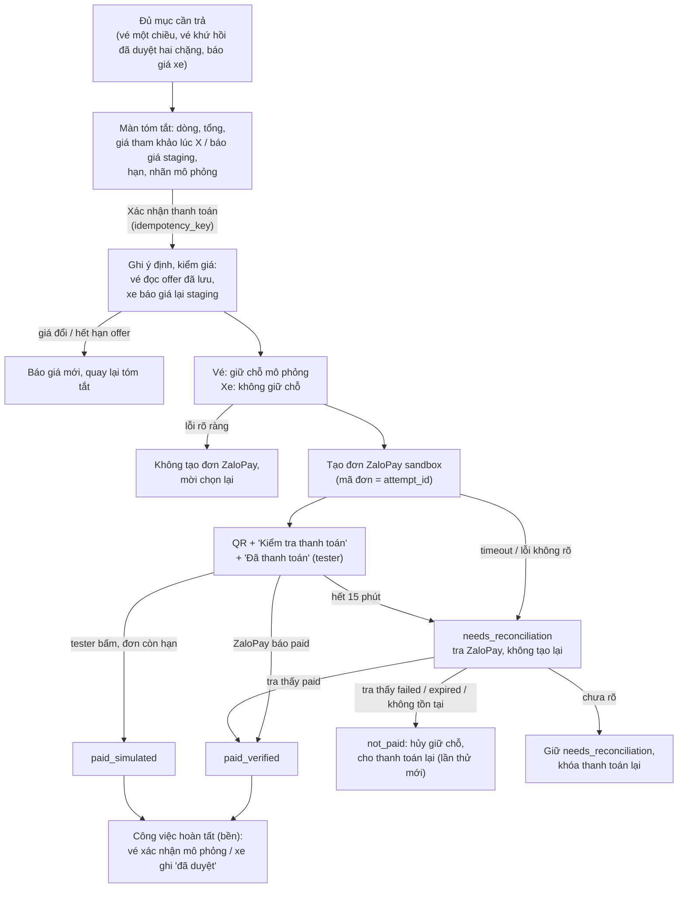
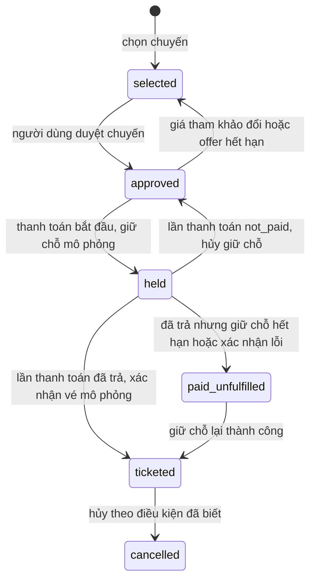
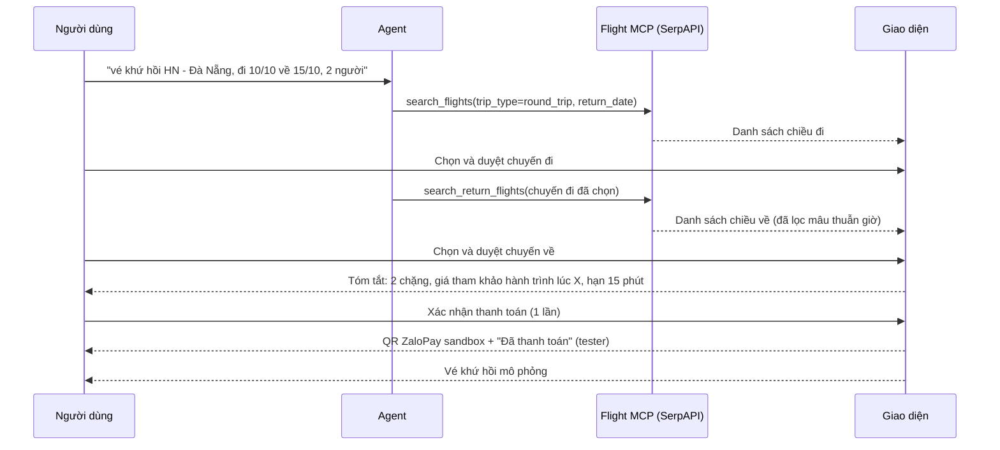
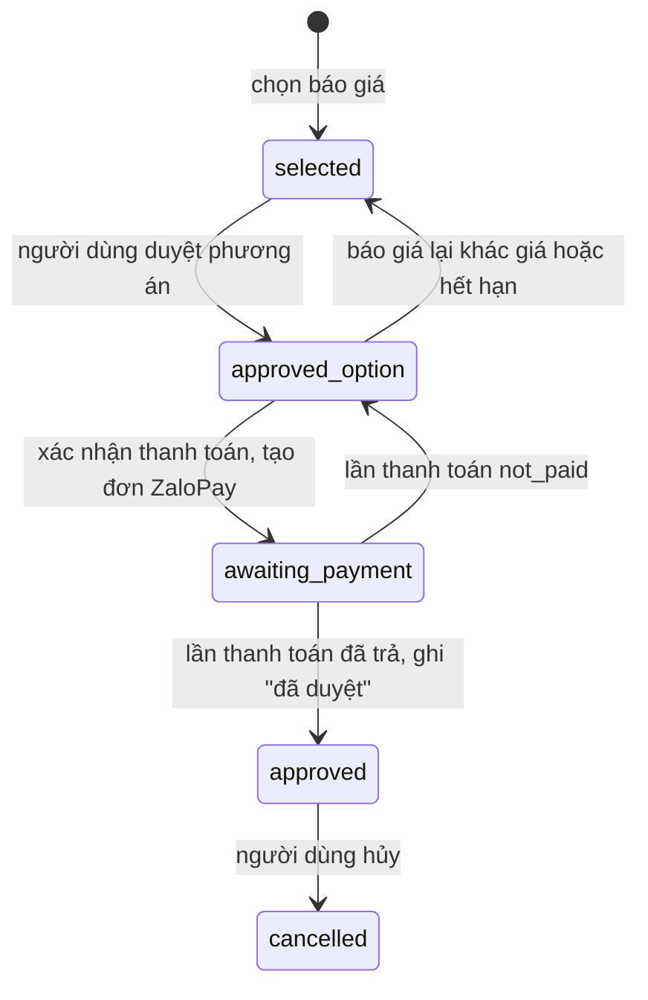
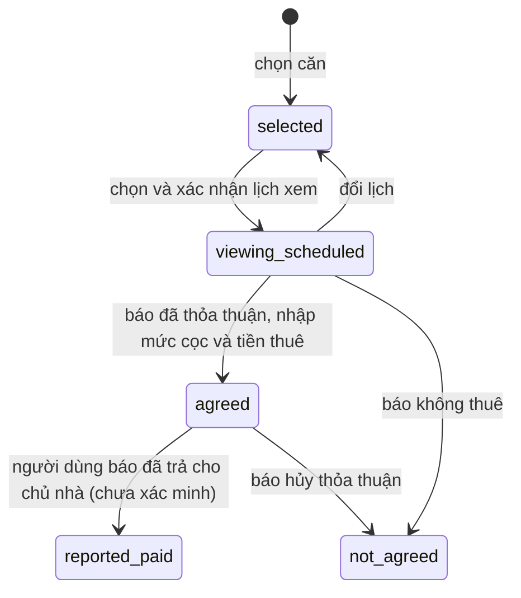

# Thiết kế thanh toán đa dịch vụ (đề xuất)

Trạng thái: **v4, đang triển khai trên nhánh `payment-design` (chưa merge).** Cập nhật: 08/10/2026. Chỗ code khác
thiết kế ghi ở mục 8.2 và 14.
Nền đối chiếu: `origin/QuangDung` tại `374d38c`, cùng `docs/product.md`, SPEC-004 / SPEC-016 / SPEC-017 trên `main`
`6519b62`.

Tài liệu mô tả **cách định làm** phần thanh toán theo các quyết định của chủ task. Tên field, trạng thái, endpoint và
file là đề xuất, chưa có code. Việc để sau ở mục 16; đối chiếu với tài liệu cũ ở mục 17.

## 1. Vai trò của app

SIU là **app trung gian**. App giúp người dùng tìm, so sánh, chốt phương án và thanh toán điện tử trong app. Hợp đồng,
thỏa thuận và trách nhiệm pháp lý (thuê nhà, tiền cọc, điều kiện vận chuyển, điều kiện vé) là giữa **người dùng và bên
cung cấp dịch vụ**; app không đứng tên hợp đồng.

Trong demo, app **chỉ thu và giữ tiền** qua ZaloPay sandbox; chưa có bước chuyển tiền cho nhà cung cấp.

| Phần | Bản chất |
|---|---|
| Gọi ZaloPay sandbox (tạo đơn, QR, tra trạng thái) | **Tích hợp API thật** trong môi trường thử của ZaloPay |
| Nút "Đã thanh toán" của tester | **Mô phỏng**: app tự đánh dấu, ZaloPay không xác nhận |
| Giữ chỗ, mã đặt chỗ (PNR), vé | **Mô phỏng** trên Flight MCP |
| Giá vé | **Giá tham khảo** từ SerpAPI tại một thời điểm, không phải giá hãng xác nhận |
| Báo giá chuyển đồ | Báo giá thật từ AhaMove **staging**; app không tạo đơn AhaMove |

Hai thứ "tích hợp sandbox thật" và "mô phỏng" không tương đương; giao diện và dữ liệu luôn ghi rõ phần nào là phần nào.

## 2. Quyết định đã chốt

| # | Quyết định |
|---|---|
| D1 | Mỗi dịch vụ là **giao dịch riêng**: trạng thái, hạn, số tiền, người nhận tiền, lần duyệt riêng. Không gộp vé, xe, nhà vào một lần thanh toán. |
| D2 | **Một loại giá**, ghi rõ nguồn và thời điểm. Vé: "**giá tham khảo lấy lúc X, dùng cho giao dịch mô phỏng**", đọc từ offer đã lưu, không xác minh lại với hãng; giữ chỗ mô phỏng không bảo đảm còn ghế thật. Xe: báo giá lại AhaMove staging trước khi thanh toán. Giá đổi thì dừng và xin xác nhận lại. |
| D3 | Hành khách: người đặt lấy từ hồ sơ tài khoản, người đi cùng nhập tay ở form duyệt. Không lưu CCCD, hộ chiếu; chỉ nội địa; không hành lý, ghế. |
| D4 | **Khứ hồi** dùng chế độ khứ hồi có sẵn của SerpAPI: chọn và duyệt chiều đi, rồi chọn và duyệt chiều về (theo chuyến đi đã chọn), rồi **thanh toán một lần**. Thiếu thông tin chặng về thì agent hỏi lại. |
| D5 | Thanh toán theo quy trình **ZaloPay sandbox**: tóm tắt → xác nhận → QR, cạnh QR có nút **"Đã thanh toán"** cho tester. |
| D6 | Chuyển đồ **bỏ luồng đặt xe staging trả tiền mặt**; mọi lần chốt xe đi qua **thanh toán điện tử của app** (D5). App chỉ thu và giữ tiền; trả xong ghi **"đã duyệt"**, không tạo đơn AhaMove. |
| D7 | Nhà: đặt lịch xem → báo kết quả và thỏa thuận. Người dùng **nhập mức cọc thực tế** đã thỏa thuận (gợi ý mặc định 1 tháng tiền thuê). **Đã thỏa thuận ≠ đã trả**: việc trả tiền cho chủ nhà là một bước báo riêng, ghi "chưa được app xác minh". Tạm thời; sau này chủ nhà xác nhận mức cọc. Tiền nhà trả thẳng cho chủ nhà, ngoài app. |
| D8 | Agent **chỉ nhắc** về thứ tự, không chặn, không thêm bước xác nhận. |
| D9 | Mỗi lần duyệt gắn đúng nội dung, số tiền và hạn. Một phần thất bại không kéo phần khác (luật đổi kế hoạch trong `docs/product.md`). |
| D10 | Nút "Đã thanh toán" dùng ngay trong môi trường demo và test của nhóm, sau cờ cấu hình và kiểm quyền ở backend (mục 7.3). Không bao giờ bật trên production. |
| D11 | Mở rộng Flight MCP cho khứ hồi (mục 8.3). |
| D12 | Kiểm mâu thuẫn ngày giờ giữa hai chặng; có mâu thuẫn thì agent hỏi lại (mục 8.4). |
| D13 | Hạn **15 phút** cho giữ chỗ vé và đơn ZaloPay. **Hết hạn trên UI không chứng minh là chưa trả**: phải đối soát trước khi cho thanh toán lại (mục 7.2). |
| D14 | Lịch xem nhà ở chế độ test mở toàn bộ khung giờ mặc định (mục 10). |
| D15 | Dữ liệu hành khách và liên hệ chỉ nằm trong **kho dữ liệu cá nhân mã hóa** (hạn 30 phút như hiện có); giao dịch, booking mô phỏng và log chỉ giữ **tham chiếu** và tóm tắt không định danh. |
| D16 | Thao tác thanh toán **lưu bền** từng bước (ghi ý định trước khi gọi bên ngoài, bảng công việc chờ); khởi động lại thì chạy tiếp hoặc đối soát (mục 7.4). |
| D17 | `MovingOptions.payment_method` giữ đúng phương thức của AhaMove; cách app thu tiền là field riêng `checkout_mode`. |

## 3. Phạm vi

| Trong phạm vi | Ngoài phạm vi |
|---|---|
| Vé nội địa một chiều và khứ hồi, tìm thật qua SerpAPI; giữ chỗ và xuất vé mô phỏng | Xuất vé thật, chuyến quốc tế, multi-city, hành lý, ghế, đổi vé |
| Chuyển đồ: báo giá AhaMove staging, thanh toán điện tử của app, ghi "đã duyệt" | Đơn AhaMove (kể cả staging), chuyển tiền cho AhaMove |
| Nhà: lịch xem, báo thỏa thuận và mức cọc thực tế, báo đã trả cho chủ nhà | Thu tiền nhà, hợp đồng điện tử, chủ nhà xác nhận (làm sau) |
| Tổng tiền theo trạng thái thanh toán thật của từng giao dịch | Hoàn tiền thật (ADR-015: chưa hỗ trợ trong MVP) |

## 4. Tham khảo quy trình (không làm luật cứng)

- **Vietjet, khứ hồi:** chọn "Khứ hồi" kèm ngày đi và ngày về → chọn chiều đi → chọn chiều về → hành khách → dịch vụ
  thêm → trang tóm tắt → **một lần thanh toán**. Theo Vietnambooking: giá khứ hồi là tổng hai chặng; chỉ cho chọn
  ngày về sau ngày đi (khứ hồi trong ngày phải gọi tổng đài); có thể đổi hoặc hủy riêng một chiều theo hạng vé.
  SIU mượn ý chọn từng chiều và thanh toán một lần; vẫn cho khứ hồi trong ngày nếu đủ cách giờ (mục 8.4).
- **SerpAPI Google Flights, chế độ khứ hồi:** `type=1` + `return_date` trả danh sách chiều đi, mỗi chuyến có
  `departure_token`; gọi lại với token thì có danh sách chiều về. Kết quả SerpAPI được cache 1 giờ (có tham số bỏ cache,
  thiết kế không dùng vì D2). Tài liệu SerpAPI **không ghi rõ** giá ở danh sách chiều đi là giá gì; kiểm bằng một lần
  gọi thật khi code và ghi vào `price_scope` (mục 6.1).
- **ZaloPay:** khi thiếu callback, merchant phải tự tra trạng thái đơn (Query Order Status); không có scheduler thì ít
  nhất tra một lần sau thời hạn của đơn.

## 5. Hiện trạng code liên quan (`QuangDung` `374d38c`)

| Phần | Đã có | Khoảng trống hoặc lưu ý |
|---|---|---|
| Duyệt | `confirm` gửi `payload_hash` cho toàn bộ `commit_actions`; `transaction` chạy mọi action trong một lần duyệt | Cần một lần thanh toán mỗi lần duyệt (D9) |
| Ghi an toàn | `guarded_commit` ghi **ý định ghi** trước khi gọi provider, kết quả không chắc thì chặn thử lại (`pending_verification`) | Giữ nguyên nguyên tắc này cho mọi bước mới (D16) |
| Lựa chọn | Mới có `goal_selections` (task → option, `progress.record_selections`); nhưng một lựa chọn mới của **cùng dịch vụ** sẽ thay lựa chọn cũ | Khứ hồi cần **hai lựa chọn Flight cùng lúc** (chiều đi, chiều về); phải cho phép khi task chiều về phụ thuộc task chiều đi |
| Vé bay | Flight MCP tìm một chiều; provider SerpAPI cố định `type: ONE_WAY`; `get_offer` **đọc offer đã lưu**, không gọi lại provider; giữ chỗ mô phỏng 15 phút | Chưa có khứ hồi; giá chỉ là giá tham khảo (D2) |
| Dữ liệu booking | `BookingEngine` lưu **nguyên JSON booking** (gồm hành khách, liên hệ) vào bảng `bookings` SQLite, dạng văn bản thường | Trái D15; booking mô phỏng chỉ được lưu tham chiếu |
| Kho PII | `SqlitePiiStore` mã hóa, hạn 30 phút | Dùng làm nơi duy nhất giữ dữ liệu hành khách (D15) |
| Thanh toán | `create_payment` (ZaloPay), `PendingPayment` có QR, hạn; `PAYMENT_EXPIRE_MINUTES` = 15; `simulate_payment_result` chỉ có với provider mock | Chưa có đối soát sau hạn; nút tester làm ở tầng app |
| Chuyển đồ | `MovingOptions.payment_method: Literal["CASH"]`; `apply_draft_options` **chép `payment_method` vào yêu cầu gửi AhaMove** | Không được thêm giá trị demo vào field này (D17) |
| Giao diện | Chữ qua `uiText` / `formatUi` và `locales/en.json`; `MovingOptionsForm` có khối "Thanh toán tiền mặt" | Chữ mới thêm vào `en.json`; bỏ khối tiền mặt (D6) |
| Gọi Flight/Payment MCP | stdio; theo tài liệu kiến trúc của Khoa, mở process con mỗi lần gọi | Tốn thời gian khởi động mỗi tool (mục 7.5) |

## 6. Mô hình dữ liệu

### 6.1. Giao dịch dịch vụ (`ServiceTransaction`)

| Field | Ý nghĩa |
|---|---|
| `transaction_id` | ID duy nhất (UUID), không suy ra từ tên task |
| `user_id`, `thread_id` | Chủ sở hữu; mọi endpoint kiểm hai field này |
| `logical_key` | Khóa trong một plan để hiển thị và gom: `flight:<task>`, `moving:<task>`, `housing:<listing_id>` |
| `domain`, `task_id`, `option_id`, `option_version` | Phương án đã duyệt và phiên bản của nó (đổi chuyến, đổi báo giá, đổi căn → phiên bản mới) |
| `legs` | Chỉ vé: các chặng, mỗi chặng có chuyến, giờ đi/đến, `approved_at` |
| `passenger_ref`, `passenger_version` | Chỉ vé: tham chiếu tới kho PII và phiên bản danh sách hành khách; không chứa dữ liệu cá nhân |
| `price_vnd`, `price_scope` | `price_scope`: `per_leg` hoặc `itinerary`, số hành khách, loại tiền. Không tự cộng hay chia giá provider trả |
| `price_source`, `price_read_at`, `price_expires_at` | Nguồn và thời điểm lấy giá (D2) |
| `status` | Trạng thái hoàn tất dịch vụ theo từng domain (mục 8–10), tách khỏi trạng thái thanh toán |
| `amount_kind` | `one_time` / `monthly` / `deposit_to_landlord` |
| `payee` | Demo: app giữ tiền (vé, xe); chủ nhà (ngoài app) |
| `mode` | `simulated` / `staging` / `sandbox` / `user_reported` |
| `cancel_info` | Cách hủy, đổi và phí đã biết; không biết thì "chưa rõ" |

### 6.2. Lần thanh toán (`PaymentAttempt`)

Mỗi giao dịch có thể có nhiều lần thanh toán (lần trước hết hạn, lần sau tạo mới). Mỗi lần là một bản ghi riêng.

| Field | Ý nghĩa |
|---|---|
| `attempt_id` | ID duy nhất của lần thử; dùng làm mã đơn gửi ZaloPay |
| `transaction_id`, `user_id`, `thread_id` | Thuộc giao dịch và chủ nào |
| `idempotency_key` | Băm từ `transaction_id` + `option_version` + `passenger_version` + `payload_hash`. Gửi lại cùng khóa (hai tab, bấm lặp, mạng chậm) trả về cùng lần thử, không tạo đơn mới |
| `payload_hash` | Gồm phương án, hành trình hoặc tuyến, ngày giờ, số người, `passenger_version`, số tiền, hạn, người nhận. Chỉ dùng tham chiếu, không đưa dữ liệu cá nhân vào hash, màn hình hay log |
| `lines`, `amount_vnd` | Dòng hiển thị và tổng lúc xác nhận |
| `zalopay_ref`, `qr_code`, `expires_at` | Đơn ZaloPay sandbox, hạn 15 phút |
| `gateway_status` | Trạng thái **do ZaloPay trả**: `creating`, `pending`, `paid`, `failed`, `expired`, `unknown` |
| `tester_mark` | Đánh dấu **mô phỏng** của tester: người bấm, thời điểm. Không phải bằng chứng ZaloPay đã nhận tiền |
| `outcome` | Kết luận của app: `awaiting_payment`, `needs_reconciliation`, `paid_verified`, `paid_simulated`, `not_paid`, `cancelled` |
| `reconciled_at`, `reconcile_note` | Lần đối soát cuối và kết quả |

Trạng thái hoàn tất dịch vụ (`ServiceTransaction.status`) chỉ đổi khi `outcome` là `paid_verified` hoặc
`paid_simulated`, và chỉ đổi **một lần** cho mỗi giao dịch.

## 7. Thanh toán

### 7.1. Luồng chính (D5)

- **Màn tóm tắt** là bước duyệt thanh toán; nút xác nhận gửi kèm `idempotency_key`.
- **Thứ tự bắt buộc:** giữ chỗ trước, tạo đơn ZaloPay sau, để không thu tiền khi chưa có chỗ.

### 7.2. Hết hạn và đối soát (D13)

- Hết 15 phút trên UI **không** chứng minh chưa trả. Lần thử chuyển `needs_reconciliation`, app tra ZaloPay
  (Query Order Status) **ít nhất một lần sau hạn**.
- Tạo đơn bị **timeout** hoặc lỗi không rõ sau khi đã gửi: `needs_reconciliation`, tra theo `attempt_id`; không coi là
  thất bại để tạo lại.
- **Chỉ cho thanh toán lại** (lần thử mới) khi đối soát cho kết quả chắc chắn: đơn cũ `failed`, `expired`, hoặc không
  tồn tại phía ZaloPay. Chưa rõ thì khóa nút thanh toán lại, hiện "đang kiểm tra giao dịch trước".
- **Đã trả nhưng giữ chỗ hết hạn:** `outcome = paid_verified`, giao dịch "đã thanh toán, chưa hoàn tất đặt vé", hiện
  hướng xử lý (giữ chỗ lại nếu còn chuyến, hoặc hoàn tiền thủ công). **Không xóa** sự kiện thanh toán.
- Mở lại trang hoặc hội thoại có lần thử `needs_reconciliation` thì tra lại ngay.

### 7.3. Nút "Đã thanh toán" của tester (D10)

| Quy tắc | Nội dung |
|---|---|
| Ai được bấm | Backend kiểm **cả bốn**: cờ cấu hình bật (đề xuất `PAYMENT_TESTER_CONFIRM_ENABLED`); môi trường không phải production; người bấm thuộc danh sách tester cấu hình phía server (ID tài khoản); người bấm sở hữu giao dịch. Ẩn nút trên UI không thay cho kiểm quyền |
| Khi nào được bấm | Lần thử đang `awaiting_payment` và **còn hạn**. Không đánh dấu lần thử đã hết hạn, đã đối soát hay đã hủy |
| Ghi gì | `tester_mark` (người, thời điểm), `outcome = paid_simulated`. `gateway_status` giữ nguyên giá trị ZaloPay trả |
| Sau đó ZaloPay vẫn `pending` | Giữ `paid_simulated`; nhãn "đánh dấu bởi tester, ZaloPay chưa xác nhận" |
| Sau đó ZaloPay báo `paid` | Chuyển `paid_verified`; **không** chạy hoàn tất dịch vụ lần hai |
| Hiển thị | Mọi nơi gắn nhãn "đánh dấu bởi tester"; không trình bày như ZaloPay đã nhận tiền |

### 7.4. Lưu bền và phục hồi (D16)

- Mỗi bước gọi bên ngoài (giữ chỗ, tạo đơn ZaloPay, xác nhận vé) **ghi ý định trước khi gọi** và ghi kết quả sau khi
  gọi, theo cơ chế `guarded_commit` hiện có.
- Khi `outcome` thành đã trả, app ghi một **công việc hoàn tất** vào bảng bền (đề xuất `fulfilment_jobs`: `job_id`,
  `transaction_id`, `attempt_id`, bước, trạng thái, số lần thử) **trong cùng lần ghi** với kết quả thanh toán, rồi mới
  trả phản hồi cho UI.
- Công việc chạy nền; khởi động lại thì quét công việc chưa xong để chạy tiếp hoặc đối soát.
- Xác nhận vé và ghi "đã duyệt" **chống chạy trùng** theo `transaction_id` (Flight MCP `confirm_booking` vốn không xuất
  vé hai lần cho cùng booking).
- "Một thao tác UI" có thể gồm nhiều lần ghi DB; không gộp mọi thứ vào một lần ghi cuối.

### 7.5. Tốc độ (lý thuyết, chưa đo)

Mục tiêu: sau mỗi lần bấm, người dùng thấy phản hồi ngay và bước tiếp theo trong vài giây, không phải chờ một lượt chat
(hiện khoảng 9–25 s tùy số lần gọi LLM).

| # | Cách làm | Vì sao nhanh hơn |
|---|---|---|
| L1 | Mọi bước thanh toán là **thao tác có kiểu trên UI, 0 lần gọi LLM**, theo cách form báo giá Moving của PR #53 (ADR-022) | Bỏ Intake và Planner LLM khỏi luồng; Khoa đo đường form báo giá xe khoảng 4,3 s lần đầu và 1 s khi danh mục đã nhớ tạm. Chat vẫn hiểu "thanh toán đi" nhưng chỉ trả thẻ tóm tắt |
| L2 | Dựng sẵn màn tóm tắt từ state lúc duyệt | Mở tóm tắt không gọi mạng |
| L3 | Vé đọc offer đã lưu (giá tham khảo, D2); xe dùng danh mục nhớ tạm 45 s, chỉ gọi estimate | Bước kiểm giá gần như không chờ mạng với vé |
| L4 | Chạy song song các bước độc lập (kiểm giá, lấy tham chiếu hành khách, kiểm hạn) | Thời gian bằng bước lâu nhất |
| L5 | Chỉ giữ chỗ → tạo đơn ZaloPay là phải nối tiếp | Không thêm bước thừa |
| L6 | Chạy Flight và Payment MCP dài hạn (HTTP) hoặc giữ một session stdio dùng lại | Bớt thời gian khởi động process cho 4–5 lần gọi tool |
| L7 | Trả "đã thanh toán, đang xác nhận vé" ngay sau khi **đã ghi bền** công việc hoàn tất (mục 7.4) | Người dùng không chờ bước cuối, không mất việc khi restart |
| L8 | Tra ZaloPay theo chu kỳ ngắn rồi giãn dần; sau hạn chuyển sang đối soát (mục 7.2) | Biết kết quả sớm mà không dồn request |
| L9 | Khứ hồi: lấy danh sách chiều về ngay khi chọn chuyến đi; tải trước cho vài chuyến đầu là tùy chọn, mặc định tắt (tốn lượt SerpAPI) | Giảm chờ lần gọi SerpAPI thứ hai |
| L10 | Thao tác thanh toán không chạy lại cả graph; chỉ ghi những gì bước đó cần (mục 7.4) | Bớt tính lại không cần thiết |
| L11 | Hiện tiến trình từng bước "Kiểm giá → Giữ chỗ → Tạo QR", giữ thẻ đang mở, khóa nút khi đang chạy | Người dùng thấy tiến trình, không gửi trùng |
| L12 | Giới hạn thời gian từng bước; quá hạn thì báo rõ, chuyển đối soát nếu đã gửi lệnh ghi | Lỗi nhanh, không quay vô hạn |

| Thao tác | Mục tiêu (để đo khi code) |
|---|---|
| Mở màn tóm tắt | Gần như tức thì |
| Xác nhận → thấy QR (vé) | Vài giây: đọc offer local + giữ chỗ + tạo đơn ZaloPay |
| Xác nhận → thấy QR (xe) | Vài giây: estimate AhaMove + tạo đơn ZaloPay |
| "Đã thanh toán" → thấy đã trả | Tức thì; vé mô phỏng hiện sau |
| Chọn chuyến đi → thấy chiều về | Một lần gọi SerpAPI (chưa đo) |

## 8. Vé máy bay

### 8.1. Một chiều

- **Hành khách** (D3, D15): form duyệt điền sẵn người đặt từ hồ sơ; người đi cùng nhập tay. Dữ liệu vào kho PII mã
  hóa; giao dịch chỉ giữ `passenger_ref` và `passenger_version`. Đổi số hành khách thì tìm lại chuyến (giá theo số người).
- **Không có hành lý, ghế.** Thẻ chuyến ghi "hành lý theo hạng vé, chưa xác minh".

### 8.2. Khứ hồi (D4)

**Intake** (LLM, có kiểu, không dùng bảng từ khóa) thêm `trip_type` (`one_way` | `round_trip`) và `return_date`
(ngày tương đối như "về sau 3 ngày" tính theo ngày đi).

| Câu | Kết quả mong muốn |
|---|---|
| "vé khứ hồi Hà Nội – Đà Nẵng, đi 10/10 về 15/10" | `round_trip`; tìm khứ hồi, hiện chiều đi |
| "bay vào Đà Nẵng ngày 10, 15 bay về lại" | Như trên |
| "vé khứ hồi Hà Nội Đà Nẵng ngày 10/10" | Thiếu ngày về: agent hỏi "Bạn muốn bay về ngày nào?" trước khi tìm |
| Đã chọn chuyến đi, sau đó "về ngày 15" hoặc "về chuyến tối" | Bổ sung chặng về, lấy danh sách chiều về cho chuyến đi đã chọn |
| "vé một chiều" hoặc không nhắc chiều về | `one_way` |

**Planner (đã làm, khác bản đề xuất):** khứ hồi là **một** task Flight (`trip_type=round_trip`), không tách
`flight_out` → `flight_return`. Chọn chuyến đi là thao tác UI có kiểu `POST /ui/chat/{thread_id}/flight/outbound`
(0 LLM): app gọi `search_return_flights`, ghi danh sách chiều về vào cùng kết quả (`return_options`). Lựa chọn cuối
`selected:flight` là offer hành trình (đi + về), nên `goal_selections` vẫn một lựa chọn Flight mỗi task. Lý do: không
phải sửa `record_selections` để giữ hai lựa chọn cùng lĩnh vực, không thêm một lượt planner LLM giữa hai chiều (L1).
Đổi chuyến đi thì bỏ lựa chọn chiều về và lựa chọn của task. "Duyệt" là bước xác nhận ở màn thanh toán.

**Giá (đã kiểm bằng SerpAPI thật 08/10/2026):** với `type=1`, giá ở mỗi chuyến đi là **giá khứ hồi thấp nhất có chuyến
đi đó** (`price_scope=round_trip_from`, UI ghi "từ"); gọi lại với `departure_token` thì giá mỗi chuyến về là **tổng cả
hành trình** (`price_scope=round_trip`). Chỉ offer hành trình được thanh toán; không cộng hai giá hiển thị.

**Đổi và lỗi:**

| Lúc | Xử lý |
|---|---|
| Đổi chuyến đi sau khi đã chọn chiều về | Lựa chọn chiều về **và** các lần duyệt liên quan hết hiệu lực; lấy lại danh sách chiều về |
| Giá đổi khi xác nhận thanh toán | Quay lại tóm tắt với giá mới |
| Giữ chỗ lỗi rõ ràng | Không tạo đơn ZaloPay, mời chọn lại |
| Đã trả, giữ chỗ hết hạn hoặc xác nhận lỗi | `paid_unfulfilled`, hướng dẫn xử lý; không xóa thanh toán (mục 7.2) |
| Muốn đổi hoặc hủy một chiều sau khi có vé | Hiện điều kiện và phí đã biết; thay đổi là giao dịch mới |

### 8.3. Mở rộng Flight MCP (D11, D15)

| Thành phần | Thay đổi đề xuất |
|---|---|
| `FlightSearchRequest` | Thêm `trip_type` (`one_way` mặc định, `round_trip`) và `return_date` (bắt buộc khi khứ hồi, không trước ngày đi) |
| Provider SerpAPI | Khứ hồi gửi `type=1` + `return_date`; server giữ `departure_token`, chỉ trả `offer_id` |
| Tool mới `search_return_flights(outbound_offer_id)` | Trả offer hành trình hai chặng, giá kèm `price_scope`, hạn; lọc chuyến về mâu thuẫn giờ |
| `get_offer` | Đọc offer hành trình; ghi rõ là offer đã lưu (giá tham khảo), không phải giá vừa xác minh |
| `hold_booking`, `confirm_booking`, `cancel_booking` | Nhận offer hành trình: một booking mô phỏng hai chặng, hạn giữ 15 phút |
| Lưu booking (`storage.py`, `booking_engine.py`) | Chỉ lưu `passenger_ref` và tóm tắt không định danh (số người theo loại). Dữ liệu hành khách chỉ dùng trong bộ nhớ để kiểm và chuẩn hóa tên, không ghi xuống bảng `bookings` |
| Provider mock | Cùng contract để test không cần SerpAPI key |

### 8.4. Mâu thuẫn ngày giờ giữa hai chặng (D12)

| Trường hợp | Xử lý |
|---|---|
| Ngày về trước ngày đi | Không tìm; agent hỏi lại ngày về |
| Ngày đi hoặc ngày về đã qua | Agent hỏi lại |
| Cùng ngày | Cho phép; chỉ giữ chuyến về cất cánh sau giờ hạ cánh chuyến đi cộng khoảng cách tối thiểu cấu hình được (`ROUND_TRIP_MIN_GAP_MINUTES`); không còn chuyến thì hỏi đổi ngày |
| Chuyến đi qua đêm | So theo giờ hạ cánh thực tế |
| Đổi ngày đi sau khi đã chọn chiều về | Kiểm lại; mâu thuẫn thì bỏ lựa chọn chiều về và hỏi lại |
| Ngày về trước ngày dọn vào, hoặc chiều đi sau ngày chuyển đồ | Chỉ nhắc (D8) |

Các kiểm tra nằm trong code (validator của Intake và Flight MCP), không giao cho model tự quyết.

## 9. Chuyển đồ (D6, D17)

- **Bỏ luồng đặt xe staging trả tiền mặt** khỏi UI và agent; không đề xuất `moving_booking` CASH nữa. Mọi lần chốt xe
  đi qua thanh toán điện tử của app (mục 7).
- App chỉ thu và giữ tiền; trả xong ghi **"đã duyệt"**, nhãn "thanh toán qua app, chưa tạo đơn AhaMove". Không gọi
  `create_move_order`, không dùng approval bridge.
- `payment_method` vẫn là phương thức hợp lệ của AhaMove và vẫn được gửi khi báo giá như hiện tại. Thêm field riêng
  **`checkout_mode`** (ví dụ `app_payment`) cho cách app thu tiền; field này **không** đi vào yêu cầu gửi AhaMove.
- Liên hệ người gửi, nhận vẫn nhập ở form duyệt, vào kho PII (D15).

## 10. Nhà (D7, D14)

| Bước | Người dùng làm | App ghi |
|---|---|---|
| Đặt lịch xem | Chọn khung giờ; chế độ test mở toàn bộ lịch; tự xác nhận | `viewing_scheduled`, `mode = simulated`, nhãn "lịch thử nghiệm, chưa liên hệ chủ nhà thật" |
| Kết quả và thỏa thuận | Tự trao đổi với chủ nhà, rồi báo có thuê không, ngày dọn vào, **mức cọc thực tế** (ô nhập gợi ý sẵn 1 tháng tiền thuê) và tiền thuê hằng tháng | `agreed` với số tiền **cần trả**, hoặc `not_agreed`. `mode = user_reported` |
| Báo đã trả | Báo đã chuyển cọc và tháng đầu: số tiền, thời điểm | `reported_paid`, nhãn **"người dùng tự báo, app chưa xác minh"** |

**Lịch test mặc định** (cấu hình được): khung 30 phút, 08:00–20:00, 14 ngày tới, không chọn giờ đã qua.

- **Đồng ý thuê không có nghĩa đã trả tiền.** Tổng tiền chỉ ghi "đã trả cho chủ nhà" sau bước báo đã trả.
- Mức cọc do người dùng nhập là **tạm thời**: người dùng có thể khai sai. Khi có giao diện chủ nhà, chủ nhà xác nhận
  mức cọc (mục 16).
- Tiền nhà trả thẳng cho chủ nhà, ngoài app; app không thu, không giữ, không bảo đảm. Không dùng
  `CommitActionKind.DEPOSIT`.
- Ngày dọn vào là mốc để nhắc (mục 11).

## 11. Duyệt, thứ tự và nhắc nhở (D8, D9)

**Duyệt:**

- Duyệt chuyến, chặng hoặc phương án: chốt lựa chọn ở `option_version` hiện tại. Khứ hồi có hai lần duyệt chặng.
- Duyệt thanh toán (màn tóm tắt): tạo đúng một `PaymentAttempt` theo `idempotency_key`.
- `confirm` và `transaction` xử lý **một lần thanh toán mỗi lần duyệt**.
- Đổi giá, phương án, hành trình, ngày giờ hoặc hành khách → `payload_hash` khác → duyệt cũ hết hiệu lực.

**Nhắc (không chặn):**

| Khi | Nhắc |
|---|---|
| Thanh toán vé hoặc xe mà nhà chưa `agreed` | "Bạn chưa báo đã thỏa thuận nhà. Nếu nhà không thành, vé hoặc xe có thể phải hủy theo điều kiện của bên cung cấp." |
| Ngày chuyển đồ trước ngày dọn vào | "Ngày chuyển (X) trước ngày dọn vào (Y)." |
| Chiều đi sau ngày chuyển đồ, hoặc chiều về trước ngày dọn vào | Tương tự, nêu hai ngày |

**Một phần thất bại hoặc thay đổi** (theo `docs/product.md`, *Changing a finalized plan*):

| Tình huống | Xử lý |
|---|---|
| Nhà `not_agreed` sau khi vé đã `ticketed` | Vé giữ nguyên; hiện cách hủy và phí đã biết (vé mô phỏng: hủy mô phỏng; hoàn tiền thủ công) |
| Nhà `not_agreed` khi xe đã `approved` | Xe giữ nguyên; hiện cách hủy; căn mới cần báo giá và thanh toán mới |
| Đã trả nhưng dịch vụ chưa hoàn tất | Hiện số tiền đã trả và việc cần xử lý; không ẩn khoản đã trả |
| Kết quả không chắc | Không thử lại tự động; đối soát trước (mục 7.2) |

## 12. Tổng tiền và thanh kế hoạch

| Nhãn trên thanh kế hoạch | Từ trạng thái |
|---|---|
| Đã xem xét | Có kết quả, chưa chọn |
| Đã chốt | Đã chọn hoặc đã duyệt chuyến, chặng, phương án |
| Chờ thanh toán (kèm hạn) | Lần thanh toán `awaiting_payment` |
| Đang kiểm tra giao dịch | Lần thanh toán `needs_reconciliation` |
| Đã thanh toán | `paid_verified`, hoặc `paid_simulated` kèm nhãn "đánh dấu bởi tester" |
| Đã thanh toán, cần xử lý | Đã trả nhưng dịch vụ `paid_unfulfilled` |
| Đã hẹn xem / Đã thỏa thuận / Đã báo trả chủ nhà / Không thuê | `viewing_scheduled`, `agreed`, `reported_paid`, `not_agreed` |

"Tổng đã chốt" tính theo **thanh toán**, không theo vé đã xuất hay xe đã duyệt:

1. **Đã thanh toán qua app**: tổng các lần thanh toán `paid_verified` và `paid_simulated` (tách nhãn tester), kể cả khi
   dịch vụ chưa hoàn tất.
2. **Chờ thanh toán hoặc đang kiểm tra**: kèm hạn hoặc trạng thái đối soát.
3. **Cần trả chủ nhà**: cọc và tháng đầu của căn `agreed` chưa báo trả.
4. **Đã báo trả chủ nhà (chưa xác minh)**: căn `reported_paid`.
5. **Hằng tháng**: tiền thuê.

## 13. Agent và hội thoại

- Intake: thêm `trip_type`, `return_date`; hỏi lại khi thiếu ngày về hoặc mâu thuẫn ngày (mục 8.4). Không tự mở rộng
  sang dịch vụ khác. Câu về nhà được hiểu, nhưng việc ghi đi qua form xác nhận trên UI.
- Planner: khứ hồi là `flight_out` → `flight_return`; mỗi lần thanh toán là một commit có kiểu riêng.
- Respond: nêu trạng thái thanh toán và hoàn tất của từng giao dịch; chèn câu nhắc (D8); không nói "đã đặt xong" khi
  mới xong một phần; không nói giá vé đã được hãng xác minh.
- Dữ liệu cá nhân không vào prompt LLM (D15, D16 hiện có).

## 14. Thay đổi theo file

Đã làm trên nhánh `payment-design` (chưa push). Khác bảng dưới: giao dịch, lần thanh toán và công việc hoàn tất nằm ở
module riêng `src/checkout/` (bảng `checkout_*` trong runtime SQLite, API `src/api/checkout.py`) thay vì sửa
`nodes/confirm.py`, `nodes/transaction.py`, `commit.py`; agent không gọi thanh toán, người dùng bấm "Thanh toán" trên
UI. Bật bằng `APP_PAYMENT_DEMO_ENABLED` (launcher `--payment-demo`). Chưa làm: MCP dài hạn (L6).

| Tầng | File (trên `QuangDung`) | Việc |
|---|---|---|
| Hồ sơ hành khách | `Frontend/store.py`, `Frontend/server.py`, trang tài khoản | Hồ sơ người đặt mã hóa; không CCCD, hộ chiếu |
| Mô hình | `src/agents/models.py`, `state.py` | `ServiceTransaction`, `PaymentAttempt`, trạng thái tách thanh toán và hoàn tất |
| Lựa chọn | `src/agents/progress.py` (`record_selections`), `src/api/web_actions.py` | Cho phép hai lựa chọn Flight khi chiều về phụ thuộc chiều đi |
| Duyệt, thanh toán | `nodes/confirm.py`, `nodes/transaction.py`, `nodes/cost_summary.py`, `src/services/adapters/commit.py`, `src/api/routes.py` | Một lần thanh toán mỗi lần duyệt; `idempotency_key`; đối soát sau hạn và sau timeout; endpoint tester kiểm quyền |
| Lưu bền | `src/services/adapters/sqlite_runtime.py` | Bảng `payment_attempts`, `fulfilment_jobs`; quét công việc dở khi khởi động |
| Flight MCP | `schemas.py`, `search/serpapi.py`, `search/mock.py`, `tools.py`, `server.py`, `booking_engine.py`, `storage.py`, `README.md` | Khứ hồi SerpAPI, `search_return_flights`, offer hành trình, `price_scope`, lưu `passenger_ref` thay dữ liệu hành khách |
| Agent vé bay | `intake_llm.py`, `planner_llm.py`, `subagents/capabilities.py`, `subagents/services/flight.py`, `domain_tools.py`, `wiring.py` | `trip_type`, `return_date`, `flight_out` → `flight_return`; bật đặt vé mô phỏng khi `AGENT_ALLOW_SIMULATED_TRANSACTIONS` và `FLIGHT_SIMULATION_ENABLED` cùng bật |
| Chuyển đồ | `src/models/moving_options.py`, `commit.py`, `planning.py` | `checkout_mode` riêng; bỏ đề xuất `moving_booking` CASH; ghi `approved` sau thanh toán |
| Nhà | Endpoint UI mới, `progress.py` | Lịch xem, thỏa thuận với mức cọc nhập tay, báo đã trả |
| Giao diện | `PlanPeek.tsx`, `PlanProgress.tsx`, `Transactions.tsx`, `ServiceWorkspaces.tsx`, `Forms.tsx`, `MovingOptionsForm.tsx`, `locales/en.json` | Màn tóm tắt, QR, nút tester, tiến trình từng bước, trạng thái đối soát, chọn chiều đi rồi chiều về, lịch xem nhà, tổng theo thanh toán; bỏ khối tiền mặt; chữ qua `uiText` |
| Tốc độ | `src/services/adapters/mcp.py` hoặc cấu hình Flight/Payment MCP | MCP dài hạn hoặc session dùng lại (L6) |

## 15. Kiểm thử dự kiến

| Nhóm | Ca | Kết quả bắt buộc |
|---|---|---|
| Đồng thời | Hai tab cùng xác nhận một thanh toán | Một lần giữ chỗ và một đơn ZaloPay cho cùng `idempotency_key` |
| Đối soát | Tạo đơn timeout sau khi ZaloPay đã nhận | `needs_reconciliation`, tra theo `attempt_id`, không tạo lại mù |
| Đối soát | Trả sát hạn, app biết kết quả muộn | Không ghi sai "chưa trả", không tạo đơn trùng |
| Đối soát | Đã trả nhưng giữ chỗ hết hạn | `paid_unfulfilled`, giữ sự kiện thanh toán, hiện hướng xử lý |
| Phục hồi | Khởi động lại sau khi đã trả, trước khi xác nhận vé | Công việc hoàn tất chạy tiếp, vé xác nhận đúng một lần |
| Tester | Tester đánh dấu rồi ZaloPay báo `paid` | Không hoàn tất dịch vụ hai lần |
| Tester | Đánh dấu đơn đã hết hạn; cờ tắt; môi trường production; người không thuộc danh sách tester | Backend từ chối |
| Quyền | Người khác gọi endpoint của giao dịch hoặc lần thanh toán | Backend từ chối |
| Khứ hồi | Đủ hai ngày; thiếu ngày về; ngày về trước ngày đi; trong ngày còn và hết chuyến; qua đêm; đổi chuyến đi sau khi chọn chiều về (bỏ lựa chọn và duyệt liên quan) | Như mục 8.2, 8.4 |
| Giá | Offer hết hạn; giá thay đổi | Quay lại tóm tắt; hiển thị "giá tham khảo lúc X" |
| Chuyển đồ | Đã thanh toán | Ghi "đã duyệt"; không có lệnh tạo đơn AhaMove; `checkout_mode` không có trong yêu cầu gửi AhaMove |
| Nhà | Đồng ý thuê nhưng chưa chuyển cọc | `agreed`, không ghi đã trả; tổng ở dòng "cần trả chủ nhà" |
| Nhà | Nhập mức cọc khác 1 tháng; báo đã trả | Lưu đúng số người dùng nhập; nhãn "chưa xác minh" |
| Dữ liệu cá nhân | Đặt vé nhiều hành khách | Bảng `bookings`, giao dịch, hash và log không có tên, ngày sinh, điện thoại; chỉ có `passenger_ref` |
| Tổng tiền | Đã trả nhưng xuất vé lỗi | Vẫn tính vào "đã thanh toán qua app", kèm trạng thái cần xử lý |

PR chỉ có tài liệu nên chưa chạy test LLM. Sau khi có code: test giao dịch chạy trên LLM thật, SerpAPI thật, AhaMove
staging, ZaloPay sandbox; vé là mô phỏng và được ghi rõ.

## 16. Việc để sau

1. **Người ngoài nhóm dùng thử:** triển khai sau; khi đó quyết định cách dùng nút tester với họ.
2. **Chủ nhà xác nhận mức cọc** và lịch rảnh (màn hình chủ nhà), thay cho mức cọc người dùng tự nhập.
3. **Loại giá ở danh sách chiều đi của SerpAPI:** kiểm bằng một lần gọi thật khi code.
4. **Giá trị `ROUND_TRIP_MIN_GAP_MINUTES`:** chọn khi code.
5. **Chuyển tiền cho nhà cung cấp và giữ tiền thật** (vai trò trung gian giữ tiền khi chạy thật): cần hợp đồng merchant,
   hợp đồng nhà cung cấp và ý kiến pháp lý; ngoài phạm vi demo.

## 17. Đối chiếu với tài liệu cũ

Các tài liệu dưới đây là bản demo tuần trước. Thiết kế này giữ các nguyên tắc an toàn đã có (duyệt gắn đúng nội dung,
kiểm giá trước khi trả, ghi ý định và chống ghi lặp, đối soát khi không chắc, dữ liệu cá nhân không vào LLM, ghi rõ mô
phỏng) và mở thêm luồng thanh toán.

### 17.1. Đã cập nhật trên nhánh `payment-design`

Tài liệu mô tả code hiện tại chỉ được thêm ghi chú trỏ sang thiết kế này, không viết lại.

| Tài liệu | Cập nhật |
|---|---|
| `docs/architecture/agent-graph.md` | Ghi chú đầu file; Q21 (bỏ luồng staging tiền mặt, thanh toán điện tử của app) và Q25 (lịch xem, thỏa thuận, mức cọc nhập tay; vẫn không có commit `deposit`) |
| `docs/adr/ADR-015-zalopay-payment-and-data-privacy.md` | Mục *Cập nhật 2026-10-07*: ngoại lệ hẹp cho quy tắc 8, quy tắc trạng thái và kiểm quyền của nút tester |
| `docs/adr/ADR-019-local-integrated-mvp.md` | Ghi chú dưới dòng "Payment demo độc lập với Moving CASH" |
| `docs/specs/SPEC-004-ahamove-moving-service.md` | Làm rõ non-goal "Payment-gateway implementation" |
| `docs/runbooks/local-mvp.md` | Ghi chú: đoạn CASH là hành vi code hiện tại |
| `docs/architecture/mvp-architecture.md` (Khoa) | Ghi chú cuối §8 |
| `Frontend/SERVICE_AUDIT.md` (Dũng) | Ghi chú sau đoạn "Chuyển đồ hiện dùng CASH" |
| `docs/review/mvp-architecture.md` | Ghi chú ở §7.1 |
| `apps/flights-mcp/README.md` | Mục đề xuất khứ hồi và lưu tham chiếu hành khách |

### 17.2. Đã chốt, chờ áp dụng sau khi PR #42 merge

SPEC-016, SPEC-017 và `docs/product.md` chỉ có trên `main`. Nội dung sửa soạn sẵn ở Phụ lục A.

## Phụ lục A. Nội dung soạn sẵn cho các tài liệu trên `main`

Viết bằng tiếng Anh cho khớp ngôn ngữ của các file đó. **Đã áp dụng trên nhánh `khoa` ngày 09/10**, có chỉnh theo code: khứ hồi là một task cộng thao tác chọn chuyến đi (mục 8.2), duyệt là bước xác nhận ở màn thanh toán. Nội dung dưới đây giữ lại làm bản gốc.

### A.1. `docs/specs/SPEC-017-travel-and-flight-booking.md`

- Thêm dưới dòng trạng thái:
  > Update (Draft, not implemented): the demo enables a **simulated** booking path per `docs/review/payment-design.md`.
  > Search stays live through SerpApi. Prices are reference prices captured at a stated time and are not re-verified
  > with the airline; holds, tickets and PNRs are simulated and labeled per action (AC-18). Real ticketing remains
  > unavailable.
- Thay AC-08:
  > SPEC-017/AC-08 | A booking request in the current application runs the labeled simulated path: simulated hold,
  > a ZaloPay sandbox payment order, then a simulated ticket. No real ticket is created, and valid independent read
  > tasks continue.
- Thêm vào cuối AC-12:
  > In test environments only, an authorized tester may mark an unexpired sandbox payment attempt as paid. The mark is
  > recorded separately from the gateway status (`paid_simulated`, not `paid_verified`), is labeled "marked by tester",
  > requires a server-side flag, a tester allow-list and ownership, and is never enabled in production (ADR-015
  > update). Fulfilment runs at most once per transaction, whichever of the two arrives first.
- Thêm vào AC-11 hoặc thêm tiêu chí mới:
  > SPEC-017/AC-24 | An expired attempt or a payment-creation timeout moves to reconciliation; the gateway is queried
  > at least once after the deadline, and a new attempt is allowed only when the previous one is confirmed unpaid. A
  > payment verified after the hold expired is kept and shown as paid but not fulfilled.
- Thay TRV-01:
  > TRV-01 | After choosing an offer, the customer asks to book it. | Run the labeled simulated path; create no real
  > ticket; independent read tasks continue. | AC-05, AC-08, AC-18
- Thêm vào phạm vi (*Problem and scope*):
  > A **round trip** uses SerpApi's round-trip mode: the customer selects and approves an outbound flight, then
  > selects and approves a return flight from the options for that outbound flight. Missing return information is
  > asked for. One payment covers the itinerary once both legs are approved. The provider's price scope (per leg or
  > itinerary, passenger count, currency) is recorded and prices are never summed or split by the application.
- Thêm tiêu chí:
  > SPEC-017/AC-21 | "Round trip" and equivalent phrasing produce an outbound task and a return task that depends on
  > the selected outbound flight; a missing return date is asked for before the round-trip search.
  >
  > SPEC-017/AC-22 | The payment summary appears only after both legs are approved; it shows both legs, the itinerary
  > reference price and its capture time; a failed hold creates no payment order.
  >
  > SPEC-017/AC-23 | A return date before the departure date is rejected with a question; a same-day return lists
  > only flights departing after the outbound arrival plus a configured minimum gap; changing the outbound flight
  > invalidates the selected return flight and related approvals.
  >
  > SPEC-017/AC-25 | Passenger and contact data stay in the encrypted personal-data store; transactions, simulated
  > bookings, hashes and logs hold only a reference.

### A.2. `docs/specs/SPEC-016-housing-search.md`

- Thay dòng *Contact advertiser / arrange viewing* trong bảng *Feature scope review*:
  > In scope (Draft): schedule a viewing and report the viewing result and agreement. Until a landlord availability
  > screen exists, test mode opens the full calendar (30-minute slots, 08:00–20:00, next 14 days) and the user
  > confirms the slot. The app does not contact the landlord.
- Thay dòng *Sign a lease, pay a deposit, book housing*:
  > Outside the app. The user and landlord agree on the lease and deposit directly and are responsible for them. The
  > user enters the agreed deposit (prefilled with one month's rent as a suggestion) and monthly rent; for now this is
  > self-reported and will later be confirmed by the landlord. Agreeing is not paying: the user separately reports a
  > payment to the landlord, labeled as not verified by the app. The app never collects housing money.
- Thêm tiêu chí:
  > SPEC-016/AC-13 | After choosing a home, the user can schedule a viewing; in test mode every slot in the default
  > window is open, past slots are rejected, and the confirmed viewing is labeled as a test schedule.
  >
  > SPEC-016/AC-14 | Reporting an agreement records the amounts due to the landlord, not a payment. Only a separate
  > "paid to landlord" report moves the amounts to paid, labeled as self-reported and unverified.

### A.3. `docs/product.md`

Thêm mục mới, ví dụ sau phần *MVP scope*:

> ## Platform role
>
> SIU is an intermediary platform. It helps users find, compare and confirm services and pay electronically in the
> app. In the demo, SIU only collects and holds payments through the ZaloPay sandbox and does not pay providers.
> Contracts, agreements and legal responsibility for housing, moving and travel are between the user and the
> provider; SIU does not sign leases or collect housing money. Paying providers and holding real funds require
> merchant and provider agreements, legal review and a separate decision.

## Nguồn tham khảo

- [Vietjet — Vé khứ hồi và cách đặt](https://www.vietjetair.com/vi/news/cam-nang-du-lich-1640944806320/ve-may-bay-khu-hoi-la-gi-cach-dat-ve-may-bay-khu-hoi-1667032230942)
- [Vietnambooking — Vé khứ hồi Vietjet](https://www.vietnambooking.com/ve-may-bay/khu-hoi-vietjet.html)
- [SerpApi — Google Flights API](https://serpapi.com/google-flights-api)
- [ZaloPay — Create order](https://docs.zalopay.vn/docs/specs/order-create)
- [ZaloPay — Query order status](https://docs.zalopay.vn/docs/specs/order-query)
