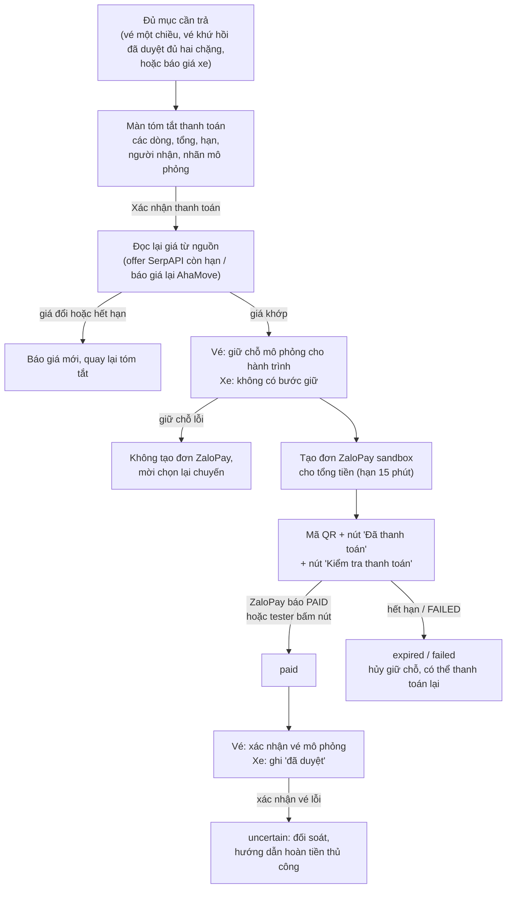
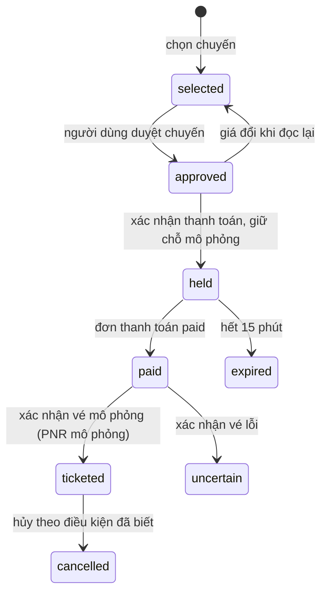
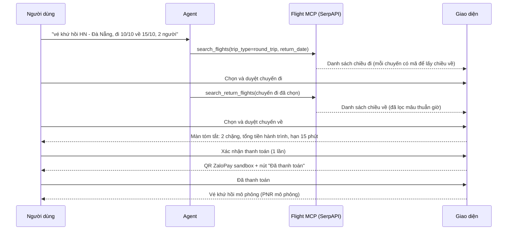
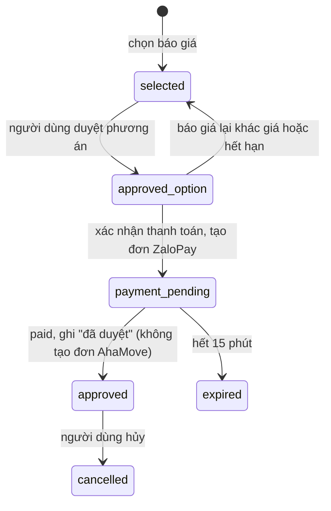
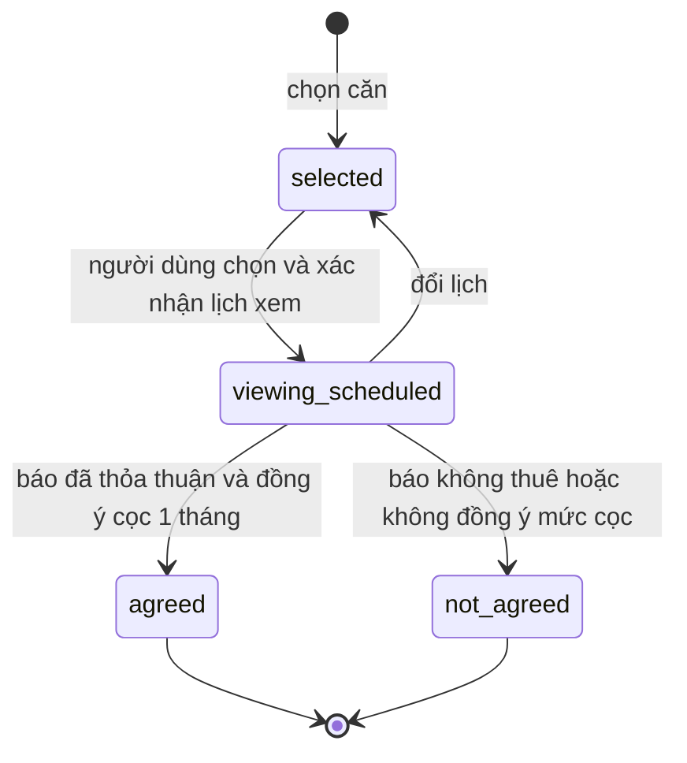

# Thiết kế thanh toán đa dịch vụ (đề xuất)

Trạng thái: **Draft v3, chưa triển khai, chưa push.** Cập nhật: 07/10/2026.
Nền đối chiếu: `origin/QuangDung` tại `26f63c4` (đã gồm PR #53 form báo giá Moving; kiểm lại 07/10 chưa có commit
mới hơn), cùng `docs/product.md`,
SPEC-004 / SPEC-016 / SPEC-017 trên `main` `6519b62`.

Tài liệu mô tả **cách định làm** phần thanh toán theo các quyết định của chủ task. Tên field, trạng thái, endpoint và
file là đề xuất, chưa có code. Việc còn để sau nằm ở mục 16; đối chiếu với tài liệu cũ ở mục 17.

## 1. Vai trò của app

SIU là **app trung gian**. App giúp người dùng tìm, so sánh, chốt phương án và đi qua bước thanh toán (ở MVP là mô
phỏng). Hợp đồng, thỏa thuận và trách nhiệm pháp lý (thuê nhà, tiền cọc, điều kiện vận chuyển, điều kiện vé) là giữa
**người dùng và bên cung cấp dịch vụ**; app không can thiệp, không giữ tiền cọc, không đứng tên hợp đồng.

## 2. Quyết định đã chốt

| # | Quyết định |
|---|---|
| D1 | Mỗi dịch vụ là **giao dịch riêng**: trạng thái, hạn, số tiền đã xác nhận, người nhận tiền, lần duyệt riêng. Không gộp các **dịch vụ khác nhau** (vé, xe, nhà) vào một lần thanh toán. |
| D2 | **Một loại giá duy nhất**, luôn kèm nguồn và hạn. Khi người dùng xác nhận thanh toán, hệ thống đọc lại giá từ nguồn; khác thì dừng và xin xác nhận lại. |
| D3 | Hành khách: **người đặt lấy từ hồ sơ tài khoản**, người đi cùng nhập tay ở form duyệt (không lưu). Hỗ trợ nhiều hành khách trong một phiên. **Không lưu CCCD, hộ chiếu**; chỉ chuyến **nội địa**. Không làm hành lý ký gửi, chọn ghế. |
| D4 | **Khứ hồi** dùng **chế độ khứ hồi có sẵn của SerpAPI**. Người dùng chọn và **duyệt chặng đi**, rồi chọn và **duyệt chặng về** (danh sách chiều về phụ thuộc chuyến đi đã chọn). Thiếu thông tin chặng về thì agent **hỏi lại**. Đủ hai chặng thì app hiện **một lần thanh toán chung** cho cả hành trình. |
| D5 | Thanh toán theo quy trình **ZaloPay sandbox**: màn tóm tắt số tiền → người dùng xác nhận → mã QR ZaloPay sandbox, bên cạnh có nút **"Đã thanh toán"** để nhóm test (vì chưa chắc trả được đơn sandbox). |
| D6 | Chuyển đồ (AhaMove) **thanh toán online theo cùng quy trình** D5. Sau khi thanh toán (mô phỏng), app **chỉ ghi "đã duyệt"**, không tạo đơn AhaMove. |
| D7 | Nhà: **đặt lịch xem** → **kết quả xem và thỏa thuận** (gộp một bước; người dùng tự trao đổi với chủ nhà rồi báo lại app). Tiền cọc **mặc định 1 tháng** tiền thuê. Người dùng **đồng ý** mức cọc thì căn được chốt; **không đồng ý** thì căn **không được chốt**. Không đối chiếu với dữ liệu cọc của tin đăng. Tiền cọc trả **thẳng cho chủ nhà**, ngoài app. |
| D8 | Agent **chỉ nhắc** về thứ tự (ví dụ nhà chưa thỏa thuận mà đã trả vé); **không chặn, không thêm bước xác nhận**. |
| D9 | Mỗi lần duyệt gắn đúng các mục, số tiền và hạn của nó. Một phần thất bại không kéo phần khác; app chỉ ra cách hủy hoặc đổi kèm phí đã biết (luật đổi kế hoạch trong `docs/product.md`). |
| D10 | Nút "Đã thanh toán" **dùng ngay** trong môi trường demo và test của nhóm. Rào chắn (ADR-015 mục *Cập nhật 2026-10-07*): cờ cấu hình riêng, mặc định tắt trong code và **bật ở môi trường của nhóm**; ghi người bấm và thời điểm; nhãn **"đánh dấu bởi tester"**; **không bao giờ bật trên production**. Việc cho người dùng ngoài nhóm dùng thử tính sau (mục 16). |
| D11 | **Mở rộng Flight MCP** cho khứ hồi (mục 8.3) và cập nhật `src/mcp_servers/flights/README.md` tương ứng. |
| D12 | **Kiểm tra mâu thuẫn ngày giờ** giữa chặng đi và chặng về; có mâu thuẫn thì agent hỏi lại, không tự sửa (mục 8.4). |
| D13 | Hạn **15 phút** cho giữ chỗ vé mô phỏng và đơn thanh toán ZaloPay sandbox. |
| D14 | Lịch xem nhà ở chế độ test mở toàn bộ khung giờ theo cấu hình mặc định ở mục 10, người dùng tự xác nhận. |

## 3. Phạm vi

| Trong phạm vi | Ngoài phạm vi |
|---|---|
| Vé nội địa một chiều và khứ hồi, **tìm thật qua SerpAPI** (khứ hồi dùng chế độ khứ hồi của SerpAPI); giữ chỗ và xuất vé **mô phỏng** trên Flight MCP | Xuất vé thật, chuyến quốc tế, nhiều chặng (multi-city), hành lý, ghế, đổi vé |
| Chuyển đồ: báo giá thật từ AhaMove staging; thanh toán theo quy trình ZaloPay sandbox; ghi "đã duyệt" | Tạo đơn AhaMove, thu hộ thật cho AhaMove |
| Nhà: đặt lịch xem (lịch mở toàn bộ ở chế độ test), báo kết quả và thỏa thuận, tiền cọc mặc định 1 tháng | Thu tiền nhà hay cọc qua app, hợp đồng điện tử, giao diện chủ nhà (làm sau) |
| Tổng tiền theo trạng thái thật của từng giao dịch | Hoàn tiền thật (ADR-015: hoàn tiền ZaloPay chưa hỗ trợ trong MVP); trả tiền cho nhà cung cấp |

## 4. Tham khảo quy trình (không làm luật cứng)

- **Vietjet, khứ hồi:**
  1. Chọn "Khứ hồi" kèm ngày đi và ngày về.
  2. Chọn chuyến và hạng vé chiều đi, rồi chọn chiều về.
  3. Nhập hành khách.
  4. Chọn dịch vụ thêm.
  5. Trang tóm tắt, rồi **một lần thanh toán**.

  Theo Vietnambooking:
  - giá khứ hồi là **tổng hai chặng**;
  - hệ thống **chỉ cho chọn ngày về sau ngày đi**; khứ hồi trong ngày phải gọi tổng đài;
  - có thể đổi hoặc hủy riêng một chiều, phí theo hạng vé.

  SIU mượn ý "chọn từng chiều, kiểm ngày về hợp lệ, thanh toán một lần ở trang tóm tắt". Không chép luật riêng của
  Vietjet: SIU cho phép khứ hồi trong ngày nếu chuyến về đủ cách giờ hạ cánh chuyến đi (mục 8.4), và hai chặng có thể
  khác hãng vì SerpAPI trả nhiều hãng.
- **SerpAPI Google Flights, chế độ khứ hồi** (đã chọn, D4):
  - Tìm với `type=1` và `return_date`: trả danh sách **chiều đi**, mỗi chuyến đi có `departure_token`.
  - Gọi lại với `departure_token` của chuyến đi đã chọn: trả danh sách **chiều về** cho chuyến đó.
  - `booking_token` dùng để xem lựa chọn đặt chỗ (không dùng trong demo).
  - Kết quả SerpAPI được cache 1 giờ.

  Tài liệu SerpAPI **không ghi rõ** giá ở danh sách chiều đi là giá một chiều hay giá khứ hồi gộp; cần kiểm bằng một
  lần gọi thật khi code (mục 16).

## 5. Hiện trạng code liên quan (`QuangDung` `26f63c4`)

| Phần | Đã có | Khoảng trống |
|---|---|---|
| Duyệt | `confirm` gửi `payload_hash` cho **toàn bộ** `summary.commit_actions`; `transaction` chạy `for action in ordered` trong một lần duyệt | Cần duyệt từng chặng hoặc phương án và một đơn thanh toán mỗi lần (D4, D9) |
| Vé bay | Flight MCP tìm **một chiều**: `FlightSearchRequest` (origin, destination, departure_date); provider SerpAPI cố định `"type": ONE_WAY`; README ghi "khứ hồi thì gọi 2 lần". Giá là tổng cho toàn bộ hành khách. Giữ chỗ mô phỏng 15 phút. Tool đặt vé chỉ có khi `FLIGHT_SIMULATION_ENABLED=true`; có cờ `agent_allow_simulated_transactions` | Chưa có chế độ khứ hồi, chưa có offer hành trình hai chặng; chưa có chế độ bật đặt vé mô phỏng cho app |
| Thanh toán | `McpTransaction`: `get_offer` → `hold_booking` → `create_payment` (ZaloPay) → chờ PAID → `confirm_booking`; `PendingPayment` có QR và hạn; `PAYMENT_EXPIRE_MINUTES` = 15 | `simulate_payment_result` chỉ đăng ký khi `PAYMENT_PROVIDER=mock` (ADR-015), nên nút "Đã thanh toán" làm ở tầng app |
| Chuyển đồ | `MovingOptions.payment_method: Literal["CASH"]`; `moving_booking` không qua Payment (Q21) | Cần đường thanh toán online mô phỏng; không gọi `create_move_order` |
| Hành khách | Schema `Passenger`, `Contact`; form PII lúc duyệt (`pii_forms` → kho PII mã hóa) | Bảng `users` chưa có hồ sơ hành khách |
| Nhà | `CommitActionKind.DEPOSIT` bị chặn (Q25) | Chưa có lịch xem, kết quả, thỏa thuận |
| Tổng tiền | `plan_progress`: "đã chốt" khi có `selected:<domain>`; tổng tháng / một lần | Chưa có đã trả, sắp trả, trả chủ nhà |
| Giao diện (commit `26f63c4` của Dũng) | Chữ hiển thị đi qua `uiText` / `formatUi` (`uiPreferences.tsx`) và `locales/en.json` (tiếng Việt / tiếng Anh). `MovingOptionsForm` có khối "Thanh toán tiền mặt"; chọn gói xe qua `VehicleGuide`, `movingCatalog.ts` | Chữ mới của luồng thanh toán phải thêm vào `en.json`; khối "Thanh toán tiền mặt" đổi theo D6 |
| Gọi Flight/Payment MCP | Chạy qua stdio; theo tài liệu kiến trúc của Khoa, `McpToolClient._session()` mở process con theo **mỗi lần gọi** | Mỗi tool trên luồng thanh toán tốn thêm thời gian khởi động process (mục 7.1) |

## 6. Mô hình dữ liệu

### 6.1. Giao dịch dịch vụ (`ServiceTransaction`)

Một mục cần cam kết; tạo khi người dùng chốt phương án.

| Field | Ý nghĩa |
|---|---|
| `id` | Ổn định qua phiên bản plan: `flight:<task>`, `moving:<task>`, `housing:<listing_id>` |
| `domain`, `task_id`, `option_id` | Dịch vụ, task, phương án đã chọn (khứ hồi: offer hành trình hai chặng) |
| `legs` | Chỉ vé: danh sách chặng (`out`, `return`), mỗi chặng có chuyến, giờ đi/đến và `approved_at` |
| `status` | Theo máy trạng thái từng domain (mục 8–10) |
| `price_vnd`, `price_source`, `price_read_at`, `price_expires_at` | Một loại giá (D2), nguồn và hạn |
| `amount_kind` | `one_time` / `monthly` / `deposit_to_landlord` |
| `payee` | Hãng bay (mô phỏng), AhaMove (mô phỏng), chủ nhà (ngoài app) |
| `payment_order_id` | Đơn thanh toán chứa giao dịch này (nếu có) |
| `mode` | `simulated` / `staging` / `sandbox` / `user_reported` |
| `cancel_info` | Cách hủy, đổi và phí **đã biết**; không biết thì ghi "chưa rõ" |

### 6.2. Đơn thanh toán (`PaymentOrder`)

Một lần thanh toán cho **một** giao dịch: vé một chiều, vé khứ hồi (cả hành trình) hoặc một báo giá xe. Không có đơn
nào gộp giao dịch của các dịch vụ khác nhau (D1).

| Field | Ý nghĩa |
|---|---|
| `id`, `domain`, `transaction_id` | Ví dụ `pay:flight:<task>` |
| `lines` | Các dòng hiển thị: từng chặng (vé) hoặc báo giá (xe); giá lúc xác nhận |
| `amount_vnd` | Tổng, đọc lại từ nguồn ngay trước khi tạo đơn |
| `approval_id`, `payload_hash` | Lần xác nhận thanh toán, gắn đúng dòng, giá, hạn |
| `zalopay_ref`, `qr_code`, `expires_at` | Đơn ZaloPay sandbox, hạn 15 phút (D13) |
| `status` | `awaiting_confirmation` → `pending` → `paid` / `failed` / `expired` / `cancelled` |
| `paid_via` | `zalopay_verified` (tra ZaloPay thấy PAID) hoặc `tester_marked` (bấm nút "Đã thanh toán") |
| `fulfilment` | Kết quả sau khi trả: vé mô phỏng đã xác nhận; với xe là "đã duyệt" |

## 7. Quy trình thanh toán chung (D5, dùng cho vé và xe)

- **Màn tóm tắt** là bước duyệt thanh toán. `payload_hash` gồm các dòng, giá, tổng, hạn và người nhận.
- **Nút "Đã thanh toán"** (D10): đặt cạnh mã QR. Bấm thì đơn chuyển `paid` với `paid_via = tester_marked`. Nút chỉ
  hiện khi bật cờ cấu hình riêng (đề xuất `PAYMENT_TESTER_CONFIRM_ENABLED`, mặc định tắt); cấu hình production từ chối
  cờ này. App ghi người bấm và thời điểm; mọi nơi hiển thị gắn nhãn "đánh dấu bởi tester". Vì `simulate_payment_result`
  của ZaloPay không được đăng ký (ADR-015 quy tắc 8), việc đánh dấu làm ở tầng app, không gọi ZaloPay.
- **"Kiểm tra thanh toán"** vẫn tra ZaloPay sandbox như hiện có. Nếu ZaloPay trả PAID thì `paid_via = zalopay_verified`.
- **Hạn hiển thị**: 15 phút cho cả giữ chỗ vé và đơn ZaloPay (D13); hiện hạn sớm hơn nếu hai mốc lệch nhau.
- Mọi nhãn ghi rõ **"mô phỏng / sandbox"**; không gọi là vé thật hay đơn thật.

### 7.1. Tốc độ của luồng thanh toán (lý thuyết, chưa đo)

Mục tiêu: sau mỗi lần bấm, người dùng thấy phản hồi ngay và thấy bước tiếp theo trong vài giây, không phải chờ một
lượt chat đầy đủ (lượt chat hiện mất khoảng 9–25 s tùy số lần gọi LLM).

| # | Cách làm | Vì sao nhanh hơn |
|---|---|---|
| L1 | **Mọi bước thanh toán là thao tác có kiểu trên UI, 0 lần gọi LLM**: duyệt chặng, mở tóm tắt, xác nhận thanh toán, "Đã thanh toán", "Kiểm tra thanh toán", đặt lịch xem nhà, báo thỏa thuận. Theo cách form báo giá Moving của PR #53 (ADR-022) | Bỏ Intake và Planner LLM khỏi luồng; Khoa đo đường form báo giá xe là 4,3 s lần đầu và khoảng 1 s khi danh mục đã nhớ tạm, 0 LLM. Chat vẫn hiểu "thanh toán đi", nhưng chỉ trả về thẻ tóm tắt, các bước sau đi bằng nút |
| L2 | **Dựng sẵn màn tóm tắt** từ dữ liệu đã có trong state lúc duyệt chặng hoặc phương án | Mở tóm tắt không gọi nhà cung cấp |
| L3 | **Đọc lại giá rẻ**: vé đọc offer đã lưu trong Flight MCP (kết quả SerpAPI cache 1 giờ), chỉ tìm lại khi offer hết hạn; xe dùng danh mục nhớ tạm 45 s của PR #53, chỉ gọi estimate | Bước đọc lại giá gần như không chờ mạng với vé; xe còn một lệnh estimate |
| L4 | **Chạy song song** các bước độc lập sau khi xác nhận: đọc lại giá, lấy hồ sơ hành khách từ kho PII, kiểm hạn | Cộng thời gian thành lấy thời gian lâu nhất |
| L5 | **Giữ thứ tự bắt buộc nhưng ngắn**: giữ chỗ trước, tạo đơn ZaloPay sau (không thu tiền khi chưa có chỗ). Hai lệnh này là hai lần gọi mạng duy nhất phải nối tiếp | Không thêm bước thừa |
| L6 | **Bỏ chi phí khởi động process MCP**: chạy Flight và Payment MCP dài hạn (HTTP, như Location/Moving) hoặc giữ một session stdio dùng lại, thay vì mở process mỗi lần gọi | Luồng vé có 4–5 lần gọi tool (`get_offer`, `hold_booking`, `create_payment`, `get_payment`, `confirm_booking`); mỗi lần bớt được thời gian khởi động Python |
| L7 | **Trả trước, làm sau**: khi ZaloPay báo PAID hoặc tester bấm "Đã thanh toán", trả ngay "Đã thanh toán, đang xác nhận vé"; xác nhận vé mô phỏng chạy nền, UI tự cập nhật | Người dùng không chờ bước cuối |
| L8 | **Kiểm trạng thái thông minh**: tra ZaloPay theo chu kỳ ngắn lúc đầu rồi giãn dần, dừng khi hết hạn 15 phút; nút "Kiểm tra thanh toán" tra ngay | Biết kết quả sớm mà không dồn request |
| L9 | **Khứ hồi**: lấy danh sách chiều về ngay khi người dùng chọn chuyến đi (hiện khung chờ trong lúc tải); tùy chọn tải trước chiều về cho vài chuyến đi đầu danh sách (cấu hình, mặc định tắt vì tốn lượt SerpAPI) | Chờ lần gọi SerpAPI thứ hai ít nhất có thể, không tốn lượt khi người dùng chưa cần |
| L10 | **Một lần ghi checkpoint mỗi thao tác**, không chạy lại cả graph | Bớt ghi và tính lại không cần thiết |
| L11 | **Phản hồi tại chỗ trên UI**: giữ form và thẻ đang mở (như PR #53), hiện từng bước "Đọc giá → Giữ chỗ → Tạo QR" với trạng thái từng bước; khóa nút trong lúc chạy để không gửi trùng | Người dùng thấy tiến trình, không tưởng app bị treo |
| L12 | **Giới hạn thời gian từng bước** (đọc giá, giữ chỗ, tạo QR); quá hạn thì báo lỗi rõ và cho thử lại, không quay vô hạn | Lỗi nhanh tốt hơn chờ lâu |

Mục tiêu thời gian để đo khi code (chưa phải số đo):

| Thao tác | Mục tiêu |
|---|---|
| Mở màn tóm tắt | Gần như tức thì (không gọi mạng) |
| Xác nhận thanh toán → thấy QR (vé) | Vài giây: đọc offer local + giữ chỗ + tạo đơn ZaloPay |
| Xác nhận thanh toán → thấy QR (xe) | Vài giây: estimate AhaMove + tạo đơn ZaloPay |
| "Đã thanh toán" → thấy trạng thái đã trả | Tức thì; vé mô phỏng hiện sau đó |
| Chọn chuyến đi → thấy danh sách chiều về | Một lần gọi SerpAPI (chưa đo thời gian SerpAPI) |

## 8. Vé máy bay

### 8.1. Một chiều

- **Hành khách** (D3): form duyệt điền sẵn người đặt từ hồ sơ; thêm người đi cùng bằng tay. Dữ liệu qua `pii_forms`
  vào kho PII, **không vào LLM**. Số hành khách thay đổi thì phải tìm lại chuyến, vì giá là tổng theo số người.
- **Không có hành lý, ghế.** Thẻ chuyến ghi "hành lý theo hạng vé, chưa xác minh" khi thiếu dữ liệu.
- Sau khi duyệt chuyến, màn tóm tắt thanh toán hiện ngay.

### 8.2. Khứ hồi (D4)

**Intake** (LLM, có kiểu, không dùng bảng từ khóa) thêm hai field:

- `trip_type`: `one_way` | `round_trip`. Mô tả cho model: khứ hồi là có chiều đi và chiều về giữa hai nơi.
- `return_date`: ngày bay chiều về; ngày tương đối ("về sau 3 ngày") tính theo ngày đi.

| Câu | Kết quả mong muốn |
|---|---|
| "vé khứ hồi Hà Nội – Đà Nẵng, đi 10/10 về 15/10" | `round_trip`; tìm khứ hồi, hiện chiều đi |
| "bay vào Đà Nẵng ngày 10, 15 bay về lại" | Như trên |
| "vé khứ hồi Hà Nội Đà Nẵng ngày 10/10" | Thiếu ngày về: agent **hỏi** "Bạn muốn bay về ngày nào?" trước khi tìm (chế độ khứ hồi của SerpAPI cần `return_date`) |
| Đã chọn chuyến đi, sau đó "về ngày 15" hoặc "về chuyến tối" | Bổ sung thông tin chặng về, lấy danh sách chiều về cho chuyến đi đã chọn |
| "vé một chiều" hoặc không nhắc chiều về | `one_way` |

**Planner**: hai task Flight có phụ thuộc:

- `flight_out`: tìm khứ hồi, trả danh sách chiều đi.
- `flight_return`: phụ thuộc chuyến đi **đã chọn** (giống chuyển đồ phụ thuộc căn đã chọn), trả danh sách chiều về.

Thanh kế hoạch hiện "Chuyến đi" → "Chuyến về" có mũi tên. Lựa chọn khóa **theo task** (ví dụ
`selected:flight:flight_out`) để chọn chiều về không ghi đè chiều đi; phải sửa các chỗ đang giả định một lựa chọn mỗi
domain (`progress.py`, `web_actions.py`, `cost_summary`).

**Giá**: giá đưa vào thanh toán là **giá của hành trình** sau khi chọn đủ hai chiều. Giá hiện ở danh sách chiều đi ghi
đúng loại giá SerpAPI trả (sẽ kiểm khi code, mục 16).

**Đổi và lỗi:**

| Lúc | Xử lý |
|---|---|
| Đổi chuyến đi sau khi đã chọn chuyến về | Lựa chọn chiều về hết hiệu lực (danh sách chiều về phụ thuộc chuyến đi), lấy lại danh sách chiều về |
| Giá hành trình đổi khi xác nhận thanh toán | Quay lại tóm tắt với giá mới; giữ lựa chọn hai chiều nếu còn |
| Giữ chỗ hành trình lỗi | Không tạo đơn ZaloPay, mời chọn lại chuyến |
| Đã `paid`, xác nhận vé lỗi | `uncertain`, đối soát; hoàn tiền thủ công vì hoàn tiền ZaloPay chưa hỗ trợ trong MVP |
| Muốn đổi hoặc hủy một chiều sau khi đã có vé | Hiện điều kiện và phí đã biết; thay đổi là giao dịch mới |

### 8.3. Mở rộng Flight MCP cho khứ hồi (D11)

| Thành phần | Thay đổi đề xuất |
|---|---|
| `FlightSearchRequest` (`schemas.py`) | Thêm `trip_type` (`one_way` mặc định, `round_trip`) và `return_date` (bắt buộc khi `round_trip`, không trước `departure_date`) |
| Provider SerpAPI (`search/serpapi.py`) | Gửi `type=1` + `return_date` khi khứ hồi; giữ `departure_token` của từng chuyến đi phía server, chỉ trả `offer_id` |
| Tool mới `search_return_flights(outbound_offer_id)` (`tools.py`, `server.py`) | Gọi SerpAPI với `departure_token`; trả các **offer hành trình** gồm hai chặng, tổng giá, hạn; lọc chuyến về mâu thuẫn giờ (mục 8.4) |
| `get_offer` | Đọc được offer hành trình hai chặng |
| `hold_booking`, `confirm_booking`, `cancel_booking` (`booking_engine.py`) | Nhận offer hành trình: một booking mô phỏng có hai chặng, hạn giữ 15 phút |
| Provider mock | Hỗ trợ cùng contract để test không cần SerpAPI key |
| `src/mcp_servers/flights/README.md` | Đã thêm mục "Đề xuất: tìm và đặt vé khứ hồi (Draft, chưa code)" |

Phía agent: `FlightSubagent` và domain tools Flight dùng `search_return_flights` cho task `flight_return`; contract
Flight trong `capabilities.py` thêm `trip_type`, `return_date`.

### 8.4. Mâu thuẫn ngày giờ giữa hai chặng (D12)

| Trường hợp | Xử lý |
|---|---|
| Ngày về trước ngày đi | Không tìm; agent hỏi lại ngày về |
| Ngày đi hoặc ngày về đã qua | Agent hỏi lại |
| Cùng ngày (khứ hồi trong ngày) | Cho phép; danh sách chiều về chỉ giữ chuyến cất cánh sau giờ hạ cánh chuyến đi cộng khoảng cách tối thiểu cấu hình được (đề xuất `ROUND_TRIP_MIN_GAP_MINUTES`). Không còn chuyến nào thì agent báo và hỏi đổi ngày |
| Chuyến đi bay qua đêm, hạ cánh sang ngày hôm sau | So theo giờ hạ cánh thực tế, không chỉ theo ngày |
| Người dùng đổi ngày đi sau khi đã chọn chiều về | Kiểm lại; mâu thuẫn thì bỏ lựa chọn chiều về và hỏi lại |
| Ngày về trước ngày dọn vào nhà, hoặc chiều đi sau ngày chuyển đồ | Chỉ **nhắc** (D8), không chặn |

Các kiểm tra này nằm trong code (validator của Intake và Flight MCP), không giao cho model tự quyết.

## 9. Chuyển đồ (D6)

- Dùng quy trình mục 7. Báo giá lại AhaMove staging trước khi tạo đơn ZaloPay (D2).
- Sau `paid`: trạng thái **`approved` ("đã duyệt")**, nhãn "thanh toán mô phỏng, chưa tạo đơn AhaMove".
  **Không** gọi `create_move_order`, không cần approval bridge.
- Liên hệ người gửi, nhận vẫn nhập ở form duyệt như hiện tại (không vào LLM).
- `MovingOptions.payment_method` cần thêm giá trị cho thanh toán online mô phỏng (hiện chỉ có `CASH`).

## 10. Nhà (D7, D14)

| Bước | Người dùng làm | App ghi |
|---|---|---|
| Chọn căn | Đã có | `selected` |
| **Đặt lịch xem** | Chọn khung giờ; chế độ test **mở toàn bộ lịch** (chưa có lịch rảnh của chủ nhà); người dùng tự xác nhận | `viewing_scheduled`, `mode = simulated`, thẻ ghi "lịch thử nghiệm, chưa liên hệ chủ nhà thật". Xác nhận xong chuyển sang bước tiếp theo |
| **Kết quả xem và thỏa thuận** (một bước) | Tự trao đổi với chủ nhà ngoài app, rồi báo: có thuê không, ngày dọn vào; app hiện mức cọc **1 tháng tiền thuê** để người dùng đồng ý hay không | Đồng ý: `agreed` (căn được chốt), ghi tiền cọc và tiền thuê. Không thuê hoặc không đồng ý mức cọc: `not_agreed` (căn **không** được chốt). `mode = user_reported` |

**Lịch test mặc định** (cấu hình được, D14): khung 30 phút, từ 08:00 đến 20:00, mở 14 ngày tới, không cho chọn giờ đã
qua.

- Mức cọc luôn là 1 tháng tiền thuê theo giá tin đăng; **không** đối chiếu với dữ liệu cọc của tin đăng.
- Tiền cọc và tiền thuê trả **thẳng cho chủ nhà**, ngoài app; app không thu, không giữ, không bảo đảm (mục 1).
  Thẻ nhà ghi rõ điều này.
- **Sau này:** màn hình chủ nhà để đăng ký lịch rảnh và điền mức cọc; khi đó mức 1 tháng chỉ là gợi ý.
- Ngày dọn vào là mốc để nhắc (mục 11).
- Không dùng `CommitActionKind.DEPOSIT`: app không thực hiện giao dịch tiền nhà.

## 11. Duyệt, thứ tự và nhắc nhở (D8, D9)

**Duyệt:**

- Duyệt **chuyến, chặng hoặc phương án**: chốt lựa chọn và giá tại thời điểm đó. Khứ hồi có hai lần duyệt chặng.
- Duyệt **thanh toán** (màn tóm tắt): một lần cho một đơn thanh toán.
- `confirm` và `transaction` xử lý **một đơn thanh toán mỗi lần**; bỏ việc một lần duyệt chạy mọi commit action.
- Đổi giá, đổi phương án, đổi hành khách sau khi duyệt → duyệt cũ hết hiệu lực (`payload_hash`).

**Nhắc (không chặn):** agent và màn tóm tắt hiện một dòng nhắc khi:

| Khi | Nhắc |
|---|---|
| Thanh toán vé hoặc xe mà nhà chưa `agreed` | "Bạn chưa báo đã thỏa thuận nhà. Nếu nhà không thành, vé hoặc xe có thể phải hủy theo điều kiện của bên cung cấp." |
| Ngày chuyển đồ trước ngày dọn vào đã báo | "Ngày chuyển (X) trước ngày dọn vào (Y)." |
| Chiều đi sau ngày chuyển đồ, hoặc chiều về trước ngày dọn vào | Tương tự, nêu hai ngày |

Người dùng vẫn thanh toán bình thường; không có thêm nút "Vẫn đặt", không ghi override.

**Một phần thất bại hoặc thay đổi** (theo `docs/product.md`, *Changing a finalized plan*):

| Tình huống | Xử lý |
|---|---|
| Nhà `not_agreed` sau khi vé đã `ticketed` | Vé giữ nguyên; thẻ vé hiện cách hủy và phí đã biết (vé mô phỏng: hủy mô phỏng; hoàn tiền thủ công) |
| Nhà `not_agreed` khi xe đã `approved` | Xe giữ nguyên trạng thái; hiện cách hủy; báo giá cho căn mới là giao dịch mới |
| Đổi căn sau khi đã duyệt xe | Như trên |
| Kết quả không chắc (`uncertain`) | Không thử lại tự động; đối soát trước (đã có `pending_verification`) |

## 12. Tổng tiền và thanh kế hoạch

| Nhãn trên thanh kế hoạch | Từ trạng thái |
|---|---|
| Đã xem xét | Có kết quả, chưa chọn |
| Đã chốt | Đã chọn hoặc đã duyệt chuyến, chặng, phương án |
| Chờ thanh toán (kèm hạn) | Đơn thanh toán `awaiting_confirmation`, `pending`; vé `held` |
| Đã thanh toán (mô phỏng) | Vé `ticketed`; xe `approved` |
| Đã hẹn xem / Đã thỏa thuận / Không chốt | `viewing_scheduled`, `agreed`, `not_agreed` |
| Cần xử lý | `expired`, `failed`, `uncertain` |

"Tổng đã chốt" tách bốn dòng:

1. **Đã thanh toán qua app (mô phỏng)**: vé, xe.
2. **Chờ thanh toán**: các đơn đang chờ, kèm hạn sớm nhất.
3. **Trả trực tiếp cho chủ nhà**: tiền cọc và tháng đầu của căn `agreed`.
4. **Hằng tháng**: tiền thuê.

Dòng có `paid_via = tester_marked` ghi thêm "(đánh dấu bởi tester)".

## 13. Agent và hội thoại

- Intake: thêm `trip_type`, `return_date`; hỏi lại khi thiếu ngày về hoặc mâu thuẫn ngày (mục 8.4). Hiểu yêu cầu theo
  từng giao dịch ("thanh toán vé khứ hồi", "đặt xe"), không tự mở rộng sang dịch vụ khác. Câu về nhà ("xem rồi, ưng
  căn đó", "đã thỏa thuận") được hiểu, nhưng việc ghi đi qua form xác nhận trên UI để số liệu đúng.
- Planner: khứ hồi là `flight_out` → `flight_return`; mỗi đơn thanh toán là một commit có kiểu riêng.
- Respond: nêu trạng thái từng giao dịch và bước tiếp theo; chèn câu nhắc (D8) khi điều kiện mục 11 đúng; không nói
  "đã đặt xong" khi mới xong một phần.
- Dữ liệu cá nhân (hành khách, liên hệ) không vào prompt LLM (D16 hiện có).

## 14. Thay đổi dự kiến theo file (chưa làm)

| Tầng | File (trên `QuangDung`) | Việc |
|---|---|---|
| Hồ sơ hành khách | `Frontend/store.py`, `Frontend/server.py`, trang tài khoản | Hồ sơ người đặt **mã hóa** (danh xưng, họ, tên, ngày sinh, điện thoại); không CCCD, hộ chiếu |
| Mô hình | `src/agents/models.py`, `state.py` | `ServiceTransaction`, `PaymentOrder`, trạng thái từng domain, khóa lựa chọn theo task |
| Duyệt, thanh toán | `nodes/confirm.py`, `nodes/transaction.py`, `nodes/cost_summary.py`, `src/services/adapters/commit.py`, `src/api/routes.py` | Duyệt chặng; một đơn thanh toán mỗi lần; giữ chỗ hành trình rồi một đơn ZaloPay; endpoint đánh dấu "Đã thanh toán" có cờ |
| Flight MCP | `src/mcp_servers/flights/schemas.py`, `search/serpapi.py`, `search/mock.py`, `tools.py`, `server.py`, `booking_engine.py`, `README.md` | Chế độ khứ hồi SerpAPI, `search_return_flights`, offer hành trình hai chặng, kiểm mâu thuẫn giờ (mục 8.3, 8.4) |
| Agent vé bay | `intake_llm.py`, `planner_llm.py`, `subagents/capabilities.py`, `subagents/services/flight.py`, `domain_tools.py`, `wiring.py` | `trip_type`, `return_date`, `flight_out` → `flight_return`; bật đặt vé mô phỏng khi `AGENT_ALLOW_SIMULATED_TRANSACTIONS` và `FLIGHT_SIMULATION_ENABLED` cùng bật |
| Chuyển đồ | `src/models/moving_options.py`, `commit.py` | Thanh toán online mô phỏng; ghi `approved`, không tạo đơn |
| Nhà | Endpoint UI mới, `progress.py` | Lịch xem (mặc định mục 10), kết quả và thỏa thuận, cọc 1 tháng đồng ý hay không |
| Giao diện | `PlanPeek.tsx`, `PlanProgress.tsx`, `Transactions.tsx`, `ServiceWorkspaces.tsx`, `Forms.tsx`, `MovingOptionsForm.tsx`, `locales/en.json` | Thẻ giao dịch, màn tóm tắt thanh toán, QR và nút "Đã thanh toán", chọn chiều đi rồi chiều về, lịch xem nhà, tổng bốn dòng, hiện tiến trình từng bước (L11); đổi khối "Thanh toán tiền mặt"; chữ mới qua `uiText` và `en.json` |
| Tốc độ | `src/api/` (endpoint thao tác thanh toán), `src/services/adapters/mcp.py` hoặc cấu hình Flight/Payment MCP | Endpoint có kiểu 0 LLM (L1); MCP dài hạn hoặc session dùng lại (L6); xác nhận vé chạy nền (L7) |
| Tài liệu | Mục 17 | Cập nhật tài liệu cũ |

## 15. Kiểm thử dự kiến

| Nhóm | Case |
|---|---|
| Khứ hồi | Đủ hai ngày; thiếu ngày về (hỏi lại); ngày về trước ngày đi; khứ hồi trong ngày còn và hết chuyến hợp lệ; chuyến đi qua đêm; đổi chuyến đi sau khi đã chọn chiều về; "vé một chiều" |
| Vé bay | Hồ sơ thiếu ngày sinh; nhiều hành khách; giá đổi khi xác nhận; hết hạn 15 phút; giữ chỗ lỗi; PAID rồi xác nhận lỗi (`uncertain`) |
| Thanh toán | QR + "Kiểm tra thanh toán"; nút "Đã thanh toán" chỉ hiện khi bật cờ; production từ chối cờ; nhãn "đánh dấu bởi tester" |
| Chuyển đồ | Báo giá lại khác giá; đã thanh toán → "đã duyệt", không có lệnh tạo đơn AhaMove nào được gọi |
| Nhà | Đặt lịch trong khung mặc định; giờ đã qua bị từ chối; đồng ý cọc → `agreed`; không đồng ý → `not_agreed`, căn không chốt |
| Nhắc | Thanh toán vé khi nhà chưa thỏa thuận → có câu nhắc, vẫn thanh toán được |
| An toàn | Không dữ liệu hành khách nào trong prompt hoặc log; gửi lại cùng `payload_hash` không tạo thanh toán hay giữ chỗ lần hai |

Chạy trên stack thật: LLM thật, SerpAPI thật, AhaMove staging, ZaloPay sandbox; vé là mô phỏng và được ghi rõ.

## 16. Việc còn để sau

1. **Cho người ngoài nhóm dùng thử và cảm nhận**: triển khai sau; khi đó mới quyết định cách dùng nút "Đã thanh toán"
   với họ. Hiện nút vẫn bật cho môi trường của nhóm (D10).
2. **Loại giá ở danh sách chiều đi của SerpAPI** (một chiều hay khứ hồi gộp): kiểm bằng một lần gọi thật khi bắt đầu
   code, rồi ghi vào README Flight MCP.
3. **Giá trị `ROUND_TRIP_MIN_GAP_MINUTES`**: chọn khi code (cấu hình được).

## 17. Đối chiếu với tài liệu cũ

Các tài liệu dưới đây là bản dùng để demo tuần trước. Thiết kế này là bước tiếp theo của chúng: giữ nguyên các nguyên
tắc an toàn đã có (duyệt gắn đúng số tiền và mục, đọc lại giá trước khi trả, chống ghi lặp, dữ liệu cá nhân không vào
LLM, ghi rõ mô phỏng) và mở thêm luồng thanh toán ở chế độ mô phỏng.

### 17.1. Đã cập nhật trên `QuangDung` (07/10, chưa commit)

Tài liệu mô tả **code hiện tại** chỉ được thêm ghi chú trỏ sang thiết kế này, không viết lại, vì code chưa đổi.

| Tài liệu | Cập nhật |
|---|---|
| `docs/architecture/agent-graph.md` | Ghi chú đầu file; Q21 (chuyển đồ thanh toán online mô phỏng) và Q25 (lịch xem, thỏa thuận, cọc; vẫn không có commit `deposit`) thêm dòng "Đề xuất 07/10" |
| `docs/adr/ADR-019-local-integrated-mvp.md` | Ghi chú dưới dòng "Payment demo độc lập với Moving CASH" |
| `docs/adr/ADR-015-zalopay-payment-and-data-privacy.md` | Mục *Cập nhật 2026-10-07*: ngoại lệ hẹp cho quy tắc 8 với rào chắn D10 |
| `docs/specs/SPEC-004-ahamove-moving-service.md` | Làm rõ non-goal "Payment-gateway implementation": thanh toán do app làm, Moving service vẫn không có cổng thanh toán |
| `docs/runbooks/local-mvp.md` | Ghi chú: đoạn CASH là hành vi code hiện tại |
| `docs/architecture/mvp-architecture.md` (Khoa) | Ghi chú cuối §8 về phạm vi giao dịch trong thiết kế mới |
| `Frontend/SERVICE_AUDIT.md` (Dũng) | Ghi chú sau đoạn "Chuyển đồ hiện dùng CASH" |
| `docs/review/mvp-architecture.md` | Ghi chú ở §7.1 về trạng thái và tổng tiền mới |
| `src/mcp_servers/flights/README.md` | Mục đề xuất tìm và đặt vé khứ hồi (D11); ghi chú ở dòng `search_flights` |

### 17.2. Đã chốt, chờ áp dụng sau khi PR #42 merge

Ba tài liệu dưới đây chỉ có trên `main`. Chủ task chọn **chờ PR #42 (`QuangDung` → `main`) merge** rồi sửa cùng một
chỗ. Nội dung sửa đã soạn sẵn ở Phụ lục A.

| # | Tài liệu | Quyết định 07/10 |
|---|---|---|
| M1 | SPEC-017 AC-12 | Áp rào chắn D10: vé xuất từ thanh toán do tester đánh dấu là mô phỏng và được gắn nhãn |
| M2 | SPEC-017 AC-08, TRV-01, phạm vi | Đổi thành "đặt vé mô phỏng đã bật"; thêm khứ hồi theo chế độ khứ hồi SerpAPI, kiểm mâu thuẫn ngày giờ |
| M3 | SPEC-016 | Đưa đặt lịch xem và báo kết quả, thỏa thuận vào phạm vi; cọc mặc định 1 tháng, không đồng ý thì không chốt căn |
| M4 | `docs/product.md` | Thêm đoạn vai trò trung gian |

## Phụ lục A. Nội dung soạn sẵn cho các tài liệu trên `main`

Viết bằng tiếng Anh cho khớp ngôn ngữ của các file đó. Áp dụng sau khi PR #42 merge; chưa sửa file nào trên `main`.

### A.1. `docs/specs/SPEC-017-travel-and-flight-booking.md`

- Thêm dưới dòng trạng thái:
  > Update 2026-10-07 (Draft, not implemented): the demo enables a **simulated** booking path per
  > `docs/review/payment-design.md`. Search stays live through SerpApi; holds, tickets and PNRs are simulated and
  > labeled per action (AC-18). Real ticketing remains unavailable.
- Thay AC-08:
  > SPEC-017/AC-08 | A booking request in the current application runs the labeled simulated path: simulated hold,
  > a ZaloPay sandbox payment order, then a simulated ticket. No real ticket or real charge is created, and valid
  > independent read tasks continue.
- Thêm vào cuối AC-12:
  > In test environments only, a tester may mark a sandbox payment order as paid (`paid_via = tester_marked`). The
  > control is off by default, records who and when, is labeled "marked by tester", and is never enabled in
  > production (ADR-015 update 2026-10-07). A ticket issued from a tester-marked payment is simulated and labeled so.
- Thay TRV-01:
  > TRV-01 | After choosing an offer, the customer asks to book it. | Run the labeled simulated path; create no real
  > ticket or charge; independent read tasks continue. | AC-05, AC-08, AC-18
- Thêm vào phạm vi (*Problem and scope*):
  > A **round trip** uses SerpApi's round-trip mode: the customer selects and approves an outbound flight, then
  > selects and approves a return flight from the options for that outbound flight. Missing return information is
  > asked for. One payment order covers the itinerary once both legs are approved. Multi-city trips remain out of
  > scope.
- Thêm tiêu chí:
  > SPEC-017/AC-21 | "Round trip" and equivalent phrasing produce an outbound task and a return task that depends on
  > the selected outbound flight; a missing return date is asked for before the round-trip search.
  >
  > SPEC-017/AC-22 | The payment summary appears only after both legs are approved; it shows both legs and the
  > itinerary total, re-reads the price before the payment order, and a failed hold creates no payment order.
  >
  > SPEC-017/AC-23 | A return date before the departure date is rejected with a question; a same-day return lists
  > only flights departing after the outbound arrival plus a configured minimum gap; changing the outbound flight
  > invalidates the selected return flight.

### A.2. `docs/specs/SPEC-016-housing-search.md`

- Thay dòng *Contact advertiser / arrange viewing* trong bảng *Feature scope review*:
  > In scope (2026-10-07, Draft): schedule a viewing and report the viewing result and agreement. Until a landlord
  > availability screen exists, test mode opens the full calendar (30-minute slots, 08:00–20:00, next 14 days) and
  > the user confirms the slot. The app does not contact the landlord.
- Thay dòng *Sign a lease, pay a deposit, book housing*:
  > Outside the app. The user and landlord agree on the lease and deposit directly and are responsible for them. The
  > app shows a default deposit of one month's rent; if the user accepts, the home is confirmed in the plan, and if
  > not, the home is not confirmed. Listing deposit data is not checked. The app never collects housing money.
- Thêm tiêu chí:
  > SPEC-016/AC-13 | After choosing a home, the user can schedule a viewing; in test mode every slot in the default
  > window is open, past slots are rejected, and the confirmed viewing is labeled as a test schedule.
  >
  > SPEC-016/AC-14 | The user reports the outcome; accepting the one-month deposit confirms the home and the plan
  > shows the deposit and first month as paid directly to the landlord, outside the app; rejecting it leaves the
  > home unconfirmed.

### A.3. `docs/product.md`

Thêm mục mới, ví dụ sau phần *MVP scope*:

> ## Platform role
>
> SIU is an intermediary platform. It helps users find, compare and confirm services and, in the demo, walks them
> through a simulated payment step (ZaloPay sandbox). Contracts, agreements and legal responsibility for housing,
> moving and travel are between the user and the provider; SIU does not hold housing deposits or sign leases. If
> real payments are introduced, SIU may assist with collection on behalf of a provider without becoming a party to
> the agreement; that model requires merchant and provider agreements and a separate decision.

## Nguồn tham khảo

- [Vietjet — Vé khứ hồi và cách đặt](https://www.vietjetair.com/vi/news/cam-nang-du-lich-1640944806320/ve-may-bay-khu-hoi-la-gi-cach-dat-ve-may-bay-khu-hoi-1667032230942)
- [Vietjet — Round-trip booking](https://www.vietjetair.com/en/destinations/experience/what-is-a-round-trip-airline-ticket-how-to-book-round-trip-airline-tickets)
- [Vietnambooking — Vé khứ hồi Vietjet](https://www.vietnambooking.com/ve-may-bay/khu-hoi-vietjet.html)
- [Vietnambooking — Đặt vé Vietjet online](https://www.vietnambooking.com/ve-may-bay/tin-tuc/cach-dat-ve-may-bay-vietjet-air-online-qua-mang.html)
- [SerpApi — Google Flights API](https://serpapi.com/google-flights-api)
- [SerpApi — Scraping Google Flights](https://serpapi.com/blog/scraping-google-flights-using-node-js-and-serpapi/)
- [ZaloPay — Create order](https://docs.zalopay.vn/docs/specs/order-create)
