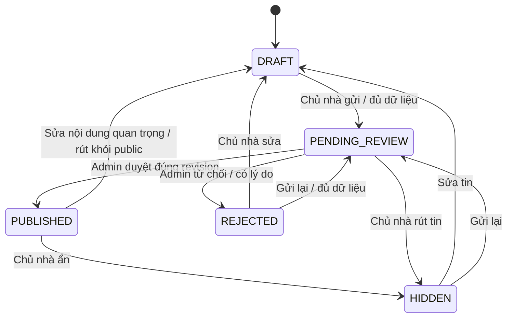

# ReloHome — audit quản lý tin đăng và kế hoạch MVP

> Audit trước triển khai; trạng thái mới xem [báo cáo triển khai](housing-cloud-implementation-2026-10-12.md).
Ngày: 12/10/2026, múi giờ Asia/Saigon. Trạng thái: **đề xuất để duyệt; chưa triển khai code**.

Cập nhật theo trao đổi tiếp: giữ tài khoản và luồng Customer/Landlord hiện hữu. Admin có lối đăng nhập riêng ở màn đăng nhập và workspace `/admin`, dùng lại authentication/session/database hiện có. Không chuyển thành menu ba workspace cho mọi tài khoản. Ưu tiên hoàn thiện trải nghiệm cho thuê với địa chỉ và bản đồ; kiểm chứng dữ liệu PR127 trước khi đề xuất thay đổi chính sách dữ liệu cũ.

Người dùng đã xác nhận “trang chủ thuê” cần nâng cấp là **khu chủ nhà đăng/quản lý nhà cho thuê**, không phải thay giao diện Customer Search. Đây là xác nhận phạm vi, chưa phải duyệt triển khai code.

Sau khi khởi động bản PR127, đã bổ sung [đối chiếu Airbnb/Zillow/Booking.com/Agoda và kế hoạch hoàn thiện dashboard](../design/landlord-workspace-mvp-2026-10-12.md). Kiểm tra local cho thấy chưa cấu hình tài khoản Housing Moderator; hiện có thể chuẩn bị tin nhưng chưa có người có quyền xử lý review cho tin mới. Ưu tiên hoàn tất luồng P0 rồi quản lý nhiều phòng/ảnh/inbox/lịch xem P1, sau đó thống kê có định nghĩa P2.

## 1. Baseline và cách tránh xung đột

- Đã `git fetch origin --prune` trước khi đọc code.
- `origin/main`: `09ac457ab1326bb99a261ce35a1cc9a0550290b7`.
- `origin/QuangDung`: `c1de7d48626c1bb84e6bce3fdd08686046f7cee5`.
- `main...QuangDung`: 0 commit riêng của main, 13 commit riêng của QuangDung. QuangDung đã chứa toàn bộ main ở thời điểm audit.
- [PR127](https://github.com/AI20K-Build-Phase-Cohort-4/P-044/pull/127) đang OPEN, nguồn QuangDung, đích main, GitHub báo MERGEABLE/CLEAN. Các check đã chạy thành công; hai check Moving bị skipped, không tính là đã kiểm chứng.
- Diff hai head có 30 file, chủ yếu frontend form dịch vụ/điều hướng, tài liệu và ZIP Housing. Không có diff trong `src/`, `Frontend/server.py`, `Frontend/store.py` hay `Maps VN/LifeFlow/`. Vì vậy các phát hiện backend/database bên dưới áp dụng cho cả hai baseline.
- Checkout đang làm việc là `feat/housing-product-v1-finish`, có sửa `presentation/README.md` và nhiều artifact chưa tracked. Không pull/merge trực tiếp lên checkout này, không stash/reset và không đụng file của người dùng.
- Code mới đã được lấy về và đọc trong worktree detached riêng tại `/tmp/relohome-audit-s6N6T7`. Git LFS smudge được tắt; không tải/restore ZIP vào DB ứng dụng.

Phạm vi đã khảo sát: inventory 1.107 file tracked của baseline mới; kiến trúc, sản phẩm, authentication/gateway, API và graph Agent, Housing CRUD/moderation, schema và migrations, importer/geocode, Search/Map/MCP, frontend workspace/design system, CI/root tooling và các test liên quan. Đây là audit theo phạm vi quản lý tin; không phải chứng nhận mọi dòng code, provider hoặc toàn bộ hệ thống production.

Catalogue skill hiện có không có skill audit repository/thiết kế phân quyền phù hợp. Sites dành cho xây dựng/hosting website bằng Sites, không phù hợp với audit repo này; không cài plugin hoặc skill mới. Dùng Git/GitHub CLI, đọc source, kiểm thử có mục tiêu và tài liệu chính thức Airbnb/VIETMAP.

## 2. Kết luận

**Nâng cấp nền tảng đã có, không xây lại hệ thống quản lý tin.** Repo đã có property → unit → listing, quyền quản lý theo địa điểm, hồ sơ người đăng, upload ảnh, hàng chờ kiểm duyệt, trạng thái công khai và còn trống riêng biệt, REST/MCP cùng dùng một query service.

Phần cần sửa tập trung vào: workspace Admin riêng; kiểm tra đầy đủ trước submit/approve; thay đổi quan trọng phải duyệt lại; transaction/revision và điều kiện public nhất quán; ảnh chưa duyệt; kết nối Vietmap trực tiếp vào form; chính sách cho tin crawl cũ.

Mô hình một tài khoản chuyển giữa thuê và cho thuê phù hợp với [Airbnb: switching between hosting and traveling](https://www.airbnb.com/help/article/3546). Chỉ tham khảo cách tổ chức workspace, không sao chép hệ thống xác minh/thanh toán của Airbnb.

## 3. Đã có và chưa có theo yêu cầu

| Yêu cầu | Đã có trong code | Khoảng trống cần làm |
|---|---|---|
| Customer và Landlord cùng tài khoản | Session/user chung; `/landlord`; nút đổi chế độ ở header; nhớ chế độ theo thiết bị | Giữ luồng hiện hữu theo yêu cầu cập nhật; tập trung hoàn thiện trải nghiệm cho thuê |
| Chỉ Admin duyệt/từ chối | `actor()` xác thực token nội bộ; `moderator()` dùng `HOUSING_MODERATOR_IDS`; không tự duyệt địa điểm mình quản lý | Tách UI `/admin`; không thêm role do client tự khai; kiểm tra lại điều kiện tin ở endpoint approve |
| Chủ nhà tạo/sửa/quản lý | CRUD property/unit/listing; membership kiểm tra ở backend; API PATCH unit đã có | Bổ sung UI sửa phòng; UX sửa tin published dễ dùng; validation ở thời điểm gửi duyệt |
| DRAFT → PENDING_REVIEW → PUBLISHED/REJECTED | Đã có đầy đủ trạng thái, lý do từ chối, sửa rejected rồi submit lại | Chưa yêu cầu lý do cụ thể; submit/review thiếu expected revision; chưa kiểm nội dung hoàn chỉnh |
| Ẩn tin, đã thuê | `hidden`; `vacant/rented/paused`; cập nhật `active/inactive` | Ghi đồng bộ trong một transaction; chặn public bằng điều kiện dữ liệu thực |
| Nội dung quan trọng phải duyệt lại | Listing PATCH chặn published và pending; phải hide trước khi sửa | Property/unit PATCH chưa làm mất hiệu lực duyệt; media POST không kiểm trạng thái tin |
| Admin danh sách/chi tiết/filter | Tab moderation có hosts/properties/listings đang chờ | Workspace riêng; filter các trạng thái; pagination; chi tiết đầy đủ kể cả ảnh đã duyệt và tọa độ |
| Nhập địa chỉ và Vietmap | Form nhập địa chỉ/tìm local place/nhập tọa độ; script offline dùng VIETMAP Search/Place v4 | Chưa có adapter runtime cho form; không lưu bằng chứng lựa chọn provider trong luồng tự đăng |
| Search/Map/AI chỉ thấy tin hợp lệ | REST và MCP dùng chung `HousingQueryService`; `map_points` có trigger đồng bộ | Đọc public chủ yếu dựa vào canonical `active`; chưa có gate thống nhất về moderation/availability/location; thumbnail chưa lọc approved |
| Nhiều phòng cùng tọa độ | Unit/listing có ID riêng; unique phòng theo property + unit_code; importer dùng source identity | Giữ cơ chế này; thêm regression Search/Map/cluster/MCP cho cùng pin |
| Giữ dữ liệu/chức năng/design | PostGIS + SQLite hiện hữu; CSS workspace, locale, theme và MapLibre đã có | Migration additive, bảo toàn ID/giá/lịch sử; xử lý rõ dữ liệu crawl không có moderation/availability |

## 4. Phát hiện cụ thể và mức ưu tiên

Đường dẫn/line dưới đây thuộc head QuangDung đã khóa ở mục 1. Source có thể xem qua [tree baseline](https://github.com/AI20K-Build-Phase-Cohort-4/P-044/tree/c1de7d48626c1bb84e6bce3fdd08686046f7cee5).

### A1 — P0: sửa property/unit có thể thay nội dung công khai mà không duyệt lại

- `Maps VN/LifeFlow/platform-api/src/housing-management.ts:360`: PATCH property thay tên/loại/địa chỉ/geom nhưng không reset publication của các tin liên quan.
- Cùng file, line 407: PATCH unit thay diện tích/phòng ngủ/tiện nghi mà không reset publication.
- Migration `019_housing_map_points.sql` đồng bộ ngay thay đổi property/unit/place sang `map_points`. Tin đã active có thể hiện nội dung mới ngay.
- Đây là thiếu sót về quy trình duyệt, không phải thiếu ownership: các PATCH vẫn gọi `member()`.

Sửa tối thiểu: một helper transaction dùng chung để sửa nội dung và chuyển các tin bị ảnh hưởng về draft/inactive, tăng revision, đồng bộ map. Thay địa chỉ/tọa độ cần mapping và Admin kiểm tra lại trước public.

### A2 — P0: submit/approve chưa kiểm tra tin hoàn chỉnh

- `housing-management.ts:564`: submit chỉ kiểm membership active, host profile và trạng thái, sau đó chuyển pending_review.
- Description cho phép rỗng; address là record tùy ý; diện tích nullable; không yêu cầu một ảnh hợp lệ.
- `housing-management.ts:647`: approve kiểm moderator/self-review/host verification, nhưng không chạy lại kiểm tra đầy đủ, không kiểm mapping địa chỉ và không ràng buộc quyết định với revision đã xem.
- Integration fixture hiện tạo listing không description/ảnh rồi duyệt thành công; bộ test hiện tại chưa mô tả yêu cầu validation mới.

Sửa tối thiểu: một validator server dùng ở cả submit và approve; trả lỗi từng trường cho UI. Draft tiếp tục được lưu chưa hoàn chỉnh.

### A3 — P0: cập nhật trạng thái công khai chưa atomic

- Hide, soft delete, availability và review ghi `managed_listings`, `listings` và media bằng các query độc lập.
- Nếu query sau lỗi, trạng thái có thể lệch; thao tác đồng thời có thể dùng thông tin cũ. Đây là rủi ro xác định từ source, chưa tái hiện bằng fault injection trên DB trong audit này.
- Search/Map/get chủ yếu dựa vào `listings.status='active'`/`map_points`, không xác thực trực tiếp `published AND vacant` cho mọi trường hợp.

Sửa tối thiểu: transaction + khóa/revision cho các chuyển trạng thái; một định nghĩa public eligibility dùng chung cho indexed map, search có/không text, detail và route Housing. Đồng bộ read model ngay trong cùng transaction.

### A4 — P0: thumbnail có thể dùng ảnh chưa duyệt

- Media POST ở line 551 chỉ kiểm ownership và URL hợp lệ về cú pháp; không giới hạn trạng thái tin, không chứng minh file là ảnh đã qua upload validation.
- `housing-service.ts:283`: detail lọc `moderation_status='approved'`.
- Cùng file, line 394 và 494: thumbnail Map/Search lấy ảnh đầu tiên mà không lọc approved.
- Tin published có thể nhận thêm ảnh pending; nếu không có ảnh approved, thumbnail có thể lấy ảnh pending.

Sửa tối thiểu: public thumbnail/detail chỉ dùng approved; ảnh mới hoặc thay ảnh phải cập nhật revision và đi qua review. Chỉ đường upload đã kiểm tra MIME/bytes/đọc ảnh được đánh dấu là ảnh hợp lệ; client không tự khai cờ validated hoặc đưa URL tùy ý thay cho ảnh đã kiểm tra.

### A5 — P1: workspace Admin và khả năng review chưa đủ

- `Frontend/src/landlord/Workspace.tsx:148,1707`: moderation đang nằm trong LandlordWorkspace, capability được suy ra từ gọi queue thành công.
- Queue chỉ trả pending; chưa có filter/history/detail Admin riêng. Preview ảnh chỉ chứa pending_media; thiếu tọa độ, diện tích và toàn bộ thông tin cần kiểm tra.
- Backend từ chối cho phép reason rỗng và tự dùng “Cần bổ sung thông tin.”; UI cũng không bắt nhập.

Sửa tối thiểu: tách component review hiện hữu sang `/admin`; trả capability từ Platform API; filter/pagination và detail riêng bảo vệ bởi moderator. Bắt lý do không rỗng ở backend và UI. Khi backend/capability lỗi, hiện trạng thái thử lại, không suy ra người dùng được quyền Admin.

### A6 — P1: Vietmap hiện là batch tool, chưa phục vụ tự đăng

- `Frontend/src/landlord/Workspace.tsx:526`: PropertyForm dùng `/map/search`, lấy label/lat/lng; khi chọn không giữ provider identity.
- `LocationService.resolve()` tìm trong PostGIS; không gọi Vietmap.
- `scripts/housing-geocode-full.py` có Search v4 → Place v4, quota/cache và bảo vệ nguồn hiện hữu; không nên chạy nguyên batch tool trong request tạo nhà.
- Địa chỉ gõ lại sau khi chọn chưa làm mất hiệu lực điểm đã chọn. Cần gắn tọa độ vào đúng phiên bản địa chỉ.

Sửa tối thiểu: adapter provider nhỏ trong Platform API hiện hữu, cùng gateway auth; lưu provider ref + địa chỉ + tọa độ + thời điểm/kết quả xác nhận. Đổi address phải clear mapping.

### A7 — P1: tin crawl không có cùng bằng chứng công khai với tin tự đăng

- Importer giữ partner/source identity và có thể ghi canonical active; không tạo `managed_listings` cho tin crawl.
- `verification_status` gồm unverified/source_verified/lifeflow_verified. Đây là xác minh nguồn, không thay thế duyệt nội dung bởi Admin hoặc xác nhận phòng còn trống.
- Handoff PR127 ghi 38.930 bản ghi JSONL; số này là bằng chứng trong tài liệu bàn giao, không phải kiểm đếm DB đang chạy trong audit.
- Không thể vừa giữ mọi crawl active công khai vô điều kiện, vừa tuyên bố mọi tin đều đã duyệt và còn khả dụng.

Đây là khác biệt giữa dữ liệu nguồn tìm kiếm và tin do chủ nhà tự đăng, không đủ để kết luận công việc geocode của QuangDung bị lỗi. Theo yêu cầu cập nhật “giữ nguyên như cũ”, chưa đề xuất tự ẩn/reset hàng loạt tin crawl. Kiểm chứng artifact PR127 riêng; trước mắt siết workflow tin tự đăng. Nếu muốn áp dụng quy tắc duyệt/khả dụng cho toàn bộ nguồn crawl, cần duyệt riêng chính sách chuyển đổi; không tự tạo owner giả hoặc tự đánh dấu đã duyệt.

## 5. Quyết định MVP đề xuất

1. Một tài khoản; Customer và Landlord là workspace, không phải hai role loại trừ. Quyền quản lý thực vẫn theo property membership.
2. Admin có lối “Đăng nhập Admin” tại màn đăng nhập và workspace `/admin`, dùng lại auth/password/session hiện hữu và quyền `HOUSING_MODERATOR_IDS`. Đăng nhập Admin phải kiểm quyền ở server; không có đăng ký Admin công khai. Customer/Landlord không tự nâng quyền qua request, preference hoặc localStorage. Admin cũng không tự duyệt tin mình quản lý/tạo. Không thêm hệ thống tài khoản hoặc database auth thứ hai.
3. Giữ host profile và cơ chế xác minh thủ công đang có; không bổ sung CCCD/eKYC, AI moderation, risk scoring hoặc dịch vụ mới. Gom thông tin trong Admin để giảm thao tác; không mở rộng quy trình xác minh.
4. Giữ enum lowercase và các bảng hiện có. Nhãn UI ánh xạ DRAFT/PENDING_REVIEW/PUBLISHED/REJECTED theo yêu cầu; không đổi enum chỉ để viết hoa.
5. Nội dung quan trọng thay đổi: tạm rút tin khỏi public, lưu draft, chủ nhà bấm gửi duyệt lại. MVP không cần lưu đồng thời bản published và một phiên bản draft khác.
6. `vacant/rented/paused` vẫn độc lập với publication. Đánh dấu rented/paused hoặc hide phải loại khỏi tập public sau commit; mở lại phòng chỉ public nếu nội dung vẫn đã duyệt hợp lệ.
7. Giữ dữ liệu nguồn/crawl và hoạt động đọc hiện hữu trong phạm vi nâng cấp lần này; không tự backfill “đã duyệt/còn trống”, không tự ẩn hàng loạt. Quy tắc public chặt áp dụng cho tin chủ nhà tự đăng. Việc áp dụng nó cho toàn bộ crawl là chính sách riêng cần duyệt, vì geocode hoàn tất không chứng minh phòng đang còn trống hoặc có quyết định duyệt của Admin.

### Luồng tin



Room availability là trạng thái riêng; đổi phòng sang rented không đổi published thành rejected. Sau khi phòng còn trống trở lại, chỉ khôi phục hiển thị khi approval vẫn hợp lệ.

### Nội dung phải đủ trước submit và approve

| Trường | Kiểm tra server MVP |
|---|---|
| Tiêu đề | Trim, ít nhất 5 ký tự, tối đa 240 theo giới hạn hiện có |
| Mô tả | Trim, không rỗng; giữ tối đa 5.000; không thêm chấm điểm nội dung |
| Địa chỉ | Dòng địa chỉ không rỗng; lưu bản gõ và bản chuẩn hóa; không chấp nhận object rỗng |
| Tọa độ | Số hữu hạn, đúng phạm vi hỗ trợ; mapping gắn với đúng địa chỉ, có xác nhận vị trí |
| Giá | VND/tháng, số nguyên dương theo giới hạn hiện có; current offer hợp lệ |
| Diện tích | `area_m2 > 0` ở unit; không cho null khi gửi |
| Loại phòng/nhà | Dùng enum `property_type` hiện hữu; không tạo taxonomies trùng lặp |
| Ảnh | Ít nhất một ảnh qua upload validation, chưa rejected; pending được Admin xem, public chỉ dùng approved |

Admin approve chạy lại validator, kiểm quyền người đăng/địa điểm và trạng thái mapping. Không chấp nhận quyết định từ màn preview cũ sau khi revision thay đổi. Từ chối bắt reason trim không rỗng, giữ giới hạn 500 ký tự.

### Luồng địa chỉ Vietmap → địa điểm Housing → Map

1. Chủ nhà gõ địa chỉ, bấm tìm vị trí; server gọi Search/Autocomplete v4, trả danh sách gợi ý.
2. Chủ nhà chọn kết quả; server resolve `ref_id` bằng Place v4, lấy địa chỉ và lat/lng. API key nằm ở server, không đưa vào `VITE_*`, HTML, browser request hoặc log URL.
3. Hiện preview pin riêng trong form; chủ nhà xác nhận đúng nhà. Không tự chọn kết quả đầu tiên; không dùng centroid phường/quận như vị trí căn nhà.
4. Lưu provider ref, kết quả tối thiểu, độ chính xác và xác nhận gắn với phiên bản address. Nếu người dùng sửa pin, ghi rõ nguồn điều chỉnh, Admin kiểm tra; không tự nâng thành rooftop.
5. Lưu vào `catalog.places` + `housing.properties` đã có, giữ `entity_role='housing_anchor'`. Đây là điểm nhà để Housing Map dùng; không biến mọi phòng thành POI công cộng trong layer tiện ích.
6. Map Customer chỉ nhận điểm sau khi tin được Admin duyệt và còn khả dụng. Private preview trong form/Admin không đồng nghĩa đã công khai trên Map.
7. Khi Vietmap lỗi/hết quota/mơ hồ: giữ draft, hiện lỗi để thử lại/chỉnh địa chỉ; không tự approve hoặc tạo vị trí giả. MVP chưa cần job queue geocoding.

Tài liệu chính thức: [Autocomplete v4](https://maps.vietmap.vn/docs/map-api/autocomplete-version/autocomplete-v4/), [Place v4](https://maps.vietmap.vn/docs/map-api/place-v4/), [Address Migration/V4 Search](https://maps.vietmap.vn/docs/migrate-address/migrate-address/). Place v4 trả address components và tọa độ từ ref_id; không chứng minh quyền cho thuê hay thay thế moderation. Địa chỉ mới có thể không có district, nên không bắt buộc dữ liệu quận/huyện theo format cũ.

## 6. Thay đổi tối thiểu theo thứ tự

### Bước 1 — thống nhất backend/state/public eligibility

- Tập trung vào `platform-api/src/housing-management.ts`, `packages/housing-query/src/housing-service.ts`, read model `map_points` và route Housing.
- Thêm validator hoàn chỉnh dùng chung submit/approve; lỗi có code và trường thiếu; gateway chỉ chuyển các trường lỗi đã allowlist.
- Dùng transaction cho submit/review/hide/delete/availability và sửa nội dung; khóa theo thứ tự nhất quán, kiểm quyền tại thao tác, tăng revision.
- Review/submit gửi expected revision; thêm bảo vệ revision cho unit/media và các thay đổi property liên quan. Kiểm lại toàn bộ nội dung của revision đó trong transaction.
- Sửa important fields của property tác động mọi tin của property; sửa unit tác động các tin của unit; sửa title/description/offer/fees/media tác động listing. Tin đã published hoặc đang pending bị đưa về draft/inactive; hidden giữ ẩn và cần review khi gửi lại.
- Giữ `reviewed_by/at` và lý do phục vụ hiển thị/truy vết; không để thay đổi availability giả thành một lần Admin duyệt mới.
- Public eligibility cho tin tự đăng: nội dung được duyệt ở phiên bản hiện tại, phòng vacant, vị trí đã mapping/xác nhận, không soft-deleted, canonical active, current offer hợp lệ. Giữ các ràng buộc quyền/địa điểm hiện hữu và đường đọc legacy cho tin nguồn trong phạm vi lần này.
- Dùng cùng định nghĩa eligibility cho Search có/không text, get detail, Map marker/cluster và route Housing. MCP tiếp tục dùng cùng service, không thêm logic duyệt bằng prompt.
- Thêm trigger đồng bộ khi moderation/availability/location đổi; indexed read model không chứa tin mất điều kiện. Public queries vẫn xác thực eligibility để không phụ thuộc duy nhất vào mirror active.
- Thumbnail Search/Map và ảnh detail chỉ approved. Đường đăng ký media từ browser không được bypass kiểm tra upload.

Migration mới sau 022, dự kiến 023 (xác nhận lại số khi bắt đầu). Không sửa file migration đã apply vì runner kiểm checksum.

Với tin tự đăng, tiếp tục dùng `managed_listings`; không tạo bảng listing/ownership mới. Bảng kiểm duyệt cho tin crawl chưa nằm trong phạm vi triển khai lần này. Chỉ thiết kế migration riêng nếu sau đó người dùng yêu cầu áp dụng moderation cho mọi nguồn; không tạo owner giả hoặc tự gắn nhãn đã duyệt cho dữ liệu nhập.

### Bước 2 — Vietmap runtime trong backend hiện hữu

- Adapter TS nhỏ trong Platform API, tái sử dụng quy tắc/mẫu dữ liệu từ script offline; không thêm Python geocoding service.
- Bổ sung endpoint address suggestions/resolve trong namespace quản lý; đi qua gateway session và token nội bộ như CRUD hiện tại.
- Giới hạn độ dài query, timeout, rate limit/cache nhỏ; cấu hình key server, lỗi đã khử thông tin nhạy cảm. Không gọi provider theo từng kết quả Search/Map.
- Metadata location lưu additive ở place/property hiện hữu; grants chỉ bổ sung cột cần ghi.
- Nhận tọa độ từ provider ở server; không tin lat/lng hoặc validated flag do browser khai là bằng chứng Vietmap.

### Bước 3 — giữ Customer/Landlord, thêm đăng nhập Admin và hoàn thiện trang cho thuê

- `App.tsx`: giữ Shell/luồng Customer/Landlord; thêm lối “Đăng nhập Admin”, màn `/admin/login` và workspace `/admin`.
- Capability có thể thêm additive vào response `host/profile` hiện hữu: thông tin backend về workspace và quyền kiểm duyệt. Không tải toàn queue chỉ để xác định Admin.
- Customer/Landlord dùng chung tài khoản và chuyển chế độ như đang có. Không thêm Admin vào bộ chuyển chế độ thường; sau đăng nhập Admin hợp lệ mở thẳng khu quản trị. LocalStorage không cấp quyền; backend kiểm tất cả API.
- Landlord: giữ danh mục nhà/phòng/inbox/reviews; bổ sung sửa unit và form location có private map preview; checklist trường thiếu trước gửi duyệt; hiển thị reason và “Sửa rồi gửi lại”.
- Tin published có nút “Sửa tin” với thông báo sẽ tạm rút khỏi công khai; backend thực hiện thay đổi atomic, không cần người dùng tự hide trước.
- Luồng sản phẩm chủ nhà gồm ba phần dễ theo dõi, tái sử dụng component hiện hữu: (1) Chọn/thêm nhà và xác nhận địa chỉ trên bản đồ; (2) Chọn/thêm phòng, nhập diện tích/loại/giá/mô tả và ảnh; (3) Xem trước tin, checklist thiếu, lưu nháp hoặc gửi duyệt. Giữ dữ liệu form khi lỗi; hiển thị trạng thái, reason và hành động tiếp theo ngay trên danh sách phòng/tin. Dùng địa điểm có sẵn cho nhiều phòng, không bắt geocode lại từng phòng trong cùng nhà.
- Tách ModerationPanel hiện hữu thành `Frontend/src/admin/` nhỏ. Admin: danh sách theo trạng thái, pagination, trang/panel chi tiết gồm chủ nhà, address/pin/diện tích/loại/giá/phí/ảnh và reason; approve/reject có revision.
- Giữ các chức năng moderation review đang có qua khu vực Admin; không xóa dữ liệu/luồng đánh giá.
- Tái sử dụng CSS tokens/component/VI–EN/theme hiện hữu; responsive và keyboard. Không thiết kế lại Customer Search/Map hoặc các form dịch vụ PR127.

### Bước 4 — nghiệm thu và bàn giao

- Chạy test dưới đây trên DB test riêng; build/lint theo root tooling Node 24/npm 11/Python 3.11 của PR124.
- Cập nhật SPEC-021/runbook hiện hữu và ghi bằng chứng pass/fail/skip; không chỉnh `docs/guide/**`.
- Trước mở PR, fetch lại main; chỉ đưa diff quản lý tin, migration additive và test liên quan. Không kèm ZIP/snapshot/presentation/crawler/preprocess hoặc thay cấu trúc monorepo.

## 7. Kiểm thử bắt buộc khi triển khai

| Nhóm | Nghiệm thu |
|---|---|
| Authz | Customer/Landlord gọi approve/reject/queue/detail Admin bị 403; header/body giả actor/role không cấp quyền; Admin không tự duyệt tin mình tạo/quản lý |
| Ownership | Người khác không đọc/sửa property/unit/listing/media/availability của chủ nhà; UUID biết trước không vượt quyền |
| Validation | Thiếu từng trường bắt buộc hoặc ảnh không hợp lệ không submit; draft vẫn lưu; approve cũng từ chối khi điều kiện đã mất |
| Workflow | Draft → pending → published/rejected; reason bắt buộc; rejected sửa/gửi lại; chuyển trạng thái sai bị từ chối |
| Duyệt lại | Thay title/description/address/pin/type/area/amenity/price/fee/media sau duyệt rút khỏi public; property change tác động đúng tất cả phòng; Admin phải xem revision mới |
| Tranh chấp | Hai Admin cùng duyệt, chủ sửa trong lúc Admin duyệt, hide/rented đồng thời approve; một thao tác thắng, thao tác cũ 409; rollback khi query giữa chừng lỗi |
| Đồng bộ | Cùng listing IDs đủ điều kiện ở REST Search/get, Map marker/cluster và MCP search_housing/get_housing; cả query text và indexed; chưa duyệt/hidden/rented/paused/deleted không xuất hiện |
| Ảnh | Không ảnh pending/rejected ở thumbnail/detail public; ảnh giả/không giải mã được bị chặn; media mới không được approve bởi quyết định của preview cũ |
| Cùng pin | Hai phòng khác unit_code/listing_id cùng tọa độ vẫn đủ hai kết quả; cluster count đúng; không unique/dedup theo lat/lng |
| Vietmap | Provider lỗi/quota/ambiguous giữ draft; chỉnh address làm mất mapping cũ; ref resolve không tin tọa độ client; key không xuất hiện browser/log; address format mới không có district vẫn hợp lệ |
| Dữ liệu cũ | Migration trên bản sao giữ số hàng canonical, ID, giá, offer history, media, property/unit, saved/contact/viewing; chỉ thay public set theo policy đã duyệt; importer không lách approval |
| Frontend | Luồng Customer/Landlord giữ nguyên; lối đăng nhập Admin kiểm quyền và mở đúng workspace; non-Admin không tải dữ liệu duyệt; empty/loading/error/retry; mobile/desktop, VI/EN, theme, keyboard/axe |
| Regression PR127 | Form/draft khi Agent ERROR; explicit next step; hẹn xem giữ map/camera; route prefill đúng căn; Moving/Flight/Payment/Roommate vẫn hoạt động theo baseline |

Snapshot chat/saved/viewing cũ phải được giữ như lịch sử, nhưng không trở thành nguồn cấp lại tin public hiện hành. Khi mở/so sánh/chọn căn cũ, revalidate canonical eligibility và hiển thị không còn khả dụng nếu mất điều kiện; không xóa lịch sử hay làm mất map vì refresh trạng thái. Những kết quả AI mới phải lấy dữ liệu đủ điều kiện từ MCP/backend.

## 8. Bằng chứng kiểm chứng trong lượt audit

Đã chạy trên worktree QuangDung mới, với Python 3.11 và venv hiện hữu:

```sh
/home/doan/Vin/P-044/.venv/bin/python -m pytest \
  Frontend/tests/test_housing_management_gateway.py \
  tests/test_housing_geocode.py -q -p no:cacheprovider
```

Kết quả: **59 passed, 2 subtests passed**. Nhóm này dùng transport/fixture và dữ liệu tạm; không tạo listing hoặc gọi Vietmap thật.

Đã đọc unit/integration/browser tests Housing, migrations và báo cáo regression PR127. Chưa chạy DB integration, full browser, full build hoặc provider live trong lượt audit. Host hiện có Node 25, khác runtime Node 24 được repo quy định; không lấy nó làm bằng chứng build chuẩn. Không restore/migrate DB ứng dụng hay sửa cấu hình provider.

Cập nhật kiểm tra data theo yêu cầu tiếp: đã tải và kiểm ZIP PR127, so toàn bộ JSONL trước/sau, restore dump vào container PostGIS tạm cách ly và kiểm parity/trigger bằng transaction rollback. Chi tiết và các giới hạn trong [báo cáo kiểm chứng dữ liệu PR127](pr127-housing-data-verification-2026-10-12.md). Đây là kiểm tra snapshot riêng, không phải chạy lại toàn bộ bộ test tích hợp ứng dụng hoặc thay DB đang hoạt động.

Theo báo cáo PR127: full browser trước follow-up có 207 pass/39 fail/28 skip; 5 ca đã được sửa/rerun, 34 ca còn cần đóng riêng. Housing-query integration từng va chạm fixture `district_7_test` trong DB developer. Các con số này là báo cáo của PR127, không phải các suite vừa chạy lại. CI xanh không chứng minh mọi luồng product/DB đã xanh.

## 9. Chiến lược branch/PR

Ưu tiên để PR127 được review/merge độc lập. Sau đó tạo `feat/housing-listing-moderation-mvp` từ main mới nhất trong worktree sạch. Nếu cần làm sớm, branch từ đúng head QuangDung đã audit, ghi dependency PR127 và rebase lên main sau khi PR127 merge; không mở PR vào main kéo theo toàn bộ commit PR127 ngoài ý muốn.

Các vùng giao nhau PR127: `Frontend/src/App.tsx`, locales, workspace CSS và browser tests. Thay đổi login/route phải nhỏ; Admin component/CSS nằm file riêng, tránh refactor ChatPage/Forms/Viewings/serviceJourney. Giữ root lock/tooling mới của PR124, migrations/grants theo PR126 và đọc lại kế hoạch monorepo nếu có PR đổi đường dẫn được merge. Fetch tiếp đã thấy nhánh issue-111 TS relocation và issue-112 Python packages; cần kiểm tra đường dẫn mới trước triển khai, không trộn việc di chuyển monorepo vào PR quản lý tin.

Có PR107 observability đang mở; helper/API mới cần giữ conventions logging hiện hữu, không sửa telemetry/transport lan sang phạm vi đó. Chưa thực hiện push, mở PR hay merge trong lượt này.

## 10. Nội dung cần duyệt trước khi sửa code

Đề nghị duyệt bước 1–4 cùng các quyết định mục 5, đặc biệt:

- Sửa quan trọng đưa tin về draft và tạm rút khỏi public, rồi chủ nhà gửi lại; MVP chưa làm hai phiên bản published/draft song song.
- Địa chỉ được mapping qua Vietmap và xác nhận trong form; Admin duyệt trước khi vào Housing Map; giữ housing_anchor riêng khỏi POI tiện ích.
- Giữ luồng Customer/Landlord hiện hữu; chỉ bổ sung lối đăng nhập và workspace Admin, hoàn thiện trải nghiệm cho thuê với mapping.
- Kiểm tra dữ liệu QuangDung/PR127 thực tế; giữ nguồn crawl như cũ trong phạm vi lần này. Không tự ẩn/reset hoặc đổi chính sách dữ liệu hàng loạt. Nếu mở rộng quy tắc duyệt/khả dụng sang mọi tin crawl, chốt chính sách đó riêng.

Đây là yêu cầu duyệt kế hoạch do chính người dùng đặt ra, không phải approval phát sinh từ skill hoặc thao tác triển khai. Sau khi kế hoạch được duyệt mới bắt đầu thay đổi code/migration.
