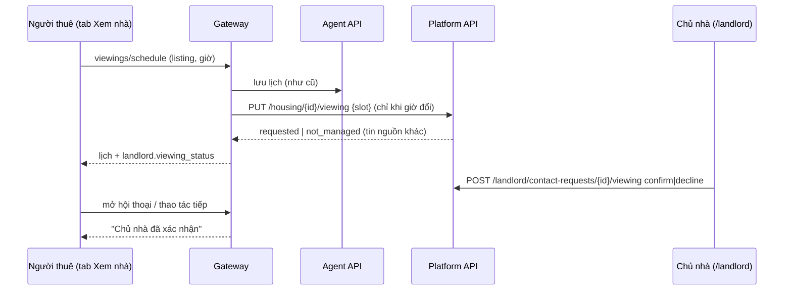

# Thiết kế: gửi lịch xem nhà tới chủ nhà và chờ xác nhận

Trạng thái: **v2, đã code trên nhánh `feat/housing-product-v1-finish` (chưa push).** Ngày: 09/10/2026.

v2: với tin do chủ nhà quản lý, người thuê **chỉ ghi kết quả buổi xem (và vì thế mới chốt được) khi chủ nhà đã xác
nhận đúng giờ đó**; thêm **tin nhắn** giữa hai bên trên từng yêu cầu liên hệ (mục 6).
Nền: [housing-viewing-design](housing-viewing-design.md) (tab "Xem nhà"), [SPEC-021](../specs/SPEC-021-housing-product-v1.md)
(hộp thư yêu cầu liên hệ) và [host-mode-design](host-mode-design.md) (chế độ chủ nhà).

## 1. Vấn đề

Tab "Xem nhà" cho người thuê đặt giờ xem, nhưng lịch chỉ lưu phía người thuê ("chế độ thử"). Chủ nhà dùng ReloHome
không thấy giờ hẹn; hộp thư chỉ nhận lời nhắn gõ tay qua nút "Gửi yêu cầu liên hệ".

## 2. Quyết định

| # | Quyết định |
|---|---|
| L1 | Đặt hoặc đổi giờ ở tab "Xem nhà" cho **tin do chủ nhà quản lý** tự gửi giờ đó vào hộp thư chủ nhà |
| L2 | Chủ nhà bấm **Xác nhận giờ xem** hoặc **Không nhận giờ này** |
| L3 | Tab "Xem nhà" hiện "Đã gửi giờ hẹn, chờ chủ nhà xác nhận", "Chủ nhà đã xác nhận" hoặc "Chủ nhà không nhận giờ này" thay cho "chế độ thử" |
| L4 | Tin từ nguồn khác (crawl) giữ nguyên lịch thử; app không liên hệ ai |
| L5 | Dùng lại `housing.contact_requests` (một yêu cầu mở cho mỗi người thuê và tin), không thêm bảng |
| L6 | Gateway đồng bộ sau mỗi thao tác xem nhà và khi mở hội thoại; chỉ gửi khi giờ thay đổi (0 LLM, tối đa vài lệnh gọi nhanh) |

Agent API và kho lịch xem (`src/checkout/viewing.py`) **không đổi**: nguồn sự thật của lịch phía người thuê vẫn là
giao dịch `housing:{listing_id}`; câu trả lời của chủ nhà nằm ở Platform API.

## 3. Luồng

Quy tắc đồng bộ ở gateway (`landlord_viewings` trong `Frontend/server.py`):

| Trạng thái căn trong tab | Gửi Platform |
|---|---|
| Có giờ (`viewing_scheduled`, `visit_due`, `backup`) và giờ khác giờ chủ nhà đang có | `PUT` giờ mới (chủ nhà phải trả lời lại) |
| Có giờ trùng giờ chủ nhà đã trả lời | Không gửi (giữ câu trả lời) |
| Có giờ trùng nhưng lịch đã hủy hoặc yêu cầu đã đóng | `PUT` lại giờ hẹn; chủ nhà xác nhận lại |
| `selected` (đã hủy lịch) hoặc đã bỏ chọn | `DELETE` nếu giờ đang chờ hoặc đã xác nhận |
| Đã xem / đã chốt | Không gửi (giữ câu trả lời của chủ nhà) |

Hủy giờ: yêu cầu chỉ sinh ra từ lịch xem và chủ nhà chưa xử lý thì đóng luôn; yêu cầu chủ nhà đã xử lý vẫn mở,
chỉ ghi giờ đã bị hủy.

## 4. Dữ liệu và API

Migration `015_housing_viewing_requests.sql` thêm vào `housing.contact_requests`: `viewing_slot`, `viewing_status`
(`requested`, `confirmed`, `declined`, `cancelled`), `viewing_updated_at`, `source` (`contact` | `viewing`).

| Endpoint | Ai gọi | Ghi chú |
|---|---|---|
| `PUT /v1/housing/:listingId/viewing` | Người thuê (qua gateway) | Tạo hoặc cập nhật yêu cầu mở; giờ trùng giờ đã có thì không đổi; tin không nhận lịch → `409 not_managed` |
| `DELETE /v1/housing/:listingId/viewing` | Người thuê (qua gateway) | Rút giờ xem |
| `POST /v1/landlord/contact-requests/:id/viewing` | Chủ nhà | `{decision: confirm\|decline, revision}`; xác nhận thì yêu cầu chuyển `viewing` |

Hộp thư chủ nhà và `contact-requests/me` trả thêm ba trường mới; hộp thư đưa giờ chờ xác nhận lên đầu.

## 5. Giới hạn

- Chủ nhà chưa đề nghị được giờ khác trong app; "Không nhận giờ này" để người thuê tự chọn giờ khác.
- Giờ hiển thị cho chủ nhà theo múi giờ trình duyệt.
- Bước đặt lịch đơn lẻ cũ trong checkout (`/housing/viewing`, khi tắt tính năng chọn nhiều căn) vẫn là lịch thử.
- Không gửi thông báo ngoài app (email, SMS); chủ nhà xem trong hộp thư.

## 6. Tin nhắn và điều kiện ghi kết quả (v2)

- **Điều kiện ghi kết quả:** gateway kiểm tra trước bước `visit`. Tin có `management` (do chủ nhà quản lý) cần yêu cầu
  liên hệ còn mở (`new`, `contacted`, `viewing`) và có `viewing_status = confirmed` cho đúng giờ đang hẹn;
  nếu không trả `409`. Xác nhận của yêu cầu đã đóng không cho phép ghi kết quả. Tin nguồn khác giữ luồng thử.
  Không kiểm được Platform thì trả `503` (không cho qua). Giao diện ẩn nút ghi kết quả khi chủ nhà chưa xác nhận.
- **Tin nhắn:** bảng `housing.contact_messages` (migration `017`), một cuộc trò chuyện cho mỗi yêu cầu liên hệ.
  Chỉ người thuê của yêu cầu và người quản lý đang hoạt động của địa điểm đọc và gửi được; người khác nhận `404`.
  Lời nhắn đầu của yêu cầu là tin nhắn đầu tiên. Chủ nhà trả lời lần đầu thì yêu cầu chuyển `contacted`.
  Yêu cầu đã đóng thì không gửi thêm. Giới hạn số tin mỗi phút là cấu hình `HOUSING_MESSAGE_RATE_PER_MINUTE`
  (mặc định 10). Số tin chưa đọc hiện ở hộp thư chủ nhà, tab Liên hệ chủ nhà và tab Xem nhà.
- Giao diện nhắc "không chuyển tiền cọc trước khi xem nhà và gặp chủ nhà" ngay trong khung chat. Không có thông báo
  đẩy; giao diện tải lại tin mỗi 15 giây khi đang mở cuộc trò chuyện.

### Cập nhật theo review PR #88

- **Đọc không ghi:** mở tab Xem nhà hoặc tải hội thoại chỉ hiện câu trả lời của chủ nhà, không gửi gì, nên yêu cầu
  người thuê đã hủy hoặc chủ nhà đã đóng không bị mở lại. Chỉ thao tác xem nhà mới ghi: gửi đúng căn vừa đặt lịch
  (kể cả đặt lại sau khi hủy) và rút giờ của căn không còn lịch.
- **Gửi thất bại không im lặng:** Platform lỗi khi gửi giờ hoặc rút giờ thì gateway lưu "thay đổi đang chờ" (bảng
  `landlord_sync` trong database gateway), trả `landlord.sync = "failed"` hoặc `landlord_withdraw_pending`; tab hiện
  cảnh báo và nút gửi lại (`viewings/landlord-retry`). Thao tác xem nhà kế tiếp cũng thử lại. Thay đổi chờ tự bỏ khi
  người thuê hủy, bỏ chọn hoặc đổi giờ. Không đọc được danh sách yêu cầu thì trả `landlord_unavailable`.
- **Lần gửi lại không tạo lại yêu cầu đã đóng:** gateway lưu "dấu vân tay" của yêu cầu phía Platform (id và
  `viewing_updated_at`) trước lần gửi lỗi. Nếu sau đó yêu cầu đã đổi (lần gửi bị timeout nhưng thực ra đã tới, rồi chủ
  nhà trả lời hoặc đóng) thì coi như đã gửi và không gửi lại. Chỉ khi người thuê tự đặt lịch mới được tạo lại yêu cầu
  đã đóng.

### Sửa trường hợp đổi giờ gửi thất bại (10/10/2026)

- Nền code: `origin/main` tại `9b2b2db` (đã merge PR #88), cập nhật vào nhánh local `QuangDung`.
- Trường hợp còn thiếu: chủ nhà đang giữ giờ A; người thuê đổi sang B nhưng gửi lỗi; sau đó chủ nhà đóng
  yêu cầu hoặc hủy lịch A. Giờ và `viewing_updated_at` cũ có thể giữ nguyên, nên kiểm tra fingerprint cùng
  giờ B không phát hiện việc đóng. Retry trước đây gửi `PUT` và mở lại yêu cầu.
- Retry giờ xem giờ đây bỏ thay đổi chờ nếu yêu cầu đã đóng hoặc lịch bị hủy, bất kể giờ phía chủ nhà có
  trùng giờ đang chờ hay không. Giữ giờ nháp phía người thuê và hiển thị trạng thái đã đóng. Chỉ thao tác
  đặt lịch rõ ràng của người thuê mới gửi lại yêu cầu.
- Không hiện nút ghi kết quả cho yêu cầu đã đóng dù nó giữ `viewing_status = confirmed`; gateway cũng
  chặn gọi trực tiếp bằng `409`. Nếu lịch đã tới giờ mà yêu cầu đóng, người thuê vẫn chọn giờ mới được.
- Không đổi endpoint, payload, database schema hay checkout của Moving/Flight.

## 7. Kiểm thử

- Platform (PostGIS thật): gửi giờ, gửi lại không đổi, người khác không trả lời được, từ chối rồi đổi giờ, xác nhận,
  hủy, yêu cầu chỉ từ lịch xem đóng khi hủy, tin không quản lý trả `not_managed`.
- Gateway: chỉ gửi giờ đổi, rút giờ của căn đã bỏ chọn, tin nguồn khác giữ chế độ thử, câu trả lời hiện cả ở
  `viewings` lẫn snapshot hội thoại.
- Trình duyệt: chủ nhà xác nhận giờ xem trong hộp thư (desktop, mobile, axe).

Kiểm tra bản sửa 10/10/2026:

- RED: 4 trường hợp gateway thất bại trước khi sửa (retry khi `resolved`, `declined`, lịch `cancelled`,
  và ghi kết quả bằng xác nhận của yêu cầu đã đóng). Test Chrome cũng tái hiện nút ghi kết quả sai.
- GREEN: 99 test gateway, checkout, cấu hình deployment, ảnh runtime web, projection review,
  graph lịch xem và API lịch xem đều qua. Chạy với `PYTHONUTF8=1`, `APP_ENV=test`, `ROOMMATE_ENABLED=false`
  để fixture offline không kế thừa cấu hình Roommate bật trong `.env` local; không sửa `.env`.
- Chrome: 6 test trong `Frontend/tests/browser/viewing-closed-request.spec.ts` qua trên desktop/mobile;
  xác minh yêu cầu đóng không ghi kết quả được, có thể đặt lại và yêu cầu mở đã xác nhận vẫn ghi được.
  Không có `pageerror` trong các luồng này.
- `npm run build` và `ruff check Frontend/server.py Frontend/tests/test_housing_management_gateway.py` qua.
- Các test lỗi gửi/timeout dùng upstream mô phỏng; không thực hiện giao dịch thanh toán hay ghi lịch
  vào tài khoản thật để kiểm tra sự cố này.
