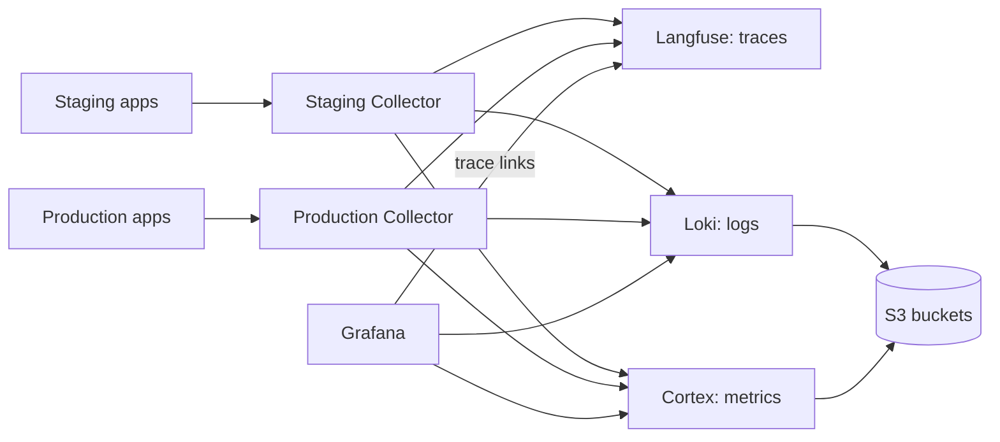

# Observability

ReloHome exports OpenTelemetry from its services to one Collector per environment
([#106](https://github.com/AI20K-Build-Phase-Cohort-4/P-044/issues/106)). A shared
platform stores traces in Langfuse, logs in Loki and metrics in Cortex, and
Grafana shows dashboards and alerts. Staging and production share every store:
each Collector stamps `environment=staging|production` on all data, and Langfuse,
Grafana and the alerts filter or group by that label.



Configuration lives in `deploy/observability/`:

| File | Purpose |
| --- | --- |
| `compose.yaml` | Shared platform: Langfuse (web, worker, Postgres, ClickHouse, Redis), Loki, Cortex, Grafana |
| `compose.collector.yaml`, `collector.yaml` | One Collector per environment |
| `loki.yaml`, `cortex.yaml` | Log and metric storage on S3 |
| `grafana/datasources.yaml`, `dashboards.yaml`, `overview.json`, `alerts.yaml` | Grafana data sources, the **ReloHome operations** dashboard and alert rules |
| `.env.example` | Every variable both resources need |

## Before you start

- **One server** with about 12.4 GiB of free memory for the platform plus 512 MiB
  per Collector, and disk for the Langfuse databases and the Loki/Cortex caches.
  The apps, Collectors and platform must run on the same Docker host: the
  Collectors reach the platform over a Docker network.
- **Three private S3 buckets** for Langfuse events, Loki and Cortex, each with a
  key that can list, get, put and delete.
- **Two HTTPS domains**, one for Grafana and one for Langfuse.

## Set up

### 1. Shared platform

In Coolify, create a Git-based Application the same way as the main application
(see [deployment setup](../../deploy/README.md#one-time-coolify-setup-per-environment)):

- Docker Compose build pack, branch `main`
- Base directory **`/deploy/observability`**, compose file **`/compose.yaml`**.
  Coolify resolves the `./` config mounts from the base directory.
- **Preserve repository during deployment** on. Coolify then mounts the config
  files from the repository; without it the containers fail to start.
- Auto-deploy off

Set the variables listed in `.env.example`:

- Secrets: `openssl rand -hex 32` for the Langfuse database passwords, `LF_SALT`
  and `LF_NEXTAUTH_SECRET`; a 64-hex `LF_ENCRYPTION_KEY`; the admin passwords.
  Back up `LF_ENCRYPTION_KEY` and `LF_SALT` with the database backups.
- `LANGFUSE_PUBLIC_KEY=pk-lf-…` and `LANGFUSE_SECRET_KEY=sk-lf-…`, generated by you.
  Langfuse creates the `relohome` project with this key pair at first start.
- `LANGFUSE_URL` and `GRAFANA_URL`: the two HTTPS domains. Point them at the
  `langfuse` and `grafana` services on port 3000.
- Buckets: `LANGFUSE_S3_EVENT_UPLOAD_*` (endpoint with `https://`), `LOKI_S3_*` and
  `CORTEX_S3_*` (endpoints as `host[:port]`, without a scheme).

Deploy. Grafana should show the **ReloHome operations** dashboard and the
**ReloHome** alert rules, and Langfuse the `relohome` project. Sign-up is disabled
on both.

### 2. One Collector per environment

Create another Git-based Application per environment with the same settings and
compose file **`/compose.collector.yaml`**:

| Variable | Value |
| --- | --- |
| `OTEL_DEPLOYMENT_ENVIRONMENT` | `staging` or `production` |
| `APPLICATION_NETWORK` | That environment's app network (`docker network ls`; Coolify names it after the app's UUID) |
| `LANGFUSE_PUBLIC_KEY`, `LANGFUSE_SECRET_KEY` | The same pair as the platform |

Deploy the platform first: it creates the shared `relohome-observability-ingest`
network that the Collectors join. The Collector's environment is the only thing
that separates staging from production data, so set it carefully.

### 3. Deploy the instrumented app images

Python image entrypoints use `opentelemetry-instrument`; Node image entrypoints
preload `@relohome/telemetry/register`. Both activate telemetry automatically.
On the production app set `OTEL_DEPLOYMENT_ENVIRONMENT=production`; the default
is `staging`. Redeploy with `deploy.yml`, because a plain restart does not apply
new variables. The app Compose already sends to `http://otel-collector:4318`.

To disable telemetry, rebuild and redeploy an image with the plain entrypoint:
remove `opentelemetry-instrument` from the Python command, or remove Node's
`--import @relohome/telemetry/register`. No activation environment variable is used.

### 4. Check

- A chat request shows up in Langfuse as one connected trace (gateway → agent →
  MCP → database) with the right environment.
- The Grafana dashboard fills in for the chosen environment, and a log line's
  `trace_id` opens that trace in Langfuse.
- The alerts in Grafana stay Normal.

## Making changes

Edit the files in `deploy/observability/`, review them in a PR, merge, then
redeploy the platform or a Collector in Coolify. Grafana loads its files at
startup and re-reads dashboard JSON every 30 seconds. UI edits to the provisioned
dashboard cannot be saved; export a copy and move the change into `overview.json`.

For upgrades, read the release notes, check the new image has an ARM64 build
(`docker buildx imagetools inspect <image>`), and back up the volumes first.

Grafana keeps rules and data sources it provisioned earlier. If an older
deployment with per-environment data sources and alerts exists, remove its
`grafana` volume before deploying this layout; everything in it is provisioned
again from the files.

## What is collected

`OBSERVABILITY_CONTENT_MODE` controls whether prompt and tool content reaches
Langfuse:

| Mode | Langfuse input/output |
| --- | --- |
| `metadata` (default) | Omitted; timing, outcomes, token usage and metrics remain |
| `redacted` | Non-production opt-in; personal fields and detected emails, Vietnamese phone and ID numbers removed |
| `raw` | Non-production opt-in; credentials still scrubbed, personal fields may remain |

The content modes apply to application-authored graph, tool and generation
payloads. Production uses `metadata` for those payloads. Framework and library
telemetry now uses the stock SDK processors: exception events, stack traces, URLs
and database statements are retained by their instrumentors. There is no custom
SDK privacy processor or attribute allowlist. The Collector's existing downstream
rules remain separate from SDK configuration.

### Framework and client instrumentation

The Python services start through `opentelemetry-instrument` with the official
`opentelemetry-distro` package. The launcher discovers installed compatible
instrumentors before application imports and uses standard `OTEL_*` settings for
sampling and export. There is no custom distro, configurator or provider bootstrap.
Node services preload `@relohome/telemetry/register` and use the official NodeSDK
and standard processors.

For a direct launch in the installed environment:

```sh
OTEL_EXPORTER_OTLP_PROTOCOL=http/protobuf OTEL_SERVICE_NAME=backend \
  OTEL_PYTHON_DISABLED_INSTRUMENTATIONS=sqlite3 OTEL_SEMCONV_STABILITY_OPT_IN=http \
  opentelemetry-instrument python -m uvicorn relohome_agent.main:app --port 8000
```

The existing `npm run dev:*` service commands and `scripts/local-integration.py`
also use the CLI. Instrumentation packages are pinned in the observability
package. SQLite instrumentation is disabled because its connection proxy
conflicts with the native backup API. SQLite and aiosqlite use their normal connections; there
is no custom database adapter.

| Runtime | Integration |
| --- | --- |
| Agent API, browser gateway, Intake, Orchestrator | `FastAPIInstrumentor` |
| Python Flight/Payment MCP HTTP applications | `StarletteInstrumentor` |
| Python outgoing HTTP | `HTTPXClientInstrumentor` |
| Python PostgreSQL/Roommate pools | `PsycopgInstrumentor`, without SQL parameters or SQLCommenter |
| SQLite and aiosqlite | Not instrumented |
| Node HTTP/MCP servers | `HttpInstrumentation` |
| Platform and Moving Fastify APIs | Maintained `@fastify/otel`, registered automatically by NodeSDK |
| Node fetch, PostgreSQL and logging | `UndiciInstrumentation`, `PgInstrumentation`, `PinoInstrumentation` |

FastAPI's built-in tracing is disabled to avoid duplicating the official
instrumentor. Standard SDK instrumentation owns HTTP spans, exception events,
context propagation and HTTP metrics. Incoming W3C trace context follows the
SDK's default parent-based sampling. Python ASGI send/receive spans use the
instrumentor defaults. Fastify lifecycle hook spans are disabled through its
standard configuration. Graph, generation, tool and job spans remain
application-authored.

There is no custom HTTP middleware, response trace header, completion log or
HTTP metric implementation. Python opts into stable HTTP semantic conventions
with `OTEL_SEMCONV_STABILITY_OPT_IN=http`; the Node HTTP instrumentor already uses
them. Grafana HTTP queries use the native `http.server.request.duration`
histogram, whose count gives request volume. The Collector retains these metrics
and their standard attributes.

Deploy updated application images, Collector configuration and Grafana
provisioning together, including standalone Intake/Orchestrator images if used.
Use full SDK route templates such as `/api/v1/status` in route-specific queries.

Official references: [FastAPI](https://opentelemetry-python-contrib.readthedocs.io/en/latest/instrumentation/fastapi/fastapi.html),
[Starlette](https://opentelemetry-python-contrib.readthedocs.io/en/latest/instrumentation/starlette/starlette.html),
[Psycopg](https://opentelemetry-python-contrib.readthedocs.io/en/latest/instrumentation/psycopg/psycopg.html),
[Fastify](https://github.com/fastify/otel),
[Python CLI](https://opentelemetry.io/docs/zero-code/python/),
[Distro/configurator extensions](https://opentelemetry.io/docs/languages/python/distro/).

### HTTP failure diagnostics

HTTPX auto-instrumentation creates outbound request spans. For dependency or
unhandled failures, inspect the SDK's exception events and status, including the
original exception class, message and stack trace.

Application decisions that become handled HTTP errors use a fixed diagnostic code:

| `app.error.code` | Origin |
| --- | --- |
| `missing_agent_api_token` | Gateway or backend has no server authentication token |
| `agent_runtime_not_started` | Backend has no initialized Agent service |
| `upstream_invalid_json` | Gateway could not decode the upstream response as JSON |
| `missing_service_token` | Standalone Intake/Orchestrator service token is absent |
| `llm_not_configured`, `llm_unavailable`, `llm_provider_error`, `llm_invalid_output`, `llm_no_result` | Standalone LLM service's handled outcome |
| `internal_service_error`, `approval_not_configured` | Standalone service failure or approval configuration failure |

The `relohome_observability.fastapi` bridge annotates the active HTTP span and
emits a correlated ERROR log when an application decision becomes an HTTP error.
The fixed code is stored as `app.error.code` so standard instrumentors can set
`error.type` independently. The existing response body, status and headers are
preserved. Recovered errors do not mark successful requests as failed.

To investigate `/web/api/status`, find the gateway request by service, route
and timestamp, or open the trace linked from a correlated log. Inspect
`app.error.code`, then follow any outbound HTTP span to the backend span and
its cause. A missing gateway token stops before an outbound Agent API request.
A transport failure has an automatic HTTPX child span (for example, `httpx.ConnectError`) beneath the gateway's 502.
Use the existing Langfuse trace link from Loki for the corresponding ERROR log.

Deploy the updated application images and Collector configuration, which adds
`app.error.code` to the retained span attributes. Existing stored traces do not
gain new attributes.

### Jev shadow metrics

The guardrail observer exports `relohome.guardrail.observations`,
`relohome.guardrail.skips` and `relohome.guardrail.in_flight`, with labels
`point`, `event` and `reason`. The dashboard shows coverage, skip reasons,
outcomes and in-flight work. Coverage is completed / eligible attempts for running
processes, not a security score, and counters reset on restart.

## Alerts

Each rule fires per environment and carries an `environment` label; the
application rules also carry `service_name`:

| Rule | Fires when |
| --- | --- |
| HTTP error rate | 5xx above 5% over 10 minutes, with at least 20 requests |
| Agent/tool/provider failures | Above 5% over 10 minutes, with at least 20 operations |
| Provider rate limits | At least 3 in 10 minutes |
| Chat latency | p95 above 120 seconds over 15 minutes, with at least 10 requests |
| Service heartbeat missing | A service that reported in the last 24 hours has been silent for 2 minutes |
| Collector unavailable | An environment's Collector that reported in the last 24 hours has been gone for 2 minutes |
| Telemetry export failures | Export failures for 5 minutes |

No contact point is configured, so alerts show in Grafana but notify no one. Add
a contact point and notification policy in Grafana when needed.

## Retention

Loki keeps logs for 7 days and Cortex keeps metrics for 30 days; their compactors
delete older data from S3. Langfuse keeps traces indefinitely, because trace
retention is an Enterprise feature in self-hosted Langfuse
([#173](https://github.com/AI20K-Build-Phase-Cohort-4/P-044/issues/173)). You may
expire the Langfuse bucket's `events/` prefix after 8 days at the bucket provider;
do not expire the Loki or Cortex buckets.

## Local run

```bash
docker compose -f deploy/observability/compose.yaml --env-file <file> up -d
```

Grafana and Langfuse listen on `127.0.0.1:3001` and `127.0.0.1:3000`. On a server,
change these ports in `compose.yaml` if they are already taken.

Tests for the telemetry SDKs:

```bash
python -m pytest tests/test_observability.py tests/test_observability_export.py -q
npm run build && npm run test:ci
```
