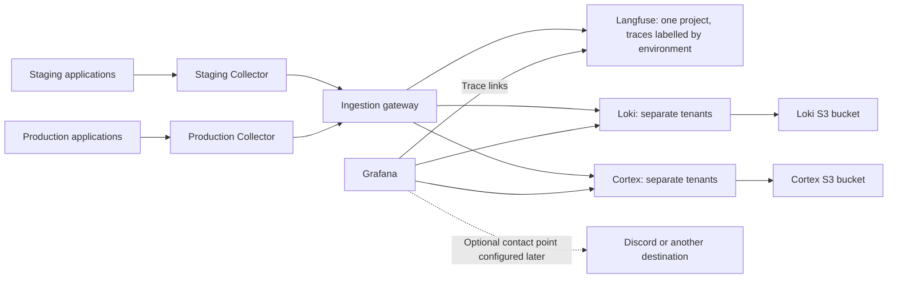

# Shared observability

Implementation of [#106](https://github.com/AI20K-Build-Phase-Cohort-4/P-044/issues/106).
Applications export OpenTelemetry to one Collector per environment. A shared
platform stores traces in Langfuse, operational logs in Loki and metrics in
single-instance Cortex backed by S3. Grafana dashboards, data sources and alert
rules are provisioned. Contact points and notification policies can be configured
later in Grafana; this deployment supplies no external notification destination.



## Deployment boundaries

Deploy three independent Coolify resources: the shared platform, the staging
Collector and, after staging validation, the production Collector. Like the
application ([deployment](../../deploy/README.md)), they are Git-based Coolify
Applications: Coolify clones this repository and runs
`deploy/observability/compose.yaml` or `compose.collector.yaml`, whose relative
bind mounts read the committed config files directly. Unlike the application,
they use public pinned images, are not deployed by CD and follow `main` when an
operator redeploys them. There is no packaging step; edit the files in
`deploy/observability/` and redeploy.
Collector and Caddy expand their own environment references, and Grafana
provisioning keeps its own `$$` escape for trace links.

The supplied network layout assumes the resources run on the **same Docker
host**. Each Collector joins its existing application network and the private
`relohome-observability-ingest` network. Only the gateway joins that
network from the shared platform; databases, Cortex, Loki and Redis remain on the
platform's private network. Langfuse Web and Worker connect to the existing
S3-compatible bucket through its configured endpoint. Do not attach applications
to the storage network.

Docker bridge networks do not span hosts. For a separate observability host,
provide VPN/private routed connectivity or authenticated HTTPS to the gateway.
Set `OBSERVABILITY_GATEWAY_URL` to its origin (scheme, host and optional port,
without a path). The Collector sends all signals outbound and scrapes its own internal metrics
on localhost:8888. No inbound central scrape is needed.
Never expose Collector OTLP, scrape endpoints, Loki or storage ports publicly.

The gateway routes by URL path: each Collector sends to `/staging/` or
`/production/` from its own `OTEL_DEPLOYMENT_ENVIRONMENT`, and the gateway assigns
the matching fixed Loki/Cortex tenant and injects the Langfuse project key. Both environments share
one Langfuse project; the Collector sets each trace's Langfuse environment from
its own configuration, and the Langfuse UI filters by environment. An application
cannot choose its destination by changing an environment label or tenant header.
The Collector and gateway are reachable only on private Docker networks, so the
internal hops are unauthenticated; environment separation depends on each
Collector's `OTEL_DEPLOYMENT_ENVIRONMENT` being set correctly.

The shared operations team is trusted to read both environments. Grafana has a
separate fixed-tenant Cortex and Loki datasource for each environment; its
operators can access both. Dashboard filters do not restrict query access.
Staging-only operators require
separate query access controls/backends before being granted access. Shared
backends still share capacity and failure risk. This deployment uses one process
per backend; observability availability and HA are outside this PR's scope.

## Preflight

1. Verify host memory and disk headroom independently of the application budget.
   Configured platform memory limits total about 12.375 GiB, plus 512 MiB per
   Collector; these limits are ceilings, not evidence of sufficient capacity.
   Langfuse/ClickHouse initialization and load can require additional headroom.
   Inspect actual RSS, queue growth and disk growth during staging. Prefer a
   dedicated host when available; no new paid infrastructure is provisioned here.
2. Check available disk with `df -h` and Docker usage with `docker system df`.
   Budget space for images, all named volumes, ClickHouse merges and Collector
   queues. Queue length bounds batches, not total storage bytes; monitor its
   volume and reserve disk headroom.
3. Confirm each image pinned in `compose.yaml` and `compose.collector.yaml` has
   an ARM64 build, for example
   `docker buildx imagetools inspect grafana/grafana:13.2.3`.
4. Identify the actual existing application network for each environment with
   `docker network ls`. Plan authenticated HTTPS domains for Grafana and Langfuse.
   Confirm application → Collector and Collector → gateway
   connectivity, plus backend access to the three configured S3 buckets. The readiness endpoints of applications do not depend
   on observability.

## Bootstrap the shared platform

In Coolify, create each resource as a Git-based Application the same way as the
main application: a **Public Repository** whose URL carries a read-only personal
access token (see [deployment setup](../../deploy/README.md#one-time-coolify-setup-per-environment)),
the **Docker Compose** build pack, branch `main` and base directory
`/deploy/observability`:

| Resource | Docker Compose location |
| --- | --- |
| Shared platform | `/compose.yaml` |
| Staging or production Collector | `/compose.collector.yaml` |

The base directory must be `/deploy/observability`, not `/`. Coolify resolves
the `./` mount sources from the base directory (it runs Compose with
`--project-directory` set to it), so a base directory of `/` would look for
`./grafana/...` at the repository root.

Enable **Preserve repository during deployment** under **General > Build
pipeline** on each resource. Coolify then copies the base directory to the
server for the mounts. Without it, the config files are not present at deploy
time; Docker then creates empty directories in their place and the containers
fail to start. Turn off automatic deployment on push if config changes
should only roll out when an operator redeploys.

Langfuse and Grafana also bind to `127.0.0.1:3000` and `127.0.0.1:3001` on the
host, for local use; these are not public. Change them if those host ports are
already taken. For a local deployment, run
`docker compose -f deploy/observability/compose.yaml --env-file <file> up -d`.
Store each resource's real environment configuration outside Git. The example
at `deploy/observability/.env.example` lists every required input.

Generate independent random secrets; hexadecimal database passwords avoid URL
escaping errors in `DATABASE_URL`. `LF_ENCRYPTION_KEY` must be 64 hexadecimal
characters. Keep backups of this key and `LF_SALT` with the database backups.

Initially `LANGFUSE_AUTH` may be empty. Start the platform and sign in with the
initialized operator account. Create one `relohome` project and a project API key.
Set `LANGFUSE_AUTH` to base64 of `public-key:secret-key` and `LANGFUSE_PROJECT_ID`
to the project's actual ID, not its display name. Keep the key only in the
platform resource; the gateway uses it. Redeploy the platform after entering it.
Langfuse recommends one project with its environments feature when the same team
can see every environment
([managing environments](https://langfuse.com/faq/all/managing-different-environments));
use separate projects only if production traces need narrower access.

Set `LANGFUSE_URL` and `GRAFANA_URL` to their external HTTPS URLs and configure the
Coolify reverse proxy domains to each web service's port 3000. Verify
authentication and signup restrictions.

Configure the existing private object-storage bucket using these platform
resource variables. Both Langfuse Web and Worker receive the same values; the
Compose file keeps only variable references and never contains credentials.

| Variable | Value |
| --- | --- |
| `LANGFUSE_S3_EVENT_UPLOAD_BUCKET` | Existing bucket name |
| `LANGFUSE_S3_EVENT_UPLOAD_ENDPOINT` | Provider's S3 API endpoint, including `https://` |
| `LANGFUSE_S3_EVENT_UPLOAD_REGION` | Bucket region; use `auto` for Cloudflare R2 |
| `LANGFUSE_S3_EVENT_UPLOAD_ACCESS_KEY_ID` | Bucket-scoped access key, entered as a deployment secret |
| `LANGFUSE_S3_EVENT_UPLOAD_SECRET_ACCESS_KEY` | Matching secret, entered as a deployment secret |
| `LANGFUSE_S3_EVENT_UPLOAD_PREFIX` | Event prefix, defaults to `events/`; end custom prefixes with `/` |
| `LANGFUSE_S3_EVENT_UPLOAD_FORCE_PATH_STYLE` | Defaults to `false`; set `true` if required by the provider |

For Amazon S3, use the regional API endpoint such as
`https://s3.ap-southeast-1.amazonaws.com`. For R2, use the account's S3 API
endpoint. These are storage API endpoints, not public bucket or CDN URLs.
Grant scoped List/Get/Put/Delete permissions and configure the eight-day event
prefix lifecycle described below. The platform does not create the bucket,
manage its policy or deploy MinIO. Batch exports and media storage are not enabled.

Loki and Cortex use their own private buckets. Set `LOKI_S3_BUCKET`,
`LOKI_S3_ENDPOINT`, `LOKI_S3_REGION`, `LOKI_S3_ACCESS_KEY_ID` and
`LOKI_S3_SECRET_ACCESS_KEY`; configure the corresponding `CORTEX_S3_*` variables
for Cortex. Their endpoints use **host[:port] without `https://`**. TLS is enabled
unless `*_S3_INSECURE=true`; that setting is intended for local HTTP fixtures.
Use `LOKI_S3_FORCE_PATH_STYLE=true` or `CORTEX_S3_BUCKET_LOOKUP_TYPE=path` when the
provider requires path-style access. Cortex also accepts `auto` (default) or
`virtual-hosted`. Give each backend List/Get/Put/Delete access to its own bucket.
The compactor in each backend controls retention; do not apply Langfuse's
eight-day lifecycle or blanket object expiry to these two buckets. Local Loki
and Cortex volumes still hold WAL, active indexes and caches.

Contact points and notification policies are not provisioned and require no
webhook secret during deployment. Alert rules evaluate and their state is visible
in Grafana. When notifications are needed, create a contact point and routing
policy in **Grafana Alerting**, or manage them through separate provisioning.
Grafana's persistent volume retains settings entered in its UI. Existing contact
points and policies are not deleted or managed by this deployment.

## Enable staging, then production

For each Collector resource, set:

| Variable | Value |
| --- | --- |
| `OTEL_DEPLOYMENT_ENVIRONMENT` | `staging` or `production` |
| `APPLICATION_NETWORK` | That environment's existing Docker network |
| `OBSERVABILITY_GATEWAY_URL` | `http://telemetry-gateway:8080` on the private bridge |

Keep application networks separate: the `otel-collector` alias must resolve to
exactly one Collector in each application's network. Persistent queue volumes
belong to individual Collector resources; do not share them.

Set these on the staging application resource and redeploy its instrumented
images:

```dotenv
OBSERVABILITY_ENABLED=true
OBSERVABILITY_CONTENT_MODE=metadata
OTEL_DEPLOYMENT_ENVIRONMENT=staging
OTEL_EXPORTER_OTLP_ENDPOINT=http://otel-collector:4318
```

The application Compose supplies each service name and release SHA. When starting
a service directly, preload Node with
`--import @relohome/telemetry/register`. Python entry points initialize telemetry
before constructing clients. Keep legacy LangSmith tracing disabled.

The current application uses HTTP for Payment MCP. Python Flight/Payment servers
also accept per-call W3C `_meta` over standalone stdio. No subprocess client or
environment forwarding is added to the application. External stdio launchers
should pass only the required telemetry variables and existing service settings;
telemetry writes no JSON-RPC data to stdout.

Exercise chat, clarification/resume, parallel tools and mocked payment jobs.
Verify one connected trace, correct thread/session grouping, structured errors,
token usage, metadata-only logs and bounded metric labels. A background job starts
a fresh trace linked to persisted origin context; it does not keep an HTTP span
open. External provider internals remain outside our traces. Langfuse pricing
depends on available model definitions; an unpriced model must not be interpreted
as a zero-cost call.

Before enabling production, switch the two production mounts in
`deploy/observability/compose.yaml` to the active files named in their comments
(`grafana/alerts/production.yaml` and
`cortex-rules/production/expected-services.yaml`), merge that change and redeploy the platform.
This adds production alert rules and expected heartbeat inventory in its Cortex
tenant. Deploy the production Collector and enable its applications. Keep the same stack
and dashboard definitions. Initial collection samples all non-health requests;
measure overhead and growth before changing sampling or retention.

## Content and failure behavior

`OBSERVABILITY_ENABLED` defaults to `false`. Content mode affects future exports:

| Mode | Langfuse input/output |
| --- | --- |
| `metadata` (default) | Omitted; timing, outcomes, token usage and metrics remain |
| `redacted` | Non-production diagnostic opt-in; sanitized copy with structured personal fields and detected email, Vietnamese phone and identity-number patterns removed |
| `raw` | Non-production diagnostic opt-in; credentials still scrubbed, personal fields may remain |

If either `APP_ENV` or `OTEL_DEPLOYMENT_ENVIRONMENT` is `production`, Python and
Node force `metadata` even when an existing resource still configures `redacted`
or `raw`. This cannot retroactively erase previously captured content. Check both
environment settings when redeploying. Compose propagates `APP_ENV` to all
instrumented services. The production Collector also drops input/output attributes
using its authoritative environment, protecting storage from legacy SDK exports.
This Collector protection does not prevent legacy SDKs from first sending content
to the Collector; deploy updated application images as well. Do not enable diagnostic content on real
user traffic without a separately reviewed privacy and retention policy.

Credential fields, authorization/cookies, API keys, recognizable signed tokens
and URL credentials/query strings are scrubbed in all content modes. Free text
can contain names or addresses that pattern matching cannot identify. Use
`metadata` when that limitation is unacceptable. Sanitization failures omit
content, and each captured field is capped at 16 KiB. Business data is unchanged.
Changing settings never rewrites previously stored telemetry.

Loki receives fixed completion events or `application.log`, severity and bounded
operational attributes. Arbitrary message bodies, exception values, stack traces,
SQL statements, HTTP bodies and graph checkpoints are excluded from export.
Original local container logging remains controlled by existing application
logging. Do not add a second stdout-to-Loki shipper without deduplication/privacy
review. Trace and span IDs are structured log metadata, never indexed labels or
metric dimensions.

### Jev shadow metrics

The observer now records fixed-cardinality OTEL instruments directly, independent
of INFO log filtering or message-body sanitation. No new export endpoint, LLM
call, foreground await or external destination is introduced. These metrics use
the existing application Collector only when `OBSERVABILITY_ENABLED=true`; the
observer and telemetry remain separately opt-in. The existing stderr snapshots
continue to work when observability is disabled.

- `relohome.guardrail.observations`: counter with `point` (`plan`, `assessment`)
  and fixed `event` (seen, eligible, submitted, completed, skipped, timeout,
  provider/connection/response/internal errors, cancellation).
- `relohome.guardrail.skips`: counter with `point` and fixed `reason`, including
  overload, missing scope, duplicate turn limits and privacy-insufficient evidence.
- `relohome.guardrail.in_flight`: non-monotonic sum with `point`; admissions add 1,
  task completion/cancellation subtracts 1, including cancellation before HTTP starts.

Collector metric allowlisting preserves only these three additional label keys.
Cortex exposes `relohome_guardrail_observations_total`,
`relohome_guardrail_skips_total`, and `relohome_guardrail_in_flight`. Grafana's
provisioned overview includes coverage, skip reasons, outcomes and in-flight panels.
Coverage is completed / eligible observation attempts for currently active processes,
not all chats or a security score. Counters reset on restart. Duplicates of already
submitted points are excluded from eligible; repeated unsuccessful admissions may
be counted again. No eligible attempts means undefined, not success. Current
Housing/Flight narrative assessments remain privacy skips, not clean verdicts.

The local launcher preloads `@relohome/telemetry/register` for Location, Platform,
Moving MCP and Moving API before service imports. Disabled registration is a no-op;
read-only schema checks and explicit migrations are not instrumented by this change.

SDK queues hold at most 2,048 spans/log records each and export asynchronously.
Each Collector has a 256 MiB memory limiter, 512 MiB container limit and a disk
queue of 200 batches per exporter pipeline. It retries temporary backend outages.
Prolonged outages, full queues, permanent rejection and disk exhaustion can drop
telemetry. Application requests and payments remain independent of export.

## Dashboards and alerts

### Configuration stored in Git

Edit the following files directly; their contents are the provisioning source:

| Source under `deploy/observability/` | Purpose |
| --- | --- |
| `grafana/overview.json` | Dashboard panels, queries, layout and environment selector |
| `grafana/dashboards.yaml` | File-provider settings and dashboard folder |
| `grafana/datasources.yaml` | Fixed-tenant Cortex/Loki connections and Langfuse trace links |
| `grafana/alerts/staging.yaml`, `grafana/alerts/production.yaml` | Alert groups and queries for each environment |
| `grafana/alerts/disabled/staging.yaml`, `grafana/alerts/disabled/production.yaml` | Removal of this deployment's alert rules when an environment is disabled |
| `grafana/alerts/legacy.yaml` | Removal of the previous global alert-rule UIDs |
| `cortex-rules/{staging,production}/expected-services.yaml` | Expected-service recording rules for each tenant |
| `cortex-rules/disabled.yaml` | Empty recording-rule inventory for a disabled environment |

`compose.yaml` mounts the active staging files and the disabled production files.
Enabling production means pointing its two mounts at the active files (see
above). Data-source tenant headers, dashboard defaults and environment-specific
alert UIDs stay explicit in the reviewed source files. No Terraform or additional
provisioning framework is needed.

Keep credentials and deployment-specific values in the resource's environment
variables. Grafana resolves provisioning YAML references such as `LANGFUSE_URL`
and the Langfuse project ID at runtime. Keep the trace-link
`$${__value.raw}` escape in YAML and the dashboard's `$environment` variable in
JSON. Dashboard JSON does not expand process environment variables; put runtime
values in provisioning YAML instead. For secret values containing `$`, use
`$VARIABLE` references to avoid a second expansion. See
[Grafana environment-variable provisioning](https://grafana.com/docs/grafana/latest/administration/provisioning/#use-environment-variables).

### Review and apply changes

1. Edit the source JSON/YAML and review the configuration change in a PR. Keep
   queries, tenant routing and related data-source UIDs consistent. When adding,
   removing or renaming alert rules, update the matching UIDs in the disabled
   cleanup files as well.
2. Merge to `main`, then redeploy the platform resource in Coolify (or let it
   deploy on push, if enabled). Coolify pulls the merged files. Preserve the
   existing resource identity, volumes and deployment secrets.
3. Grafana provisions the mounted files. Check that the dashboard shows
   application data for the selected environment and that a log's trace link
   opens its trace in Langfuse.

Choose the apply method according to the changed file:

| Change | Apply method |
| --- | --- |
| Dashboard JSON, with the new bytes already visible in the running container | The file provider polls every 30 seconds; no Grafana restart is needed. |
| Dashboard provider YAML | Restart Grafana or `POST /api/admin/provisioning/dashboards/reload`. |
| Data-source YAML | Restart Grafana or `POST /api/admin/provisioning/datasources/reload`. |
| Alert-rule YAML, with the new bytes already visible in the running container | Restart Grafana or `POST /api/admin/provisioning/alerting/reload`. |
| Enabled/disabled environment selection | Recreate/redeploy the container: the selection changes bind-mount source paths, which a provisioning reload cannot update. |
| Container environment values, including credentials, URLs or project IDs | Recreate/redeploy the container with the new environment; a provisioning reload does not change the process environment. |

Coolify redeployment is the normal path because it pulls the merged files and
updates the container configuration together. Admin reload endpoints require Basic
Authentication with a Grafana server administrator; a service-account token is
not sufficient. Reloading dashboard provisioning also refreshes its file-provider
configuration. See the
[Admin provisioning reload API](https://grafana.com/docs/grafana/latest/developer-resources/api-reference/http-api/api-legacy/admin/#reload-provisioning-configurations),
[data-source management](https://grafana.com/docs/grafana/latest/administration/data-source-management/#provisioned-data-sources)
and [alert file provisioning](https://grafana.com/docs/grafana/latest/alerting/set-up/provision-alerting-resources/file-provisioning/).

The dashboard provider uses `allowUiUpdates: false`: UI changes cannot be saved
over the provisioned dashboard. To experiment, edit a separate copy, export its
JSON and review the intended changes into `overview.json`. **UI edits never
update Git automatically.** Keep the source dashboard UID when replacing its
definition. `disableDeletion: true` preserves an existing dashboard if its source
file disappears; retirement needs an explicit operator action. These settings
and polling behavior are described in
[Grafana dashboard provisioning](https://grafana.com/docs/grafana/latest/administration/provisioning/#dashboards).

Contact points and notification policies remain outside these files. Configure
them later in Grafana's UI or separate provisioning files; deploying this stack
requires no Discord webhook. UI-managed notifications are stored in Grafana's
database, not written back to this repository.

### Metrics, queries and alert evaluation

Cortex receives metrics over native OTLP. Its suffix normalization produces
application counters such as `relohome_http_requests_total` and histograms such
as `relohome_http_duration_seconds_bucket`. Internal counters scraped by each
Collector become `otelcol_exporter_send_failed_spans_total`; the memory gauge
remains `otelcol_process_memory_rss`. There is no port 8889 application exporter
or standalone Prometheus service. The Collector's `prometheus/internal` receiver,
PromQL expressions and Grafana's `prometheus` datasource type remain because
Cortex implements the Prometheus query API.

Each enabled environment gets its own Grafana alert group and fixed-tenant
Cortex datasource. Cortex's local ruler evaluates only the expected-service
recording rules so missing heartbeats remain detectable when an application has
never emitted metrics. Grafana evaluates all alert conditions; delivery to an
external destination requires a separately configured contact point and policy.

Open **ReloHome operations** in Grafana and choose the environment. Expand a log
record's `trace_id` to open its Langfuse trace. Verify the generated URL after
entering the real project ID.

| Rule | Evaluation |
| --- | --- |
| HTTP 5xx | >5% over 10 minutes, at least 20 requests per service/environment |
| Agent/tool/LLM failures | >5% over 10 minutes, at least 20 operations per kind/service/environment |
| Provider rate limits | At least 3 over 10 minutes |
| Chat latency | p95 >120 seconds over 15 minutes, at least 10 requests |
| Missing service heartbeat | Expected service has no heartbeat newer than 120 seconds |
| Collector unavailable | Failed or missing self-scrape series for 2 minutes |
| Telemetry export failure/drop | Nonzero failure rate persisting for 5 minutes |

When configuring notifications later, use the environment and service labels to
route and group alerts. Check the Collector's fixed environment, DNS, queue depth and backend
health before changing thresholds. These checks cover application and collection failures while the shared
backend is running; availability of the observability system is outside scope.

## Retention, upgrades and rollback

Cortex's compactor retains metric blocks for 30 days in S3.
Loki's compactor applies seven-day retention in its S3 bucket. Langfuse traces
are kept indefinitely: scheduled retention is an Enterprise feature in
self-hosted Langfuse, and this deployment does not delete traces. See #173.

Configure an expiration rule at the bucket provider for raw event objects after
eight days, allowing one extra day for ingestion. Scope the rule to
`LANGFUSE_S3_EVENT_UPLOAD_PREFIX` (`events/` by default); do not expire unrelated
objects. This lifecycle is managed by the bucket provider and is not installed
by the deployment. For versioned buckets, expire noncurrent versions too;
current-object expiry alone can leave their data stored (see
[S3 lifecycle behavior](https://docs.aws.amazon.com/AmazonS3/latest/userguide/intro-lifecycle-rules.html)).
Monitor worker backlog and queues; do not allow replay backlog to approach this
window.

Back up persistent volumes and encryption secrets according to the deployment's
backup policy. Pin upgraded images, read their migration notes, check their
ARM64 builds and deploy the upgrade to staging first. Downgrading Langfuse after a schema migration is not
a substitute for restoring a compatible backup.

Rollback application telemetry by setting `OBSERVABILITY_ENABLED=false` and
redeploying. Keep volumes for investigation and stop the independent observability
resources if needed. Do not use `down --volumes` on a real deployment. To remove an
environment, point its two mounts in `compose.yaml` back at the disabled files.

### Moving an existing preview from local storage

This changes the metrics backend and Loki storage; it does not migrate historical
data. Preserve the previous Prometheus volume if its history is needed. New
metrics go to Cortex, and Grafana provisioning replaces the old Prometheus
datasource and global alert rules with per-environment Cortex definitions.

The supplied Loki schema is for a new S3 deployment. For a populated local-Loki
instance, retain its previous filesystem schema and volume, and introduce a
future-dated S3 schema period as a separate operator migration. Do not replace an
existing schema period in place and expect old chunks to move automatically.
Keep old storage until its retention window expires or perform an explicit
migration. The PR does not delete or modify any live volume or bucket.

### Updating an existing preview deployment to ReloHome names

New deployments use `relohome` identifiers. For an earlier preview deployment,
coordinate the naming update across application SDKs, Collectors and the shared
platform; old publishers would be rejected by the new application-metric filter.
Historical `lifeflow_*` metric series retain their old names. Use the old queries
for historical data; the new dashboard and alerts query `relohome_*` series.

Preserve the deployment's effective Compose project name and existing volume
mounts when upgrading: changing a Compose project name can select fresh volumes,
including the Collector queue. Keep the existing Coolify resources and verify
their resolved mounts before redeploying. Set `OBSERVABILITY_INGEST_NETWORK` to
the same existing network on the platform and both Collector resources.

Set `LANGFUSE_INIT_ORG_ID` and `LANGFUSE_PROJECT_ID` to the existing stored IDs.
Bootstrap defaults do not rename stored organizations or projects; change their
display names through Langfuse. Preserve the project's API key.
Grafana's new dashboard UID is `relohome-overview`, its folder is `ReloHome`, and
its alert UIDs use `rh-{environment}-`. Retire the old provisioned rules and
dashboards after verifying the replacements, so both sets do not remain active.
Existing contact points and notification policies remain unchanged; review them
separately when upgrading an earlier preview that provisioned notifications.
This code change does not move stored data or alter a running deployment.

## Validation

The TypeScript telemetry workspace is `packages/telemetry`
(`@relohome/telemetry`) and participates in the root build/test commands after
the #111 relocation. Its `./register` export must still preload before service
modules. The resource namespace, instrumentation scopes, metrics and custom
attributes use `relohome`; Grafana displays **ReloHome**. Deploy SDK publishers,
Collector filters and dashboard/alert queries together when changing these names.

Python telemetry lives in `packages/python/observability` as
`relohome-observability` / `relohome_observability`, following the #112 package
boundaries now on `main`. Canonical applications live in `apps/agent-api`
(`relohome_agent`), `apps/browser-gateway` (`relohome_gateway`), `apps/flights-mcp`
and `apps/payments-mcp`; the web UI is in `apps/web`. The gateway, backend, both
Python MCP applications and shared MCP HTTP declare their telemetry dependency;
each runtime image installs its wheel. The #115 shim retirement also removes
`src/observability`; callers import `relohome_observability` directly.
Image checks import canonical entrypoints in isolated Python from
`/tmp`, without checkout path injection. This source migration does not change
the shared observability deployment or enable telemetry automatically.

```bash
python -m pytest tests/test_observability.py tests/test_observability_export.py -q
npm run build
npm run test:ci
```

These tests check the SDKs; none of them start the observability services or
read the deployment configuration. Staging is where the stack first runs
together, so deploy configuration and image changes to staging and check the
dashboard, alerts and a connected trace before production.

References: [Langfuse OTLP](https://langfuse.com/integrations/native/opentelemetry),
[retention licensing](https://langfuse.com/docs/administration/data-retention),
[deletion API](https://langfuse.com/docs/administration/data-deletion),
[Loki OTLP](https://grafana.com/docs/loki/latest/send-data/otel/),
[Cortex OTLP](https://cortexmetrics.io/docs/guides/use-opentelemetry-collector-to-send-metrics-to-cortex/),
[Cortex configuration](https://cortexmetrics.io/docs/configuration/configuration-file/),
[Grafana provisioning](https://grafana.com/docs/grafana/latest/alerting/set-up/provision-alerting-resources/file-provisioning/).
