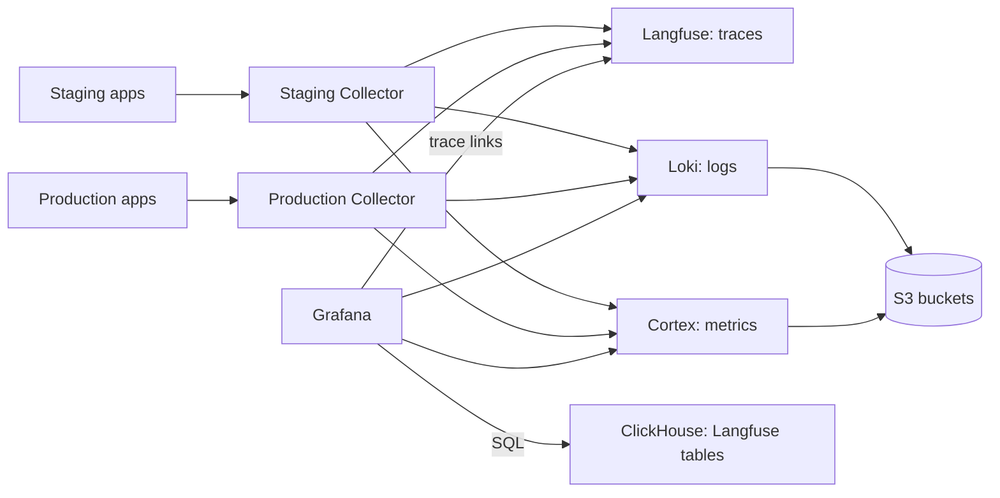

# Observability

ReloHome exports OpenTelemetry from its services to one Collector per environment
([#106](https://github.com/AI20K-Build-Phase-Cohort-4/P-044/issues/106)). A shared
platform stores traces in Langfuse, logs in Loki and metrics in Cortex, and
Grafana shows dashboards and alerts. Staging and production share every store:
each Collector stamps `environment=staging|production` on all data, and Langfuse,
Grafana and the alerts filter or group by that label.



Configuration lives in `deploy/observability/`:

| File | Purpose |
| --- | --- |
| `compose.yaml` | Shared platform: Langfuse (web, worker, Postgres, ClickHouse, Redis), Loki, Cortex, Grafana |
| `compose.collector.yaml`, `collector.yaml` | One Collector per environment |
| `loki.yaml`, `cortex.yaml` | Log and metric storage on S3 |
| `grafana/datasources.yaml`, `dashboards.yaml`, `overview.json`, `alerts.yaml` | Grafana data sources, the **ReloHome operations** dashboard and alert rules |
| `.env.example` | Every variable both resources need |

## Before you start

- **One server** with about 12.4 GiB of free memory for the platform plus 512 MiB
  per Collector, and disk for the Langfuse databases and the Loki/Cortex caches.
  The apps, Collectors and platform must run on the same Docker host: the
  Collectors reach the platform over a Docker network.
- **Three private S3 buckets** for Langfuse events, Loki and Cortex, each with a
  key that can list, get, put and delete.
- **Two HTTPS domains**, one for Grafana and one for Langfuse.

## Set up

### 1. Shared platform

In Coolify, create a Git-based Application the same way as the main application
(see [deployment setup](../../deploy/README.md#one-time-coolify-setup-per-environment)):

- Docker Compose build pack, branch `main`
- Base directory **`/deploy/observability`**, compose file **`/compose.yaml`**.
  Coolify resolves the `./` config mounts from the base directory.
- **Preserve repository during deployment** on. Coolify then mounts the config
  files from the repository; without it the containers fail to start.
- Auto-deploy off

Set the variables listed in `.env.example`:

- Secrets: `openssl rand -hex 32` for the Langfuse database passwords, `LF_SALT`
  and `LF_NEXTAUTH_SECRET`; a 64-hex `LF_ENCRYPTION_KEY`; the admin passwords.
  Back up `LF_ENCRYPTION_KEY` and `LF_SALT` with the database backups.
- `LANGFUSE_PUBLIC_KEY=pk-lf-…` and `LANGFUSE_SECRET_KEY=sk-lf-…`, generated by you.
  Langfuse creates the `relohome` project with this key pair at first start.
- `LANGFUSE_URL` and `GRAFANA_URL`: the two HTTPS domains. Point them at the
  `langfuse` and `grafana` services on port 3000.
- Buckets: `LANGFUSE_S3_EVENT_UPLOAD_*` (endpoint with `https://`), `LOKI_S3_*` and
  `CORTEX_S3_*` (endpoints as `host[:port]`, without a scheme).

Deploy. Grafana should show the **ReloHome operations** dashboard and the
**ReloHome** alert rules, and Langfuse the `relohome` project. Sign-up is disabled
on both.

Grafana also provisions a **ClickHouse** datasource using the official plugin
(pinned to 4.22.1), installed before provisioning at startup. Grafana and Langfuse
share the `langfuse` ClickHouse account and existing `LF_CLICKHOUSE_PASSWORD`
secret. Grafana queries have the same write permissions as Langfuse. Redeploy
the platform to apply the datasource, and redeploy both ClickHouse and Grafana
when rotating the shared secret. ClickHouse stays on the internal Docker network.
Grafana needs outbound access to download the plugin on first installation.

In Grafana **Explore**, select **ClickHouse** and run `SELECT 1`, then
`SHOW TABLES FROM default` to verify access. Use SQL against the Langfuse tables
for additional dashboards; these are Langfuse's schema, not the OpenTelemetry
ClickHouse exporter schema. Queries can read both environments, so include the
appropriate environment and project filters. Cortex remains the default datasource.

### 2. One Collector per environment

Create another Git-based Application per environment with the same settings and
compose file **`/compose.collector.yaml`**:

| Variable | Value |
| --- | --- |
| `OTEL_DEPLOYMENT_ENVIRONMENT` | `staging` or `production` |
| `APPLICATION_NETWORK` | That environment's app network (`docker network ls`; Coolify names it after the app's UUID) |
| `LANGFUSE_PUBLIC_KEY`, `LANGFUSE_SECRET_KEY` | The same pair as the platform |

Deploy the platform first: it creates the shared `relohome-observability-ingest`
network that the Collectors join. The Collector's environment is the only thing
that separates staging from production data, so set it carefully.

### 3. Deploy the instrumented app images

Python image entrypoints use `opentelemetry-instrument`; Node image entrypoints
preload `@relohome/telemetry/register`. Both activate telemetry automatically.
On the production app set `OTEL_DEPLOYMENT_ENVIRONMENT=production`; the default
is `staging`. Redeploy with `deploy.yml`, because a plain restart does not apply
new variables. The app Compose already sends to `http://otel-collector:4318`.

To disable telemetry, rebuild and redeploy an image with the plain entrypoint:
remove `opentelemetry-instrument` from the Python command, or remove Node's
`--import @relohome/telemetry/register`. No activation environment variable is used.

### 4. Check

- HTTP requests appear in Langfuse with connected outbound HTTP and supported
  database spans, with the right environment.
- The Grafana dashboard fills in for the chosen environment, and a log line's
  `trace_id` opens that trace in Langfuse.
- The alerts in Grafana stay Normal.

## Making changes

Edit the files in `deploy/observability/`, review them in a PR, merge, then
redeploy the platform or a Collector in Coolify. Grafana loads its files at
startup and re-reads dashboard JSON every 30 seconds. UI edits to the provisioned
dashboard cannot be saved; export a copy and move the change into `overview.json`.

For upgrades, read the release notes, check the new image has an ARM64 build
(`docker buildx imagetools inspect <image>`), and back up the volumes first.

## Application telemetry

Python services use the official `opentelemetry-distro` and
`opentelemetry-instrument` launcher. Dependencies are pinned in
`requirements-observability.txt`. Node services preload
`@relohome/telemetry/register`, which configures the official NodeSDK and its
instrumentors. There is no Python observability package, custom distro,
application tracing wrapper, content mode or custom telemetry processor.

```sh
OTEL_EXPORTER_OTLP_PROTOCOL=http/protobuf OTEL_SERVICE_NAME=backend \
  OTEL_SEMCONV_STABILITY_OPT_IN=http \
  opentelemetry-instrument python -m uvicorn relohome_agent.main:app --port 8000
```

The development service commands use the same instrumented launchers. Standard
`OTEL_*` settings control sampling, propagation and export. Python opts into
stable HTTP conventions; the Node HTTP instrumentor already uses them.

| Runtime | Official integration |
| --- | --- |
| Agent API, browser gateway, Intake, Orchestrator | `FastAPIInstrumentor` |
| Python Flight/Payment MCP HTTP applications | `StarletteInstrumentor` |
| Python outgoing HTTP | `HTTPXClientInstrumentor` |
| Python PostgreSQL | `PsycopgInstrumentor` |
| Python SQLite | `SQLite3Instrumentor` (explicit cursor calls) |
| Node HTTP servers | `HttpInstrumentation` |
| Platform and Moving APIs | `@fastify/otel` |
| Node fetch, PostgreSQL and logging | `UndiciInstrumentation`, `PgInstrumentation`, `PinoInstrumentation` |

FastAPI's built-in tracing is disabled to avoid duplicate HTTP spans. SQLite's
standard instrumentor traces explicit cursor calls; it does not wrap connection
shortcut methods. Backup utilities run separately with plain Python. There is
no custom SQLite adapter or aiosqlite worker patch.

Instrumentors provide request spans, exception events, stack traces, supported
SQL statements, metrics and log correlation. The Collector forwards these using
standard resource and batch processors. Application-specific graph, LLM, MCP,
session and durable-job tracing wrappers, custom metrics, content filtering and
payload serialization have been removed. Stdio MCP and background jobs do not
have the former custom cross-process trace links.

### Handled HTTP failures

Automatic instrumentation records HTTP status and uncaught dependency exceptions.
For handled configuration failures, application handlers add `app.error.code`
to the active span and write a normal Python error log. There are no custom
exception or response classes. The SDK records the final HTTP error status and
correlates the log.

Gateway/backend codes include `missing_agent_api_token`,
`agent_runtime_not_started` and `upstream_invalid_json`. Standalone services use
their existing `ServiceError.code`, such as `NOT_CONFIGURED`.

For `/web/api/status`, find the gateway request by service, route and timestamp,
or open its trace from a correlated log. Inspect `app.error.code` and follow any
outbound HTTP span. A missing token stops before an outbound request; a connection
failure has an automatic HTTPX exception span beneath the gateway's 502.

### Dashboards and deployment

Grafana uses the SDK's `http.server.request.duration` histogram for request count,
5xx rate and latency. Collector queue, memory and operational-log panels remain.
Alerts cover HTTP error rate, chat latency, Collector availability and export
failures. Panels and alerts for removed custom application metrics are deleted.

Deploy application images, Collector configuration and Grafana provisioning
together. Previous telemetry data is not migrated. Updated code and queries use
the current SDK schema directly.

References: [Python zero-code instrumentation](https://opentelemetry.io/docs/zero-code/python/),
[FastAPI](https://opentelemetry-python-contrib.readthedocs.io/en/latest/instrumentation/fastapi/fastapi.html),
[SQLite](https://opentelemetry-python-contrib.readthedocs.io/en/latest/instrumentation/sqlite3/sqlite3.html),
[Fastify](https://github.com/fastify/otel).
