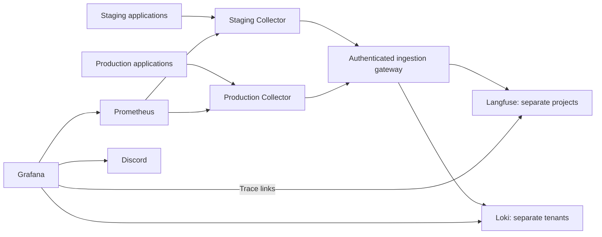

# Shared observability

Implementation of [#106](https://github.com/AI20K-Build-Phase-Cohort-4/P-044/issues/106).
Applications export OpenTelemetry to one Collector per environment. A shared
platform stores traces in Langfuse, operational logs in Loki and metrics in
Prometheus. Grafana owns dashboards, alert evaluation, notification policies and
the Discord contact point. Application services never receive the Discord webhook.



## Deployment boundaries

Deploy three independent Coolify resources: the shared platform, the staging
Collector and, after staging validation, the production Collector. Application
releases use the existing GHCR/image-only workflow. The renderer embeds config
files into Coolify bind-mount `content` fields, so the host needs no repository
checkout. Generated files are deployment artifacts; edit the sources in
`deploy/observability/` and `scripts/render-observability.py`.

The supplied network layout assumes the resources run on the **same Docker
host**. Each Collector joins its existing application network and the private
`lifeflow-observability-ingest` network. Only the gateway and Prometheus join that
network from the shared platform; databases, Loki, Redis and MinIO remain on the
platform's private network. Do not attach applications to the storage network.

Docker bridge networks do not span hosts. For a separate observability host,
provide VPN/private routed connectivity or authenticated HTTPS to the gateway,
and private Prometheus reachability to each Collector's ports 8888/8889. Configure
`OBSERVABILITY_GATEWAY_URL` and scrape targets accordingly before enabling export.
Never expose Collector OTLP, scrape endpoints, Loki or storage ports publicly.

The gateway authenticates staging and production independently, assigns a fixed
Loki tenant and injects the corresponding Langfuse project key. An application
cannot choose its destination by changing an environment label or tenant header.
Collector bearer tokens and gateway passwords must differ between environments.

The shared operations team is trusted to read both environments. Grafana filters
and Prometheus labels do not restrict query access. Staging-only operators require
separate query access controls/backends before being granted access. Shared
backends still share capacity and failure risk; this deployment is not HA.

## Preflight

1. Verify host memory and disk headroom independently of the application budget.
   Configured platform memory limits total about 12 GiB, plus 512 MiB per
   Collector; these limits are ceilings, not evidence of sufficient capacity.
   Langfuse/ClickHouse initialization and load can require additional headroom.
   Inspect actual RSS, queue growth and disk growth during staging. Prefer a
   dedicated host when available; no new paid infrastructure is provisioned here.
2. Check available disk with `df -h` and Docker usage with `docker system df`.
   Budget space for images, all named volumes, ClickHouse merges and Collector
   queues. Queue length bounds batches, not total storage bytes; monitor its
   volume and reserve disk headroom.
3. Verify pinned image architecture and all backend configuration:

   ```bash
   python scripts/validate-observability.py --images
   ```

   This uses Docker, PyYAML and temporary test credentials. Full validation below
   requires enough capacity to start a disposable copy of the platform.
4. Identify the actual existing application network for each environment with
   `docker network ls`. Plan authenticated HTTPS domains for Grafana and Langfuse.
   Confirm application → Collector, Collector → gateway and Prometheus →
   Collector connectivity. The readiness endpoints of applications do not depend
   on observability.

## Bootstrap the shared platform

Render the staging-first platform:

```bash
python scripts/render-observability.py --coolify --output /tmp/lifeflow-observability
python scripts/render-observability.py --kind collector --coolify --output /tmp/lifeflow-collector
```

Create independent Coolify Docker Compose resources from the generated
`compose.coolify.yaml` files. For a local deployment, omit `--coolify` and use the
generated `compose.yaml`; Grafana and Langfuse bind only to localhost on ports
3001 and 3000. Store each resource's real environment configuration outside Git.
The example at `deploy/observability/.env.example` lists every required input.

Generate independent random secrets; hexadecimal database passwords avoid URL
escaping errors in `DATABASE_URL`. `LF_ENCRYPTION_KEY` must be 64 hexadecimal
characters. Keep backups of this key and `LF_SALT` with the database backups.
Generate a separate password for each Collector's gateway identity and use
`caddy hash-password` (interactive input) to obtain its bcrypt hash. Set
`STAGING_INGEST_PASSWORD_HASH` and `PRODUCTION_INGEST_PASSWORD_HASH` in the platform
resource. In local Compose `.env` files, single-quote hashes to preserve dollar
signs. Enter literal hashes in Coolify secret fields.

Initially `LANGFUSE_STAGING_AUTH` and `LANGFUSE_PRODUCTION_AUTH` may be empty.
Start the platform and sign in with the initialized operator account. Create
`lifeflow-staging` and `lifeflow-production` projects and independent project API
keys. Set each `LANGFUSE_*_AUTH` to base64 of `public-key:secret-key`, and set each
`LANGFUSE_*_PROJECT_ID` to its actual project ID, not its display name. Keep those
keys only in the platform resource; the gateway and retention worker use them.
Redeploy the platform after entering the keys. Cleanup reports failures until
project credentials are configured.

Set `LANGFUSE_URL` and `GRAFANA_URL` to their external HTTPS URLs and configure the
Coolify reverse proxy domains to each web service's port 3000. The Coolify output
removes localhost port mappings. Verify authentication and signup restrictions.
MinIO initialization creates the private event bucket and applies its lifecycle.
No MinIO console or object-storage endpoint needs a public domain.

Set the Discord webhook as `DISCORD_WEBHOOK_URL` on the **Grafana/platform
resource**. The provisioned `lifeflow-discord` contact point, routing policy and
rules are managed as code. View them in Grafana Alerting; change their source
configuration and redeploy to make lasting edits. Use Grafana's contact-point
test during rollout, then verify a controlled firing and resolution in the
intended channel. Local automated validation uses a disposable receiver and does
not send to Discord.

## Enable staging, then production

For each Collector resource, set:

| Variable | Value |
| --- | --- |
| `OTEL_DEPLOYMENT_ENVIRONMENT` | `staging` or `production` |
| `APPLICATION_NETWORK` | That environment's existing Docker network |
| `OTEL_COLLECTOR_TOKEN` | Unique random application ingestion bearer token |
| `OBSERVABILITY_INGEST_PASSWORD` | Plaintext matching that environment's gateway bcrypt hash |
| `OBSERVABILITY_GATEWAY_URL` | `http://telemetry-gateway:8080` on the private bridge |

Keep application networks separate: the `otel-collector` alias must resolve to
exactly one Collector in each application's network. Persistent queue volumes
belong to individual Collector resources; do not share them.

Set these on the staging application resource and redeploy its instrumented
images:

```dotenv
OBSERVABILITY_ENABLED=true
OBSERVABILITY_CONTENT_MODE=redacted
OTEL_DEPLOYMENT_ENVIRONMENT=staging
OTEL_EXPORTER_OTLP_ENDPOINT=http://otel-collector:4318
OTEL_COLLECTOR_TOKEN=<staging-token>
```

The application Compose supplies each service name, release SHA and encoded
`OTEL_EXPORTER_OTLP_HEADERS=Authorization=Bearer%20...`. When starting a service
directly, set these OTLP headers yourself and preload Node with
`--import @relohome/telemetry/register`. Python entry points initialize telemetry
before constructing clients. Keep legacy LangSmith tracing disabled.

The current application uses HTTP for Payment MCP. Python Flight/Payment servers
also accept per-call W3C `_meta` over standalone stdio. No subprocess client or
environment forwarding is added to the application. External stdio launchers
should pass only the required telemetry variables and existing service settings;
telemetry writes no JSON-RPC data to stdout.

Exercise chat, clarification/resume, parallel tools and mocked payment jobs.
Verify one connected trace, correct thread/session grouping, structured errors,
token usage, metadata-only logs and bounded metric labels. A background job starts
a fresh trace linked to persisted origin context; it does not keep an HTTP span
open. External provider internals remain outside our traces. Langfuse pricing
depends on available model definitions; an unpriced model must not be interpreted
as a zero-cost call.

Before enabling production, render the shared stack again with
`--environments staging production` and set
`OBSERVABILITY_ENVIRONMENTS=staging,production`. This adds production scrape
targets, expected heartbeat inventory and retention. Deploy the production
Collector and enable its applications with their own token. Keep the same stack
and dashboard definitions. Initial collection samples all non-health requests;
measure overhead and growth before changing sampling or retention.

## Content and failure behavior

`OBSERVABILITY_ENABLED` defaults to `false`. Content mode affects future exports:

| Mode | Langfuse input/output |
| --- | --- |
| `metadata` | Omitted |
| `redacted` (default) | Sanitized copy with structured personal fields and detected email, Vietnamese phone and identity-number patterns removed |
| `raw` | Copy with credentials still scrubbed; personal fields may remain |

Credential fields, authorization/cookies, API keys, recognizable signed tokens
and URL credentials/query strings are scrubbed in all content modes. Free text
can contain names or addresses that pattern matching cannot identify. Use
`metadata` when that limitation is unacceptable. Sanitization failures omit
content, and each captured field is capped at 16 KiB. Business data is unchanged.
Changing settings never rewrites previously stored telemetry.

Loki receives fixed completion events or `application.log`, severity and bounded
operational attributes. Arbitrary message bodies, exception values, stack traces,
SQL statements, HTTP bodies and graph checkpoints are excluded from export.
Original local container logging remains controlled by existing application
logging. Do not add a second stdout-to-Loki shipper without deduplication/privacy
review. Trace and span IDs are structured log metadata, never indexed labels or
metric dimensions.

SDK queues hold at most 2,048 spans/log records each and export asynchronously.
Each Collector has a 256 MiB memory limiter, 512 MiB container limit and a disk
queue of 200 batches per exporter pipeline. It retries temporary backend outages.
Prolonged outages, full queues, permanent rejection and disk exhaustion can drop
telemetry. Application requests and payments remain independent of export.

## Dashboards and alerts

Open **LifeFlow operations** in Grafana and choose the environment. Expand a log
record's `trace_id` to open its project-specific Langfuse trace. Verify the
generated URL after entering real project IDs.

| Rule | Evaluation |
| --- | --- |
| HTTP 5xx | >5% over 10 minutes, at least 20 requests per service/environment |
| Agent/tool/LLM failures | >5% over 10 minutes, at least 20 operations per kind/service/environment |
| Provider rate limits | At least 3 over 10 minutes |
| Chat latency | p95 >120 seconds over 15 minutes, at least 10 requests |
| Missing service heartbeat | Expected service has no heartbeat newer than 120 seconds |
| Collector unavailable | Failed scrape for 2 minutes |
| Telemetry export failure/drop | Nonzero failure rate persisting for 5 minutes |
| Trace cleanup failure | Failed cleanup for 15 minutes |

Notification groups include environment and service; resolved notifications are
enabled. Check Collector auth, fixed environment, DNS, queue depth and backend
health before changing thresholds. A completely unavailable Grafana/host cannot
send its own alerts; an external availability monitor is separate work.

## Retention, upgrades and rollback

Prometheus retains up to 30 days, with a 10 GB size ceiling that can shorten this.
Loki's compactor applies seven-day retention. Langfuse OSS lacks built-in scheduled
retention, so the project-scoped worker enumerates observations older than seven
days, deletes their trace IDs using supported APIs, and verifies asynchronous
deletion. It runs every 24 hours, retries failures after 15 minutes and exposes
cleanup status on port 9101. Thus deletion is not instantaneous at the seven-day
boundary. It does not clean datasets or independently uploaded media.

MinIO expires raw `events/` objects after eight days, allowing one extra day for
ingestion. Monitor worker backlog and queues; do not allow replay backlog to
approach this window. Failed cleanup must be repaired, not masked by increasing
object expiry. Run a scoped dry run inside the retention container with
`python /app/retention.py --dry-run`; omit `--dry-run` for an immediate cleanup.
The script prints only environment and counts. Never run cleanup with keys for
an unrelated project.

Back up persistent volumes and encryption secrets according to the deployment's
backup policy. Pin upgraded images, read their migration notes, rerun validation
and stage the upgrade first. Downgrading Langfuse after a schema migration is not
a substitute for restoring a compatible backup.

Rollback application telemetry by setting `OBSERVABILITY_ENABLED=false` and
redeploying. Keep volumes for investigation and stop the independent observability
resources if needed. Do not use `down --volumes` on a real deployment. To remove an
environment, also remove its scrape/inventory configuration and retention target.

## Validation

The TypeScript telemetry workspace is `packages/telemetry`
(`@relohome/telemetry`) and participates in the root build/test commands after
the #111 relocation. Its `./register` export must still preload before service
modules. Keep `service.name`, the `lifeflow` resource namespace, metric names,
Grafana identifiers and environment routing stable during source renames.

Python telemetry currently remains in `src/observability`. The #112 packaging
handoff is `relohome-observability` / `relohome_observability` under
`packages/python/observability`; carry its dependencies into every consuming
wheel/image, including shared MCP HTTP, and rerun export/privacy checks outside
the checkout when that packaging change lands. This source migration does not
change the shared observability deployment or enable telemetry automatically.

```bash
python -m pytest tests/test_observability.py tests/test_observability_export.py -q
python scripts/validate-observability.py --images --smoke
npm run build
npm run test:ci
```

The smoke command creates a unique disposable Docker project with random test
credentials and loopback-only ports, checks provisioning/ingestion/isolation and
queue recovery, exercises Python/LangGraph → Node MCP → PostgreSQL, captures
Grafana firing/resolved webhook payloads locally and verifies trace deletion.
Install the Python requirements and run `npm ci && npm run build` in
the repository root before this command. It removes only that project's containers
and volumes. If the
process is forcibly interrupted, inspect `p044-observability-test-*` resources
and clean up that exact test project before retrying.

References: [Langfuse OTLP](https://langfuse.com/integrations/native/opentelemetry),
[retention licensing](https://langfuse.com/docs/administration/data-retention),
[deletion API](https://langfuse.com/docs/administration/data-deletion),
[Loki OTLP](https://grafana.com/docs/loki/latest/send-data/otel/),
[Grafana provisioning](https://grafana.com/docs/grafana/latest/alerting/set-up/provision-alerting-resources/file-provisioning/).
