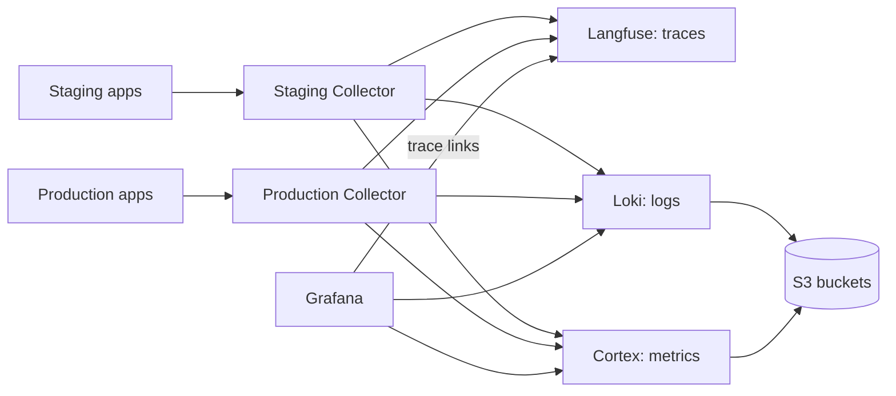

# Observability

ReloHome exports OpenTelemetry from its services to one Collector per environment
([#106](https://github.com/AI20K-Build-Phase-Cohort-4/P-044/issues/106)). A shared
platform stores traces in Langfuse, logs in Loki and metrics in Cortex, and
Grafana shows dashboards and alerts. Staging and production share every store:
each Collector stamps `environment=staging|production` on all data, and Langfuse,
Grafana and the alerts filter or group by that label.



Configuration lives in `deploy/observability/`:

| File | Purpose |
| --- | --- |
| `compose.yaml` | Shared platform: Langfuse (web, worker, Postgres, ClickHouse, Redis), Loki, Cortex, Grafana |
| `compose.collector.yaml`, `collector.yaml` | One Collector per environment |
| `loki.yaml`, `cortex.yaml` | Log and metric storage on S3 |
| `grafana/datasources.yaml`, `dashboards.yaml`, `overview.json`, `alerts.yaml` | Grafana data sources, the **ReloHome operations** dashboard and alert rules |
| `.env.example` | Every variable both resources need |

## Before you start

- **One server** with about 12.4 GiB of free memory for the platform plus 512 MiB
  per Collector, and disk for the Langfuse databases and the Loki/Cortex caches.
  The apps, Collectors and platform must run on the same Docker host: the
  Collectors reach the platform over a Docker network.
- **Three private S3 buckets** for Langfuse events, Loki and Cortex, each with a
  key that can list, get, put and delete.
- **Two HTTPS domains**, one for Grafana and one for Langfuse.

## Set up

### 1. Shared platform

In Coolify, create a Git-based Application the same way as the main application
(see [deployment setup](../../deploy/README.md#one-time-coolify-setup-per-environment)):

- Docker Compose build pack, branch `main`
- Base directory **`/deploy/observability`**, compose file **`/compose.yaml`**.
  Coolify resolves the `./` config mounts from the base directory.
- **Preserve repository during deployment** on. Coolify then mounts the config
  files from the repository; without it the containers fail to start.
- Auto-deploy off

Set the variables listed in `.env.example`:

- Secrets: `openssl rand -hex 32` for the Langfuse database passwords, `LF_SALT`
  and `LF_NEXTAUTH_SECRET`; a 64-hex `LF_ENCRYPTION_KEY`; the admin passwords.
  Back up `LF_ENCRYPTION_KEY` and `LF_SALT` with the database backups.
- `LANGFUSE_PUBLIC_KEY=pk-lf-…` and `LANGFUSE_SECRET_KEY=sk-lf-…`, generated by you.
  Langfuse creates the `relohome` project with this key pair at first start.
- `LANGFUSE_URL` and `GRAFANA_URL`: the two HTTPS domains. Point them at the
  `langfuse` and `grafana` services on port 3000.
- Buckets: `LANGFUSE_S3_EVENT_UPLOAD_*` (endpoint with `https://`), `LOKI_S3_*` and
  `CORTEX_S3_*` (endpoints as `host[:port]`, without a scheme).

Deploy. Grafana should show the **ReloHome operations** dashboard and the
**ReloHome** alert rules, and Langfuse the `relohome` project. Sign-up is disabled
on both.

### 2. One Collector per environment

Create another Git-based Application per environment with the same settings and
compose file **`/compose.collector.yaml`**:

| Variable | Value |
| --- | --- |
| `OTEL_DEPLOYMENT_ENVIRONMENT` | `staging` or `production` |
| `APPLICATION_NETWORK` | That environment's app network (`docker network ls`; Coolify names it after the app's UUID) |
| `LANGFUSE_PUBLIC_KEY`, `LANGFUSE_SECRET_KEY` | The same pair as the platform |

Deploy the platform first: it creates the shared `relohome-observability-ingest`
network that the Collectors join. The Collector's environment is the only thing
that separates staging from production data, so set it carefully.

### 3. Turn on telemetry in the app

On each app's Coolify Application set `OBSERVABILITY_ENABLED=true`. On the
production app also set `OTEL_DEPLOYMENT_ENVIRONMENT=production`; the default is
`staging`. Redeploy with `deploy.yml`, because a plain restart does not apply new
variables. The app Compose already sends to `http://otel-collector:4318`.

To undo, set `OBSERVABILITY_ENABLED=false` and redeploy. App data is untouched.

### 4. Check

- A chat request shows up in Langfuse as one connected trace (gateway → agent →
  MCP → database) with the right environment.
- The Grafana dashboard fills in for the chosen environment, and a log line's
  `trace_id` opens that trace in Langfuse.
- The alerts in Grafana stay Normal.

## Making changes

Edit the files in `deploy/observability/`, review them in a PR, merge, then
redeploy the platform or a Collector in Coolify. Grafana loads its files at
startup and re-reads dashboard JSON every 30 seconds. UI edits to the provisioned
dashboard cannot be saved; export a copy and move the change into `overview.json`.

For upgrades, read the release notes, check the new image has an ARM64 build
(`docker buildx imagetools inspect <image>`), and back up the volumes first.

Grafana keeps rules and data sources it provisioned earlier. If an older
deployment with per-environment data sources and alerts exists, remove its
`grafana` volume before deploying this layout; everything in it is provisioned
again from the files.

## What is collected

`OBSERVABILITY_CONTENT_MODE` controls whether prompt and tool content reaches
Langfuse:

| Mode | Langfuse input/output |
| --- | --- |
| `metadata` (default) | Omitted; timing, outcomes, token usage and metrics remain |
| `redacted` | Non-production opt-in; personal fields and detected emails, Vietnamese phone and ID numbers removed |
| `raw` | Non-production opt-in; credentials still scrubbed, personal fields may remain |

Production always uses `metadata`: the apps force it when `APP_ENV` or
`OTEL_DEPLOYMENT_ENVIRONMENT` is `production`, and the production Collector drops
input/output attributes. Credentials, cookies, API keys and signed tokens are
scrubbed in every mode. Loki receives only fixed operational events and bounded
attributes, never message bodies, SQL or exception text. Metric labels never
contain user, session, request or trace IDs.

### Framework and client instrumentation

The services use the framework-maintained/OpenTelemetry integrations below.
Initialize the Python SDK before constructing clients and instrument each app
before its first request. Node services preload `@relohome/telemetry/register`
with `--import` before HTTP, Fastify, Undici, PostgreSQL or Pino is imported.

| Runtime | Integration |
| --- | --- |
| Agent API, browser gateway, Intake, Orchestrator | `FastAPIInstrumentor` |
| Python Flight/Payment MCP HTTP applications | `StarletteInstrumentor` |
| Python outgoing HTTP | `HTTPXClientInstrumentor` |
| Python PostgreSQL/Roommate pools | `PsycopgInstrumentor`, without SQL parameters or SQLCommenter |
| SQLite and aiosqlite | Official DB-API `CursorTracer` through the native connection adapter |
| Node HTTP/MCP servers | `HttpInstrumentation` |
| Platform and Moving Fastify APIs | Maintained `@fastify/otel`, registered automatically by NodeSDK |
| Node fetch, PostgreSQL and logging | `UndiciInstrumentation`, `PgInstrumentation`, `PinoInstrumentation` |

FastAPI's built-in tracing is disabled to avoid duplicating the official
instrumentor. The HTTP policy boundary creates no spans: it adds `x-trace-id`,
preserves existing `relohome.http.*` metrics and completion logs, excludes health
and static requests, and prevents public browser trace headers from choosing
the gateway's trace or sampling policy. Internal HTTP services retain trusted
W3C parent context. Python and Node propagate trace context without baggage.
Internal ASGI send/receive spans and Fastify lifecycle hook spans are disabled;
Fastify retains a framework request/handler span beneath the HTTP server span.
The Starlette adapter places the installed SDK middleware outside its server
error handler and records the exception before that handler converts it to a
500 response. This keeps the response status and original error class on the
same SDK span; the adapter does not create an additional span.

The SDK drops automatic `http.*`/`db.*` metrics before export because their labels
can include raw request targets or queries. Existing bounded `relohome` metrics
remain the dashboard source. Span sanitation keeps route templates, error classes
and PostgreSQL SQLSTATE codes, while removing raw URLs, SQL, exception messages,
stack traces and events. Native SQLite connections remain necessary because its
C backup API rejects generic connection proxies; its adapter delegates span
creation to the official DB-API tracer and preserves aiosqlite worker context.
PostgreSQL pool setup/idle queries without a request/operation parent are not
exported. Application spans for graph nodes, LLM generations, MCP tools and
durable jobs remain separate from framework instrumentation.

Deploy updated application images, including the standalone Intake/Orchestrator
images if used. Telemetry remains opt-in; the standalone `compose.agents.yaml`
also forwards the existing observability settings. Collector/Grafana configuration
does not need to change. SDK HTTP route names now include router prefixes, such
as `/api/v1/status`; use these full templates in route-specific queries.

Official references: [FastAPI](https://opentelemetry-python-contrib.readthedocs.io/en/latest/instrumentation/fastapi/fastapi.html),
[Starlette](https://opentelemetry-python-contrib.readthedocs.io/en/latest/instrumentation/starlette/starlette.html),
[Psycopg](https://opentelemetry-python-contrib.readthedocs.io/en/latest/instrumentation/psycopg/psycopg.html),
[Fastify](https://github.com/fastify/otel).

### HTTP failure diagnostics

HTTPX auto-instrumentation creates outbound request spans. Failed automatic spans
retain `error.type`; for legacy instrumentors that only record an exception event,
the SDK copies the exception class into `error.type` before removing the event,
message and stack trace. A failed HTTP span with no more specific cause falls back
to its numeric HTTP status as `error.type`. These classifications explain the
failure category, not the full exception message or infrastructure incident.

Application decisions that become handled HTTP errors use a fixed diagnostic code:

| `error.type` | Origin |
| --- | --- |
| `missing_agent_api_token` | Gateway or backend has no server authentication token |
| `agent_runtime_not_started` | Backend has no initialized Agent service |
| `upstream_invalid_json` | Gateway could not decode the upstream response as JSON |
| `missing_service_token` | Standalone Intake/Orchestrator service token is absent |
| `llm_not_configured`, `llm_unavailable`, `llm_provider_error`, `llm_invalid_output`, `llm_no_result` | Standalone LLM service's handled outcome |
| `internal_service_error`, `approval_not_configured` | Standalone service failure or approval configuration failure |

The optional `relohome_observability.fastapi` bridge carries these codes on
`DiagnosticHTTPException` and `DiagnosticJSONResponse`. The exception handler or
response boundary annotates the existing HTTP span and emits one ERROR
`application.log` with `error_type`, correlated by trace/span ID. An exception
caught for a successful fallback does not annotate the HTTP span. The bridge
preserves existing response status, body and headers; codes are internal telemetry,
not new browser API fields. The existing standalone `ServiceError` handler uses
the same fixed-code annotations for its 5xx outcomes. Specific application causes
survive both legacy and stable HTTP conventions. Unknown codes are ignored and
diagnostic failures are fail-open. No reason code is added as a metric label.

To investigate `/web/api/status`, find the gateway request by its `x-trace-id`,
inspect `error.type`, then follow any outbound HTTP span to the backend span and
its cause. A missing gateway token stops before an outbound Agent API request;
session-store SQLite spans can still appear. A transport failure has an automatic
HTTPX child span (for example, `httpx.ConnectError`) beneath the gateway's 502.
Use the existing Langfuse trace link from Loki for the corresponding ERROR log.

These attributes already pass the Collector's privacy allowlists. Deploy updated
application images with the updated telemetry package; no Collector or Grafana
configuration update is required for these diagnostics. Existing stored traces do
not gain new attributes.

### Jev shadow metrics

The guardrail observer exports `relohome.guardrail.observations`,
`relohome.guardrail.skips` and `relohome.guardrail.in_flight`, with labels
`point`, `event` and `reason`. The dashboard shows coverage, skip reasons,
outcomes and in-flight work. Coverage is completed / eligible attempts for running
processes, not a security score, and counters reset on restart.

## Alerts

Each rule fires per environment and carries an `environment` label; the
application rules also carry `service_name`:

| Rule | Fires when |
| --- | --- |
| HTTP error rate | 5xx above 5% over 10 minutes, with at least 20 requests |
| Agent/tool/provider failures | Above 5% over 10 minutes, with at least 20 operations |
| Provider rate limits | At least 3 in 10 minutes |
| Chat latency | p95 above 120 seconds over 15 minutes, with at least 10 requests |
| Service heartbeat missing | A service that reported in the last 24 hours has been silent for 2 minutes |
| Collector unavailable | An environment's Collector that reported in the last 24 hours has been gone for 2 minutes |
| Telemetry export failures | Export failures for 5 minutes |

No contact point is configured, so alerts show in Grafana but notify no one. Add
a contact point and notification policy in Grafana when needed.

## Retention

Loki keeps logs for 7 days and Cortex keeps metrics for 30 days; their compactors
delete older data from S3. Langfuse keeps traces indefinitely, because trace
retention is an Enterprise feature in self-hosted Langfuse
([#173](https://github.com/AI20K-Build-Phase-Cohort-4/P-044/issues/173)). You may
expire the Langfuse bucket's `events/` prefix after 8 days at the bucket provider;
do not expire the Loki or Cortex buckets.

## Local run

```bash
docker compose -f deploy/observability/compose.yaml --env-file <file> up -d
```

Grafana and Langfuse listen on `127.0.0.1:3001` and `127.0.0.1:3000`. On a server,
change these ports in `compose.yaml` if they are already taken.

Tests for the telemetry SDKs:

```bash
python -m pytest tests/test_observability.py tests/test_observability_export.py -q
npm run build && npm run test:ci
```
