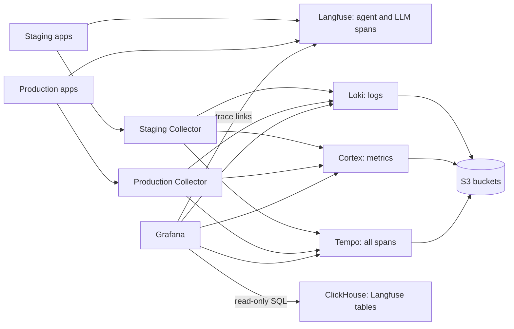

# Observability

ReloHome exports OpenTelemetry from its services to one Collector per environment
([#106](https://github.com/AI20K-Build-Phase-Cohort-4/P-044/issues/106)). A shared
platform stores agent/LLM traces in Langfuse, complete traces in Tempo,
logs in Loki and metrics in Cortex, and
Grafana shows dashboards and alerts. Staging and production share every store:
each Collector stamps `deployment.environment.name=staging|production` on its data.
Cortex and Loki expose it as `deployment_environment_name`; Grafana dashboards
and alerts filter or group by that label. The agent SDK sets the Langfuse
tracing environment directly from `OTEL_DEPLOYMENT_ENVIRONMENT`.

PR previews use one Collector per PR inside `compose.coolify.yaml`, forwarding
to these same stores over the ingestion network. See the
[preview deployment runbook](preview-deployments.md) for setup and PR attributes.



Configuration lives in `deploy/observability/`:

| File | Purpose |
| --- | --- |
| `compose.yaml` | Shared platform: Langfuse (web, worker, Postgres, ClickHouse, Redis), Tempo, Loki, Cortex, Grafana |
| Root `compose.coolify.yaml`, `collector.yaml` | Embedded Collector per deployment, including PR previews |
| `loki.yaml`, `cortex.yaml`, `tempo.yaml` | Log, metric and trace storage on S3 |
| `grafana/datasources.yaml`, `dashboards.yaml`, `overview.json`, `alerts.yaml` | Grafana data sources, the **ReloHome operations** dashboard and alert rules |
| `.env.example` | Every variable both resources need |

## Before you start

- **One server** with about 14.4 GiB of free memory for the platform plus 512 MiB
  per Collector, and disk for the Langfuse databases and the Loki/Cortex caches and Tempo WAL.
  The apps, Collectors and platform must run on the same Docker host: the
  Collectors reach the platform over a Docker network.
- **Four private S3 buckets** for Langfuse events, Loki, Cortex and Tempo, each with a
  key that can list, get, put and delete.
- **Two HTTPS domains**, one for Grafana and one for Langfuse.

## Set up

### 1. Shared platform

In Coolify, create a Git-based Application the same way as the main application
(see [deployment setup](../../deploy/README.md#one-time-coolify-setup-per-environment)):

- Docker Compose build pack, branch `main`
- Base directory **`/deploy/observability`**, compose file **`/compose.yaml`**.
  Coolify resolves the `./` config mounts from the base directory.
- **Preserve repository during deployment** on. Coolify then mounts the config
  files from the repository; without it the containers fail to start.
- Auto-deploy off

Set the variables listed in `.env.example`:

- Secrets: `openssl rand -hex 32` for the Langfuse database passwords, `LF_SALT`
  and `LF_NEXTAUTH_SECRET`; a 64-hex `LF_ENCRYPTION_KEY`; the admin passwords.
  Back up `LF_ENCRYPTION_KEY` and `LF_SALT` with the database backups.
- `LANGFUSE_PUBLIC_KEY=pk-lf-…` and `LANGFUSE_SECRET_KEY=sk-lf-…`, generated by you.
  Langfuse creates the `relohome` project with this key pair at first start.
- `LANGFUSE_URL` and `GRAFANA_URL`: the two HTTPS domains. Point them at the
  `langfuse` and `grafana` services on port 3000.
- Buckets: `LANGFUSE_S3_EVENT_UPLOAD_*` (endpoint with `https://`), `LOKI_S3_*`,
  `CORTEX_S3_*` and `TEMPO_S3_*` (endpoints as `host[:port]`, without a scheme).

Deploy. Grafana should show the **ReloHome operations** dashboard and the
**ReloHome** alert rules, and Langfuse the `relohome` project. Sign-up is disabled
on both.

Grafana also provisions a **ClickHouse** datasource using the official plugin
(pinned to 4.22.1), installed before provisioning at startup. Grafana uses the
`grafana_reader` account with read-only access to Langfuse's `default` database.
Set `GRAFANA_CLICKHOUSE_PASSWORD` on the platform (`openssl rand -hex 32`) and
redeploy ClickHouse and Grafana to apply the account and datasource changes.
The XML files in `deploy/observability/clickhouse/` provision the user on both new
and existing installations. The profile allows Grafana to set its query timeout
while keeping writes and other setting changes blocked.

Langfuse and its worker keep the existing `langfuse` account and
`LF_CLICKHOUSE_PASSWORD`. Rotate the Grafana secret by redeploying ClickHouse
and Grafana; rotate the Langfuse secret by redeploying ClickHouse, Langfuse and
its worker. ClickHouse stays on the internal Docker network.
Grafana needs outbound access to download the plugin on first installation.

In Grafana **Explore**, select **ClickHouse** and run `SELECT currentUser()`
(expect `grafana_reader`), then
`SHOW TABLES FROM default` to verify access. Use SQL against the Langfuse tables
for additional dashboards; these are Langfuse's schema, not the OpenTelemetry
ClickHouse exporter schema. Queries can read both environments, so include the
appropriate environment and project filters. Cortex remains the default datasource.

### Cloudflare SSO (optional)

Create separate Cloudflare Access SaaS OIDC applications for Grafana and Langfuse,
and attach the same exact-email Allow policy to both. The callbacks are
`https://<grafana-host>/login/generic_oauth` and
`https://<langfuse-host>/api/auth/callback/custom`.

In the shared platform environment, set Grafana's `GRAFANA_OIDC_CLIENT_ID`,
`GRAFANA_OIDC_CLIENT_SECRET`, `GRAFANA_OIDC_AUTH_URL`, `GRAFANA_OIDC_TOKEN_URL`,
`GRAFANA_OIDC_USERINFO_URL`, and `GRAFANA_OIDC_JWKS_URL` from its Cloudflare client.
Set `GRAFANA_OIDC_ENABLED=true`. New SSO users receive Viewer access; existing
Grafana organization roles are preserved by default. To manage roles through SSO,
set `GRAFANA_OIDC_DEFAULT_ROLE=Editor` (or `Viewer`) and
`GRAFANA_OIDC_SKIP_ORG_ROLE_SYNC=false`; mapping is applied on sign-in. Set Langfuse's `LF_AUTH_CUSTOM_CLIENT_ID`,
`LF_AUTH_CUSTOM_CLIENT_SECRET`, and `LF_AUTH_CUSTOM_ISSUER` from its separate client.
Keep credentials in Coolify's secret fields. Apply the updated Compose and redeploy.

First test SSO with an existing account while password login remains available.
Langfuse email/password accounts may need `LF_AUTH_CUSTOM_ALLOW_ACCOUNT_LINKING=true`
to migrate; enable this only when the IdP verifies email ownership. Organization
and project access require invitations or membership assignments in Langfuse.
For automatic Viewer access in an SSO-only deployment, set `LF_DEFAULT_ORG_ID`
and `LF_DEFAULT_PROJECT_ID` to the existing organization/project IDs before users
first sign in. Cloudflare must restrict signup to the intended email allowlist.

After SSO works, enforce it by setting `GRAFANA_DISABLE_LOGIN_FORM=true`,
`GRAFANA_BASIC_AUTH_ENABLED=false`, and `LF_AUTH_DISABLE_USERNAME_PASSWORD=true`.
To admit new whitelisted Langfuse users, also set `LF_AUTH_DISABLE_SIGNUP=false`;
disable password authentication in that same rollout so this does not open password
signup. Test an allowed email and a non-allowed email, and keep a deployment-level
rollback route for restoring password login. Browser SSO does not replace Langfuse
SDK/API keys; keep ingestion on its existing machine-authenticated route.

### 2. Embedded Collector in every application

The root `compose.coolify.yaml` includes the Collector. Deploy the platform first:
it creates `relohome-observability-ingest`. Applications and the shared platform
must use the same Docker host. Set `OBSERVABILITY_INGEST_NETWORK` on the application
only if that network has a different name.

Use `/compose.coolify.yaml` with base directory `/` and **Preserve repository
during deployment** enabled. The Collector mounts
`./deploy/observability/collector.yaml`. Keep **Connect to predefined network**
disabled: Coolify supplies the application resource network, and only the
Collector explicitly joins ingestion. No manual `APPLICATION_NETWORK` is needed.

Set `OTEL_DEPLOYMENT_ENVIRONMENT=staging` or `production` on the corresponding
application; set `preview` in the dedicated preview Application's preview variables.
Keep `APP_ENV=production` for production and `staging` for staging/previews.
Coolify's web domain supplies the public application origin automatically.

### 3. Deploy the instrumented app images

Python image entrypoints use `opentelemetry-instrument`; Node image entrypoints
preload `@relohome/telemetry/register`. Redeploy the application to apply settings.
All services send to `http://${SERVICE_NAME_COLLECTOR}:4318`, using Coolify's
actual service DNS name for that deployment. No custom OTLP endpoint is required.

### Replace standalone Collectors

Perform this direct cutover for staging first, then production. Telemetry gaps
and loss of old queued telemetry are accepted; no queue copy, drain, dual export
or database migration is required.

1. Deploy the updated shared observability configuration for PR label promotion
   and dashboards. Keep its existing ingestion network and storage.
2. On the existing application, enable **Preserve repository during deployment**,
   verify the web domain and environment settings above, and remove obsolete
   `OTEL_EXPORTER_OTLP_ENDPOINT` overrides. Keep **Include Source Commit in Build**
   enabled. Use the normal root `/compose.coolify.yaml`.
3. Stop the old standalone Collector resource. Redeploy the application at the
   release containing this change; its embedded Collector starts with a fresh
   `collector-queue` volume. There may be a telemetry gap during this cutover.
4. Verify application health and fresh traces, logs and metrics under the correct
   environment. Inspect network membership: only the embedded Collector joins
   both the resource network and shared ingestion network.
5. Delete the old standalone Collector resource and its queue volume. Remove its
   obsolete `APPLICATION_NETWORK` setting. Do not delete application databases,
   the shared ingestion network, or observability storage: none needs resetting.

To disable telemetry, rebuild and redeploy an image with the plain entrypoint:
remove `opentelemetry-instrument` from the Python command, or remove Node's
`--import @relohome/telemetry/register`. This controls infrastructure instrumentation. The Langfuse SDK has a separate
`LANGFUSE_TRACING_ENABLED=false` switch for graph/model observations.

### 4. Check

Application Compose explicitly sets `OTEL_LOGS_EXPORTER=otlp` and enables the
official Python logging instrumentor. Set `OTEL_LOGS_EXPORTER=none` to disable
only log export, then redeploy the app. Python logger levels still determine
which records are emitted; Node exports Pino records, not arbitrary console output.
This pipeline does not scrape Docker stdout from other containers.

From a host with access to the Collector and Loki (or SSH tunnels), run:

```sh
python3 scripts/check-loki-export.py \
  --collector http://<generated-collector-service-name>:4318 --loki http://loki:3100 \
  --environment staging
```

The check sends one synthetic log with a unique trace ID through the Collector and queries Loki
until it can read that exact log under the expected environment label. Collector
acceptance alone is not success. The Collector must stamp the environment;
the probe deliberately does not supply it. It verifies the trace ID even if the
Collector sanitizes the log body. For older deployments, pass
`--environment-label environment` explicitly. Use `production` for that Collector.
Keep these endpoints internal; use existing Docker-network access or SSH tunnels.
In Grafana Explore, select Loki and query
`{service_name="logging-smoke",deployment_environment_name="staging"}`.
Then check real service logs with `{service_name="backend"}` or
`{service_name="web"}` and the same environment filter.

If logs queue without reaching Loki, check `loki_ingester_wal_disk_usage_percent`
and the host filesystem. Loki throttles WAL writes at 90% filesystem usage by
default. Free approved unused storage or expand the disk, then verify the
Collector log queue drains and rerun this check. Readiness alone does not prove
that Loki accepts writes. See [Loki WAL documentation](https://grafana.com/docs/loki/latest/operations/storage/wal/).

- HTTP requests, outbound HTTP and supported database spans appear in Grafana's
  Tempo datasource with the right environment.
- Agent runs, graph nodes and model generations appear in Langfuse after enabling
  its SDK. Open the same trace ID in both tools to correlate the two portions.
- A Loki log line's `trace_id` links to Tempo and Langfuse. Infrastructure-only
  requests have no Langfuse counterpart. Tempo's span correlation opens Langfuse.
- The alerts in Grafana stay Normal.

## Making changes

Edit the files in `deploy/observability/`, review them in a PR, merge, then
redeploy the platform or a Collector in Coolify. Grafana loads its files at
startup and re-reads dashboard JSON every 30 seconds. UI edits to the provisioned
dashboard cannot be saved; export a copy and move the change into `overview.json`.

For upgrades, read the release notes, check the new image has an ARM64 build
(`docker buildx imagetools inspect <image>`), and back up the volumes first.

## Application telemetry

Python services use the official `opentelemetry-distro` and
`opentelemetry-instrument` launcher. Dependencies are pinned in
`requirements-observability.txt`. Node services preload
`@relohome/telemetry/register`, which configures the official NodeSDK and its
instrumentors. There is no custom distro or telemetry processor. LangGraph and direct OpenAI
calls additionally use the official Langfuse integrations described below.

```sh
OTEL_EXPORTER_OTLP_PROTOCOL=http/protobuf OTEL_SERVICE_NAME=backend \
  OTEL_SEMCONV_STABILITY_OPT_IN=http \
  opentelemetry-instrument python -m uvicorn relohome_agent.main:app --port 8000
```

The development service commands use the same instrumented launchers. Standard
`OTEL_*` settings control sampling, propagation and export. Python opts into
stable HTTP conventions; the Node HTTP instrumentor already uses them.

| Runtime | Official integration |
| --- | --- |
| Agent API, browser gateway, Intake, Orchestrator | `FastAPIInstrumentor` |
| Python Flight/Payment MCP HTTP applications | `StarletteInstrumentor` |
| Python outgoing HTTP | `HTTPXClientInstrumentor` |
| Python PostgreSQL | `PsycopgInstrumentor` |
| Python SQLite | `SQLite3Instrumentor` (explicit cursor calls) |
| Node HTTP servers | `HttpInstrumentation` |
| Platform and Moving APIs | `@fastify/otel` |
| Node fetch, PostgreSQL and logging | `UndiciInstrumentation`, `PgInstrumentation`, `PinoInstrumentation` |

FastAPI's built-in tracing is disabled to avoid duplicate HTTP spans. SQLite's
standard instrumentor traces explicit cursor calls; it does not wrap connection
shortcut methods. Backup utilities run separately with plain Python. There is
no custom SQLite adapter or aiosqlite worker patch.

Instrumentors provide request spans, exception events, stack traces, supported
SQL statements, metrics and log correlation. The Collector forwards these using
standard resource and batch processors. The official Langfuse callback captures
graph runs and nodes; its OpenAI integration captures LLM generations. Former
custom MCP and durable-job tracing wrappers and custom metrics remain removed.
Stdio MCP and background jobs do not
have the former custom cross-process trace links.

### Handled HTTP failures

Automatic instrumentation records HTTP status and uncaught dependency exceptions.
For handled configuration failures, application handlers write the application
error code in a normal Python error log. The official HTTP instrumentation sets
`http.response.status_code`, `error.type` (the status code string for these 5xx
responses), and the span error status. The SDK correlates logs with the span.
There is no custom error span attribute. Successful requests omit `error.type`.

Gateway/backend codes include `missing_agent_api_token`,
`agent_runtime_not_started` and `upstream_invalid_json`. Standalone services use
their existing `ServiceError.code`, such as `NOT_CONFIGURED`.

For `/web/api/status`, find the gateway request by service, route and timestamp,
or open its trace from a correlated log. Inspect `error.type`, read the correlated
error log for the application-specific cause, and follow any outbound HTTP span. A missing token stops before an outbound request; a connection
failure has an automatic HTTPX exception span beneath the gateway's 502.

### Dashboards and deployment

Grafana uses the SDK's `http.server.request.duration` histogram for request count,
5xx rate and latency. Collector queue, memory and operational-log panels remain.
Alerts cover HTTP error rate, chat latency, Collector availability and export
failures. Panels and alerts for removed custom application metrics are deleted.

Deploy application images, Collector configuration and Grafana provisioning
together. Previous telemetry data is not migrated. Updated code and queries use
the current SDK schema directly.

References: [Python zero-code instrumentation](https://opentelemetry.io/docs/zero-code/python/),
[FastAPI](https://opentelemetry-python-contrib.readthedocs.io/en/latest/instrumentation/fastapi/fastapi.html),
[SQLite](https://opentelemetry-python-contrib.readthedocs.io/en/latest/instrumentation/sqlite3/sqlite3.html),
[Fastify](https://github.com/fastify/otel).

### LangGraph and model observations

Installations include Langfuse Python SDK 5.0.1. Configure the real Langfuse
server URL (required by Compose even while tracing is disabled); Compose defaults
tracing to disabled:

```dotenv
LANGFUSE_BASE_URL=https://langfuse.example.com
LANGFUSE_TRACING_ENABLED=false
LANGFUSE_MEDIA_UPLOAD_ENABLED=false
```

Set `LANGFUSE_BASE_URL` to your reachable Langfuse HTTPS URL and
`LANGFUSE_PUBLIC_KEY` and `LANGFUSE_SECRET_KEY` to its project keys, then set `LANGFUSE_TRACING_ENABLED=true` on the backend (and standalone
intake/orchestrator services when used). Compose starts disabled until those
keys are configured. The SDK itself defaults to enabled when the flag is absent;
it disables tracing for an explicit false flag or absent credentials. There is
no custom SDK initialization. Graph callbacks are omitted when tracing is disabled
or keys are missing; model calls still work when the SDK disables tracing.
The OpenAI integration can still log SDK authentication warnings when keys are
absent. Restart after changing settings; the SDK reuses its client.

The shared `run_config` adds the official `langfuse.langchain.CallbackHandler`,
a `relohome-agent` run name and the conversation thread ID as Langfuse session ID.
The handler runs inline so async graph nodes retain the active OTEL context.
A fresh handler per invocation keeps concurrent requests independent; resumed
invocations remain grouped by session. Confirmed Moving forms invoke the same
compiled graph on a dedicated branch with runtime context, skipping Intake/Planner
LLM. Standalone intake/planner runs propagate their existing session IDs around
execution. Graph inputs/outputs and node state are captured, so the Langfuse project
now contains conversation content.

Both structured LLM clients and the read/moving tool loops use the official
`langfuse.openai.AsyncOpenAI` integration. It records Responses
`parse`/`create` prompts, outputs, model, usage and provider failures. Existing HTTP
instrumentation continues to record provider request timing and status.

Langfuse uses the existing global TracerProvider (the official Option A setup).
The official graph and OpenAI integrations obtain the SDK client automatically;
the SDK attaches its processor to that provider. The global OTLP exporter sends
every span to the Collector and Tempo. The SDK exporter sends agent/LLM observations directly to Langfuse, using
its default LLM-focused filter. Because the exporters target different backends,
each backend receives one copy, with the same trace, span and parent IDs.

The SDK owns credentials, disablement, batching, retries and endpoint selection.
Compose sets `LANGFUSE_TRACING_ENVIRONMENT` from `OTEL_DEPLOYMENT_ENVIRONMENT`
because this export bypasses the Collector's environment stamping. Direct
Langfuse delivery uses the SDK's in-memory batching, not the Collector's
persistent queue. Normal process exit flushes queued observations.
`LANGFUSE_BASE_URL` is also the real API URL for prompt management and scores;
media upload remains disabled. Remove any previous
`LANGFUSE_OTEL_TRACES_EXPORT_PATH=v1/traces` override: the SDK uses its default
`api/public/otel/v1/traces` path.

Langfuse calculates estimated USD cost from model/usage and configured model
prices; provider-reported cost (for example OpenRouter) is captured by the SDK.
Unknown/custom model IDs need matching prices in Langfuse. Missing usage or prices
must not be interpreted as a zero-cost call. This is not provider billing reconciliation.

After deployment, run a chat and verify the named graph, node spans, prompts,
responses, usage and cost in Langfuse. Check two concurrent chats have separate
traces and session IDs. The automated OTLP fixture covers success/failure,
structured parse, Responses create, context propagation and duplicate exports;
it uses a mock provider and does not verify the deployed Langfuse price catalog.

References: [LangGraph cookbook](https://langfuse.com/integrations/frameworks/langgraph),
[OpenAI integration](https://langfuse.com/integrations/model-providers/openai-py),
[OTEL interoperability](https://langfuse.com/faq/all/existing-otel-setup).


### Split trace routing and Tempo

The Collector forwards every span to Tempo. Langfuse receives observations
directly from the SDK's processor on the shared global provider. Its default
export filter includes Langfuse SDK spans, GenAI spans and recognized LLM
instrumentation scopes. The Collector has no Langfuse exporter or credentials.
Logs still go to Loki and metrics to Cortex.

Trace IDs, span IDs and parent IDs are not rewritten. Tempo shows the complete
exported trace, including HTTP/database spans, graph nodes and model generations.
Langfuse shows only agent/LLM observations, whose infrastructure parents may be
visible only in Tempo. Each observation is sent once to each backend. Prompts,
model outputs and other observation attributes are also stored in Tempo; this
pipeline does not redact its copy. Tempo's default distributor limit truncates
individual attribute keys/values at 2,048 bytes; its default trace size limit is
5,000,000 bytes. Use Langfuse for full captured prompts and outputs rather than
Tempo's truncated attributes. See [Tempo ingestion limits](https://grafana.com/docs/tempo/latest/operations/manage-trace-ingestion/)
and [attribute limits](https://grafana.com/docs/tempo/latest/configuration/).

Grafana provisions the Tempo datasource, log-to-Tempo links, trace-to-Loki links,
and an external Tempo-to-Langfuse correlation using the same trace ID. From
Langfuse, copy its trace ID into Grafana Explore's Tempo trace-ID lookup. Both
stores must retain and sample the relevant spans for correlation to succeed.

`tempo.yaml` enables `overrides.defaults.read.left_pad_trace_ids` so Tempo search
responses preserve leading zeros in the 32-character hexadecimal trace ID used
by Langfuse. This changes search response formatting, not stored trace IDs.
See [Tempo read overrides](https://grafana.com/docs/tempo/latest/configuration/#overrides).
After redeploying Tempo, verify with an agent/LLM trace present in both stores
whose Langfuse ID starts with `0`:

1. Find the trace through a fresh Grafana Tempo search and confirm its returned
   ID is 32 characters and exactly matches Langfuse, including all leading zeros.
2. Open the trace from that search result, then follow its Langfuse correlation.
   Confirm the URL contains the complete ID and opens the expected trace.
3. Repeat with a trace whose ID does not start with `0`.

If the search result is padded but the correlation URL is still shortened,
inspect the correlation's span field separately; this setting only covers search
responses. To roll back the formatting change, remove the override or set it to
`false`, then redeploy Tempo.

Tempo 3.1.0 runs in monolithic mode on the existing Docker host, using a dedicated
S3-compatible bucket and a persistent `/var/tempo` volume for local state. It has
a 2 GiB memory limit and the default 14-day retention. Keep the bucket private;
Tempo manages retention, so do not apply the Langfuse event lifecycle to it.
Ports 3200 (queries) and 4318 (OTLP) remain private to Docker networks. Grafana
provides authenticated user access; do not expose Tempo's unauthenticated APIs.
Monitor resource usage and reassess sizing as trace volume grows.

Before replacing an existing `otlphttp/langfuse` Collector exporter, pause app
traffic and drain its persistent queue: restore Langfuse connectivity, wait for
`otelcol_exporter_queue_size{exporter="otlphttp/langfuse"}` to reach zero, then
stop the Collector cleanly. Its queued spans are keyed by exporter ID and will
not replay through `otlphttp/tempo`. If draining is impossible, back up the queue
volume and explicitly accept the pending-span loss before changing exporters.
After a successful drain, old exporter storage may be removed while the Collector
is stopped; preserve Loki/Cortex queue files and never delete the whole volume.

Roll out the shared platform first with the new `TEMPO_S3_*` settings, then
redeploy each Collector with the Tempo trace pipeline. This order avoids sending
spans to an unavailable Tempo. Redeploy Grafana provisioning with
the platform. Historical infrastructure traces remain in Langfuse; they are not
migrated. New traces follow this routing after the Collector rollout.

### Attribute conventions and rollout

Service identity belongs on the resource: `service.name`, `service.namespace`,
`service.version`, and `deployment.environment.name`. Request attributes come
from the official instrumentors, including standard `error.type` for failures.
Application-specific handled error codes stay in correlated log messages.
Do not add custom error span attributes, an `environment` alias, or
a `langfuse.environment` attribute in application code or Collector configuration.
The official Langfuse SDK manages its own vendor-specific metadata through
`LANGFUSE_TRACING_ENVIRONMENT`; do not manually add equivalent span attributes.

Deploy Cortex/Loki resource promotion settings, Collector configuration, and
Grafana provisioning together when moving from `environment` to
`deployment_environment_name`. Redeploy application images to remove custom error span attributes. Historical data retains the old keys; the updated queries select new
data only. Use the old label explicitly when investigating pre-rollout data.
The Collector availability alert uses a 24-hour lookback, so old series are
excluded from its grouping after this migration.

Known upstream behavior: Python ASGI instrumentation 0.66b1 constructs
`server.address` with the port appended while also emitting `server.port`.
This comes from the instrumentor's `get_host_port_url_tuple`, not application
attributes. Keep this as an upstream instrumentation issue rather than patching
request scopes or vendoring the SDK for an attribute naming cleanup.


### Debugging Moving quote forms

The form branch is `moving_quote_agent → moving_quote_validate →
moving_quote_summary → moving_quote_respond`. The official graph callback owns
node spans and durations; FastAPI/HTTPX and the OpenAI integration own their
request/model spans. Application enrichment only describes failures that are
returned as data and would otherwise look successful to the callback.

| Situation | Trace evidence |
| --- | --- |
| Quote succeeds | Normal node spans; no application `error.type` |
| Agent returns `failed` | `moving_quote_agent` has ERROR status, `error.type` (e.g. `invalid_input`, `timeout`, `provider_unavailable`), and the existing safe error message |
| Quote fails validation | `moving_quote_validate` has ERROR status and `error.type=invalid_quote`; output `validation.issues` explains the checks |
| Form needs clarification or a corrected vehicle choice | `needs_input` / `ASK_USER` outputs; no application ERROR status |
| Unexpected form-agent exception | Original exception propagates through the graph callback (ERROR level/status message) to FastAPI instrumentation (HTTP 500 and exception event/stacktrace) |

The Langfuse level/status message is updated through its public SDK, alongside
standard OTel status and `error.type`. The helper only enriches the active named
node span: tracing disabled, non-recording spans, direct agent calls and unrelated
parent HTTP spans are left alone. Summary/respond do not inherit a red status
just because they successfully render a failure response. HTTP 200 can therefore
contain a failed quote: monitor the operation's node status as well as HTTP 5xx.

1. In Langfuse, open the session for the conversation thread, select the failed
   turn, and filter observations to **ERROR**. Open the failed quote node.
2. Read its status message and output `task_results[task_id].error`, `error_code`,
   and `retryable`. On validation failures, read `validation.issues`. The validate
   output and final graph state retain the failure in `outcome.detail`.
3. For an unexpected exception, inspect the failed graph node and the HTTP
   server span's `exception` event in Tempo. The original exception propagates;
   there is no fabricated failed-result traceback. The invocation returns HTTP
   500 and the checkpointer retains the last completed step. Read current state
   before retrying; do not assume the previous plan version is still current.
4. Follow child model/HTTP/MCP spans for downstream failures. A local missing
   configuration can fail before any provider request, so no downstream span
   is expected. `agent_trace` lists attempted tool names, not proof of a request.
5. Use the trace ID to move between Langfuse and Tempo or correlated Loki logs.
   In Tempo, select the Agent API resource service name used by the deployment
   (not `moving-api`) and search, for example:

   ```traceql
   { span:name = "moving_quote_agent" && span:status = error }
   ```

   Narrow by a bounded application code when needed:

   ```traceql
   { span:name = "moving_quote_agent" && span.error.type = "invalid_input" }
   ```

Trace export is not checkpoint storage. Node state is persisted by the configured
LangGraph checkpointer (live runtime: `/app/data/agent-runtime/checkpoints.sqlite3`).
Resuming a quote checkpoint requires the original thread configuration and fresh
`GraphContext(deps=service.deps)`; runtime dependencies are not persisted.

References: [OpenTelemetry recording errors](https://opentelemetry.io/docs/specs/semconv/general/recording-errors/),
[Langfuse levels and the current span API](https://langfuse.com/docs/observability/features/log-levels),
[LangGraph runtime context](https://docs.langchain.com/oss/python/langgraph/use-graph-api#add-runtime-configuration),
[LangGraph error handling](https://docs.langchain.com/oss/python/langgraph/thinking-in-langgraph),
[TraceQL syntax](https://grafana.com/docs/tempo/latest/traceql/construct-traceql-queries/).
