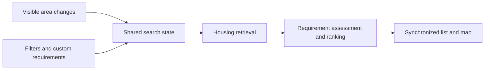

# SPEC-016: Interactive housing search

Status: Draft for scope discussion, not an implementation commitment. The desktop list/map layout and automatic search on map movement are the previously confirmed baseline. The team now also wants AI-driven presentation of task interfaces; popup format, prompt placement, and an Airbnb-like design remain open.

Owner: unassigned. Reviewers: frontend, housing, recommendation, AI system, and map service contributors.

Related documents: [Product brief](../product.md), [architecture](../../ARCHITECTURE.md), and [integration index](../integration/README.md). Scope-review work: [#27](https://github.com/AI20K-Build-Phase-Cohort-4/P-044/issues/27). Implementation follow-ups use housing [#6](https://github.com/AI20K-Build-Phase-Cohort-4/P-044/issues/6), shared contracts [#2](https://github.com/AI20K-Build-Phase-Cohort-4/P-044/issues/2), and recommendation [#3](https://github.com/AI20K-Build-Phase-Cohort-4/P-044/issues/3); remaining work is mapped below, not claimed complete by this documentation PR.

Shared interaction and prompt-placement review: [#28](https://github.com/AI20K-Build-Phase-Cohort-4/P-044/issues/28).

## Purpose and scope

Let a person relocating explore housing geographically, express custom requirements, compare options, and choose a home for their moving plan.

This spec defines the user experience and service behavior without requiring a particular provider. The integrated baseline uses MapLibre, Location REST/MCP contracts, PostGIS, and OSRM; those are existing implementation choices, not undecided placeholders. It does not define lease signing, housing booking, or payment behavior.

[SPEC-007 — Location Platform](SPEC-007-location-platform.md) defines the platform boundary. [SPEC-010 — Housing query](SPEC-010-tim-nha-o.md) owns supported geographic retrieval behavior, and the [Zod housing contract](../../packages/contracts/src/housing.ts) remains authoritative for current fields.

## Current implementation and follow-ups

Code baseline: `main` at `46c48d6` (PR #22 merged), inspected 2026-10-05. This table records code evidence, not a live-provider or deployment verification.

| Capability | Current code evidence | Remaining scope or implementation work |
|---|---|---|
| Viewport list and map | [MapWorkspace.tsx](../../apps/web/src/components/MapWorkspace.tsx) refreshes Location map/search requests after movement, guards superseded responses, and paginates the list. [mapWorkspace.ts](../../apps/web/src/mapWorkspace.ts) defines current thresholds and ordering. | Broad searches can show clusters and a refinement prompt instead of cards. Keep coverage explicit and verify AC-02/03/08/09/12 across refresh, pagination, and error races in #6. The older [Results.tsx](../../apps/web/src/components/Results.tsx)/[MapPanel.tsx](../../apps/web/src/components/MapPanel.tsx) still renders conversation candidates separately; it is not evidence that the new workspace lacks viewport search. |
| Geographic requirements | `filtersFromSearch` retains district/administrative-area and supported nearby filters but omits commute, center, and radius from workspace queries. | Make retained location constraints visible and preserve unsupported criteria as unassessed; agree the panning rules below in #27 and implement them through #6/#2. |
| Listing data and precision | The Location contract includes description, price, availability, and `location_accuracy`; workspace cards/details label approximate locations. [housing-service.ts](../../packages/housing-query/src/housing-service.ts) filters bounds using the stored point. | Marker precision, area-intersection policy, freshness, and unavailable fields need explicit treatment in #6. The [data report](../integration/location-data-status.md) records imported snapshots; this spec does not certify today's coverage. |
| Choosing an explored home | [App.tsx](../../apps/web/src/App.tsx) sends a separate select action. [web_actions.py](../../apps/agent-api/src/relohome_agent/api/web_actions.py) validates ownership and result context, fetches an absent candidate through `get_housing`, requires a comparable monthly VND price and an address, adds it with `origin: map_workspace`, and records the choice. [Action tests](../../tests/browser_gateway/test_actions.py) cover provider-backed selection and rejection of unknown IDs. | The workspace currently offers the action even when these eligibility facts are missing; the backend then reports a generic result-set error. Explain the actual eligibility reason and prevent that action through #6. The current action also lacks the viewport search identity and displayed listing version/price; record and compare those through #2/#6. A provider record alone does not prove custom-requirement suitability. |
| Suitability and ordering | Housing domain tools and LLM agents exist; workspace sort defaults to newest, with user-selectable alternatives. | The per-requirement evidence contract below and reusable assessment dependency keys remain proposals for #2/#3. Do not treat current ranking as completion of these acceptance criteria. |
| Saved homes and comparison | [Housing.tsx](../../apps/web/src/components/Housing.tsx) includes comparison controls; the application has saved-home actions and account views. | Existing UI does not settle product scope or persistence expectations. Review inclusion alongside availability/contact extensions in #27 and shared interaction in #28. |

The confirmed desktop list/map and automatic viewport-search baseline remains the requirement. Core additions below remain proposals; shortlist persistence, move-in availability, and contact/viewing extensions remain unresolved product decisions. Completing this document does not close #27 or approve a shared UI design in #28.

## Feature scope review

The customer should be able to discover suitable homes, inspect sourced information, understand fit against custom requirements, and explicitly choose a home for the relocation plan. This is a housing capability scope; it does not settle which backend service owns every feature.

| Feature | Scope position |
|---|---|
| Describe housing needs | Core proposal: area, supported budget/type/bedroom filters, and custom requirements through text and controls. Move-in dates and availability filtering need data-support agreement. |
| Explore homes geographically | Previously confirmed desktop list/map baseline with automatic visible-area search. |
| Inspect a listing | Core proposal: description, available photos, location/precision, known price and billing basis, source, and availability/freshness where known; missing facts remain explicit. |
| Understand suitability | Core proposal: per-requirement evidence, contradictions, unknowns, and explained trade-offs. Retrieval relevance alone is not proof of a match. |
| Compare homes | Proposed: inspect options and trade-offs; a dedicated side-by-side view is still a design decision. |
| Shortlist homes | Open: decide whether temporary or persistent saved homes are needed; do not equate a shortlist with the chosen relocation destination. |
| Choose a home | Core proposal: explicit choice for the relocation plan, separate from browsing and any lease commitment. |
| Contact advertiser / arrange viewing | Implemented in PR #83 behind independent `HOUSING_VIEWING_ENABLED` (2026-10-09), not the checkout demo flag: select several homes for viewing, record the visit, then explicitly decide one home for the relocation plan. Selecting for viewing alone does not change the moving destination. Until a landlord availability screen exists, the calendar is test-only (configured defaults: 30-minute slots, 08:00–20:00, next 14 days); the app does not contact the landlord. Landlord-side contact and availability are proposed in [the housing platform upgrade](../ideas/housing-platform-upgrade.md). |
| Sign a lease, pay a deposit, book housing | Outside the app. The user and landlord agree on the lease and deposit directly and are responsible for them. The user enters the agreed deposit (prefilled with one month's rent as a suggestion) and monthly rent; for now this is self-reported. Agreeing is not paying: the user separately reports a payment to the landlord, labeled as not verified by the app. The app never collects housing money ([payment design](../review/payment-design.md) §10). |

### Custom requirements in an AI-driven experience

The AI should be able to present housing exploration when the user needs to choose or inspect homes. A popup with Airbnb-like interaction is an example to evaluate, not a selected shell or product requirement. Preserve the previously confirmed list/map behavior when that exploration view is used; revisit its layout explicitly during design review if needed.

Users must be able to express and revise requirements while exploring. Show the AI's interpretation as editable criteria with mandatory/preferred priority, surface ambiguity that affects matching, and preserve the same requirements across text and controls. For example, “pets allowed and somewhere quiet to work” may produce a supported pet assessment and an unknown quiet-workspace assessment; it must not invent evidence.

Prompt placement remains unresolved. Compare persistent conversation beside the view, a contextual input inside the view, and one shared composer with a visible task context. Users should understand whether their message changes housing requirements or the overall move. Closing and reopening the view should preserve active requirements and the chosen home; cross-session persistence remains open. Do not require an independent housing conversation or choose a fixed popup input location in this spec.

### Scope boundaries to review

Housing discovery/details, suitability assessment, map evidence, and application interaction are separate capabilities even if they share one deployment. The component split below remains proposed. Review the earlier cheapest-first recommendation scope in [issue #3](https://github.com/AI20K-Build-Phase-Cohort-4/P-044/issues/3) against this requirement-driven experience before implementing it. Listing source, freshness, usable coverage, and supported filters need agreement with [housing work #6](https://github.com/AI20K-Build-Phase-Cohort-4/P-044/issues/6).

## Confirmed user experience

- On desktop, show a housing list on the left and a map on the right.
- When the user drags the map or zooms in or out, automatically update the housing list according to the visible map area.
- Support interaction through both text and UI controls, including custom housing requirements.

## Proposed search behavior

### Shared search state

Maintain one active search containing:

| Input | Meaning |
|---|---|
| Visible geographic bounds | The area currently shown by the map |
| Structured filters | Supported constraints such as budget, housing type, and bedrooms |
| Custom requirements | User-written criteria, each with an identifier and mandatory/preferred priority |
| Ordering | The selected ordering or recommendation policy |
| Pagination | The continuation position within this search, when needed |

Chat, filters, and map interactions update this same state. Moving the map changes the geographic input while preserving the other requirements. Changing a requirement updates the search in the current area unless the user explicitly requests another location.

Distinguish an initial navigation hint from an active location requirement. “Show District 7” can establish the initial viewport; “must be in District 7” remains an explicit area constraint intersected with the viewport. If the wording is ambiguous, show the interpretation and allow correction. Panning never silently removes a retained area constraint: outside it, explain the empty intersection and offer an explicit change. Proximity, radius, and commute limits remain requirements tied to their destination, travel mode, and other evidence inputs. A viewport refresh must not silently drop them or imply that unevaluated homes meet them. An explicit new-area request replaces the navigation target and identifies any conflicting retained constraint for correction; its final bounds become one new search, without a duplicate refresh from the programmatic move.

Retrieve candidates within the visible bounds and apply supported active constraints. The list must represent the current area; geographic exploration must not be restricted to a previously retrieved set of houses. Mandatory custom requirements should influence discovery where supported, as well as candidate assessment. When retrieval cannot express a criterion (for example, a description-only “must have a pool”), retain it for assessment and label returned candidates as pending or needing confirmation for that criterion. Unsupported filtering is not evidence of zero matches or permission to relax the requirement. Keep confirmed contradictions out of the satisfying-results group. If the service cannot safely execute a supported hard filter, show the unavailable/failed state rather than retrying without it. This preserves SPEC-010's hard nearby/commute filtering while allowing clearly labeled discovery for unsupported criteria. Result limits and retrieval strategy remain implementation decisions.

### Refresh and synchronization

1. Start a search after a map interaction settles. Combine rapid movements so they do not create a request for every animation frame; the exact delay remains open.
2. Show an updating state. If previous results remain visible, make clear that they belong to the previous search until the update completes.
3. Cancel work whose inputs are obsolete where possible. Ignore retrieval and whole-list ordering responses for a superseded search or candidate set. Treat per-listing assessments separately: a late assessment may be reused when its listing identity, relevant content version, requirement set, and any other evidence dependencies still match. Map movement alone does not invalidate such an assessment; reusing it must not restore an old candidate set or ordering.
4. Update the list and map markers consistently for the active search. Each loaded listing has a stable identity linking its card and marker.
5. Reset list pagination when bounds, requirements, or ordering change. Continuation must use the same search inputs as the page it follows.
6. Scrolling or paginating the list preserves the visible map area. Receiving results must not automatically recenter or zoom the map and create a search loop.

Hovering or focusing a card highlights its corresponding marker. Clicking a marker focuses the corresponding card. Focusing or opening listing details does not choose that home for the relocation plan. An explicit location selection or recenter action may move the map and initiate a new search.

If map markers represent more listings than the loaded list, or use clusters, explain that coverage and support access to the corresponding listings. Do not present a loaded-page count as the total number of matches. Wide-area result limits and clustering behavior remain open.

Cards, marker inspection, and details must expose whether a location is rooftop, approximate, or unknown; markers must not imply a verified entrance for a district/ward representative point. Explain that current retrieval uses the stored point for viewport inclusion. Whether an approximate listing should instead appear whenever its known area intersects the viewport remains an open decision requiring an area geometry contract. Until then, do not claim complete coverage of all homes in an intersecting area, and do not use approximate coordinates as verified moving pickup/drop-off pins.

### Custom requirements and descriptions

Users can add, edit, remove, and change the priority of custom requirements through the UI or text. Language interpretation may clarify ambiguous requests. Ordinary map movement and structured filter changes do not require reinterpretation by an LLM.

Listing descriptions can be evidence for custom requirements. Assessment should return, for each evaluated listing and requirement:

| Output | Meaning |
|---|---|
| Listing and requirement identifiers | Which listing and criterion the assessment concerns |
| Status | `matches`, `does_not_match`, or `unknown` |
| Evidence | A supporting description excerpt or identified structured/source fact; absent when unavailable |
| Explanation | Why the evidence supports the assessment, or why it cannot be determined |

An assessment based on a description reflects the listing's claim; it does not establish independent verification. Missing information is `unknown`, not a match or a negative claim. Contradictory information must be surfaced for clarification rather than silently resolved in favor of a match.

Candidates that contradict mandatory requirements must not be presented as satisfying them. Distinguish candidates needing confirmation from those with supporting evidence. Do not silently relax mandatory requirements. Preferred criteria may influence ranking, with explanations of trade-offs.

Reuse assessments when the listing identity, relevant content version, requirements, and other evidence dependencies have not changed. If evidence such as a commute destination or route changes, invalidate the dependent assessment. New map bounds may require retrieval of additional candidates without reassessing every unchanged listing. If assessment is incomplete, show a pending state rather than presenting unevaluated candidates as confirmed matches.

### Selection and the relocation plan

Browsing, panning, zooming, and inspecting a listing do not select it for the relocation plan. Provide an explicit “Choose this home” action, distinct from card/marker focus and opening details. Preserve the selected home when the user explores another area, and show it separately if it leaves the active results. Changing a previously selected home follows the [plan-change requirements](../product.md#changing-a-finalized-plan).

For the current MVP, a listing is eligible for home choice when its provider record has a price amount denominated in VND per month and an address that the housing adapter can normalize. This is the comparability rule enforced by `explored_listing` and [to_candidate](../../apps/agent-api/src/relohome_agent/agents/subagents/services/location.py); it does not require every preferred criterion to match or claim verified availability. Missing deposit, unknown amenities, and approximate coordinates remain visible caveats rather than automatically making a home ineligible.

An ineligible listing remains available to inspect, but the UI must disable or replace “Choose this home” with the specific reason: missing price, unsupported currency/billing period, or missing address. If eligibility is still unknown, retrieve details and show a pending state before enabling choice. Revalidate on the backend; if eligibility changes, explain the actual reason and preserve the previous choice. Do not report that a visible home is absent from the results when the real problem is missing or incomparable data. The current frontend/backend mismatch is an implementation follow-up, not behavior already delivered by this spec.

The action must work for an eligible listing found through viewport search even if it was absent from the conversation's original candidates. Bind the choice to the authorized user/thread and current plan/task, listing ID, originating search identity, relevant listing content version (or snapshot fingerprint), displayed price and billing basis, known availability, source/fetch time, and selection time. These are proposed semantics, not fields already accepted by `ResultAction`; extend the shared contract in #2 before sending them.

Validate against an authorized provider record before committing the choice; never trust client-supplied price, address, or coordinates as authoritative. If relevant price, availability, or address differs from what the user saw, present the difference and require a new explicit choice. If the record cannot be retrieved or the action context is stale, preserve the previous choice and show retry/refresh. Choosing a home records a destination preference, not verified suitability, availability, a signed lease, or approval to spend money. Retain unresolved requirement evidence with that choice for downstream review.

## Proposed service coordination

| Component | Responsibility |
|---|---|
| Frontend | Capture visible bounds and edits; display cards, markers, assessment evidence, and progress |
| Application backend / AI system | Maintain search context, interpret text when needed, and coordinate service calls |
| Housing | Retrieve candidates and expose descriptions, locations, structured facts, and provenance |
| Recommendation | Assess candidates against requirements and explain ordering and trade-offs |
| Map utilities | Resolve named locations and provide proximity or commute evidence when requested |

The frontend sends geographic bounds and search inputs through the application boundary. The chosen map implementation translates its viewport into those bounds. Backend services consume geographic data, not provider-specific map objects. Ordinary search refreshes do not replan the whole relocation workflow or invoke vendor execution.

Interfaces must communicate the search identity, candidate identities and locations, continuation information, and whether retrieval or assessment coverage is incomplete. Descriptions must be available to assessment, whether included in retrieval results or fetched as details. Existing retrieval schemas and REST/MCP bindings remain authoritative; shared-search, assessment, and selection-provenance extensions must be reconciled with them through #2/#6 rather than assumed to exist. This document defines the proposed semantics.

The proposed service operations and their input/output semantics are listed in the [MCP tool catalogue](SPEC-008-service-tools.md).

## Empty results, failures, and access

- Distinguish no matches in the visible area from unavailable data or a failed service call.
- Keep the map and requirements editable after an empty result or failure. Offer retry for the current search and explicit ways to change the area or requirements.
- If recommendation fails, indicate that assessment is unavailable; do not label the returned listings as assessed matches.
- Preserve user search context across service calls and apply the project's user-scoped access rules. Keep service credentials behind the application boundary.

## Acceptance criteria

| ID | Scenario and expected result |
|---|---|
| SPEC-016/AC-01 | Desktop presents the housing list on the left and map on the right. |
| SPEC-016/AC-02 | After a pan or zoom settles, the list updates for the new visible area and retains active requirements, including explicit area/proximity/commute constraints. An empty area intersection is explained, not silently broadened. |
| SPEC-016/AC-03 | Old retrieval or whole-list ordering responses cannot replace current results. A late per-listing assessment can still apply if all its dependencies match; changed content, requirements, or other evidence invalidates it. |
| SPEC-016/AC-04 | Text and UI edits update the same requirements and refresh the active search. |
| SPEC-016/AC-05 | Cards and markers identify the same listings; highlighting does not unintentionally move the map. Approximate/unknown locations and the stored-point inclusion rule are visible without implying a verified entrance. |
| SPEC-016/AC-06 | Description-based assessments include supporting evidence when available and distinguish unknown or pending information. |
| SPEC-016/AC-07 | Mandatory requirements are not silently relaxed; contradictions and missing evidence remain visible. Unsupported retrieval criteria stay pending/unknown for assessment, not false matches or false zero-result claims. |
| SPEC-016/AC-08 | Pagination follows the active search, resets when its inputs change, and does not move the map. |
| SPEC-016/AC-09 | Result updates do not automatically change the viewport and trigger a refresh loop. An explicit location change searches its final bounds once rather than duplicating the programmatic move refresh. |
| SPEC-016/AC-10 | Empty results, retrieval failures, and assessment failures have distinguishable states and allow continued interaction. |
| SPEC-016/AC-11 | Card/marker focus and opening details do not change the chosen home; only an explicit home choice updates the plan and affected downstream steps. Eligible viewport-only listings can be chosen through provider validation, bound search/listing provenance, and a renewed choice if relevant displayed facts changed. Missing monthly VND price or address prevents choice with a specific explanation, while inspection and the previous choice remain available. |
| SPEC-016/AC-12 | Partial results or incomplete assessment do not appear as complete coverage of all matches. |
| SPEC-016/AC-13 | After choosing a home, the user can schedule a viewing; in test mode every slot in the default window is open, past slots are rejected, and the confirmed viewing is labeled as a test schedule. |
| SPEC-016/AC-14 | Reporting an agreement records the amounts due to the landlord, not a payment; declining it records "not taking this home". Only a separate "paid to landlord" report moves the amounts to paid, labeled as self-reported and unverified. |

## Scope-review scenarios

- The AI opens housing exploration; the user can discover where to refine requirements without abandoning the current results.
- A text refinement and a filter edit yield the same visible criteria; ambiguous wording is clarified and missing listing evidence remains unknown.
- Switching to another service and returning preserves active housing needs and choice. A general plan change is not silently interpreted as a housing-only edit.
- Panning during assessment accepts still-valid individual evidence, but a delayed old list cannot replace the current area.
- Inspecting several homes leaves the relocation destination unchanged until “Choose this home”.
- “Must be in District 7” plus a pan outside District 7 explains the retained constraint; an initial “show District 7” navigation hint alone does not lock exploration there.
- A mandatory pool requirement unsupported by retrieval produces unassessed candidates, with pool evidence assessed separately; a commute service failure never becomes a successful search with the commute limit removed.
- An approximate listing near the viewport edge shows its precision and stored-point inclusion rule; neither its marker nor a directions link implies the building entrance.
- A home first found by panning can be chosen; a changed price or address at validation is shown for a renewed choice, and unavailable data leaves the previous selected home intact.
- A visible home with no price, a daily or non-VND price, or no usable address can still be inspected. Its choice control explains why it is unavailable; a backend eligibility rejection uses the same reason and leaves the existing chosen home unchanged.

These scenarios guide design discussion; they do not claim tested implementation behavior.

## Open decisions

- Any change to the current MapLibre/Location/PostGIS/OSRM baseline, evaluated against these behaviors.
- Demo listing snapshot, usable coverage and freshness; description-assessment strategy.
- Named-area navigation versus a retained area constraint when text is ambiguous; review the explicit interpretation rule above.
- Whether approximate listings enter viewport results by stored point or area intersection; geometry support and marker precision treatment.
- Ordering policy, result limits, pagination, and wide-area markers or clusters.
- Shared versus contextual prompt placement; popup, panel, or workspace; mobile layout and accessible interaction. An Airbnb-like view is only a design reference.
- Dedicated comparison, saved shortlists, move-in availability filtering, landlord-confirmed viewing availability, and persistence beyond the current conversation.
- Refresh latency target, debounce timing, and display of pending assessments.
- Extensions to existing service schemas for search identity, assessment dependencies, and selection provenance; implementation owners and scheduling in the linked follow-ups.
