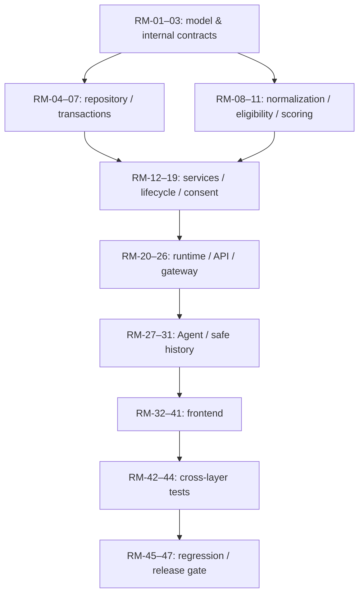

# Implementation Plan — ReloHome Roommate Discovery

## Hồ sơ dùng lại và kết nối để chat — cập nhật 17/10/2026

Audit và kế hoạch: [Roommate profile UX](../docs/architecture/roommate-profile-ux-plan-2026-10-16.md). **Đã triển khai và kiểm thử local**, xem [bàn giao ngày 17/10](../docs/integration/roommate-chat-profile-handoff-2026-10-17.md). Chưa deploy cloud; không thay evidence/checklist lịch sử bên dưới.

Hướng đã được người dùng chốt: Account và Roommate dùng chung private intro; gửi yêu cầu → người nhận đồng ý → chat trực tiếp trong ReloHome. Không ContactPicker/Phone/Zalo hoặc checkbox chia sẻ liên hệ trong luồng mới. Hai hành động gửi/đồng ý thể hiện ý định mở chat; không thêm màn xác nhận nữa. Tận dụng view/widget Housing, thêm dữ liệu và permission Roommate riêng.

Thứ tự: RU-01 Account intro → RU-02 criteria defaults → checkpoint; RC-01 lời mời chat → RC-02 accept/conversation → RC-03 read/send API → checkpoint; RU-03 composer + RU-04 accept/focus → RC-04 messenger → RC-05 lifecycle/privacy → checkpoint → RU-05 presentation → RU-06 regression/handoff. Scope/file/acceptance/lệnh kiểm chứng nằm trong bản kế hoạch liên kết; task lớn chia slice 3–5 file. Migration additive hỗ trợ SQLite/PG; không dùng bảng Housing hoặc đổi thuật toán. Bảng `intros` chưa có optimistic version nên không cam kết giải quyết đồng thời đa thiết bị trong phạm vi UI.

Rủi ro phải kiểm chứng: accept nguyên tử/idempotent chỉ tạo một chat, không tạo grant contact; pending 7 ngày nhưng chat đã accept không áp TTL grant 7 ngày; hết hạn/pause hồ sơ không tự khóa chat; read/send kiểm tra membership/block/restriction. Save intro vẫn có thể đóng pending không phù hợp. Giữ matching/quota/legacy consent; không tự đổi consent cũ thành quyền chat, không replay draft cũ sang kiểu mới. Migration/rollback không mất tin nhắn; retention và privacy phải được chốt/kiểm chứng trước phát hành. Không lưu message/PII trong browser storage; đổi actor dọn state.

> Historical layout/command evidence (M23); use the [current development map](../DEVELOPMENT.md) for this branch.


## Đợt phát hành người dùng thật — 12/10/2026

Chủ sản phẩm đã yêu cầu triển khai theo [audit](../docs/review/roommate-product-readiness-2026-10-12.md) và bàn giao deploy cloud. Baseline lịch sử bên dưới được giữ nguyên; checklist mới ở đầu `todo.md`.

Thiết kế: giữ scoring/consent/API cũ; SQLite local và PostgreSQL schema private cho cloud; không di chuyển auth/Housing. Migration additive, state/key được backup, không tự áp lên live. Notifications trong app với sự kiện thật, không thêm provider/email/OTP giả. UI dùng tokens xanh hiện có, card gọn, native controls, VI/EN/mobile/keyboard; không badge từ tự khai.

Điều chỉnh đã xác nhận: chỉ nâng cấp, không đổi thuật toán/logic ghép trọ; trải nghiệm basic gần gũi, không vuốt thẻ/Tinder, auto-match, boost hoặc ML. Tham khảo Roomies/SpareRoom/Badi chỉ cho cách trình bày search/profile/inbox/trust; không lấy cơ chế matching/consent hoặc yêu cầu xác minh của họ thay baseline.

| Task | Acceptance | Dependencies | Verification |
| --- | --- | --- | --- |
| RP-01 Storage/query | Migration ở startup; đọc không giữ writer lock; map theo listing/batch access; expiry query indexed; score giữ nguyên | None | Concurrency/query/expiry regression |
| RP-02 Schema | Index, notification/seen/rate data additive; giữ version/deadline/consent cũ | RP-01 | Atomic upgrade/restart tests |
| RP-03 PostgreSQL | Shared private persistence, timeout và transaction/cutover đúng; không database mới | RP-02 | PostgreSQL thật + race/consent/restore |
| RP-04 Inbox API | Pagination, counterparty được phép, unread/events và nhắc hạn | RP-02 | Authorization/idempotency tests |
| RP-05 Inbox UI | Name/badge/poll active/reminder/deep link, không contact trong notification | RP-04 | Desktop/mobile/stale browser |
| RP-06 Media/settings | Upload/preview/status/attach/delete; contact/block management | RP-02 | Limits/privacy + browser |
| RP-07 Moderation | Report/media/profile queue private, paging/filter/reason, role enforced | RP-06 | Moderator/outsider + browser |
| RP-08 UX/room | Housing picker + listing/city checks; onboarding/copy VI/EN | RP-05 | Payload/consent/axe |
| RP-09 Hardening | Shared rate limit, body/array caps, report dedupe, safe errors/metrics | RP-03 | Abuse/concurrency tests |
| RP-10 Retry | Journal key/ID survives reload, actor isolation, no PII persistence | RP-05 | Unknown response/reload/identity tests |
| RP-11 Data lifecycle | Export/erase scope, retention/maintenance, no TTL/replay reset | RP-04/RP-09 | Privacy/cleanup tests |
| RP-12 Cloud ops | DB/key backup/restore, SQLite→PG transfer, readiness, grants/config | RP-03/RP-11 | Temporary import/restore + deployment tests |
| RP-13 Handoff | Build/lint/regression/browser/container evidence, runbook và bàn giao | RP-01–12 | Release gate; cloud-only steps explicit |

Checkpoint sau RP-01–03, RP-04–08, RP-09–12 và RP-13. Mỗi increment viết test trước logic, kiểm chứng trước bước phụ thuộc; không hạ gate vì thời gian. Tách task lớn thành sub-slices tối đa khoảng 5 file khi thực hiện.

Rủi ro: PG concurrency khác SQLite → test race và giữ mutation nguyên tử; migration → backup/checksum và không đổi DB live; notification → actor scoped, fresh permission, không raw contact; cloud hiện staging transaction mode → không thay luồng provider ngoài Roommate. Cấu hình thật và quyền cloud được ghi trong handoff, không tự thay secrets/deploy.

- Ngày: 2026-10-07, Asia/Saigon.
- Baseline sản phẩm: [roommate-service.md v1.0](../docs/ideas/roommate-service.md).
- Feature issue: [#65](https://github.com/AI20K-Build-Phase-Cohort-4/P-044/issues/65).
- Trạng thái: **RM-01–31 hoàn tất (backend/API/Agent)**; frontend phạm vi tìm/kết nối và hồ sơ cơ bản đã triển khai theo yêu cầu tiếp theo. Tiến độ thực tế tại `todo.md`, evidence tại [backend checkpoint](../docs/integration/roommate-backend-checkpoint.md) và [frontend handoff](../Frontend/ROOMMATE_UI_HANDOFF.md). Full release gates còn pending.
- Task list target: [tasks/todo.md](todo.md), theo lựa chọn của chủ sản phẩm: lưu plan/checklist trong repo trước. Chưa tạo issue con hoặc cập nhật GitHub.
- Bản plan không phải database schema, API endpoint catalog hay code. Contract kỹ thuật cụ thể được ghi/review trong các task foundation trước khi triển khai phần phụ thuộc.
- File/module ghi “dự kiến tạo mới” mô tả tại thời điểm lập plan; implementation có thể dùng tên/ranh giới tương đương. Test command ở mỗi task là yêu cầu, không phải báo cáo đã pass; kết quả thực tế ở checklist/checkpoint.

## 1. Kết quả cần bàn giao

Roommate là service tìm hồ sơ người đang có nhu cầu ở cùng, filter hai chiều và xếp hạng bằng code. Người dùng tự xem, lưu và gửi yêu cầu; liên hệ chỉ mở với consent của cả hai. Không tự ghép cặp hoặc gọi LLM chấm candidate.

Làm toàn bộ phạm vi phát hành đầu của **service trong sản phẩm**, gồm private intro/public profile, search/detail/bookmarks, inbox, consent, expiry/cooldown/quota, block/report/moderation và chất lượng UI. Không hạ phạm vi thành dữ liệu demo. Không thêm chat realtime, email/push, ML, payment hoặc hợp đồng roommate.

Thứ tự theo yêu cầu: **data model → repository/storage → scoring engine → service layer → API → agent integration → frontend → tests → regression**. Mỗi task implementation phải chạy test tập trung ngay khi làm; phase Tests bổ sung kiểm thử xuyên lớp, không phải đợi tới cuối mới test.

## 2. Codebase đã đối chiếu

| Thành phần hiện có | File/module đọc | Hệ quả cho implementation |
| --- | --- | --- |
| App Python/FastAPI và lifespan | `src/main.py`, `src/config.py`, `src/api/routes.py` | Roommate là module Python riêng; mount routes mới và inject runtime ở composition root. |
| Graph, registry, capability | `src/agents/models.py`, `deps.py`, `wiring.py`, `graph.py`, `subagents/capabilities.py`, `conformance.py` | Thêm domain cần capability và fake fixture; không chỉ thêm tên trên UI. |
| Intake/Planner/respond/context | `src/agents/intake*.py`, `planning.py`, `planner_llm.py`, `nodes/respond.py`, `llm_context.py`, `progress.py` | Criteria có scope Roommate; contact/intro riêng không đi vào prompt/checkpoint/history. |
| Runtime persistence hiện tại | `src/services/adapters/sqlite_runtime.py`; ADR-019 | SQLite runtime dùng JSON records/autocommit, không đủ làm transaction repository cho Roommate. |
| Browser gateway và identity | `Frontend/server.py`, `Frontend/store.py`, `Frontend/tests/test_gateway.py` | Dùng session hiện có và actor do gateway xác định; không sửa bảng accounts/auth cũ. |
| Frontend hiện tại | `Frontend/src/App.tsx`, `api.ts`, `types.ts`, `components/*`, `uiPreferences.tsx`, `ui/*` | Tạo workspace/client Roommate riêng; reuse dialog, tabs, states, theme và VI/EN. |
| Map/Location | `src/agents/subagents/services/location.py`, contracts trong `packages/contracts/src/` | Dùng vùng canonical; không đổi housing/POI/geocoding hay đưa contact vào MapLibre. |
| Test/build | `Frontend/playwright.config.ts`, `Frontend/package.json`, `tests/`, `Frontend/tests/`, CI hiện tại | Python pytest/ruff; React tsc/Vite; tách browser mock khỏi full-stack API thật. |

Working tree có thay đổi frontend và housing từ các lượt trước. Khi bắt đầu implementation phải ghi baseline, chỉ sửa phần thuộc task và giữ các thay đổi chưa commit của người dùng. Không reset, gom commit hoặc sửa data để làm test pass.

## 3. Quyết định kiến trúc cho plan

### 3.1 Tổ chức module và lưu trữ

- Domain đặt tại `src/roommate/`, routes tại `src/api/roommate_*.py`, gateway mới tại `Frontend/roommate_gateway.py`, UI tại `Frontend/src/roommate/`.
- Repository relational riêng, interface/unit of work tách khỏi scoring/service. Dùng **SQLite riêng cho baseline triển khai trên một host hiện tại**; constraints và transaction đảm bảo idempotency, quota và trạng thái hai chiều. Không dùng generic RuntimeDatabase.records hoặc bảng housing.
- Căn cứ: runtime hiện tại dùng SQLite, Python chưa có ORM/PostgreSQL driver đang hoạt động; ADR-019 chỉ chấp nhận runtime local, chưa chốt deployment. Đây là lựa chọn triển khai có giới hạn, không phải chứng nhận production cloud readiness.
- **Gate RM-01–03:** review storage/deployment trước migration. Nếu yêu cầu nhiều replica/HA, cần chốt PostgreSQL và thay adapter/transaction design trước RM-04; không triển khai SQLite lên nhiều host rồi giả định khóa dùng chung. Không thay đổi policy sản phẩm vì lựa chọn storage.
- Không thêm container/ORM/vector database để tính score. Contact vault mã hóa riêng, quyền truy cập enforced ở service/API; mã hóa không thay authorization.
- Chỉ account ID tin cậy liên kết module mới với identity hiện tại; không tạo bản sao tài khoản hoặc foreign key giả giữa hai database riêng.

### 3.2 API và identity

Browser → gateway hiện tại → API Roommate → service → repository/scoring.

- Client tiếp tục dùng same-origin session và CSRF `X-SIU-Request`; gateway lấy actor từ session, không từ request body.
- Routes Roommate private phải kiểm tra trusted token/actor **ở mọi mode**, kể cả fake Agent. Không dựa vào guard legacy chỉ strict ở live mode.
- Eligibility 18+/service terms và moderator permission riêng; không đổi authentication/authorization của các service hiện có. Moderator role phải đến từ server config có thể vận hành.
- API/DTO mới chỉ cho Roommate. Không đổi endpoint/schema/payload Housing, Moving, Flight, Payment hoặc account preferences cũ.
- Exact endpoint names, status/error DTO, versioning/idempotency semantics và storage constraints được review trong technical design RM-01–03/21 trước khi frontend nối vào. Không chọn chúng ngầm từ tên component.

### 3.3 Scoring và thứ tự

- Pure functions, không LLM/network per candidate.
- Must hai chiều kiểm tra trước score; unknown-hard không pass, không tự nới.
- Trọng số spec: vùng 20, ngân sách 20, ngày 15, hút thuốc 10, thú cưng 10, nhịp sinh hoạt 10, sạch sẽ 10, giao tiếp 5.
- Unknown của preference đã chọn giữ weight và dùng neutral 0,5 nội bộ. Không preference thì không tạo score.
- Chỉ hiện số khi đủ tất cả điều kiện: hard pass, vùng/ngân sách comparable, >=4 known criteria, >=2 known lifestyle, weighted coverage >=80%.
- Số làm tròn chỉ để hiển thị; nhãn/ngưỡng dùng raw score. Test bắt buộc trường hợp raw 79,5 hiển thị 80 nhưng nhãn vẫn ở dưới ngưỡng 80.
- Đủ dữ liệu xếp trước; thiếu dữ liệu tách nhóm và chỉ sort theo vùng/ngân sách/ngày đã biết. Sort toàn tập trước phân trang, tie ổn định không boost do edit.
- **Gate RM-10:** chốt factor matrix 0..1 cho vùng/range/ngày/lifestyle với ví dụ đối chiếu, rồi mới viết engine. Đây là chi tiết technical design còn cần đặc tả, không được coi weight là thuật toán đã hoàn chỉnh.

### 3.4 Consent, lifecycle và concurrency

Các mốc policy cố định ở spec: profile 30 ngày; pending 7 ngày; contact 7 ngày từ accepted; reject 30 ngày, withdraw 24h, expired pending 7 ngày; revoke 30 ngày theo hướng; 10 request mới/rolling24h và 20 pending.

- Clock UTC tiêm được; tới đúng deadline đã hết hiệu lực. Read/write phải kiểm tra thời hạn; maintenance chỉ dọn/reconcile, không quyết định quyền truy cập.
- Request accepted và contact lease là hai state machines. Không sửa lịch sử accepted khi grant hết hạn.
- Consent gắn actor/cặp/kênh/version/TTL; hai phía mở quyền trong một transaction. Không chuyển checkbox consent từ chat hoặc điều khoản chung.
- Recheck hard conditions/profile/block/contact version trong send/accept và tại commit. Counter + tạo request + pair uniqueness phải cùng transaction.
- Retry cùng operation phải cùng kết quả, không kéo dài TTL; unknown-write có status lookup, không hướng UI tạo lại mù.
- Pause/expire/resolved không revoke accepted chỉ vì profile không hoạt động; delete/restrict/block và đổi kênh áp dụng đúng scope spec.
- Intro snapshot chỉ gồm nội dung đã review; private preferences mới không được tự thêm. Delete/restrict/block làm snapshot không còn readable với phía kia.
- Private contact không có trong result/search/Agent state/history/log/localStorage/public media. Old card/history chỉ giữ tham chiếu an toàn và hydrate theo quyền hiện tại.
- UI đang mở phải clear contact khi hết lease/logout/auth error và kiểm tra lại khi focus. Thu hồi phía server chặn mọi lần đọc lại; dữ liệu đã chụp/copy bên ngoài không thể xóa.
- Content validation chặn dạng contact có thể phát hiện trong text; ảnh chịu upload rules, preview và moderation. Technical design phải ghi giới hạn phát hiện dữ liệu contact ẩn trong ảnh/text, không tuyên bố loại bỏ mọi cách lách bằng một regex.

### 3.5 Agent và frontend

- Agent chỉ hiểu intent/criteria và mở/tìm service. Structured UI gọi API trực tiếp; không qua chat/LLM cho paginate, save, request hoặc consent.
- Không bọc RoommateSubagent trong ReadLlmAgent. Actor provider lấy trusted context hiện có, không hỏi model cung cấp user ID.
- Natural-language Intake/Planner có thể gọi LLM như hiện tại; số call không tăng theo candidate. Không thêm automatic publish/contact action vào graph.
- Guest chưa đủ điều kiện không nhận list/profile thật. Agent trả entry/eligibility requirement thay vì để model giữ nội dung candidate chưa được phép.
- Frontend giữ service bổ sung, không biến Roommate thành homepage trung tâm. Mobile ưu tiên list/detail/inbox; không cần map tọa độ chính xác cho con người.
- Reuse theme/motion/dialog/tab/UI states, không làm lại design system hoặc refactor toàn App như điều kiện tiên quyết.

## 4. Thứ tự task và dependency graph

| Giai đoạn | Task | Số task |
| --- | --- | ---: |
| Data model | RM-01–RM-03 | 3 |
| Repository/storage | RM-04–RM-07 | 4 |
| Scoring engine | RM-08–RM-11 | 4 |
| Service layer | RM-12–RM-19 | 8 |
| API | RM-20–RM-26 | 7 |
| Agent integration | RM-27–RM-31 | 5 |
| Frontend | RM-32–RM-41 | 10 |
| Tests | RM-42–RM-44 | 3 |
| Regression | RM-45–RM-47 | 3 |

Dependencies cụ thể có ở từng task. Chạy lần lượt theo ID là một topological order hợp lệ. Các task không phụ thuộc trực tiếp vẫn có thể làm độc lập, nhưng không sửa đồng thời composition/auth/shared types.



Graph minh họa thứ tự bàn giao theo phase, không thay dependency chi tiết. Tests từng task được viết và chạy ngay trong phase của task đó. Feature flag giữ tắt trong các bước chưa đầy đủ; không có “partial release” bỏ qua consent/moderation.

**Task list và trạng thái:** [todo.md](todo.md). Chi tiết thực thi nằm ở phần 5, không ghi hoàn thành chỉ vì file đã được tạo.

## 5. Chi tiết 47 task

Quy ước: S = 1–2 file, M = 3–5 file. Tên file mới là dự kiến; khi technical design đổi tên, cập nhật plan/checklist trước triển khai. Không mở rộng task thành refactor độc lập hoặc bỏ acceptance criteria để giữ đúng số file; tách task nếu phạm vi thực tế vượt 5 file.

<a id="rm-01"></a>

### RM-01 — Mô hình hồ sơ và tiêu chí

**Giai đoạn:** Data model. **Phạm vi:** M (4 file dự kiến).

**Mục đích:** Chốt typed model cho thông tin bản thân, mong muốn và vùng tìm; ghi quyết định kỹ thuật trước khi triển khai storage.

**File/module liên quan:**

- `docs/design/roommate-discovery.md` — dự kiến tạo mới.
- `src/roommate/models.py` — dự kiến tạo mới.
- `src/roommate/policy.py` — dự kiến tạo mới.
- `tests/test_roommate/test_models.py` — dự kiến tạo mới.

**Dependency:** Không có task trước; đọc product spec v1.0 và codebase hiện tại.

**Acceptance criteria:**

- Tách self traits / desired traits và bắt buộc / ưu tiên; biểu diễn unknown, linh hoạt, cơ sở phí mà không tự suy ra dữ kiện.
- Mô hình bao phủ hai loại nhu cầu, khả năng chuyển phòng, một thành phố và nhiều khu vực; không tái sử dụng housing record làm hồ sơ người.
- Ghi baseline branch/diff hiện có; quyết định storage một host phải được review trước RM-04, chưa cam kết HA hoặc nhiều replica.

**Test cần chạy khi triển khai:**

```powershell
.venv/Scripts/python.exe -m pytest tests/test_roommate/test_models.py -q
```

<a id="rm-02"></a>

### RM-02 — Mô hình request và consent

**Giai đoạn:** Data model. **Phạm vi:** M (4 file dự kiến).

**Mục đích:** Định nghĩa trạng thái request, quyền contact và bản giới thiệu riêng được phép chia sẻ.

**File/module liên quan:**

- `src/roommate/connections.py` — dự kiến tạo mới.
- `src/roommate/clock.py` — dự kiến tạo mới.
- `src/roommate/policy.py` — dự kiến tạo mới.
- `tests/test_roommate/test_connection_models.py` — dự kiến tạo mới.

**Dependency:** RM-01

**Acceptance criteria:**

- Request accepted và contact active/expired/revoked là hai vòng đời riêng; consent gắn đúng cặp, kênh, phiên bản và thời điểm.
- 30 ngày / 7 ngày / cooldown / rolling quota dùng thời gian UTC và clock tiêm được; đúng deadline là hết hạn.
- Bản giới thiệu được review có phạm vi riêng, không tự chứa contact hoặc những trường riêng tư bổ sung về sau.

**Test cần chạy khi triển khai:**

```powershell
.venv/Scripts/python.exe -m pytest tests/test_roommate/test_connection_models.py -q
```

<a id="rm-03"></a>

### RM-03 — Contract nội bộ và projection an toàn

**Giai đoạn:** Data model. **Phạm vi:** M (4 file dự kiến).

**Mục đích:** Chốt interface repository, transaction và DTO theo quyền để các lớp sau dùng cùng một contract.

**File/module liên quan:**

- `src/roommate/ports.py` — dự kiến tạo mới.
- `src/roommate/views.py` — dự kiến tạo mới.
- `docs/design/roommate-discovery.md` — dự kiến tạo mới.
- `tests/test_roommate/test_views.py` — dự kiến tạo mới.

**Dependency:** RM-01, RM-02

**Acceptance criteria:**

- DTO danh sách, chi tiết, chủ hồ sơ, inbox, contact phân biệt rõ; tìm kiếm không thể serialize contact hoặc dữ liệu chỉ chủ hồ sơ được xem.
- Actor luôn đến từ context tin cậy; contract không cho body hay LLM chọn người dùng thực hiện.
- Interface hỗ trợ transaction, idempotency, phiên bản cập nhật và projection trạng thái; không phụ thuộc LangGraph checkpoint.

**Test cần chạy khi triển khai:**

```powershell
.venv/Scripts/python.exe -m pytest tests/test_roommate/test_views.py -q
```

<a id="rm-04"></a>

### RM-04 — Khởi tạo persistence riêng

**Giai đoạn:** Repository/storage. **Phạm vi:** M (4 file dự kiến).

**Mục đích:** Tạo migration có phiên bản và SQLite riêng cho Roommate; giữ kho tài khoản và dữ liệu map hiện tại.

**File/module liên quan:**

- `src/roommate/storage.py` — dự kiến tạo mới.
- `src/roommate/migrations.py` — dự kiến tạo mới.
- `src/roommate/contact_vault.py` — dự kiến tạo mới.
- `tests/test_roommate/test_storage_bootstrap.py` — dự kiến tạo mới.

**Dependency:** RM-03

**Acceptance criteria:**

- Bootstrap lặp lại không mất dữ liệu; rollback migration lỗi; schema/constraints cụ thể được review trong technical design trước khi viết migration.
- Kho Roommate có transaction thật, WAL/busy timeout phù hợp; không nhét dữ liệu vào RuntimeDatabase.records hoặc Frontend/store.py.
- Contact mã hóa với khóa riêng ở state directory riêng tư; test chỉ dùng khóa/DB tạm; backup và restore phải giữ đúng cặp khóa–DB.

**Test cần chạy khi triển khai:**

```powershell
.venv/Scripts/python.exe -m pytest tests/test_roommate/test_storage_bootstrap.py -q
```

<a id="rm-05"></a>

### RM-05 — Lưu hồ sơ và quan tâm

**Giai đoạn:** Repository/storage. **Phạm vi:** M (3 file dự kiến).

**Mục đích:** Implement repository hồ sơ, điều kiện service, tiêu chí lưu và bookmark theo owner.

**File/module liên quan:**

- `src/roommate/profile_repository.py` — dự kiến tạo mới.
- `src/roommate/storage.py` — dự kiến tạo mới.
- `tests/test_roommate/test_profile_repository.py` — dự kiến tạo mới.

**Dependency:** RM-04

**Acceptance criteria:**

- Một account tối đa một hồ sơ active; lưu/restart không mất state, mốc xác nhận lại hoặc cơ sở ngân sách.
- Queries trả hồ sơ theo canonical city/area, current visibility; bookmark riêng tư và không tạo thông báo cho chủ hồ sơ.
- Ownership kiểm tra với ID tin cậy; sửa/xóa hồ sơ không làm mất lịch sử hạn mức và cooldown của account.

**Test cần chạy khi triển khai:**

```powershell
.venv/Scripts/python.exe -m pytest tests/test_roommate/test_profile_repository.py -q
```

<a id="rm-06"></a>

### RM-06 — Persistence nguyên tử cho kết nối

**Giai đoạn:** Repository/storage. **Phạm vi:** M (3 file dự kiến).

**Mục đích:** Lưu request, consent, operation status và các mốc chống trùng bằng transaction.

**File/module liên quan:**

- `src/roommate/connection_repository.py` — dự kiến tạo mới.
- `src/roommate/storage.py` — dự kiến tạo mới.
- `tests/test_roommate/test_connection_repository.py` — dự kiến tạo mới.

**Dependency:** RM-04, RM-02

**Acceptance criteria:**

- Một unordered pair chỉ có một pending hoặc một quyền contact còn hạn; hai chiều gửi cùng lúc không tạo hai bản ghi hợp lệ.
- Idempotency lưu qua restart; retry không đổi TTL hay tăng quota; dùng cùng operation key với nội dung khác bị từ chối.
- Đếm 10 yêu cầu mới/rolling 24h và 20 pending với expiry hiện tại trong transaction; kiểm chứng bằng hai kết nối DB độc lập.

**Test cần chạy khi triển khai:**

```powershell
.venv/Scripts/python.exe -m pytest tests/test_roommate/test_connection_repository.py -q
```

<a id="rm-07"></a>

### RM-07 — Persistence cho block và moderation

**Giai đoạn:** Repository/storage. **Phạm vi:** M (3 file dự kiến).

**Mục đích:** Lưu block theo cặp, report riêng tư và hành động của moderator.

**File/module liên quan:**

- `src/roommate/safety_repository.py` — dự kiến tạo mới.
- `src/roommate/storage.py` — dự kiến tạo mới.
- `tests/test_roommate/test_safety_repository.py` — dự kiến tạo mới.

**Dependency:** RM-04

**Acceptance criteria:**

- Block truy vấn hai chiều; bỏ block không xóa dấu thu hồi hoặc khôi phục consent.
- Report không tự block hoặc tự kết luận vi phạm; moderator action có actor, lý do và mốc thời gian.
- Report, contact và bản giới thiệu không xuất hiện trong log repository; failure không để transaction dở dang.

**Test cần chạy khi triển khai:**

```powershell
.venv/Scripts/python.exe -m pytest tests/test_roommate/test_safety_repository.py -q
```

<a id="rm-08"></a>

### RM-08 — Chuẩn hóa giá trị dùng cho so sánh

**Giai đoạn:** Scoring engine. **Phạm vi:** M (4 file dự kiến).

**Mục đích:** Adapter danh mục vùng hiện có và hàm so sánh ngân sách/ngày, không đổi dữ liệu housing.

**File/module liên quan:**

- `src/roommate/normalization.py` — dự kiến tạo mới.
- `src/roommate/location_catalog.py` — dự kiến tạo mới.
- `docs/design/roommate-discovery.md` — dự kiến tạo mới.
- `tests/test_roommate/test_normalization.py` — dự kiến tạo mới.

**Dependency:** RM-01, RM-03

**Acceptance criteria:**

- Hỗ trợ đúng HCM/Hà Nội/Đà Nẵng bằng canonical IDs của Location; ngoài phạm vi không tự đổi thành phố.
- Ngân sách mỗi người/tháng chỉ so sánh khi cùng cơ sở phí; khoảng ngày, linh hoạt và giờ yên tĩnh qua nửa đêm có semantics rõ.
- Không gọi geocoding hoặc LLM cho từng candidate; không phát sinh phụ thuộc VIETMAP/Google để scoring.

**Test cần chạy khi triển khai:**

```powershell
.venv/Scripts/python.exe -m pytest tests/test_roommate/test_normalization.py -q
```

<a id="rm-09"></a>

### RM-09 — Hard filter hai chiều

**Giai đoạn:** Scoring engine. **Phạm vi:** S (2 file dự kiến).

**Mục đích:** Viết eligibility engine thuần cho hồ sơ người tìm và candidate.

**File/module liên quan:**

- `src/roommate/eligibility.py` — dự kiến tạo mới.
- `tests/test_roommate/test_eligibility.py` — dự kiến tạo mới.

**Dependency:** RM-08

**Acceptance criteria:**

- Loại self, inactive/expired/restricted/deleted và block hai chiều; unknown ở điều kiện bắt buộc không được coi là pass.
- Kiểm tra must của cả hai phía; hai người đều có phòng và không chuyển bị loại, hai người cùng tìm phòng được phép.
- Trả reason code thiếu dữ kiện hoặc không đáp ứng; không tự hạ must thành preference hay tạo nhóm unknown-hard được gắn phù hợp.

**Test cần chạy khi triển khai:**

```powershell
.venv/Scripts/python.exe -m pytest tests/test_roommate/test_eligibility.py -q
```

<a id="rm-10"></a>

### RM-10 — Hàm tính từng tiêu chí

**Giai đoạn:** Scoring engine. **Phạm vi:** M (4 file dự kiến).

**Mục đích:** Chốt bảng factor score và fixtures trong technical design rồi triển khai pure functions.

**File/module liên quan:**

- `src/roommate/factors.py` — dự kiến tạo mới.
- `src/roommate/scoring.py` — dự kiến tạo mới.
- `docs/design/roommate-discovery.md` — dự kiến tạo mới.
- `tests/test_roommate/test_factors.py` — dự kiến tạo mới.

**Dependency:** RM-08, RM-09

**Acceptance criteria:**

- Đặc tả giá trị 0..1 cho overlap vùng/ngân sách/ngày và lựa chọn sinh hoạt trước khi code; không chấm nghề hoặc tính cách tốt/xấu.
- Trọng số 20/20/15/10/10/10/10/5 đúng spec; chỉ dùng preference được đặt; unknown dùng 0,5 và giữ mẫu số.
- Không preference thì không score; cùng input cho cùng output; thu hẹp dữ liệu không được tạo 100 giả từ một tiêu chí.

**Test cần chạy khi triển khai:**

```powershell
.venv/Scripts/python.exe -m pytest tests/test_roommate/test_factors.py -q
```

<a id="rm-11"></a>

### RM-11 — Điều kiện hiện score và xếp hạng

**Giai đoạn:** Scoring engine. **Phạm vi:** M (3 file dự kiến).

**Mục đích:** Tách điểm nội bộ với score công bố, reason và thứ tự danh sách.

**File/module liên quan:**

- `src/roommate/ranking.py` — dự kiến tạo mới.
- `src/roommate/views.py` — dự kiến tạo mới.
- `tests/test_roommate/test_ranking.py` — dự kiến tạo mới.

**Dependency:** RM-09, RM-10

**Acceptance criteria:**

- Chỉ hiện số/nhãn khi hard pass, vùng/ngân sách so sánh được, >=4 tiêu chí known, >=2 lifestyle known và coverage >=80%.
- Nhóm đủ score trước; nhóm thiếu chỉ sắp theo vùng/ngân sách/ngày đã biết; raw score quyết định nhãn/order, số nguyên chỉ để hiển thị.
- Sort toàn bộ eligible set trước paginate, tie-break ổn định không tăng hạng do sửa bài; reasons dựa trên dữ kiện và ghi missing.

**Test cần chạy khi triển khai:**

```powershell
.venv/Scripts/python.exe -m pytest tests/test_roommate/test_ranking.py -q
```

<a id="rm-12"></a>

### RM-12 — Quyền dùng Roommate

**Giai đoạn:** Service layer. **Phạm vi:** M (3 file dự kiến).

**Mục đích:** Centralize service eligibility và moderator authorization, độc lập auth các service cũ.

**File/module liên quan:**

- `src/roommate/access.py` — dự kiến tạo mới.
- `src/roommate/services/access.py` — dự kiến tạo mới.
- `tests/test_roommate/test_access.py` — dự kiến tạo mới.

**Dependency:** RM-05, RM-07

**Acceptance criteria:**

- Guest/chưa 18+/chưa nhận điều kiện phiên bản hiện tại không đọc hồ sơ thật; xác nhận tuổi không tạo nhãn verified.
- Owner/matched recipient/moderator có quyền riêng; vai trò moderation chỉ từ cấu hình server, không từ request body.
- Chưa đủ điều kiện Roommate không làm mất quyền dùng Housing/Moving/Flight; account không tự thành profile public.

**Test cần chạy khi triển khai:**

```powershell
.venv/Scripts/python.exe -m pytest tests/test_roommate/test_access.py -q
```

<a id="rm-13"></a>

### RM-13 — Discovery và chi tiết theo quyền

**Giai đoạn:** Service layer. **Phạm vi:** M (3 file dự kiến).

**Mục đích:** Kết hợp repository, eligibility, ranking và fresh projection cho tìm kiếm.

**File/module liên quan:**

- `src/roommate/services/discovery.py` — dự kiến tạo mới.
- `src/roommate/views.py` — dự kiến tạo mới.
- `tests/test_roommate/test_discovery.py` — dự kiến tạo mới.

**Dependency:** RM-05, RM-11, RM-12

**Acceptance criteria:**

- Người đủ điều kiện được tìm/xem mà không phải đăng public; candidate phải còn hoạt động tại lần đọc.
- List/detail/bookmarks không giữ dữ liệu public sau delete/restrict/block; inactive detail chỉ trả trạng thái cho người không phải owner.
- Structured search/filter/sort/page không gọi LLM; error không thay bằng hồ sơ demo hoặc tự nới filter.

**Test cần chạy khi triển khai:**

```powershell
.venv/Scripts/python.exe -m pytest tests/test_roommate/test_discovery.py -q
```

<a id="rm-14"></a>

### RM-14 — Lifecycle hồ sơ

**Giai đoạn:** Service layer. **Phạm vi:** M (3 file dự kiến).

**Mục đích:** Implement private intro, preview và các thao tác chủ động trên hồ sơ.

**File/module liên quan:**

- `src/roommate/services/profiles.py` — dự kiến tạo mới.
- `src/roommate/services/lifecycle.py` — dự kiến tạo mới.
- `tests/test_roommate/test_profile_lifecycle.py` — dự kiến tạo mới.

**Dependency:** RM-05, RM-06, RM-12

**Acceptance criteria:**

- Publish/resume/reconfirm tạo chu kỳ 30 ngày; edit không gia hạn; gửi intro riêng không tự publish.
- Pause/expire hủy incoming pending, giữ outgoing đủ điều kiện; resolved hủy mọi pending; accepted grant không mất chỉ vì pause/expire/resolved.
- Delete/restrict hủy pending, thu hồi grants và ẩn intro snapshot/ảnh; thay đổi hard condition hủy pending không còn đáp ứng, soft edit không tự hủy.

**Test cần chạy khi triển khai:**

```powershell
.venv/Scripts/python.exe -m pytest tests/test_roommate/test_profile_lifecycle.py -q
```

<a id="rm-15"></a>

### RM-15 — Gửi request và cooldown

**Giai đoạn:** Service layer. **Phạm vi:** M (3 file dự kiến).

**Mục đích:** Xây send/withdraw/reject bằng state transition và quota check trong transaction.

**File/module liên quan:**

- `src/roommate/services/requests.py` — dự kiến tạo mới.
- `src/roommate/services/limits.py` — dự kiến tạo mới.
- `tests/test_roommate/test_request_lifecycle.py` — dự kiến tạo mới.

**Dependency:** RM-06, RM-09, RM-12, RM-14

**Acceptance criteria:**

- Send recheck hai chiều, private intro đầy đủ, consent chưa chọn sẵn; reversed pending đưa tới received, không tự accept.
- Rejected 30 ngày, withdraw 24h, expired 7 ngày, system cancel không cộng cooldown; hạn mức không được hoàn khi request kết thúc.
- Chỉ đúng sender withdraw/recipient reject; retry không double count; concurrent send/retry/pair limit không vượt constraints.

**Test cần chạy khi triển khai:**

```powershell
.venv/Scripts/python.exe -m pytest tests/test_roommate/test_request_lifecycle.py -q
```

<a id="rm-16"></a>

### RM-16 — Accept và mở contact

**Giai đoạn:** Service layer. **Phạm vi:** M (3 file dự kiến).

**Mục đích:** Chấp nhận request với consent hai chiều, đọc contact qua quyền riêng.

**File/module liên quan:**

- `src/roommate/services/consent.py` — dự kiến tạo mới.
- `src/roommate/contact_vault.py` — dự kiến tạo mới.
- `tests/test_roommate/test_consent.py` — dự kiến tạo mới.

**Dependency:** RM-06, RM-12, RM-15

**Acceptance criteria:**

- Chỉ recipient accept pending chưa hết 7 ngày; recheck profile/block/hard/contact version và cả hai consent tại transaction commit.
- Accept mở hai chiều nguyên tử, grant 7 ngày từ accepted; trước accept hoặc actor thứ ba không đọc được contact.
- Đọc lại không kéo dài hạn; record accepted giữ lịch sử khi grant hết quyền; retry accept chỉ trả một kết quả.

**Test cần chạy khi triển khai:**

```powershell
.venv/Scripts/python.exe -m pytest tests/test_roommate/test_consent.py -q
```

<a id="rm-17"></a>

### RM-17 — Thu hồi và đổi kênh liên hệ

**Giai đoạn:** Service layer. **Phạm vi:** M (3 file dự kiến).

**Mục đích:** Áp dụng contact versioning và phạm vi thu hồi theo kênh/cặp.

**File/module liên quan:**

- `src/roommate/services/contacts.py` — dự kiến tạo mới.
- `src/roommate/services/consent.py` — dự kiến tạo mới.
- `tests/test_roommate/test_contact_revocation.py` — dự kiến tạo mới.

**Dependency:** RM-16

**Acceptance criteria:**

- Một bên revoke đóng cả hai quyền của đúng cặp; người còn lại bị cooldown 30 ngày hướng về revoker, revoker có thể chủ động gửi mới.
- Đổi/xóa kênh hủy pending và revoke grants dùng đúng kênh đó; kênh mới không kế thừa consent, kết nối dùng kênh khác giữ nguyên.
- Expired tự nhiên cho xin consent mới ngay theo quota; unblock/restore/repost không làm sống lại grant đã đóng.

**Test cần chạy khi triển khai:**

```powershell
.venv/Scripts/python.exe -m pytest tests/test_roommate/test_contact_revocation.py -q
```

<a id="rm-18"></a>

### RM-18 — Block/report và xử lý vi phạm

**Giai đoạn:** Service layer. **Phạm vi:** M (3 file dự kiến).

**Mục đích:** Xây safety service, gồm review report bởi người được phân quyền.

**File/module liên quan:**

- `src/roommate/services/safety.py` — dự kiến tạo mới.
- `src/roommate/services/moderation.py` — dự kiến tạo mới.
- `tests/test_roommate/test_safety.py` — dự kiến tạo mới.

**Dependency:** RM-07, RM-12, RM-14, RM-17

**Acceptance criteria:**

- Block hai chiều chặn search/actions/intro/contact, hủy pending và revoke grants của cặp; đối phương không biết actor/lý do block.
- Report không tự kết luận; moderator đọc báo cáo riêng và ẩn/hạn chế hồ sơ đúng quyền, không accept thay người dùng.
- Hidden/restricted/deleted không lộ snapshot cũ; audit moderation ghi metadata cần thiết, không contact hoặc report body vào log.

**Test cần chạy khi triển khai:**

```powershell
.venv/Scripts/python.exe -m pytest tests/test_roommate/test_safety.py -q
```

<a id="rm-19"></a>

### RM-19 — Expiry, inbox và nhắc nhu cầu

**Giai đoạn:** Service layer. **Phạm vi:** M (3 file dự kiến).

**Mục đích:** Read-time reconciliation chính xác và maintenance có thể chạy lại.

**File/module liên quan:**

- `src/roommate/services/inbox.py` — dự kiến tạo mới.
- `src/roommate/maintenance.py` — dự kiến tạo mới.
- `tests/test_roommate/test_expiry.py` — dự kiến tạo mới.

**Dependency:** RM-14, RM-15, RM-16, RM-18

**Acceptance criteria:**

- Search/send/accept/contact check expiry ngay tại đọc/ghi, kể cả maintenance dừng; clock test t-1/t/t+1 cho profile/request/grant.
- Inbox sent/received trả thời hạn/state, request intro chỉ theo quyền hiện tại; nhắc profile trong 3 ngày cuối, không gia hạn tự động.
- Maintenance idempotent, restart không tái mở grant; dùng account history để giữ cooldown dù hồ sơ bị xóa/đăng lại.

**Test cần chạy khi triển khai:**

```powershell
.venv/Scripts/python.exe -m pytest tests/test_roommate/test_expiry.py -q
```

<a id="rm-20"></a>

### RM-20 — Composition và feature availability

**Giai đoạn:** API. **Phạm vi:** M (4 file dự kiến).

**Mục đích:** Nối runtime riêng vào lifespan và settings, service tắt vẫn chạy được ứng dụng cũ.

**File/module liên quan:**

- `src/roommate/runtime.py` — dự kiến tạo mới.
- `src/main.py` — hiện có.
- `src/config.py` — hiện có.
- `tests/test_roommate/test_runtime.py` — dự kiến tạo mới.

**Dependency:** RM-04, RM-13, RM-19

**Acceptance criteria:**

- Runtime open/close tập trung; feature flag mặc định tắt; disabled không bootstrap Roommate DB hoặc gọi provider mới.
- Availability public chỉ trả service enabled/phạm vi, không hồ sơ thật; dependency injection dùng service thật và temporary storage trong tests.
- State directory/key không nằm trong data public/zip housing; không sửa auth, pricing, database hoặc endpoint cũ.

**Test cần chạy khi triển khai:**

```powershell
.venv/Scripts/python.exe -m pytest tests/test_roommate/test_runtime.py -q
```

<a id="rm-21"></a>

### RM-21 — Guard và API discovery

**Giai đoạn:** API. **Phạm vi:** M (5 file dự kiến).

**Mục đích:** Tạo route Roommate đọc với auth server bắt buộc, kể cả runtime Agent fake.

**File/module liên quan:**

- `src/api/roommate_access.py` — dự kiến tạo mới.
- `src/api/roommate_discovery.py` — dự kiến tạo mới.
- `src/roommate/api_models.py` — dự kiến tạo mới.
- `tests/test_roommate/test_discovery_api.py` — dự kiến tạo mới.
- `src/main.py` — hiện có; mount route khi module đã sẵn sàng.

**Dependency:** RM-03, RM-12, RM-13, RM-20

**Acceptance criteria:**

- Backend yêu cầu token tin cậy + actor từ gateway cho private routes ở mọi mode; service eligibility phải đạt trước trả hồ sơ.
- Typed request/response riêng Roommate, pagination/reasons/missing/score đúng contract đã review; query actor spoof không được dùng.
- Errors có code xử lý được nhưng không contact/PII input; cache private/no-store cho dữ liệu cá nhân và contact.

**Test cần chạy khi triển khai:**

```powershell
.venv/Scripts/python.exe -m pytest tests/test_roommate/test_discovery_api.py -q
```

<a id="rm-22"></a>

### RM-22 — API hồ sơ và quan tâm

**Giai đoạn:** API. **Phạm vi:** M (4 file dự kiến).

**Mục đích:** Routes private cho own intro/profile, publish/lifecycle và bookmarks.

**File/module liên quan:**

- `src/api/roommate_profiles.py` — dự kiến tạo mới.
- `src/roommate/api_models.py` — dự kiến tạo mới.
- `tests/test_roommate/test_profiles_api.py` — dự kiến tạo mới.
- `src/main.py` — hiện có; mount route khi module đã sẵn sàng.

**Dependency:** RM-14, RM-20, RM-21

**Acceptance criteria:**

- Owner-only writes, validate trường publish/send cần thiết; preview công bố phân biệt intro riêng.
- Actions lifecycle có version check khi state stale; bookmarks không lộ cho owner khác.
- Delete/pause/resolved trả state hiện tại để UI refresh; không thay /web/api/preferences hoặc saved-house schema.

**Test cần chạy khi triển khai:**

```powershell
.venv/Scripts/python.exe -m pytest tests/test_roommate/test_profiles_api.py -q
```

<a id="rm-23"></a>

### RM-23 — API request, consent và đối soát

**Giai đoạn:** API. **Phạm vi:** M (4 file dự kiến).

**Mục đích:** Expose request actions, inbox, contact đọc riêng và operation-status.

**File/module liên quan:**

- `src/api/roommate_connections.py` — dự kiến tạo mới.
- `src/roommate/api_models.py` — dự kiến tạo mới.
- `tests/test_roommate/test_connections_api.py` — dự kiến tạo mới.
- `src/main.py` — hiện có; mount route khi module đã sẵn sàng.

**Dependency:** RM-15, RM-16, RM-17, RM-19, RM-21

**Acceptance criteria:**

- Request writes yêu cầu operation key, explicit consent và đúng actor; timeout có status check cùng operation, không retry tạo mới.
- Quota/cooldown/state conflict trả reason/thời điểm retry/pending count an toàn; IDOR request/contact bị chặn.
- Contact chỉ trong endpoint private có no-store; consent không lấy từ chat, profile hay điều khoản chung.

**Test cần chạy khi triển khai:**

```powershell
.venv/Scripts/python.exe -m pytest tests/test_roommate/test_connections_api.py -q
```

<a id="rm-24"></a>

### RM-24 — API an toàn và moderator

**Giai đoạn:** API. **Phạm vi:** M (4 file dự kiến).

**Mục đích:** Tách endpoints safety/authorized review khỏi API public.

**File/module liên quan:**

- `src/api/roommate_safety.py` — dự kiến tạo mới.
- `src/roommate/api_models.py` — dự kiến tạo mới.
- `tests/test_roommate/test_safety_api.py` — dự kiến tạo mới.
- `src/main.py` — hiện có; mount route khi module đã sẵn sàng.

**Dependency:** RM-18, RM-21

**Acceptance criteria:**

- Block/unblock/report scoped actor và không lộ danh tính người block; report detail chỉ cho người được phân quyền.
- Moderator guard server-side bắt buộc cho đọc/action; client role spoof và actor thường bị từ chối.
- Restriction cascade được test; availability UI có thể cho người có quyền mở review nhưng không thay session/auth contract cũ.

**Test cần chạy khi triển khai:**

```powershell
.venv/Scripts/python.exe -m pytest tests/test_roommate/test_safety_api.py -q
```

<a id="rm-25"></a>

### RM-25 — Ảnh hồ sơ riêng tư

**Giai đoạn:** API. **Phạm vi:** M (5 file dự kiến).

**Mục đích:** Xử lý upload/read/remove avatar hoặc ảnh phòng tùy chọn theo cùng visibility rules.

**File/module liên quan:**

- `src/roommate/media.py` — dự kiến tạo mới.
- `src/api/roommate_media.py` — dự kiến tạo mới.
- `requirements.txt` — hiện có.
- `tests/test_roommate/test_media.py` — dự kiến tạo mới.
- `src/main.py` — hiện có; mount route khi module đã sẵn sàng.

**Dependency:** RM-14, RM-18, RM-21

**Acceptance criteria:**

- Technical design chốt giới hạn bytes/kích thước và image decoder được duyệt; validate nội dung JPEG/PNG, loại metadata, không nhận URL arbitrary.
- Upload/delete chỉ owner; đọc qua private route, không đưa ảnh vào Frontend/public hoặc link vĩnh viễn; blocked/deleted không truy cập ảnh cũ.
- Không ảnh vẫn dùng được; pending intro chỉ chia sẻ ảnh đã review, lỗi ảnh không mất nội dung form.

**Test cần chạy khi triển khai:**

```powershell
.venv/Scripts/python.exe -m pytest tests/test_roommate/test_media.py -q
```

<a id="rm-26"></a>

### RM-26 — Browser gateway Roommate

**Giai đoạn:** API. **Phạm vi:** M (3 file dự kiến).

**Mục đích:** Route factory mới trong gateway chuyển tiếp actor từ session và giữ CSRF hiện tại.

**File/module liên quan:**

- `Frontend/roommate_gateway.py` — dự kiến tạo mới.
- `Frontend/server.py` — hiện có.
- `Frontend/tests/test_roommate_gateway.py` — dự kiến tạo mới.

**Dependency:** RM-21, RM-22, RM-23, RM-24, RM-25

**Acceptance criteria:**

- Dùng user(request) và upstream server token; không tin actor từ browser; tất cả mutating calls chịu cùng origin/X-SIU-Request checks.
- Forward JSON và binary ảnh theo whitelist riêng, không proxy arbitrary URL; không log/cache contacts.
- Guest/login expired bị chặn dữ liệu thật; test A/B/C, CSRF, auth header propagation, no-store và bytes upload; endpoint/payload service cũ giữ nguyên.

**Test cần chạy khi triển khai:**

```powershell
.venv/Scripts/python.exe -m pytest Frontend/tests/test_roommate_gateway.py -q
```

<a id="rm-27"></a>

### RM-27 — Capability và fixture Roommate

**Giai đoạn:** Agent integration. **Phạm vi:** M (4 file dự kiến).

**Mục đích:** Mở rộng registry/domain enum có scope giới hạn và fixture fake rõ nhãn.

**File/module liên quan:**

- `src/agents/models.py` — hiện có.
- `src/agents/subagents/capabilities.py` — hiện có.
- `src/agents/subagents/fixtures/roommate.json` — dự kiến tạo mới.
- `tests/test_agents/test_roommate_capability.py` — dự kiến tạo mới.

**Dependency:** RM-03, RM-11

**Acceptance criteria:**

- Capability Roommate là read-only, uses_llm=false, không quote/commit kind hoặc lựa chọn tài chính.
- Enum mới có baseline capability và fake fixture để fake_registry không làm hỏng các domain hiện có.
- Conformance: nguồn dữ liệu rõ, source fake không lọt runtime thật, unsupported action không thực hiện side effect.

**Test cần chạy khi triển khai:**

```powershell
.venv/Scripts/python.exe -m pytest tests/test_agents/test_roommate_capability.py tests/test_agents/test_service_subagents.py -q
```

<a id="rm-28"></a>

### RM-28 — Subagent discovery không LLM

**Giai đoạn:** Agent integration. **Phạm vi:** M (3 file dự kiến).

**Mục đích:** Adapter service thật với actor provider tin cậy từ graph context hiện có.

**File/module liên quan:**

- `src/agents/subagents/services/roommate.py` — dự kiến tạo mới.
- `src/agents/wiring.py` — hiện có.
- `tests/test_agents/test_roommate_subagent.py` — dự kiến tạo mới.

**Dependency:** RM-13, RM-20, RM-27

**Acceptance criteria:**

- AgentService nhận runtime Roommate được inject, không mở DB bản sao; actor_provider dùng trusted graph context, không LLM args.
- Call discovery trả handle/reference và reasons an toàn; guest/chưa đủ điều kiện chỉ mở entry/eligibility UI.
- Không bọc bằng ReadLlmAgent và max LLM calls của subagent bằng 0; không gửi request, consent hoặc publish qua Agent.

**Test cần chạy khi triển khai:**

```powershell
.venv/Scripts/python.exe -m pytest tests/test_agents/test_roommate_subagent.py -q
```

<a id="rm-29"></a>

### RM-29 — Intake tiêu chí và định tuyến

**Giai đoạn:** Agent integration. **Phạm vi:** M (4 file dự kiến).

**Mục đích:** Nhận intent roommate, giữ criteria có namespace và bằng chứng từ người dùng.

**File/module liên quan:**

- `src/agents/intake.py` — hiện có.
- `src/agents/intake_llm.py` — hiện có.
- `src/agents/planner_llm.py` — hiện có.
- `tests/test_agents/test_roommate_intake.py` — dự kiến tạo mới.

**Dependency:** RM-01, RM-27, RM-28

**Acceptance criteria:**

- Ba nhóm câu roommate/ghép trọ/ở cùng mở đúng service độc lập; Housing ở ghép không mặc định trở thành hồ sơ người.
- Trích must/soft, self/preference, thành phố/ngân sách/thời điểm; không bịa tuổi, gender, contact hay consent.
- Không ghi đè fact Housing/Moving/Flight khi chỉnh criteria Roommate; thiếu tiêu chí mở form hoặc hỏi gọn, không gọi LLM mỗi candidate.

**Test cần chạy khi triển khai:**

```powershell
.venv/Scripts/python.exe -m pytest tests/test_agents/test_roommate_intake.py tests/test_agents/test_intake.py -q
```

<a id="rm-30"></a>

### RM-30 — Planner và phản hồi domain

**Giai đoạn:** Agent integration. **Phạm vi:** M (4 file dự kiến).

**Mục đích:** Nối kế hoạch, missing questions và output service vào luồng hiện tại.

**File/module liên quan:**

- `src/agents/planning.py` — hiện có.
- `src/agents/nodes/respond.py` — hiện có.
- `src/agents/progress.py` — hiện có.
- `tests/test_agents/test_roommate_graph.py` — dự kiến tạo mới.

**Dependency:** RM-28, RM-29

**Acceptance criteria:**

- TemplatePlanner và LLM Planner đều có đường Roommate; không phụ thuộc selected:property hay approval thanh toán.
- Progress/response phân biệt search criteria, kết quả và cần xác nhận eligibility; không hứa tự ghép hoặc tự liên hệ.
- Mixed intent tìm nhà + roommate giữ pending plan/service khác; fixture offline chứng minh graph route đúng mà không gọi external booking.

**Test cần chạy khi triển khai:**

```powershell
.venv/Scripts/python.exe -m pytest tests/test_agents/test_roommate_graph.py tests/test_agents/test_planning.py tests/test_agents/test_progress.py -q
```

<a id="rm-31"></a>

### RM-31 — Không rò dữ liệu từ lịch sử Agent

**Giai đoạn:** Agent integration. **Phạm vi:** M (5 file dự kiến).

**Mục đích:** Chỉ giữ tham chiếu Roommate an toàn; hydrate dữ liệu theo actor ở thời điểm đọc.

**File/module liên quan:**

- `src/agents/llm_context.py` — hiện có.
- `src/agents/subagents/services/roommate.py` — dự kiến tạo mới.
- `Frontend/roommate_gateway.py` — dự kiến tạo mới.
- `Frontend/server.py` — hiện có.
- `tests/test_agents/test_roommate_privacy.py` — dự kiến tạo mới.

**Dependency:** RM-18, RM-26, RM-28, RM-30

**Acceptance criteria:**

- Contact/ảnh private/intro riêng không vào graph state, prompt, checkpoint hoặc message text; result card dùng reference có fresh authorization.
- Delete/restrict/block không đọc lại profile/intro/ảnh từ thread history hay result cũ; frontend hydration trả unavailable đúng quyền.
- Privacy projection chỉ áp dụng Roommate; state payload và context của domain cũ không bị cắt hoặc đổi schema.

**Test cần chạy khi triển khai:**

```powershell
.venv/Scripts/python.exe -m pytest tests/test_agents/test_roommate_privacy.py Frontend/tests/test_roommate_gateway.py -q
```

<a id="rm-32"></a>

### RM-32 — Typed client và entry quyền dùng

**Giai đoạn:** Frontend. **Phạm vi:** M (5 file dự kiến).

**Mục đích:** Tạo client Roommate riêng, availability và chuyển tiếp sau login.

**File/module liên quan:**

- `Frontend/src/roommate/api.ts` — dự kiến tạo mới.
- `Frontend/src/roommate/types.ts` — dự kiến tạo mới.
- `Frontend/src/roommate/Entry.tsx` — dự kiến tạo mới.
- `Frontend/tests/browser/roommate-entry.spec.ts` — dự kiến tạo mới.
- `Frontend/src/roommate/roommate.css` — dự kiến tạo mới.

**Dependency:** RM-26, RM-31

**Acceptance criteria:**

- Dùng fetch contract gateway hiện tại nhưng types riêng; disabled ẩn entry và không gọi API Roommate.
- Guest thấy intro/demo có nhãn, login giữ intent/criteria không contact; xác nhận 18+/điều kiện không tick sẵn.
- Không cần public profile để vào search; underage/stale terms chỉ hạn chế Roommate, không chặn service khác.

**Test cần chạy khi triển khai:**

```powershell
npm.cmd exec --prefix Frontend -- playwright test --config Frontend/playwright.config.ts roommate-entry.spec.ts
```

<a id="rm-33"></a>

### RM-33 — Form tiêu chí và danh sách

**Giai đoạn:** Frontend. **Phạm vi:** M (4 file dự kiến).

**Mục đích:** Xây structured search, result groups và missing-data presentation.

**File/module liên quan:**

- `Frontend/src/roommate/CriteriaForm.tsx` — dự kiến tạo mới.
- `Frontend/src/roommate/Discovery.tsx` — dự kiến tạo mới.
- `Frontend/src/roommate/useDiscovery.ts` — dự kiến tạo mới.
- `Frontend/tests/browser/roommate-discovery.spec.ts` — dự kiến tạo mới.

**Dependency:** RM-11, RM-32

**Acceptance criteria:**

- Self/preference, must/soft, mỗi người/tháng và cơ sở phí rõ; optional lifestyle gọn; không tự nới filter.
- Render số/nhãn chỉ theo backend display eligibility; chia nhóm thiếu, reasons/missing và phân trang ổn định.
- Loading/error giữ criteria, xử lý response về lệch thứ tự và abort; empty không dựng kết quả mẫu.

**Test cần chạy khi triển khai:**

```powershell
npm.cmd exec --prefix Frontend -- playwright test --config Frontend/playwright.config.ts roommate-discovery.spec.ts
```

<a id="rm-34"></a>

### RM-34 — Chi tiết hồ sơ và quan tâm

**Giai đoạn:** Frontend. **Phạm vi:** M (3 file dự kiến).

**Mục đích:** Detail nhận dữ liệu mới theo quyền; danh sách lưu riêng.

**File/module liên quan:**

- `Frontend/src/roommate/ProfileDetail.tsx` — dự kiến tạo mới.
- `Frontend/src/roommate/Bookmarks.tsx` — dự kiến tạo mới.
- `Frontend/tests/browser/roommate-detail.spec.ts` — dự kiến tạo mới.

**Dependency:** RM-22, RM-32, RM-33

**Acceptance criteria:**

- Card/detail không gọi người là verified hoặc xác suất hòa hợp; ảnh tự khai/nhu cầu/reasons khác biệt có nhãn rõ.
- Bookmark không gửi notify đối phương; paused/expired/resolved hiện status-only, deleted/restricted/blocked không giữ snapshot.
- Quay lại list giữ criteria/vị trí; request CTA không dùng thao tác chọn nhà hoặc tự gửi khi xem chi tiết.

**Test cần chạy khi triển khai:**

```powershell
npm.cmd exec --prefix Frontend -- playwright test --config Frontend/playwright.config.ts roommate-detail.spec.ts
```

<a id="rm-35"></a>

### RM-35 — Editor bản giới thiệu riêng

**Giai đoạn:** Frontend. **Phạm vi:** M (4 file dự kiến).

**Mục đích:** Form private intro/self traits/contact settings; preview nội dung sẽ chia sẻ.

**File/module liên quan:**

- `Frontend/src/roommate/ProfileEditor.tsx` — dự kiến tạo mới.
- `Frontend/src/roommate/IntroPreview.tsx` — dự kiến tạo mới.
- `Frontend/src/roommate/ContactSettings.tsx` — dự kiến tạo mới.
- `Frontend/tests/browser/roommate-profile-editor.spec.ts` — dự kiến tạo mới.

**Dependency:** RM-22, RM-23, RM-25, RM-32

**Acceptance criteria:**

- Tách intro riêng, nội dung public và kênh contact riêng; không có nút lưu đồng thời tự publish.
- Validation gắn field, giữ draft khi lỗi, optional unknown được chọn; ảnh tùy chọn không bắt nhập địa chỉ chính xác.
- Đổi kênh nêu đúng hệ quả pending/grants dùng kênh đó; preview không công bố contact hoặc dùng text/ảnh để né consent.

**Test cần chạy khi triển khai:**

```powershell
npm.cmd exec --prefix Frontend -- playwright test --config Frontend/playwright.config.ts roommate-profile-editor.spec.ts
```

<a id="rm-36"></a>

### RM-36 — Quản lý nhu cầu và xuất bản

**Giai đoạn:** Frontend. **Phạm vi:** M (3 file dự kiến).

**Mục đích:** Own profile dashboard điều khiển vòng đời theo thao tác explicit.

**File/module liên quan:**

- `Frontend/src/roommate/MyProfile.tsx` — dự kiến tạo mới.
- `Frontend/src/roommate/ProfilePreview.tsx` — dự kiến tạo mới.
- `Frontend/tests/browser/roommate-profile-lifecycle.spec.ts` — dự kiến tạo mới.

**Dependency:** RM-14, RM-19, RM-35

**Acceptance criteria:**

- Publish có preview và xác nhận; pause/resume/reconfirm/resolved/delete hiện hệ quả theo spec, chỉ resume/reconfirm tạo chu kỳ mới.
- Hiện hạn hoạt động và nhắc 3 ngày cuối; không ngầm gia hạn khi save hoặc mở trang.
- State conflict refresh dữ liệu, disable nút đang ghi; xóa không giữ ảnh/intro trong các view cũ.

**Test cần chạy khi triển khai:**

```powershell
npm.cmd exec --prefix Frontend -- playwright test --config Frontend/playwright.config.ts roommate-profile-lifecycle.spec.ts
```

<a id="rm-37"></a>

### RM-37 — Form gửi request và consent

**Giai đoạn:** Frontend. **Phạm vi:** M (3 file dự kiến).

**Mục đích:** Màn review lời giới thiệu/kênh chia sẻ/người nhận trước gửi.

**File/module liên quan:**

- `Frontend/src/roommate/ConnectionComposer.tsx` — dự kiến tạo mới.
- `Frontend/src/roommate/useOperation.ts` — dự kiến tạo mới.
- `Frontend/tests/browser/roommate-consent-compose.spec.ts` — dự kiến tạo mới.

**Dependency:** RM-23, RM-34, RM-35

**Acceptance criteria:**

- Private intro review rõ, consent checkbox mặc định off, contact mình và thời hạn 7 ngày nêu đúng; không bắt publish.
- Quota/cooldown/missing-hard có lý do, deadline và hướng dẫn hợp lệ; reversed pending mở received, không tự accept.
- Double-click dùng một operation key; write timeout chuyển status check, không tạo request mới hoặc báo thành công giả.

**Test cần chạy khi triển khai:**

```powershell
npm.cmd exec --prefix Frontend -- playwright test --config Frontend/playwright.config.ts roommate-consent-compose.spec.ts
```

<a id="rm-38"></a>

### RM-38 — Inbox và xem liên hệ có thời hạn

**Giai đoạn:** Frontend. **Phạm vi:** M (4 file dự kiến).

**Mục đích:** Sent/received, accept/reject/withdraw/revoke và private contact view.

**File/module liên quan:**

- `Frontend/src/roommate/Inbox.tsx` — dự kiến tạo mới.
- `Frontend/src/roommate/ConnectionDetail.tsx` — dự kiến tạo mới.
- `Frontend/src/roommate/useContactLease.ts` — dự kiến tạo mới.
- `Frontend/tests/browser/roommate-inbox.spec.ts` — dự kiến tạo mới.

**Dependency:** RM-19, RM-23, RM-37

**Acceptance criteria:**

- Recipient review intro và consent riêng trước accept; trước accept không contact; grant state riêng request history.
- Ẩn contact khi expiry/logout/session error/revoke/block; kiểm tra lại quyền khi focus/quay lại, không lưu localStorage hoặc chat.
- Tabs/status/deadline và đối soát write dùng được bằng keyboard; khi đang mở thì state đổi không cho thao tác stale thành công.

**Test cần chạy khi triển khai:**

```powershell
npm.cmd exec --prefix Frontend -- playwright test --config Frontend/playwright.config.ts roommate-inbox.spec.ts
```

<a id="rm-39"></a>

### RM-39 — Block/report và moderation UI

**Giai đoạn:** Frontend. **Phạm vi:** M (3 file dự kiến).

**Mục đích:** Tạo report form và review view theo quyền server.

**File/module liên quan:**

- `Frontend/src/roommate/SafetyActions.tsx` — dự kiến tạo mới.
- `Frontend/src/roommate/Moderation.tsx` — dự kiến tạo mới.
- `Frontend/tests/browser/roommate-safety.spec.ts` — dự kiến tạo mới.

**Dependency:** RM-24, RM-34, RM-38

**Acceptance criteria:**

- Report độc lập checkbox block; không tuyên bố người bị report là vi phạm trước review.
- Block cảnh báo đúng scope, clear profile/contact đang hiển thị; unblock không tái mở grant.
- Moderator entry dựa vào server quyền thật; actor thường không xem report bằng route trực tiếp hoặc query thủ công.

**Test cần chạy khi triển khai:**

```powershell
npm.cmd exec --prefix Frontend -- playwright test --config Frontend/playwright.config.ts roommate-safety.spec.ts
```

<a id="rm-40"></a>

### RM-40 — Navigation và result card Agent

**Giai đoạn:** Frontend. **Phạm vi:** M (5 file dự kiến).

**Mục đích:** Nối workspace độc lập vào shell và kế hoạch hiện tại, chia thành file nhỏ nếu wiring vượt 5 file.

**File/module liên quan:**

- `Frontend/src/App.tsx` — hiện có.
- `Frontend/src/components/LandingPage.tsx` — hiện có.
- `Frontend/src/components/Results.tsx` — hiện có.
- `Frontend/src/components/PlanPeek.tsx` — hiện có.
- `Frontend/src/roommate/Workspace.tsx` — dự kiến tạo mới.

**Dependency:** RM-30, RM-31, RM-32, RM-33, RM-34, RM-36, RM-38, RM-39

**Acceptance criteria:**

- Roommate entry là service bổ sung, không thay hero/trung tâm app; result mở workspace riêng, không dùng selected:property.
- Chuyển qua lại Roommate/Housing/Moving/Flight giữ lựa chọn cũ; không đổi payload hay luồng xác nhận legacy.
- Deep link và Agent result handle hydrate bằng quyền hiện tại; forbidden/unavailable quay về trạng thái phù hợp.

**Test cần chạy khi triển khai:**

```powershell
npm.cmd exec --prefix Frontend -- playwright test --config Frontend/playwright.config.ts roommate-entry.spec.ts roommate-discovery.spec.ts roommate-inbox.spec.ts app.spec.ts
```

<a id="rm-41"></a>

### RM-41 — VI/EN, responsive và accessibility

**Giai đoạn:** Frontend. **Phạm vi:** M (5 file dự kiến).

**Mục đích:** Hoàn thiện label/progress và UI quality theo design system hiện có.

**File/module liên quan:**

- `Frontend/src/api.ts` — hiện có.
- `Frontend/src/components/PlanProgress.tsx` — hiện có.
- `Frontend/src/locales/en.json` — hiện có.
- `Frontend/src/roommate/roommate.css` — dự kiến tạo mới.
- `Frontend/tests/browser/roommate-responsive.spec.ts` — dự kiến tạo mới.

**Dependency:** RM-40

**Acceptance criteria:**

- Domain labels/progress đầy đủ; VI/EN và sáng/tối dùng token hiện có, không tạo palette hoặc theme engine riêng.
- Desktop 1440x960, tablet 768x1024 và mobile 390x844 không overflow/chồng chữ; map/chat cũ giữ layout và navigation.
- Label/focus/dialog return focus/keyboard, contrast và reduced-motion được kiểm tra; loading/empty/error/hover/active không chỉ dựa màu.

**Test cần chạy khi triển khai:**

```powershell
npm.cmd exec --prefix Frontend -- playwright test --config Frontend/playwright.config.ts roommate-responsive.spec.ts
```

<a id="rm-42"></a>

### RM-42 — Integration vòng đời và cạnh tranh

**Giai đoạn:** Tests. **Phạm vi:** M (4 file dự kiến).

**Mục đích:** Bổ sung matrix cross-layer cho trạng thái, expiry và đồng thời bằng service/storage thật.

**File/module liên quan:**

- `tests/test_roommate/conftest.py` — dự kiến tạo mới.
- `tests/test_roommate/test_transactions.py` — dự kiến tạo mới.
- `tests/test_roommate/test_lifecycle_matrix.py` — dự kiến tạo mới.
- `tests/test_roommate/test_restore.py` — dự kiến tạo mới.

**Dependency:** RM-19, RM-20, RM-26

**Acceptance criteria:**

- Hai DB connections hoặc hai process kiểm chứng send chéo, quota race, accept-vs-block/contact-change/restrict và không nửa contact.
- Fake clock t-1/t/t+1, rolling window, cooldown hai hướng, last-three-days và restore giữ policy/version/key.
- Tests không đụng data housing/runtime thật, không dùng một in-memory dict hay process-local lock thay bảo đảm persistence.

**Test cần chạy khi triển khai:**

```powershell
.venv/Scripts/python.exe -m pytest tests/test_roommate -q
```

<a id="rm-43"></a>

### RM-43 — Full-stack browser Roommate

**Giai đoạn:** Tests. **Phạm vi:** M (5 file dự kiến).

**Mục đích:** Test A/B/C qua gateway/backend thật và DB tạm; tách mock UI tests khỏi bằng chứng integration.

**File/module liên quan:**

- `Frontend/playwright.roommate.config.ts` — dự kiến tạo mới.
- `Frontend/tests/roommate_test_server.py` — dự kiến tạo mới.
- `Frontend/tests/browser/roommate-flow.integration.spec.ts` — dự kiến tạo mới.
- `Frontend/tests/browser/roommate-privacy.integration.spec.ts` — dự kiến tạo mới.
- `Frontend/tests/README.md` — hiện có.

**Dependency:** RM-26, RM-31, RM-41, RM-42

**Acceptance criteria:**

- Runner cô lập ports/state/key, khởi động backend và gateway thật; UI gọi API thật, không route.fulfill cho endpoint Roommate. Config browser hiện tại loại các *.integration.spec.ts khỏi suite mock để không chạy nhầm server.
- A dùng private intro gửi B, B consent mở contact, C bị chặn; revoke/change/block/delete và expiry làm stale tabs mất quyền.
- Guest/18+/terms, search/detail/bookmark/publish/expiry/quota/moderator và login intent hoạt động trên desktop/tablet/mobile; không tạo đơn AhaMove hoặc thanh toán.

**Test cần chạy khi triển khai:**

```powershell
npm.cmd exec --prefix Frontend -- playwright test --config Frontend/playwright.roommate.config.ts
```

<a id="rm-44"></a>

### RM-44 — Privacy, số lần gọi LLM và chi phí tìm

**Giai đoạn:** Tests. **Phạm vi:** M (4 file dự kiến).

**Mục đích:** Đo invariants bằng fixtures nhiều candidate và trace metadata đã lọc.

**File/module liên quan:**

- `tests/test_roommate/test_privacy.py` — dự kiến tạo mới.
- `tests/test_roommate/test_discovery_cost.py` — dự kiến tạo mới.
- `tests/test_agents/test_roommate_privacy.py` — dự kiến tạo mới.
- `docs/design/roommate-discovery.md` — dự kiến tạo mới.

**Dependency:** RM-11, RM-26, RM-31, RM-43

**Acceptance criteria:**

- 0 LLM calls ở scoring/structured UI; tăng candidate 10→100→1000 không tăng số calls; natural-language intake không chấm từng người.
- Kiểm tra response/search/checkpoint/history/log/error/media không chứa contact hoặc intro đã rút quyền; log không lưu PII input.
- Benchmark ghi dataset/hardware/query count/timing; chọn ngưỡng performance từ baseline kỹ thuật rồi ghi design, không tuyên bố latency đạt chỉ từ mock.

**Test cần chạy khi triển khai:**

```powershell
.venv/Scripts/python.exe -m pytest tests/test_roommate/test_privacy.py tests/test_roommate/test_discovery_cost.py tests/test_agents/test_roommate_privacy.py -q
```

<a id="rm-45"></a>

### RM-45 — Hồi quy backend và Agent hiện tại

**Giai đoạn:** Regression. **Phạm vi:** M (3 file dự kiến).

**Mục đích:** Chạy baseline suites và so contract trước/sau trên branch thực tế.

**File/module liên quan:**

- `tests/test_agents/test_roommate_regression.py` — dự kiến tạo mới.
- `Frontend/tests/test_ui_contracts.py` — hiện có.
- `docs/integration/roommate-regression.md` — dự kiến tạo mới.

**Dependency:** RM-42, RM-43, RM-44

**Acceptance criteria:**

- Housing/Map/Moving/Flight/Payment route/auth/schema/payload/quote/approval cũ không đổi; mixed-intent không mất selected house/Moving B.
- Registry enum, fake fixtures, conformance, graph, runtime storage và gateway session/CSRF cũ đều pass; không xóa/skip test để xanh.
- Lưu lệnh/kết quả, baseline failures và diff contract; lỗi có sẵn phân biệt với regression bằng bằng chứng, không coi pass giả.

**Test cần chạy khi triển khai:**

```powershell
.venv/Scripts/python.exe -m pytest tests/test_roommate tests/test_agents tests/test_api tests/test_agent_services tests/test_llm_agents/test_runtime_storage.py Frontend/tests -q
```

<a id="rm-46"></a>

### RM-46 — Hồi quy frontend toàn bộ service

**Giai đoạn:** Regression. **Phạm vi:** M (3 file dự kiến).

**Mục đích:** Build và browser suites hiện tại cùng matrix Roommate; kiểm tra console/network.

**File/module liên quan:**

- `Frontend/tests/browser/roommate-regression.spec.ts` — dự kiến tạo mới.
- `Frontend/tests/README.md` — hiện có.
- `docs/integration/roommate-regression.md` — dự kiến tạo mới.

**Dependency:** RM-41, RM-43, RM-45

**Acceptance criteria:**

- npm build không lỗi TypeScript/Vite; existing browser suites + Roommate không console errors/failed expected API calls.
- Moving A/B, selected-house shortcut, catalog loại xe, quote review; Flight form/results; housing list/map/detail; history/theme/language/account đều giữ hành vi.
- Test keyboard và responsive trên ba kích thước, VI/EN, sáng/tối; mock tests được ghi rõ, luồng backend thật có báo cáo riêng RM-43.

**Test cần chạy khi triển khai:**

```powershell
npm.cmd run build --prefix Frontend
npm.cmd exec --prefix Frontend -- playwright test --config Frontend/playwright.config.ts --workers 2
```

<a id="rm-47"></a>

### RM-47 — Gate phát hành và bàn giao

**Giai đoạn:** Regression. **Phạm vi:** M (5 file dự kiến).

**Mục đích:** Chuẩn bị CI/runbook và traceability, chỉ bật service khi toàn bộ tiêu chí sản phẩm đạt.

**File/module liên quan:**

- `.github/workflows/ci.yml` — hiện có.
- `docs/runbooks/roommate-discovery.md` — dự kiến tạo mới.
- `Frontend/README.md` — hiện có.
- `docs/ideas/roommate-service.md` — hiện có.
- `docs/integration/roommate-regression.md` — dự kiến tạo mới.

**Dependency:** RM-44, RM-45, RM-46

**Acceptance criteria:**

- AC-01..31 có bằng chứng test; moderation cấu hình được, backup/restore, maintenance và feature-off path kiểm chứng; không đưa pilot chưa consent vào production.
- CI thêm gates Roommate/backend/frontend cô lập; nêu dependency Python ảnh nếu bổ sung, ports và state/secret setup không chứa giá trị thật.
- Runbook nêu rollback bằng feature flag và bảo vệ DB/key, không drop data; deployment nhiều replica hoặc public launch cần review riêng trước bật, không tự deploy/push.

**Test cần chạy khi triển khai:**

```powershell
.venv/Scripts/python.exe -m ruff check src tests
.venv/Scripts/python.exe -m pytest tests/test_roommate Frontend/tests -q
npm.cmd run build --prefix Frontend
npm.cmd exec --prefix Frontend -- playwright test --config Frontend/playwright.config.ts --workers 2
npm.cmd exec --prefix Frontend -- playwright test --config Frontend/playwright.roommate.config.ts
```

## 6. Checkpoint và gates

Checklist checkpoint nằm tại [todo.md](todo.md), sau mỗi 2–3 task hoặc cuối phase. Mỗi checkpoint cần chạy lại tests các task vừa làm, review diff/contract, kiểm tra feature-off không làm hỏng app; phase Frontend trở đi cần build.

| Gate | Sau task | Bằng chứng cần có trước khi đi tiếp |
| --- | --- | --- |
| G1 — Foundation | RM-03 | Technical design cho model/DTO/transaction/clock và lựa chọn storage được review; fixtures diễn đạt đúng product policy. |
| G2 — Data integrity | RM-07 | Migration/restart/owner/pair/quota với DB thật pass; không đụng housing/accounts/checkpoint. |
| G3 — Scoring | RM-11 | Factor matrix và missing-data cases pass; 0 LLM; group/order/page ổn định. |
| G4 — Consent lifecycle | RM-19 | Tất cả thời hạn, hướng cooldown, snapshot visibility và revoke scope pass; no partial contact. |
| G5 — API boundary | RM-26 | A/B/C auth/CSRF/IDOR/private cache/upload và actor forwarding pass. |
| G6 — Agent privacy | RM-31 | Intent độc lập, 0 LLM trong subagent, không contact/history leak, domain cũ giữ contract. |
| G7 — UI flows | RM-41 | Structured UI thực hiện đầy đủ lifecycle/consent; các size/theme/language, states và focus kiểm tra được. |
| G8 — Integrated evidence | RM-44 | Full-stack DB/gateway thật + race/expiry/restart/privacy/call-count pass. |
| G9 — Release review | RM-47 | AC-01..31 và regression đều có evidence, runbook/backup/moderation sẵn sàng; chủ sản phẩm review trước bật. |

Checkpoint là bằng chứng kỹ thuật để review theo từng mốc, không tự tạo approval cho deploy hoặc cho phép thay nghiệp vụ. Nếu dependency chưa pass, task phụ thuộc giữ chưa làm.

## 7. Test strategy và lệnh chạy

### 7.1 Tập trung theo task

Dùng lệnh ghi ở từng RM task. Các file test Roommate sẽ được tạo **cùng implementation của task đó**. Chưa thể chạy các lệnh này trước khi có code; lượt lập plan chỉ kiểm tra đường dẫn/lệnh công cụ hiện có và cấu trúc tài liệu.

Unit/storage/service tests dùng fake clock, DB tạm, key giả, actor A/B/C. Fake chỉ ở provider/Intake/Planner khi không phải đối tượng test; không dùng fake repository để chứng minh transaction.

### 7.2 Backend/gateway regression

```powershell
.venv/Scripts/python.exe -m ruff check src tests
.venv/Scripts/python.exe -m pytest tests/test_roommate tests/test_agents tests/test_api tests/test_agent_services tests/test_llm_agents/test_runtime_storage.py Frontend/tests -q
```

Trước chạy phải xác nhận suite nào có live opt-in/env gate; giữ live external provider tests opt-in như code hiện tại, không đặt API key thật vào test. Roommate full-stack không cần gọi AhaMove đặt đơn, ZaloPay hoặc SerpAPI. Nếu cần thêm smoke LLM thật cho intent, review phạm vi/chi phí riêng; không dùng nó làm scoring test.

Các regression quan trọng hiện có: intake/planning/graph/executor/validator, fake registry/conformance, runtime storage, API thread ownership, gateway session/CSRF, Moving options và selected-property confirmation, Flight MCP/Map backend, approval/payment. Không skip/xóa assertions để qua gate.

### 7.3 Frontend

```powershell
npm.cmd run build --prefix Frontend
npm.cmd exec --prefix Frontend -- playwright test --config Frontend/playwright.config.ts --workers 2
npm.cmd exec --prefix Frontend -- playwright test --config Frontend/playwright.roommate.config.ts
```

- Config hiện có dùng Chrome, desktop 1440x960 và mobile 390x844, Vite port 5174. Tablet 768x1024 cần project/test viewport bổ sung trong task responsive/full-stack.
- Suite browser hiện tại chủ yếu mock network; đủ test rendering/interaction nhưng không chứng minh server consent.
- Config mới RM-43 khởi động frontend/gateway/backend với ports và state tạm riêng; tests Roommate integration không mock HTTP Roommate. Config cũ phải exclude các integration specs này.
- Không dùng `playwright.live.config.ts` chỉ dành cho Moving để chạy Roommate.
- Console/network errors được thu và kiểm tra; axe có sẵn trong frontend devDependencies, dùng cùng kiểm tra keyboard thủ công, không kết luận accessibility chỉ từ screenshot.
- Test timeout/unknown writes phải chứng minh status check theo operation ID; mocked success riêng không đủ.

### 7.4 Các đường kiểm thử xuyên lớp tối thiểu

1. Guest → login → service terms/18+ → search → xem detail → bookmark, không public profile.
2. Private intro → request gửi A→B → B nhận đúng snapshot → consent accept → contact hai chiều, C không xem được.
3. Send ngược chiều và retry đồng thời → chỉ một pending, quota không tăng lần hai, không tự accept.
4. Pause/expire/resolved → pending scope đúng; accepted grant giữ tới hạn hoặc revoke.
5. Contact đổi/block/delete/restrict → stale detail/inbox/Agent history/media không lấy lại được thông tin đã rút.
6. Tại expiry profile/request/grant và cuối cooldown/rolling window → kiểm tra t-1/t/t+1 với clock.
7. Thiếu data score → unknown không pass must; thiếu coverage/count ẩn số; tie/page/raw-threshold đúng.
8. Mixed intent Roommate + Housing/Moving/Flight → service cũ giữ selected house, điểm B, ngày giờ, quote và confirmation.

## 8. Traceability product AC → tasks

Mỗi AC cần test cụ thể và kết quả được ghi trong báo cáo regression khi thực thi, không đánh dấu pass trong giai đoạn plan.

| Product spec | Task thực hiện/kiểm chứng |
| --- | --- |
| AC-01 | RM-12, RM-21, RM-26, RM-32, RM-43 |
| AC-02 | RM-12, RM-21, RM-32, RM-43 |
| AC-03 | RM-13, RM-14, RM-32, RM-35, RM-37, RM-43 |
| AC-04 | RM-08, RM-13, RM-33, RM-43 |
| AC-05 | RM-27, RM-28, RM-29, RM-30, RM-40, RM-45, RM-46 |
| AC-06 | RM-01, RM-08, RM-10, RM-33, RM-35 |
| AC-07 | RM-09, RM-15, RM-16, RM-33, RM-42 |
| AC-08 | RM-11, RM-33, RM-44 |
| AC-09 | RM-10, RM-11, RM-33, RM-34 |
| AC-10 | RM-10, RM-11, RM-44 |
| AC-11 | RM-11, RM-13, RM-33, RM-44 |
| AC-12 | RM-13, RM-27, RM-28, RM-31, RM-44 |
| AC-13 | RM-05, RM-14, RM-35, RM-36, RM-42 |
| AC-14 | RM-14, RM-19, RM-36, RM-42 |
| AC-15 | RM-14, RM-18, RM-19, RM-38, RM-42 |
| AC-16 | RM-13, RM-18, RM-25, RM-31, RM-34, RM-43, RM-44 |
| AC-17 | RM-15, RM-16, RM-19, RM-38, RM-42 |
| AC-18 | RM-12, RM-15, RM-16, RM-23, RM-38, RM-43 |
| AC-19 | RM-15, RM-17, RM-19, RM-37, RM-42 |
| AC-20 | RM-06, RM-15, RM-23, RM-37, RM-42 |
| AC-21 | RM-06, RM-15, RM-16, RM-37, RM-42 |
| AC-22 | RM-14, RM-15, RM-16, RM-17, RM-18, RM-38, RM-42 |
| AC-23 | RM-06, RM-23, RM-37, RM-38, RM-43 |
| AC-24 | RM-02, RM-16, RM-23, RM-37, RM-38, RM-43 |
| AC-25 | RM-12, RM-16, RM-21, RM-23, RM-26, RM-38, RM-43 |
| AC-26 | RM-16, RM-17, RM-19, RM-38, RM-42 |
| AC-27 | RM-14, RM-17, RM-18, RM-35, RM-38, RM-42, RM-43 |
| AC-28 | RM-03, RM-07, RM-21, RM-25, RM-26, RM-31, RM-35, RM-44 |
| AC-29 | RM-17, RM-18, RM-24, RM-39, RM-43 |
| AC-30 | RM-05, RM-07, RM-18, RM-19, RM-34, RM-38, RM-39, RM-43 |
| AC-31 | RM-32, RM-33, RM-34, RM-35, RM-36, RM-37, RM-38, RM-39, RM-40, RM-41, RM-43, RM-46 |

## 9. Rủi ro và cách kiểm chứng

| Rủi ro cụ thể | Mức | Biện pháp trong plan |
| --- | --- | --- |
| SQLite JSON runtime/autocommit không bảo đảm quota/pair state | Cao | Repository riêng, transaction/constraints, hai connection/process; G1/G2. |
| Deployment nhiều host chưa có quyết định | Cao | Gate storage trước RM-04; không giả định SQLite phục vụ HA. |
| Gate legacy nới auth ở fake mode | Cao | Guard Roommate strict ở mọi mode, test spoof/IDOR A/B/C; RM-21/26. |
| Consent một chiều hoặc request race | Cao | Atomic accept, idempotency qua restart, recheck tại commit; RM-06/15/16/42. |
| Snapshot/thread history/cache giữ contact hoặc profile đã xóa | Cao | Roommate references + fresh projections, no-store, stale-tab tests; RM-03/25/31/38/44. |
| Thiếu criteria làm score đẹp giả | Cao | Coverage/count/gender unknown/budget basis; factor fixtures và gate hiển thị riêng; RM-08–11. |
| Expiry chỉ phụ thuộc cron hoặc sai hướng cooldown | Cao | Read-time clock check và transition matrix; RM-15–19/42. |
| Enum mới làm fake_registry/contract cũ lỗi | Vừa | Fixture/capability/conformance đầy đủ; RM-27/45. |
| Gateway JSON-only và ảnh leak qua public path | Cao | Private binary proxy whitelisted; ownership/metadata; RM-25/26. |
| UI gọi Agent cho từng thao tác dẫn đến chậm và nhiều LLM | Vừa | Direct typed client; call counter tests 10/100/1000 candidates; RM-32/44. |
| Test mock được báo là end-to-end thật | Cao | Config RM-43 riêng, DB/gateway/backend thật, ghi rõ mock layer. |
| Working tree bẩn làm hồi quy khó đối chiếu | Vừa | Ghi baseline trước implement, không reset/gom thay đổi không liên quan; RM-01/45. |
| Thiếu moderator hoặc pilot không có consent | Cao | Không bật dữ liệu thật trước moderation/owner activation, RM-18/39/47. |

## 10. Việc cần chốt trong technical design, không mở lại product policy

- Layout physical storage, isolation/transaction retry/constraint versioning, retention và backup/restore với encrypted vault.
- Chính xác factor matrix 0..1, reason code và tie-break; fixtures đối chiếu trước viết scoring.
- DTO và operation-status/idempotency scope/TTL đủ dài để retry không tạo thao tác mới; chính sách không bypass quota/cooldown.
- Canonical area source, fallback khi Location unavailable; search dùng danh mục vùng nhưng không thay housing tọa độ.
- Versioned intro/consent, visibility khi snapshot cũ; cache invalidation/stale open view và chống data leak qua Agent result.
- Media size/decoder/metadata validation, giới hạn phát hiện contact ẩn và moderation procedure.
- Config moderator/maintenance/flags trong một-host baseline; public launch hoặc multi-replica cần đánh giá deployment riêng.

Năm chính sách sản phẩm đã chốt không nằm trong các lựa chọn trên: guest rights, first-release scope, score display gate, lifecycle/cooldown và consent hai chiều giữ nguyên spec.

## 11. Hoàn thành một task và bàn giao

Một task chỉ được tick khi acceptance criteria đạt, focused tests pass, diff review không đổi contract legacy và dependency đã nghiệm thu. Không tick vì đã viết code một phần.

Khi thực thi cập nhật `todo.md` và evidence theo từng checkpoint. Sau review plan có thể chuyển task sang GitHub issue con của #65; giữ mã RM cố định và một nguồn tiến độ chính, không theo dõi hai checklist độc lập.

**Lượt lập plan này chỉ tạo tài liệu. Chưa tạo module, migration, API, UI, dữ liệu pilot, chạy runtime hoặc chạy các tests implementation.**

## 12. Admin → Ở ghép — cập nhật 17/10/2026

Phạm vi hiện hành: nâng cấp riêng Admin Ở ghép và bỏ upload/duyệt ảnh Roommate
ở cả người dùng lẫn Admin. Yêu cầu bổ sung thay thế hàng đợi ảnh trong kế hoạch
RA ban đầu. Các mục lịch sử phía trên giữ nguyên.

Thiết kế: [Roommate Admin](../docs/design/roommate-admin-redesign-2026-10-17.md).
Tiến độ: RA-01–RA-08 trong `todo.md`.
Evidence: [bàn giao](../docs/integration/roommate-admin-redesign-2026-10-17.md).

Đã triển khai typed projection, query phía server, KPI/list/drawer/history,
version guard và xử lý nhiều báo cáo. Giữ consent, đăng hồ sơ, thuật toán ghép,
kết nối/chat và các tab Housing Admin. Không migration hoặc cấu hình mới.
Ảnh cũ giữ trong private storage; đóng upload/gắn/duyệt ảnh qua HTTP.

Đã kiểm thử local; chưa push, chưa có CI của nhánh mới và chưa smoke cloud.
